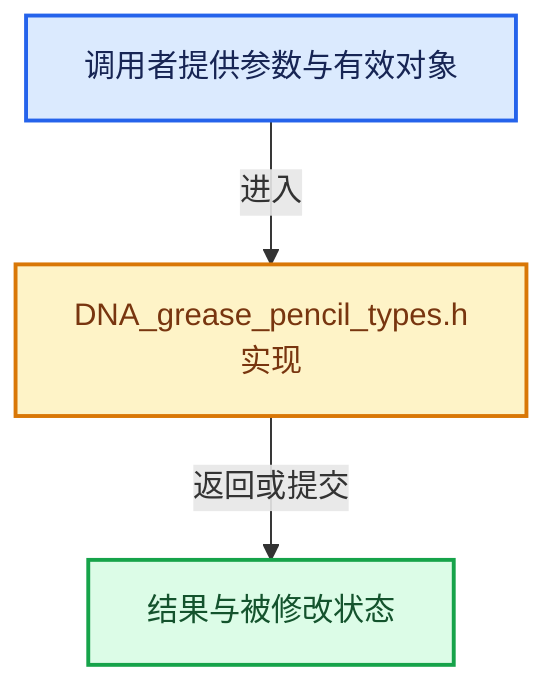

# 实现依赖专题：source/blender/makesdna/DNA_grease_pencil_types.h

[实现依赖导航](../../README.md) · [符号索引](../../../00-课程指南/02-源码与提交索引/符号依赖与实现索引.md)

本专题从正文实际调用进入，集中保存共享实现。函数有稳定锚点，可从调用处直接跳到对应完整函数；递归与互相调用通过回链组织。

## 本文件的实现关系





## 相关类型布局与成员入口

<a id="t-dec791859761"></a>

### `blender::GreasePencilLayerMaskFlag`

原始声明：[source/blender/makesdna/DNA_grease_pencil_types.h](../../../../../../../source/blender/makesdna/DNA_grease_pencil_types.h) · L97—L100。

以下保留类的数据声明与编译条件，成员函数实现通过后面的精确链接阅读。

<!-- annotated:f8ca43471d0281 -->

```cpp
enum GreasePencilLayerMaskFlag : uint16_t {
  GP_LAYER_MASK_HIDE = (1 << 0),
  GP_LAYER_MASK_INVERT = (1 << 1),
};
```

<details>
<summary>核对原始源码：source/blender/makesdna/DNA_grease_pencil_types.h · L97—L100</summary>

<!-- original:f8ca43471d0281:source/blender/makesdna/DNA_grease_pencil_types.h:97:100 -->

```cpp
enum GreasePencilLayerMaskFlag : uint16_t {
  GP_LAYER_MASK_HIDE = (1 << 0),
  GP_LAYER_MASK_INVERT = (1 << 1),
};
```

</details>


<a id="t-06d217a534ed"></a>

### `blender::GreasePencilLayerBlendMode`

原始声明：[source/blender/makesdna/DNA_grease_pencil_types.h](../../../../../../../source/blender/makesdna/DNA_grease_pencil_types.h) · L106—L113。

以下保留类的数据声明与编译条件，成员函数实现通过后面的精确链接阅读。

<!-- annotated:a4bb925b7ab895 -->

```cpp
enum GreasePencilLayerBlendMode : int8_t {
  GP_LAYER_BLEND_NONE = 0,
  GP_LAYER_BLEND_HARDLIGHT = 1,
  GP_LAYER_BLEND_ADD = 2,
  GP_LAYER_BLEND_SUBTRACT = 3,
  GP_LAYER_BLEND_MULTIPLY = 4,
  GP_LAYER_BLEND_DIVIDE = 5,
};
```

<details>
<summary>核对原始源码：source/blender/makesdna/DNA_grease_pencil_types.h · L106—L113</summary>

<!-- original:a4bb925b7ab895:source/blender/makesdna/DNA_grease_pencil_types.h:106:113 -->

```cpp
enum GreasePencilLayerBlendMode : int8_t {
  GP_LAYER_BLEND_NONE = 0,
  GP_LAYER_BLEND_HARDLIGHT = 1,
  GP_LAYER_BLEND_ADD = 2,
  GP_LAYER_BLEND_SUBTRACT = 3,
  GP_LAYER_BLEND_MULTIPLY = 4,
  GP_LAYER_BLEND_DIVIDE = 5,
};
```

</details>


<a id="t-e968f9cd7131"></a>

### `blender::GreasePencilOnionSkinningMode`

原始声明：[source/blender/makesdna/DNA_grease_pencil_types.h](../../../../../../../source/blender/makesdna/DNA_grease_pencil_types.h) · L167—L171。

以下保留类的数据声明与编译条件，成员函数实现通过后面的精确链接阅读。

<!-- annotated:7c8e73d3fbe1fc -->

```cpp
enum GreasePencilOnionSkinningMode : int8_t {
  GP_ONION_SKINNING_MODE_ABSOLUTE = 0,
  GP_ONION_SKINNING_MODE_RELATIVE = 1,
  GP_ONION_SKINNING_MODE_SELECTED = 2,
};
```

<details>
<summary>核对原始源码：source/blender/makesdna/DNA_grease_pencil_types.h · L167—L171</summary>

<!-- original:7c8e73d3fbe1fc:source/blender/makesdna/DNA_grease_pencil_types.h:167:171 -->

```cpp
enum GreasePencilOnionSkinningMode : int8_t {
  GP_ONION_SKINNING_MODE_ABSOLUTE = 0,
  GP_ONION_SKINNING_MODE_RELATIVE = 1,
  GP_ONION_SKINNING_MODE_SELECTED = 2,
};
```

</details>


<a id="t-edda94d8540f"></a>

### `blender::GreasePencilOnionSkinningFilter`

原始声明：[source/blender/makesdna/DNA_grease_pencil_types.h](../../../../../../../source/blender/makesdna/DNA_grease_pencil_types.h) · L188—L194。

以下保留类的数据声明与编译条件，成员函数实现通过后面的精确链接阅读。

<!-- annotated:57317c1a25faad -->

```cpp
enum GreasePencilOnionSkinningFilter : uint8_t {
  GP_ONION_SKINNING_FILTER_KEYTYPE_KEYFRAME = (1 << 0),
  GP_ONION_SKINNING_FILTER_KEYTYPE_EXTREME = (1 << 1),
  GP_ONION_SKINNING_FILTER_KEYTYPE_BREAKDOWN = (1 << 2),
  GP_ONION_SKINNING_FILTER_KEYTYPE_JITTER = (1 << 3),
  GP_ONION_SKINNING_FILTER_KEYTYPE_MOVEHOLD = (1 << 4),
};
```

<details>
<summary>核对原始源码：source/blender/makesdna/DNA_grease_pencil_types.h · L188—L194</summary>

<!-- original:57317c1a25faad:source/blender/makesdna/DNA_grease_pencil_types.h:188:194 -->

```cpp
enum GreasePencilOnionSkinningFilter : uint8_t {
  GP_ONION_SKINNING_FILTER_KEYTYPE_KEYFRAME = (1 << 0),
  GP_ONION_SKINNING_FILTER_KEYTYPE_EXTREME = (1 << 1),
  GP_ONION_SKINNING_FILTER_KEYTYPE_BREAKDOWN = (1 << 2),
  GP_ONION_SKINNING_FILTER_KEYTYPE_JITTER = (1 << 3),
  GP_ONION_SKINNING_FILTER_KEYTYPE_MOVEHOLD = (1 << 4),
};
```

</details>


## 完整成员与函数实现
