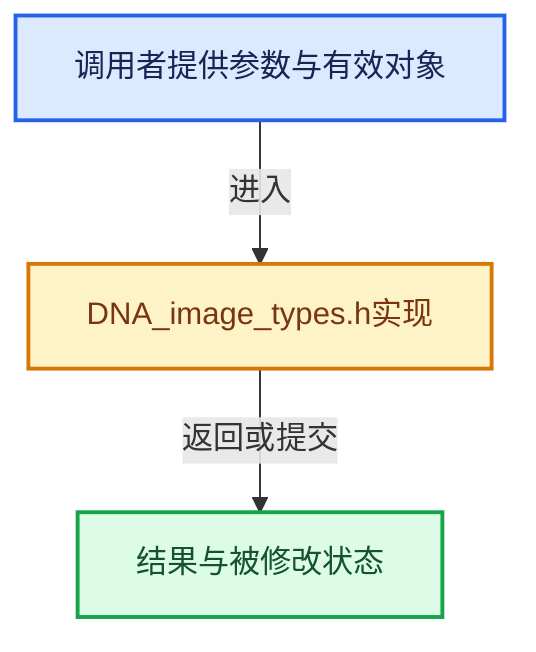

# 实现依赖专题：source/blender/makesdna/DNA_image_types.h

[实现依赖导航](../../README.md) · [符号索引](../../../00-课程指南/02-源码与提交索引/符号依赖与实现索引.md)

本专题从正文实际调用进入，集中保存共享实现。函数有稳定锚点，可从调用处直接跳到对应完整函数；递归与互相调用通过回链组织。

## 本文件的实现关系





## 相关类型布局与成员入口

<a id="t-13c34fbdad51"></a>

### `blender::RenderResult`

原始声明：[source/blender/makesdna/DNA_image_types.h](../../../../../../../source/blender/makesdna/DNA_image_types.h) · L27—L27。

以下保留类的数据声明与编译条件，成员函数实现通过后面的精确链接阅读。

<!-- annotated:8441db8d240b3d -->

```cpp
struct RenderResult;
```

<details>
<summary>核对原始源码：source/blender/makesdna/DNA_image_types.h · L27—L27</summary>

<!-- original:8441db8d240b3d:source/blender/makesdna/DNA_image_types.h:27:27 -->

```cpp
struct RenderResult;
```

</details>


<a id="t-474c44ce5fac"></a>

### `blender::eImageUser_Flag`

原始声明：[source/blender/makesdna/DNA_image_types.h](../../../../../../../source/blender/makesdna/DNA_image_types.h) · L31—L39。

以下保留类的数据声明与编译条件，成员函数实现通过后面的精确链接阅读。

<!-- annotated:e4eb2e7b96181f -->

```cpp
enum eImageUser_Flag : short {
  IMA_ANIM_ALWAYS = 1 << 0,
  IMA_SHOW_SEQUENCER_SCENE = 1 << 1,
  // IMA_UNUSED_2 = 1 << 2,
  IMA_NEED_FRAME_RECALC = 1 << 3,
  IMA_SHOW_STEREO = 1 << 4,
  // IMA_UNUSED_5 = 1 << 5,
  IMA_USER_FRAME_IN_RANGE = (1 << 10),
};
```

<details>
<summary>核对原始源码：source/blender/makesdna/DNA_image_types.h · L31—L39</summary>

<!-- original:e4eb2e7b96181f:source/blender/makesdna/DNA_image_types.h:31:39 -->

```cpp
enum eImageUser_Flag : short {
  IMA_ANIM_ALWAYS = 1 << 0,
  IMA_SHOW_SEQUENCER_SCENE = 1 << 1,
  // IMA_UNUSED_2 = 1 << 2,
  IMA_NEED_FRAME_RECALC = 1 << 3,
  IMA_SHOW_STEREO = 1 << 4,
  // IMA_UNUSED_5 = 1 << 5,
  IMA_USER_FRAME_IN_RANGE = (1 << 10),
};
```

</details>


<a id="t-936d3ff32bb4"></a>

### `blender::eImage_Flag`

原始声明：[source/blender/makesdna/DNA_image_types.h](../../../../../../../source/blender/makesdna/DNA_image_types.h) · L43—L65。

以下保留类的数据声明与编译条件，成员函数实现通过后面的精确链接阅读。

<!-- annotated:f59aa9d7b7143a -->

```cpp
enum eImage_Flag : int {
  IMA_HIGH_BITDEPTH = (1 << 0),
  IMA_FLAG_UNUSED_1 = (1 << 1), /* cleared */
#ifdef DNA_DEPRECATED_ALLOW
  IMA_DO_PREMUL = (1 << 2),
#endif
  IMA_FLAG_UNUSED_4 = (1 << 4), /* cleared */
  IMA_NOCOLLECT = (1 << 5),
  IMA_FLAG_UNUSED_6 = (1 << 6), /* cleared */
  IMA_OLD_PREMUL = (1 << 7),
  IMA_FLAG_UNUSED_8 = (1 << 8), /* cleared */
  IMA_USED_FOR_RENDER = (1 << 9),
  /** For image user, but these flags are mixed. */
  // IMA_USER_FRAME_IN_RANGE = (1 << 10),
  IMA_VIEW_AS_RENDER = (1 << 11),
  IMA_FLAG_UNUSED_12 = (1 << 12), /* cleared */
  IMA_DEINTERLACE = (1 << 13),
  IMA_USE_VIEWS = (1 << 14),
  IMA_FLAG_UNUSED_15 = (1 << 15), /* cleared */
  IMA_FLAG_UNUSED_16 = (1 << 16), /* cleared */
  /** Indicates that the image has autosave information */
  IMA_AUTOSAVE_TEMPPACK = (1 << 17),
};
```

<details>
<summary>核对原始源码：source/blender/makesdna/DNA_image_types.h · L43—L65</summary>

<!-- original:f59aa9d7b7143a:source/blender/makesdna/DNA_image_types.h:43:65 -->

```cpp
enum eImage_Flag : int {
  IMA_HIGH_BITDEPTH = (1 << 0),
  IMA_FLAG_UNUSED_1 = (1 << 1), /* cleared */
#ifdef DNA_DEPRECATED_ALLOW
  IMA_DO_PREMUL = (1 << 2),
#endif
  IMA_FLAG_UNUSED_4 = (1 << 4), /* cleared */
  IMA_NOCOLLECT = (1 << 5),
  IMA_FLAG_UNUSED_6 = (1 << 6), /* cleared */
  IMA_OLD_PREMUL = (1 << 7),
  IMA_FLAG_UNUSED_8 = (1 << 8), /* cleared */
  IMA_USED_FOR_RENDER = (1 << 9),
  /** For image user, but these flags are mixed. */
  // IMA_USER_FRAME_IN_RANGE = (1 << 10),
  IMA_VIEW_AS_RENDER = (1 << 11),
  IMA_FLAG_UNUSED_12 = (1 << 12), /* cleared */
  IMA_DEINTERLACE = (1 << 13),
  IMA_USE_VIEWS = (1 << 14),
  IMA_FLAG_UNUSED_15 = (1 << 15), /* cleared */
  IMA_FLAG_UNUSED_16 = (1 << 16), /* cleared */
  /** Indicates that the image has autosave information */
  IMA_AUTOSAVE_TEMPPACK = (1 << 17),
};
```

</details>


<a id="t-ab3b80a5a716"></a>

### `blender::eImageGenType`

原始声明：[source/blender/makesdna/DNA_image_types.h](../../../../../../../source/blender/makesdna/DNA_image_types.h) · L91—L95。

以下保留类的数据声明与编译条件，成员函数实现通过后面的精确链接阅读。

<!-- annotated:539c5c34815d04 -->

```cpp
enum eImageGenType : char {
  IMA_GENTYPE_BLANK = 0,
  IMA_GENTYPE_GRID = 1,
  IMA_GENTYPE_GRID_COLOR = 2,
};
```

<details>
<summary>核对原始源码：source/blender/makesdna/DNA_image_types.h · L91—L95</summary>

<!-- original:539c5c34815d04:source/blender/makesdna/DNA_image_types.h:91:95 -->

```cpp
enum eImageGenType : char {
  IMA_GENTYPE_BLANK = 0,
  IMA_GENTYPE_GRID = 1,
  IMA_GENTYPE_GRID_COLOR = 2,
};
```

</details>


<a id="t-4842b95ab8dc"></a>

### `blender::eImageAlphaMode`

原始声明：[source/blender/makesdna/DNA_image_types.h](../../../../../../../source/blender/makesdna/DNA_image_types.h) · L108—L113。

以下保留类的数据声明与编译条件，成员函数实现通过后面的精确链接阅读。

<!-- annotated:9b5feaad7752c2 -->

```cpp
enum eImageAlphaMode : char {
  IMA_ALPHA_STRAIGHT = 0,
  IMA_ALPHA_PREMUL = 1,
  IMA_ALPHA_CHANNEL_PACKED = 2,
  IMA_ALPHA_IGNORE = 3,
};
```

<details>
<summary>核对原始源码：source/blender/makesdna/DNA_image_types.h · L108—L113</summary>

<!-- original:9b5feaad7752c2:source/blender/makesdna/DNA_image_types.h:108:113 -->

```cpp
enum eImageAlphaMode : char {
  IMA_ALPHA_STRAIGHT = 0,
  IMA_ALPHA_PREMUL = 1,
  IMA_ALPHA_CHANNEL_PACKED = 2,
  IMA_ALPHA_IGNORE = 3,
};
```

</details>


<a id="t-267c0c358f50"></a>

### `blender::RenderSlot::RenderResult`

原始声明：[source/blender/makesdna/DNA_image_types.h](../../../../../../../source/blender/makesdna/DNA_image_types.h) · L168—L168。

以下保留类的数据声明与编译条件，成员函数实现通过后面的精确链接阅读。

<!-- annotated:9b5d84b0538e19 -->

```cpp
  struct RenderResult *render = nullptr;
```

<details>
<summary>核对原始源码：source/blender/makesdna/DNA_image_types.h · L168—L168</summary>

<!-- original:9b5d84b0538e19:source/blender/makesdna/DNA_image_types.h:168:168 -->

```cpp
  struct RenderResult *render = nullptr;
```

</details>


<a id="t-bddf26b23dfb"></a>

### `blender::Image::RenderResult`

原始声明：[source/blender/makesdna/DNA_image_types.h](../../../../../../../source/blender/makesdna/DNA_image_types.h) · L209—L209。

以下保留类的数据声明与编译条件，成员函数实现通过后面的精确链接阅读。

<!-- annotated:7376c9aa86009b -->

```cpp
  struct RenderResult *rr = nullptr;
```

<details>
<summary>核对原始源码：source/blender/makesdna/DNA_image_types.h · L209—L209</summary>

<!-- original:7376c9aa86009b:source/blender/makesdna/DNA_image_types.h:209:209 -->

```cpp
  struct RenderResult *rr = nullptr;
```

</details>


## 完整成员与函数实现
