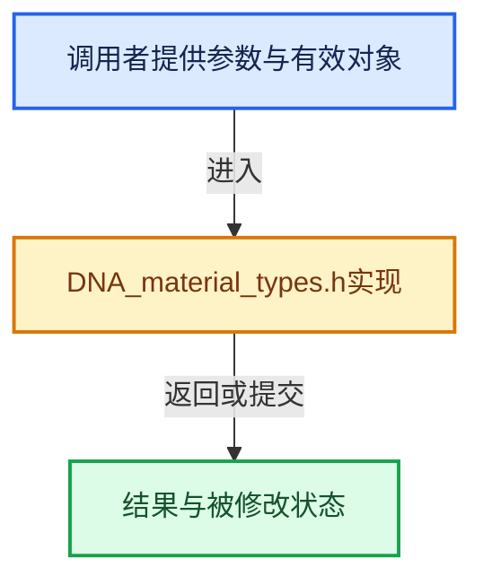

# 实现依赖专题：source/blender/makesdna/DNA_material_types.h

[实现依赖导航](../../README.md) · [符号索引](../../../00-课程指南/02-源码与提交索引/符号依赖与实现索引.md)

本专题从正文实际调用进入，集中保存共享实现。函数有稳定锚点，可从调用处直接跳到对应完整函数；递归与互相调用通过回链组织。

## 本文件的实现关系





## 相关类型布局与成员入口

<a id="t-c718f2eec4ff"></a>

### `blender::eMaterial_BlendMethod`

原始声明：[source/blender/makesdna/DNA_material_types.h](../../../../../../../source/blender/makesdna/DNA_material_types.h) · L183—L190。

以下保留类的数据声明与编译条件，成员函数实现通过后面的精确链接阅读。

<!-- annotated:81be6a63e3a49e -->

```cpp
enum eMaterial_BlendMethod : char {
  MA_BM_SOLID = 0,
  // MA_BM_ADD = 1, /* deprecated */
  // MA_BM_MULTIPLY = 2,  /* deprecated */
  MA_BM_CLIP = 3,
  MA_BM_HASHED = 4,
  MA_BM_BLEND = 5,
};
```

<details>
<summary>核对原始源码：source/blender/makesdna/DNA_material_types.h · L183—L190</summary>

<!-- original:81be6a63e3a49e:source/blender/makesdna/DNA_material_types.h:183:190 -->

```cpp
enum eMaterial_BlendMethod : char {
  MA_BM_SOLID = 0,
  // MA_BM_ADD = 1, /* deprecated */
  // MA_BM_MULTIPLY = 2,  /* deprecated */
  MA_BM_CLIP = 3,
  MA_BM_HASHED = 4,
  MA_BM_BLEND = 5,
};
```

</details>


<a id="t-a1fd8ec5c0ec"></a>

### `blender::eMaterial_BlendFlag`

原始声明：[source/blender/makesdna/DNA_material_types.h](../../../../../../../source/blender/makesdna/DNA_material_types.h) · L193—L202。

以下保留类的数据声明与编译条件，成员函数实现通过后面的精确链接阅读。

<!-- annotated:38f801c35e8a7c -->

```cpp
enum eMaterial_BlendFlag : char {
  MA_BL_HIDE_BACKFACE = (1 << 0),
  MA_BL_SS_REFRACTION = (1 << 1),
  MA_BL_CULL_BACKFACE = (1 << 2),
  MA_BL_TRANSLUCENCY = (1 << 3),
  MA_BL_LIGHTPROBE_VOLUME_DOUBLE_SIDED = (1 << 4),
  MA_BL_CULL_BACKFACE_SHADOW = (1 << 5),
  MA_BL_TRANSPARENT_SHADOW = (1 << 6),
  MA_BL_THICKNESS_FROM_SHADOW = static_cast<char>(1 << 7),
};
```

<details>
<summary>核对原始源码：source/blender/makesdna/DNA_material_types.h · L193—L202</summary>

<!-- original:38f801c35e8a7c:source/blender/makesdna/DNA_material_types.h:193:202 -->

```cpp
enum eMaterial_BlendFlag : char {
  MA_BL_HIDE_BACKFACE = (1 << 0),
  MA_BL_SS_REFRACTION = (1 << 1),
  MA_BL_CULL_BACKFACE = (1 << 2),
  MA_BL_TRANSLUCENCY = (1 << 3),
  MA_BL_LIGHTPROBE_VOLUME_DOUBLE_SIDED = (1 << 4),
  MA_BL_CULL_BACKFACE_SHADOW = (1 << 5),
  MA_BL_TRANSPARENT_SHADOW = (1 << 6),
  MA_BL_THICKNESS_FROM_SHADOW = static_cast<char>(1 << 7),
};
```

</details>


<a id="t-4c47b6d7f7a2"></a>

### `blender::eMaterial_DisplacementMethod`

原始声明：[source/blender/makesdna/DNA_material_types.h](../../../../../../../source/blender/makesdna/DNA_material_types.h) · L214—L218。

以下保留类的数据声明与编译条件，成员函数实现通过后面的精确链接阅读。

<!-- annotated:ff7da05bafc6f8 -->

```cpp
enum eMaterial_DisplacementMethod : char {
  MA_DISPLACEMENT_BUMP = 0,
  MA_DISPLACEMENT_DISPLACE = 1,
  MA_DISPLACEMENT_BOTH = 2,
};
```

<details>
<summary>核对原始源码：source/blender/makesdna/DNA_material_types.h · L214—L218</summary>

<!-- original:ff7da05bafc6f8:source/blender/makesdna/DNA_material_types.h:214:218 -->

```cpp
enum eMaterial_DisplacementMethod : char {
  MA_DISPLACEMENT_BUMP = 0,
  MA_DISPLACEMENT_DISPLACE = 1,
  MA_DISPLACEMENT_BOTH = 2,
};
```

</details>


## 完整成员与函数实现
