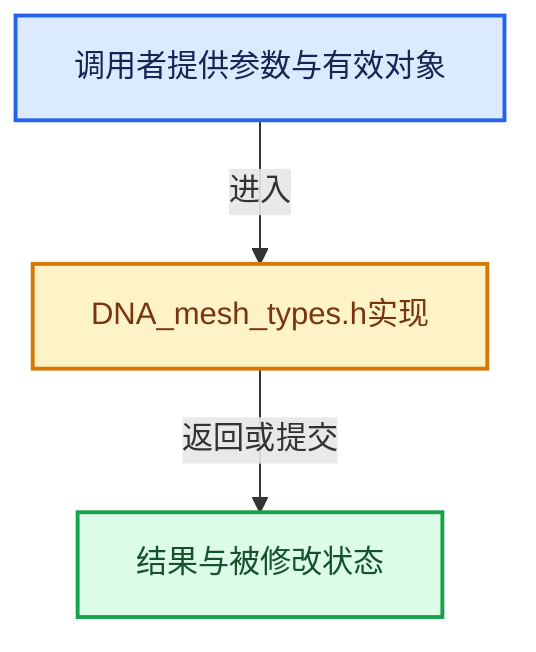

# 实现依赖专题：source/blender/makesdna/DNA_mesh_types.h

[实现依赖导航](../../README.md) · [符号索引](../../../00-课程指南/02-源码与提交索引/符号依赖与实现索引.md)

本专题从正文实际调用进入，集中保存共享实现。函数有稳定锚点，可从调用处直接跳到对应完整函数；递归与互相调用通过回链组织。

## 本文件的实现关系





## 相关类型布局与成员入口

<a id="t-3124dc634817"></a>

### `blender::Bounds`

原始声明：[source/blender/makesdna/DNA_mesh_types.h](../../../../../../../source/blender/makesdna/DNA_mesh_types.h) · L27—L27。

以下保留类的数据声明与编译条件，成员函数实现通过后面的精确链接阅读。

<!-- annotated:5efb6ca31924a5 -->

```cpp
template<typename T> struct Bounds;
```

<details>
<summary>核对原始源码：source/blender/makesdna/DNA_mesh_types.h · L27—L27</summary>

<!-- original:5efb6ca31924a5:source/blender/makesdna/DNA_mesh_types.h:27:27 -->

```cpp
template<typename T> struct Bounds;
```

</details>


<a id="t-184fd48fb638"></a>

### `blender::Span`

原始声明：[source/blender/makesdna/DNA_mesh_types.h](../../../../../../../source/blender/makesdna/DNA_mesh_types.h) · L35—L35。

以下保留类的数据声明与编译条件，成员函数实现通过后面的精确链接阅读。

<!-- annotated:6e0151185577e4 -->

```cpp
template<typename T> class Span;
```

<details>
<summary>核对原始源码：source/blender/makesdna/DNA_mesh_types.h · L35—L35</summary>

<!-- original:6e0151185577e4:source/blender/makesdna/DNA_mesh_types.h:35:35 -->

```cpp
template<typename T> class Span;
```

</details>


<a id="t-c07b09941a03"></a>

### `blender::Key`

原始声明：[source/blender/makesdna/DNA_mesh_types.h](../../../../../../../source/blender/makesdna/DNA_mesh_types.h) · L50—L50。

以下保留类的数据声明与编译条件，成员函数实现通过后面的精确链接阅读。

<!-- annotated:244a1cb48abce0 -->

```cpp
struct Key;
```

<details>
<summary>核对原始源码：source/blender/makesdna/DNA_mesh_types.h · L50—L50</summary>

<!-- original:244a1cb48abce0:source/blender/makesdna/DNA_mesh_types.h:50:50 -->

```cpp
struct Key;
```

</details>


<a id="t-317087543416"></a>

### `blender::eMesh_TexSpaceFlag`

原始声明：[source/blender/makesdna/DNA_mesh_types.h](../../../../../../../source/blender/makesdna/DNA_mesh_types.h) · L57—L60。

以下保留类的数据声明与编译条件，成员函数实现通过后面的精确链接阅读。

<!-- annotated:e3a1bad594384b -->

```cpp
enum eMesh_TexSpaceFlag : char {
  ME_TEXSPACE_FLAG_AUTO = 1 << 0,
  ME_TEXSPACE_FLAG_AUTO_EVALUATED = 1 << 1,
};
```

<details>
<summary>核对原始源码：source/blender/makesdna/DNA_mesh_types.h · L57—L60</summary>

<!-- original:e3a1bad594384b:source/blender/makesdna/DNA_mesh_types.h:57:60 -->

```cpp
enum eMesh_TexSpaceFlag : char {
  ME_TEXSPACE_FLAG_AUTO = 1 << 0,
  ME_TEXSPACE_FLAG_AUTO_EVALUATED = 1 << 1,
};
```

</details>


<a id="t-3596c578ed12"></a>

### `blender::eMesh_Flag`

原始声明：[source/blender/makesdna/DNA_mesh_types.h](../../../../../../../source/blender/makesdna/DNA_mesh_types.h) · L87—L113。

以下保留类的数据声明与编译条件，成员函数实现通过后面的精确链接阅读。

<!-- annotated:ba41b5a0dc95dc -->

```cpp
enum eMesh_Flag : uint16_t {
  ME_FLAG_UNUSED_0 = 1 << 0,     /* cleared */
  ME_FLAG_UNUSED_1 = 1 << 1,     /* cleared */
  ME_FLAG_DEPRECATED_2 = 1 << 2, /* deprecated */
  /**
   * The UV selection is marked as synchronized.
   * See #BMesh::uv_select_sync_valid for details.
   */
  ME_FLAG_UV_SELECT_SYNC_VALID = 1 << 3,
  ME_FLAG_UNUSED_4 = 1 << 4,     /* cleared */
  ME_AUTOSMOOTH_LEGACY = 1 << 5, /* deprecated */
  ME_FLAG_UNUSED_6 = 1 << 6,     /* cleared */
  ME_FLAG_UNUSED_7 = 1 << 7,     /* cleared */
  ME_REMESH_REPROJECT_ATTRIBUTES = 1 << 8,
  ME_DS_EXPAND = 1 << 9,
  ME_SCULPT_DYNAMIC_TOPOLOGY = 1 << 10,
  /**
   * Used to tag that the mesh has no overlapping topology (see #Mesh::no_overlapping_topology()).
   * Theoretically this is runtime data that could always be recalculated, but since the intent is
   * to improve performance and it only takes one bit, it is stored in the mesh instead.
   */
  ME_NO_OVERLAPPING_TOPOLOGY = 1 << 11,
  ME_FLAG_UNUSED_8 = 1 << 12, /* deprecated */
  ME_REMESH_FIX_POLES = 1 << 13,
  ME_REMESH_REPROJECT_VOLUME = 1 << 14,
  ME_FLAG_UNUSED_9 = 1 << 15, /* deprecated */
};
```

<details>
<summary>核对原始源码：source/blender/makesdna/DNA_mesh_types.h · L87—L113</summary>

<!-- original:ba41b5a0dc95dc:source/blender/makesdna/DNA_mesh_types.h:87:113 -->

```cpp
enum eMesh_Flag : uint16_t {
  ME_FLAG_UNUSED_0 = 1 << 0,     /* cleared */
  ME_FLAG_UNUSED_1 = 1 << 1,     /* cleared */
  ME_FLAG_DEPRECATED_2 = 1 << 2, /* deprecated */
  /**
   * The UV selection is marked as synchronized.
   * See #BMesh::uv_select_sync_valid for details.
   */
  ME_FLAG_UV_SELECT_SYNC_VALID = 1 << 3,
  ME_FLAG_UNUSED_4 = 1 << 4,     /* cleared */
  ME_AUTOSMOOTH_LEGACY = 1 << 5, /* deprecated */
  ME_FLAG_UNUSED_6 = 1 << 6,     /* cleared */
  ME_FLAG_UNUSED_7 = 1 << 7,     /* cleared */
  ME_REMESH_REPROJECT_ATTRIBUTES = 1 << 8,
  ME_DS_EXPAND = 1 << 9,
  ME_SCULPT_DYNAMIC_TOPOLOGY = 1 << 10,
  /**
   * Used to tag that the mesh has no overlapping topology (see #Mesh::no_overlapping_topology()).
   * Theoretically this is runtime data that could always be recalculated, but since the intent is
   * to improve performance and it only takes one bit, it is stored in the mesh instead.
   */
  ME_NO_OVERLAPPING_TOPOLOGY = 1 << 11,
  ME_FLAG_UNUSED_8 = 1 << 12, /* deprecated */
  ME_REMESH_FIX_POLES = 1 << 13,
  ME_REMESH_REPROJECT_VOLUME = 1 << 14,
  ME_FLAG_UNUSED_9 = 1 << 15, /* deprecated */
};
```

</details>


<a id="t-f9312e28e819"></a>

### `blender::eMeshSymmetryType`

原始声明：[source/blender/makesdna/DNA_mesh_types.h](../../../../../../../source/blender/makesdna/DNA_mesh_types.h) · L140—L144。

以下保留类的数据声明与编译条件，成员函数实现通过后面的精确链接阅读。

<!-- annotated:2c42c514bcbd8d -->

```cpp
enum eMeshSymmetryType : char {
  ME_SYMMETRY_X = 1 << 0,
  ME_SYMMETRY_Y = 1 << 1,
  ME_SYMMETRY_Z = 1 << 2,
};
```

<details>
<summary>核对原始源码：source/blender/makesdna/DNA_mesh_types.h · L140—L144</summary>

<!-- original:2c42c514bcbd8d:source/blender/makesdna/DNA_mesh_types.h:140:144 -->

```cpp
enum eMeshSymmetryType : char {
  ME_SYMMETRY_X = 1 << 0,
  ME_SYMMETRY_Y = 1 << 1,
  ME_SYMMETRY_Z = 1 << 2,
};
```

</details>


<a id="t-5259e892f15f"></a>

### `blender::Mesh::Key`

原始声明：[source/blender/makesdna/DNA_mesh_types.h](../../../../../../../source/blender/makesdna/DNA_mesh_types.h) · L158—L158。

以下保留类的数据声明与编译条件，成员函数实现通过后面的精确链接阅读。

<!-- annotated:d0cb3d68d01b55 -->

```cpp
  struct Key *key = nullptr;
```

<details>
<summary>核对原始源码：source/blender/makesdna/DNA_mesh_types.h · L158—L158</summary>

<!-- original:d0cb3d68d01b55:source/blender/makesdna/DNA_mesh_types.h:158:158 -->

```cpp
  struct Key *key = nullptr;
```

</details>


<a id="m-f3b4f303ccb7"></a>

## 宏 `ME_USING_MIRROR_X_VERTEX_GROUPS`

<!-- annotated:134969eaa0a3a6 -->

```cpp
#define ME_USING_MIRROR_X_VERTEX_GROUPS(_me) \
  (((_me)->editflag & ME_EDIT_MIRROR_VERTEX_GROUPS) && ((_me)->symmetry & ME_SYMMETRY_X))

```

<details>
<summary>核对原始源码：source/blender/makesdna/DNA_mesh_types.h · L76—L78</summary>

<!-- original:134969eaa0a3a6:source/blender/makesdna/DNA_mesh_types.h:76:78 -->

```cpp
#define ME_USING_MIRROR_X_VERTEX_GROUPS(_me) \
  (((_me)->editflag & ME_EDIT_MIRROR_VERTEX_GROUPS) && ((_me)->symmetry & ME_SYMMETRY_X))

```

</details>

宏在预处理阶段展开，参数替换、重复求值和条件编译应直接从该定义检查。与普通函数不同，宏不会自动提供参数类型检查；构建配置选择哪个定义需结合外围条件。

## 完整成员与函数实现
