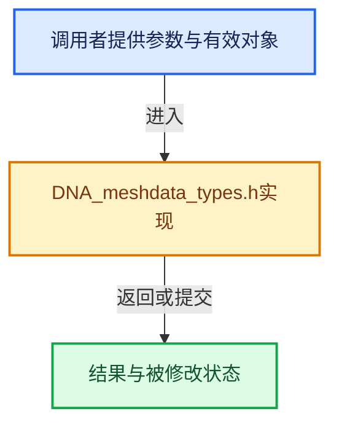

# 实现依赖专题：source/blender/makesdna/DNA_meshdata_types.h

[实现依赖导航](../../README.md) · [符号索引](../../../00-课程指南/02-源码与提交索引/符号依赖与实现索引.md)

本专题从正文实际调用进入，集中保存共享实现。函数有稳定锚点，可从调用处直接跳到对应完整函数；递归与互相调用通过回链组织。

## 本文件的实现关系





## 相关类型布局与成员入口

<a id="t-b3603d4ae6aa"></a>

### `blender::eMSelect_Type`

原始声明：[source/blender/makesdna/DNA_meshdata_types.h](../../../../../../../source/blender/makesdna/DNA_meshdata_types.h) · L21—L25。

以下保留类的数据声明与编译条件，成员函数实现通过后面的精确链接阅读。

<!-- annotated:f9f59a52503860 -->

```cpp
enum eMSelect_Type : int {
  ME_VSEL = 0,
  ME_ESEL = 1,
  ME_FSEL = 2,
};
```

<details>
<summary>核对原始源码：source/blender/makesdna/DNA_meshdata_types.h · L21—L25</summary>

<!-- original:f9f59a52503860:source/blender/makesdna/DNA_meshdata_types.h:21:25 -->

```cpp
enum eMSelect_Type : int {
  ME_VSEL = 0,
  ME_ESEL = 1,
  ME_FSEL = 2,
};
```

</details>


<a id="t-a07cfe7ed9fd"></a>

### `blender::eMVertSkinFlag`

原始声明：[source/blender/makesdna/DNA_meshdata_types.h](../../../../../../../source/blender/makesdna/DNA_meshdata_types.h) · L29—L41。

以下保留类的数据声明与编译条件，成员函数实现通过后面的精确链接阅读。

<!-- annotated:af782f1829f710 -->

```cpp
enum eMVertSkinFlag : int {
  /**
   * Marks a vertex as the edge-graph root, used for calculating rotations for all connected
   * edges (recursively). Also used to choose a root when generating an armature.
   */
  MVERT_SKIN_ROOT = 1,

  /**
   * Marks a branch vertex (vertex with more than two connected edges), so that its neighbors
   * are directly hulled together, rather than the default of generating intermediate frames.
   */
  MVERT_SKIN_LOOSE = 2,
};
```

<details>
<summary>核对原始源码：source/blender/makesdna/DNA_meshdata_types.h · L29—L41</summary>

<!-- original:af782f1829f710:source/blender/makesdna/DNA_meshdata_types.h:29:41 -->

```cpp
enum eMVertSkinFlag : int {
  /**
   * Marks a vertex as the edge-graph root, used for calculating rotations for all connected
   * edges (recursively). Also used to choose a root when generating an armature.
   */
  MVERT_SKIN_ROOT = 1,

  /**
   * Marks a branch vertex (vertex with more than two connected edges), so that its neighbors
   * are directly hulled together, rather than the default of generating intermediate frames.
   */
  MVERT_SKIN_LOOSE = 2,
};
```

</details>


<a id="t-39b233294baa"></a>

### `blender::eMFace_EdgeCode`

原始声明：[source/blender/makesdna/DNA_meshdata_types.h](../../../../../../../source/blender/makesdna/DNA_meshdata_types.h) · L47—L53。

以下保留类的数据声明与编译条件，成员函数实现通过后面的精确链接阅读。

<!-- annotated:72a8f1ff45d83a -->

```cpp
enum eMFace_EdgeCode : char {
  ME_V1V2 = (1 << 0),
  ME_V2V3 = (1 << 1),
  ME_V3V1 = (1 << 2),
  ME_V3V4 = ME_V3V1,
  ME_V4V1 = (1 << 3),
};
```

<details>
<summary>核对原始源码：source/blender/makesdna/DNA_meshdata_types.h · L47—L53</summary>

<!-- original:72a8f1ff45d83a:source/blender/makesdna/DNA_meshdata_types.h:47:53 -->

```cpp
enum eMFace_EdgeCode : char {
  ME_V1V2 = (1 << 0),
  ME_V2V3 = (1 << 1),
  ME_V3V1 = (1 << 2),
  ME_V3V4 = ME_V3V1,
  ME_V4V1 = (1 << 3),
};
```

</details>


## 完整成员与函数实现
