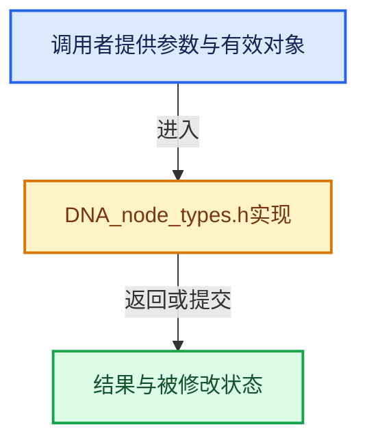

# 实现依赖专题：source/blender/makesdna/DNA_node_types.h

[实现依赖导航](../../README.md) · [符号索引](../../../00-课程指南/02-源码与提交索引/符号依赖与实现索引.md)

本专题从正文实际调用进入，集中保存共享实现。函数有稳定锚点，可从调用处直接跳到对应完整函数；递归与互相调用通过回链组织。

## 本文件的实现关系





## 相关类型布局与成员入口

<a id="t-49ec6fbb9b69"></a>

### `blender::Span`

原始声明：[source/blender/makesdna/DNA_node_types.h](../../../../../../../source/blender/makesdna/DNA_node_types.h) · L28—L28。

以下保留类的数据声明与编译条件，成员函数实现通过后面的精确链接阅读。

<!-- annotated:ce759763ed686f -->

```cpp
template<typename T> class Span;
```

<details>
<summary>核对原始源码：source/blender/makesdna/DNA_node_types.h · L28—L28</summary>

<!-- original:ce759763ed686f:source/blender/makesdna/DNA_node_types.h:28:28 -->

```cpp
template<typename T> class Span;
```

</details>


<a id="t-0448cc889d39"></a>

### `blender::IndexRange`

原始声明：[source/blender/makesdna/DNA_node_types.h](../../../../../../../source/blender/makesdna/DNA_node_types.h) · L30—L30。

以下保留类的数据声明与编译条件，成员函数实现通过后面的精确链接阅读。

<!-- annotated:b0b86c8b9e1981 -->

```cpp
class IndexRange;
```

<details>
<summary>核对原始源码：source/blender/makesdna/DNA_node_types.h · L30—L30</summary>

<!-- original:b0b86c8b9e1981:source/blender/makesdna/DNA_node_types.h:30:30 -->

```cpp
class IndexRange;
```

</details>


<a id="t-fdea02f95b31"></a>

### `blender::eNodeSocketDatatype`

原始声明：[source/blender/makesdna/DNA_node_types.h](../../../../../../../source/blender/makesdna/DNA_node_types.h) · L88—L115。

以下保留类的数据声明与编译条件，成员函数实现通过后面的精确链接阅读。

<!-- annotated:4c335bba282d66 -->

```cpp
enum eNodeSocketDatatype : short {
  SOCK_CUSTOM = -1, /* socket has no integer type */
  SOCK_FLOAT = 0,
  SOCK_VECTOR = 1,
  SOCK_RGBA = 2,
  SOCK_SHADER = 3,
  SOCK_BOOLEAN = 4,
  SOCK_INT = 6,
  SOCK_STRING = 7,
  SOCK_OBJECT = 8,
  SOCK_IMAGE = 9,
  SOCK_GEOMETRY = 10,
  SOCK_COLLECTION = 11,
  SOCK_TEXTURE = 12,
  SOCK_MATERIAL = 13,
  SOCK_ROTATION = 14,
  SOCK_MENU = 15,
  SOCK_MATRIX = 16,
  SOCK_BUNDLE = 17,
  SOCK_CLOSURE = 18,
  SOCK_FONT = 19,
  SOCK_SCENE = 20,
  /** Has _ID suffix to avoid using it instead of SOCK_STRING accidentally. */
  SOCK_TEXT_ID = 21,
  SOCK_MASK = 22,
  SOCK_SOUND = 23,
  SOCK_INT_VECTOR = 24,
};
```

<details>
<summary>核对原始源码：source/blender/makesdna/DNA_node_types.h · L88—L115</summary>

<!-- original:4c335bba282d66:source/blender/makesdna/DNA_node_types.h:88:115 -->

```cpp
enum eNodeSocketDatatype : short {
  SOCK_CUSTOM = -1, /* socket has no integer type */
  SOCK_FLOAT = 0,
  SOCK_VECTOR = 1,
  SOCK_RGBA = 2,
  SOCK_SHADER = 3,
  SOCK_BOOLEAN = 4,
  SOCK_INT = 6,
  SOCK_STRING = 7,
  SOCK_OBJECT = 8,
  SOCK_IMAGE = 9,
  SOCK_GEOMETRY = 10,
  SOCK_COLLECTION = 11,
  SOCK_TEXTURE = 12,
  SOCK_MATERIAL = 13,
  SOCK_ROTATION = 14,
  SOCK_MENU = 15,
  SOCK_MATRIX = 16,
  SOCK_BUNDLE = 17,
  SOCK_CLOSURE = 18,
  SOCK_FONT = 19,
  SOCK_SCENE = 20,
  /** Has _ID suffix to avoid using it instead of SOCK_STRING accidentally. */
  SOCK_TEXT_ID = 21,
  SOCK_MASK = 22,
  SOCK_SOUND = 23,
  SOCK_INT_VECTOR = 24,
};
```

</details>


<a id="t-d43f55593f9d"></a>

### `blender::eNodeSocketInOut`

原始声明：[source/blender/makesdna/DNA_node_types.h](../../../../../../../source/blender/makesdna/DNA_node_types.h) · L131—L134。

以下保留类的数据声明与编译条件，成员函数实现通过后面的精确链接阅读。

<!-- annotated:4643762c40f1b6 -->

```cpp
enum eNodeSocketInOut : short {
  SOCK_IN = 1 << 0,
  SOCK_OUT = 1 << 1,
};
```

<details>
<summary>核对原始源码：source/blender/makesdna/DNA_node_types.h · L131—L134</summary>

<!-- original:4643762c40f1b6:source/blender/makesdna/DNA_node_types.h:131:134 -->

```cpp
enum eNodeSocketInOut : short {
  SOCK_IN = 1 << 0,
  SOCK_OUT = 1 << 1,
};
```

</details>


<a id="t-bfb6c9947d85"></a>

### `blender::eNodeTree_Flag`

原始声明：[source/blender/makesdna/DNA_node_types.h](../../../../../../../source/blender/makesdna/DNA_node_types.h) · L287—L304。

以下保留类的数据声明与编译条件，成员函数实现通过后面的精确链接阅读。

<!-- annotated:7566447a18d7b2 -->

```cpp
enum eNodeTree_Flag : int {
  /** For animation editors. */
  NTREE_DS_EXPAND = 1 << 0,
  /** Two pass. */
  NTREE_UNUSED_2 = 1 << 2, /* cleared */
  /** Use a border for viewer nodes. */
  NTREE_VIEWER_BORDER = 1 << 4,
  /**
   * Tree is localized copy, free when deleting node groups.
   * NOTE: DEPRECATED, use (id->tag & ID_TAG_LOCALIZED) instead.
   */
  // NTREE_IS_LOCALIZED = 1 << 5,
  /**
   * Internal tree for building gpu shaders. This enables context-dependent node declarations for
   * adding "Weight" input sockets.
   */
  NTREE_IS_GPU_SHADER_INTERNAL = 1 << 6,
};
```

<details>
<summary>核对原始源码：source/blender/makesdna/DNA_node_types.h · L287—L304</summary>

<!-- original:7566447a18d7b2:source/blender/makesdna/DNA_node_types.h:287:304 -->

```cpp
enum eNodeTree_Flag : int {
  /** For animation editors. */
  NTREE_DS_EXPAND = 1 << 0,
  /** Two pass. */
  NTREE_UNUSED_2 = 1 << 2, /* cleared */
  /** Use a border for viewer nodes. */
  NTREE_VIEWER_BORDER = 1 << 4,
  /**
   * Tree is localized copy, free when deleting node groups.
   * NOTE: DEPRECATED, use (id->tag & ID_TAG_LOCALIZED) instead.
   */
  // NTREE_IS_LOCALIZED = 1 << 5,
  /**
   * Internal tree for building gpu shaders. This enables context-dependent node declarations for
   * adding "Weight" input sockets.
   */
  NTREE_IS_GPU_SHADER_INTERNAL = 1 << 6,
};
```

</details>


<a id="t-40009178bb3f"></a>

### `blender::NodeCompareOperation`

原始声明：[source/blender/makesdna/DNA_node_types.h](../../../../../../../source/blender/makesdna/DNA_node_types.h) · L841—L850。

以下保留类的数据声明与编译条件，成员函数实现通过后面的精确链接阅读。

<!-- annotated:396e6a3fbf9051 -->

```cpp
enum NodeCompareOperation : int8_t {
  NODE_COMPARE_LESS_THAN = 0,
  NODE_COMPARE_LESS_EQUAL = 1,
  NODE_COMPARE_GREATER_THAN = 2,
  NODE_COMPARE_GREATER_EQUAL = 3,
  NODE_COMPARE_EQUAL = 4,
  NODE_COMPARE_NOT_EQUAL = 5,
  NODE_COMPARE_COLOR_BRIGHTER = 6,
  NODE_COMPARE_COLOR_DARKER = 7,
};
```

<details>
<summary>核对原始源码：source/blender/makesdna/DNA_node_types.h · L841—L850</summary>

<!-- original:396e6a3fbf9051:source/blender/makesdna/DNA_node_types.h:841:850 -->

```cpp
enum NodeCompareOperation : int8_t {
  NODE_COMPARE_LESS_THAN = 0,
  NODE_COMPARE_LESS_EQUAL = 1,
  NODE_COMPARE_GREATER_THAN = 2,
  NODE_COMPARE_GREATER_EQUAL = 3,
  NODE_COMPARE_EQUAL = 4,
  NODE_COMPARE_NOT_EQUAL = 5,
  NODE_COMPARE_COLOR_BRIGHTER = 6,
  NODE_COMPARE_COLOR_DARKER = 7,
};
```

</details>


<a id="t-d1267a139d42"></a>

### `blender::NodeCombSepColorMode`

原始声明：[source/blender/makesdna/DNA_node_types.h](../../../../../../../source/blender/makesdna/DNA_node_types.h) · L1392—L1396。

以下保留类的数据声明与编译条件，成员函数实现通过后面的精确链接阅读。

<!-- annotated:866c45f93e56a1 -->

```cpp
enum NodeCombSepColorMode : int8_t {
  NODE_COMBSEP_COLOR_RGB = 0,
  NODE_COMBSEP_COLOR_HSV = 1,
  NODE_COMBSEP_COLOR_HSL = 2,
};
```

<details>
<summary>核对原始源码：source/blender/makesdna/DNA_node_types.h · L1392—L1396</summary>

<!-- original:866c45f93e56a1:source/blender/makesdna/DNA_node_types.h:1392:1396 -->

```cpp
enum NodeCombSepColorMode : int8_t {
  NODE_COMBSEP_COLOR_RGB = 0,
  NODE_COMBSEP_COLOR_HSV = 1,
  NODE_COMBSEP_COLOR_HSL = 2,
};
```

</details>


## 完整成员与函数实现
