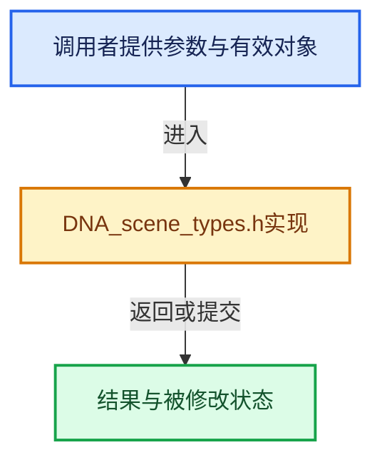

# 实现依赖专题：source/blender/makesdna/DNA_scene_types.h

[实现依赖导航](../../README.md) · [符号索引](../../../00-课程指南/02-源码与提交索引/符号依赖与实现索引.md)

本专题从正文实际调用进入，集中保存共享实现。函数有稳定锚点，可从调用处直接跳到对应完整函数；递归与互相调用通过回链组织。

## 本文件的实现关系





## 相关类型布局与成员入口

<a id="t-1e69ad2de3f9"></a>

### `blender::eFFMpegPreset`

原始声明：[source/blender/makesdna/DNA_scene_types.h](../../../../../../../source/blender/makesdna/DNA_scene_types.h) · L71—L97。

以下保留类的数据声明与编译条件，成员函数实现通过后面的精确链接阅读。

<!-- annotated:feef8aa0ae4e2c -->

```cpp
enum eFFMpegPreset : int {
  FFM_PRESET_NONE = 0,

#ifdef DNA_DEPRECATED_ALLOW
  /* Previously used by h.264 to control encoding speed vs. file size. */
  FFM_PRESET_ULTRAFAST = 1, /* DEPRECATED */
  FFM_PRESET_SUPERFAST = 2, /* DEPRECATED */
  FFM_PRESET_VERYFAST = 3,  /* DEPRECATED */
  FFM_PRESET_FASTER = 4,    /* DEPRECATED */
  FFM_PRESET_FAST = 5,      /* DEPRECATED */
  FFM_PRESET_MEDIUM = 6,    /* DEPRECATED */
  FFM_PRESET_SLOW = 7,      /* DEPRECATED */
  FFM_PRESET_SLOWER = 8,    /* DEPRECATED */
  FFM_PRESET_VERYSLOW = 9,  /* DEPRECATED */
#endif

  /* Used by WEBM/VP9 and h.264 to control encoding speed vs. file size.
   * WEBM/VP9 use these values directly, whereas h.264 map those to
   * respectively the MEDIUM, SLOWER, and SUPERFAST presets. */

  /** The default and recommended for most applications. */
  FFM_PRESET_GOOD = 10,
  /** Recommended if you have lots of time and want the best compression efficiency. */
  FFM_PRESET_BEST = 11,
  /** Recommended for live / fast encoding. */
  FFM_PRESET_REALTIME = 12,
};
```

<details>
<summary>核对原始源码：source/blender/makesdna/DNA_scene_types.h · L71—L97</summary>

<!-- original:feef8aa0ae4e2c:source/blender/makesdna/DNA_scene_types.h:71:97 -->

```cpp
enum eFFMpegPreset : int {
  FFM_PRESET_NONE = 0,

#ifdef DNA_DEPRECATED_ALLOW
  /* Previously used by h.264 to control encoding speed vs. file size. */
  FFM_PRESET_ULTRAFAST = 1, /* DEPRECATED */
  FFM_PRESET_SUPERFAST = 2, /* DEPRECATED */
  FFM_PRESET_VERYFAST = 3,  /* DEPRECATED */
  FFM_PRESET_FASTER = 4,    /* DEPRECATED */
  FFM_PRESET_FAST = 5,      /* DEPRECATED */
  FFM_PRESET_MEDIUM = 6,    /* DEPRECATED */
  FFM_PRESET_SLOW = 7,      /* DEPRECATED */
  FFM_PRESET_SLOWER = 8,    /* DEPRECATED */
  FFM_PRESET_VERYSLOW = 9,  /* DEPRECATED */
#endif

  /* Used by WEBM/VP9 and h.264 to control encoding speed vs. file size.
   * WEBM/VP9 use these values directly, whereas h.264 map those to
   * respectively the MEDIUM, SLOWER, and SUPERFAST presets. */

  /** The default and recommended for most applications. */
  FFM_PRESET_GOOD = 10,
  /** Recommended if you have lots of time and want the best compression efficiency. */
  FFM_PRESET_BEST = 11,
  /** Recommended for live / fast encoding. */
  FFM_PRESET_REALTIME = 12,
};
```

</details>


<a id="t-701007ec15a1"></a>

### `blender::eFFMpegAudioChannels`

原始声明：[source/blender/makesdna/DNA_scene_types.h](../../../../../../../source/blender/makesdna/DNA_scene_types.h) · L116—L122。

以下保留类的数据声明与编译条件，成员函数实现通过后面的精确链接阅读。

<!-- annotated:07b1c29a6ec562 -->

```cpp
enum eFFMpegAudioChannels : int {
  FFM_CHANNELS_MONO = 1,
  FFM_CHANNELS_STEREO = 2,
  FFM_CHANNELS_SURROUND4 = 4,
  FFM_CHANNELS_SURROUND51 = 6,
  FFM_CHANNELS_SURROUND71 = 8,
};
```

<details>
<summary>核对原始源码：source/blender/makesdna/DNA_scene_types.h · L116—L122</summary>

<!-- original:07b1c29a6ec562:source/blender/makesdna/DNA_scene_types.h:116:122 -->

```cpp
enum eFFMpegAudioChannels : int {
  FFM_CHANNELS_MONO = 1,
  FFM_CHANNELS_STEREO = 2,
  FFM_CHANNELS_SURROUND4 = 4,
  FFM_CHANNELS_SURROUND51 = 6,
  FFM_CHANNELS_SURROUND71 = 8,
};
```

</details>


<a id="t-e4d94d9ec504"></a>

### `blender::ImageFormatData`

原始声明：[source/blender/makesdna/DNA_scene_types.h](../../../../../../../source/blender/makesdna/DNA_scene_types.h) · L463—L514。

成员布局：

- `MediaType media_type`
- `char imtype`
- `eImageFormatDepth depth`
- `ImColorMode color_mode`
- `char flag`
- `char quality`
- `char compress`
- `char exr_codec`
- `char exr_flag`
- `char jp2_flag`
- `char jp2_codec`
- `char tiff_codec`
- `char cineon_flag`
- `char _pad`
- `short cineon_white`
- `float cineon_gamma`
- `Stereo3dFormat stereo3d_format`
- `eImageFormat_ViewsFormat views_format`
- `char color_management`
- `char _pad1`
- `ColorManagedViewSettings view_settings`
- `ColorManagedDisplaySettings display_settings`
- `ColorManagedColorspaceSettings linear_colorspace_settings`

以下保留类的数据声明与编译条件，成员函数实现通过后面的精确链接阅读。

<!-- annotated:e23f0e35862cb8 -->

```cpp
struct ImageFormatData {
  MediaType media_type = MEDIA_TYPE_IMAGE;
  /**
   * R_IMF_IMTYPE_PNG, R_...
   * \note Video types should only ever be set from this structure when used from #RenderData.
   */
  char imtype = R_IMF_IMTYPE_PNG;
  /**
   * Bits per channel. Not a bitmask; set only one at a time.
   */
  eImageFormatDepth depth = R_IMF_CHAN_DEPTH_8;

  ImColorMode color_mode = ImColorMode::RGBA;
  /** Generic options for all image types, alpha Z-buffer. */
  char flag = 0;

  /** (0 - 100), eg: JPEG quality. */
  char quality = 90;
  /** (0 - 100), eg: PNG compression. */
  char compress = 15;

  /* --- format specific --- */

  /** OpenEXR: R_IMF_EXR_CODEC_* values in low OPENEXR_CODEC_MASK bits. */
  char exr_codec = 0;
  char exr_flag = R_IMF_EXR_FLAG_MULTIPART;

  /** Jpeg2000. */
  char jp2_flag = 0;
  char jp2_codec = 0;

  /** TIFF. */
  char tiff_codec = 0;

  /** CINEON. */
  char cineon_flag = 0;
  char _pad[3] = {};
  short cineon_white = 0, cineon_black = 0;
  float cineon_gamma = 0;

  /** Multi-view. */
  Stereo3dFormat stereo3d_format;
  eImageFormat_ViewsFormat views_format = {};

  /* Color management members. */

  char color_management = 0;
  char _pad1[6] = {};
  ColorManagedViewSettings view_settings;
  ColorManagedDisplaySettings display_settings;
  ColorManagedColorspaceSettings linear_colorspace_settings;
};
```

<details>
<summary>核对原始源码：source/blender/makesdna/DNA_scene_types.h · L463—L514</summary>

<!-- original:e23f0e35862cb8:source/blender/makesdna/DNA_scene_types.h:463:514 -->

```cpp
struct ImageFormatData {
  MediaType media_type = MEDIA_TYPE_IMAGE;
  /**
   * R_IMF_IMTYPE_PNG, R_...
   * \note Video types should only ever be set from this structure when used from #RenderData.
   */
  char imtype = R_IMF_IMTYPE_PNG;
  /**
   * Bits per channel. Not a bitmask; set only one at a time.
   */
  eImageFormatDepth depth = R_IMF_CHAN_DEPTH_8;

  ImColorMode color_mode = ImColorMode::RGBA;
  /** Generic options for all image types, alpha Z-buffer. */
  char flag = 0;

  /** (0 - 100), eg: JPEG quality. */
  char quality = 90;
  /** (0 - 100), eg: PNG compression. */
  char compress = 15;

  /* --- format specific --- */

  /** OpenEXR: R_IMF_EXR_CODEC_* values in low OPENEXR_CODEC_MASK bits. */
  char exr_codec = 0;
  char exr_flag = R_IMF_EXR_FLAG_MULTIPART;

  /** Jpeg2000. */
  char jp2_flag = 0;
  char jp2_codec = 0;

  /** TIFF. */
  char tiff_codec = 0;

  /** CINEON. */
  char cineon_flag = 0;
  char _pad[3] = {};
  short cineon_white = 0, cineon_black = 0;
  float cineon_gamma = 0;

  /** Multi-view. */
  Stereo3dFormat stereo3d_format;
  eImageFormat_ViewsFormat views_format = {};

  /* Color management members. */

  char color_management = 0;
  char _pad1[6] = {};
  ColorManagedViewSettings view_settings;
  ColorManagedDisplaySettings display_settings;
  ColorManagedColorspaceSettings linear_colorspace_settings;
};
```

</details>


<a id="t-c2932aaa617c"></a>

### `blender::eBakeType`

原始声明：[source/blender/makesdna/DNA_scene_types.h](../../../../../../../source/blender/makesdna/DNA_scene_types.h) · L523—L528。

以下保留类的数据声明与编译条件，成员函数实现通过后面的精确链接阅读。

<!-- annotated:48ae231c7041b9 -->

```cpp
enum eBakeType : int {
  R_BAKE_NORMALS = 0,
  R_BAKE_DISPLACEMENT = 1,
  R_BAKE_AO = 2,
  R_BAKE_VECTOR_DISPLACEMENT = 3,
};
```

<details>
<summary>核对原始源码：source/blender/makesdna/DNA_scene_types.h · L523—L528</summary>

<!-- original:48ae231c7041b9:source/blender/makesdna/DNA_scene_types.h:523:528 -->

```cpp
enum eBakeType : int {
  R_BAKE_NORMALS = 0,
  R_BAKE_DISPLACEMENT = 1,
  R_BAKE_AO = 2,
  R_BAKE_VECTOR_DISPLACEMENT = 3,
};
```

</details>


<a id="t-c85b3fe601af"></a>

### `blender::eBakeMarginType`

原始声明：[source/blender/makesdna/DNA_scene_types.h](../../../../../../../source/blender/makesdna/DNA_scene_types.h) · L547—L550。

以下保留类的数据声明与编译条件，成员函数实现通过后面的精确链接阅读。

<!-- annotated:f99277686067bf -->

```cpp
enum eBakeMarginType : char {
  R_BAKE_ADJACENT_FACES = 0,
  R_BAKE_EXTEND = 1,
};
```

<details>
<summary>核对原始源码：source/blender/makesdna/DNA_scene_types.h · L547—L550</summary>

<!-- original:f99277686067bf:source/blender/makesdna/DNA_scene_types.h:547:550 -->

```cpp
enum eBakeMarginType : char {
  R_BAKE_ADJACENT_FACES = 0,
  R_BAKE_EXTEND = 1,
};
```

</details>


<a id="t-f974f3611c98"></a>

### `blender::eCompositorPrecision`

原始声明：[source/blender/makesdna/DNA_scene_types.h](../../../../../../../source/blender/makesdna/DNA_scene_types.h) · L674—L677。

以下保留类的数据声明与编译条件，成员函数实现通过后面的精确链接阅读。

<!-- annotated:e5f2c01ed7522e -->

```cpp
enum eCompositorPrecision : int {
  SCE_COMPOSITOR_PRECISION_AUTO = 0,
  SCE_COMPOSITOR_PRECISION_FULL = 1,
};
```

<details>
<summary>核对原始源码：source/blender/makesdna/DNA_scene_types.h · L674—L677</summary>

<!-- original:e5f2c01ed7522e:source/blender/makesdna/DNA_scene_types.h:674:677 -->

```cpp
enum eCompositorPrecision : int {
  SCE_COMPOSITOR_PRECISION_AUTO = 0,
  SCE_COMPOSITOR_PRECISION_FULL = 1,
};
```

</details>


<a id="t-e1e751897a9d"></a>

### `blender::UnifiedPaintSettings`

原始声明：[source/blender/makesdna/DNA_scene_types.h](../../../../../../../source/blender/makesdna/DNA_scene_types.h) · L1104—L1141。

成员布局：

- `DNA_DEFINE_CXX_METHODS UnifiedPaintSettings`
- `int size`
- `float unprojected_size`
- `float alpha`
- `float weight`
- `float color`
- `float secondary_color`
- `DNA_DEPRECATED float`
- `DNA_DEPRECATED secondary_rgb`
- `int color_jitter_flag`
- `float hsv_jitter`
- `struct CurveMapping curve_rand_hue`
- `struct CurveMapping curve_rand_saturation`
- `struct CurveMapping curve_rand_value`
- `int input_samples`
- `eUnifiedPaintSettingsFlags flag`

以下保留类的数据声明与编译条件，成员函数实现通过后面的精确链接阅读。

<!-- annotated:477f63e7cf9774 -->

```cpp
struct UnifiedPaintSettings {
  DNA_DEFINE_CXX_METHODS(UnifiedPaintSettings)

  /** Unified diameter of brush in pixels. */
  int size = 100;

  /** Unified diameter of brush in Blender units. */
  float unprojected_size = 0.58;

  /** Unified strength of brush. */
  float alpha = 0.5f;

  /** Unified brush weight, [0, 1]. */
  float weight = 0.5f;

  /** Unified brush color. */
  float color[3] = {0.0f, 0.0f, 0.0f};
  /** Unified brush secondary color. */
  float secondary_color[3] = {1.0f, 1.0f, 1.0f};

  /* Deprecated sRGB color for forward compatibility. */
  DNA_DEPRECATED float rgb[3] = {0.0f, 0.0f, 0.0f};
  DNA_DEPRECATED float secondary_rgb[3] = {1.0f, 1.0f, 1.0f};

  /** Unified color jitter settings */
  int color_jitter_flag = 0;
  float hsv_jitter[3] = {};

  /** Color jitter pressure curves. */
  struct CurveMapping *curve_rand_hue = nullptr;
  struct CurveMapping *curve_rand_saturation = nullptr;
  struct CurveMapping *curve_rand_value = nullptr;

  /** Unified brush stroke input samples. */
  int input_samples = 1;

  eUnifiedPaintSettingsFlags flag = eUnifiedPaintSettingsFlags(0);
};
```

<details>
<summary>核对原始源码：source/blender/makesdna/DNA_scene_types.h · L1104—L1141</summary>

<!-- original:477f63e7cf9774:source/blender/makesdna/DNA_scene_types.h:1104:1141 -->

```cpp
struct UnifiedPaintSettings {
  DNA_DEFINE_CXX_METHODS(UnifiedPaintSettings)

  /** Unified diameter of brush in pixels. */
  int size = 100;

  /** Unified diameter of brush in Blender units. */
  float unprojected_size = 0.58;

  /** Unified strength of brush. */
  float alpha = 0.5f;

  /** Unified brush weight, [0, 1]. */
  float weight = 0.5f;

  /** Unified brush color. */
  float color[3] = {0.0f, 0.0f, 0.0f};
  /** Unified brush secondary color. */
  float secondary_color[3] = {1.0f, 1.0f, 1.0f};

  /* Deprecated sRGB color for forward compatibility. */
  DNA_DEPRECATED float rgb[3] = {0.0f, 0.0f, 0.0f};
  DNA_DEPRECATED float secondary_rgb[3] = {1.0f, 1.0f, 1.0f};

  /** Unified color jitter settings */
  int color_jitter_flag = 0;
  float hsv_jitter[3] = {};

  /** Color jitter pressure curves. */
  struct CurveMapping *curve_rand_hue = nullptr;
  struct CurveMapping *curve_rand_saturation = nullptr;
  struct CurveMapping *curve_rand_value = nullptr;

  /** Unified brush stroke input samples. */
  int input_samples = 1;

  eUnifiedPaintSettingsFlags flag = eUnifiedPaintSettingsFlags(0);
};
```

</details>


<a id="t-fc867afedd53"></a>

### `blender::Paint::UnifiedPaintSettings`

原始声明：[source/blender/makesdna/DNA_scene_types.h](../../../../../../../source/blender/makesdna/DNA_scene_types.h) · L1268—L1268。

成员布局：

- `DNA_DEFINE_CXX_METHODS UnifiedPaintSettings`
- `int size`
- `float unprojected_size`
- `float alpha`
- `float weight`
- `float color`
- `float secondary_color`
- `DNA_DEPRECATED float`
- `DNA_DEPRECATED secondary_rgb`
- `int color_jitter_flag`
- `float hsv_jitter`
- `struct CurveMapping curve_rand_hue`
- `struct CurveMapping curve_rand_saturation`
- `struct CurveMapping curve_rand_value`
- `int input_samples`
- `eUnifiedPaintSettingsFlags flag`

以下保留类的数据声明与编译条件，成员函数实现通过后面的精确链接阅读。

<!-- annotated:b6bd9ef39954e6 -->

```cpp
  struct UnifiedPaintSettings unified_paint_settings;
```

<details>
<summary>核对原始源码：source/blender/makesdna/DNA_scene_types.h · L1268—L1268</summary>

<!-- original:b6bd9ef39954e6:source/blender/makesdna/DNA_scene_types.h:1268:1268 -->

```cpp
  struct UnifiedPaintSettings unified_paint_settings;
```

</details>


<a id="t-4c7d0f526323"></a>

### `blender::eSequencerSnapMode`

原始声明：[source/blender/makesdna/DNA_scene_types.h](../../../../../../../source/blender/makesdna/DNA_scene_types.h) · L1828—L1842。

以下保留类的数据声明与编译条件，成员函数实现通过后面的精确链接阅读。

<!-- annotated:9f236086fb1894 -->

```cpp
enum eSequencerSnapMode : short {
  SEQ_SNAP_TO_STRIPS = 1 << 0,
  SEQ_SNAP_TO_CURRENT_FRAME = 1 << 1,
  SEQ_SNAP_TO_STRIP_HOLD = 1 << 2,
  SEQ_SNAP_TO_MARKERS = 1 << 3,

  /* Preview snapping. */
  SEQ_SNAP_TO_PREVIEW_BORDERS = 1 << 4,
  SEQ_SNAP_TO_PREVIEW_CENTER = 1 << 5,
  SEQ_SNAP_TO_STRIPS_PREVIEW = 1 << 6,

  SEQ_SNAP_TO_RETIMING = 1 << 7,
  SEQ_SNAP_TO_INCREMENT = 1 << 8, /* NOTE: Treated identically to `SCE_SNAP_TO_INCREMENT`. */
  SEQ_SNAP_TO_FRAME_RANGE = 1 << 9,
};
```

<details>
<summary>核对原始源码：source/blender/makesdna/DNA_scene_types.h · L1828—L1842</summary>

<!-- original:9f236086fb1894:source/blender/makesdna/DNA_scene_types.h:1828:1842 -->

```cpp
enum eSequencerSnapMode : short {
  SEQ_SNAP_TO_STRIPS = 1 << 0,
  SEQ_SNAP_TO_CURRENT_FRAME = 1 << 1,
  SEQ_SNAP_TO_STRIP_HOLD = 1 << 2,
  SEQ_SNAP_TO_MARKERS = 1 << 3,

  /* Preview snapping. */
  SEQ_SNAP_TO_PREVIEW_BORDERS = 1 << 4,
  SEQ_SNAP_TO_PREVIEW_CENTER = 1 << 5,
  SEQ_SNAP_TO_STRIPS_PREVIEW = 1 << 6,

  SEQ_SNAP_TO_RETIMING = 1 << 7,
  SEQ_SNAP_TO_INCREMENT = 1 << 8, /* NOTE: Treated identically to `SCE_SNAP_TO_INCREMENT`. */
  SEQ_SNAP_TO_FRAME_RANGE = 1 << 9,
};
```

</details>


<a id="t-9aeb0b412db3"></a>

### `blender::eSnapFlag`

原始声明：[source/blender/makesdna/DNA_scene_types.h](../../../../../../../source/blender/makesdna/DNA_scene_types.h) · L1897—L1913。

以下保留类的数据声明与编译条件，成员函数实现通过后面的精确链接阅读。

<!-- annotated:405964df8d6951 -->

```cpp
enum eSnapFlag : short {
  SCE_SNAP = (1 << 0),
  SCE_SNAP_ROTATE = (1 << 1),
  SCE_SNAP_PEEL_OBJECT = (1 << 2),
  // SCE_SNAP_PROJECT = (1 << 3), /* DEPRECATED, see #SCE_SNAP_INDIVIDUAL_PROJECT. */
  /** Was `SCE_SNAP_NO_SELF`, but self should be active. */
  SCE_SNAP_NOT_TO_ACTIVE = (1 << 4),
  SCE_SNAP_ABS_GRID = (1 << 5),
  /* Same value with different name to make it easier to understand in time based code. */
  SCE_SNAP_ABS_TIME_STEP = (1 << 5),
  SCE_SNAP_BACKFACE_CULLING = (1 << 6),
  SCE_SNAP_KEEP_ON_SAME_OBJECT = (1 << 7),
  /** see #eSnapTargetOP */
  SCE_SNAP_TO_INCLUDE_EDITED = (1 << 8),
  SCE_SNAP_TO_INCLUDE_NONEDITED = (1 << 9),
  SCE_SNAP_TO_ONLY_SELECTABLE = (1 << 10),
};
```

<details>
<summary>核对原始源码：source/blender/makesdna/DNA_scene_types.h · L1897—L1913</summary>

<!-- original:405964df8d6951:source/blender/makesdna/DNA_scene_types.h:1897:1913 -->

```cpp
enum eSnapFlag : short {
  SCE_SNAP = (1 << 0),
  SCE_SNAP_ROTATE = (1 << 1),
  SCE_SNAP_PEEL_OBJECT = (1 << 2),
  // SCE_SNAP_PROJECT = (1 << 3), /* DEPRECATED, see #SCE_SNAP_INDIVIDUAL_PROJECT. */
  /** Was `SCE_SNAP_NO_SELF`, but self should be active. */
  SCE_SNAP_NOT_TO_ACTIVE = (1 << 4),
  SCE_SNAP_ABS_GRID = (1 << 5),
  /* Same value with different name to make it easier to understand in time based code. */
  SCE_SNAP_ABS_TIME_STEP = (1 << 5),
  SCE_SNAP_BACKFACE_CULLING = (1 << 6),
  SCE_SNAP_KEEP_ON_SAME_OBJECT = (1 << 7),
  /** see #eSnapTargetOP */
  SCE_SNAP_TO_INCLUDE_EDITED = (1 << 8),
  SCE_SNAP_TO_INCLUDE_NONEDITED = (1 << 9),
  SCE_SNAP_TO_ONLY_SELECTABLE = (1 << 10),
};
```

</details>


<a id="t-cca1a4c0cb32"></a>

### `blender::eSnapMode`

原始声明：[source/blender/makesdna/DNA_scene_types.h](../../../../../../../source/blender/makesdna/DNA_scene_types.h) · L1941—L1975。

以下保留类的数据声明与编译条件，成员函数实现通过后面的精确链接阅读。

<!-- annotated:193c31ae6968c8 -->

```cpp
enum eSnapMode : short {
  SCE_SNAP_TO_NONE = 0,

  /** #ToolSettings::snap_anim_mode and #ToolSettings::snap_playhead_mode. */
  SCE_SNAP_TO_FRAME = (1 << 0),
  SCE_SNAP_TO_SECOND = (1 << 1),
  SCE_SNAP_TO_MARKERS = (1 << 2),
  SCE_SNAP_TO_KEYS = (1 << 3),
  SCE_SNAP_TO_STRIPS = (1 << 4),

  /**
   * Used for:
   * - #ToolSettings::snap_mode
   * - #ToolSettings::snap_node_mode
   * - #ToolSettings.snap_uv_mode
   * - #ToolSettings::snap_mode_tools
   */
  SCE_SNAP_TO_POINT = (1 << 0),
  SCE_SNAP_TO_EDGE_MIDPOINT = (1 << 1),
  SCE_SNAP_TO_EDGE_ENDPOINT = (1 << 2),
  SCE_SNAP_TO_EDGE_PERPENDICULAR = (1 << 3),
  SCE_SNAP_TO_EDGE = (1 << 4),
  SCE_SNAP_TO_FACE = (1 << 5),
  SCE_SNAP_TO_VOLUME = (1 << 6),
  SCE_SNAP_TO_GRID = (1 << 7),
  SCE_SNAP_TO_INCREMENT = (1 << 8),

  /** For snap individual elements. */
  SCE_SNAP_INDIVIDUAL_NEAREST = (1 << 9),
  SCE_SNAP_INDIVIDUAL_PROJECT = (1 << 10),

  SCE_SNAP_TO_FACE_MIDPOINT = (1 << 11),

  SCE_SNAP_TO_ORIGIN = (1 << 12)
};
```

<details>
<summary>核对原始源码：source/blender/makesdna/DNA_scene_types.h · L1941—L1975</summary>

<!-- original:193c31ae6968c8:source/blender/makesdna/DNA_scene_types.h:1941:1975 -->

```cpp
enum eSnapMode : short {
  SCE_SNAP_TO_NONE = 0,

  /** #ToolSettings::snap_anim_mode and #ToolSettings::snap_playhead_mode. */
  SCE_SNAP_TO_FRAME = (1 << 0),
  SCE_SNAP_TO_SECOND = (1 << 1),
  SCE_SNAP_TO_MARKERS = (1 << 2),
  SCE_SNAP_TO_KEYS = (1 << 3),
  SCE_SNAP_TO_STRIPS = (1 << 4),

  /**
   * Used for:
   * - #ToolSettings::snap_mode
   * - #ToolSettings::snap_node_mode
   * - #ToolSettings.snap_uv_mode
   * - #ToolSettings::snap_mode_tools
   */
  SCE_SNAP_TO_POINT = (1 << 0),
  SCE_SNAP_TO_EDGE_MIDPOINT = (1 << 1),
  SCE_SNAP_TO_EDGE_ENDPOINT = (1 << 2),
  SCE_SNAP_TO_EDGE_PERPENDICULAR = (1 << 3),
  SCE_SNAP_TO_EDGE = (1 << 4),
  SCE_SNAP_TO_FACE = (1 << 5),
  SCE_SNAP_TO_VOLUME = (1 << 6),
  SCE_SNAP_TO_GRID = (1 << 7),
  SCE_SNAP_TO_INCREMENT = (1 << 8),

  /** For snap individual elements. */
  SCE_SNAP_INDIVIDUAL_NEAREST = (1 << 9),
  SCE_SNAP_INDIVIDUAL_PROJECT = (1 << 10),

  SCE_SNAP_TO_FACE_MIDPOINT = (1 << 11),

  SCE_SNAP_TO_ORIGIN = (1 << 12)
};
```

</details>


<a id="t-e48c8c6615f6"></a>

### `blender::ToolSettings`

原始声明：[source/blender/makesdna/DNA_scene_types.h](../../../../../../../source/blender/makesdna/DNA_scene_types.h) · L2234—L2478。

成员布局：

- `DNA_DEFINE_CXX_METHODS ToolSettings`
- `VPaint vpaint`
- `VPaint wpaint`
- `Sculpt sculpt`
- `UvSculpt uvsculpt`
- `GpPaint gp_paint`
- `GpVertexPaint gp_vertexpaint`
- `GpSculptPaint gp_sculptpaint`
- `GpWeightPaint gp_weightpaint`
- `CurvesSculpt curves_sculpt`
- `float vgroup_weight`
- `float doublimit`
- `char automerge`
- `char object_flag`
- `char selectmode`
- `eTool_Unwrapper unwrapper`
- `eTool_UvCalcFlag uvcalc_flag`
- `eTool_UvFlag uv_flag`
- `eTool_UvSelectMode uv_selectmode`
- `eTool_UvSticky uv_sticky`
- `rctf uv_custom_region`
- `float uvcalc_margin`
- `int uvcalc_iterations`
- `float uvcalc_weight_factor`
- `char uvcalc_weight_group`
- `short autoik_chainlen`
- `eGPencil_Flags gpencil_flags`
- `eGPencil_Placement_Flags gpencil_v3d_align`
- `eGPencil_Placement_Flags gpencil_v2d_align`
- `eGPencil_Placement_Flags annotate_v3d_align`
- `short annotate_thickness`
- `float gpencil_surface_offset`
- `eGPencil_Selectmode_types gpencil_selectmode_edit`
- `eGP_Sculpt_SelectMaskFlag gpencil_selectmode_sculpt`
- `char _pad0`
- `struct GP_Sculpt_Settings gp_sculpt`
- `struct GP_Interpolate_Settings gp_interpolate`
- `struct ImagePaintSettings imapaint`
- `struct PaintModeSettings paint_mode`
- `struct ParticleEditSettings particle`
- `float proportional_size`
- `float select_thresh`
- `short keying_flag`
- `eAutokey_Mode autokey_mode`
- `char keyframe_type`
- `char edge_mode`
- `char edge_mode_live_unwrap`
- `char transform_pivot_point`
- `char transform_flag`
- `char snap_node_mode`
- `eSnapMode snap_mode`
- `eSnapMode snap_uv_mode`
- `eSnapMode snap_anim_mode`
- `eSnapMode snap_playhead_mode`
- `eSnapFlag snap_flag`
- `eSnapFlag snap_flag_node`
- `eSnapFlag snap_flag_seq`
- `eSnapFlag snap_flag_anim`
- `eSnapFlag snap_flag_driver`
- `eSnapFlag snap_flag_playhead`
- `eSnapFlag snap_uv_flag`
- `eSnapSourceOP snap_target`
- `eSnapTransformMode snap_transform_mode_flag`
- `short snap_face_nearest_steps`
- `char proportional_edit`
- `char proportional_objects`
- `char proportional_mask`
- `char proportional_action`
- `char proportional_fcurve`
- `char lock_markers`
- `char auto_normalize`
- `char wpaint_lock_relative`
- `char multipaint`
- `eTool_WeightUser weightuser`
- `eVGroupSelect vgroupsubset`
- `eGP_Vertex_SelectMaskFlag gpencil_selectmode_vertex`
- `char uv_sculpt_settings`
- `char workspace_tool_type`
- `char _pad5`
- `DNA_DEPRECATED short sculpt_paint_settings`
- `DNA_DEPRECATED sculpt_paint_unified_size`
- `DNA_DEPRECATED sculpt_paint_unified_unprojected_radius`
- `DNA_DEPRECATED sculpt_paint_unified_alpha`
- `DNA_DEPRECATED struct`
- `UnifiedPaintSettings unified_paint_settings`
- `struct CurvePaintSettings curve_paint_settings`
- `struct MeshStatVis statvis`
- `float normal_vector`
- `char _pad6`
- `struct CurveProfile custom_bevel_profile_preset`
- `struct SequencerToolSettings sequencer_tool_settings`
- `eSnapMode snap_mode_tools`
- `char plane_axis`
- `eV3DPlaceDepth plane_depth`
- `eV3DPlaceOrient plane_orient`
- `char use_plane_axis_auto`
- `char _pad7`
- `float snap_angle_increment_2d`
- `float snap_angle_increment_2d_precision`
- `float snap_angle_increment_3d`
- `float snap_angle_increment_3d_precision`
- `int16_t snap_step_seconds`
- `int16_t snap_step_frames`
- `int playhead_snap_distance`
- `struct Object anim_mirror_object`
- `struct Object anim_relative_object`
- `char anim_mirror_bone`
- `uint8_t fix_to_cam_flag`
- `char _pad8`

以下保留类的数据声明与编译条件，成员函数实现通过后面的精确链接阅读。

<!-- annotated:7a78438cbed518 -->

```cpp
struct ToolSettings {
  DNA_DEFINE_CXX_METHODS(ToolSettings)

  /** Vertex paint. */
  VPaint *vpaint = nullptr;
  /** Weight paint. */
  VPaint *wpaint = nullptr;
  Sculpt *sculpt = nullptr;
  /** UV smooth. */
  UvSculpt uvsculpt;
  /** Gpencil paint. */
  GpPaint *gp_paint = nullptr;
  /** Gpencil vertex paint. */
  GpVertexPaint *gp_vertexpaint = nullptr;
  /** Gpencil sculpt paint. */
  GpSculptPaint *gp_sculptpaint = nullptr;
  /** Gpencil weight paint. */
  GpWeightPaint *gp_weightpaint = nullptr;
  /** Curves sculpt. */
  CurvesSculpt *curves_sculpt = nullptr;

  /** Vertex group weight - used only for editmode, not weight paint. */
  float vgroup_weight = 1.0f;

  /** Remove doubles limit. */
  float doublimit = 0.001;
  char automerge = 0;
  char object_flag = SCE_OBJECT_MODE_LOCK;

  /** Selection Mode for Mesh. */
  char selectmode = SCE_SELECT_VERTEX;

  /* UV Calculation. */

  /* Use `UVCALC_UNWRAP_METHOD_*` values. */
  eTool_Unwrapper unwrapper = UVCALC_UNWRAP_METHOD_CONFORMAL;
  eTool_UvCalcFlag uvcalc_flag = UVCALC_TRANSFORM_CORRECT_SLIDE;
  eTool_UvFlag uv_flag = UV_FLAG_SELECT_SYNC;
  eTool_UvSelectMode uv_selectmode = UV_SELECT_VERT;
  eTool_UvSticky uv_sticky = UV_STICKY_LOCATION;

  rctf uv_custom_region = {};

  float uvcalc_margin = 0.001f;

  int uvcalc_iterations = 10;
  float uvcalc_weight_factor = 1.0;

  /**
   * Regarding having a single vertex group for all meshes.
   * In most cases there is no expectation for the names used for vertex groups.
   * UV weights is a fairly specific feature for unwrapping and in this case
   * users are expected to use the name `uv_importance`.
   * While we could support setting a different group per mesh (similar to the active group).
   * This isn't all that useful in practice, so use a "default" name instead.
   * This approach may be reworked after gathering feedback from users.
   */
  char uvcalc_weight_group[/*MAX_VGROUP_NAME*/ 64] = "uv_importance";

  /* Auto-IK. */
  /** Runtime only. */
  short autoik_chainlen = 0;

  /* Grease Pencil. */
  /** Flags/options for how the tool works. */
  eGPencil_Flags gpencil_flags = {};

  /** Stroke placement settings: 3D View. */
  eGPencil_Placement_Flags gpencil_v3d_align = GP_PROJECT_VIEWSPACE;
  /** General 2D Editor. */
  eGPencil_Placement_Flags gpencil_v2d_align = GP_PROJECT_VIEWSPACE;

  /* Annotations. */
  /** Stroke placement settings - 3D View. */
  eGPencil_Placement_Flags annotate_v3d_align = GP_PROJECT_VIEWSPACE | GP_PROJECT_CURSOR;
  /** Default stroke thickness for annotation strokes. */
  short annotate_thickness = 3;

  /** Normal offset used when drawing on surfaces. */
  float gpencil_surface_offset = 0;

  /** Stroke selection mode for Edit. */
  eGPencil_Selectmode_types gpencil_selectmode_edit = GP_SELECTMODE_POINT;
  /** Stroke selection mode for Sculpt. */
  eGP_Sculpt_SelectMaskFlag gpencil_selectmode_sculpt = {};
  char _pad0[6] = {};

  /** Grease Pencil Sculpt. */
  struct GP_Sculpt_Settings gp_sculpt;

  /** Grease Pencil Interpolation Tool(s). */
  struct GP_Interpolate_Settings gp_interpolate;

  /** Image Paint (8 bytes aligned please!). */
  struct ImagePaintSettings imapaint;

  /** Settings for paint mode. */
  struct PaintModeSettings paint_mode;

  /** Particle Editing. */
  struct ParticleEditSettings particle;

  /** Transform Proportional Area of Effect. */
  float proportional_size = 1.0f;

  /** Select Group Threshold. */
  float select_thresh = 0.01f;

  /* Keying Settings. */
  /** Defines in DNA_userdef_types.h. */
  short keying_flag = 0;
  eAutokey_Mode autokey_mode = AUTOKEY_MODE_NORMAL;
  /** Keyframe type (see DNA_curve_types.h). */
  char keyframe_type = 0;

  /** Edge tagging, store operator settings (no UI access). */
  char edge_mode = 0;

  char edge_mode_live_unwrap = 0;

  /* Transform. */

  char transform_pivot_point = V3D_AROUND_CENTER_MEDIAN;
  char transform_flag = 0;
  /** Snap elements (per space-type), #eSnapMode. */
  char snap_node_mode = SCE_SNAP_TO_GRID;

  eSnapMode snap_mode = SCE_SNAP_TO_INCREMENT;
  eSnapMode snap_uv_mode = SCE_SNAP_TO_INCREMENT;
  eSnapMode snap_anim_mode = SCE_SNAP_TO_FRAME;
  eSnapMode snap_playhead_mode = SCE_SNAP_TO_KEYS | SCE_SNAP_TO_STRIPS;
  /** Generic flags (per space-type). */
  eSnapFlag snap_flag = SCE_SNAP_TO_INCLUDE_EDITED | SCE_SNAP_TO_INCLUDE_NONEDITED;
  eSnapFlag snap_flag_node = {};
  eSnapFlag snap_flag_seq = SCE_SNAP;
  eSnapFlag snap_flag_anim = SCE_SNAP;
  eSnapFlag snap_flag_driver = {};
  eSnapFlag snap_flag_playhead = {};
  eSnapFlag snap_uv_flag = {};
  /** Default snap source, #eSnapSourceOP. */
  /**
   * TODO(@gfxcoder): Rename `snap_target` to `snap_source` to avoid previous ambiguity of
   * "target" (now, "source" is geometry to be moved and "target" is geometry to which moved
   * geometry is snapped).
   */
  eSnapSourceOP snap_target = SCE_SNAP_SOURCE_CLOSEST;
  /** Snap mask for transform modes. */
  eSnapTransformMode snap_transform_mode_flag = SCE_SNAP_TRANSFORM_MODE_TRANSLATE;
  /** Steps to break transformation into with face nearest snapping. */
  short snap_face_nearest_steps = 1;

  char proportional_edit = 0, prop_mode = 0;
  /** Proportional edit, object mode. */
  char proportional_objects = 0;
  /** Proportional edit, mask editing. */
  char proportional_mask = 0;
  /** Proportional edit, action editor. */
  char proportional_action = 0;
  /** Proportional edit, graph editor. */
  char proportional_fcurve = 0;
  /** Lock marker editing. */
  char lock_markers = 0;

  /** Auto normalizing mode in wpaint. */
  char auto_normalize = true;
  /** Present weights as if all locked vertex groups were
   *  deleted, and the remaining deform groups normalized. */
  char wpaint_lock_relative = 0;
  /** Paint multiple bones in wpaint. */
  char multipaint = true;
  eTool_WeightUser weightuser = OB_DRAW_GROUPUSER_ACTIVE;
  /** Subset selection filter in wpaint. */
  eVGroupSelect vgroupsubset = WT_VGROUP_ALL;

  /** Stroke selection mode for Vertex Paint. */
  eGP_Vertex_SelectMaskFlag gpencil_selectmode_vertex = {};

  /* UV painting. */
  char uv_sculpt_settings = 0;

  char workspace_tool_type = 0;

  char _pad5[7] = {};

  /**
   * XXX: these `sculpt_paint_*` fields are deprecated, use the
   * unified_paint_settings field instead!
   */
  DNA_DEPRECATED short sculpt_paint_settings = 0;
  DNA_DEPRECATED int sculpt_paint_unified_size = 0;
  DNA_DEPRECATED float sculpt_paint_unified_unprojected_radius = 0;
  DNA_DEPRECATED float sculpt_paint_unified_alpha = 0;

  /**
   * Unified Paint Settings.
   * \warning Deprecated, see the per-paint mode values on the `Paint` struct.
   */
  DNA_DEPRECATED struct UnifiedPaintSettings unified_paint_settings;

  struct CurvePaintSettings curve_paint_settings;

  struct MeshStatVis statvis;

  /** Normal Editing. */
  float normal_vector[3] = {};
  char _pad6[4] = {};

  /**
   * Custom Curve Profile for bevel tool:
   * Temporary until there is a proper preset system that stores the profiles or maybe stores
   * entire bevel configurations.
   */
  struct CurveProfile *custom_bevel_profile_preset = nullptr;

  struct SequencerToolSettings *sequencer_tool_settings = nullptr;

  eSnapMode snap_mode_tools =
      SCE_SNAP_TO_GEOM; /* If SCE_SNAP_TO_NONE, use #ToolSettings::snap_mode. */
  char plane_axis = 2;  /* X, Y or Z. */
  eV3DPlaceDepth plane_depth = V3D_PLACE_DEPTH_SURFACE;
  eV3DPlaceOrient plane_orient = V3D_PLACE_ORIENT_SURFACE;
  char use_plane_axis_auto = 0;
  char _pad7[2] = {};

  /** Rotation Angle snapping amount */
  float snap_angle_increment_2d = DEG2RADF(5.0f);
  float snap_angle_increment_2d_precision = DEG2RADF(1.0f);
  float snap_angle_increment_3d = DEG2RADF(5.0f);
  float snap_angle_increment_3d_precision = DEG2RADF(1.0f);

  int16_t snap_step_seconds = 1;
  int16_t snap_step_frames = 2;
  /* Pixel threshold that needs to be crossed before the playhead is snapped to a point. */
  int playhead_snap_distance = 20;

  /* Animation settings, used by "Paste Global Transform" operator. */
  struct Object *anim_mirror_object = nullptr;
  struct Object *anim_relative_object = nullptr;
  char anim_mirror_bone[64] = "";

  /* Flags for "Fix to Camera" operator. */
  uint8_t fix_to_cam_flag = FIX_TO_CAM_FLAG_USE_LOC | FIX_TO_CAM_FLAG_USE_ROT |
                            FIX_TO_CAM_FLAG_USE_SCALE; /* eFixToCam_Flags */
  char _pad8[7] = {};
};
```

<details>
<summary>核对原始源码：source/blender/makesdna/DNA_scene_types.h · L2234—L2478</summary>

<!-- original:7a78438cbed518:source/blender/makesdna/DNA_scene_types.h:2234:2478 -->

```cpp
struct ToolSettings {
  DNA_DEFINE_CXX_METHODS(ToolSettings)

  /** Vertex paint. */
  VPaint *vpaint = nullptr;
  /** Weight paint. */
  VPaint *wpaint = nullptr;
  Sculpt *sculpt = nullptr;
  /** UV smooth. */
  UvSculpt uvsculpt;
  /** Gpencil paint. */
  GpPaint *gp_paint = nullptr;
  /** Gpencil vertex paint. */
  GpVertexPaint *gp_vertexpaint = nullptr;
  /** Gpencil sculpt paint. */
  GpSculptPaint *gp_sculptpaint = nullptr;
  /** Gpencil weight paint. */
  GpWeightPaint *gp_weightpaint = nullptr;
  /** Curves sculpt. */
  CurvesSculpt *curves_sculpt = nullptr;

  /** Vertex group weight - used only for editmode, not weight paint. */
  float vgroup_weight = 1.0f;

  /** Remove doubles limit. */
  float doublimit = 0.001;
  char automerge = 0;
  char object_flag = SCE_OBJECT_MODE_LOCK;

  /** Selection Mode for Mesh. */
  char selectmode = SCE_SELECT_VERTEX;

  /* UV Calculation. */

  /* Use `UVCALC_UNWRAP_METHOD_*` values. */
  eTool_Unwrapper unwrapper = UVCALC_UNWRAP_METHOD_CONFORMAL;
  eTool_UvCalcFlag uvcalc_flag = UVCALC_TRANSFORM_CORRECT_SLIDE;
  eTool_UvFlag uv_flag = UV_FLAG_SELECT_SYNC;
  eTool_UvSelectMode uv_selectmode = UV_SELECT_VERT;
  eTool_UvSticky uv_sticky = UV_STICKY_LOCATION;

  rctf uv_custom_region = {};

  float uvcalc_margin = 0.001f;

  int uvcalc_iterations = 10;
  float uvcalc_weight_factor = 1.0;

  /**
   * Regarding having a single vertex group for all meshes.
   * In most cases there is no expectation for the names used for vertex groups.
   * UV weights is a fairly specific feature for unwrapping and in this case
   * users are expected to use the name `uv_importance`.
   * While we could support setting a different group per mesh (similar to the active group).
   * This isn't all that useful in practice, so use a "default" name instead.
   * This approach may be reworked after gathering feedback from users.
   */
  char uvcalc_weight_group[/*MAX_VGROUP_NAME*/ 64] = "uv_importance";

  /* Auto-IK. */
  /** Runtime only. */
  short autoik_chainlen = 0;

  /* Grease Pencil. */
  /** Flags/options for how the tool works. */
  eGPencil_Flags gpencil_flags = {};

  /** Stroke placement settings: 3D View. */
  eGPencil_Placement_Flags gpencil_v3d_align = GP_PROJECT_VIEWSPACE;
  /** General 2D Editor. */
  eGPencil_Placement_Flags gpencil_v2d_align = GP_PROJECT_VIEWSPACE;

  /* Annotations. */
  /** Stroke placement settings - 3D View. */
  eGPencil_Placement_Flags annotate_v3d_align = GP_PROJECT_VIEWSPACE | GP_PROJECT_CURSOR;
  /** Default stroke thickness for annotation strokes. */
  short annotate_thickness = 3;

  /** Normal offset used when drawing on surfaces. */
  float gpencil_surface_offset = 0;

  /** Stroke selection mode for Edit. */
  eGPencil_Selectmode_types gpencil_selectmode_edit = GP_SELECTMODE_POINT;
  /** Stroke selection mode for Sculpt. */
  eGP_Sculpt_SelectMaskFlag gpencil_selectmode_sculpt = {};
  char _pad0[6] = {};

  /** Grease Pencil Sculpt. */
  struct GP_Sculpt_Settings gp_sculpt;

  /** Grease Pencil Interpolation Tool(s). */
  struct GP_Interpolate_Settings gp_interpolate;

  /** Image Paint (8 bytes aligned please!). */
  struct ImagePaintSettings imapaint;

  /** Settings for paint mode. */
  struct PaintModeSettings paint_mode;

  /** Particle Editing. */
  struct ParticleEditSettings particle;

  /** Transform Proportional Area of Effect. */
  float proportional_size = 1.0f;

  /** Select Group Threshold. */
  float select_thresh = 0.01f;

  /* Keying Settings. */
  /** Defines in DNA_userdef_types.h. */
  short keying_flag = 0;
  eAutokey_Mode autokey_mode = AUTOKEY_MODE_NORMAL;
  /** Keyframe type (see DNA_curve_types.h). */
  char keyframe_type = 0;

  /** Edge tagging, store operator settings (no UI access). */
  char edge_mode = 0;

  char edge_mode_live_unwrap = 0;

  /* Transform. */

  char transform_pivot_point = V3D_AROUND_CENTER_MEDIAN;
  char transform_flag = 0;
  /** Snap elements (per space-type), #eSnapMode. */
  char snap_node_mode = SCE_SNAP_TO_GRID;

  eSnapMode snap_mode = SCE_SNAP_TO_INCREMENT;
  eSnapMode snap_uv_mode = SCE_SNAP_TO_INCREMENT;
  eSnapMode snap_anim_mode = SCE_SNAP_TO_FRAME;
  eSnapMode snap_playhead_mode = SCE_SNAP_TO_KEYS | SCE_SNAP_TO_STRIPS;
  /** Generic flags (per space-type). */
  eSnapFlag snap_flag = SCE_SNAP_TO_INCLUDE_EDITED | SCE_SNAP_TO_INCLUDE_NONEDITED;
  eSnapFlag snap_flag_node = {};
  eSnapFlag snap_flag_seq = SCE_SNAP;
  eSnapFlag snap_flag_anim = SCE_SNAP;
  eSnapFlag snap_flag_driver = {};
  eSnapFlag snap_flag_playhead = {};
  eSnapFlag snap_uv_flag = {};
  /** Default snap source, #eSnapSourceOP. */
  /**
   * TODO(@gfxcoder): Rename `snap_target` to `snap_source` to avoid previous ambiguity of
   * "target" (now, "source" is geometry to be moved and "target" is geometry to which moved
   * geometry is snapped).
   */
  eSnapSourceOP snap_target = SCE_SNAP_SOURCE_CLOSEST;
  /** Snap mask for transform modes. */
  eSnapTransformMode snap_transform_mode_flag = SCE_SNAP_TRANSFORM_MODE_TRANSLATE;
  /** Steps to break transformation into with face nearest snapping. */
  short snap_face_nearest_steps = 1;

  char proportional_edit = 0, prop_mode = 0;
  /** Proportional edit, object mode. */
  char proportional_objects = 0;
  /** Proportional edit, mask editing. */
  char proportional_mask = 0;
  /** Proportional edit, action editor. */
  char proportional_action = 0;
  /** Proportional edit, graph editor. */
  char proportional_fcurve = 0;
  /** Lock marker editing. */
  char lock_markers = 0;

  /** Auto normalizing mode in wpaint. */
  char auto_normalize = true;
  /** Present weights as if all locked vertex groups were
   *  deleted, and the remaining deform groups normalized. */
  char wpaint_lock_relative = 0;
  /** Paint multiple bones in wpaint. */
  char multipaint = true;
  eTool_WeightUser weightuser = OB_DRAW_GROUPUSER_ACTIVE;
  /** Subset selection filter in wpaint. */
  eVGroupSelect vgroupsubset = WT_VGROUP_ALL;

  /** Stroke selection mode for Vertex Paint. */
  eGP_Vertex_SelectMaskFlag gpencil_selectmode_vertex = {};

  /* UV painting. */
  char uv_sculpt_settings = 0;

  char workspace_tool_type = 0;

  char _pad5[7] = {};

  /**
   * XXX: these `sculpt_paint_*` fields are deprecated, use the
   * unified_paint_settings field instead!
   */
  DNA_DEPRECATED short sculpt_paint_settings = 0;
  DNA_DEPRECATED int sculpt_paint_unified_size = 0;
  DNA_DEPRECATED float sculpt_paint_unified_unprojected_radius = 0;
  DNA_DEPRECATED float sculpt_paint_unified_alpha = 0;

  /**
   * Unified Paint Settings.
   * \warning Deprecated, see the per-paint mode values on the `Paint` struct.
   */
  DNA_DEPRECATED struct UnifiedPaintSettings unified_paint_settings;

  struct CurvePaintSettings curve_paint_settings;

  struct MeshStatVis statvis;

  /** Normal Editing. */
  float normal_vector[3] = {};
  char _pad6[4] = {};

  /**
   * Custom Curve Profile for bevel tool:
   * Temporary until there is a proper preset system that stores the profiles or maybe stores
   * entire bevel configurations.
   */
  struct CurveProfile *custom_bevel_profile_preset = nullptr;

  struct SequencerToolSettings *sequencer_tool_settings = nullptr;

  eSnapMode snap_mode_tools =
      SCE_SNAP_TO_GEOM; /* If SCE_SNAP_TO_NONE, use #ToolSettings::snap_mode. */
  char plane_axis = 2;  /* X, Y or Z. */
  eV3DPlaceDepth plane_depth = V3D_PLACE_DEPTH_SURFACE;
  eV3DPlaceOrient plane_orient = V3D_PLACE_ORIENT_SURFACE;
  char use_plane_axis_auto = 0;
  char _pad7[2] = {};

  /** Rotation Angle snapping amount */
  float snap_angle_increment_2d = DEG2RADF(5.0f);
  float snap_angle_increment_2d_precision = DEG2RADF(1.0f);
  float snap_angle_increment_3d = DEG2RADF(5.0f);
  float snap_angle_increment_3d_precision = DEG2RADF(1.0f);

  int16_t snap_step_seconds = 1;
  int16_t snap_step_frames = 2;
  /* Pixel threshold that needs to be crossed before the playhead is snapped to a point. */
  int playhead_snap_distance = 20;

  /* Animation settings, used by "Paste Global Transform" operator. */
  struct Object *anim_mirror_object = nullptr;
  struct Object *anim_relative_object = nullptr;
  char anim_mirror_bone[64] = "";

  /* Flags for "Fix to Camera" operator. */
  uint8_t fix_to_cam_flag = FIX_TO_CAM_FLAG_USE_LOC | FIX_TO_CAM_FLAG_USE_ROT |
                            FIX_TO_CAM_FLAG_USE_SCALE; /* eFixToCam_Flags */
  char _pad8[7] = {};
};
```

</details>


<a id="t-cd41e802cab2"></a>

### `blender::eSceneEEVEE_Flag`

原始声明：[source/blender/makesdna/DNA_scene_types.h](../../../../../../../source/blender/makesdna/DNA_scene_types.h) · L2648—L2678。

以下保留类的数据声明与编译条件，成员函数实现通过后面的精确链接阅读。

<!-- annotated:33d62687dbeb7e -->

```cpp
enum eSceneEEVEE_Flag : int {
  // SCE_EEVEE_VOLUMETRIC_ENABLED = (1 << 0), /* Unused */
  // SCE_EEVEE_VOLUMETRIC_LIGHTS = (1 << 1), /* Unused. */
  SCE_EEVEE_VOLUMETRIC_SHADOWS = (1 << 2),
  //  SCE_EEVEE_VOLUMETRIC_COLORED    = (1 << 3), /* Unused */
  SCE_EEVEE_GTAO_ENABLED = (1 << 4),
  // SCE_EEVEE_GTAO_BENT_NORMALS = (1 << 5), /* Unused. */
  // SCE_EEVEE_GTAO_BOUNCE = (1 << 6), /* Unused. */
  // SCE_EEVEE_DOF_ENABLED = (1 << 7), /* Moved to camera->dof.flag */
  // SCE_EEVEE_BLOOM_ENABLED = (1 << 8), /* Unused */
  SCE_EEVEE_MOTION_BLUR_ENABLED_DEPRECATED = (1 << 9), /* Moved to scene->r.mode */
  // SCE_EEVEE_SHADOW_HIGH_BITDEPTH = (1 << 10), /* Unused. */
  SCE_EEVEE_TAA_REPROJECTION = (1 << 11),
  // SCE_EEVEE_SSS_ENABLED = (1 << 12), /* Unused */
  // SCE_EEVEE_SSS_SEPARATE_ALBEDO = (1 << 13), /* Unused */
  SCE_EEVEE_SSR_ENABLED = (1 << 14),
  // SCE_EEVEE_SSR_REFRACTION = (1 << 15), /* Unused. */
  // SCE_EEVEE_SSR_HALF_RESOLUTION = (1 << 16), /* Unused. */
  // SCE_EEVEE_SHOW_IRRADIANCE = (1 << 17), /* Unused. */
  // SCE_EEVEE_SHOW_CUBEMAPS = (1 << 18), /* Unused. */
  SCE_EEVEE_GI_AUTOBAKE = (1 << 19),
  // SCE_EEVEE_SHADOW_SOFT = (1 << 20), /* Unused. */
  SCE_EEVEE_OVERSCAN = (1 << 21),
  // SCE_EEVEE_DOF_HQ_SLIGHT_FOCUS = (1 << 22), /* Unused. */
  SCE_EEVEE_DOF_JITTER = (1 << 23),
  SCE_EEVEE_SHADOW_ENABLED = (1 << 24),
  SCE_EEVEE_RAYTRACE_OPTIONS_SPLIT = (1 << 25),
  SCE_EEVEE_SHADOW_JITTERED_VIEWPORT = (1 << 26),
  SCE_EEVEE_VOLUME_CUSTOM_RANGE = (1 << 27),
  SCE_EEVEE_FAST_GI_ENABLED = (1 << 28),
};
```

<details>
<summary>核对原始源码：source/blender/makesdna/DNA_scene_types.h · L2648—L2678</summary>

<!-- original:33d62687dbeb7e:source/blender/makesdna/DNA_scene_types.h:2648:2678 -->

```cpp
enum eSceneEEVEE_Flag : int {
  // SCE_EEVEE_VOLUMETRIC_ENABLED = (1 << 0), /* Unused */
  // SCE_EEVEE_VOLUMETRIC_LIGHTS = (1 << 1), /* Unused. */
  SCE_EEVEE_VOLUMETRIC_SHADOWS = (1 << 2),
  //  SCE_EEVEE_VOLUMETRIC_COLORED    = (1 << 3), /* Unused */
  SCE_EEVEE_GTAO_ENABLED = (1 << 4),
  // SCE_EEVEE_GTAO_BENT_NORMALS = (1 << 5), /* Unused. */
  // SCE_EEVEE_GTAO_BOUNCE = (1 << 6), /* Unused. */
  // SCE_EEVEE_DOF_ENABLED = (1 << 7), /* Moved to camera->dof.flag */
  // SCE_EEVEE_BLOOM_ENABLED = (1 << 8), /* Unused */
  SCE_EEVEE_MOTION_BLUR_ENABLED_DEPRECATED = (1 << 9), /* Moved to scene->r.mode */
  // SCE_EEVEE_SHADOW_HIGH_BITDEPTH = (1 << 10), /* Unused. */
  SCE_EEVEE_TAA_REPROJECTION = (1 << 11),
  // SCE_EEVEE_SSS_ENABLED = (1 << 12), /* Unused */
  // SCE_EEVEE_SSS_SEPARATE_ALBEDO = (1 << 13), /* Unused */
  SCE_EEVEE_SSR_ENABLED = (1 << 14),
  // SCE_EEVEE_SSR_REFRACTION = (1 << 15), /* Unused. */
  // SCE_EEVEE_SSR_HALF_RESOLUTION = (1 << 16), /* Unused. */
  // SCE_EEVEE_SHOW_IRRADIANCE = (1 << 17), /* Unused. */
  // SCE_EEVEE_SHOW_CUBEMAPS = (1 << 18), /* Unused. */
  SCE_EEVEE_GI_AUTOBAKE = (1 << 19),
  // SCE_EEVEE_SHADOW_SOFT = (1 << 20), /* Unused. */
  SCE_EEVEE_OVERSCAN = (1 << 21),
  // SCE_EEVEE_DOF_HQ_SLIGHT_FOCUS = (1 << 22), /* Unused. */
  SCE_EEVEE_DOF_JITTER = (1 << 23),
  SCE_EEVEE_SHADOW_ENABLED = (1 << 24),
  SCE_EEVEE_RAYTRACE_OPTIONS_SPLIT = (1 << 25),
  SCE_EEVEE_SHADOW_JITTERED_VIEWPORT = (1 << 26),
  SCE_EEVEE_VOLUME_CUSTOM_RANGE = (1 << 27),
  SCE_EEVEE_FAST_GI_ENABLED = (1 << 28),
};
```

</details>


<a id="t-87578038cf84"></a>

### `blender::Scene::ToolSettings`

原始声明：[source/blender/makesdna/DNA_scene_types.h](../../../../../../../source/blender/makesdna/DNA_scene_types.h) · L2920—L2920。

成员布局：

- `DNA_DEFINE_CXX_METHODS ToolSettings`
- `VPaint vpaint`
- `VPaint wpaint`
- `Sculpt sculpt`
- `UvSculpt uvsculpt`
- `GpPaint gp_paint`
- `GpVertexPaint gp_vertexpaint`
- `GpSculptPaint gp_sculptpaint`
- `GpWeightPaint gp_weightpaint`
- `CurvesSculpt curves_sculpt`
- `float vgroup_weight`
- `float doublimit`
- `char automerge`
- `char object_flag`
- `char selectmode`
- `eTool_Unwrapper unwrapper`
- `eTool_UvCalcFlag uvcalc_flag`
- `eTool_UvFlag uv_flag`
- `eTool_UvSelectMode uv_selectmode`
- `eTool_UvSticky uv_sticky`
- `rctf uv_custom_region`
- `float uvcalc_margin`
- `int uvcalc_iterations`
- `float uvcalc_weight_factor`
- `char uvcalc_weight_group`
- `short autoik_chainlen`
- `eGPencil_Flags gpencil_flags`
- `eGPencil_Placement_Flags gpencil_v3d_align`
- `eGPencil_Placement_Flags gpencil_v2d_align`
- `eGPencil_Placement_Flags annotate_v3d_align`
- `short annotate_thickness`
- `float gpencil_surface_offset`
- `eGPencil_Selectmode_types gpencil_selectmode_edit`
- `eGP_Sculpt_SelectMaskFlag gpencil_selectmode_sculpt`
- `char _pad0`
- `struct GP_Sculpt_Settings gp_sculpt`
- `struct GP_Interpolate_Settings gp_interpolate`
- `struct ImagePaintSettings imapaint`
- `struct PaintModeSettings paint_mode`
- `struct ParticleEditSettings particle`
- `float proportional_size`
- `float select_thresh`
- `short keying_flag`
- `eAutokey_Mode autokey_mode`
- `char keyframe_type`
- `char edge_mode`
- `char edge_mode_live_unwrap`
- `char transform_pivot_point`
- `char transform_flag`
- `char snap_node_mode`
- `eSnapMode snap_mode`
- `eSnapMode snap_uv_mode`
- `eSnapMode snap_anim_mode`
- `eSnapMode snap_playhead_mode`
- `eSnapFlag snap_flag`
- `eSnapFlag snap_flag_node`
- `eSnapFlag snap_flag_seq`
- `eSnapFlag snap_flag_anim`
- `eSnapFlag snap_flag_driver`
- `eSnapFlag snap_flag_playhead`
- `eSnapFlag snap_uv_flag`
- `eSnapSourceOP snap_target`
- `eSnapTransformMode snap_transform_mode_flag`
- `short snap_face_nearest_steps`
- `char proportional_edit`
- `char proportional_objects`
- `char proportional_mask`
- `char proportional_action`
- `char proportional_fcurve`
- `char lock_markers`
- `char auto_normalize`
- `char wpaint_lock_relative`
- `char multipaint`
- `eTool_WeightUser weightuser`
- `eVGroupSelect vgroupsubset`
- `eGP_Vertex_SelectMaskFlag gpencil_selectmode_vertex`
- `char uv_sculpt_settings`
- `char workspace_tool_type`
- `char _pad5`
- `DNA_DEPRECATED short sculpt_paint_settings`
- `DNA_DEPRECATED sculpt_paint_unified_size`
- `DNA_DEPRECATED sculpt_paint_unified_unprojected_radius`
- `DNA_DEPRECATED sculpt_paint_unified_alpha`
- `DNA_DEPRECATED struct`
- `UnifiedPaintSettings unified_paint_settings`
- `struct CurvePaintSettings curve_paint_settings`
- `struct MeshStatVis statvis`
- `float normal_vector`
- `char _pad6`
- `struct CurveProfile custom_bevel_profile_preset`
- `struct SequencerToolSettings sequencer_tool_settings`
- `eSnapMode snap_mode_tools`
- `char plane_axis`
- `eV3DPlaceDepth plane_depth`
- `eV3DPlaceOrient plane_orient`
- `char use_plane_axis_auto`
- `char _pad7`
- `float snap_angle_increment_2d`
- `float snap_angle_increment_2d_precision`
- `float snap_angle_increment_3d`
- `float snap_angle_increment_3d_precision`
- `int16_t snap_step_seconds`
- `int16_t snap_step_frames`
- `int playhead_snap_distance`
- `struct Object anim_mirror_object`
- `struct Object anim_relative_object`
- `char anim_mirror_bone`
- `uint8_t fix_to_cam_flag`
- `char _pad8`

以下保留类的数据声明与编译条件，成员函数实现通过后面的精确链接阅读。

<!-- annotated:c7b50b733c310a -->

```cpp
  struct ToolSettings *toolsettings = nullptr;
```

<details>
<summary>核对原始源码：source/blender/makesdna/DNA_scene_types.h · L2920—L2920</summary>

<!-- original:c7b50b733c310a:source/blender/makesdna/DNA_scene_types.h:2920:2920 -->

```cpp
  struct ToolSettings *toolsettings = nullptr;
```

</details>


<a id="m-6d3f839a4237"></a>

## 宏 `BASE_VISIBLE`

<!-- annotated:821b37e1d44fef -->

```cpp
#define BASE_VISIBLE(v3d, base) BKE_base_is_visible(v3d, base)
#define BASE_SELECTABLE(v3d, base) \
```

<details>
<summary>核对原始源码：source/blender/makesdna/DNA_scene_types.h · L3052—L3053</summary>

<!-- original:821b37e1d44fef:source/blender/makesdna/DNA_scene_types.h:3052:3053 -->

```cpp
#define BASE_VISIBLE(v3d, base) BKE_base_is_visible(v3d, base)
#define BASE_SELECTABLE(v3d, base) \
```

</details>

宏在预处理阶段展开，参数替换、重复求值和条件编译应直接从该定义检查。与普通函数不同，宏不会自动提供参数类型检查；构建配置选择哪个定义需结合外围条件。

<a id="m-4fa4561fd92d"></a>

## 宏 `OBEDIT_FROM_OBACT`

<!-- annotated:e88e85879bfdd5 -->

```cpp
#define OBEDIT_FROM_OBACT(ob) ((ob) ? (((ob)->mode & OB_MODE_EDIT) ? ob : NULL) : NULL)
#define OBPOSE_FROM_OBACT(ob) ((ob) ? (((ob)->mode & OB_MODE_POSE) ? ob : NULL) : NULL)
```

<details>
<summary>核对原始源码：source/blender/makesdna/DNA_scene_types.h · L3066—L3067</summary>

<!-- original:e88e85879bfdd5:source/blender/makesdna/DNA_scene_types.h:3066:3067 -->

```cpp
#define OBEDIT_FROM_OBACT(ob) ((ob) ? (((ob)->mode & OB_MODE_EDIT) ? ob : NULL) : NULL)
#define OBPOSE_FROM_OBACT(ob) ((ob) ? (((ob)->mode & OB_MODE_POSE) ? ob : NULL) : NULL)
```

</details>

宏在预处理阶段展开，参数替换、重复求值和条件编译应直接从该定义检查。与普通函数不同，宏不会自动提供参数类型检查；构建配置选择哪个定义需结合外围条件。

<a id="m-99e421a8451b"></a>

## 宏 `FRA2TIME`

<!-- annotated:5bd884d64aa56f -->

```cpp
#define FRA2TIME(a) ((((double)scene->r.frs_sec_base) * (double)(a)) / (double)scene->r.frs_sec)
#define TIME2FRA(a) ((((double)scene->r.frs_sec) * (double)(a)) / (double)scene->r.frs_sec_base)
```

<details>
<summary>核对原始源码：source/blender/makesdna/DNA_scene_types.h · L3076—L3077</summary>

<!-- original:5bd884d64aa56f:source/blender/makesdna/DNA_scene_types.h:3076:3077 -->

```cpp
#define FRA2TIME(a) ((((double)scene->r.frs_sec_base) * (double)(a)) / (double)scene->r.frs_sec)
#define TIME2FRA(a) ((((double)scene->r.frs_sec) * (double)(a)) / (double)scene->r.frs_sec_base)
```

</details>

宏在预处理阶段展开，参数替换、重复求值和条件编译应直接从该定义检查。与普通函数不同，宏不会自动提供参数类型检查；构建配置选择哪个定义需结合外围条件。

## 完整成员与函数实现
