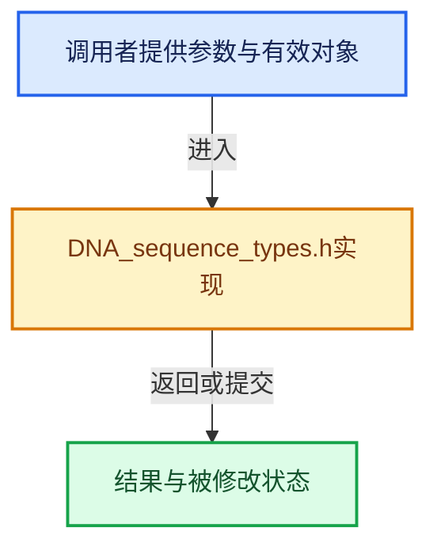

# 实现依赖专题：source/blender/makesdna/DNA_sequence_types.h

[实现依赖导航](../../README.md) · [符号索引](../../../00-课程指南/02-源码与提交索引/符号依赖与实现索引.md)

本专题从正文实际调用进入，集中保存共享实现。函数有稳定锚点，可从调用处直接跳到对应完整函数；递归与互相调用通过回链组织。

## 本文件的实现关系





## 相关类型布局与成员入口

<a id="t-63369f1fc0c7"></a>

### `blender::eStripFlag`

原始声明：[source/blender/makesdna/DNA_sequence_types.h](../../../../../../../source/blender/makesdna/DNA_sequence_types.h) · L42—L87。

以下保留类的数据声明与编译条件，成员函数实现通过后面的精确链接阅读。

<!-- annotated:4c0d766c47e81e -->

```cpp
enum eStripFlag : uint32_t {
  SEQ_FLAG_NONE = 0,
  SEQ_SELECT = (1 << 0),
  SEQ_LEFTSEL = (1 << 1),
  SEQ_RIGHTSEL = (1 << 2),
  /* (1 << 3) unused, set to zero by versioning code. */
  SEQ_DEINTERLACE = (1 << 4),
  SEQ_MUTE = (1 << 5),
  SEQ_FLAG_TEXT_EDITING_ACTIVE = (1 << 6),
  SEQ_REVERSE_FRAMES = (1 << 7),
  /* (1 << 8) unused, set to zero by versioning code. */
  /* (1 << 9) unused, set to zero by versioning code. */
  /* (1 << 10) unused, set to zero by versioning code. */
  SEQ_FLIPX = (1 << 11),
  SEQ_FLIPY = (1 << 12),
  SEQ_MAKE_FLOAT = (1 << 13),
  SEQ_LOCK = (1 << 14),
  SEQ_USE_PROXY = (1 << 15),
  /* (1 << 16) unused, set to zero by versioning code. */
  SEQ_AUTO_PLAYBACK_RATE = (1 << 17),
  SEQ_SINGLE_FRAME_CONTENT = (1 << 18),
  SEQ_SHOW_RETIMING = (1 << 19),
  /* (1 << 20) unused, set to zero by versioning code. */
  SEQ_MULTIPLY_ALPHA = (1 << 21),

  SEQ_USE_EFFECT_DEFAULT_FADE = (1 << 22),
  /* (1 << 23) unused, set to zero by versioning code. */

  /* Flags for whether those properties are animated or not */
  SEQ_AUDIO_VOLUME_ANIMATED = (1 << 24),
  SEQ_AUDIO_PITCH_ANIMATED = (1 << 25),
  SEQ_AUDIO_PAN_ANIMATED = (1 << 26),
  SEQ_AUDIO_DRAW_WAVEFORM = (1 << 27),

  /* Don't include annotations in OpenGL previews of Scene strips. */
  SEQ_SCENE_NO_ANNOTATION = (1 << 28),
  SEQ_USE_VIEWS = (1 << 29),

  /* Access scene strips directly (like a meta-strip). */
  SEQ_SCENE_STRIPS = (1 << 30),

  SEQ_AUDIO_PITCH_CORRECTION = (1u << 31),

  /* Convenience flag for all selection flags. */
  STRIP_ALLSEL = SEQ_SELECT | SEQ_LEFTSEL | SEQ_RIGHTSEL
};
```

<details>
<summary>核对原始源码：source/blender/makesdna/DNA_sequence_types.h · L42—L87</summary>

<!-- original:4c0d766c47e81e:source/blender/makesdna/DNA_sequence_types.h:42:87 -->

```cpp
enum eStripFlag : uint32_t {
  SEQ_FLAG_NONE = 0,
  SEQ_SELECT = (1 << 0),
  SEQ_LEFTSEL = (1 << 1),
  SEQ_RIGHTSEL = (1 << 2),
  /* (1 << 3) unused, set to zero by versioning code. */
  SEQ_DEINTERLACE = (1 << 4),
  SEQ_MUTE = (1 << 5),
  SEQ_FLAG_TEXT_EDITING_ACTIVE = (1 << 6),
  SEQ_REVERSE_FRAMES = (1 << 7),
  /* (1 << 8) unused, set to zero by versioning code. */
  /* (1 << 9) unused, set to zero by versioning code. */
  /* (1 << 10) unused, set to zero by versioning code. */
  SEQ_FLIPX = (1 << 11),
  SEQ_FLIPY = (1 << 12),
  SEQ_MAKE_FLOAT = (1 << 13),
  SEQ_LOCK = (1 << 14),
  SEQ_USE_PROXY = (1 << 15),
  /* (1 << 16) unused, set to zero by versioning code. */
  SEQ_AUTO_PLAYBACK_RATE = (1 << 17),
  SEQ_SINGLE_FRAME_CONTENT = (1 << 18),
  SEQ_SHOW_RETIMING = (1 << 19),
  /* (1 << 20) unused, set to zero by versioning code. */
  SEQ_MULTIPLY_ALPHA = (1 << 21),

  SEQ_USE_EFFECT_DEFAULT_FADE = (1 << 22),
  /* (1 << 23) unused, set to zero by versioning code. */

  /* Flags for whether those properties are animated or not */
  SEQ_AUDIO_VOLUME_ANIMATED = (1 << 24),
  SEQ_AUDIO_PITCH_ANIMATED = (1 << 25),
  SEQ_AUDIO_PAN_ANIMATED = (1 << 26),
  SEQ_AUDIO_DRAW_WAVEFORM = (1 << 27),

  /* Don't include annotations in OpenGL previews of Scene strips. */
  SEQ_SCENE_NO_ANNOTATION = (1 << 28),
  SEQ_USE_VIEWS = (1 << 29),

  /* Access scene strips directly (like a meta-strip). */
  SEQ_SCENE_STRIPS = (1 << 30),

  SEQ_AUDIO_PITCH_CORRECTION = (1u << 31),

  /* Convenience flag for all selection flags. */
  STRIP_ALLSEL = SEQ_SELECT | SEQ_LEFTSEL | SEQ_RIGHTSEL
};
```

</details>


<a id="t-c8100f5144c1"></a>

### `blender::eEffectSpeedControlFlags`

原始声明：[source/blender/makesdna/DNA_sequence_types.h](../../../../../../../source/blender/makesdna/DNA_sequence_types.h) · L711—L717。

以下保留类的数据声明与编译条件，成员函数实现通过后面的精确链接阅读。

<!-- annotated:ce367e3e2e9d84 -->

```cpp
enum eEffectSpeedControlFlags : uint32_t {
  SEQ_SPEED_NONE = 0,
  SEQ_SPEED_UNUSED_2 = 1 << 0, /* Cleared. */
  SEQ_SPEED_UNUSED_1 = 1 << 1, /* Cleared. */
  SEQ_SPEED_UNUSED_3 = 1 << 2, /* Cleared. */
  SEQ_SPEED_USE_INTERPOLATION = 1 << 3,
};
```

<details>
<summary>核对原始源码：source/blender/makesdna/DNA_sequence_types.h · L711—L717</summary>

<!-- original:ce367e3e2e9d84:source/blender/makesdna/DNA_sequence_types.h:711:717 -->

```cpp
enum eEffectSpeedControlFlags : uint32_t {
  SEQ_SPEED_NONE = 0,
  SEQ_SPEED_UNUSED_2 = 1 << 0, /* Cleared. */
  SEQ_SPEED_UNUSED_1 = 1 << 1, /* Cleared. */
  SEQ_SPEED_UNUSED_3 = 1 << 2, /* Cleared. */
  SEQ_SPEED_USE_INTERPOLATION = 1 << 3,
};
```

</details>


## 完整成员与函数实现

<a id="f-5747f930a56b8ce6"></a>

### `blender::SeqTimelineChannel::is_muted`

实现位置：[source/blender/makesdna/DNA_sequence_types.h](../../../../../../../source/blender/makesdna/DNA_sequence_types.h) · L598—L601。

**教学注释版**

<!-- annotated:234d0167da2477 -->

```cpp
  bool is_muted() const
  {
    return (this->flag & SEQ_CHANNEL_MUTE) != 0;
  }
```

<details>
<summary>核对原始源码：source/blender/makesdna/DNA_sequence_types.h · L598—L601</summary>

<!-- original:234d0167da2477:source/blender/makesdna/DNA_sequence_types.h:598:601 -->

```cpp
  bool is_muted() const
  {
    return (this->flag & SEQ_CHANNEL_MUTE) != 0;
  }
```

</details>

**结果出口**

- `return (this->flag & SEQ_CHANNEL_MUTE) != 0;`

**继续追踪实现**

本实现没有需要继续展开的显式调用；检查返回表达式、对象转换和调用者前置条件。
