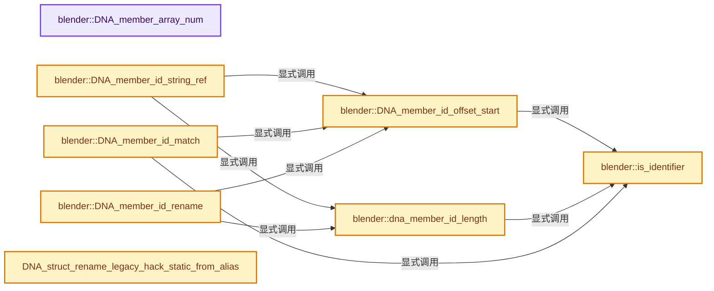
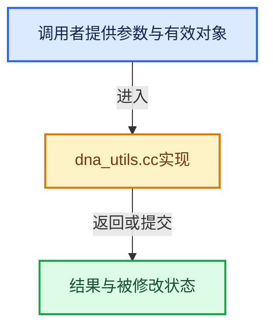

# 实现依赖专题：source/blender/makesdna/intern/dna_utils.cc

[实现依赖导航](../../../README.md) · [符号索引](../../../../00-课程指南/02-源码与提交索引/符号依赖与实现索引.md)

本专题从正文实际调用进入，集中保存共享实现。函数有稳定锚点，可从调用处直接跳到对应完整函数；递归与互相调用通过回链组织。

## 本文件的实现关系






## 完整成员与函数实现

<a id="f-9bf1f9298dc562ae"></a>

### `blender::DNA_member_array_num`

实现位置：[source/blender/makesdna/intern/dna_utils.cc](../../../../../../../../source/blender/makesdna/intern/dna_utils.cc) · L28—L57。

接口参数：

- `const StringRef str`

**教学注释版**

<!-- annotated:49ef5178e0a67a -->

```cpp
int DNA_member_array_num(const StringRef str)
{
  int result = 1;
  int current = 0;
  for (const char c : str) {
    switch (c) {
      case '[':
        current = 0;
        break;
      case ']':
        result *= current;
        break;
      case '0':
      case '1':
      case '2':
      case '3':
      case '4':
      case '5':
      case '6':
      case '7':
      case '8':
      case '9':
        current = current * 10 + (c - '0');
        break;
      default:
        break;
    }
  }
  return result;
}
```

<details>
<summary>核对原始源码：source/blender/makesdna/intern/dna_utils.cc · L28—L57</summary>

<!-- original:49ef5178e0a67a:source/blender/makesdna/intern/dna_utils.cc:28:57 -->

```cpp
int DNA_member_array_num(const StringRef str)
{
  int result = 1;
  int current = 0;
  for (const char c : str) {
    switch (c) {
      case '[':
        current = 0;
        break;
      case ']':
        result *= current;
        break;
      case '0':
      case '1':
      case '2':
      case '3':
      case '4':
      case '5':
      case '6':
      case '7':
      case '8':
      case '9':
        current = current * 10 + (c - '0');
        break;
      default:
        break;
    }
  }
  return result;
}
```

</details>

**沿实际写入检查状态**

- `current = 0;`
- `result *= current;`
- `current = current * 10 + (c - '0');`

**结果出口**

- `return result;`

**继续追踪实现**

本实现没有需要继续展开的显式调用；检查返回表达式、对象转换和调用者前置条件。

<a id="f-ce67e4ca39907dd7"></a>

### `blender::is_identifier`

实现位置：[source/blender/makesdna/intern/dna_utils.cc](../../../../../../../../source/blender/makesdna/intern/dna_utils.cc) · L65—L69。

接口参数：

- `const char c`

**教学注释版**

<!-- annotated:e4dd818d5b962f -->

```cpp
static bool is_identifier(const char c)
{
  return ((c >= 'a' && c <= 'z') || (c >= 'A' && c <= 'Z') || (c >= '0' && c <= '9') ||
          (c == '_'));
}
```

<details>
<summary>核对原始源码：source/blender/makesdna/intern/dna_utils.cc · L65—L69</summary>

<!-- original:e4dd818d5b962f:source/blender/makesdna/intern/dna_utils.cc:65:69 -->

```cpp
static bool is_identifier(const char c)
{
  return ((c >= 'a' && c <= 'z') || (c >= 'A' && c <= 'Z') || (c >= '0' && c <= '9') ||
          (c == '_'));
}
```

</details>

**结果出口**

- `return ((c >= 'a' && c <= 'z') || (c >= 'A' && c <= 'Z') || (c >= '0' && c <= '9') ||`

**继续追踪实现**

本实现没有需要继续展开的显式调用；检查返回表达式、对象转换和调用者前置条件。

<a id="f-dcb10830f95c4cd2"></a>

### `blender::DNA_member_id_offset_start`

实现位置：[source/blender/makesdna/intern/dna_utils.cc](../../../../../../../../source/blender/makesdna/intern/dna_utils.cc) · L71—L82。

接口参数：

- `const StringRef member_full`

**教学注释版**

<!-- annotated:efceb3b5483607 -->

```cpp
uint DNA_member_id_offset_start(const StringRef member_full)
{
  uint elem_full_offset = 0;
  /* NOTE(@ideasman42): checking nil is needed for invalid names such as `*`,
   * these were written by older versions of Blender (v2.66).
   * In this case the "name" part will be an empty string.
   * The member cannot be used, this just prevents a crash. */
  while (elem_full_offset < member_full.size() && !is_identifier(member_full[elem_full_offset])) {
    elem_full_offset++;
  }
  return elem_full_offset;
}
```

<details>
<summary>核对原始源码：source/blender/makesdna/intern/dna_utils.cc · L71—L82</summary>

<!-- original:efceb3b5483607:source/blender/makesdna/intern/dna_utils.cc:71:82 -->

```cpp
uint DNA_member_id_offset_start(const StringRef member_full)
{
  uint elem_full_offset = 0;
  /* NOTE(@ideasman42): checking nil is needed for invalid names such as `*`,
   * these were written by older versions of Blender (v2.66).
   * In this case the "name" part will be an empty string.
   * The member cannot be used, this just prevents a crash. */
  while (elem_full_offset < member_full.size() && !is_identifier(member_full[elem_full_offset])) {
    elem_full_offset++;
  }
  return elem_full_offset;
}
```

</details>

**结果出口**

- `return elem_full_offset;`

**继续追踪实现**

- `member_full.size` → [blender::Bounds<T>::size · L543](../../../../12-空间数据结构与几何算法/07-Bounds与BVH对比.md#f-fcce88c0824fcd97)；[blender::GVArrayImpl::size · L651](../../../../04-虚拟数组与索引选择/05-GVArray运行时类型.md#f-f23d3d1f3b110f1e)；[blender::GVArrayCommon::size · L759](../../../../04-虚拟数组与索引选择/05-GVArray运行时类型.md#f-0856784f4e4fd3c9)；[blender::StringRefBase::size · L196](../../../../01-基础容器与现代CPP/15-StringRef字符串视图.md#f-60d4631c74931d2e)；[blender::KDTreeNew<T>::size · L493](../../../../12-空间数据结构与几何算法/05-K近邻与范围查询.md#f-233c05ce6d5c8d39)；[blender::MainAllIDsIterator::size · L1291](../../../02-BKE几何与数据/intern/main.cc.md#f-520d1311c646452f)；[blender::GLSourcesBaked::size · L1541](../../gpu/opengl/gl_shader.cc.md#f-5b5b539d533c6792)。同名重载需按实参类型选择。
- `is_identifier` → [blender::is_identifier · L65](dna_utils.cc.md#f-ce67e4ca39907dd7)。

<a id="f-815fb3df6edc03a7"></a>

### `blender::dna_member_id_length`

实现位置：[source/blender/makesdna/intern/dna_utils.cc](../../../../../../../../source/blender/makesdna/intern/dna_utils.cc) · L84—L93。

接口参数：

- `const StringRef member_full_trimmed`

**教学注释版**

<!-- annotated:705e44e45891cf -->

```cpp
static uint dna_member_id_length(const StringRef member_full_trimmed)
{
  uint elem_full_offset = 0;
  while (elem_full_offset < member_full_trimmed.size() &&
         is_identifier(member_full_trimmed[elem_full_offset]))
  {
    elem_full_offset++;
  }
  return elem_full_offset;
}
```

<details>
<summary>核对原始源码：source/blender/makesdna/intern/dna_utils.cc · L84—L93</summary>

<!-- original:705e44e45891cf:source/blender/makesdna/intern/dna_utils.cc:84:93 -->

```cpp
static uint dna_member_id_length(const StringRef member_full_trimmed)
{
  uint elem_full_offset = 0;
  while (elem_full_offset < member_full_trimmed.size() &&
         is_identifier(member_full_trimmed[elem_full_offset]))
  {
    elem_full_offset++;
  }
  return elem_full_offset;
}
```

</details>

**结果出口**

- `return elem_full_offset;`

**继续追踪实现**

- `member_full_trimmed.size` → [blender::Bounds<T>::size · L543](../../../../12-空间数据结构与几何算法/07-Bounds与BVH对比.md#f-fcce88c0824fcd97)；[blender::GVArrayImpl::size · L651](../../../../04-虚拟数组与索引选择/05-GVArray运行时类型.md#f-f23d3d1f3b110f1e)；[blender::GVArrayCommon::size · L759](../../../../04-虚拟数组与索引选择/05-GVArray运行时类型.md#f-0856784f4e4fd3c9)；[blender::StringRefBase::size · L196](../../../../01-基础容器与现代CPP/15-StringRef字符串视图.md#f-60d4631c74931d2e)；[blender::KDTreeNew<T>::size · L493](../../../../12-空间数据结构与几何算法/05-K近邻与范围查询.md#f-233c05ce6d5c8d39)；[blender::MainAllIDsIterator::size · L1291](../../../02-BKE几何与数据/intern/main.cc.md#f-520d1311c646452f)；[blender::GLSourcesBaked::size · L1541](../../gpu/opengl/gl_shader.cc.md#f-5b5b539d533c6792)。同名重载需按实参类型选择。
- `is_identifier` → [blender::is_identifier · L65](dna_utils.cc.md#f-ce67e4ca39907dd7)。

<a id="f-0878f89f0c5cc8de"></a>

### `blender::DNA_member_id_string_ref`

实现位置：[source/blender/makesdna/intern/dna_utils.cc](../../../../../../../../source/blender/makesdna/intern/dna_utils.cc) · L95—L100。

接口参数：

- `const StringRef member_full`

**教学注释版**

<!-- annotated:40371c612957ac -->

```cpp
StringRef DNA_member_id_string_ref(const StringRef member_full)
{
  const uint id_start = DNA_member_id_offset_start(member_full);
  const StringRef member_id = member_full.drop_prefix(id_start);
  return member_id.substr(0, dna_member_id_length(member_id));
}
```

<details>
<summary>核对原始源码：source/blender/makesdna/intern/dna_utils.cc · L95—L100</summary>

<!-- original:40371c612957ac:source/blender/makesdna/intern/dna_utils.cc:95:100 -->

```cpp
StringRef DNA_member_id_string_ref(const StringRef member_full)
{
  const uint id_start = DNA_member_id_offset_start(member_full);
  const StringRef member_id = member_full.drop_prefix(id_start);
  return member_id.substr(0, dna_member_id_length(member_id));
}
```

</details>

**结果出口**

- `return member_id.substr(0, dna_member_id_length(member_id));`

**继续追踪实现**

- `DNA_member_id_offset_start` → [blender::DNA_member_id_offset_start · L71](dna_utils.cc.md#f-dcb10830f95c4cd2)。
- `member_full.drop_prefix` → [blender::StringRef::drop_prefix · L578](../../../../01-基础容器与现代CPP/15-StringRef字符串视图.md#f-d6d7a931996e7e19)。
- `member_id.substr` → [blender::StringRefBase::substr · L303](../../../../01-基础容器与现代CPP/15-StringRef字符串视图.md#f-cc876508a516d26d)。
- `dna_member_id_length` → [blender::dna_member_id_length · L84](dna_utils.cc.md#f-815fb3df6edc03a7)。

<a id="f-f9337f00df02e61f"></a>

### `blender::DNA_member_id_match`

实现位置：[source/blender/makesdna/intern/dna_utils.cc](../../../../../../../../source/blender/makesdna/intern/dna_utils.cc) · L102—L116。

接口参数：

- `const StringRef member_id`
- `const StringRef member_full`
- `uint *r_member_full_offset`

**教学注释版**

<!-- annotated:d384983e140faf -->

```cpp
bool DNA_member_id_match(const StringRef member_id,
                         const StringRef member_full,
                         uint *r_member_full_offset)
{
  const uint elem_full_offset = DNA_member_id_offset_start(member_full);
  const StringRef elem_full_trim = member_full.drop_prefix(elem_full_offset);
  if (elem_full_trim.startswith(member_id)) {
    const int64_t next = member_id.size();
    if (next == elem_full_trim.size() || !is_identifier(elem_full_trim[next])) {
      *r_member_full_offset = elem_full_offset;
      return true;
    }
  }
  return false;
}
```

<details>
<summary>核对原始源码：source/blender/makesdna/intern/dna_utils.cc · L102—L116</summary>

<!-- original:d384983e140faf:source/blender/makesdna/intern/dna_utils.cc:102:116 -->

```cpp
bool DNA_member_id_match(const StringRef member_id,
                         const StringRef member_full,
                         uint *r_member_full_offset)
{
  const uint elem_full_offset = DNA_member_id_offset_start(member_full);
  const StringRef elem_full_trim = member_full.drop_prefix(elem_full_offset);
  if (elem_full_trim.startswith(member_id)) {
    const int64_t next = member_id.size();
    if (next == elem_full_trim.size() || !is_identifier(elem_full_trim[next])) {
      *r_member_full_offset = elem_full_offset;
      return true;
    }
  }
  return false;
}
```

</details>

**结果出口**

- `return true;`
- `return false;`

**继续追踪实现**

- `DNA_member_id_offset_start` → [blender::DNA_member_id_offset_start · L71](dna_utils.cc.md#f-dcb10830f95c4cd2)。
- `member_full.drop_prefix` → [blender::StringRef::drop_prefix · L578](../../../../01-基础容器与现代CPP/15-StringRef字符串视图.md#f-d6d7a931996e7e19)。
- `elem_full_trim.startswith` → [blender::StringRefBase::startswith · L269](../../../../01-基础容器与现代CPP/15-StringRef字符串视图.md#f-78237ccfe249bfa5)。
- `member_id.size` → [blender::Bounds<T>::size · L543](../../../../12-空间数据结构与几何算法/07-Bounds与BVH对比.md#f-fcce88c0824fcd97)；[blender::GVArrayImpl::size · L651](../../../../04-虚拟数组与索引选择/05-GVArray运行时类型.md#f-f23d3d1f3b110f1e)；[blender::GVArrayCommon::size · L759](../../../../04-虚拟数组与索引选择/05-GVArray运行时类型.md#f-0856784f4e4fd3c9)；[blender::StringRefBase::size · L196](../../../../01-基础容器与现代CPP/15-StringRef字符串视图.md#f-60d4631c74931d2e)；[blender::KDTreeNew<T>::size · L493](../../../../12-空间数据结构与几何算法/05-K近邻与范围查询.md#f-233c05ce6d5c8d39)；[blender::MainAllIDsIterator::size · L1291](../../../02-BKE几何与数据/intern/main.cc.md#f-520d1311c646452f)；[blender::GLSourcesBaked::size · L1541](../../gpu/opengl/gl_shader.cc.md#f-5b5b539d533c6792)。同名重载需按实参类型选择。
- `elem_full_trim.size` → [blender::Bounds<T>::size · L543](../../../../12-空间数据结构与几何算法/07-Bounds与BVH对比.md#f-fcce88c0824fcd97)；[blender::GVArrayImpl::size · L651](../../../../04-虚拟数组与索引选择/05-GVArray运行时类型.md#f-f23d3d1f3b110f1e)；[blender::GVArrayCommon::size · L759](../../../../04-虚拟数组与索引选择/05-GVArray运行时类型.md#f-0856784f4e4fd3c9)；[blender::StringRefBase::size · L196](../../../../01-基础容器与现代CPP/15-StringRef字符串视图.md#f-60d4631c74931d2e)；[blender::KDTreeNew<T>::size · L493](../../../../12-空间数据结构与几何算法/05-K近邻与范围查询.md#f-233c05ce6d5c8d39)；[blender::MainAllIDsIterator::size · L1291](../../../02-BKE几何与数据/intern/main.cc.md#f-520d1311c646452f)；[blender::GLSourcesBaked::size · L1541](../../gpu/opengl/gl_shader.cc.md#f-5b5b539d533c6792)。同名重载需按实参类型选择。
- `is_identifier` → [blender::is_identifier · L65](dna_utils.cc.md#f-ce67e4ca39907dd7)。

<a id="f-5e49e1e324453e58"></a>

### `blender::DNA_member_id_rename`

实现位置：[source/blender/makesdna/intern/dna_utils.cc](../../../../../../../../source/blender/makesdna/intern/dna_utils.cc) · L118—L150。

接口参数：

- `LinearAllocator<> &mem_arena`
- `const StringRef member_id_src`
- `const StringRef member_id_dst`
- `const StringRef member_full_src`
- `const uint member_full_src_offset_len`

**教学注释版**

<!-- annotated:2b3fdf9d4bc155 -->

```cpp
StringRef DNA_member_id_rename(LinearAllocator<> &mem_arena,
                               const StringRef member_id_src,
                               const StringRef member_id_dst,
                               const StringRef member_full_src,
                               const uint member_full_src_offset_len)
{
  BLI_assert(DNA_member_id_offset_start(member_full_src) == member_full_src_offset_len);

  const int64_t member_full_dst_len = (member_full_src.size() - member_id_src.size()) +
                                      member_id_dst.size();
  char *member_full_dst = mem_arena.allocate_array<char>(member_full_dst_len + 1).data();
  int64_t i = 0;
  if (member_full_src_offset_len != 0) {
    // [讲解] memcpy：复制字节，源与目标不应重叠。类型生命周期、对齐和可复制表示须由调用者证明，不是任意对象的复制构造。
    memcpy(member_full_dst, member_full_src.data(), member_full_src_offset_len);
    i = member_full_src_offset_len;
  }
  memcpy(&member_full_dst[i], member_id_dst.data(), member_id_dst.size());
  i += member_id_dst.size();
  const int64_t member_full_src_offset_end = member_full_src_offset_len + member_id_src.size();
  BLI_assert(dna_member_id_length(member_full_src.drop_prefix(member_full_src_offset_len)) ==
             (member_full_src_offset_end - member_full_src_offset_len));
  if (member_full_src_offset_end != member_full_src.size()) {
    const int64_t member_full_tail_len = member_full_src.size() - member_full_src_offset_end;
    memcpy(&member_full_dst[i],
           member_full_src.data() + member_full_src_offset_end,
           member_full_tail_len);
    i += member_full_tail_len;
  }
  member_full_dst[i] = '\0';
  BLI_assert(i == member_full_dst_len);
  UNUSED_VARS_NDEBUG(i);
  return member_full_dst;
}
```

<details>
<summary>核对原始源码：source/blender/makesdna/intern/dna_utils.cc · L118—L150</summary>

<!-- original:2b3fdf9d4bc155:source/blender/makesdna/intern/dna_utils.cc:118:150 -->

```cpp
StringRef DNA_member_id_rename(LinearAllocator<> &mem_arena,
                               const StringRef member_id_src,
                               const StringRef member_id_dst,
                               const StringRef member_full_src,
                               const uint member_full_src_offset_len)
{
  BLI_assert(DNA_member_id_offset_start(member_full_src) == member_full_src_offset_len);

  const int64_t member_full_dst_len = (member_full_src.size() - member_id_src.size()) +
                                      member_id_dst.size();
  char *member_full_dst = mem_arena.allocate_array<char>(member_full_dst_len + 1).data();
  int64_t i = 0;
  if (member_full_src_offset_len != 0) {
    memcpy(member_full_dst, member_full_src.data(), member_full_src_offset_len);
    i = member_full_src_offset_len;
  }
  memcpy(&member_full_dst[i], member_id_dst.data(), member_id_dst.size());
  i += member_id_dst.size();
  const int64_t member_full_src_offset_end = member_full_src_offset_len + member_id_src.size();
  BLI_assert(dna_member_id_length(member_full_src.drop_prefix(member_full_src_offset_len)) ==
             (member_full_src_offset_end - member_full_src_offset_len));
  if (member_full_src_offset_end != member_full_src.size()) {
    const int64_t member_full_tail_len = member_full_src.size() - member_full_src_offset_end;
    memcpy(&member_full_dst[i],
           member_full_src.data() + member_full_src_offset_end,
           member_full_tail_len);
    i += member_full_tail_len;
  }
  member_full_dst[i] = '\0';
  BLI_assert(i == member_full_dst_len);
  UNUSED_VARS_NDEBUG(i);
  return member_full_dst;
}
```

</details>

**沿实际写入检查状态**

- `i = member_full_src_offset_len;`
- `i += member_id_dst.size();`
- `i += member_full_tail_len;`
- `member_full_dst[i] = '\0';`

**结果出口**

- `return member_full_dst;`

**继续追踪实现**

- `BLI_assert` → [BLI_assert · L48](../../../01-BLI基础库/BLI_assert.hh.md#m-57a88495704d)；[BLI_assert · L63](../../../01-BLI基础库/BLI_assert.hh.md#m-d07050020cb5)。宏定义由构建条件选择。
- `DNA_member_id_offset_start` → [blender::DNA_member_id_offset_start · L71](dna_utils.cc.md#f-dcb10830f95c4cd2)。
- `member_full_src.size` → [blender::Bounds<T>::size · L543](../../../../12-空间数据结构与几何算法/07-Bounds与BVH对比.md#f-fcce88c0824fcd97)；[blender::GVArrayImpl::size · L651](../../../../04-虚拟数组与索引选择/05-GVArray运行时类型.md#f-f23d3d1f3b110f1e)；[blender::GVArrayCommon::size · L759](../../../../04-虚拟数组与索引选择/05-GVArray运行时类型.md#f-0856784f4e4fd3c9)；[blender::StringRefBase::size · L196](../../../../01-基础容器与现代CPP/15-StringRef字符串视图.md#f-60d4631c74931d2e)；[blender::KDTreeNew<T>::size · L493](../../../../12-空间数据结构与几何算法/05-K近邻与范围查询.md#f-233c05ce6d5c8d39)；[blender::MainAllIDsIterator::size · L1291](../../../02-BKE几何与数据/intern/main.cc.md#f-520d1311c646452f)；[blender::GLSourcesBaked::size · L1541](../../gpu/opengl/gl_shader.cc.md#f-5b5b539d533c6792)。同名重载需按实参类型选择。
- `member_id_src.size` → [blender::Bounds<T>::size · L543](../../../../12-空间数据结构与几何算法/07-Bounds与BVH对比.md#f-fcce88c0824fcd97)；[blender::GVArrayImpl::size · L651](../../../../04-虚拟数组与索引选择/05-GVArray运行时类型.md#f-f23d3d1f3b110f1e)；[blender::GVArrayCommon::size · L759](../../../../04-虚拟数组与索引选择/05-GVArray运行时类型.md#f-0856784f4e4fd3c9)；[blender::StringRefBase::size · L196](../../../../01-基础容器与现代CPP/15-StringRef字符串视图.md#f-60d4631c74931d2e)；[blender::KDTreeNew<T>::size · L493](../../../../12-空间数据结构与几何算法/05-K近邻与范围查询.md#f-233c05ce6d5c8d39)；[blender::MainAllIDsIterator::size · L1291](../../../02-BKE几何与数据/intern/main.cc.md#f-520d1311c646452f)；[blender::GLSourcesBaked::size · L1541](../../gpu/opengl/gl_shader.cc.md#f-5b5b539d533c6792)。同名重载需按实参类型选择。
- `member_id_dst.size` → [blender::Bounds<T>::size · L543](../../../../12-空间数据结构与几何算法/07-Bounds与BVH对比.md#f-fcce88c0824fcd97)；[blender::GVArrayImpl::size · L651](../../../../04-虚拟数组与索引选择/05-GVArray运行时类型.md#f-f23d3d1f3b110f1e)；[blender::GVArrayCommon::size · L759](../../../../04-虚拟数组与索引选择/05-GVArray运行时类型.md#f-0856784f4e4fd3c9)；[blender::StringRefBase::size · L196](../../../../01-基础容器与现代CPP/15-StringRef字符串视图.md#f-60d4631c74931d2e)；[blender::KDTreeNew<T>::size · L493](../../../../12-空间数据结构与几何算法/05-K近邻与范围查询.md#f-233c05ce6d5c8d39)；[blender::MainAllIDsIterator::size · L1291](../../../02-BKE几何与数据/intern/main.cc.md#f-520d1311c646452f)；[blender::GLSourcesBaked::size · L1541](../../gpu/opengl/gl_shader.cc.md#f-5b5b539d533c6792)。同名重载需按实参类型选择。
- `mem_arena.allocate_array<char>(member_full_dst_len + 1).data` → [调用协议](../../../../00-课程指南/01-路线与规范/模板宏与动态分派协议.md)：接收对象类型依赖auto、返回值或模板实例；不按同名猜测目标。调用位置L128。
- `mem_arena.allocate_array<char>` → [blender::LinearAllocator::allocate_array · L115](../../../../03-内存分配与运行时类型/02-LinearAllocator布局.md#f-a4f71808bf7434ab)；[blender::LinearAllocator::allocate_array · L122](../../../../03-内存分配与运行时类型/02-LinearAllocator布局.md#f-3957475aeffc5dc7)。同名重载需按实参类型选择。
- `memcpy` → [外部契约](https://eel.is/c++draft/cstring.syn)：复制字节，源与目标不应重叠。类型生命周期、对齐和可复制表示须由调用者证明，不是任意对象的复制构造。
- `member_full_src.data` → [blender::StringRefBase::data · L209](../../../../01-基础容器与现代CPP/15-StringRef字符串视图.md#f-cced1a1ccd124155)。
- `member_id_dst.data` → [blender::StringRefBase::data · L209](../../../../01-基础容器与现代CPP/15-StringRef字符串视图.md#f-cced1a1ccd124155)。
- `dna_member_id_length` → [blender::dna_member_id_length · L84](dna_utils.cc.md#f-815fb3df6edc03a7)。
- `member_full_src.drop_prefix` → [blender::StringRef::drop_prefix · L578](../../../../01-基础容器与现代CPP/15-StringRef字符串视图.md#f-d6d7a931996e7e19)。
- `UNUSED_VARS_NDEBUG` → [UNUSED_VARS_NDEBUG · L526](../../../01-BLI基础库/BLI_utildefines.hh.md#m-fea439f7d366)；[UNUSED_VARS_NDEBUG · L528](../../../01-BLI基础库/BLI_utildefines.hh.md#m-a8f8cfac06c0)。宏定义由构建条件选择。

<a id="f-14e15d1d1fd20331"></a>

### `DNA_struct_rename_legacy_hack_static_from_alias`

实现位置：[source/blender/makesdna/intern/dna_utils.cc](../../../../../../../../source/blender/makesdna/intern/dna_utils.cc) · L228—L242。

接口参数：

- `const StringRef name`

**教学注释版**

<!-- annotated:16a50666fda682 -->

```cpp
StringRef DNA_struct_rename_legacy_hack_static_from_alias(const StringRef name)
{
  /* 'bScreen' replaces the old IrisGL 'Screen' struct */
  if ("bScreen" == name) {
    return "Screen";
  }
  /* Groups renamed to collections in 2.8 */
  if ("Collection" == name) {
    return "Group";
  }
  if ("CollectionObject" == name) {
    return "GroupObject";
  }
  return name;
}
```

<details>
<summary>核对原始源码：source/blender/makesdna/intern/dna_utils.cc · L228—L242</summary>

<!-- original:16a50666fda682:source/blender/makesdna/intern/dna_utils.cc:228:242 -->

```cpp
StringRef DNA_struct_rename_legacy_hack_static_from_alias(const StringRef name)
{
  /* 'bScreen' replaces the old IrisGL 'Screen' struct */
  if ("bScreen" == name) {
    return "Screen";
  }
  /* Groups renamed to collections in 2.8 */
  if ("Collection" == name) {
    return "Group";
  }
  if ("CollectionObject" == name) {
    return "GroupObject";
  }
  return name;
}
```

</details>

**结果出口**

- `return "Screen";`
- `return "Group";`
- `return "GroupObject";`
- `return name;`

**继续追踪实现**

本实现没有需要继续展开的显式调用；检查返回表达式、对象转换和调用者前置条件。

<a id="f-0853f7537c9d333a"></a>

### `DNA_struct_rename_legacy_hack_alias_from_static`

实现位置：[source/blender/makesdna/intern/dna_utils.cc](../../../../../../../../source/blender/makesdna/intern/dna_utils.cc) · L244—L258。

接口参数：

- `const StringRef name`

**教学注释版**

<!-- annotated:102ee2b7fd9fd9 -->

```cpp
StringRef DNA_struct_rename_legacy_hack_alias_from_static(const StringRef name)
{
  /* 'bScreen' replaces the old IrisGL 'Screen' struct */
  if ("Screen" == name) {
    return "bScreen";
  }
  /* Groups renamed to collections in 2.8 */
  if ("Group" == name) {
    return "Collection";
  }
  if ("GroupObject" == name) {
    return "CollectionObject";
  }
  return name;
}
```

<details>
<summary>核对原始源码：source/blender/makesdna/intern/dna_utils.cc · L244—L258</summary>

<!-- original:102ee2b7fd9fd9:source/blender/makesdna/intern/dna_utils.cc:244:258 -->

```cpp
StringRef DNA_struct_rename_legacy_hack_alias_from_static(const StringRef name)
{
  /* 'bScreen' replaces the old IrisGL 'Screen' struct */
  if ("Screen" == name) {
    return "bScreen";
  }
  /* Groups renamed to collections in 2.8 */
  if ("Group" == name) {
    return "Collection";
  }
  if ("GroupObject" == name) {
    return "CollectionObject";
  }
  return name;
}
```

</details>

**结果出口**

- `return "bScreen";`
- `return "Collection";`
- `return "CollectionObject";`
- `return name;`

**继续追踪实现**

本实现没有需要继续展开的显式调用；检查返回表达式、对象转换和调用者前置条件。

<a id="f-1411eddf78e71fc9"></a>

### `_DNA_internal_swap`

实现位置：[source/blender/makesdna/intern/dna_utils.cc](../../../../../../../../source/blender/makesdna/intern/dna_utils.cc) · L276—L282。

接口参数：

- `void *a`
- `void *b`
- `const size_t size`

**教学注释版**

<!-- annotated:336b2d75930b74 -->

```cpp
void _DNA_internal_swap(void *a, void *b, const size_t size)
{
  void *tmp = alloca(size);
  // [讲解] memcpy：复制字节，源与目标不应重叠。类型生命周期、对齐和可复制表示须由调用者证明，不是任意对象的复制构造。
  memcpy(tmp, a, size);
  memcpy(a, b, size);
  memcpy(b, tmp, size);
}
```

<details>
<summary>核对原始源码：source/blender/makesdna/intern/dna_utils.cc · L276—L282</summary>

<!-- original:336b2d75930b74:source/blender/makesdna/intern/dna_utils.cc:276:282 -->

```cpp
void _DNA_internal_swap(void *a, void *b, const size_t size)
{
  void *tmp = alloca(size);
  memcpy(tmp, a, size);
  memcpy(a, b, size);
  memcpy(b, tmp, size);
}
```

</details>

**继续追踪实现**

- `alloca` → [alloca · L19](../../../01-BLI基础库/BLI_compiler_compat.hh.md#m-3f4c0afdcf42)。宏定义由构建条件选择。
- `memcpy` → [外部契约](https://eel.is/c++draft/cstring.syn)：复制字节，源与目标不应重叠。类型生命周期、对齐和可复制表示须由调用者证明，不是任意对象的复制构造。
