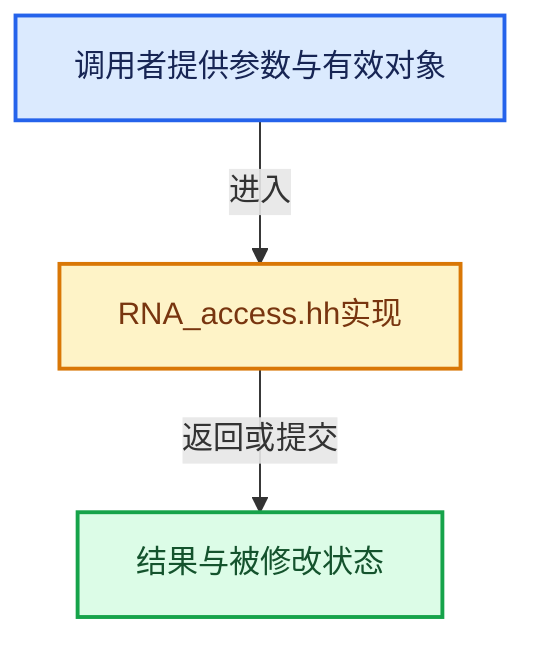

# 实现依赖专题：source/blender/makesrna/RNA_access.hh

[实现依赖导航](../../README.md) · [符号索引](../../../00-课程指南/02-源码与提交索引/符号依赖与实现索引.md)

本专题从正文实际调用进入，集中保存共享实现。函数有稳定锚点，可从调用处直接跳到对应完整函数；递归与互相调用通过回链组织。

## 本文件的实现关系





<a id="m-f66bb84fb7b4"></a>

## 宏 `RNA_PROP_BEGIN`

<!-- annotated:5bbed4e189907d -->

```cpp
#define RNA_PROP_BEGIN(sptr, itemptr, prop) \
  { \
    CollectionPropertyIterator rna_macro_iter; \
    for (RNA_property_collection_begin(sptr, prop, &rna_macro_iter); rna_macro_iter.valid; \
         RNA_property_collection_next(&rna_macro_iter)) \
    { \
      PointerRNA itemptr = rna_macro_iter.ptr;

```

<details>
<summary>核对原始源码：source/blender/makesrna/RNA_access.hh · L822—L829</summary>

<!-- original:5bbed4e189907d:source/blender/makesrna/RNA_access.hh:822:829 -->

```cpp
#define RNA_PROP_BEGIN(sptr, itemptr, prop) \
  { \
    CollectionPropertyIterator rna_macro_iter; \
    for (RNA_property_collection_begin(sptr, prop, &rna_macro_iter); rna_macro_iter.valid; \
         RNA_property_collection_next(&rna_macro_iter)) \
    { \
      PointerRNA itemptr = rna_macro_iter.ptr;

```

</details>

宏在预处理阶段展开，参数替换、重复求值和条件编译应直接从该定义检查。与普通函数不同，宏不会自动提供参数类型检查；构建配置选择哪个定义需结合外围条件。

<a id="m-e0d1e461ee20"></a>

## 宏 `RNA_STRUCT_BEGIN`

<!-- annotated:4ae2342934ec39 -->

```cpp
#define RNA_STRUCT_BEGIN(sptr, prop) \
  { \
    CollectionPropertyIterator rna_macro_iter{}; \
    for (RNA_property_collection_begin( \
             sptr, RNA_struct_iterator_property((sptr)->type), &rna_macro_iter); \
         rna_macro_iter.valid; \
         RNA_property_collection_next(&rna_macro_iter)) \
    { \
      PropertyRNA *prop = (PropertyRNA *)rna_macro_iter.ptr.data;

```

<details>
<summary>核对原始源码：source/blender/makesrna/RNA_access.hh · L836—L845</summary>

<!-- original:4ae2342934ec39:source/blender/makesrna/RNA_access.hh:836:845 -->

```cpp
#define RNA_STRUCT_BEGIN(sptr, prop) \
  { \
    CollectionPropertyIterator rna_macro_iter{}; \
    for (RNA_property_collection_begin( \
             sptr, RNA_struct_iterator_property((sptr)->type), &rna_macro_iter); \
         rna_macro_iter.valid; \
         RNA_property_collection_next(&rna_macro_iter)) \
    { \
      PropertyRNA *prop = (PropertyRNA *)rna_macro_iter.ptr.data;

```

</details>

宏在预处理阶段展开，参数替换、重复求值和条件编译应直接从该定义检查。与普通函数不同，宏不会自动提供参数类型检查；构建配置选择哪个定义需结合外围条件。

<a id="m-0e114f05fab4"></a>

## 宏 `RNA_warning`

<!-- annotated:c39f62f00784f8 -->

```cpp
#  define RNA_warning(format, args...) _RNA_warning("%s: " format "\n", __func__, ##args)
#elif defined(_MSVC_TRADITIONAL) && \
```

<details>
<summary>核对原始源码：source/blender/makesrna/RNA_access.hh · L978—L979</summary>

<!-- original:c39f62f00784f8:source/blender/makesrna/RNA_access.hh:978:979 -->

```cpp
#  define RNA_warning(format, args...) _RNA_warning("%s: " format "\n", __func__, ##args)
#elif defined(_MSVC_TRADITIONAL) && \
```

</details>

宏在预处理阶段展开，参数替换、重复求值和条件编译应直接从该定义检查。与普通函数不同，宏不会自动提供参数类型检查；构建配置选择哪个定义需结合外围条件。

<a id="m-bcc724e1f148"></a>

## 宏 `RNA_warning`

<!-- annotated:98eb728f83178d -->

```cpp
#  define RNA_warning(format, ...) _RNA_warning("%s: " format "\n", __FUNCTION__, ##__VA_ARGS__)
#else
```

<details>
<summary>核对原始源码：source/blender/makesrna/RNA_access.hh · L981—L982</summary>

<!-- original:98eb728f83178d:source/blender/makesrna/RNA_access.hh:981:982 -->

```cpp
#  define RNA_warning(format, ...) _RNA_warning("%s: " format "\n", __FUNCTION__, ##__VA_ARGS__)
#else
```

</details>

宏在预处理阶段展开，参数替换、重复求值和条件编译应直接从该定义检查。与普通函数不同，宏不会自动提供参数类型检查；构建配置选择哪个定义需结合外围条件。

<a id="m-918592a98579"></a>

## 宏 `RNA_warning`

<!-- annotated:5ce01878d307a0 -->

```cpp
#  define RNA_warning(format, ...) _RNA_warning("%s: " format "\n", __FUNCTION__, __VA_ARGS__)
#endif
```

<details>
<summary>核对原始源码：source/blender/makesrna/RNA_access.hh · L983—L984</summary>

<!-- original:5ce01878d307a0:source/blender/makesrna/RNA_access.hh:983:984 -->

```cpp
#  define RNA_warning(format, ...) _RNA_warning("%s: " format "\n", __FUNCTION__, __VA_ARGS__)
#endif
```

</details>

宏在预处理阶段展开，参数替换、重复求值和条件编译应直接从该定义检查。与普通函数不同，宏不会自动提供参数类型检查；构建配置选择哪个定义需结合外围条件。

<a id="m-c4cd875d3250"></a>

## 宏 `RNA_warning_bare`

<!-- annotated:d402494a0716bb -->

```cpp
#  define RNA_warning_bare(format, args...) _RNA_warning(format "\n", ##args)
#elif defined(_MSVC_TRADITIONAL) && \
```

<details>
<summary>核对原始源码：source/blender/makesrna/RNA_access.hh · L988—L989</summary>

<!-- original:d402494a0716bb:source/blender/makesrna/RNA_access.hh:988:989 -->

```cpp
#  define RNA_warning_bare(format, args...) _RNA_warning(format "\n", ##args)
#elif defined(_MSVC_TRADITIONAL) && \
```

</details>

宏在预处理阶段展开，参数替换、重复求值和条件编译应直接从该定义检查。与普通函数不同，宏不会自动提供参数类型检查；构建配置选择哪个定义需结合外围条件。

<a id="m-c9facf2f2b8a"></a>

## 宏 `RNA_warning_bare`

<!-- annotated:1b9238d7a2cbb9 -->

```cpp
#  define RNA_warning_bare(format, ...) _RNA_warning(format "\n", ##__VA_ARGS__)
#else
```

<details>
<summary>核对原始源码：source/blender/makesrna/RNA_access.hh · L991—L992</summary>

<!-- original:1b9238d7a2cbb9:source/blender/makesrna/RNA_access.hh:991:992 -->

```cpp
#  define RNA_warning_bare(format, ...) _RNA_warning(format "\n", ##__VA_ARGS__)
#else
```

</details>

宏在预处理阶段展开，参数替换、重复求值和条件编译应直接从该定义检查。与普通函数不同，宏不会自动提供参数类型检查；构建配置选择哪个定义需结合外围条件。

<a id="m-687ffd18bf96"></a>

## 宏 `RNA_warning_bare`

<!-- annotated:3ce6b7ee100015 -->

```cpp
#  define RNA_warning_bare(format, ...) _RNA_warning(format "\n", __VA_ARGS__)
#endif
```

<details>
<summary>核对原始源码：source/blender/makesrna/RNA_access.hh · L993—L994</summary>

<!-- original:3ce6b7ee100015:source/blender/makesrna/RNA_access.hh:993:994 -->

```cpp
#  define RNA_warning_bare(format, ...) _RNA_warning(format "\n", __VA_ARGS__)
#endif
```

</details>

宏在预处理阶段展开，参数替换、重复求值和条件编译应直接从该定义检查。与普通函数不同，宏不会自动提供参数类型检查；构建配置选择哪个定义需结合外围条件。

## 完整成员与函数实现
