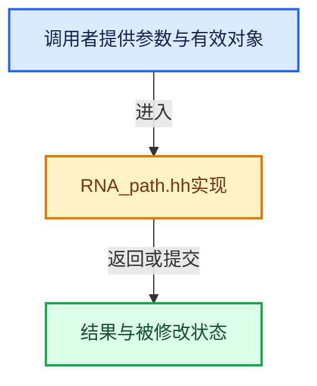

# 实现依赖专题：source/blender/makesrna/RNA_path.hh

[实现依赖导航](../../README.md) · [符号索引](../../../00-课程指南/02-源码与提交索引/符号依赖与实现索引.md)

本专题从正文实际调用进入，集中保存共享实现。函数有稳定锚点，可从调用处直接跳到对应完整函数；递归与互相调用通过回链组织。

## 本文件的实现关系





## 相关类型布局与成员入口

<a id="t-8781b4581a6c"></a>

### `blender::rna_path::Member`

原始声明：[source/blender/makesrna/RNA_path.hh](../../../../../../../source/blender/makesrna/RNA_path.hh) · L83—L87。

成员布局：

- `UString identifier`

以下保留类的数据声明与编译条件，成员函数实现通过后面的精确链接阅读。

<!-- annotated:d3230bac9b852b -->

```cpp
struct Member {
  UString identifier;

```

<details>
<summary>核对原始源码：source/blender/makesrna/RNA_path.hh · L83—L85</summary>

<!-- original:d3230bac9b852b:source/blender/makesrna/RNA_path.hh:83:85 -->

```cpp
struct Member {
  UString identifier;

```

</details>

<!-- annotated:4acfcec03e08a5 -->

```cpp
};
```

<details>
<summary>核对原始源码：source/blender/makesrna/RNA_path.hh · L87—L87</summary>

<!-- original:4acfcec03e08a5:source/blender/makesrna/RNA_path.hh:87:87 -->

```cpp
};
```

</details>


<a id="t-efb89e8dd2f8"></a>

### `blender::rna_path::LookupIndex`

原始声明：[source/blender/makesrna/RNA_path.hh](../../../../../../../source/blender/makesrna/RNA_path.hh) · L93—L97。

成员布局：

- `int64_t index`

以下保留类的数据声明与编译条件，成员函数实现通过后面的精确链接阅读。

<!-- annotated:3d5fbc5371ae1f -->

```cpp
struct LookupIndex {
  int64_t index;

```

<details>
<summary>核对原始源码：source/blender/makesrna/RNA_path.hh · L93—L95</summary>

<!-- original:3d5fbc5371ae1f:source/blender/makesrna/RNA_path.hh:93:95 -->

```cpp
struct LookupIndex {
  int64_t index;

```

</details>

<!-- annotated:0adc167a9cf77e -->

```cpp
};
```

<details>
<summary>核对原始源码：source/blender/makesrna/RNA_path.hh · L97—L97</summary>

<!-- original:0adc167a9cf77e:source/blender/makesrna/RNA_path.hh:97:97 -->

```cpp
};
```

</details>


<a id="t-6bf3f6687f74"></a>

### `blender::rna_path::LookupKey`

原始声明：[source/blender/makesrna/RNA_path.hh](../../../../../../../source/blender/makesrna/RNA_path.hh) · L100—L104。

成员布局：

- `UString key`

以下保留类的数据声明与编译条件，成员函数实现通过后面的精确链接阅读。

<!-- annotated:f8a0f3fadefbf5 -->

```cpp
struct LookupKey {
  UString key;

```

<details>
<summary>核对原始源码：source/blender/makesrna/RNA_path.hh · L100—L102</summary>

<!-- original:f8a0f3fadefbf5:source/blender/makesrna/RNA_path.hh:100:102 -->

```cpp
struct LookupKey {
  UString key;

```

</details>

<!-- annotated:70f5957facb148 -->

```cpp
};
```

<details>
<summary>核对原始源码：source/blender/makesrna/RNA_path.hh · L104—L104</summary>

<!-- original:70f5957facb148:source/blender/makesrna/RNA_path.hh:104:104 -->

```cpp
};
```

</details>


## 完整成员与函数实现
