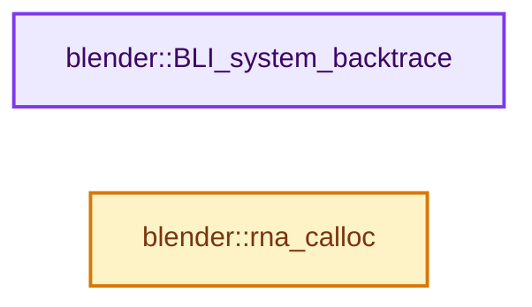
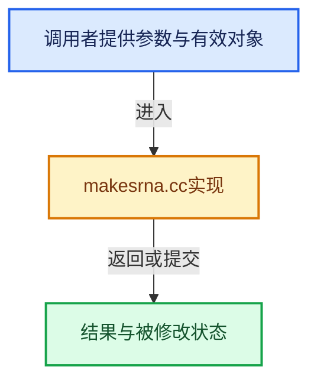

# 实现依赖专题：source/blender/makesrna/intern/makesrna.cc

[实现依赖导航](../../../README.md) · [符号索引](../../../../00-课程指南/02-源码与提交索引/符号依赖与实现索引.md)

本专题从正文实际调用进入，集中保存共享实现。函数有稳定锚点，可从调用处直接跳到对应完整函数；递归与互相调用通过回链组织。

## 本文件的实现关系






## 完整成员与函数实现

<a id="f-61d5e8002f87d0f0"></a>

### `blender::BLI_system_backtrace`

实现位置：[source/blender/makesrna/intern/makesrna.cc](../../../../../../../../source/blender/makesrna/intern/makesrna.cc) · L54—L57。

接口参数：

- `FILE *fp`

**教学注释版**

<!-- annotated:ba887a96f7c6a3 -->

```cpp
void BLI_system_backtrace(FILE *fp)
{
  (void)fp;
}
```

<details>
<summary>核对原始源码：source/blender/makesrna/intern/makesrna.cc · L54—L57</summary>

<!-- original:ba887a96f7c6a3:source/blender/makesrna/intern/makesrna.cc:54:57 -->

```cpp
void BLI_system_backtrace(FILE *fp)
{
  (void)fp;
}
```

</details>

**继续追踪实现**

本实现没有需要继续展开的显式调用；检查返回表达式、对象转换和调用者前置条件。

<a id="f-acf5fd06ad9cc99a"></a>

### `blender::rna_calloc`

实现位置：[source/blender/makesrna/intern/makesrna.cc](../../../../../../../../source/blender/makesrna/intern/makesrna.cc) · L379—L385。

接口参数：

- `int buffer_size`

**教学注释版**

<!-- annotated:266e3f6f5fbb74 -->

```cpp
void *rna_calloc(int buffer_size)
{
  AllocDefRNA *alloc = MEM_new_zeroed<AllocDefRNA>("AllocDefRNA");
  alloc->mem = MEM_new_zeroed(buffer_size, __func__);
  rna_addtail(&DefRNA.allocs, alloc);
  return alloc->mem;
}
```

<details>
<summary>核对原始源码：source/blender/makesrna/intern/makesrna.cc · L379—L385</summary>

<!-- original:266e3f6f5fbb74:source/blender/makesrna/intern/makesrna.cc:379:385 -->

```cpp
void *rna_calloc(int buffer_size)
{
  AllocDefRNA *alloc = MEM_new_zeroed<AllocDefRNA>("AllocDefRNA");
  alloc->mem = MEM_new_zeroed(buffer_size, __func__);
  rna_addtail(&DefRNA.allocs, alloc);
  return alloc->mem;
}
```

</details>

**沿实际写入检查状态**

- `alloc->mem = MEM_new_zeroed(buffer_size, __func__);`

**结果出口**

- `return alloc->mem;`

**继续追踪实现**

- `MEM_new_zeroed<AllocDefRNA>` → [MEM_new_zeroed · L550](../../../07-Intern运行时与平台/guardedalloc/MEM_guardedalloc.h.md#f-eeb1e2a7f57dd231)；[MEM_new_zeroed · L114](../../../07-Intern运行时与平台/guardedalloc/intern/mallocn.cc.md#f-e04cf01c64c8b180)。同名重载需按实参类型选择。
- `MEM_new_zeroed` → [MEM_new_zeroed · L550](../../../07-Intern运行时与平台/guardedalloc/MEM_guardedalloc.h.md#f-eeb1e2a7f57dd231)；[MEM_new_zeroed · L114](../../../07-Intern运行时与平台/guardedalloc/intern/mallocn.cc.md#f-e04cf01c64c8b180)。同名重载需按实参类型选择。
- `rna_addtail` → [blender::rna_addtail · L92](rna_define.cc.md#f-8c4434daaf3c4846)。
