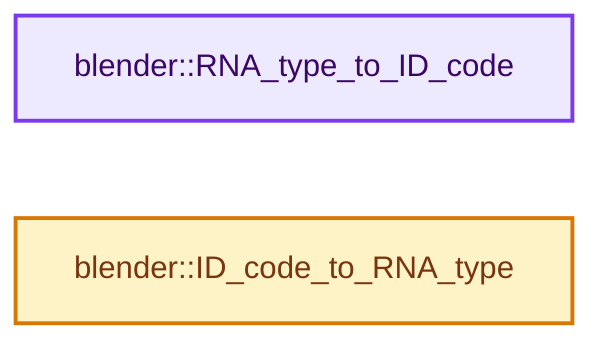
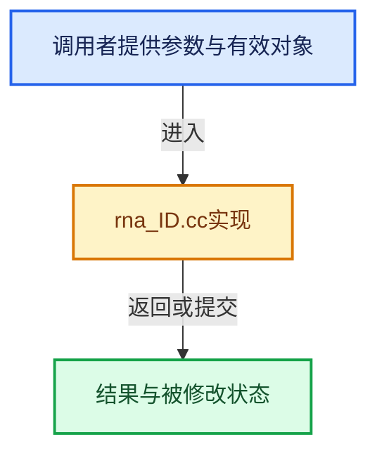

# 实现依赖专题：source/blender/makesrna/intern/rna_ID.cc

[实现依赖导航](../../../README.md) · [符号索引](../../../../00-课程指南/02-源码与提交索引/符号依赖与实现索引.md)

本专题从正文实际调用进入，集中保存共享实现。函数有稳定锚点，可从调用处直接跳到对应完整函数；递归与互相调用通过回链组织。

## 本文件的实现关系






## 完整成员与函数实现

<a id="f-877a517130c94602"></a>

### `blender::RNA_type_to_ID_code`

实现位置：[source/blender/makesrna/intern/rna_ID.cc](../../../../../../../../source/blender/makesrna/intern/rna_ID.cc) · L410—L535。

接口参数：

- `const StructRNA *type`

**教学注释版**

<!-- annotated:c80e30a5f2eff4 -->

```cpp
short RNA_type_to_ID_code(const StructRNA *type)
{
  const StructRNA *base_type = RNA_struct_base_child_of(type, RNA_ID);
  if (base_type == nullptr) [[unlikely]] {
    return 0;
  }
  if (base_type == RNA_Action) {
    return ID_AC;
  }
  if (base_type == RNA_Armature) {
    return ID_AR;
  }
  if (base_type == RNA_Brush) {
    return ID_BR;
  }
  if (base_type == RNA_CacheFile) {
    return ID_CF;
  }
  if (base_type == RNA_Camera) {
    return ID_CA;
  }
  if (base_type == RNA_Curve) {
    return ID_CU_LEGACY;
  }
  if (base_type == RNA_Annotation) {
    return ID_GD_LEGACY;
  }
  if (base_type == RNA_GreasePencil) {
    return ID_GP;
  }
  if (base_type == RNA_Collection) {
    return ID_GR;
  }
  if (base_type == RNA_Image) {
    return ID_IM;
  }
  if (base_type == RNA_Key) {
    return ID_KE;
  }
  if (base_type == RNA_Light) {
    return ID_LA;
  }
  if (base_type == RNA_Library) {
    return ID_LI;
  }
  if (base_type == RNA_FreestyleLineStyle) {
    return ID_LS;
  }
  if (base_type == RNA_Curves) {
    return ID_CV;
  }
  if (base_type == RNA_Lattice) {
    return ID_LT;
  }
  if (base_type == RNA_Material) {
    return ID_MA;
  }
  if (base_type == RNA_MetaBall) {
    return ID_MB;
  }
  if (base_type == RNA_MovieClip) {
    return ID_MC;
  }
  if (base_type == RNA_Mesh) {
    return ID_ME;
  }
  if (base_type == RNA_Mask) {
    return ID_MSK;
  }
  if (base_type == RNA_NodeTree) {
    return ID_NT;
  }
  if (base_type == RNA_Object) {
    return ID_OB;
  }
  if (base_type == RNA_ParticleSettings) {
    return ID_PA;
  }
  if (base_type == RNA_Palette) {
    return ID_PAL;
  }
  if (base_type == RNA_PaintCurve) {
    return ID_PC;
  }
  if (base_type == RNA_PointCloud) {
    return ID_PT;
  }
  if (base_type == RNA_LightProbe) {
    return ID_LP;
  }
  if (base_type == RNA_Scene) {
    return ID_SCE;
  }
  if (base_type == RNA_Screen) {
    return ID_SCR;
  }
  if (base_type == RNA_Sound) {
    return ID_SO;
  }
  if (base_type == RNA_Speaker) {
    return ID_SPK;
  }
  if (base_type == RNA_Texture) {
    return ID_TE;
  }
  if (base_type == RNA_Text) {
    return ID_TXT;
  }
  if (base_type == RNA_VectorFont) {
    return ID_VF;
  }
  if (base_type == RNA_Volume) {
    return ID_VO;
  }
  if (base_type == RNA_WorkSpace) {
    return ID_WS;
  }
  if (base_type == RNA_World) {
    return ID_WO;
  }
  if (base_type == RNA_WindowManager) {
    return ID_WM;
  }

  return 0;
}
```

<details>
<summary>核对原始源码：source/blender/makesrna/intern/rna_ID.cc · L410—L535</summary>

<!-- original:c80e30a5f2eff4:source/blender/makesrna/intern/rna_ID.cc:410:535 -->

```cpp
short RNA_type_to_ID_code(const StructRNA *type)
{
  const StructRNA *base_type = RNA_struct_base_child_of(type, RNA_ID);
  if (base_type == nullptr) [[unlikely]] {
    return 0;
  }
  if (base_type == RNA_Action) {
    return ID_AC;
  }
  if (base_type == RNA_Armature) {
    return ID_AR;
  }
  if (base_type == RNA_Brush) {
    return ID_BR;
  }
  if (base_type == RNA_CacheFile) {
    return ID_CF;
  }
  if (base_type == RNA_Camera) {
    return ID_CA;
  }
  if (base_type == RNA_Curve) {
    return ID_CU_LEGACY;
  }
  if (base_type == RNA_Annotation) {
    return ID_GD_LEGACY;
  }
  if (base_type == RNA_GreasePencil) {
    return ID_GP;
  }
  if (base_type == RNA_Collection) {
    return ID_GR;
  }
  if (base_type == RNA_Image) {
    return ID_IM;
  }
  if (base_type == RNA_Key) {
    return ID_KE;
  }
  if (base_type == RNA_Light) {
    return ID_LA;
  }
  if (base_type == RNA_Library) {
    return ID_LI;
  }
  if (base_type == RNA_FreestyleLineStyle) {
    return ID_LS;
  }
  if (base_type == RNA_Curves) {
    return ID_CV;
  }
  if (base_type == RNA_Lattice) {
    return ID_LT;
  }
  if (base_type == RNA_Material) {
    return ID_MA;
  }
  if (base_type == RNA_MetaBall) {
    return ID_MB;
  }
  if (base_type == RNA_MovieClip) {
    return ID_MC;
  }
  if (base_type == RNA_Mesh) {
    return ID_ME;
  }
  if (base_type == RNA_Mask) {
    return ID_MSK;
  }
  if (base_type == RNA_NodeTree) {
    return ID_NT;
  }
  if (base_type == RNA_Object) {
    return ID_OB;
  }
  if (base_type == RNA_ParticleSettings) {
    return ID_PA;
  }
  if (base_type == RNA_Palette) {
    return ID_PAL;
  }
  if (base_type == RNA_PaintCurve) {
    return ID_PC;
  }
  if (base_type == RNA_PointCloud) {
    return ID_PT;
  }
  if (base_type == RNA_LightProbe) {
    return ID_LP;
  }
  if (base_type == RNA_Scene) {
    return ID_SCE;
  }
  if (base_type == RNA_Screen) {
    return ID_SCR;
  }
  if (base_type == RNA_Sound) {
    return ID_SO;
  }
  if (base_type == RNA_Speaker) {
    return ID_SPK;
  }
  if (base_type == RNA_Texture) {
    return ID_TE;
  }
  if (base_type == RNA_Text) {
    return ID_TXT;
  }
  if (base_type == RNA_VectorFont) {
    return ID_VF;
  }
  if (base_type == RNA_Volume) {
    return ID_VO;
  }
  if (base_type == RNA_WorkSpace) {
    return ID_WS;
  }
  if (base_type == RNA_World) {
    return ID_WO;
  }
  if (base_type == RNA_WindowManager) {
    return ID_WM;
  }

  return 0;
}
```

</details>

**结果出口**

- `return 0;`
- `return ID_AC;`
- `return ID_AR;`
- `return ID_BR;`
- `return ID_CF;`
- `return ID_CA;`
- `return ID_CU_LEGACY;`
- `return ID_GD_LEGACY;`
- `return ID_GP;`
- `return ID_GR;`
- `return ID_IM;`
- `return ID_KE;`
- `return ID_LA;`
- `return ID_LI;`
- `return ID_LS;`
- `return ID_CV;`
- `return ID_LT;`
- `return ID_MA;`
- `return ID_MB;`
- `return ID_MC;`
- `return ID_ME;`
- `return ID_MSK;`
- `return ID_NT;`
- `return ID_OB;`
- `return ID_PA;`
- `return ID_PAL;`
- `return ID_PC;`
- `return ID_PT;`
- `return ID_LP;`
- `return ID_SCE;`
- `return ID_SCR;`
- `return ID_SO;`
- `return ID_SPK;`
- `return ID_TE;`
- `return ID_TXT;`
- `return ID_VF;`
- `return ID_VO;`
- `return ID_WS;`
- `return ID_WO;`
- `return ID_WM;`

**继续追踪实现**

- `RNA_struct_base_child_of` → [blender::RNA_struct_base_child_of · L782](rna_access.cc.md#f-303d21b317c15c49)。

<a id="f-687b276b7db91bcd"></a>

### `blender::ID_code_to_RNA_type`

实现位置：[source/blender/makesrna/intern/rna_ID.cc](../../../../../../../../source/blender/makesrna/intern/rna_ID.cc) · L537—L623。

接口参数：

- `short idcode`

**教学注释版**

<!-- annotated:60e01817c82742 -->

```cpp
StructRNA *ID_code_to_RNA_type(short idcode)
{
  /* NOTE: this switch doesn't use a 'default',
   * so adding new ID's causes a warning. */
  switch (ID_Type(idcode)) {
    case ID_AC:
      return RNA_Action;
    case ID_AR:
      return RNA_Armature;
    case ID_BR:
      return RNA_Brush;
    case ID_CA:
      return RNA_Camera;
    case ID_CF:
      return RNA_CacheFile;
    case ID_CU_LEGACY:
      return RNA_Curve;
    case ID_GD_LEGACY:
      return RNA_Annotation;
    case ID_GP:
      return RNA_GreasePencil;
    case ID_GR:
      return RNA_Collection;
    case ID_CV:
      return RNA_Curves;
    case ID_IM:
      return RNA_Image;
    case ID_KE:
      return RNA_Key;
    case ID_LA:
      return RNA_Light;
    case ID_LI:
      return RNA_Library;
    case ID_LS:
      return RNA_FreestyleLineStyle;
    case ID_LT:
      return RNA_Lattice;
    case ID_MA:
      return RNA_Material;
    case ID_MB:
      return RNA_MetaBall;
    case ID_MC:
      return RNA_MovieClip;
    case ID_ME:
      return RNA_Mesh;
    case ID_MSK:
      return RNA_Mask;
    case ID_NT:
      return RNA_NodeTree;
    case ID_OB:
      return RNA_Object;
    case ID_PA:
      return RNA_ParticleSettings;
    case ID_PAL:
      return RNA_Palette;
    case ID_PC:
      return RNA_PaintCurve;
    case ID_PT:
      return RNA_PointCloud;
    case ID_LP:
      return RNA_LightProbe;
    case ID_SCE:
      return RNA_Scene;
    case ID_SCR:
      return RNA_Screen;
    case ID_SO:
      return RNA_Sound;
    case ID_SPK:
      return RNA_Speaker;
    case ID_TE:
      return RNA_Texture;
    case ID_TXT:
      return RNA_Text;
    case ID_VF:
      return RNA_VectorFont;
    case ID_VO:
      return RNA_Volume;
    case ID_WM:
      return RNA_WindowManager;
    case ID_WO:
      return RNA_World;
    case ID_WS:
      return RNA_WorkSpace;
  }

  return RNA_ID;
}
```

<details>
<summary>核对原始源码：source/blender/makesrna/intern/rna_ID.cc · L537—L623</summary>

<!-- original:60e01817c82742:source/blender/makesrna/intern/rna_ID.cc:537:623 -->

```cpp
StructRNA *ID_code_to_RNA_type(short idcode)
{
  /* NOTE: this switch doesn't use a 'default',
   * so adding new ID's causes a warning. */
  switch (ID_Type(idcode)) {
    case ID_AC:
      return RNA_Action;
    case ID_AR:
      return RNA_Armature;
    case ID_BR:
      return RNA_Brush;
    case ID_CA:
      return RNA_Camera;
    case ID_CF:
      return RNA_CacheFile;
    case ID_CU_LEGACY:
      return RNA_Curve;
    case ID_GD_LEGACY:
      return RNA_Annotation;
    case ID_GP:
      return RNA_GreasePencil;
    case ID_GR:
      return RNA_Collection;
    case ID_CV:
      return RNA_Curves;
    case ID_IM:
      return RNA_Image;
    case ID_KE:
      return RNA_Key;
    case ID_LA:
      return RNA_Light;
    case ID_LI:
      return RNA_Library;
    case ID_LS:
      return RNA_FreestyleLineStyle;
    case ID_LT:
      return RNA_Lattice;
    case ID_MA:
      return RNA_Material;
    case ID_MB:
      return RNA_MetaBall;
    case ID_MC:
      return RNA_MovieClip;
    case ID_ME:
      return RNA_Mesh;
    case ID_MSK:
      return RNA_Mask;
    case ID_NT:
      return RNA_NodeTree;
    case ID_OB:
      return RNA_Object;
    case ID_PA:
      return RNA_ParticleSettings;
    case ID_PAL:
      return RNA_Palette;
    case ID_PC:
      return RNA_PaintCurve;
    case ID_PT:
      return RNA_PointCloud;
    case ID_LP:
      return RNA_LightProbe;
    case ID_SCE:
      return RNA_Scene;
    case ID_SCR:
      return RNA_Screen;
    case ID_SO:
      return RNA_Sound;
    case ID_SPK:
      return RNA_Speaker;
    case ID_TE:
      return RNA_Texture;
    case ID_TXT:
      return RNA_Text;
    case ID_VF:
      return RNA_VectorFont;
    case ID_VO:
      return RNA_Volume;
    case ID_WM:
      return RNA_WindowManager;
    case ID_WO:
      return RNA_World;
    case ID_WS:
      return RNA_WorkSpace;
  }

  return RNA_ID;
}
```

</details>

**结果出口**

- `return RNA_Action;`
- `return RNA_Armature;`
- `return RNA_Brush;`
- `return RNA_Camera;`
- `return RNA_CacheFile;`
- `return RNA_Curve;`
- `return RNA_Annotation;`
- `return RNA_GreasePencil;`
- `return RNA_Collection;`
- `return RNA_Curves;`
- `return RNA_Image;`
- `return RNA_Key;`
- `return RNA_Light;`
- `return RNA_Library;`
- `return RNA_FreestyleLineStyle;`
- `return RNA_Lattice;`
- `return RNA_Material;`
- `return RNA_MetaBall;`
- `return RNA_MovieClip;`
- `return RNA_Mesh;`
- `return RNA_Mask;`
- `return RNA_NodeTree;`
- `return RNA_Object;`
- `return RNA_ParticleSettings;`
- `return RNA_Palette;`
- `return RNA_PaintCurve;`
- `return RNA_PointCloud;`
- `return RNA_LightProbe;`
- `return RNA_Scene;`
- `return RNA_Screen;`
- `return RNA_Sound;`
- `return RNA_Speaker;`
- `return RNA_Texture;`
- `return RNA_Text;`
- `return RNA_VectorFont;`
- `return RNA_Volume;`
- `return RNA_WindowManager;`
- `return RNA_World;`
- `return RNA_WorkSpace;`
- `return RNA_ID;`

**继续追踪实现**

- `ID_Type` → [blender::ID_Type](../../windowmanager/WM_api.hh.md#t-a58f1911df5c)；[blender::ID_Type](../../makesdna/DNA_ID_enums.h.md#t-4fa202c1cee5)。
