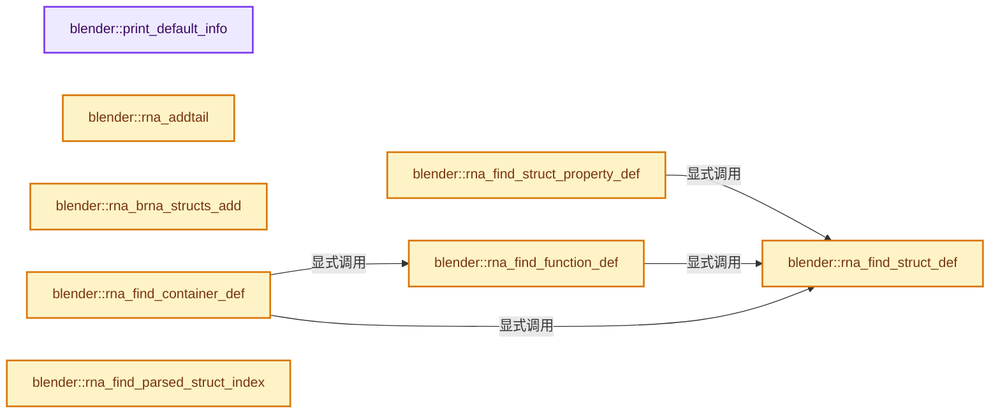
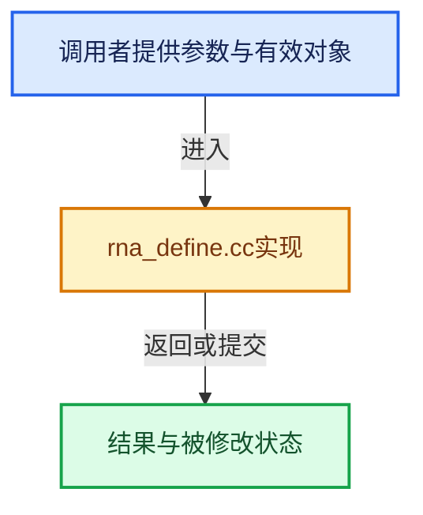

# 实现依赖专题：source/blender/makesrna/intern/rna_define.cc

[实现依赖导航](../../../README.md) · [符号索引](../../../../00-课程指南/02-源码与提交索引/符号依赖与实现索引.md)

本专题从正文实际调用进入，集中保存共享实现。函数有稳定锚点，可从调用处直接跳到对应完整函数；递归与互相调用通过回链组织。

## 本文件的实现关系






## 完整成员与函数实现

<a id="f-3abd1cfd18d3497b"></a>

### `blender::print_default_info`

实现位置：[source/blender/makesrna/intern/rna_define.cc](../../../../../../../../source/blender/makesrna/intern/rna_define.cc) · L81—L89。

接口参数：

- `const PropertyDefRNA *dp`

**教学注释版**

<!-- annotated:c9cc0c4cf8b4c2 -->

```cpp
static void print_default_info(const PropertyDefRNA *dp)
{
  fprintf(stderr,
          "dna_type=%s, dna_struct=%s, dna_name=%s, id=%s\n",
          dp->dnatype.c_str(),
          dp->dnastructname.c_str(),
          dp->dnaname.c_str(),
          dp->prop->identifier.c_str());
}
```

<details>
<summary>核对原始源码：source/blender/makesrna/intern/rna_define.cc · L81—L89</summary>

<!-- original:c9cc0c4cf8b4c2:source/blender/makesrna/intern/rna_define.cc:81:89 -->

```cpp
static void print_default_info(const PropertyDefRNA *dp)
{
  fprintf(stderr,
          "dna_type=%s, dna_struct=%s, dna_name=%s, id=%s\n",
          dp->dnatype.c_str(),
          dp->dnastructname.c_str(),
          dp->dnaname.c_str(),
          dp->prop->identifier.c_str());
}
```

</details>

**继续追踪实现**

- `fprintf` → [外部契约](https://eel.is/c++draft/)：这个边界按实际表达式及所属类型核对参数、返回值、寿命与失败行为。这里提供接口入口，不声称已解释该第三方版本的内部实现。
- `dp->dnatype.c_str` → [调用协议](../../../../00-课程指南/01-路线与规范/模板宏与动态分派协议.md)：接收对象类型依赖auto、返回值或模板实例；不按同名猜测目标。调用位置L85。
- `dp->dnastructname.c_str` → [调用协议](../../../../00-课程指南/01-路线与规范/模板宏与动态分派协议.md)：接收对象类型依赖auto、返回值或模板实例；不按同名猜测目标。调用位置L86。
- `dp->dnaname.c_str` → [调用协议](../../../../00-课程指南/01-路线与规范/模板宏与动态分派协议.md)：接收对象类型依赖auto、返回值或模板实例；不按同名猜测目标。调用位置L87。
- `dp->prop->identifier.c_str` → [调用协议](../../../../00-课程指南/01-路线与规范/模板宏与动态分派协议.md)：接收对象类型依赖auto、返回值或模板实例；不按同名猜测目标。调用位置L88。

<a id="f-8c4434daaf3c4846"></a>

### `blender::rna_addtail`

实现位置：[source/blender/makesrna/intern/rna_define.cc](../../../../../../../../source/blender/makesrna/intern/rna_define.cc) · L92—L106。

接口参数：

- `ListBase *listbase`
- `void *vlink`

**教学注释版**

<!-- annotated:3f6d912884288b -->

```cpp
void rna_addtail(ListBase *listbase, void *vlink)
{
  Link *link = static_cast<Link *>(vlink);

  link->next = nullptr;
  link->prev = static_cast<Link *>(listbase->last_);

  if (listbase->last_) {
    (static_cast<Link *>(listbase->last_))->next = link;
  }
  if (listbase->first_ == nullptr) {
    listbase->first_ = link;
  }
  listbase->last_ = link;
}
```

<details>
<summary>核对原始源码：source/blender/makesrna/intern/rna_define.cc · L92—L106</summary>

<!-- original:3f6d912884288b:source/blender/makesrna/intern/rna_define.cc:92:106 -->

```cpp
void rna_addtail(ListBase *listbase, void *vlink)
{
  Link *link = static_cast<Link *>(vlink);

  link->next = nullptr;
  link->prev = static_cast<Link *>(listbase->last_);

  if (listbase->last_) {
    (static_cast<Link *>(listbase->last_))->next = link;
  }
  if (listbase->first_ == nullptr) {
    listbase->first_ = link;
  }
  listbase->last_ = link;
}
```

</details>

**沿实际写入检查状态**

- `link->next = nullptr;`
- `link->prev = static_cast<Link *>(listbase->last_);`
- `listbase->first_ = link;`
- `listbase->last_ = link;`

**继续追踪实现**

本实现没有需要继续展开的显式调用；检查返回表达式、对象转换和调用者前置条件。

<a id="f-4e44906edd1da580"></a>

### `blender::rna_brna_structs_add`

实现位置：[source/blender/makesrna/intern/rna_define.cc](../../../../../../../../source/blender/makesrna/intern/rna_define.cc) · L145—L155。

接口参数：

- `BlenderRNA *brna`
- `std::unique_ptr<StructRNA> srna_ptr`

**教学注释版**

<!-- annotated:75a7f69329afd3 -->

```cpp
static void rna_brna_structs_add(BlenderRNA *brna, std::unique_ptr<StructRNA> srna_ptr)
{
  StructRNA *srna = srna_ptr.get();
  // [讲解] std::move：把表达式转换成可供移动重载选择的值类别；不保证真的移动，不结束源对象寿命，对const值可能选择复制。
  brna->structs.append(std::move(srna_ptr));

  /* This exception is only needed for pre-processing.
   * otherwise we don't allow empty names. */
  if ((srna->flag & STRUCT_PUBLIC_NAMESPACE) && (srna->identifier[0] != '\0')) {
    brna->structs_map.add(srna->identifier, srna);
  }
}
```

<details>
<summary>核对原始源码：source/blender/makesrna/intern/rna_define.cc · L145—L155</summary>

<!-- original:75a7f69329afd3:source/blender/makesrna/intern/rna_define.cc:145:155 -->

```cpp
static void rna_brna_structs_add(BlenderRNA *brna, std::unique_ptr<StructRNA> srna_ptr)
{
  StructRNA *srna = srna_ptr.get();
  brna->structs.append(std::move(srna_ptr));

  /* This exception is only needed for pre-processing.
   * otherwise we don't allow empty names. */
  if ((srna->flag & STRUCT_PUBLIC_NAMESPACE) && (srna->identifier[0] != '\0')) {
    brna->structs_map.add(srna->identifier, srna);
  }
}
```

</details>

**继续追踪实现**

- `srna_ptr.get` → [外部契约](https://eel.is/c++draft/)：这个边界按实际表达式及所属类型核对参数、返回值、寿命与失败行为。这里提供接口入口，不声称已解释该第三方版本的内部实现。
- `brna->structs.append` → [调用协议](../../../../00-课程指南/01-路线与规范/模板宏与动态分派协议.md)：接收对象类型依赖auto、返回值或模板实例；不按同名猜测目标。调用位置L148。
- `std::move` → [外部契约](https://eel.is/c++draft/utility.forward)：把表达式转换成可供移动重载选择的值类别；不保证真的移动，不结束源对象寿命，对const值可能选择复制。
- `brna->structs_map.add` → [调用协议](../../../../00-课程指南/01-路线与规范/模板宏与动态分派协议.md)：接收对象类型依赖auto、返回值或模板实例；不按同名猜测目标。调用位置L153。

<a id="f-36e1c27ea028ded2"></a>

### `blender::rna_find_struct_def`

实现位置：[source/blender/makesrna/intern/rna_define.cc](../../../../../../../../source/blender/makesrna/intern/rna_define.cc) · L184—L196。

接口参数：

- `StructRNA *srna`

**教学注释版**

<!-- annotated:8023a6f727a9a6 -->

```cpp
StructDefRNA *rna_find_struct_def(StructRNA *srna)
{
  StructDefRNA *dsrna;

  dsrna = DefRNA.structs.last();
  for (; dsrna; dsrna = static_cast<StructDefRNA *>(dsrna->cont.prev)) {
    if (dsrna->srna == srna) {
      return dsrna;
    }
  }

  return nullptr;
}
```

<details>
<summary>核对原始源码：source/blender/makesrna/intern/rna_define.cc · L184—L196</summary>

<!-- original:8023a6f727a9a6:source/blender/makesrna/intern/rna_define.cc:184:196 -->

```cpp
StructDefRNA *rna_find_struct_def(StructRNA *srna)
{
  StructDefRNA *dsrna;

  dsrna = DefRNA.structs.last();
  for (; dsrna; dsrna = static_cast<StructDefRNA *>(dsrna->cont.prev)) {
    if (dsrna->srna == srna) {
      return dsrna;
    }
  }

  return nullptr;
}
```

</details>

**沿实际写入检查状态**

- `dsrna = DefRNA.structs.last();`

**结果出口**

- `return dsrna;`
- `return nullptr;`

**继续追踪实现**

- `DefRNA.structs.last` → [调用协议](../../../../00-课程指南/01-路线与规范/模板宏与动态分派协议.md)：接收对象类型依赖auto、返回值或模板实例；不按同名猜测目标。调用位置L188。

<a id="f-fb86bdd2ab98b19a"></a>

### `blender::rna_find_struct_property_def`

实现位置：[source/blender/makesrna/intern/rna_define.cc](../../../../../../../../source/blender/makesrna/intern/rna_define.cc) · L198—L222。

接口参数：

- `StructRNA *srna`
- `PropertyRNA *prop`

**教学注释版**

<!-- annotated:3607ba1bc51131 -->

```cpp
PropertyDefRNA *rna_find_struct_property_def(StructRNA *srna, PropertyRNA *prop)
{
  StructDefRNA *dsrna;
  PropertyDefRNA *dprop;

  dsrna = rna_find_struct_def(srna);
  dprop = dsrna->cont.properties.last();
  for (; dprop; dprop = dprop->prev) {
    if (dprop->prop == prop) {
      return dprop;
    }
  }

  dsrna = DefRNA.structs.last();
  for (; dsrna; dsrna = static_cast<StructDefRNA *>(dsrna->cont.prev)) {
    dprop = dsrna->cont.properties.last();
    for (; dprop; dprop = dprop->prev) {
      if (dprop->prop == prop) {
        return dprop;
      }
    }
  }

  return nullptr;
}
```

<details>
<summary>核对原始源码：source/blender/makesrna/intern/rna_define.cc · L198—L222</summary>

<!-- original:3607ba1bc51131:source/blender/makesrna/intern/rna_define.cc:198:222 -->

```cpp
PropertyDefRNA *rna_find_struct_property_def(StructRNA *srna, PropertyRNA *prop)
{
  StructDefRNA *dsrna;
  PropertyDefRNA *dprop;

  dsrna = rna_find_struct_def(srna);
  dprop = dsrna->cont.properties.last();
  for (; dprop; dprop = dprop->prev) {
    if (dprop->prop == prop) {
      return dprop;
    }
  }

  dsrna = DefRNA.structs.last();
  for (; dsrna; dsrna = static_cast<StructDefRNA *>(dsrna->cont.prev)) {
    dprop = dsrna->cont.properties.last();
    for (; dprop; dprop = dprop->prev) {
      if (dprop->prop == prop) {
        return dprop;
      }
    }
  }

  return nullptr;
}
```

</details>

**沿实际写入检查状态**

- `dsrna = rna_find_struct_def(srna);`
- `dprop = dsrna->cont.properties.last();`
- `dsrna = DefRNA.structs.last();`

**结果出口**

- `return dprop;`
- `return nullptr;`

**继续追踪实现**

- `rna_find_struct_def` → [blender::rna_find_struct_def · L184](rna_define.cc.md#f-36e1c27ea028ded2)。
- `dsrna->cont.properties.last` → [调用协议](../../../../00-课程指南/01-路线与规范/模板宏与动态分派协议.md)：接收对象类型依赖auto、返回值或模板实例；不按同名猜测目标。调用位置L204。
- `DefRNA.structs.last` → [调用协议](../../../../00-课程指南/01-路线与规范/模板宏与动态分派协议.md)：接收对象类型依赖auto、返回值或模板实例；不按同名猜测目标。调用位置L211。

<a id="f-c1e1771da11920a3"></a>

### `blender::rna_find_function_def`

实现位置：[source/blender/makesrna/intern/rna_define.cc](../../../../../../../../source/blender/makesrna/intern/rna_define.cc) · L224—L248。

接口参数：

- `FunctionRNA *func`

**教学注释版**

<!-- annotated:7a23b18afab5e4 -->

```cpp
FunctionDefRNA *rna_find_function_def(FunctionRNA *func)
{
  StructDefRNA *dsrna;
  FunctionDefRNA *dfunc;

  dsrna = rna_find_struct_def(DefRNA.laststruct);
  dfunc = dsrna->functions.last();
  for (; dfunc; dfunc = static_cast<FunctionDefRNA *>(dfunc->cont.prev)) {
    if (dfunc->func == func) {
      return dfunc;
    }
  }

  dsrna = DefRNA.structs.last();
  for (; dsrna; dsrna = static_cast<StructDefRNA *>(dsrna->cont.prev)) {
    dfunc = dsrna->functions.last();
    for (; dfunc; dfunc = static_cast<FunctionDefRNA *>(dfunc->cont.prev)) {
      if (dfunc->func == func) {
        return dfunc;
      }
    }
  }

  return nullptr;
}
```

<details>
<summary>核对原始源码：source/blender/makesrna/intern/rna_define.cc · L224—L248</summary>

<!-- original:7a23b18afab5e4:source/blender/makesrna/intern/rna_define.cc:224:248 -->

```cpp
FunctionDefRNA *rna_find_function_def(FunctionRNA *func)
{
  StructDefRNA *dsrna;
  FunctionDefRNA *dfunc;

  dsrna = rna_find_struct_def(DefRNA.laststruct);
  dfunc = dsrna->functions.last();
  for (; dfunc; dfunc = static_cast<FunctionDefRNA *>(dfunc->cont.prev)) {
    if (dfunc->func == func) {
      return dfunc;
    }
  }

  dsrna = DefRNA.structs.last();
  for (; dsrna; dsrna = static_cast<StructDefRNA *>(dsrna->cont.prev)) {
    dfunc = dsrna->functions.last();
    for (; dfunc; dfunc = static_cast<FunctionDefRNA *>(dfunc->cont.prev)) {
      if (dfunc->func == func) {
        return dfunc;
      }
    }
  }

  return nullptr;
}
```

</details>

**沿实际写入检查状态**

- `dsrna = rna_find_struct_def(DefRNA.laststruct);`
- `dfunc = dsrna->functions.last();`
- `dsrna = DefRNA.structs.last();`

**结果出口**

- `return dfunc;`
- `return nullptr;`

**继续追踪实现**

- `rna_find_struct_def` → [blender::rna_find_struct_def · L184](rna_define.cc.md#f-36e1c27ea028ded2)。
- `dsrna->functions.last` → [调用协议](../../../../00-课程指南/01-路线与规范/模板宏与动态分派协议.md)：接收对象类型依赖auto、返回值或模板实例；不按同名猜测目标。调用位置L230。
- `DefRNA.structs.last` → [调用协议](../../../../00-课程指南/01-路线与规范/模板宏与动态分派协议.md)：接收对象类型依赖auto、返回值或模板实例；不按同名猜测目标。调用位置L237。

<a id="f-d37d15daf3c9092d"></a>

### `blender::rna_find_container_def`

实现位置：[source/blender/makesrna/intern/rna_define.cc](../../../../../../../../source/blender/makesrna/intern/rna_define.cc) · L283—L299。

接口参数：

- `ContainerRNA *cont`

**教学注释版**

<!-- annotated:219fd27043c052 -->

```cpp
static ContainerDefRNA *rna_find_container_def(ContainerRNA *cont)
{
  StructDefRNA *ds;
  FunctionDefRNA *dfunc;

  ds = rna_find_struct_def(reinterpret_cast<StructRNA *>(cont));
  if (ds) {
    return &ds->cont;
  }

  dfunc = rna_find_function_def(reinterpret_cast<FunctionRNA *>(cont));
  if (dfunc) {
    return &dfunc->cont;
  }

  return nullptr;
}
```

<details>
<summary>核对原始源码：source/blender/makesrna/intern/rna_define.cc · L283—L299</summary>

<!-- original:219fd27043c052:source/blender/makesrna/intern/rna_define.cc:283:299 -->

```cpp
static ContainerDefRNA *rna_find_container_def(ContainerRNA *cont)
{
  StructDefRNA *ds;
  FunctionDefRNA *dfunc;

  ds = rna_find_struct_def(reinterpret_cast<StructRNA *>(cont));
  if (ds) {
    return &ds->cont;
  }

  dfunc = rna_find_function_def(reinterpret_cast<FunctionRNA *>(cont));
  if (dfunc) {
    return &dfunc->cont;
  }

  return nullptr;
}
```

</details>

**沿实际写入检查状态**

- `ds = rna_find_struct_def(reinterpret_cast<StructRNA *>(cont));`
- `dfunc = rna_find_function_def(reinterpret_cast<FunctionRNA *>(cont));`

**结果出口**

- `return &ds->cont;`
- `return &dfunc->cont;`
- `return nullptr;`

**继续追踪实现**

- `rna_find_struct_def` → [blender::rna_find_struct_def · L184](rna_define.cc.md#f-36e1c27ea028ded2)。
- `rna_find_function_def` → [blender::rna_find_function_def · L224](rna_define.cc.md#f-c1e1771da11920a3)。

<a id="f-131de26861b9a61e"></a>

### `blender::rna_find_parsed_struct_index`

实现位置：[source/blender/makesrna/intern/rna_define.cc](../../../../../../../../source/blender/makesrna/intern/rna_define.cc) · L303—L311。

接口参数：

- `const StringRef structname`

**教学注释版**

<!-- annotated:f8241408cc093e -->

```cpp
static int rna_find_parsed_struct_index(const StringRef structname)
{
  for (int i = 0; i < int(DefRNA.dna_structs.size()); i++) {
    if (DefRNA.dna_structs[i].type_name == structname) {
      return i;
    }
  }
  return -1;
}
```

<details>
<summary>核对原始源码：source/blender/makesrna/intern/rna_define.cc · L303—L311</summary>

<!-- original:f8241408cc093e:source/blender/makesrna/intern/rna_define.cc:303:311 -->

```cpp
static int rna_find_parsed_struct_index(const StringRef structname)
{
  for (int i = 0; i < int(DefRNA.dna_structs.size()); i++) {
    if (DefRNA.dna_structs[i].type_name == structname) {
      return i;
    }
  }
  return -1;
}
```

</details>

**结果出口**

- `return i;`
- `return -1;`

**继续追踪实现**

- `DefRNA.dna_structs.size` → [调用协议](../../../../00-课程指南/01-路线与规范/模板宏与动态分派协议.md)：接收对象类型依赖auto、返回值或模板实例；不按同名猜测目标。调用位置L305。

<a id="f-f1fa69a9713f702b"></a>

### `blender::rna_default_data`

实现位置：[source/blender/makesrna/intern/rna_define.cc](../../../../../../../../source/blender/makesrna/intern/rna_define.cc) · L313—L328。

接口参数：

- `const int struct_idx`
- `const int member_idx`
- `const void *base_default_data`

**教学注释版**

<!-- annotated:bf30544c0745e3 -->

```cpp
static const void *rna_default_data(const int struct_idx,
                                    const int member_idx,
                                    const void *base_default_data)
{
  const void *member_default_data = DNA_member_default_table[struct_idx][member_idx];

  if (base_default_data) {
    /* For a nested member, offset into the parent struct's default instance. */
    const void *struct_default_base = DNA_member_default_table[struct_idx][0];
    return POINTER_OFFSET(base_default_data,
                          static_cast<const char *>(member_default_data) -
                              static_cast<const char *>(struct_default_base));
  }

  return member_default_data;
}
```

<details>
<summary>核对原始源码：source/blender/makesrna/intern/rna_define.cc · L313—L328</summary>

<!-- original:bf30544c0745e3:source/blender/makesrna/intern/rna_define.cc:313:328 -->

```cpp
static const void *rna_default_data(const int struct_idx,
                                    const int member_idx,
                                    const void *base_default_data)
{
  const void *member_default_data = DNA_member_default_table[struct_idx][member_idx];

  if (base_default_data) {
    /* For a nested member, offset into the parent struct's default instance. */
    const void *struct_default_base = DNA_member_default_table[struct_idx][0];
    return POINTER_OFFSET(base_default_data,
                          static_cast<const char *>(member_default_data) -
                              static_cast<const char *>(struct_default_base));
  }

  return member_default_data;
}
```

</details>

**结果出口**

- `return POINTER_OFFSET(base_default_data,`
- `return member_default_data;`

**继续追踪实现**

- `POINTER_OFFSET` → [POINTER_OFFSET · L316](../../../01-BLI基础库/BLI_utildefines.hh.md#m-c812e199f26c)。宏定义由构建条件选择。

<a id="f-a29c78cb54bbe77b"></a>

### `blender::rna_find_sdna_member`

实现位置：[source/blender/makesrna/intern/rna_define.cc](../../../../../../../../source/blender/makesrna/intern/rna_define.cc) · L331—L388。

接口参数：

- `const StringRef structname`
- `const StringRef path`
- `PropertyDefRNA *r_dp = nullptr`
- `const void *base_default_data = nullptr`

**教学注释版**

<!-- annotated:863af578426b3e -->

```cpp
static bool rna_find_sdna_member(const StringRef structname,
                                 const StringRef path,
                                 PropertyDefRNA *r_dp = nullptr,
                                 const void *base_default_data = nullptr)
{
  const int struct_idx = rna_find_parsed_struct_index(structname);
  if (struct_idx == -1) {
    return false;
  }
  const dna::ParsedStruct &ps = DefRNA.dna_structs[struct_idx];

  for (const int member_idx : ps.members.index_range()) {
    const dna::ParsedMember &pm = ps.members[member_idx];
    const StringRef pm_name = DNA_member_id_string_ref(pm.member_name);

    if (!path.startswith(pm_name)) {
      continue;
    }
    StringRef remainder = path.drop_known_prefix(pm_name);

    if (remainder.is_empty() || remainder.startswith("[")) {
      /* Found a match. */
      if (r_dp) {
        r_dp->dnatype = pm.type_name;
        r_dp->dnaarraylength = remainder.is_empty() ?
                                   DNA_member_array_num(pm.member_name.c_str()) :
                                   0;
        r_dp->dnapointerlevel = 0;
        for (int b = 0; pm.member_name[b] == '*'; b++) {
          r_dp->dnapointerlevel++;
        }
        r_dp->dnadefaultdata = rna_default_data(struct_idx, member_idx, base_default_data);
      }
      return true;
    }

    /* Recursive into nested members. */
    const void *nested_default_data = nullptr;
    if (remainder.startswith(".")) {
      /* Nested struct, offset into parent default. */
      remainder = remainder.drop_known_prefix(".");
      nested_default_data = rna_default_data(struct_idx, member_idx, base_default_data);
    }
    else if (remainder.startswith("->")) {
      remainder = remainder.drop_known_prefix("->");
    }
    else {
      continue;
    }

    /* The return value for nested structs is ignored, to allow recursing into
     * runtime structs not covered by DNA. */
    rna_find_sdna_member(pm.type_name, remainder, r_dp, nested_default_data);
    return true;
  }

  return false;
}
```

<details>
<summary>核对原始源码：source/blender/makesrna/intern/rna_define.cc · L331—L388</summary>

<!-- original:863af578426b3e:source/blender/makesrna/intern/rna_define.cc:331:388 -->

```cpp
static bool rna_find_sdna_member(const StringRef structname,
                                 const StringRef path,
                                 PropertyDefRNA *r_dp = nullptr,
                                 const void *base_default_data = nullptr)
{
  const int struct_idx = rna_find_parsed_struct_index(structname);
  if (struct_idx == -1) {
    return false;
  }
  const dna::ParsedStruct &ps = DefRNA.dna_structs[struct_idx];

  for (const int member_idx : ps.members.index_range()) {
    const dna::ParsedMember &pm = ps.members[member_idx];
    const StringRef pm_name = DNA_member_id_string_ref(pm.member_name);

    if (!path.startswith(pm_name)) {
      continue;
    }
    StringRef remainder = path.drop_known_prefix(pm_name);

    if (remainder.is_empty() || remainder.startswith("[")) {
      /* Found a match. */
      if (r_dp) {
        r_dp->dnatype = pm.type_name;
        r_dp->dnaarraylength = remainder.is_empty() ?
                                   DNA_member_array_num(pm.member_name.c_str()) :
                                   0;
        r_dp->dnapointerlevel = 0;
        for (int b = 0; pm.member_name[b] == '*'; b++) {
          r_dp->dnapointerlevel++;
        }
        r_dp->dnadefaultdata = rna_default_data(struct_idx, member_idx, base_default_data);
      }
      return true;
    }

    /* Recursive into nested members. */
    const void *nested_default_data = nullptr;
    if (remainder.startswith(".")) {
      /* Nested struct, offset into parent default. */
      remainder = remainder.drop_known_prefix(".");
      nested_default_data = rna_default_data(struct_idx, member_idx, base_default_data);
    }
    else if (remainder.startswith("->")) {
      remainder = remainder.drop_known_prefix("->");
    }
    else {
      continue;
    }

    /* The return value for nested structs is ignored, to allow recursing into
     * runtime structs not covered by DNA. */
    rna_find_sdna_member(pm.type_name, remainder, r_dp, nested_default_data);
    return true;
  }

  return false;
}
```

</details>

**沿实际写入检查状态**

- `r_dp->dnatype = pm.type_name;`
- `r_dp->dnaarraylength = remainder.is_empty() ?`
- `r_dp->dnapointerlevel = 0;`
- `r_dp->dnadefaultdata = rna_default_data(struct_idx, member_idx, base_default_data);`
- `remainder = remainder.drop_known_prefix(".");`
- `nested_default_data = rna_default_data(struct_idx, member_idx, base_default_data);`
- `remainder = remainder.drop_known_prefix("->");`

**结果出口**

- `return false;`
- `return true;`

**继续追踪实现**

- `rna_find_parsed_struct_index` → [blender::rna_find_parsed_struct_index · L303](rna_define.cc.md#f-131de26861b9a61e)。
- `ps.members.index_range` → [调用协议](../../../../00-课程指南/01-路线与规范/模板宏与动态分派协议.md)：接收对象类型依赖auto、返回值或模板实例；不按同名猜测目标。调用位置L342。
- `DNA_member_id_string_ref` → [blender::DNA_member_id_string_ref · L95](../../makesdna/intern/dna_utils.cc.md#f-0878f89f0c5cc8de)。
- `path.startswith` → [blender::StringRefBase::startswith · L269](../../../../01-基础容器与现代CPP/15-StringRef字符串视图.md#f-78237ccfe249bfa5)。
- `path.drop_known_prefix` → [blender::StringRef::drop_known_prefix · L590](../../../../01-基础容器与现代CPP/15-StringRef字符串视图.md#f-4800aaabdc73488d)。
- `remainder.is_empty` → [blender::Bounds<T>::is_empty · L533](../../../../12-空间数据结构与几何算法/07-Bounds与BVH对比.md#f-55ac376b3d0a0944)；[blender::GVArrayCommon::is_empty · L767](../../../../04-虚拟数组与索引选择/05-GVArray运行时类型.md#f-c1da602ffc5555f9)；[blender::StringRefBase::is_empty · L201](../../../../01-基础容器与现代CPP/15-StringRef字符串视图.md#f-9f6c3d2da1cb1796)；[blender::KDTreeNew<T>::is_empty · L498](../../../../12-空间数据结构与几何算法/05-K近邻与范围查询.md#f-67f0ff91cf00b00b)。同名重载需按实参类型选择。
- `remainder.startswith` → [blender::StringRefBase::startswith · L269](../../../../01-基础容器与现代CPP/15-StringRef字符串视图.md#f-78237ccfe249bfa5)。
- `DNA_member_array_num` → [blender::DNA_member_array_num · L28](../../makesdna/intern/dna_utils.cc.md#f-9bf1f9298dc562ae)。
- `pm.member_name.c_str` → [调用协议](../../../../00-课程指南/01-路线与规范/模板宏与动态分派协议.md)：接收对象类型依赖auto、返回值或模板实例；不按同名猜测目标。调用位置L356。
- `rna_default_data` → [blender::rna_default_data · L313](rna_define.cc.md#f-f1fa69a9713f702b)。
- `remainder.drop_known_prefix` → [blender::StringRef::drop_known_prefix · L590](../../../../01-基础容器与现代CPP/15-StringRef字符串视图.md#f-4800aaabdc73488d)。
- `rna_find_sdna_member` → [blender::rna_find_sdna_member · L331](rna_define.cc.md#f-a29c78cb54bbe77b)。

<a id="f-c7118a91d75ba389"></a>

### `blender::rna_dnatype_primitive_info`

实现位置：[source/blender/makesrna/intern/rna_define.cc](../../../../../../../../source/blender/makesrna/intern/rna_define.cc) · L399—L422。

接口参数：

- `const StringRef dnatype`

**教学注释版**

<!-- annotated:56d34a33551ea7 -->

```cpp
static RnaDnaTypeInfo rna_dnatype_primitive_info(const StringRef dnatype)
{
  /* clang-format off */
  static const std::pair<const char *, RnaDnaTypeInfo> table[] = {
      {"char",    {sizeof(char),    true,  CHAR_MIN, CHAR_MAX}},
      {"uchar",   {sizeof(uchar),   true,  0,        UCHAR_MAX}},
      {"int8_t",  {sizeof(int8_t),  true,  INT8_MIN, INT8_MAX}},
      {"uint8_t", {sizeof(uint8_t), true,  0,        UINT8_MAX}},
      {"short",   {sizeof(short),   true,  SHRT_MIN, SHRT_MAX}},
      {"ushort",  {sizeof(ushort),  true,  0,        USHRT_MAX}},
      {"int",     {sizeof(int),     true,  INT_MIN,  INT_MAX}},
      {"float",   {sizeof(float),   false, }},
      {"int64_t", {sizeof(int64_t), false, }},
      {"uint64_t",{sizeof(uint64_t),false, }},
      {"double",  {sizeof(double),  false, }},
  };
  /* clang-format on */
  for (const auto &[name, info] : table) {
    if (dnatype == name) {
      return info;
    }
  }
  return {};
}
```

<details>
<summary>核对原始源码：source/blender/makesrna/intern/rna_define.cc · L399—L422</summary>

<!-- original:56d34a33551ea7:source/blender/makesrna/intern/rna_define.cc:399:422 -->

```cpp
static RnaDnaTypeInfo rna_dnatype_primitive_info(const StringRef dnatype)
{
  /* clang-format off */
  static const std::pair<const char *, RnaDnaTypeInfo> table[] = {
      {"char",    {sizeof(char),    true,  CHAR_MIN, CHAR_MAX}},
      {"uchar",   {sizeof(uchar),   true,  0,        UCHAR_MAX}},
      {"int8_t",  {sizeof(int8_t),  true,  INT8_MIN, INT8_MAX}},
      {"uint8_t", {sizeof(uint8_t), true,  0,        UINT8_MAX}},
      {"short",   {sizeof(short),   true,  SHRT_MIN, SHRT_MAX}},
      {"ushort",  {sizeof(ushort),  true,  0,        USHRT_MAX}},
      {"int",     {sizeof(int),     true,  INT_MIN,  INT_MAX}},
      {"float",   {sizeof(float),   false, }},
      {"int64_t", {sizeof(int64_t), false, }},
      {"uint64_t",{sizeof(uint64_t),false, }},
      {"double",  {sizeof(double),  false, }},
  };
  /* clang-format on */
  for (const auto &[name, info] : table) {
    if (dnatype == name) {
      return info;
    }
  }
  return {};
}
```

</details>

**结果出口**

- `return info;`
- `return {};`

**继续追踪实现**

本实现没有需要继续展开的显式调用；检查返回表达式、对象转换和调用者前置条件。

<a id="f-f68839c7f0054762"></a>

### `blender::RNA_validate_identifier`

实现位置：[source/blender/makesrna/intern/rna_define.cc](../../../../../../../../source/blender/makesrna/intern/rna_define.cc) · L426—L515。

接口参数：

- `const char *identifier`
- `bool is_property`
- `const char **r_error`

**教学注释版**

<!-- annotated:1630b9b2962c41 -->

```cpp
bool RNA_validate_identifier(const char *identifier, bool is_property, const char **r_error)
{
  int a = 0;

  /**
   * List is from:
   * \code{.py}
   * ", ".join([
   *     '"%s"' % kw for kw in __import__("keyword").kwlist
   *     if kw not in {"False", "None", "True"}
   * ])
   * \endcode
   */
  static const char *kwlist[] = {
      /* "False", "None", "True", */
      "and",    "as",   "assert", "async",  "await",    "break", "class", "continue", "def",
      "del",    "elif", "else",   "except", "finally",  "for",   "from",  "global",   "if",
      "import", "in",   "is",     "lambda", "nonlocal", "not",   "or",    "pass",     "raise",
      "return", "try",  "while",  "with",   "yield",    nullptr,
  };

  if (!isalpha(identifier[0])) {
    if (r_error) {
      *r_error = "first character failed isalpha() check";
    }
    return false;
  }

  for (a = 0; identifier[a]; a++) {
#ifndef RNA_RUNTIME
    if (is_property) {
      if (isalpha(identifier[a]) && isupper(identifier[a])) {
        if (r_error) {
          *r_error = "property names must contain lower case characters only";
        }
        return false;
      }
    }
#endif

    if (identifier[a] == '_') {
      continue;
    }

    if (identifier[a] == ' ') {
      if (r_error) {
        *r_error = "spaces are not okay in identifier names";
      }
      return false;
    }

    if (isalnum(identifier[a]) == 0) {
      if (r_error) {
        *r_error = "one of the characters failed an isalnum() check and is not an underscore";
      }
      return false;
    }
  }

  for (a = 0; kwlist[a]; a++) {
    if (STREQ(identifier, kwlist[a])) {
      if (r_error) {
        *r_error = "this keyword is reserved by Python";
      }
      return false;
    }
  }

  if (is_property) {
    static const char *kwlist_prop[] = {
        /* not keywords but reserved all the same because py uses */
        "keys",
        "values",
        "items",
        "get",
        nullptr,
    };

    for (a = 0; kwlist_prop[a]; a++) {
      if (STREQ(identifier, kwlist_prop[a])) {
        if (r_error) {
          *r_error = "this keyword is reserved by Python";
        }
        return false;
      }
    }
  }

  return true;
}
```

<details>
<summary>核对原始源码：source/blender/makesrna/intern/rna_define.cc · L426—L515</summary>

<!-- original:1630b9b2962c41:source/blender/makesrna/intern/rna_define.cc:426:515 -->

```cpp
bool RNA_validate_identifier(const char *identifier, bool is_property, const char **r_error)
{
  int a = 0;

  /**
   * List is from:
   * \code{.py}
   * ", ".join([
   *     '"%s"' % kw for kw in __import__("keyword").kwlist
   *     if kw not in {"False", "None", "True"}
   * ])
   * \endcode
   */
  static const char *kwlist[] = {
      /* "False", "None", "True", */
      "and",    "as",   "assert", "async",  "await",    "break", "class", "continue", "def",
      "del",    "elif", "else",   "except", "finally",  "for",   "from",  "global",   "if",
      "import", "in",   "is",     "lambda", "nonlocal", "not",   "or",    "pass",     "raise",
      "return", "try",  "while",  "with",   "yield",    nullptr,
  };

  if (!isalpha(identifier[0])) {
    if (r_error) {
      *r_error = "first character failed isalpha() check";
    }
    return false;
  }

  for (a = 0; identifier[a]; a++) {
#ifndef RNA_RUNTIME
    if (is_property) {
      if (isalpha(identifier[a]) && isupper(identifier[a])) {
        if (r_error) {
          *r_error = "property names must contain lower case characters only";
        }
        return false;
      }
    }
#endif

    if (identifier[a] == '_') {
      continue;
    }

    if (identifier[a] == ' ') {
      if (r_error) {
        *r_error = "spaces are not okay in identifier names";
      }
      return false;
    }

    if (isalnum(identifier[a]) == 0) {
      if (r_error) {
        *r_error = "one of the characters failed an isalnum() check and is not an underscore";
      }
      return false;
    }
  }

  for (a = 0; kwlist[a]; a++) {
    if (STREQ(identifier, kwlist[a])) {
      if (r_error) {
        *r_error = "this keyword is reserved by Python";
      }
      return false;
    }
  }

  if (is_property) {
    static const char *kwlist_prop[] = {
        /* not keywords but reserved all the same because py uses */
        "keys",
        "values",
        "items",
        "get",
        nullptr,
    };

    for (a = 0; kwlist_prop[a]; a++) {
      if (STREQ(identifier, kwlist_prop[a])) {
        if (r_error) {
          *r_error = "this keyword is reserved by Python";
        }
        return false;
      }
    }
  }

  return true;
}
```

</details>

**结果出口**

- `return false;`
- `return true;`

**继续追踪实现**

- `isalpha` → [调用协议](../../../../00-课程指南/01-路线与规范/模板宏与动态分派协议.md)：函数指针、局部可调用对象或未展开的宏；必须结合调用者环境。调用位置L447。
- `isupper` → [调用协议](../../../../00-课程指南/01-路线与规范/模板宏与动态分派协议.md)：函数指针、局部可调用对象或未展开的宏；必须结合调用者环境。调用位置L457。
- `isalnum` → [调用协议](../../../../00-课程指南/01-路线与规范/模板宏与动态分派协议.md)：函数指针、局部可调用对象或未展开的宏；必须结合调用者环境。调用位置L477。
- `STREQ` → [STREQ · L112](../../../07-Intern运行时与平台/ghost/intern/GHOST_utildefines.hh.md#m-9549fb6aafd2)；[STREQ · L451](../../../01-BLI基础库/BLI_utildefines.hh.md#m-c7b745bcfad2)；[STREQ · L55](../../../07-Intern运行时与平台/clog/clog.cc.md#m-96e78f386894)。宏定义由构建条件选择。

<a id="f-3500847597fd8ac4"></a>

### `blender::RNA_identifier_sanitize`

实现位置：[source/blender/makesrna/intern/rna_define.cc](../../../../../../../../source/blender/makesrna/intern/rna_define.cc) · L517—L590。

接口参数：

- `char *identifier`
- `bool is_property`

**教学注释版**

<!-- annotated:45a8d7905e4253 -->

```cpp
void RNA_identifier_sanitize(char *identifier, bool is_property)
{
  int a = 0;

  /* List from: http://docs.python.org/py3k/reference/lexical_analysis.html#keywords */
  static const char *kwlist[] = {
      /* "False", "None", "True", */
      "and",    "as",     "assert", "break",   "class",    "continue", "def",    "del",
      "elif",   "else",   "except", "finally", "for",      "from",     "global", "if",
      "import", "in",     "is",     "lambda",  "nonlocal", "not",      "or",     "pass",
      "raise",  "return", "try",    "while",   "with",     "yield",    nullptr,
  };

  if (!isalpha(identifier[0])) {
    /* first character failed isalpha() check */
    identifier[0] = '_';
  }

  for (a = 0; identifier[a]; a++) {
#ifndef RNA_RUNTIME
    if (is_property) {
      if (isalpha(identifier[a]) && isupper(identifier[a])) {
        /* property names must contain lower case characters only */
        identifier[a] = tolower(identifier[a]);
      }
    }
#endif

    if (identifier[a] == '_') {
      continue;
    }

    if (identifier[a] == ' ') {
      /* spaces are not okay in identifier names */
      identifier[a] = '_';
    }

    if (isalnum(identifier[a]) == 0) {
      /* one of the characters failed an isalnum() check and is not an underscore */
      identifier[a] = '_';
    }
  }

  for (a = 0; kwlist[a]; a++) {
    if (STREQ(identifier, kwlist[a])) {
      /* this keyword is reserved by python.
       * just replace the last character by '_' to keep it readable.
       */
      identifier[strlen(identifier) - 1] = '_';
      break;
    }
  }

  if (is_property) {
    static const char *kwlist_prop[] = {
        /* not keywords but reserved all the same because py uses */
        "keys",
        "values",
        "items",
        "get",
        nullptr,
    };

    for (a = 0; kwlist_prop[a]; a++) {
      if (STREQ(identifier, kwlist_prop[a])) {
        /* this keyword is reserved by python.
         * just replace the last character by '_' to keep it readable.
         */
        identifier[strlen(identifier) - 1] = '_';
        break;
      }
    }
  }
}
```

<details>
<summary>核对原始源码：source/blender/makesrna/intern/rna_define.cc · L517—L590</summary>

<!-- original:45a8d7905e4253:source/blender/makesrna/intern/rna_define.cc:517:590 -->

```cpp
void RNA_identifier_sanitize(char *identifier, bool is_property)
{
  int a = 0;

  /* List from: http://docs.python.org/py3k/reference/lexical_analysis.html#keywords */
  static const char *kwlist[] = {
      /* "False", "None", "True", */
      "and",    "as",     "assert", "break",   "class",    "continue", "def",    "del",
      "elif",   "else",   "except", "finally", "for",      "from",     "global", "if",
      "import", "in",     "is",     "lambda",  "nonlocal", "not",      "or",     "pass",
      "raise",  "return", "try",    "while",   "with",     "yield",    nullptr,
  };

  if (!isalpha(identifier[0])) {
    /* first character failed isalpha() check */
    identifier[0] = '_';
  }

  for (a = 0; identifier[a]; a++) {
#ifndef RNA_RUNTIME
    if (is_property) {
      if (isalpha(identifier[a]) && isupper(identifier[a])) {
        /* property names must contain lower case characters only */
        identifier[a] = tolower(identifier[a]);
      }
    }
#endif

    if (identifier[a] == '_') {
      continue;
    }

    if (identifier[a] == ' ') {
      /* spaces are not okay in identifier names */
      identifier[a] = '_';
    }

    if (isalnum(identifier[a]) == 0) {
      /* one of the characters failed an isalnum() check and is not an underscore */
      identifier[a] = '_';
    }
  }

  for (a = 0; kwlist[a]; a++) {
    if (STREQ(identifier, kwlist[a])) {
      /* this keyword is reserved by python.
       * just replace the last character by '_' to keep it readable.
       */
      identifier[strlen(identifier) - 1] = '_';
      break;
    }
  }

  if (is_property) {
    static const char *kwlist_prop[] = {
        /* not keywords but reserved all the same because py uses */
        "keys",
        "values",
        "items",
        "get",
        nullptr,
    };

    for (a = 0; kwlist_prop[a]; a++) {
      if (STREQ(identifier, kwlist_prop[a])) {
        /* this keyword is reserved by python.
         * just replace the last character by '_' to keep it readable.
         */
        identifier[strlen(identifier) - 1] = '_';
        break;
      }
    }
  }
}
```

</details>

**沿实际写入检查状态**

- `identifier[0] = '_';`
- `identifier[a] = tolower(identifier[a]);`
- `identifier[a] = '_';`

**继续追踪实现**

- `isalpha` → [调用协议](../../../../00-课程指南/01-路线与规范/模板宏与动态分派协议.md)：函数指针、局部可调用对象或未展开的宏；必须结合调用者环境。调用位置L530。
- `isupper` → [调用协议](../../../../00-课程指南/01-路线与规范/模板宏与动态分派协议.md)：函数指针、局部可调用对象或未展开的宏；必须结合调用者环境。调用位置L538。
- `tolower` → [调用协议](../../../../00-课程指南/01-路线与规范/模板宏与动态分派协议.md)：函数指针、局部可调用对象或未展开的宏；必须结合调用者环境。调用位置L540。
- `isalnum` → [调用协议](../../../../00-课程指南/01-路线与规范/模板宏与动态分派协议.md)：函数指针、局部可调用对象或未展开的宏；必须结合调用者环境。调用位置L554。
- `STREQ` → [STREQ · L112](../../../07-Intern运行时与平台/ghost/intern/GHOST_utildefines.hh.md#m-9549fb6aafd2)；[STREQ · L451](../../../01-BLI基础库/BLI_utildefines.hh.md#m-c7b745bcfad2)；[STREQ · L55](../../../07-Intern运行时与平台/clog/clog.cc.md#m-96e78f386894)。宏定义由构建条件选择。
- `strlen` → [外部契约](https://eel.is/c++draft/)：这个边界按实际表达式及所属类型核对参数、返回值、寿命与失败行为。这里提供接口入口，不声称已解释该第三方版本的内部实现。

<a id="f-d9071db3351dbe9f"></a>

### `blender::rna_property_type_sizeof`

实现位置：[source/blender/makesrna/intern/rna_define.cc](../../../../../../../../source/blender/makesrna/intern/rna_define.cc) · L768—L788。

接口参数：

- `PropertyType type`

**教学注释版**

<!-- annotated:919cfb9cbad0b6 -->

```cpp
static size_t rna_property_type_sizeof(PropertyType type)
{
  switch (type) {
    case PROP_BOOLEAN:
      return sizeof(BoolPropertyRNA);
    case PROP_INT:
      return sizeof(IntPropertyRNA);
    case PROP_FLOAT:
      return sizeof(FloatPropertyRNA);
    case PROP_STRING:
      return sizeof(StringPropertyRNA);
    case PROP_ENUM:
      return sizeof(EnumPropertyRNA);
    case PROP_POINTER:
      return sizeof(PointerPropertyRNA);
    case PROP_COLLECTION:
      return sizeof(CollectionPropertyRNA);
    default:
      return 0;
  }
}
```

<details>
<summary>核对原始源码：source/blender/makesrna/intern/rna_define.cc · L768—L788</summary>

<!-- original:919cfb9cbad0b6:source/blender/makesrna/intern/rna_define.cc:768:788 -->

```cpp
static size_t rna_property_type_sizeof(PropertyType type)
{
  switch (type) {
    case PROP_BOOLEAN:
      return sizeof(BoolPropertyRNA);
    case PROP_INT:
      return sizeof(IntPropertyRNA);
    case PROP_FLOAT:
      return sizeof(FloatPropertyRNA);
    case PROP_STRING:
      return sizeof(StringPropertyRNA);
    case PROP_ENUM:
      return sizeof(EnumPropertyRNA);
    case PROP_POINTER:
      return sizeof(PointerPropertyRNA);
    case PROP_COLLECTION:
      return sizeof(CollectionPropertyRNA);
    default:
      return 0;
  }
}
```

</details>

**结果出口**

- `return sizeof(BoolPropertyRNA);`
- `return sizeof(IntPropertyRNA);`
- `return sizeof(FloatPropertyRNA);`
- `return sizeof(StringPropertyRNA);`
- `return sizeof(EnumPropertyRNA);`
- `return sizeof(PointerPropertyRNA);`
- `return sizeof(CollectionPropertyRNA);`
- `return 0;`

**继续追踪实现**

本实现没有需要继续展开的显式调用；检查返回表达式、对象转换和调用者前置条件。

<a id="f-9b0884ae81962e2d"></a>

### `blender::rna_find_def_struct`

实现位置：[source/blender/makesrna/intern/rna_define.cc](../../../../../../../../source/blender/makesrna/intern/rna_define.cc) · L791—L802。

接口参数：

- `StructRNA *srna`

**教学注释版**

<!-- annotated:ee7d515fec2ac3 -->

```cpp
static StructDefRNA *rna_find_def_struct(StructRNA *srna)
{
  StructDefRNA *ds;

  for (ds = DefRNA.structs.first(); ds; ds = static_cast<StructDefRNA *>(ds->cont.next)) {
    if (ds->srna == srna) {
      return ds;
    }
  }

  return nullptr;
}
```

<details>
<summary>核对原始源码：source/blender/makesrna/intern/rna_define.cc · L791—L802</summary>

<!-- original:ee7d515fec2ac3:source/blender/makesrna/intern/rna_define.cc:791:802 -->

```cpp
static StructDefRNA *rna_find_def_struct(StructRNA *srna)
{
  StructDefRNA *ds;

  for (ds = DefRNA.structs.first(); ds; ds = static_cast<StructDefRNA *>(ds->cont.next)) {
    if (ds->srna == srna) {
      return ds;
    }
  }

  return nullptr;
}
```

</details>

**结果出口**

- `return ds;`
- `return nullptr;`

**继续追踪实现**

- `DefRNA.structs.first` → [调用协议](../../../../00-课程指南/01-路线与规范/模板宏与动态分派协议.md)：接收对象类型依赖auto、返回值或模板实例；不按同名猜测目标。调用位置L795。

<a id="f-37cc235892d0094b"></a>

### `blender::RNA_def_struct_ptr`

实现位置：[source/blender/makesrna/intern/rna_define.cc](../../../../../../../../source/blender/makesrna/intern/rna_define.cc) · L805—L934。

接口参数：

- `BlenderRNA *brna`
- `const char *identifier`
- `StructRNA *srnafrom`

**教学注释版**

<!-- annotated:d9e4a1368b23da -->

```cpp
StructRNA *RNA_def_struct_ptr(BlenderRNA *brna, const char *identifier, StructRNA *srnafrom)
{
  StructRNA *srna;
  PropertyRNA *prop;

#ifndef RNA_RUNTIME
  StructDefRNA *dsfrom = nullptr;
  const char *error = nullptr;

  if (!RNA_validate_identifier(identifier, false, &error)) {
    CLOG_ERROR(&LOG, "struct identifier \"%s\" error - %s", identifier, error);
    DefRNA.error = true;
  }
#endif

  // [讲解] std::make_unique<StructRNA>：创建独占拥有的对象，拥有关系可移动，get返回的借用指针不自动延长寿命。
  auto srna_ptr = std::make_unique<StructRNA>();
  srna = srna_ptr.get();
  DefRNA.laststruct = srna;

  if (srnafrom) {
    srna->blender_type = srnafrom->blender_type;
    srna->flag = srnafrom->flag;
    srna->prop_tag_defines = srnafrom->prop_tag_defines;
    srna->icon = srnafrom->icon;
    srna->nested = srnafrom->nested;
    srna->refine = srnafrom->refine;
    srna->path = srnafrom->path;
    srna->reg = srnafrom->reg;
    srna->unreg = srnafrom->unreg;
    srna->instance = srnafrom->instance;
    srna->idproperties = srnafrom->idproperties;
    srna->system_idproperties = srnafrom->system_idproperties;

    srna->base = srnafrom;

#ifndef RNA_RUNTIME
    dsfrom = rna_find_def_struct(srnafrom);
#else
    if (srnafrom->flag & STRUCT_PUBLIC_NAMESPACE_INHERIT) {
      RNA_def_struct_flag(srna, STRUCT_PUBLIC_NAMESPACE | STRUCT_PUBLIC_NAMESPACE_INHERIT);
    }
    else {
      RNA_def_struct_clear_flag(srna, STRUCT_PUBLIC_NAMESPACE | STRUCT_PUBLIC_NAMESPACE_INHERIT);
    }
#endif
  }

  srna->identifier = UString(identifier);
  srna->name = identifier; /* may be overwritten later RNA_def_struct_ui_text */
  srna->description = "";
  /* may be overwritten later RNA_def_struct_translation_context */
  srna->translation_context = BLT_I18NCONTEXT_DEFAULT_BPYRNA;
  if (!srnafrom) {
    srna->icon = ICON_DOT;
    RNA_def_struct_flag(srna, STRUCT_UNDO);
  }

#ifndef RNA_RUNTIME
  RNA_def_struct_flag(srna, STRUCT_PUBLIC_NAMESPACE);
#endif

  // [讲解] std::move：把表达式转换成可供移动重载选择的值类别；不保证真的移动，不结束源对象寿命，对const值可能选择复制。
  rna_brna_structs_add(brna, std::move(srna_ptr));

#ifndef RNA_RUNTIME
  StructDefRNA *ds = MEM_new<StructDefRNA>("StructDefRNA");
  ds->srna = srna;
  rna_addtail(&DefRNA.structs, ds);

  if (dsfrom && !dsfrom->dnaname.is_empty()) {
    ds->dnafromname = dsfrom->dnaname;
  }

  /* in preprocess, try to find sdna */
  RNA_def_struct_sdna(srna, srna->identifier.c_str());
#else
  RNA_def_struct_flag(srna, STRUCT_RUNTIME);
  srna->cont.prop_lookup_set =
      MEM_new<CustomIDVectorSet<PropertyRNA *, PropertyRNAIdentifierGetter>>(__func__);
#endif

  if (srnafrom) {
    srna->nameproperty = srnafrom->nameproperty;
    srna->iteratorproperty = srnafrom->iteratorproperty;
  }
  else {
    /* define some builtin properties */
    prop = RNA_def_property(&srna->cont, "rna_properties", PROP_COLLECTION, PROP_NONE);
    prop->flag_internal |= PROP_INTERN_BUILTIN;
    /* Properties with internal flag #PROP_INTERN_BUILTIN are not included for lookup. */
    if (srna->cont.prop_lookup_set) {
      srna->cont.prop_lookup_set->remove_as(prop->identifier);
    }
    RNA_def_property_ui_text(prop, "Properties", "RNA property collection");

#ifndef RNA_RUNTIME
    RNA_def_property_struct_type(prop, "Property");
    RNA_def_property_collection_funcs(prop,
                                      "rna_builtin_properties_begin",
                                      "rna_builtin_properties_next",
                                      "rna_iterator_listbase_end",
                                      "rna_builtin_properties_get",
                                      nullptr,
                                      nullptr,
                                      "rna_builtin_properties_lookup_string",
                                      nullptr);
#else
    CollectionPropertyRNA *cprop = reinterpret_cast<CollectionPropertyRNA *>(prop);
    cprop->begin = rna_builtin_properties_begin;
    cprop->next = rna_builtin_properties_next;
    cprop->get = rna_builtin_properties_get;
    cprop->item_type = RNA_Property;
#endif

    prop = RNA_def_property(&srna->cont, "rna_type", PROP_POINTER, PROP_NONE);
    RNA_def_property_flag(prop, PROP_HIDDEN);
    prop->flag_internal |= PROP_INTERN_RNA_DEFINITION;
    RNA_def_property_ui_text(prop, "RNA", "RNA type definition");

#ifndef RNA_RUNTIME
    RNA_def_property_struct_type(prop, "Struct");
    RNA_def_property_pointer_funcs(prop, "rna_builtin_type_get", nullptr, nullptr, nullptr);
#else
    PointerPropertyRNA *pprop = reinterpret_cast<PointerPropertyRNA *>(prop);
    pprop->get = rna_builtin_type_get;
    pprop->pointer_type = RNA_Struct;
#endif
  }

  return srna;
}
```

<details>
<summary>核对原始源码：source/blender/makesrna/intern/rna_define.cc · L805—L934</summary>

<!-- original:d9e4a1368b23da:source/blender/makesrna/intern/rna_define.cc:805:934 -->

```cpp
StructRNA *RNA_def_struct_ptr(BlenderRNA *brna, const char *identifier, StructRNA *srnafrom)
{
  StructRNA *srna;
  PropertyRNA *prop;

#ifndef RNA_RUNTIME
  StructDefRNA *dsfrom = nullptr;
  const char *error = nullptr;

  if (!RNA_validate_identifier(identifier, false, &error)) {
    CLOG_ERROR(&LOG, "struct identifier \"%s\" error - %s", identifier, error);
    DefRNA.error = true;
  }
#endif

  auto srna_ptr = std::make_unique<StructRNA>();
  srna = srna_ptr.get();
  DefRNA.laststruct = srna;

  if (srnafrom) {
    srna->blender_type = srnafrom->blender_type;
    srna->flag = srnafrom->flag;
    srna->prop_tag_defines = srnafrom->prop_tag_defines;
    srna->icon = srnafrom->icon;
    srna->nested = srnafrom->nested;
    srna->refine = srnafrom->refine;
    srna->path = srnafrom->path;
    srna->reg = srnafrom->reg;
    srna->unreg = srnafrom->unreg;
    srna->instance = srnafrom->instance;
    srna->idproperties = srnafrom->idproperties;
    srna->system_idproperties = srnafrom->system_idproperties;

    srna->base = srnafrom;

#ifndef RNA_RUNTIME
    dsfrom = rna_find_def_struct(srnafrom);
#else
    if (srnafrom->flag & STRUCT_PUBLIC_NAMESPACE_INHERIT) {
      RNA_def_struct_flag(srna, STRUCT_PUBLIC_NAMESPACE | STRUCT_PUBLIC_NAMESPACE_INHERIT);
    }
    else {
      RNA_def_struct_clear_flag(srna, STRUCT_PUBLIC_NAMESPACE | STRUCT_PUBLIC_NAMESPACE_INHERIT);
    }
#endif
  }

  srna->identifier = UString(identifier);
  srna->name = identifier; /* may be overwritten later RNA_def_struct_ui_text */
  srna->description = "";
  /* may be overwritten later RNA_def_struct_translation_context */
  srna->translation_context = BLT_I18NCONTEXT_DEFAULT_BPYRNA;
  if (!srnafrom) {
    srna->icon = ICON_DOT;
    RNA_def_struct_flag(srna, STRUCT_UNDO);
  }

#ifndef RNA_RUNTIME
  RNA_def_struct_flag(srna, STRUCT_PUBLIC_NAMESPACE);
#endif

  rna_brna_structs_add(brna, std::move(srna_ptr));

#ifndef RNA_RUNTIME
  StructDefRNA *ds = MEM_new<StructDefRNA>("StructDefRNA");
  ds->srna = srna;
  rna_addtail(&DefRNA.structs, ds);

  if (dsfrom && !dsfrom->dnaname.is_empty()) {
    ds->dnafromname = dsfrom->dnaname;
  }

  /* in preprocess, try to find sdna */
  RNA_def_struct_sdna(srna, srna->identifier.c_str());
#else
  RNA_def_struct_flag(srna, STRUCT_RUNTIME);
  srna->cont.prop_lookup_set =
      MEM_new<CustomIDVectorSet<PropertyRNA *, PropertyRNAIdentifierGetter>>(__func__);
#endif

  if (srnafrom) {
    srna->nameproperty = srnafrom->nameproperty;
    srna->iteratorproperty = srnafrom->iteratorproperty;
  }
  else {
    /* define some builtin properties */
    prop = RNA_def_property(&srna->cont, "rna_properties", PROP_COLLECTION, PROP_NONE);
    prop->flag_internal |= PROP_INTERN_BUILTIN;
    /* Properties with internal flag #PROP_INTERN_BUILTIN are not included for lookup. */
    if (srna->cont.prop_lookup_set) {
      srna->cont.prop_lookup_set->remove_as(prop->identifier);
    }
    RNA_def_property_ui_text(prop, "Properties", "RNA property collection");

#ifndef RNA_RUNTIME
    RNA_def_property_struct_type(prop, "Property");
    RNA_def_property_collection_funcs(prop,
                                      "rna_builtin_properties_begin",
                                      "rna_builtin_properties_next",
                                      "rna_iterator_listbase_end",
                                      "rna_builtin_properties_get",
                                      nullptr,
                                      nullptr,
                                      "rna_builtin_properties_lookup_string",
                                      nullptr);
#else
    CollectionPropertyRNA *cprop = reinterpret_cast<CollectionPropertyRNA *>(prop);
    cprop->begin = rna_builtin_properties_begin;
    cprop->next = rna_builtin_properties_next;
    cprop->get = rna_builtin_properties_get;
    cprop->item_type = RNA_Property;
#endif

    prop = RNA_def_property(&srna->cont, "rna_type", PROP_POINTER, PROP_NONE);
    RNA_def_property_flag(prop, PROP_HIDDEN);
    prop->flag_internal |= PROP_INTERN_RNA_DEFINITION;
    RNA_def_property_ui_text(prop, "RNA", "RNA type definition");

#ifndef RNA_RUNTIME
    RNA_def_property_struct_type(prop, "Struct");
    RNA_def_property_pointer_funcs(prop, "rna_builtin_type_get", nullptr, nullptr, nullptr);
#else
    PointerPropertyRNA *pprop = reinterpret_cast<PointerPropertyRNA *>(prop);
    pprop->get = rna_builtin_type_get;
    pprop->pointer_type = RNA_Struct;
#endif
  }

  return srna;
}
```

</details>

**沿实际写入检查状态**

- `DefRNA.error = true;`
- `srna = srna_ptr.get();`
- `DefRNA.laststruct = srna;`
- `srna->blender_type = srnafrom->blender_type;`
- `srna->flag = srnafrom->flag;`
- `srna->prop_tag_defines = srnafrom->prop_tag_defines;`
- `srna->icon = srnafrom->icon;`
- `srna->nested = srnafrom->nested;`
- `srna->refine = srnafrom->refine;`
- `srna->path = srnafrom->path;`
- `srna->reg = srnafrom->reg;`
- `srna->unreg = srnafrom->unreg;`
- `srna->instance = srnafrom->instance;`
- `srna->idproperties = srnafrom->idproperties;`
- `srna->system_idproperties = srnafrom->system_idproperties;`
- `srna->base = srnafrom;`
- `dsfrom = rna_find_def_struct(srnafrom);`
- `srna->identifier = UString(identifier);`
- `srna->name = identifier; /* may be overwritten later RNA_def_struct_ui_text */`
- `srna->description = "";`
- `srna->translation_context = BLT_I18NCONTEXT_DEFAULT_BPYRNA;`
- `srna->icon = ICON_DOT;`
- `ds->srna = srna;`
- `ds->dnafromname = dsfrom->dnaname;`
- `srna->cont.prop_lookup_set =`
- `srna->nameproperty = srnafrom->nameproperty;`
- `srna->iteratorproperty = srnafrom->iteratorproperty;`
- `prop = RNA_def_property(&srna->cont, "rna_properties", PROP_COLLECTION, PROP_NONE);`
- `prop->flag_internal |= PROP_INTERN_BUILTIN;`
- `cprop->begin = rna_builtin_properties_begin;`
- `cprop->next = rna_builtin_properties_next;`
- `cprop->get = rna_builtin_properties_get;`
- `cprop->item_type = RNA_Property;`
- `prop = RNA_def_property(&srna->cont, "rna_type", PROP_POINTER, PROP_NONE);`
- `prop->flag_internal |= PROP_INTERN_RNA_DEFINITION;`
- `pprop->get = rna_builtin_type_get;`
- `pprop->pointer_type = RNA_Struct;`

**结果出口**

- `return srna;`

**继续追踪实现**

- `RNA_validate_identifier` → [blender::RNA_validate_identifier · L426](rna_define.cc.md#f-f68839c7f0054762)。
- `CLOG_ERROR` → [CLOG_ERROR · L188](../../../07-Intern运行时与平台/clog/CLG_log.h.md#m-081575cdc8d0)。宏定义由构建条件选择。
- `std::make_unique<StructRNA>` → [外部契约](https://eel.is/c++draft/unique.ptr.create)：创建独占拥有的对象，拥有关系可移动，get返回的借用指针不自动延长寿命。
- `srna_ptr.get` → [调用协议](../../../../00-课程指南/01-路线与规范/模板宏与动态分派协议.md)：接收对象类型依赖auto、返回值或模板实例；不按同名猜测目标。调用位置L821。
- `rna_find_def_struct` → [blender::rna_find_def_struct · L791](rna_define.cc.md#f-9b0884ae81962e2d)。
- `RNA_def_struct_flag` → [blender::RNA_def_struct_flag · L1037](rna_define.cc.md#f-aec211dd48713941)。
- `RNA_def_struct_clear_flag` → [blender::RNA_def_struct_clear_flag · L1042](rna_define.cc.md#f-ce274ef816bb1713)。
- `UString` → [blender::UString::UString · L65](../../../01-BLI基础库/BLI_ustring.hh.md#f-af044c001f6ab696)；[blender::UString::UString · L68](../../../01-BLI基础库/BLI_ustring.hh.md#f-acdd59bd65bf3333)；[blender::UString::UString · L69](../../../01-BLI基础库/BLI_ustring.hh.md#f-bc4cac73ffd771a5)。同名重载需按实参类型选择。
- `rna_brna_structs_add` → [blender::rna_brna_structs_add · L145](rna_define.cc.md#f-4e44906edd1da580)。
- `std::move` → [外部契约](https://eel.is/c++draft/utility.forward)：把表达式转换成可供移动重载选择的值类别；不保证真的移动，不结束源对象寿命，对const值可能选择复制。
- `MEM_new<StructDefRNA>` → [MEM_new · L351](../../../07-Intern运行时与平台/guardedalloc/MEM_guardedalloc.h.md#f-115f9b6784f89912)。
- `rna_addtail` → [blender::rna_addtail · L92](rna_define.cc.md#f-8c4434daaf3c4846)。
- `dsfrom->dnaname.is_empty` → [调用协议](../../../../00-课程指南/01-路线与规范/模板宏与动态分派协议.md)：接收对象类型依赖auto、返回值或模板实例；不按同名猜测目标。调用位置L873。
- `RNA_def_struct_sdna` → [blender::RNA_def_struct_sdna · L954](rna_define.cc.md#f-5eefa214fb2b1efa)。
- `srna->identifier.c_str` → [调用协议](../../../../00-课程指南/01-路线与规范/模板宏与动态分派协议.md)：接收对象类型依赖auto、返回值或模板实例；不按同名猜测目标。调用位置L878。
- `MEM_new<CustomIDVectorSet<PropertyRNA *, PropertyRNAIdentifierGetter>>` → [MEM_new · L351](../../../07-Intern运行时与平台/guardedalloc/MEM_guardedalloc.h.md#f-115f9b6784f89912)。
- `RNA_def_property` → [blender::RNA_def_property · L1176](rna_define.cc.md#f-91e73ed6728edac6)。
- `srna->cont.prop_lookup_set->remove_as` → [调用协议](../../../../00-课程指南/01-路线与规范/模板宏与动态分派协议.md)：接收对象类型依赖auto、返回值或模板实例；不按同名猜测目标。调用位置L895。
- `RNA_def_property_ui_text` → [blender::RNA_def_property_ui_text · L1620](rna_define.cc.md#f-d30766910207a8d5)。
- `RNA_def_property_struct_type` → [blender::RNA_def_property_struct_type · L1798](rna_define.cc.md#f-7f6f1bd4aefdc38c)。
- `RNA_def_property_collection_funcs` → [blender::RNA_def_property_collection_funcs · L3688](rna_define.cc.md#f-5d4b883964dcf24c)。
- `RNA_def_property_flag` → [blender::RNA_def_property_flag · L1407](rna_define.cc.md#f-5cf166a170a67318)。
- `RNA_def_property_pointer_funcs` → [blender::RNA_def_property_pointer_funcs · L3653](rna_define.cc.md#f-05e98b51504e1556)。

<a id="f-5eefa214fb2b1efa"></a>

### `blender::RNA_def_struct_sdna`

实现位置：[source/blender/makesrna/intern/rna_define.cc](../../../../../../../../source/blender/makesrna/intern/rna_define.cc) · L954—L974。

接口参数：

- `StructRNA *srna`
- `const char *structname`

**教学注释版**

<!-- annotated:bce8e818c9a0da -->

```cpp
void RNA_def_struct_sdna(StructRNA *srna, const char *structname)
{
  StructDefRNA *ds;

  ds = rna_find_def_struct(srna);

/* NOTE(@ideasman42): There are far too many structs which initialize without valid DNA struct
 * names, this can't be checked without adding an option to disable
 * (tested this and it means changes all over). */
#  if 0
  if (rna_find_parsed_struct_index(structname) == -1) {
    if (!DefRNA.silent) {
      CLOG_ERROR(&LOG, "%s not found.", structname);
      DefRNA.error = true;
    }
    return;
  }
#  endif

  ds->dnaname = structname;
}
```

<details>
<summary>核对原始源码：source/blender/makesrna/intern/rna_define.cc · L954—L974</summary>

<!-- original:bce8e818c9a0da:source/blender/makesrna/intern/rna_define.cc:954:974 -->

```cpp
void RNA_def_struct_sdna(StructRNA *srna, const char *structname)
{
  StructDefRNA *ds;

  ds = rna_find_def_struct(srna);

/* NOTE(@ideasman42): There are far too many structs which initialize without valid DNA struct
 * names, this can't be checked without adding an option to disable
 * (tested this and it means changes all over). */
#  if 0
  if (rna_find_parsed_struct_index(structname) == -1) {
    if (!DefRNA.silent) {
      CLOG_ERROR(&LOG, "%s not found.", structname);
      DefRNA.error = true;
    }
    return;
  }
#  endif

  ds->dnaname = structname;
}
```

</details>

**沿实际写入检查状态**

- `ds = rna_find_def_struct(srna);`
- `DefRNA.error = true;`
- `ds->dnaname = structname;`

**继续追踪实现**

- `rna_find_def_struct` → [blender::rna_find_def_struct · L791](rna_define.cc.md#f-9b0884ae81962e2d)。
- `rna_find_parsed_struct_index` → [blender::rna_find_parsed_struct_index · L303](rna_define.cc.md#f-131de26861b9a61e)。
- `CLOG_ERROR` → [CLOG_ERROR · L188](../../../07-Intern运行时与平台/clog/CLG_log.h.md#m-081575cdc8d0)。宏定义由构建条件选择。

<a id="f-aec211dd48713941"></a>

### `blender::RNA_def_struct_flag`

实现位置：[source/blender/makesrna/intern/rna_define.cc](../../../../../../../../source/blender/makesrna/intern/rna_define.cc) · L1037—L1040。

接口参数：

- `StructRNA *srna`
- `StructFlag flag`

**教学注释版**

<!-- annotated:59c284e26ed696 -->

```cpp
void RNA_def_struct_flag(StructRNA *srna, StructFlag flag)
{
  srna->flag |= flag;
}
```

<details>
<summary>核对原始源码：source/blender/makesrna/intern/rna_define.cc · L1037—L1040</summary>

<!-- original:59c284e26ed696:source/blender/makesrna/intern/rna_define.cc:1037:1040 -->

```cpp
void RNA_def_struct_flag(StructRNA *srna, StructFlag flag)
{
  srna->flag |= flag;
}
```

</details>

**沿实际写入检查状态**

- `srna->flag |= flag;`

**继续追踪实现**

本实现没有需要继续展开的显式调用；检查返回表达式、对象转换和调用者前置条件。

<a id="f-ce274ef816bb1713"></a>

### `blender::RNA_def_struct_clear_flag`

实现位置：[source/blender/makesrna/intern/rna_define.cc](../../../../../../../../source/blender/makesrna/intern/rna_define.cc) · L1042—L1045。

接口参数：

- `StructRNA *srna`
- `StructFlag flag`

**教学注释版**

<!-- annotated:171ed62aa06589 -->

```cpp
void RNA_def_struct_clear_flag(StructRNA *srna, StructFlag flag)
{
  srna->flag &= ~flag;
}
```

<details>
<summary>核对原始源码：source/blender/makesrna/intern/rna_define.cc · L1042—L1045</summary>

<!-- original:171ed62aa06589:source/blender/makesrna/intern/rna_define.cc:1042:1045 -->

```cpp
void RNA_def_struct_clear_flag(StructRNA *srna, StructFlag flag)
{
  srna->flag &= ~flag;
}
```

</details>

**沿实际写入检查状态**

- `srna->flag &= ~flag;`

**继续追踪实现**

本实现没有需要继续展开的显式调用；检查返回表达式、对象转换和调用者前置条件。

<a id="f-ace495c5822f170c"></a>

### `blender::RNA_def_struct_property_tags`

实现位置：[source/blender/makesrna/intern/rna_define.cc](../../../../../../../../source/blender/makesrna/intern/rna_define.cc) · L1047—L1050。

接口参数：

- `StructRNA *srna`
- `const EnumPropertyItem *prop_tag_defines`

**教学注释版**

<!-- annotated:034e250c8f0d6a -->

```cpp
void RNA_def_struct_property_tags(StructRNA *srna, const EnumPropertyItem *prop_tag_defines)
{
  srna->prop_tag_defines = prop_tag_defines;
}
```

<details>
<summary>核对原始源码：source/blender/makesrna/intern/rna_define.cc · L1047—L1050</summary>

<!-- original:034e250c8f0d6a:source/blender/makesrna/intern/rna_define.cc:1047:1050 -->

```cpp
void RNA_def_struct_property_tags(StructRNA *srna, const EnumPropertyItem *prop_tag_defines)
{
  srna->prop_tag_defines = prop_tag_defines;
}
```

</details>

**沿实际写入检查状态**

- `srna->prop_tag_defines = prop_tag_defines;`

**继续追踪实现**

本实现没有需要继续展开的显式调用；检查返回表达式、对象转换和调用者前置条件。

<a id="f-e8faada524c15119"></a>

### `blender::RNA_def_struct_path_func_runtime`

实现位置：[source/blender/makesrna/intern/rna_define.cc](../../../../../../../../source/blender/makesrna/intern/rna_define.cc) · L1129—L1132。

接口参数：

- `StructRNA *srna`
- `StructPathFunc path_fn`

**教学注释版**

<!-- annotated:d49c8fdc93f7a4 -->

```cpp
void RNA_def_struct_path_func_runtime(StructRNA *srna, StructPathFunc path_fn)
{
  srna->path = path_fn;
}
```

<details>
<summary>核对原始源码：source/blender/makesrna/intern/rna_define.cc · L1129—L1132</summary>

<!-- original:d49c8fdc93f7a4:source/blender/makesrna/intern/rna_define.cc:1129:1132 -->

```cpp
void RNA_def_struct_path_func_runtime(StructRNA *srna, StructPathFunc path_fn)
{
  srna->path = path_fn;
}
```

</details>

**沿实际写入检查状态**

- `srna->path = path_fn;`

**继续追踪实现**

本实现没有需要继续展开的显式调用；检查返回表达式、对象转换和调用者前置条件。

<a id="f-8f8ed4a3429de76b"></a>

### `blender::RNA_def_struct_identifier`

实现位置：[source/blender/makesrna/intern/rna_define.cc](../../../../../../../../source/blender/makesrna/intern/rna_define.cc) · L1135—L1150。

接口参数：

- `BlenderRNA *brna`
- `StructRNA *srna`
- `const char *identifier`

**教学注释版**

<!-- annotated:c6a0080bf5f8e7 -->

```cpp
void RNA_def_struct_identifier(BlenderRNA *brna, StructRNA *srna, const char *identifier)
{
  /* Operator registration may set twice, see: operator_properties_init */
  if (srna->flag & STRUCT_PUBLIC_NAMESPACE) {
    if (identifier != srna->identifier) {
      if (srna->identifier[0] != '\0') {
        brna->structs_map.remove(srna->identifier);
      }
      if (identifier[0] != '\0') {
        brna->structs_map.add(UString(identifier), srna);
      }
    }
  }

  srna->identifier = UString(identifier);
}
```

<details>
<summary>核对原始源码：source/blender/makesrna/intern/rna_define.cc · L1135—L1150</summary>

<!-- original:c6a0080bf5f8e7:source/blender/makesrna/intern/rna_define.cc:1135:1150 -->

```cpp
void RNA_def_struct_identifier(BlenderRNA *brna, StructRNA *srna, const char *identifier)
{
  /* Operator registration may set twice, see: operator_properties_init */
  if (srna->flag & STRUCT_PUBLIC_NAMESPACE) {
    if (identifier != srna->identifier) {
      if (srna->identifier[0] != '\0') {
        brna->structs_map.remove(srna->identifier);
      }
      if (identifier[0] != '\0') {
        brna->structs_map.add(UString(identifier), srna);
      }
    }
  }

  srna->identifier = UString(identifier);
}
```

</details>

**沿实际写入检查状态**

- `srna->identifier = UString(identifier);`

**继续追踪实现**

- `brna->structs_map.remove` → [调用协议](../../../../00-课程指南/01-路线与规范/模板宏与动态分派协议.md)：接收对象类型依赖auto、返回值或模板实例；不按同名猜测目标。调用位置L1141。
- `brna->structs_map.add` → [调用协议](../../../../00-课程指南/01-路线与规范/模板宏与动态分派协议.md)：接收对象类型依赖auto、返回值或模板实例；不按同名猜测目标。调用位置L1144。
- `UString` → [blender::UString::UString · L65](../../../01-BLI基础库/BLI_ustring.hh.md#f-af044c001f6ab696)；[blender::UString::UString · L68](../../../01-BLI基础库/BLI_ustring.hh.md#f-acdd59bd65bf3333)；[blender::UString::UString · L69](../../../01-BLI基础库/BLI_ustring.hh.md#f-bc4cac73ffd771a5)。同名重载需按实参类型选择。

<a id="f-76f0d59df7ce449d"></a>

### `blender::RNA_def_struct_ui_text`

实现位置：[source/blender/makesrna/intern/rna_define.cc](../../../../../../../../source/blender/makesrna/intern/rna_define.cc) · L1158—L1162。

接口参数：

- `StructRNA *srna`
- `const char *name`
- `const char *description`

**教学注释版**

<!-- annotated:39a5fa3d6c684c -->

```cpp
void RNA_def_struct_ui_text(StructRNA *srna, const char *name, const char *description)
{
  srna->name = name;
  srna->description = description;
}
```

<details>
<summary>核对原始源码：source/blender/makesrna/intern/rna_define.cc · L1158—L1162</summary>

<!-- original:39a5fa3d6c684c:source/blender/makesrna/intern/rna_define.cc:1158:1162 -->

```cpp
void RNA_def_struct_ui_text(StructRNA *srna, const char *name, const char *description)
{
  srna->name = name;
  srna->description = description;
}
```

</details>

**沿实际写入检查状态**

- `srna->name = name;`
- `srna->description = description;`

**继续追踪实现**

本实现没有需要继续展开的显式调用；检查返回表达式、对象转换和调用者前置条件。

<a id="f-330c13f8bf500966"></a>

### `blender::RNA_def_struct_translation_context`

实现位置：[source/blender/makesrna/intern/rna_define.cc](../../../../../../../../source/blender/makesrna/intern/rna_define.cc) · L1169—L1172。

接口参数：

- `StructRNA *srna`
- `const char *context`

**教学注释版**

<!-- annotated:7a8723d78be7fe -->

```cpp
void RNA_def_struct_translation_context(StructRNA *srna, const char *context)
{
  srna->translation_context = context ? context : BLT_I18NCONTEXT_DEFAULT_BPYRNA;
}
```

<details>
<summary>核对原始源码：source/blender/makesrna/intern/rna_define.cc · L1169—L1172</summary>

<!-- original:7a8723d78be7fe:source/blender/makesrna/intern/rna_define.cc:1169:1172 -->

```cpp
void RNA_def_struct_translation_context(StructRNA *srna, const char *context)
{
  srna->translation_context = context ? context : BLT_I18NCONTEXT_DEFAULT_BPYRNA;
}
```

</details>

**沿实际写入检查状态**

- `srna->translation_context = context ? context : BLT_I18NCONTEXT_DEFAULT_BPYRNA;`

**继续追踪实现**

本实现没有需要继续展开的显式调用；检查返回表达式、对象转换和调用者前置条件。

<a id="f-91e73ed6728edac6"></a>

### `blender::RNA_def_property`

实现位置：[source/blender/makesrna/intern/rna_define.cc](../../../../../../../../source/blender/makesrna/intern/rna_define.cc) · L1176—L1405。

接口参数：

- `StructOrFunctionRNA *cont_`
- `const char *identifier_c_str`
- `int type`
- `int subtype`

**教学注释版**

<!-- annotated:c0867d5dc04b66 -->

```cpp
PropertyRNA *RNA_def_property(StructOrFunctionRNA *cont_,
                              const char *identifier_c_str,
                              int type,
                              int subtype)
{
  ContainerRNA *cont = static_cast<ContainerRNA *>(cont_);
  PropertyRNA *prop;

  const UString identifier(identifier_c_str);

#ifndef RNA_RUNTIME
  PropertyDefRNA *dprop = nullptr;
  {
    const char *error = nullptr;

    if (!RNA_validate_identifier(identifier.c_str(), true, &error)) {
      CLOG_ERROR(&LOG,
                 "property identifier \"%s.%s\" - %s",
                 CONTAINER_RNA_ID(cont),
                 identifier.c_str(),
                 error);
      DefRNA.error = true;
    }

    ContainerDefRNA *dcont = rna_find_container_def(cont);

    /* TODO: detect super-type collisions. */
    for (PropertyDefRNA &other_def : dcont->properties) {
      if (other_def.prop && other_def.prop->identifier == identifier) {
        CLOG_ERROR(
            &LOG, "duplicate identifier \"%s.%s\"", CONTAINER_RNA_ID(cont), identifier.c_str());
        DefRNA.error = true;
        break;
      }
    }

    dprop = MEM_new<PropertyDefRNA>("PropertyDefRNA");
    rna_addtail(&dcont->properties, dprop);
  }
#elif !defined(NDEBUG)
  {
    const char *error = nullptr;
    if (!RNA_validate_identifier(identifier.c_str(), true, &error)) {
      CLOG_ERROR(&LOG,
                 "runtime property identifier \"%s.%s\" - %s",
                 CONTAINER_RNA_ID(cont),
                 identifier.c_str(),
                 error);
      DefRNA.error = true;
    }
  }
#endif

  prop = static_cast<PropertyRNA *>(
      MEM_new_zeroed(rna_property_type_sizeof(PropertyType(type)), "PropertyRNA"));

  switch (type) {
    case PROP_BOOLEAN:
#ifndef RNA_RUNTIME
      if ((subtype & ~PROP_LAYER_MEMBER) != PROP_NONE) {
        CLOG_ERROR(&LOG,
                   "subtype does not apply to 'PROP_BOOLEAN' \"%s.%s\"",
                   CONTAINER_RNA_ID(cont),
                   identifier.c_str());
        DefRNA.error = true;
      }
#endif
      break;
    case PROP_INT: {
      IntPropertyRNA *iprop = reinterpret_cast<IntPropertyRNA *>(prop);

#ifndef RNA_RUNTIME
      if (subtype == PROP_DISTANCE) {
        CLOG_ERROR(&LOG,
                   "subtype does not apply to 'PROP_INT' \"%s.%s\"",
                   CONTAINER_RNA_ID(cont),
                   identifier.c_str());
        DefRNA.error = true;
      }
#endif

      iprop->hardmin = (subtype == PROP_UNSIGNED) ? 0 : INT_MIN;
      iprop->hardmax = INT_MAX;

      iprop->softmin = (subtype == PROP_UNSIGNED) ? 0 : -10000; /* rather arbitrary. */
      iprop->softmax = 10000;
      iprop->step = 1;
      break;
    }
    case PROP_FLOAT: {
      FloatPropertyRNA *fprop = reinterpret_cast<FloatPropertyRNA *>(prop);

      fprop->hardmin = (subtype == PROP_UNSIGNED) ? 0.0f : -FLT_MAX;
      fprop->hardmax = FLT_MAX;

      if (ELEM(subtype, PROP_COLOR, PROP_COLOR_GAMMA)) {
        fprop->softmin = fprop->hardmin = 0.0f;
        fprop->softmax = 1.0f;
      }
      else if (subtype == PROP_FACTOR) {
        fprop->softmin = fprop->hardmin = 0.0f;
        fprop->softmax = fprop->hardmax = 1.0f;
      }
      else {
        fprop->softmin = (subtype == PROP_UNSIGNED) ? 0.0f : -10000.0f; /* rather arbitrary. */
        fprop->softmax = 10000.0f;
      }
      fprop->step = 10;
      fprop->precision = 3;
      break;
    }
    case PROP_STRING: {
      StringPropertyRNA *sprop = reinterpret_cast<StringPropertyRNA *>(prop);
      /* By default don't allow nullptr string args, callers may clear.
       * Used so generated 'get/length/set' functions skip a nullptr check
       * in some cases we want it */
      RNA_def_property_flag(prop, PROP_NEVER_NULL);
      sprop->defaultvalue = "";
      break;
    }
    case PROP_POINTER:
      /* needed for default behavior when PARM_RNAPTR is set */
      RNA_def_property_flag(prop, PROP_THICK_WRAP);
      break;
    case PROP_ENUM:
    case PROP_COLLECTION:
      break;
    default:
      CLOG_ERROR(
          &LOG, "\"%s.%s\", invalid property type.", CONTAINER_RNA_ID(cont), identifier.c_str());
      DefRNA.error = true;
      return nullptr;
  }

#ifndef RNA_RUNTIME
  dprop->cont = cont;
  dprop->prop = prop;
#endif

  prop->magic = RNA_MAGIC;
  prop->identifier = identifier;
  prop->type = PropertyType(type);
  prop->subtype = PropertySubType(subtype);
  prop->name = identifier.c_str();
  prop->description = "";
  prop->deprecated = nullptr;
  prop->translation_context = BLT_I18NCONTEXT_DEFAULT_BPYRNA;
  /* a priori not raw editable */
  prop->rawtype = RawPropertyType(-1);

  if (!ELEM(type, PROP_COLLECTION, PROP_POINTER)) {
    RNA_def_property_flag(prop, PROP_EDITABLE);

    if (type != PROP_STRING) {
#ifdef RNA_RUNTIME
      RNA_def_property_flag(prop, PROP_ANIMATABLE);
#else
      if (DefRNA.animate) {
        RNA_def_property_flag(prop, PROP_ANIMATABLE);
      }
#endif
    }
  }

#ifndef RNA_RUNTIME
  if (DefRNA.make_overridable) {
    RNA_def_property_override_flag(prop, PROPOVERRIDE_OVERRIDABLE_LIBRARY);
  }

  StructRNA *srna = DefRNA.laststruct;
  if (srna->flag & STRUCT_RNA_DEFINITION) {
    prop->flag_internal |= PROP_INTERN_RNA_DEFINITION;
  }

  switch (type) {
    case PROP_BOOLEAN:
      DefRNA.silent = true;
      RNA_def_property_boolean_sdna(prop, nullptr, identifier.c_str(), 0);
      DefRNA.silent = false;
      break;
    case PROP_INT: {
      DefRNA.silent = true;
      RNA_def_property_int_sdna(prop, nullptr, identifier.c_str());
      DefRNA.silent = false;
      break;
    }
    case PROP_FLOAT: {
      DefRNA.silent = true;
      RNA_def_property_float_sdna(prop, nullptr, identifier.c_str());
      DefRNA.silent = false;
      break;
    }
    case PROP_STRING: {
      DefRNA.silent = true;
      RNA_def_property_string_sdna(prop, nullptr, identifier.c_str());
      DefRNA.silent = false;
      break;
    }
    case PROP_ENUM:
      DefRNA.silent = true;
      RNA_def_property_enum_sdna(prop, nullptr, identifier.c_str());
      DefRNA.silent = false;
      break;
    case PROP_POINTER:
      DefRNA.silent = true;
      RNA_def_property_pointer_sdna(prop, nullptr, identifier.c_str());
      DefRNA.silent = false;
      break;
    case PROP_COLLECTION:
      DefRNA.silent = true;
      RNA_def_property_collection_sdna(prop, nullptr, identifier.c_str(), nullptr);
      DefRNA.silent = false;
      break;
  }

  /* Both are typically cleared. */
  RNA_def_property_update(
      prop, DefRNA.fallback.property_update.noteflag, DefRNA.fallback.property_update.updatefunc);
#else
  RNA_def_property_flag(prop, PROP_IDPROPERTY);
  prop->flag_internal |= PROP_INTERN_RUNTIME;
  if (cont->prop_lookup_set) {
    cont->prop_lookup_set->add(prop);
  }
#endif

  rna_addtail(&cont->properties, prop);

  return prop;
}
```

<details>
<summary>核对原始源码：source/blender/makesrna/intern/rna_define.cc · L1176—L1405</summary>

<!-- original:c0867d5dc04b66:source/blender/makesrna/intern/rna_define.cc:1176:1405 -->

```cpp
PropertyRNA *RNA_def_property(StructOrFunctionRNA *cont_,
                              const char *identifier_c_str,
                              int type,
                              int subtype)
{
  ContainerRNA *cont = static_cast<ContainerRNA *>(cont_);
  PropertyRNA *prop;

  const UString identifier(identifier_c_str);

#ifndef RNA_RUNTIME
  PropertyDefRNA *dprop = nullptr;
  {
    const char *error = nullptr;

    if (!RNA_validate_identifier(identifier.c_str(), true, &error)) {
      CLOG_ERROR(&LOG,
                 "property identifier \"%s.%s\" - %s",
                 CONTAINER_RNA_ID(cont),
                 identifier.c_str(),
                 error);
      DefRNA.error = true;
    }

    ContainerDefRNA *dcont = rna_find_container_def(cont);

    /* TODO: detect super-type collisions. */
    for (PropertyDefRNA &other_def : dcont->properties) {
      if (other_def.prop && other_def.prop->identifier == identifier) {
        CLOG_ERROR(
            &LOG, "duplicate identifier \"%s.%s\"", CONTAINER_RNA_ID(cont), identifier.c_str());
        DefRNA.error = true;
        break;
      }
    }

    dprop = MEM_new<PropertyDefRNA>("PropertyDefRNA");
    rna_addtail(&dcont->properties, dprop);
  }
#elif !defined(NDEBUG)
  {
    const char *error = nullptr;
    if (!RNA_validate_identifier(identifier.c_str(), true, &error)) {
      CLOG_ERROR(&LOG,
                 "runtime property identifier \"%s.%s\" - %s",
                 CONTAINER_RNA_ID(cont),
                 identifier.c_str(),
                 error);
      DefRNA.error = true;
    }
  }
#endif

  prop = static_cast<PropertyRNA *>(
      MEM_new_zeroed(rna_property_type_sizeof(PropertyType(type)), "PropertyRNA"));

  switch (type) {
    case PROP_BOOLEAN:
#ifndef RNA_RUNTIME
      if ((subtype & ~PROP_LAYER_MEMBER) != PROP_NONE) {
        CLOG_ERROR(&LOG,
                   "subtype does not apply to 'PROP_BOOLEAN' \"%s.%s\"",
                   CONTAINER_RNA_ID(cont),
                   identifier.c_str());
        DefRNA.error = true;
      }
#endif
      break;
    case PROP_INT: {
      IntPropertyRNA *iprop = reinterpret_cast<IntPropertyRNA *>(prop);

#ifndef RNA_RUNTIME
      if (subtype == PROP_DISTANCE) {
        CLOG_ERROR(&LOG,
                   "subtype does not apply to 'PROP_INT' \"%s.%s\"",
                   CONTAINER_RNA_ID(cont),
                   identifier.c_str());
        DefRNA.error = true;
      }
#endif

      iprop->hardmin = (subtype == PROP_UNSIGNED) ? 0 : INT_MIN;
      iprop->hardmax = INT_MAX;

      iprop->softmin = (subtype == PROP_UNSIGNED) ? 0 : -10000; /* rather arbitrary. */
      iprop->softmax = 10000;
      iprop->step = 1;
      break;
    }
    case PROP_FLOAT: {
      FloatPropertyRNA *fprop = reinterpret_cast<FloatPropertyRNA *>(prop);

      fprop->hardmin = (subtype == PROP_UNSIGNED) ? 0.0f : -FLT_MAX;
      fprop->hardmax = FLT_MAX;

      if (ELEM(subtype, PROP_COLOR, PROP_COLOR_GAMMA)) {
        fprop->softmin = fprop->hardmin = 0.0f;
        fprop->softmax = 1.0f;
      }
      else if (subtype == PROP_FACTOR) {
        fprop->softmin = fprop->hardmin = 0.0f;
        fprop->softmax = fprop->hardmax = 1.0f;
      }
      else {
        fprop->softmin = (subtype == PROP_UNSIGNED) ? 0.0f : -10000.0f; /* rather arbitrary. */
        fprop->softmax = 10000.0f;
      }
      fprop->step = 10;
      fprop->precision = 3;
      break;
    }
    case PROP_STRING: {
      StringPropertyRNA *sprop = reinterpret_cast<StringPropertyRNA *>(prop);
      /* By default don't allow nullptr string args, callers may clear.
       * Used so generated 'get/length/set' functions skip a nullptr check
       * in some cases we want it */
      RNA_def_property_flag(prop, PROP_NEVER_NULL);
      sprop->defaultvalue = "";
      break;
    }
    case PROP_POINTER:
      /* needed for default behavior when PARM_RNAPTR is set */
      RNA_def_property_flag(prop, PROP_THICK_WRAP);
      break;
    case PROP_ENUM:
    case PROP_COLLECTION:
      break;
    default:
      CLOG_ERROR(
          &LOG, "\"%s.%s\", invalid property type.", CONTAINER_RNA_ID(cont), identifier.c_str());
      DefRNA.error = true;
      return nullptr;
  }

#ifndef RNA_RUNTIME
  dprop->cont = cont;
  dprop->prop = prop;
#endif

  prop->magic = RNA_MAGIC;
  prop->identifier = identifier;
  prop->type = PropertyType(type);
  prop->subtype = PropertySubType(subtype);
  prop->name = identifier.c_str();
  prop->description = "";
  prop->deprecated = nullptr;
  prop->translation_context = BLT_I18NCONTEXT_DEFAULT_BPYRNA;
  /* a priori not raw editable */
  prop->rawtype = RawPropertyType(-1);

  if (!ELEM(type, PROP_COLLECTION, PROP_POINTER)) {
    RNA_def_property_flag(prop, PROP_EDITABLE);

    if (type != PROP_STRING) {
#ifdef RNA_RUNTIME
      RNA_def_property_flag(prop, PROP_ANIMATABLE);
#else
      if (DefRNA.animate) {
        RNA_def_property_flag(prop, PROP_ANIMATABLE);
      }
#endif
    }
  }

#ifndef RNA_RUNTIME
  if (DefRNA.make_overridable) {
    RNA_def_property_override_flag(prop, PROPOVERRIDE_OVERRIDABLE_LIBRARY);
  }

  StructRNA *srna = DefRNA.laststruct;
  if (srna->flag & STRUCT_RNA_DEFINITION) {
    prop->flag_internal |= PROP_INTERN_RNA_DEFINITION;
  }

  switch (type) {
    case PROP_BOOLEAN:
      DefRNA.silent = true;
      RNA_def_property_boolean_sdna(prop, nullptr, identifier.c_str(), 0);
      DefRNA.silent = false;
      break;
    case PROP_INT: {
      DefRNA.silent = true;
      RNA_def_property_int_sdna(prop, nullptr, identifier.c_str());
      DefRNA.silent = false;
      break;
    }
    case PROP_FLOAT: {
      DefRNA.silent = true;
      RNA_def_property_float_sdna(prop, nullptr, identifier.c_str());
      DefRNA.silent = false;
      break;
    }
    case PROP_STRING: {
      DefRNA.silent = true;
      RNA_def_property_string_sdna(prop, nullptr, identifier.c_str());
      DefRNA.silent = false;
      break;
    }
    case PROP_ENUM:
      DefRNA.silent = true;
      RNA_def_property_enum_sdna(prop, nullptr, identifier.c_str());
      DefRNA.silent = false;
      break;
    case PROP_POINTER:
      DefRNA.silent = true;
      RNA_def_property_pointer_sdna(prop, nullptr, identifier.c_str());
      DefRNA.silent = false;
      break;
    case PROP_COLLECTION:
      DefRNA.silent = true;
      RNA_def_property_collection_sdna(prop, nullptr, identifier.c_str(), nullptr);
      DefRNA.silent = false;
      break;
  }

  /* Both are typically cleared. */
  RNA_def_property_update(
      prop, DefRNA.fallback.property_update.noteflag, DefRNA.fallback.property_update.updatefunc);
#else
  RNA_def_property_flag(prop, PROP_IDPROPERTY);
  prop->flag_internal |= PROP_INTERN_RUNTIME;
  if (cont->prop_lookup_set) {
    cont->prop_lookup_set->add(prop);
  }
#endif

  rna_addtail(&cont->properties, prop);

  return prop;
}
```

</details>

**沿实际写入检查状态**

- `DefRNA.error = true;`
- `dprop = MEM_new<PropertyDefRNA>("PropertyDefRNA");`
- `prop = static_cast<PropertyRNA *>(`
- `iprop->hardmin = (subtype == PROP_UNSIGNED) ? 0 : INT_MIN;`
- `iprop->hardmax = INT_MAX;`
- `iprop->softmin = (subtype == PROP_UNSIGNED) ? 0 : -10000; /* rather arbitrary. */`
- `iprop->softmax = 10000;`
- `iprop->step = 1;`
- `fprop->hardmin = (subtype == PROP_UNSIGNED) ? 0.0f : -FLT_MAX;`
- `fprop->hardmax = FLT_MAX;`
- `fprop->softmin = fprop->hardmin = 0.0f;`
- `fprop->softmax = 1.0f;`
- `fprop->softmax = fprop->hardmax = 1.0f;`
- `fprop->softmin = (subtype == PROP_UNSIGNED) ? 0.0f : -10000.0f; /* rather arbitrary. */`
- `fprop->softmax = 10000.0f;`
- `fprop->step = 10;`
- `fprop->precision = 3;`
- `sprop->defaultvalue = "";`
- `dprop->cont = cont;`
- `dprop->prop = prop;`
- `prop->magic = RNA_MAGIC;`
- `prop->identifier = identifier;`
- `prop->type = PropertyType(type);`
- `prop->subtype = PropertySubType(subtype);`
- `prop->name = identifier.c_str();`
- `prop->description = "";`
- `prop->deprecated = nullptr;`
- `prop->translation_context = BLT_I18NCONTEXT_DEFAULT_BPYRNA;`
- `prop->rawtype = RawPropertyType(-1);`
- `prop->flag_internal |= PROP_INTERN_RNA_DEFINITION;`
- `DefRNA.silent = true;`
- `DefRNA.silent = false;`
- `prop->flag_internal |= PROP_INTERN_RUNTIME;`

**结果出口**

- `return nullptr;`
- `return prop;`

**继续追踪实现**

- `RNA_validate_identifier` → [blender::RNA_validate_identifier · L426](rna_define.cc.md#f-f68839c7f0054762)。
- `identifier.c_str` → [blender::UString::c_str · L88](../../../01-BLI基础库/BLI_ustring.hh.md#f-2ff40d65689d1a13)。
- `CLOG_ERROR` → [CLOG_ERROR · L188](../../../07-Intern运行时与平台/clog/CLG_log.h.md#m-081575cdc8d0)。宏定义由构建条件选择。
- `CONTAINER_RNA_ID` → [CONTAINER_RNA_ID · L775](rna_internal_types.hh.md#m-372200629219)。宏定义由构建条件选择。
- `rna_find_container_def` → [blender::rna_find_container_def · L283](rna_define.cc.md#f-d37d15daf3c9092d)。
- `MEM_new<PropertyDefRNA>` → [MEM_new · L351](../../../07-Intern运行时与平台/guardedalloc/MEM_guardedalloc.h.md#f-115f9b6784f89912)。
- `rna_addtail` → [blender::rna_addtail · L92](rna_define.cc.md#f-8c4434daaf3c4846)。
- `MEM_new_zeroed` → [MEM_new_zeroed · L550](../../../07-Intern运行时与平台/guardedalloc/MEM_guardedalloc.h.md#f-eeb1e2a7f57dd231)；[MEM_new_zeroed · L114](../../../07-Intern运行时与平台/guardedalloc/intern/mallocn.cc.md#f-e04cf01c64c8b180)。同名重载需按实参类型选择。
- `rna_property_type_sizeof` → [blender::rna_property_type_sizeof · L768](rna_define.cc.md#f-d9071db3351dbe9f)。
- `PropertyType` → [blender::ed::AnimTransformable::PropertyType](../../editors/include/ED_anim_transformable.hh.md#t-ae3652fab415)；[blender::PropertyType](../RNA_types.hh.md#t-6e7842431017)。
- `ELEM` → [ELEM · L88](../../../07-Intern运行时与平台/ghost/intern/GHOST_utildefines.hh.md#m-d28724a15928)；[ELEM · L135](../../../01-BLI基础库/BLI_utildefines.hh.md#m-d6572de7cae0)。宏定义由构建条件选择。
- `RNA_def_property_flag` → [blender::RNA_def_property_flag · L1407](rna_define.cc.md#f-5cf166a170a67318)。
- `PropertySubType` → [blender::PropertySubType](../RNA_types.hh.md#t-5e2fcc33b556)。
- `RawPropertyType` → [blender::RawPropertyType](../RNA_types.hh.md#t-ee5ab11da3fb)。
- `RNA_def_property_override_flag` → [blender::RNA_def_property_override_flag · L1452](rna_define.cc.md#f-50543b30d1114f2f)。
- `RNA_def_property_boolean_sdna` → [blender::RNA_def_property_boolean_sdna · L2524](rna_define.cc.md#f-16e1696efd811757)。
- `RNA_def_property_int_sdna` → [blender::RNA_def_property_int_sdna · L2549](rna_define.cc.md#f-1d9108bc006d0b42)。
- `RNA_def_property_float_sdna` → [blender::RNA_def_property_float_sdna · L2692](rna_define.cc.md#f-387584f6a13ab782)。
- `RNA_def_property_string_sdna` → [blender::RNA_def_property_string_sdna · L2860](rna_define.cc.md#f-3e5b3d5c069a8738)。
- `RNA_def_property_enum_sdna` → [blender::RNA_def_property_enum_sdna · L2791](rna_define.cc.md#f-15239b7f95f33d95)。
- `RNA_def_property_pointer_sdna` → [blender::RNA_def_property_pointer_sdna · L2894](rna_define.cc.md#f-4ac850fac76d71b3)。
- `RNA_def_property_collection_sdna` → [blender::RNA_def_property_collection_sdna · L2921](rna_define.cc.md#f-2fcfad440415f278)。
- `RNA_def_property_update` → [blender::RNA_def_property_update · L3042](rna_define.cc.md#f-43365279f41332b8)。
- `cont->prop_lookup_set->add` → [调用协议](../../../../00-课程指南/01-路线与规范/模板宏与动态分派协议.md)：接收对象类型依赖auto、返回值或模板实例；不按同名猜测目标。调用位置L1398。

<a id="f-5cf166a170a67318"></a>

### `blender::RNA_def_property_flag`

实现位置：[source/blender/makesrna/intern/rna_define.cc](../../../../../../../../source/blender/makesrna/intern/rna_define.cc) · L1407—L1432。

接口参数：

- `PropertyRNA *prop`
- `PropertyFlag flag`

**教学注释版**

<!-- annotated:d27d6955f14302 -->

```cpp
void RNA_def_property_flag(PropertyRNA *prop, PropertyFlag flag)
{
  switch (prop->type) {
    case PROP_ENUM: {
      /* In some cases the flag will have been set, ignore that case. */
      if ((flag & PROP_ENUM_FLAG) && (prop->flag & PROP_ENUM_FLAG) == 0) {
        EnumPropertyRNA *eprop = reinterpret_cast<EnumPropertyRNA *>(prop);
        if (eprop->item) {
          StructRNA *srna = DefRNA.laststruct;
          CLOG_ERROR(&LOG,
                     "\"%s.%s\", PROP_ENUM_FLAG must be set before setting items",
                     srna->identifier.c_str(),
                     prop->identifier.c_str());
          DefRNA.error = true;
        }
      }
    }
    default:
      break;
  }

  prop->flag |= flag;
  if (flag & PROP_ID_REFCOUNT) {
    prop->flag_internal |= PROP_INTERN_PTR_ID_REFCOUNT_FORCED;
  }
}
```

<details>
<summary>核对原始源码：source/blender/makesrna/intern/rna_define.cc · L1407—L1432</summary>

<!-- original:d27d6955f14302:source/blender/makesrna/intern/rna_define.cc:1407:1432 -->

```cpp
void RNA_def_property_flag(PropertyRNA *prop, PropertyFlag flag)
{
  switch (prop->type) {
    case PROP_ENUM: {
      /* In some cases the flag will have been set, ignore that case. */
      if ((flag & PROP_ENUM_FLAG) && (prop->flag & PROP_ENUM_FLAG) == 0) {
        EnumPropertyRNA *eprop = reinterpret_cast<EnumPropertyRNA *>(prop);
        if (eprop->item) {
          StructRNA *srna = DefRNA.laststruct;
          CLOG_ERROR(&LOG,
                     "\"%s.%s\", PROP_ENUM_FLAG must be set before setting items",
                     srna->identifier.c_str(),
                     prop->identifier.c_str());
          DefRNA.error = true;
        }
      }
    }
    default:
      break;
  }

  prop->flag |= flag;
  if (flag & PROP_ID_REFCOUNT) {
    prop->flag_internal |= PROP_INTERN_PTR_ID_REFCOUNT_FORCED;
  }
}
```

</details>

**沿实际写入检查状态**

- `DefRNA.error = true;`
- `prop->flag |= flag;`
- `prop->flag_internal |= PROP_INTERN_PTR_ID_REFCOUNT_FORCED;`

**继续追踪实现**

- `CLOG_ERROR` → [CLOG_ERROR · L188](../../../07-Intern运行时与平台/clog/CLG_log.h.md#m-081575cdc8d0)。宏定义由构建条件选择。
- `srna->identifier.c_str` → [调用协议](../../../../00-课程指南/01-路线与规范/模板宏与动态分派协议.md)：接收对象类型依赖auto、返回值或模板实例；不按同名猜测目标。调用位置L1418。
- `prop->identifier.c_str` → [调用协议](../../../../00-课程指南/01-路线与规范/模板宏与动态分派协议.md)：接收对象类型依赖auto、返回值或模板实例；不按同名猜测目标。调用位置L1419。

<a id="f-e8d5b4f5e5ff2472"></a>

### `blender::RNA_def_property_clear_flag`

实现位置：[source/blender/makesrna/intern/rna_define.cc](../../../../../../../../source/blender/makesrna/intern/rna_define.cc) · L1441—L1450。

接口参数：

- `PropertyRNA *prop`
- `PropertyFlag flag`

**教学注释版**

<!-- annotated:c43549cba48a81 -->

```cpp
void RNA_def_property_clear_flag(PropertyRNA *prop, PropertyFlag flag)
{
  prop->flag &= ~flag;
  if (flag & PROP_PTR_NO_OWNERSHIP) {
    prop->flag_internal |= PROP_INTERN_PTR_OWNERSHIP_FORCED;
  }
  if (flag & PROP_ID_REFCOUNT) {
    prop->flag_internal |= PROP_INTERN_PTR_ID_REFCOUNT_FORCED;
  }
}
```

<details>
<summary>核对原始源码：source/blender/makesrna/intern/rna_define.cc · L1441—L1450</summary>

<!-- original:c43549cba48a81:source/blender/makesrna/intern/rna_define.cc:1441:1450 -->

```cpp
void RNA_def_property_clear_flag(PropertyRNA *prop, PropertyFlag flag)
{
  prop->flag &= ~flag;
  if (flag & PROP_PTR_NO_OWNERSHIP) {
    prop->flag_internal |= PROP_INTERN_PTR_OWNERSHIP_FORCED;
  }
  if (flag & PROP_ID_REFCOUNT) {
    prop->flag_internal |= PROP_INTERN_PTR_ID_REFCOUNT_FORCED;
  }
}
```

</details>

**沿实际写入检查状态**

- `prop->flag &= ~flag;`
- `prop->flag_internal |= PROP_INTERN_PTR_OWNERSHIP_FORCED;`
- `prop->flag_internal |= PROP_INTERN_PTR_ID_REFCOUNT_FORCED;`

**继续追踪实现**

本实现没有需要继续展开的显式调用；检查返回表达式、对象转换和调用者前置条件。

<a id="f-50543b30d1114f2f"></a>

### `blender::RNA_def_property_override_flag`

实现位置：[source/blender/makesrna/intern/rna_define.cc](../../../../../../../../source/blender/makesrna/intern/rna_define.cc) · L1452—L1455。

接口参数：

- `PropertyRNA *prop`
- `PropertyOverrideFlag flag`

**教学注释版**

<!-- annotated:e3badf7febac92 -->

```cpp
void RNA_def_property_override_flag(PropertyRNA *prop, PropertyOverrideFlag flag)
{
  prop->flag_override |= flag;
}
```

<details>
<summary>核对原始源码：source/blender/makesrna/intern/rna_define.cc · L1452—L1455</summary>

<!-- original:e3badf7febac92:source/blender/makesrna/intern/rna_define.cc:1452:1455 -->

```cpp
void RNA_def_property_override_flag(PropertyRNA *prop, PropertyOverrideFlag flag)
{
  prop->flag_override |= flag;
}
```

</details>

**沿实际写入检查状态**

- `prop->flag_override |= flag;`

**继续追踪实现**

本实现没有需要继续展开的显式调用；检查返回表达式、对象转换和调用者前置条件。

<a id="f-b34650c44d309698"></a>

### `blender::RNA_def_property_array`

实现位置：[source/blender/makesrna/intern/rna_define.cc](../../../../../../../../source/blender/makesrna/intern/rna_define.cc) · L1494—L1563。

接口参数：

- `PropertyRNA *prop`
- `int length`

**教学注释版**

<!-- annotated:52ced8b1c08147 -->

```cpp
void RNA_def_property_array(PropertyRNA *prop, int length)
{
  StructRNA *srna = DefRNA.laststruct;

  if (length < 0) {
    CLOG_ERROR(&LOG,
               "\"%s.%s\", array length must be zero of greater.",
               srna->identifier.c_str(),
               prop->identifier.c_str());
    DefRNA.error = true;
    return;
  }

  if (length > RNA_MAX_ARRAY_LENGTH) {
    CLOG_ERROR(&LOG,
               "\"%s.%s\", array length must be smaller than %d.",
               srna->identifier.c_str(),
               prop->identifier.c_str(),
               RNA_MAX_ARRAY_LENGTH);
    DefRNA.error = true;
    return;
  }

  if (prop->arraydimension > 1) {
    CLOG_ERROR(&LOG,
               "\"%s.%s\", array dimensions has been set to %u but would be overwritten as 1.",
               srna->identifier.c_str(),
               prop->identifier.c_str(),
               prop->arraydimension);
    DefRNA.error = true;
    return;
  }

  /* For boolean arrays using bitflags, ensure that the DNA member is an array, and not a scalar
   * value.
   *
   * NOTE: when using #RNA_def_property_boolean_bitset_array_sdna, #RNA_def_property_array will be
   * called _before_ defining #dp->booleanbit, so this check won't be triggered. */
#ifndef RNA_RUNTIME
  if (DefRNA.verify && prop->type == PROP_BOOLEAN) {
    PropertyDefRNA *dp = rna_find_struct_property_def(DefRNA.laststruct, prop);
    if (dp && dp->booleanbit && dp->dnaarraylength < length) {
      CLOG_ERROR(&LOG,
                 "\"%s.%s\", cannot define a bitflags boolean array wrapping a scalar DNA member. "
                 "`RNA_def_property_boolean_bitset_array_sdna` should be used instead.",
                 srna->identifier.c_str(),
                 prop->identifier.c_str());
      DefRNA.error = true;
      return;
    }
  }
#endif

  switch (prop->type) {
    case PROP_BOOLEAN:
    case PROP_INT:
    case PROP_FLOAT:
      prop->arraylength[0] = length;
      prop->totarraylength = length;
      prop->arraydimension = 1;
      break;
    default:
      CLOG_ERROR(&LOG,
                 "\"%s.%s\", only boolean/int/float can be array.",
                 srna->identifier.c_str(),
                 prop->identifier.c_str());
      DefRNA.error = true;
      break;
  }
}
```

<details>
<summary>核对原始源码：source/blender/makesrna/intern/rna_define.cc · L1494—L1563</summary>

<!-- original:52ced8b1c08147:source/blender/makesrna/intern/rna_define.cc:1494:1563 -->

```cpp
void RNA_def_property_array(PropertyRNA *prop, int length)
{
  StructRNA *srna = DefRNA.laststruct;

  if (length < 0) {
    CLOG_ERROR(&LOG,
               "\"%s.%s\", array length must be zero of greater.",
               srna->identifier.c_str(),
               prop->identifier.c_str());
    DefRNA.error = true;
    return;
  }

  if (length > RNA_MAX_ARRAY_LENGTH) {
    CLOG_ERROR(&LOG,
               "\"%s.%s\", array length must be smaller than %d.",
               srna->identifier.c_str(),
               prop->identifier.c_str(),
               RNA_MAX_ARRAY_LENGTH);
    DefRNA.error = true;
    return;
  }

  if (prop->arraydimension > 1) {
    CLOG_ERROR(&LOG,
               "\"%s.%s\", array dimensions has been set to %u but would be overwritten as 1.",
               srna->identifier.c_str(),
               prop->identifier.c_str(),
               prop->arraydimension);
    DefRNA.error = true;
    return;
  }

  /* For boolean arrays using bitflags, ensure that the DNA member is an array, and not a scalar
   * value.
   *
   * NOTE: when using #RNA_def_property_boolean_bitset_array_sdna, #RNA_def_property_array will be
   * called _before_ defining #dp->booleanbit, so this check won't be triggered. */
#ifndef RNA_RUNTIME
  if (DefRNA.verify && prop->type == PROP_BOOLEAN) {
    PropertyDefRNA *dp = rna_find_struct_property_def(DefRNA.laststruct, prop);
    if (dp && dp->booleanbit && dp->dnaarraylength < length) {
      CLOG_ERROR(&LOG,
                 "\"%s.%s\", cannot define a bitflags boolean array wrapping a scalar DNA member. "
                 "`RNA_def_property_boolean_bitset_array_sdna` should be used instead.",
                 srna->identifier.c_str(),
                 prop->identifier.c_str());
      DefRNA.error = true;
      return;
    }
  }
#endif

  switch (prop->type) {
    case PROP_BOOLEAN:
    case PROP_INT:
    case PROP_FLOAT:
      prop->arraylength[0] = length;
      prop->totarraylength = length;
      prop->arraydimension = 1;
      break;
    default:
      CLOG_ERROR(&LOG,
                 "\"%s.%s\", only boolean/int/float can be array.",
                 srna->identifier.c_str(),
                 prop->identifier.c_str());
      DefRNA.error = true;
      break;
  }
}
```

</details>

**沿实际写入检查状态**

- `DefRNA.error = true;`
- `prop->arraylength[0] = length;`
- `prop->totarraylength = length;`
- `prop->arraydimension = 1;`

**继续追踪实现**

- `CLOG_ERROR` → [CLOG_ERROR · L188](../../../07-Intern运行时与平台/clog/CLG_log.h.md#m-081575cdc8d0)。宏定义由构建条件选择。
- `srna->identifier.c_str` → [调用协议](../../../../00-课程指南/01-路线与规范/模板宏与动态分派协议.md)：接收对象类型依赖auto、返回值或模板实例；不按同名猜测目标。调用位置L1501。
- `prop->identifier.c_str` → [调用协议](../../../../00-课程指南/01-路线与规范/模板宏与动态分派协议.md)：接收对象类型依赖auto、返回值或模板实例；不按同名猜测目标。调用位置L1502。
- `rna_find_struct_property_def` → [blender::rna_find_struct_property_def · L198](rna_define.cc.md#f-fb86bdd2ab98b19a)。

<a id="f-d30766910207a8d5"></a>

### `blender::RNA_def_property_ui_text`

实现位置：[source/blender/makesrna/intern/rna_define.cc](../../../../../../../../source/blender/makesrna/intern/rna_define.cc) · L1620—L1624。

接口参数：

- `PropertyRNA *prop`
- `const char *name`
- `const char *description`

**教学注释版**

<!-- annotated:0a5b96430dac16 -->

```cpp
void RNA_def_property_ui_text(PropertyRNA *prop, const char *name, const char *description)
{
  prop->name = name;
  prop->description = description;
}
```

<details>
<summary>核对原始源码：source/blender/makesrna/intern/rna_define.cc · L1620—L1624</summary>

<!-- original:0a5b96430dac16:source/blender/makesrna/intern/rna_define.cc:1620:1624 -->

```cpp
void RNA_def_property_ui_text(PropertyRNA *prop, const char *name, const char *description)
{
  prop->name = name;
  prop->description = description;
}
```

</details>

**沿实际写入检查状态**

- `prop->name = name;`
- `prop->description = description;`

**继续追踪实现**

本实现没有需要继续展开的显式调用；检查返回表达式、对象转换和调用者前置条件。

<a id="f-c3417d0a43d8985a"></a>

### `blender::RNA_def_property_ui_range`

实现位置：[source/blender/makesrna/intern/rna_define.cc](../../../../../../../../source/blender/makesrna/intern/rna_define.cc) · L1674—L1732。

接口参数：

- `PropertyRNA *prop`
- `double min`
- `double max`
- `double step`
- `int precision`

**教学注释版**

<!-- annotated:fd0f6ac91d4534 -->

```cpp
void RNA_def_property_ui_range(
    PropertyRNA *prop, double min, double max, double step, int precision)
{
  StructRNA *srna = DefRNA.laststruct;

#ifndef NDEBUG
  if (min > max) {
    CLOG_ERROR(&LOG, "\"%s.%s\", min > max.", srna->identifier.c_str(), prop->identifier.c_str());
    DefRNA.error = true;
  }

  if (step < 0 || step > 1000) {
    CLOG_ERROR(&LOG,
               "\"%s.%s\", step outside range.",
               srna->identifier.c_str(),
               prop->identifier.c_str());
    DefRNA.error = true;
  }

  if (step == 0) {
    CLOG_ERROR(
        &LOG, "\"%s.%s\", step is zero.", srna->identifier.c_str(), prop->identifier.c_str());
    DefRNA.error = true;
  }

  if (precision < -1 || precision > UI_PRECISION_FLOAT_MAX) {
    CLOG_ERROR(&LOG,
               "\"%s.%s\", precision outside range.",
               srna->identifier.c_str(),
               prop->identifier.c_str());
    DefRNA.error = true;
  }
#endif

  switch (prop->type) {
    case PROP_INT: {
      IntPropertyRNA *iprop = reinterpret_cast<IntPropertyRNA *>(prop);
      iprop->softmin = int(min);
      iprop->softmax = int(max);
      iprop->step = int(step);
      break;
    }
    case PROP_FLOAT: {
      FloatPropertyRNA *fprop = reinterpret_cast<FloatPropertyRNA *>(prop);
      fprop->softmin = float(min);
      fprop->softmax = float(max);
      fprop->step = float(step);
      fprop->precision = precision;
      break;
    }
    default:
      CLOG_ERROR(&LOG,
                 "\"%s.%s\", invalid type for ui range.",
                 srna->identifier.c_str(),
                 prop->identifier.c_str());
      DefRNA.error = true;
      break;
  }
}
```

<details>
<summary>核对原始源码：source/blender/makesrna/intern/rna_define.cc · L1674—L1732</summary>

<!-- original:fd0f6ac91d4534:source/blender/makesrna/intern/rna_define.cc:1674:1732 -->

```cpp
void RNA_def_property_ui_range(
    PropertyRNA *prop, double min, double max, double step, int precision)
{
  StructRNA *srna = DefRNA.laststruct;

#ifndef NDEBUG
  if (min > max) {
    CLOG_ERROR(&LOG, "\"%s.%s\", min > max.", srna->identifier.c_str(), prop->identifier.c_str());
    DefRNA.error = true;
  }

  if (step < 0 || step > 1000) {
    CLOG_ERROR(&LOG,
               "\"%s.%s\", step outside range.",
               srna->identifier.c_str(),
               prop->identifier.c_str());
    DefRNA.error = true;
  }

  if (step == 0) {
    CLOG_ERROR(
        &LOG, "\"%s.%s\", step is zero.", srna->identifier.c_str(), prop->identifier.c_str());
    DefRNA.error = true;
  }

  if (precision < -1 || precision > UI_PRECISION_FLOAT_MAX) {
    CLOG_ERROR(&LOG,
               "\"%s.%s\", precision outside range.",
               srna->identifier.c_str(),
               prop->identifier.c_str());
    DefRNA.error = true;
  }
#endif

  switch (prop->type) {
    case PROP_INT: {
      IntPropertyRNA *iprop = reinterpret_cast<IntPropertyRNA *>(prop);
      iprop->softmin = int(min);
      iprop->softmax = int(max);
      iprop->step = int(step);
      break;
    }
    case PROP_FLOAT: {
      FloatPropertyRNA *fprop = reinterpret_cast<FloatPropertyRNA *>(prop);
      fprop->softmin = float(min);
      fprop->softmax = float(max);
      fprop->step = float(step);
      fprop->precision = precision;
      break;
    }
    default:
      CLOG_ERROR(&LOG,
                 "\"%s.%s\", invalid type for ui range.",
                 srna->identifier.c_str(),
                 prop->identifier.c_str());
      DefRNA.error = true;
      break;
  }
}
```

</details>

**沿实际写入检查状态**

- `DefRNA.error = true;`
- `iprop->softmin = int(min);`
- `iprop->softmax = int(max);`
- `iprop->step = int(step);`
- `fprop->softmin = float(min);`
- `fprop->softmax = float(max);`
- `fprop->step = float(step);`
- `fprop->precision = precision;`

**继续追踪实现**

- `CLOG_ERROR` → [CLOG_ERROR · L188](../../../07-Intern运行时与平台/clog/CLG_log.h.md#m-081575cdc8d0)。宏定义由构建条件选择。
- `srna->identifier.c_str` → [调用协议](../../../../00-课程指南/01-路线与规范/模板宏与动态分派协议.md)：接收对象类型依赖auto、返回值或模板实例；不按同名猜测目标。调用位置L1681。
- `prop->identifier.c_str` → [调用协议](../../../../00-课程指南/01-路线与规范/模板宏与动态分派协议.md)：接收对象类型依赖auto、返回值或模板实例；不按同名猜测目标。调用位置L1681。

<a id="f-636b10b9b7e2048e"></a>

### `blender::RNA_def_property_range`

实现位置：[source/blender/makesrna/intern/rna_define.cc](../../../../../../../../source/blender/makesrna/intern/rna_define.cc) · L1759—L1795。

接口参数：

- `PropertyRNA *prop`
- `double min`
- `double max`

**教学注释版**

<!-- annotated:1c148b44097f9b -->

```cpp
void RNA_def_property_range(PropertyRNA *prop, double min, double max)
{
  StructRNA *srna = DefRNA.laststruct;

#ifndef NDEBUG
  if (min > max) {
    CLOG_ERROR(&LOG, "\"%s.%s\", min > max.", srna->identifier.c_str(), prop->identifier.c_str());
    DefRNA.error = true;
  }
#endif

  switch (prop->type) {
    case PROP_INT: {
      IntPropertyRNA *iprop = reinterpret_cast<IntPropertyRNA *>(prop);
      iprop->hardmin = int(min);
      iprop->hardmax = int(max);
      // [讲解] std::max：按比较关系选取较大值。本讲解中的增长公式同时满足最低请求和几何增长；若保存返回引用，还需注意实参寿命。
      iprop->softmin = std::max(int(min), iprop->hardmin);
      // [讲解] std::min：按比较关系选取较小值；截断范围时还需先满足非负和可表示范围，min本身不会证明边界安全。
      iprop->softmax = std::min(int(max), iprop->hardmax);
      break;
    }
    case PROP_FLOAT: {
      FloatPropertyRNA *fprop = reinterpret_cast<FloatPropertyRNA *>(prop);
      fprop->hardmin = float(min);
      fprop->hardmax = float(max);
      fprop->softmin = std::max(float(min), fprop->hardmin);
      fprop->softmax = std::min(float(max), fprop->hardmax);
      break;
    }
    default:
      CLOG_ERROR(&LOG,
                 "\"%s.%s\", invalid type for range.",
                 srna->identifier.c_str(),
                 prop->identifier.c_str());
      DefRNA.error = true;
      break;
  }
}
```

<details>
<summary>核对原始源码：source/blender/makesrna/intern/rna_define.cc · L1759—L1795</summary>

<!-- original:1c148b44097f9b:source/blender/makesrna/intern/rna_define.cc:1759:1795 -->

```cpp
void RNA_def_property_range(PropertyRNA *prop, double min, double max)
{
  StructRNA *srna = DefRNA.laststruct;

#ifndef NDEBUG
  if (min > max) {
    CLOG_ERROR(&LOG, "\"%s.%s\", min > max.", srna->identifier.c_str(), prop->identifier.c_str());
    DefRNA.error = true;
  }
#endif

  switch (prop->type) {
    case PROP_INT: {
      IntPropertyRNA *iprop = reinterpret_cast<IntPropertyRNA *>(prop);
      iprop->hardmin = int(min);
      iprop->hardmax = int(max);
      iprop->softmin = std::max(int(min), iprop->hardmin);
      iprop->softmax = std::min(int(max), iprop->hardmax);
      break;
    }
    case PROP_FLOAT: {
      FloatPropertyRNA *fprop = reinterpret_cast<FloatPropertyRNA *>(prop);
      fprop->hardmin = float(min);
      fprop->hardmax = float(max);
      fprop->softmin = std::max(float(min), fprop->hardmin);
      fprop->softmax = std::min(float(max), fprop->hardmax);
      break;
    }
    default:
      CLOG_ERROR(&LOG,
                 "\"%s.%s\", invalid type for range.",
                 srna->identifier.c_str(),
                 prop->identifier.c_str());
      DefRNA.error = true;
      break;
  }
}
```

</details>

**沿实际写入检查状态**

- `DefRNA.error = true;`
- `iprop->hardmin = int(min);`
- `iprop->hardmax = int(max);`
- `iprop->softmin = std::max(int(min), iprop->hardmin);`
- `iprop->softmax = std::min(int(max), iprop->hardmax);`
- `fprop->hardmin = float(min);`
- `fprop->hardmax = float(max);`
- `fprop->softmin = std::max(float(min), fprop->hardmin);`
- `fprop->softmax = std::min(float(max), fprop->hardmax);`

**继续追踪实现**

- `CLOG_ERROR` → [CLOG_ERROR · L188](../../../07-Intern运行时与平台/clog/CLG_log.h.md#m-081575cdc8d0)。宏定义由构建条件选择。
- `srna->identifier.c_str` → [调用协议](../../../../00-课程指南/01-路线与规范/模板宏与动态分派协议.md)：接收对象类型依赖auto、返回值或模板实例；不按同名猜测目标。调用位置L1765。
- `prop->identifier.c_str` → [调用协议](../../../../00-课程指南/01-路线与规范/模板宏与动态分派协议.md)：接收对象类型依赖auto、返回值或模板实例；不按同名猜测目标。调用位置L1765。
- `std::max` → [外部契约](https://eel.is/c++draft/alg.min.max)：按比较关系选取较大值。本讲解中的增长公式同时满足最低请求和几何增长；若保存返回引用，还需注意实参寿命。
- `std::min` → [外部契约](https://eel.is/c++draft/alg.min.max)：按比较关系选取较小值；截断范围时还需先满足非负和可表示范围，min本身不会证明边界安全。

<a id="f-7f6f1bd4aefdc38c"></a>

### `blender::RNA_def_property_struct_type`

实现位置：[source/blender/makesrna/intern/rna_define.cc](../../../../../../../../source/blender/makesrna/intern/rna_define.cc) · L1798—L1821。

接口参数：

- `PropertyRNA *prop`
- `const char *type`

**教学注释版**

<!-- annotated:26483a00feec75 -->

```cpp
void RNA_def_property_struct_type(PropertyRNA *prop, const char *type)
{
  StructRNA *srna = DefRNA.laststruct;

  switch (prop->type) {
    case PROP_POINTER: {
      PointerPropertyRNA *pprop = reinterpret_cast<PointerPropertyRNA *>(prop);
      pprop->pointer_type = reinterpret_cast<StructRNA *>(const_cast<char *>(type));
      break;
    }
    case PROP_COLLECTION: {
      CollectionPropertyRNA *cprop = reinterpret_cast<CollectionPropertyRNA *>(prop);
      cprop->item_type = reinterpret_cast<StructRNA *>(const_cast<char *>(type));
      break;
    }
    default:
      CLOG_ERROR(&LOG,
                 "\"%s.%s\", invalid type for struct type.",
                 srna->identifier.c_str(),
                 prop->identifier.c_str());
      DefRNA.error = true;
      break;
  }
}
```

<details>
<summary>核对原始源码：source/blender/makesrna/intern/rna_define.cc · L1798—L1821</summary>

<!-- original:26483a00feec75:source/blender/makesrna/intern/rna_define.cc:1798:1821 -->

```cpp
void RNA_def_property_struct_type(PropertyRNA *prop, const char *type)
{
  StructRNA *srna = DefRNA.laststruct;

  switch (prop->type) {
    case PROP_POINTER: {
      PointerPropertyRNA *pprop = reinterpret_cast<PointerPropertyRNA *>(prop);
      pprop->pointer_type = reinterpret_cast<StructRNA *>(const_cast<char *>(type));
      break;
    }
    case PROP_COLLECTION: {
      CollectionPropertyRNA *cprop = reinterpret_cast<CollectionPropertyRNA *>(prop);
      cprop->item_type = reinterpret_cast<StructRNA *>(const_cast<char *>(type));
      break;
    }
    default:
      CLOG_ERROR(&LOG,
                 "\"%s.%s\", invalid type for struct type.",
                 srna->identifier.c_str(),
                 prop->identifier.c_str());
      DefRNA.error = true;
      break;
  }
}
```

</details>

**沿实际写入检查状态**

- `pprop->pointer_type = reinterpret_cast<StructRNA *>(const_cast<char *>(type));`
- `cprop->item_type = reinterpret_cast<StructRNA *>(const_cast<char *>(type));`
- `DefRNA.error = true;`

**继续追踪实现**

- `CLOG_ERROR` → [CLOG_ERROR · L188](../../../07-Intern运行时与平台/clog/CLG_log.h.md#m-081575cdc8d0)。宏定义由构建条件选择。
- `srna->identifier.c_str` → [调用协议](../../../../00-课程指南/01-路线与规范/模板宏与动态分派协议.md)：接收对象类型依赖auto、返回值或模板实例；不按同名猜测目标。调用位置L1816。
- `prop->identifier.c_str` → [调用协议](../../../../00-课程指南/01-路线与规范/模板宏与动态分派协议.md)：接收对象类型依赖auto、返回值或模板实例；不按同名猜测目标。调用位置L1817。

<a id="f-9899e9a226cd3fbe"></a>

### `blender::RNA_def_property_struct_runtime`

实现位置：[source/blender/makesrna/intern/rna_define.cc](../../../../../../../../source/blender/makesrna/intern/rna_define.cc) · L1823—L1875。

接口参数：

- `StructOrFunctionRNA *cont`
- `PropertyRNA *prop`
- `StructRNA *type`

**教学注释版**

<!-- annotated:0e7b26f73bf46c -->

```cpp
void RNA_def_property_struct_runtime(StructOrFunctionRNA *cont, PropertyRNA *prop, StructRNA *type)
{
  /* Never valid when defined from python. */
  StructRNA *srna = DefRNA.laststruct;

  const bool is_id_type = (type->flag & STRUCT_ID) != 0;

  switch (prop->type) {
    case PROP_POINTER: {
      PointerPropertyRNA *pprop = reinterpret_cast<PointerPropertyRNA *>(prop);
      pprop->pointer_type = type;

      /* Check between `cont` and `srna` is mandatory, since when defined from python
       * `DefRNA.laststruct` is not valid.
       * This is not an issue as bpy code already checks for this case on its own. */
      if (cont == srna && (srna->flag & STRUCT_NO_DATABLOCK_IDPROPERTIES) != 0 && is_id_type) {
        CLOG_ERROR(&LOG,
                   "\"%s.%s\", this struct type (probably an Operator, Keymap or UserPreference) "
                   "does not accept ID pointer properties.",
                   CONTAINER_RNA_ID(cont),
                   prop->identifier.c_str());
        DefRNA.error = true;
        return;
      }

      if ((prop->flag_internal & PROP_INTERN_PTR_ID_REFCOUNT_FORCED) == 0 && type &&
          (type->flag & STRUCT_ID_REFCOUNT))
      {
        /* Do not use #RNA_def_property_flag, to avoid this automatic flag definition to set
         * #PROP_INTERN_PTR_ID_REFCOUNT_FORCED. */
        prop->flag |= PROP_ID_REFCOUNT;
      }

      break;
    }
    case PROP_COLLECTION: {
      CollectionPropertyRNA *cprop = reinterpret_cast<CollectionPropertyRNA *>(prop);
      cprop->item_type = type;
      break;
    }
    default:
      CLOG_ERROR(&LOG,
                 "\"%s.%s\", invalid type for struct type.",
                 CONTAINER_RNA_ID(cont),
                 prop->identifier.c_str());
      DefRNA.error = true;
      return;
  }

  if (is_id_type) {
    RNA_def_property_flag(prop, PROP_PTR_NO_OWNERSHIP);
  }
}
```

<details>
<summary>核对原始源码：source/blender/makesrna/intern/rna_define.cc · L1823—L1875</summary>

<!-- original:0e7b26f73bf46c:source/blender/makesrna/intern/rna_define.cc:1823:1875 -->

```cpp
void RNA_def_property_struct_runtime(StructOrFunctionRNA *cont, PropertyRNA *prop, StructRNA *type)
{
  /* Never valid when defined from python. */
  StructRNA *srna = DefRNA.laststruct;

  const bool is_id_type = (type->flag & STRUCT_ID) != 0;

  switch (prop->type) {
    case PROP_POINTER: {
      PointerPropertyRNA *pprop = reinterpret_cast<PointerPropertyRNA *>(prop);
      pprop->pointer_type = type;

      /* Check between `cont` and `srna` is mandatory, since when defined from python
       * `DefRNA.laststruct` is not valid.
       * This is not an issue as bpy code already checks for this case on its own. */
      if (cont == srna && (srna->flag & STRUCT_NO_DATABLOCK_IDPROPERTIES) != 0 && is_id_type) {
        CLOG_ERROR(&LOG,
                   "\"%s.%s\", this struct type (probably an Operator, Keymap or UserPreference) "
                   "does not accept ID pointer properties.",
                   CONTAINER_RNA_ID(cont),
                   prop->identifier.c_str());
        DefRNA.error = true;
        return;
      }

      if ((prop->flag_internal & PROP_INTERN_PTR_ID_REFCOUNT_FORCED) == 0 && type &&
          (type->flag & STRUCT_ID_REFCOUNT))
      {
        /* Do not use #RNA_def_property_flag, to avoid this automatic flag definition to set
         * #PROP_INTERN_PTR_ID_REFCOUNT_FORCED. */
        prop->flag |= PROP_ID_REFCOUNT;
      }

      break;
    }
    case PROP_COLLECTION: {
      CollectionPropertyRNA *cprop = reinterpret_cast<CollectionPropertyRNA *>(prop);
      cprop->item_type = type;
      break;
    }
    default:
      CLOG_ERROR(&LOG,
                 "\"%s.%s\", invalid type for struct type.",
                 CONTAINER_RNA_ID(cont),
                 prop->identifier.c_str());
      DefRNA.error = true;
      return;
  }

  if (is_id_type) {
    RNA_def_property_flag(prop, PROP_PTR_NO_OWNERSHIP);
  }
}
```

</details>

**沿实际写入检查状态**

- `pprop->pointer_type = type;`
- `DefRNA.error = true;`
- `prop->flag |= PROP_ID_REFCOUNT;`
- `cprop->item_type = type;`

**继续追踪实现**

- `CLOG_ERROR` → [CLOG_ERROR · L188](../../../07-Intern运行时与平台/clog/CLG_log.h.md#m-081575cdc8d0)。宏定义由构建条件选择。
- `CONTAINER_RNA_ID` → [CONTAINER_RNA_ID · L775](rna_internal_types.hh.md#m-372200629219)。宏定义由构建条件选择。
- `prop->identifier.c_str` → [调用协议](../../../../00-课程指南/01-路线与规范/模板宏与动态分派协议.md)：接收对象类型依赖auto、返回值或模板实例；不按同名猜测目标。调用位置L1843。
- `RNA_def_property_flag` → [blender::RNA_def_property_flag · L1407](rna_define.cc.md#f-5cf166a170a67318)。

<a id="f-085323a02a3ce626"></a>

### `blender::RNA_def_property_enum_items`

实现位置：[source/blender/makesrna/intern/rna_define.cc](../../../../../../../../source/blender/makesrna/intern/rna_define.cc) · L1897—L2037。

接口参数：

- `PropertyRNA *prop`
- `const EnumPropertyItem *item`

**教学注释版**

<!-- annotated:e8f3e8063f324a -->

```cpp
void RNA_def_property_enum_items(PropertyRNA *prop, const EnumPropertyItem *item)
{
  StructRNA *srna = DefRNA.laststruct;
  int i, defaultfound = 0, defaultflag = 0;

  switch (prop->type) {
    case PROP_ENUM: {

#ifndef RNA_RUNTIME
      /* Access DNA size & range (for additional sanity checks). */
      int enum_dna_size = -1;
      int enum_dna_value_min = 0, enum_dna_value_max = 0;
      /* If this is larger, this is likely a string which can sometimes store enums. */
      if (PropertyDefRNA *dp = rna_find_struct_property_def(srna, prop)) {
        if (dp->dnatype.is_empty()) {
          /* Unfortunately this happens when #PropertyDefRNA::dnastructname is for example
           * `type->region_type` there isn't a convenient way to access the int size. */
        }
        else if (dp->dnaarraylength > 1) {
          /* When an array this is likely a string using get/set functions for enum access. */
        }
        else if (const RnaDnaTypeInfo type_info = rna_dnatype_primitive_info(dp->dnatype);
                 type_info.size == 0)
        {
          /* Function-callback / non-primitive enums fall through here. */
        }
        else {
          enum_dna_size = type_info.size;
          if (!type_info.is_integer) {
            CLOG_ERROR(&LOG,
                       "\"%s.%s\", enum type \"%s\" size is not known.",
                       srna->identifier.c_str(),
                       prop->identifier.c_str(),
                       dp->dnatype.c_str());
          }
          else {
            enum_dna_value_min = type_info.value_min;
            enum_dna_value_max = type_info.value_max;
          }
        }
      }
#endif

      EnumPropertyRNA *eprop = reinterpret_cast<EnumPropertyRNA *>(prop);
      eprop->item = const_cast<EnumPropertyItem *>(item);
      eprop->totitem = 0;
      for (i = 0; item[i].identifier; i++) {
        eprop->totitem++;

        if (item[i].identifier[0]) {
#ifndef RNA_RUNTIME
          /* Don't allow spaces in internal enum items (it's fine for Python ones). */
          if (strstr(item[i].identifier, " ")) {
            CLOG_ERROR(&LOG,
                       "\"%s.%s\", enum identifiers must not contain spaces.",
                       srna->identifier.c_str(),
                       prop->identifier.c_str());
            DefRNA.error = true;
            break;
          }

          /* When the integer size is known, check the flag wont fit. */
          if (enum_dna_size != -1) {
            if (prop->flag & PROP_ENUM_FLAG) {
              uint32_t enum_type_mask = 0;
              if (enum_dna_size == 1) {
                enum_type_mask = 0xff;
              }
              else if (enum_dna_size == 2) {
                enum_type_mask = 0xffff;
              }
              if (enum_type_mask != 0) {
                if (uint32_t(item[i].value) != (uint32_t(item[i].value) & enum_type_mask)) {
                  CLOG_ERROR(&LOG,
                             "\"%s.%s\", enum value for '%s' does not fit into %d byte(s).",
                             srna->identifier.c_str(),
                             prop->identifier.c_str(),
                             item[i].identifier,
                             enum_dna_size);
                  DefRNA.error = true;
                  break;
                }
              }
            }
            else {
              if (ELEM(enum_dna_size, 1, 2)) {
                if ((item[i].value < enum_dna_value_min) || (item[i].value > enum_dna_value_max)) {
                  CLOG_ERROR(&LOG,
                             "\"%s.%s\", enum value for '%s' is outside of range [%d - %d].",
                             srna->identifier.c_str(),
                             prop->identifier.c_str(),
                             item[i].identifier,
                             enum_dna_value_min,
                             enum_dna_value_max);
                  DefRNA.error = true;
                  break;
                }
              }
            }
          }
#endif

          if (prop->flag & PROP_ENUM_FLAG) {
            defaultflag |= item[i].value;
          }
          else {
            if (item[i].value == eprop->defaultvalue) {
              defaultfound = 1;
            }
          }
        }
      }

      if (prop->flag & PROP_ENUM_FLAG) {
        /* This may have been initialized from the DNA defaults.
         * In rare cases the DNA defaults define flags assigned to other RNA properties.
         * In this case it's necessary to mask the default. */
        eprop->defaultvalue &= defaultflag;
      }
      else {
        if (!defaultfound) {
          for (i = 0; item[i].identifier; i++) {
            if (item[i].identifier[0]) {
              eprop->defaultvalue = item[i].value;
              break;
            }
          }
        }
      }

      break;
    }
    default:
      CLOG_ERROR(&LOG,
                 "\"%s.%s\", invalid type for struct type.",
                 srna->identifier.c_str(),
                 prop->identifier.c_str());
      DefRNA.error = true;
      break;
  }
}
```

<details>
<summary>核对原始源码：source/blender/makesrna/intern/rna_define.cc · L1897—L2037</summary>

<!-- original:e8f3e8063f324a:source/blender/makesrna/intern/rna_define.cc:1897:2037 -->

```cpp
void RNA_def_property_enum_items(PropertyRNA *prop, const EnumPropertyItem *item)
{
  StructRNA *srna = DefRNA.laststruct;
  int i, defaultfound = 0, defaultflag = 0;

  switch (prop->type) {
    case PROP_ENUM: {

#ifndef RNA_RUNTIME
      /* Access DNA size & range (for additional sanity checks). */
      int enum_dna_size = -1;
      int enum_dna_value_min = 0, enum_dna_value_max = 0;
      /* If this is larger, this is likely a string which can sometimes store enums. */
      if (PropertyDefRNA *dp = rna_find_struct_property_def(srna, prop)) {
        if (dp->dnatype.is_empty()) {
          /* Unfortunately this happens when #PropertyDefRNA::dnastructname is for example
           * `type->region_type` there isn't a convenient way to access the int size. */
        }
        else if (dp->dnaarraylength > 1) {
          /* When an array this is likely a string using get/set functions for enum access. */
        }
        else if (const RnaDnaTypeInfo type_info = rna_dnatype_primitive_info(dp->dnatype);
                 type_info.size == 0)
        {
          /* Function-callback / non-primitive enums fall through here. */
        }
        else {
          enum_dna_size = type_info.size;
          if (!type_info.is_integer) {
            CLOG_ERROR(&LOG,
                       "\"%s.%s\", enum type \"%s\" size is not known.",
                       srna->identifier.c_str(),
                       prop->identifier.c_str(),
                       dp->dnatype.c_str());
          }
          else {
            enum_dna_value_min = type_info.value_min;
            enum_dna_value_max = type_info.value_max;
          }
        }
      }
#endif

      EnumPropertyRNA *eprop = reinterpret_cast<EnumPropertyRNA *>(prop);
      eprop->item = const_cast<EnumPropertyItem *>(item);
      eprop->totitem = 0;
      for (i = 0; item[i].identifier; i++) {
        eprop->totitem++;

        if (item[i].identifier[0]) {
#ifndef RNA_RUNTIME
          /* Don't allow spaces in internal enum items (it's fine for Python ones). */
          if (strstr(item[i].identifier, " ")) {
            CLOG_ERROR(&LOG,
                       "\"%s.%s\", enum identifiers must not contain spaces.",
                       srna->identifier.c_str(),
                       prop->identifier.c_str());
            DefRNA.error = true;
            break;
          }

          /* When the integer size is known, check the flag wont fit. */
          if (enum_dna_size != -1) {
            if (prop->flag & PROP_ENUM_FLAG) {
              uint32_t enum_type_mask = 0;
              if (enum_dna_size == 1) {
                enum_type_mask = 0xff;
              }
              else if (enum_dna_size == 2) {
                enum_type_mask = 0xffff;
              }
              if (enum_type_mask != 0) {
                if (uint32_t(item[i].value) != (uint32_t(item[i].value) & enum_type_mask)) {
                  CLOG_ERROR(&LOG,
                             "\"%s.%s\", enum value for '%s' does not fit into %d byte(s).",
                             srna->identifier.c_str(),
                             prop->identifier.c_str(),
                             item[i].identifier,
                             enum_dna_size);
                  DefRNA.error = true;
                  break;
                }
              }
            }
            else {
              if (ELEM(enum_dna_size, 1, 2)) {
                if ((item[i].value < enum_dna_value_min) || (item[i].value > enum_dna_value_max)) {
                  CLOG_ERROR(&LOG,
                             "\"%s.%s\", enum value for '%s' is outside of range [%d - %d].",
                             srna->identifier.c_str(),
                             prop->identifier.c_str(),
                             item[i].identifier,
                             enum_dna_value_min,
                             enum_dna_value_max);
                  DefRNA.error = true;
                  break;
                }
              }
            }
          }
#endif

          if (prop->flag & PROP_ENUM_FLAG) {
            defaultflag |= item[i].value;
          }
          else {
            if (item[i].value == eprop->defaultvalue) {
              defaultfound = 1;
            }
          }
        }
      }

      if (prop->flag & PROP_ENUM_FLAG) {
        /* This may have been initialized from the DNA defaults.
         * In rare cases the DNA defaults define flags assigned to other RNA properties.
         * In this case it's necessary to mask the default. */
        eprop->defaultvalue &= defaultflag;
      }
      else {
        if (!defaultfound) {
          for (i = 0; item[i].identifier; i++) {
            if (item[i].identifier[0]) {
              eprop->defaultvalue = item[i].value;
              break;
            }
          }
        }
      }

      break;
    }
    default:
      CLOG_ERROR(&LOG,
                 "\"%s.%s\", invalid type for struct type.",
                 srna->identifier.c_str(),
                 prop->identifier.c_str());
      DefRNA.error = true;
      break;
  }
}
```

</details>

**沿实际写入检查状态**

- `enum_dna_size = type_info.size;`
- `enum_dna_value_min = type_info.value_min;`
- `enum_dna_value_max = type_info.value_max;`
- `eprop->item = const_cast<EnumPropertyItem *>(item);`
- `eprop->totitem = 0;`
- `DefRNA.error = true;`
- `enum_type_mask = 0xff;`
- `enum_type_mask = 0xffff;`
- `defaultflag |= item[i].value;`
- `defaultfound = 1;`
- `eprop->defaultvalue &= defaultflag;`
- `eprop->defaultvalue = item[i].value;`

**继续追踪实现**

- `rna_find_struct_property_def` → [blender::rna_find_struct_property_def · L198](rna_define.cc.md#f-fb86bdd2ab98b19a)。
- `dp->dnatype.is_empty` → [调用协议](../../../../00-课程指南/01-路线与规范/模板宏与动态分派协议.md)：接收对象类型依赖auto、返回值或模板实例；不按同名猜测目标。调用位置L1911。
- `rna_dnatype_primitive_info` → [blender::rna_dnatype_primitive_info · L399](rna_define.cc.md#f-c7118a91d75ba389)。
- `CLOG_ERROR` → [CLOG_ERROR · L188](../../../07-Intern运行时与平台/clog/CLG_log.h.md#m-081575cdc8d0)。宏定义由构建条件选择。
- `srna->identifier.c_str` → [调用协议](../../../../00-课程指南/01-路线与规范/模板宏与动态分派协议.md)：接收对象类型依赖auto、返回值或模板实例；不按同名猜测目标。调用位置L1928。
- `prop->identifier.c_str` → [调用协议](../../../../00-课程指南/01-路线与规范/模板宏与动态分派协议.md)：接收对象类型依赖auto、返回值或模板实例；不按同名猜测目标。调用位置L1929。
- `dp->dnatype.c_str` → [调用协议](../../../../00-课程指南/01-路线与规范/模板宏与动态分派协议.md)：接收对象类型依赖auto、返回值或模板实例；不按同名猜测目标。调用位置L1930。
- `strstr` → [调用协议](../../../../00-课程指南/01-路线与规范/模板宏与动态分派协议.md)：函数指针、局部可调用对象或未展开的宏；必须结合调用者环境。调用位置L1949。
- `ELEM` → [ELEM · L88](../../../07-Intern运行时与平台/ghost/intern/GHOST_utildefines.hh.md#m-d28724a15928)；[ELEM · L135](../../../01-BLI基础库/BLI_utildefines.hh.md#m-d6572de7cae0)。宏定义由构建条件选择。

<a id="f-51a127ed8719bfbf"></a>

### `blender::RNA_def_property_string_maxlength`

实现位置：[source/blender/makesrna/intern/rna_define.cc](../../../../../../../../source/blender/makesrna/intern/rna_define.cc) · L2039—L2057。

接口参数：

- `PropertyRNA *prop`
- `int maxlength`

**教学注释版**

<!-- annotated:f952d855873800 -->

```cpp
void RNA_def_property_string_maxlength(PropertyRNA *prop, int maxlength)
{
  StructRNA *srna = DefRNA.laststruct;

  switch (prop->type) {
    case PROP_STRING: {
      StringPropertyRNA *sprop = reinterpret_cast<StringPropertyRNA *>(prop);
      sprop->maxlength = maxlength;
      break;
    }
    default:
      CLOG_ERROR(&LOG,
                 "\"%s.%s\", type is not string.",
                 srna->identifier.c_str(),
                 prop->identifier.c_str());
      DefRNA.error = true;
      break;
  }
}
```

<details>
<summary>核对原始源码：source/blender/makesrna/intern/rna_define.cc · L2039—L2057</summary>

<!-- original:f952d855873800:source/blender/makesrna/intern/rna_define.cc:2039:2057 -->

```cpp
void RNA_def_property_string_maxlength(PropertyRNA *prop, int maxlength)
{
  StructRNA *srna = DefRNA.laststruct;

  switch (prop->type) {
    case PROP_STRING: {
      StringPropertyRNA *sprop = reinterpret_cast<StringPropertyRNA *>(prop);
      sprop->maxlength = maxlength;
      break;
    }
    default:
      CLOG_ERROR(&LOG,
                 "\"%s.%s\", type is not string.",
                 srna->identifier.c_str(),
                 prop->identifier.c_str());
      DefRNA.error = true;
      break;
  }
}
```

</details>

**沿实际写入检查状态**

- `sprop->maxlength = maxlength;`
- `DefRNA.error = true;`

**继续追踪实现**

- `CLOG_ERROR` → [CLOG_ERROR · L188](../../../07-Intern运行时与平台/clog/CLG_log.h.md#m-081575cdc8d0)。宏定义由构建条件选择。
- `srna->identifier.c_str` → [调用协议](../../../../00-课程指南/01-路线与规范/模板宏与动态分派协议.md)：接收对象类型依赖auto、返回值或模板实例；不按同名猜测目标。调用位置L2052。
- `prop->identifier.c_str` → [调用协议](../../../../00-课程指南/01-路线与规范/模板宏与动态分派协议.md)：接收对象类型依赖auto、返回值或模板实例；不按同名猜测目标。调用位置L2053。

<a id="f-19826a9670c2c7de"></a>

### `blender::RNA_def_property_boolean_default`

实现位置：[source/blender/makesrna/intern/rna_define.cc](../../../../../../../../source/blender/makesrna/intern/rna_define.cc) · L2059—L2085。

接口参数：

- `PropertyRNA *prop`
- `bool value`

**教学注释版**

<!-- annotated:93855811675cdd -->

```cpp
void RNA_def_property_boolean_default(PropertyRNA *prop, bool value)
{
  StructRNA *srna = DefRNA.laststruct;

  switch (prop->type) {
    case PROP_BOOLEAN: {
      BoolPropertyRNA *bprop = reinterpret_cast<BoolPropertyRNA *>(prop);
      BLI_assert(ELEM(value, false, true));
#ifndef RNA_RUNTIME
      /* Default may be set from items. */
      if (bprop->defaultvalue) {
        CLOG_ERROR(
            &LOG, "\"%s.%s\", set from DNA.", srna->identifier.c_str(), prop->identifier.c_str());
      }
#endif
      bprop->defaultvalue = value;
      break;
    }
    default:
      CLOG_ERROR(&LOG,
                 "\"%s.%s\", type is not boolean.",
                 srna->identifier.c_str(),
                 prop->identifier.c_str());
      DefRNA.error = true;
      break;
  }
}
```

<details>
<summary>核对原始源码：source/blender/makesrna/intern/rna_define.cc · L2059—L2085</summary>

<!-- original:93855811675cdd:source/blender/makesrna/intern/rna_define.cc:2059:2085 -->

```cpp
void RNA_def_property_boolean_default(PropertyRNA *prop, bool value)
{
  StructRNA *srna = DefRNA.laststruct;

  switch (prop->type) {
    case PROP_BOOLEAN: {
      BoolPropertyRNA *bprop = reinterpret_cast<BoolPropertyRNA *>(prop);
      BLI_assert(ELEM(value, false, true));
#ifndef RNA_RUNTIME
      /* Default may be set from items. */
      if (bprop->defaultvalue) {
        CLOG_ERROR(
            &LOG, "\"%s.%s\", set from DNA.", srna->identifier.c_str(), prop->identifier.c_str());
      }
#endif
      bprop->defaultvalue = value;
      break;
    }
    default:
      CLOG_ERROR(&LOG,
                 "\"%s.%s\", type is not boolean.",
                 srna->identifier.c_str(),
                 prop->identifier.c_str());
      DefRNA.error = true;
      break;
  }
}
```

</details>

**沿实际写入检查状态**

- `bprop->defaultvalue = value;`
- `DefRNA.error = true;`

**继续追踪实现**

- `BLI_assert` → [BLI_assert · L48](../../../01-BLI基础库/BLI_assert.hh.md#m-57a88495704d)；[BLI_assert · L63](../../../01-BLI基础库/BLI_assert.hh.md#m-d07050020cb5)。宏定义由构建条件选择。
- `ELEM` → [ELEM · L88](../../../07-Intern运行时与平台/ghost/intern/GHOST_utildefines.hh.md#m-d28724a15928)；[ELEM · L135](../../../01-BLI基础库/BLI_utildefines.hh.md#m-d6572de7cae0)。宏定义由构建条件选择。
- `CLOG_ERROR` → [CLOG_ERROR · L188](../../../07-Intern运行时与平台/clog/CLG_log.h.md#m-081575cdc8d0)。宏定义由构建条件选择。
- `srna->identifier.c_str` → [调用协议](../../../../00-课程指南/01-路线与规范/模板宏与动态分派协议.md)：接收对象类型依赖auto、返回值或模板实例；不按同名猜测目标。调用位置L2071。
- `prop->identifier.c_str` → [调用协议](../../../../00-课程指南/01-路线与规范/模板宏与动态分派协议.md)：接收对象类型依赖auto、返回值或模板实例；不按同名猜测目标。调用位置L2071。

<a id="f-0523092c7a39ed21"></a>

### `blender::RNA_def_property_int_default`

实现位置：[source/blender/makesrna/intern/rna_define.cc](../../../../../../../../source/blender/makesrna/intern/rna_define.cc) · L2107—L2129。

接口参数：

- `PropertyRNA *prop`
- `int value`

**教学注释版**

<!-- annotated:f0b1b87c1a88b3 -->

```cpp
void RNA_def_property_int_default(PropertyRNA *prop, int value)
{
  StructRNA *srna = DefRNA.laststruct;

  switch (prop->type) {
    case PROP_INT: {
      IntPropertyRNA *iprop = reinterpret_cast<IntPropertyRNA *>(prop);
#ifndef RNA_RUNTIME
      if (iprop->defaultvalue != 0) {
        CLOG_ERROR(
            &LOG, "\"%s.%s\", set from DNA.", srna->identifier.c_str(), prop->identifier.c_str());
      }
#endif
      iprop->defaultvalue = value;
      break;
    }
    default:
      CLOG_ERROR(
          &LOG, "\"%s.%s\", type is not int.", srna->identifier.c_str(), prop->identifier.c_str());
      DefRNA.error = true;
      break;
  }
}
```

<details>
<summary>核对原始源码：source/blender/makesrna/intern/rna_define.cc · L2107—L2129</summary>

<!-- original:f0b1b87c1a88b3:source/blender/makesrna/intern/rna_define.cc:2107:2129 -->

```cpp
void RNA_def_property_int_default(PropertyRNA *prop, int value)
{
  StructRNA *srna = DefRNA.laststruct;

  switch (prop->type) {
    case PROP_INT: {
      IntPropertyRNA *iprop = reinterpret_cast<IntPropertyRNA *>(prop);
#ifndef RNA_RUNTIME
      if (iprop->defaultvalue != 0) {
        CLOG_ERROR(
            &LOG, "\"%s.%s\", set from DNA.", srna->identifier.c_str(), prop->identifier.c_str());
      }
#endif
      iprop->defaultvalue = value;
      break;
    }
    default:
      CLOG_ERROR(
          &LOG, "\"%s.%s\", type is not int.", srna->identifier.c_str(), prop->identifier.c_str());
      DefRNA.error = true;
      break;
  }
}
```

</details>

**沿实际写入检查状态**

- `iprop->defaultvalue = value;`
- `DefRNA.error = true;`

**继续追踪实现**

- `CLOG_ERROR` → [CLOG_ERROR · L188](../../../07-Intern运行时与平台/clog/CLG_log.h.md#m-081575cdc8d0)。宏定义由构建条件选择。
- `srna->identifier.c_str` → [调用协议](../../../../00-课程指南/01-路线与规范/模板宏与动态分派协议.md)：接收对象类型依赖auto、返回值或模板实例；不按同名猜测目标。调用位置L2117。
- `prop->identifier.c_str` → [调用协议](../../../../00-课程指南/01-路线与规范/模板宏与动态分派协议.md)：接收对象类型依赖auto、返回值或模板实例；不按同名猜测目标。调用位置L2117。

<a id="f-250eab0139ef45a8"></a>

### `blender::RNA_def_property_string_default`

实现位置：[source/blender/makesrna/intern/rna_define.cc](../../../../../../../../source/blender/makesrna/intern/rna_define.cc) · L2206—L2249。

接口参数：

- `PropertyRNA *prop`
- `const char *value`

**教学注释版**

<!-- annotated:2ed296f60a1c1c -->

```cpp
void RNA_def_property_string_default(PropertyRNA *prop, const char *value)
{
  StructRNA *srna = DefRNA.laststruct;

  switch (prop->type) {
    case PROP_STRING: {
      StringPropertyRNA *sprop = reinterpret_cast<StringPropertyRNA *>(prop);

      if (value == nullptr) {
        CLOG_ERROR(&LOG,
                   "\"%s.%s\", nullptr string passed (don't call in this case).",
                   srna->identifier.c_str(),
                   prop->identifier.c_str());
        DefRNA.error = true;
        break;
      }

      if (!value[0]) {
        CLOG_ERROR(&LOG,
                   "\"%s.%s\", empty string passed (don't call in this case).",
                   srna->identifier.c_str(),
                   prop->identifier.c_str());
        DefRNA.error = true;
        // BLI_assert(0);
        break;
      }
#ifndef RNA_RUNTIME
      if (sprop->defaultvalue != nullptr && sprop->defaultvalue[0]) {
        CLOG_ERROR(
            &LOG, "\"%s.%s\", set from DNA.", srna->identifier.c_str(), prop->identifier.c_str());
      }
#endif
      sprop->defaultvalue = value;
      break;
    }
    default:
      CLOG_ERROR(&LOG,
                 "\"%s.%s\", type is not string.",
                 srna->identifier.c_str(),
                 prop->identifier.c_str());
      DefRNA.error = true;
      break;
  }
}
```

<details>
<summary>核对原始源码：source/blender/makesrna/intern/rna_define.cc · L2206—L2249</summary>

<!-- original:2ed296f60a1c1c:source/blender/makesrna/intern/rna_define.cc:2206:2249 -->

```cpp
void RNA_def_property_string_default(PropertyRNA *prop, const char *value)
{
  StructRNA *srna = DefRNA.laststruct;

  switch (prop->type) {
    case PROP_STRING: {
      StringPropertyRNA *sprop = reinterpret_cast<StringPropertyRNA *>(prop);

      if (value == nullptr) {
        CLOG_ERROR(&LOG,
                   "\"%s.%s\", nullptr string passed (don't call in this case).",
                   srna->identifier.c_str(),
                   prop->identifier.c_str());
        DefRNA.error = true;
        break;
      }

      if (!value[0]) {
        CLOG_ERROR(&LOG,
                   "\"%s.%s\", empty string passed (don't call in this case).",
                   srna->identifier.c_str(),
                   prop->identifier.c_str());
        DefRNA.error = true;
        // BLI_assert(0);
        break;
      }
#ifndef RNA_RUNTIME
      if (sprop->defaultvalue != nullptr && sprop->defaultvalue[0]) {
        CLOG_ERROR(
            &LOG, "\"%s.%s\", set from DNA.", srna->identifier.c_str(), prop->identifier.c_str());
      }
#endif
      sprop->defaultvalue = value;
      break;
    }
    default:
      CLOG_ERROR(&LOG,
                 "\"%s.%s\", type is not string.",
                 srna->identifier.c_str(),
                 prop->identifier.c_str());
      DefRNA.error = true;
      break;
  }
}
```

</details>

**沿实际写入检查状态**

- `DefRNA.error = true;`
- `sprop->defaultvalue = value;`

**继续追踪实现**

- `CLOG_ERROR` → [CLOG_ERROR · L188](../../../07-Intern运行时与平台/clog/CLG_log.h.md#m-081575cdc8d0)。宏定义由构建条件选择。
- `srna->identifier.c_str` → [调用协议](../../../../00-课程指南/01-路线与规范/模板宏与动态分派协议.md)：接收对象类型依赖auto、返回值或模板实例；不按同名猜测目标。调用位置L2217。
- `prop->identifier.c_str` → [调用协议](../../../../00-课程指南/01-路线与规范/模板宏与动态分派协议.md)：接收对象类型依赖auto、返回值或模板实例；不按同名猜测目标。调用位置L2218。

<a id="f-804874f9251d9dd3"></a>

### `blender::RNA_def_property_enum_default`

实现位置：[source/blender/makesrna/intern/rna_define.cc](../../../../../../../../source/blender/makesrna/intern/rna_define.cc) · L2251—L2310。

接口参数：

- `PropertyRNA *prop`
- `int value`

**教学注释版**

<!-- annotated:9f2b7d540144aa -->

```cpp
void RNA_def_property_enum_default(PropertyRNA *prop, int value)
{
  StructRNA *srna = DefRNA.laststruct;
  int i, defaultfound = 0;

  switch (prop->type) {
    case PROP_ENUM: {
      EnumPropertyRNA *eprop = reinterpret_cast<EnumPropertyRNA *>(prop);
      eprop->defaultvalue = value;

      if (prop->flag & PROP_ENUM_FLAG) {
        /* check all bits are accounted for */
        int totflag = 0;
        for (i = 0; i < eprop->totitem; i++) {
          if (eprop->item[i].identifier[0]) {
            totflag |= eprop->item[i].value;
          }
        }

        if (eprop->defaultvalue & ~totflag) {
          CLOG_ERROR(&LOG,
                     "\"%s.%s\", default includes unused bits (%d).",
                     srna->identifier.c_str(),
                     prop->identifier.c_str(),
                     eprop->defaultvalue & ~totflag);
          DefRNA.error = true;
        }
      }
      else {
        for (i = 0; i < eprop->totitem; i++) {
          if (eprop->item[i].identifier[0] && eprop->item[i].value == eprop->defaultvalue) {
            defaultfound = 1;
          }
        }

        if (!defaultfound && eprop->totitem) {
          if (value == 0) {
            eprop->defaultvalue = eprop->item[0].value;
          }
          else {
            CLOG_ERROR(&LOG,
                       "\"%s.%s\", default is not in items.",
                       srna->identifier.c_str(),
                       prop->identifier.c_str());
            DefRNA.error = true;
          }
        }
      }

      break;
    }
    default:
      CLOG_ERROR(&LOG,
                 "\"%s.%s\", type is not enum.",
                 srna->identifier.c_str(),
                 prop->identifier.c_str());
      DefRNA.error = true;
      break;
  }
}
```

<details>
<summary>核对原始源码：source/blender/makesrna/intern/rna_define.cc · L2251—L2310</summary>

<!-- original:9f2b7d540144aa:source/blender/makesrna/intern/rna_define.cc:2251:2310 -->

```cpp
void RNA_def_property_enum_default(PropertyRNA *prop, int value)
{
  StructRNA *srna = DefRNA.laststruct;
  int i, defaultfound = 0;

  switch (prop->type) {
    case PROP_ENUM: {
      EnumPropertyRNA *eprop = reinterpret_cast<EnumPropertyRNA *>(prop);
      eprop->defaultvalue = value;

      if (prop->flag & PROP_ENUM_FLAG) {
        /* check all bits are accounted for */
        int totflag = 0;
        for (i = 0; i < eprop->totitem; i++) {
          if (eprop->item[i].identifier[0]) {
            totflag |= eprop->item[i].value;
          }
        }

        if (eprop->defaultvalue & ~totflag) {
          CLOG_ERROR(&LOG,
                     "\"%s.%s\", default includes unused bits (%d).",
                     srna->identifier.c_str(),
                     prop->identifier.c_str(),
                     eprop->defaultvalue & ~totflag);
          DefRNA.error = true;
        }
      }
      else {
        for (i = 0; i < eprop->totitem; i++) {
          if (eprop->item[i].identifier[0] && eprop->item[i].value == eprop->defaultvalue) {
            defaultfound = 1;
          }
        }

        if (!defaultfound && eprop->totitem) {
          if (value == 0) {
            eprop->defaultvalue = eprop->item[0].value;
          }
          else {
            CLOG_ERROR(&LOG,
                       "\"%s.%s\", default is not in items.",
                       srna->identifier.c_str(),
                       prop->identifier.c_str());
            DefRNA.error = true;
          }
        }
      }

      break;
    }
    default:
      CLOG_ERROR(&LOG,
                 "\"%s.%s\", type is not enum.",
                 srna->identifier.c_str(),
                 prop->identifier.c_str());
      DefRNA.error = true;
      break;
  }
}
```

</details>

**沿实际写入检查状态**

- `eprop->defaultvalue = value;`
- `totflag |= eprop->item[i].value;`
- `DefRNA.error = true;`
- `defaultfound = 1;`
- `eprop->defaultvalue = eprop->item[0].value;`

**继续追踪实现**

- `CLOG_ERROR` → [CLOG_ERROR · L188](../../../07-Intern运行时与平台/clog/CLG_log.h.md#m-081575cdc8d0)。宏定义由构建条件选择。
- `srna->identifier.c_str` → [调用协议](../../../../00-课程指南/01-路线与规范/模板宏与动态分派协议.md)：接收对象类型依赖auto、返回值或模板实例；不按同名猜测目标。调用位置L2273。
- `prop->identifier.c_str` → [调用协议](../../../../00-课程指南/01-路线与规范/模板宏与动态分派协议.md)：接收对象类型依赖auto、返回值或模板实例；不按同名猜测目标。调用位置L2274。

<a id="f-c33f6da85bd75c60"></a>

### `blender::rna_def_property_sdna`

实现位置：[source/blender/makesrna/intern/rna_define.cc](../../../../../../../../source/blender/makesrna/intern/rna_define.cc) · L2316—L2378。

接口参数：

- `PropertyRNA *prop`
- `const char *structname`
- `const char *propname`

**教学注释版**

<!-- annotated:f57d1f70473332 -->

```cpp
static PropertyDefRNA *rna_def_property_sdna(PropertyRNA *prop,
                                             const char *structname,
                                             const char *propname)
{
  StructDefRNA *ds;
  PropertyDefRNA *dp;

  dp = rna_find_struct_property_def(DefRNA.laststruct, prop);
  if (dp == nullptr) {
    return nullptr;
  }

  ds = rna_find_struct_def(reinterpret_cast<StructRNA *>(dp->cont));

  if (!structname) {
    structname = ds->dnaname.c_str();
  }
  if (!propname) {
    propname = prop->identifier.c_str();
  }

  if (!rna_find_sdna_member(structname, propname, dp)) {
    if (DefRNA.silent) {
      return nullptr;
    }
    if (!DefRNA.verify) {
      /* some basic values to survive even with sdna info */
      dp->dnastructname = structname;
      dp->dnaname = propname;
      dp->dnaarraylength = (prop->type == PROP_BOOLEAN) ? 1 : 0;
      dp->dnapointerlevel = (prop->type == PROP_POINTER) ? 1 : 0;
      return dp;
    }
    CLOG_ERROR(&LOG,
               "\"%s.%s\" (identifier \"%s\") not found. Struct must be in DNA.",
               structname,
               propname,
               prop->identifier.c_str());
    DefRNA.error = true;
    return nullptr;
  }

  if (dp->dnaarraylength > 1) {
    prop->arraylength[0] = dp->dnaarraylength;
    prop->totarraylength = dp->dnaarraylength;
    prop->arraydimension = 1;
  }
  else {
    prop->arraydimension = 0;
    prop->totarraylength = 0;
  }

  dp->dnastructname = structname;
  if (!ds->dnafromname.is_empty()) {
    dp->dnastructfromname = ds->dnafromname;
  }
  if (!ds->dnafromprop.is_empty()) {
    dp->dnastructfromprop = ds->dnafromprop;
  }
  dp->dnaname = propname;

  return dp;
}
```

<details>
<summary>核对原始源码：source/blender/makesrna/intern/rna_define.cc · L2316—L2378</summary>

<!-- original:f57d1f70473332:source/blender/makesrna/intern/rna_define.cc:2316:2378 -->

```cpp
static PropertyDefRNA *rna_def_property_sdna(PropertyRNA *prop,
                                             const char *structname,
                                             const char *propname)
{
  StructDefRNA *ds;
  PropertyDefRNA *dp;

  dp = rna_find_struct_property_def(DefRNA.laststruct, prop);
  if (dp == nullptr) {
    return nullptr;
  }

  ds = rna_find_struct_def(reinterpret_cast<StructRNA *>(dp->cont));

  if (!structname) {
    structname = ds->dnaname.c_str();
  }
  if (!propname) {
    propname = prop->identifier.c_str();
  }

  if (!rna_find_sdna_member(structname, propname, dp)) {
    if (DefRNA.silent) {
      return nullptr;
    }
    if (!DefRNA.verify) {
      /* some basic values to survive even with sdna info */
      dp->dnastructname = structname;
      dp->dnaname = propname;
      dp->dnaarraylength = (prop->type == PROP_BOOLEAN) ? 1 : 0;
      dp->dnapointerlevel = (prop->type == PROP_POINTER) ? 1 : 0;
      return dp;
    }
    CLOG_ERROR(&LOG,
               "\"%s.%s\" (identifier \"%s\") not found. Struct must be in DNA.",
               structname,
               propname,
               prop->identifier.c_str());
    DefRNA.error = true;
    return nullptr;
  }

  if (dp->dnaarraylength > 1) {
    prop->arraylength[0] = dp->dnaarraylength;
    prop->totarraylength = dp->dnaarraylength;
    prop->arraydimension = 1;
  }
  else {
    prop->arraydimension = 0;
    prop->totarraylength = 0;
  }

  dp->dnastructname = structname;
  if (!ds->dnafromname.is_empty()) {
    dp->dnastructfromname = ds->dnafromname;
  }
  if (!ds->dnafromprop.is_empty()) {
    dp->dnastructfromprop = ds->dnafromprop;
  }
  dp->dnaname = propname;

  return dp;
}
```

</details>

**沿实际写入检查状态**

- `dp = rna_find_struct_property_def(DefRNA.laststruct, prop);`
- `ds = rna_find_struct_def(reinterpret_cast<StructRNA *>(dp->cont));`
- `structname = ds->dnaname.c_str();`
- `propname = prop->identifier.c_str();`
- `dp->dnastructname = structname;`
- `dp->dnaname = propname;`
- `dp->dnaarraylength = (prop->type == PROP_BOOLEAN) ? 1 : 0;`
- `dp->dnapointerlevel = (prop->type == PROP_POINTER) ? 1 : 0;`
- `DefRNA.error = true;`
- `prop->arraylength[0] = dp->dnaarraylength;`
- `prop->totarraylength = dp->dnaarraylength;`
- `prop->arraydimension = 1;`
- `prop->arraydimension = 0;`
- `prop->totarraylength = 0;`
- `dp->dnastructfromname = ds->dnafromname;`
- `dp->dnastructfromprop = ds->dnafromprop;`

**结果出口**

- `return nullptr;`
- `return dp;`

**继续追踪实现**

- `rna_find_struct_property_def` → [blender::rna_find_struct_property_def · L198](rna_define.cc.md#f-fb86bdd2ab98b19a)。
- `rna_find_struct_def` → [blender::rna_find_struct_def · L184](rna_define.cc.md#f-36e1c27ea028ded2)。
- `ds->dnaname.c_str` → [调用协议](../../../../00-课程指南/01-路线与规范/模板宏与动态分派协议.md)：接收对象类型依赖auto、返回值或模板实例；不按同名猜测目标。调用位置L2331。
- `prop->identifier.c_str` → [调用协议](../../../../00-课程指南/01-路线与规范/模板宏与动态分派协议.md)：接收对象类型依赖auto、返回值或模板实例；不按同名猜测目标。调用位置L2334。
- `rna_find_sdna_member` → [blender::rna_find_sdna_member · L331](rna_define.cc.md#f-a29c78cb54bbe77b)。
- `CLOG_ERROR` → [CLOG_ERROR · L188](../../../07-Intern运行时与平台/clog/CLG_log.h.md#m-081575cdc8d0)。宏定义由构建条件选择。
- `ds->dnafromname.is_empty` → [调用协议](../../../../00-课程指南/01-路线与规范/模板宏与动态分派协议.md)：接收对象类型依赖auto、返回值或模板实例；不按同名猜测目标。调用位置L2369。
- `ds->dnafromprop.is_empty` → [调用协议](../../../../00-课程指南/01-路线与规范/模板宏与动态分派协议.md)：接收对象类型依赖auto、返回值或模板实例；不按同名猜测目标。调用位置L2372。

<a id="f-ac3e93f63b88efa6"></a>

### `blender::rna_def_property_boolean_sdna`

实现位置：[source/blender/makesrna/intern/rna_define.cc](../../../../../../../../source/blender/makesrna/intern/rna_define.cc) · L2380—L2522。

接口参数：

- `PropertyRNA *prop`
- `const char *structname`
- `const char *propname`
- `const int64_t booleanbit`
- `const bool booleannegative`
- `const int length`

**教学注释版**

<!-- annotated:ea6998aad3b554 -->

```cpp
static void rna_def_property_boolean_sdna(PropertyRNA *prop,
                                          const char *structname,
                                          const char *propname,
                                          const int64_t booleanbit,
                                          const bool booleannegative,
                                          const int length)
{
  PropertyDefRNA *dp;
  BoolPropertyRNA *bprop = reinterpret_cast<BoolPropertyRNA *>(prop);
  StructRNA *srna = DefRNA.laststruct;

  if (prop->type != PROP_BOOLEAN) {
    CLOG_ERROR(&LOG,
               "\"%s.%s\", type is not boolean.",
               srna->identifier.c_str(),
               prop->identifier.c_str());
    DefRNA.error = true;
    return;
  }

  BLI_assert(length > 0);

  /* In 'bitset array' case, ensure that the booleanbit value has a single bit enabled, and find
   * its 'index'. */
  uint bit_index = 0;
  if (length > 1) {
    if (booleanbit <= 0) {
      CLOG_ERROR(&LOG,
                 "%s.%s is using a null or negative 'booleanbit' value of %" PRId64
                 ", which is invalid "
                 "for 'bitset arrays' boolean properties.",
                 srna->identifier.c_str(),
                 prop->identifier.c_str(),
                 booleanbit);
      DefRNA.error = true;
      return;
    }

    bit_index = bitscan_forward_uint64(*reinterpret_cast<const uint64_t *>(&booleanbit));
    if ((booleanbit & ~(1 << bit_index)) != 0) {
      CLOG_ERROR(&LOG,
                 "%s.%s is using a multi-bit 'booleanbit' value of %" PRId64
                 ", which is invalid for "
                 "'bitset arrays' boolean properties.",
                 srna->identifier.c_str(),
                 prop->identifier.c_str(),
                 booleanbit);
      DefRNA.error = true;
      return;
    }
  }

  dp = rna_def_property_sdna(prop, structname, propname);
  if (!dp) {
    return;
  }

  if (!DefRNA.silent) {
    /* Error check to ensure floats are not wrapped as integers/booleans. */
    if (!dp->dnatype.is_empty() && !is_dnatype_boolean_compat(dp->dnatype)) {
      CLOG_ERROR(&LOG,
                 "%s.%s is a '%s' but wrapped as type '%s'.",
                 srna->identifier.c_str(),
                 prop->identifier.c_str(),
                 dp->dnatype.c_str(),
                 RNA_property_typename(prop->type));
      DefRNA.error = true;
      return;
    }
  }

  const bool is_bitset_array = (length > 1);
  if (is_bitset_array) {
    if (DefRNA.verify) {
      const int dna_size = rna_dnatype_primitive_info(dp->dnatype).size *
                           // [讲解] std::max：按比较关系选取较大值。本讲解中的增长公式同时满足最低请求和几何增长；若保存返回引用，还需注意实参寿命。
                           std::max(dp->dnaarraylength, 1);
      const short max_length = (dna_size * 8) -
                               (is_dnatype_boolean_bitshift_fullrange_compat(dp->dnatype) ? 0 : 1);
      if ((bit_index + length) > max_length) {
        CLOG_ERROR(&LOG,
                   "%s.%s is a '%s' of %d bytes, but wrapped as type '%s' 'bitset array' of %d "
                   "items starting at bit %u.",
                   srna->identifier.c_str(),
                   prop->identifier.c_str(),
                   dp->dnatype.c_str(),
                   dna_size,
                   RNA_property_typename(prop->type),
                   length,
                   bit_index);
        DefRNA.error = true;
        return;
      }
    }
    RNA_def_property_array(prop, length);
  }

  /* NOTE: #dp->booleanbit must be defined _after_ calling #RNA_def_property_array when defining
   * a 'bitset array'. */
  dp->booleanbit = booleanbit;
  dp->booleannegative = booleannegative;

  /* Set the default if possible. */
  if (dp->dnadefaultdata) {
    bool has_default = true;
    if (prop->totarraylength > 0) {
      has_default = false;
      if (debugSRNA_defaults) {
        fprintf(stderr, "%s default: unsupported boolean array default\n", __func__);
      }
    }
    else {
      if (dp->dnatype == "char") {
        bprop->defaultvalue = *(const char *)dp->dnadefaultdata & booleanbit;
      }
      else if (dp->dnatype == "short") {
        bprop->defaultvalue = *(const short *)dp->dnadefaultdata & booleanbit;
      }
      else if (dp->dnatype == "int") {
        bprop->defaultvalue = *(const int *)dp->dnadefaultdata & booleanbit;
      }
      else {
        has_default = false;
        if (debugSRNA_defaults) {
          fprintf(stderr,
                  "%s default: unsupported boolean type (%s)\n",
                  __func__,
                  dp->dnatype.c_str());
        }
      }

      if (has_default) {
        if (dp->booleannegative) {
          bprop->defaultvalue = !bprop->defaultvalue;
        }

        if (debugSRNA_defaults) {
          fprintf(stderr, "value=%d, ", bprop->defaultvalue);
          print_default_info(dp);
        }
      }
    }
  }
}
```

<details>
<summary>核对原始源码：source/blender/makesrna/intern/rna_define.cc · L2380—L2522</summary>

<!-- original:ea6998aad3b554:source/blender/makesrna/intern/rna_define.cc:2380:2522 -->

```cpp
static void rna_def_property_boolean_sdna(PropertyRNA *prop,
                                          const char *structname,
                                          const char *propname,
                                          const int64_t booleanbit,
                                          const bool booleannegative,
                                          const int length)
{
  PropertyDefRNA *dp;
  BoolPropertyRNA *bprop = reinterpret_cast<BoolPropertyRNA *>(prop);
  StructRNA *srna = DefRNA.laststruct;

  if (prop->type != PROP_BOOLEAN) {
    CLOG_ERROR(&LOG,
               "\"%s.%s\", type is not boolean.",
               srna->identifier.c_str(),
               prop->identifier.c_str());
    DefRNA.error = true;
    return;
  }

  BLI_assert(length > 0);

  /* In 'bitset array' case, ensure that the booleanbit value has a single bit enabled, and find
   * its 'index'. */
  uint bit_index = 0;
  if (length > 1) {
    if (booleanbit <= 0) {
      CLOG_ERROR(&LOG,
                 "%s.%s is using a null or negative 'booleanbit' value of %" PRId64
                 ", which is invalid "
                 "for 'bitset arrays' boolean properties.",
                 srna->identifier.c_str(),
                 prop->identifier.c_str(),
                 booleanbit);
      DefRNA.error = true;
      return;
    }

    bit_index = bitscan_forward_uint64(*reinterpret_cast<const uint64_t *>(&booleanbit));
    if ((booleanbit & ~(1 << bit_index)) != 0) {
      CLOG_ERROR(&LOG,
                 "%s.%s is using a multi-bit 'booleanbit' value of %" PRId64
                 ", which is invalid for "
                 "'bitset arrays' boolean properties.",
                 srna->identifier.c_str(),
                 prop->identifier.c_str(),
                 booleanbit);
      DefRNA.error = true;
      return;
    }
  }

  dp = rna_def_property_sdna(prop, structname, propname);
  if (!dp) {
    return;
  }

  if (!DefRNA.silent) {
    /* Error check to ensure floats are not wrapped as integers/booleans. */
    if (!dp->dnatype.is_empty() && !is_dnatype_boolean_compat(dp->dnatype)) {
      CLOG_ERROR(&LOG,
                 "%s.%s is a '%s' but wrapped as type '%s'.",
                 srna->identifier.c_str(),
                 prop->identifier.c_str(),
                 dp->dnatype.c_str(),
                 RNA_property_typename(prop->type));
      DefRNA.error = true;
      return;
    }
  }

  const bool is_bitset_array = (length > 1);
  if (is_bitset_array) {
    if (DefRNA.verify) {
      const int dna_size = rna_dnatype_primitive_info(dp->dnatype).size *
                           std::max(dp->dnaarraylength, 1);
      const short max_length = (dna_size * 8) -
                               (is_dnatype_boolean_bitshift_fullrange_compat(dp->dnatype) ? 0 : 1);
      if ((bit_index + length) > max_length) {
        CLOG_ERROR(&LOG,
                   "%s.%s is a '%s' of %d bytes, but wrapped as type '%s' 'bitset array' of %d "
                   "items starting at bit %u.",
                   srna->identifier.c_str(),
                   prop->identifier.c_str(),
                   dp->dnatype.c_str(),
                   dna_size,
                   RNA_property_typename(prop->type),
                   length,
                   bit_index);
        DefRNA.error = true;
        return;
      }
    }
    RNA_def_property_array(prop, length);
  }

  /* NOTE: #dp->booleanbit must be defined _after_ calling #RNA_def_property_array when defining
   * a 'bitset array'. */
  dp->booleanbit = booleanbit;
  dp->booleannegative = booleannegative;

  /* Set the default if possible. */
  if (dp->dnadefaultdata) {
    bool has_default = true;
    if (prop->totarraylength > 0) {
      has_default = false;
      if (debugSRNA_defaults) {
        fprintf(stderr, "%s default: unsupported boolean array default\n", __func__);
      }
    }
    else {
      if (dp->dnatype == "char") {
        bprop->defaultvalue = *(const char *)dp->dnadefaultdata & booleanbit;
      }
      else if (dp->dnatype == "short") {
        bprop->defaultvalue = *(const short *)dp->dnadefaultdata & booleanbit;
      }
      else if (dp->dnatype == "int") {
        bprop->defaultvalue = *(const int *)dp->dnadefaultdata & booleanbit;
      }
      else {
        has_default = false;
        if (debugSRNA_defaults) {
          fprintf(stderr,
                  "%s default: unsupported boolean type (%s)\n",
                  __func__,
                  dp->dnatype.c_str());
        }
      }

      if (has_default) {
        if (dp->booleannegative) {
          bprop->defaultvalue = !bprop->defaultvalue;
        }

        if (debugSRNA_defaults) {
          fprintf(stderr, "value=%d, ", bprop->defaultvalue);
          print_default_info(dp);
        }
      }
    }
  }
}
```

</details>

**沿实际写入检查状态**

- `DefRNA.error = true;`
- `bit_index = bitscan_forward_uint64(*reinterpret_cast<const uint64_t *>(&booleanbit));`
- `dp = rna_def_property_sdna(prop, structname, propname);`
- `dp->booleanbit = booleanbit;`
- `dp->booleannegative = booleannegative;`
- `has_default = false;`
- `bprop->defaultvalue = *(const char *)dp->dnadefaultdata & booleanbit;`
- `bprop->defaultvalue = *(const short *)dp->dnadefaultdata & booleanbit;`
- `bprop->defaultvalue = *(const int *)dp->dnadefaultdata & booleanbit;`
- `bprop->defaultvalue = !bprop->defaultvalue;`

**继续追踪实现**

- `CLOG_ERROR` → [CLOG_ERROR · L188](../../../07-Intern运行时与平台/clog/CLG_log.h.md#m-081575cdc8d0)。宏定义由构建条件选择。
- `srna->identifier.c_str` → [调用协议](../../../../00-课程指南/01-路线与规范/模板宏与动态分派协议.md)：接收对象类型依赖auto、返回值或模板实例；不按同名猜测目标。调用位置L2394。
- `prop->identifier.c_str` → [调用协议](../../../../00-课程指南/01-路线与规范/模板宏与动态分派协议.md)：接收对象类型依赖auto、返回值或模板实例；不按同名猜测目标。调用位置L2395。
- `BLI_assert` → [BLI_assert · L48](../../../01-BLI基础库/BLI_assert.hh.md#m-57a88495704d)；[BLI_assert · L63](../../../01-BLI基础库/BLI_assert.hh.md#m-d07050020cb5)。宏定义由构建条件选择。
- `bitscan_forward_uint64` → [blender::bitscan_forward_uint64 · L32](../../../01-BLI基础库/intern/math_bits_inline.cc.md#f-81c6299b5b713570)。
- `rna_def_property_sdna` → [blender::rna_def_property_sdna · L2316](rna_define.cc.md#f-c33f6da85bd75c60)。
- `dp->dnatype.is_empty` → [调用协议](../../../../00-课程指南/01-路线与规范/模板宏与动态分派协议.md)：接收对象类型依赖auto、返回值或模板实例；不按同名猜测目标。调用位置L2439。
- `is_dnatype_boolean_compat` → [blender::is_dnatype_boolean_compat · L786](rna_internal_types.hh.md#f-de3e36a1110134c9)。
- `dp->dnatype.c_str` → [调用协议](../../../../00-课程指南/01-路线与规范/模板宏与动态分派协议.md)：接收对象类型依赖auto、返回值或模板实例；不按同名猜测目标。调用位置L2444。
- `RNA_property_typename` → [blender::RNA_property_typename · L5221](rna_define.cc.md#f-2695ad2409a5a4f6)。
- `rna_dnatype_primitive_info` → [blender::rna_dnatype_primitive_info · L399](rna_define.cc.md#f-c7118a91d75ba389)。
- `std::max` → [外部契约](https://eel.is/c++draft/alg.min.max)：按比较关系选取较大值。本讲解中的增长公式同时满足最低请求和几何增长；若保存返回引用，还需注意实参寿命。
- `is_dnatype_boolean_bitshift_fullrange_compat` → [blender::is_dnatype_boolean_bitshift_fullrange_compat · L790](rna_internal_types.hh.md#f-6554492ae728ab5e)。
- `RNA_def_property_array` → [blender::RNA_def_property_array · L1494](rna_define.cc.md#f-b34650c44d309698)。
- `fprintf` → [外部契约](https://eel.is/c++draft/)：这个边界按实际表达式及所属类型核对参数、返回值、寿命与失败行为。这里提供接口入口，不声称已解释该第三方版本的内部实现。
- `print_default_info` → [blender::print_default_info · L81](rna_define.cc.md#f-3abd1cfd18d3497b)。

<a id="f-16e1696efd811757"></a>

### `blender::RNA_def_property_boolean_sdna`

实现位置：[source/blender/makesrna/intern/rna_define.cc](../../../../../../../../source/blender/makesrna/intern/rna_define.cc) · L2524—L2530。

接口参数：

- `PropertyRNA *prop`
- `const char *structname`
- `const char *propname`
- `int64_t booleanbit`

**教学注释版**

<!-- annotated:47918a9c9815e9 -->

```cpp
void RNA_def_property_boolean_sdna(PropertyRNA *prop,
                                   const char *structname,
                                   const char *propname,
                                   int64_t booleanbit)
{
  rna_def_property_boolean_sdna(prop, structname, propname, booleanbit, false, 1);
}
```

<details>
<summary>核对原始源码：source/blender/makesrna/intern/rna_define.cc · L2524—L2530</summary>

<!-- original:47918a9c9815e9:source/blender/makesrna/intern/rna_define.cc:2524:2530 -->

```cpp
void RNA_def_property_boolean_sdna(PropertyRNA *prop,
                                   const char *structname,
                                   const char *propname,
                                   int64_t booleanbit)
{
  rna_def_property_boolean_sdna(prop, structname, propname, booleanbit, false, 1);
}
```

</details>

**继续追踪实现**

- `rna_def_property_boolean_sdna` → [blender::rna_def_property_boolean_sdna · L2380](rna_define.cc.md#f-ac3e93f63b88efa6)。

<a id="f-1d9108bc006d0b42"></a>

### `blender::RNA_def_property_int_sdna`

实现位置：[source/blender/makesrna/intern/rna_define.cc](../../../../../../../../source/blender/makesrna/intern/rna_define.cc) · L2549—L2690。

接口参数：

- `PropertyRNA *prop`
- `const char *structname`
- `const char *propname`

**教学注释版**

<!-- annotated:9d21d7381b03c9 -->

```cpp
void RNA_def_property_int_sdna(PropertyRNA *prop, const char *structname, const char *propname)
{
  PropertyDefRNA *dp;
  IntPropertyRNA *iprop = reinterpret_cast<IntPropertyRNA *>(prop);
  StructRNA *srna = DefRNA.laststruct;

  if (prop->type != PROP_INT) {
    CLOG_ERROR(
        &LOG, "\"%s.%s\", type is not int.", srna->identifier.c_str(), prop->identifier.c_str());
    DefRNA.error = true;
    return;
  }

  if ((dp = rna_def_property_sdna(prop, structname, propname))) {

    /* Error check to ensure floats are not wrapped as integers/booleans. */
    if (!DefRNA.silent) {
      if (!dp->dnatype.is_empty() && !is_dnatype_int_compat(dp->dnatype)) {
        CLOG_ERROR(&LOG,
                   "%s.%s is a '%s' but wrapped as type '%s'.",
                   srna->identifier.c_str(),
                   prop->identifier.c_str(),
                   dp->dnatype.c_str(),
                   RNA_property_typename(prop->type));
        DefRNA.error = true;
        return;
      }
    }

    /* SDNA doesn't pass us unsigned unfortunately. */
    if (dp->dnatype != nullptr && (dp->dnatype[0] != '\0')) {
      const RnaDnaTypeInfo type_info = rna_dnatype_primitive_info(dp->dnatype);
      if (type_info.is_integer) {
        iprop->hardmin = iprop->softmin = type_info.value_min;
        iprop->hardmax = iprop->softmax = type_info.value_max;
      }
      else {
        CLOG_ERROR(&LOG,
                   "\"%s.%s\", type \"%s\" range not known.",
                   srna->identifier.c_str(),
                   prop->identifier.c_str(),
                   dp->dnatype.c_str());
        DefRNA.error = true;
      }

      /* Rather arbitrary that this is only done for one type. */
      if (dp->dnatype == "int") {
        iprop->softmin = -10000;
        iprop->softmax = 10000;
      }
    }

    if (ELEM(prop->subtype, PROP_UNSIGNED, PROP_PERCENTAGE, PROP_FACTOR)) {
      iprop->hardmin = iprop->softmin = 0;
    }

    /* Set the default if possible. */
    if (dp->dnadefaultdata) {
      /* NOTE: Currently doesn't store sign, assume chars are unsigned because
       * we build with this enabled, otherwise check 'PROP_UNSIGNED'. */
      bool has_default = true;
      if (prop->totarraylength > 0) {
        const int dna_size = rna_dnatype_primitive_info(dp->dnatype).size *
                             // [讲解] std::max：按比较关系选取较大值。本讲解中的增长公式同时满足最低请求和几何增长；若保存返回引用，还需注意实参寿命。
                             std::max(dp->dnaarraylength, 1);
        const void *default_data = dp->dnadefaultdata;
        const void *default_data_end = POINTER_OFFSET(default_data, dna_size);
        const int size_final = sizeof(int) * prop->totarraylength;
        if (dp->dnatype == "char") {
          int *defaultarray = static_cast<int *>(rna_calloc(size_final));
          for (int i = 0; i < prop->totarraylength && default_data < default_data_end; i++) {
            defaultarray[i] = *(const char *)default_data;
            default_data = POINTER_OFFSET(default_data, sizeof(char));
          }
          iprop->defaultarray = defaultarray;
        }
        else if (dp->dnatype == "short") {
          int *defaultarray = static_cast<int *>(rna_calloc(size_final));
          for (int i = 0; i < prop->totarraylength && default_data < default_data_end; i++) {
            defaultarray[i] = (prop->subtype != PROP_UNSIGNED) ? *(const short *)default_data :
                                                                 *(const ushort *)default_data;
            default_data = POINTER_OFFSET(default_data, sizeof(short));
          }
          iprop->defaultarray = defaultarray;
        }
        else if (dp->dnatype == "int") {
          int *defaultarray = static_cast<int *>(rna_calloc(size_final));
          // [讲解] memcpy：复制字节，源与目标不应重叠。类型生命周期、对齐和可复制表示须由调用者证明，不是任意对象的复制构造。
          memcpy(defaultarray, default_data, std::min(size_final, dna_size));
          iprop->defaultarray = defaultarray;
        }
        else {
          has_default = false;
          if (debugSRNA_defaults) {
            fprintf(stderr,
                    "%s default: unsupported int array type (%s)\n",
                    __func__,
                    dp->dnatype.c_str());
          }
        }

        if (has_default) {
          if (debugSRNA_defaults) {
            fprintf(stderr, "value=(");
            for (int i = 0; i < prop->totarraylength; i++) {
              fprintf(stderr, "%d, ", iprop->defaultarray[i]);
            }
            fprintf(stderr, "), ");
            print_default_info(dp);
          }
        }
      }
      else {
        if (dp->dnatype == "char") {
          iprop->defaultvalue = *(const char *)dp->dnadefaultdata;
        }
        else if (dp->dnatype == "short") {
          iprop->defaultvalue = (prop->subtype != PROP_UNSIGNED) ?
                                    *(const short *)dp->dnadefaultdata :
                                    *(const ushort *)dp->dnadefaultdata;
        }
        else if (dp->dnatype == "int") {
          iprop->defaultvalue = (prop->subtype != PROP_UNSIGNED) ?
                                    *(const int *)dp->dnadefaultdata :
                                    *(const uint *)dp->dnadefaultdata;
        }
        else {
          has_default = false;
          if (debugSRNA_defaults) {
            fprintf(
                stderr, "%s default: unsupported int type (%s)\n", __func__, dp->dnatype.c_str());
          }
        }

        if (has_default) {
          if (debugSRNA_defaults) {
            fprintf(stderr, "value=%d, ", iprop->defaultvalue);
            print_default_info(dp);
          }
        }
      }
    }
  }
}
```

<details>
<summary>核对原始源码：source/blender/makesrna/intern/rna_define.cc · L2549—L2690</summary>

<!-- original:9d21d7381b03c9:source/blender/makesrna/intern/rna_define.cc:2549:2690 -->

```cpp
void RNA_def_property_int_sdna(PropertyRNA *prop, const char *structname, const char *propname)
{
  PropertyDefRNA *dp;
  IntPropertyRNA *iprop = reinterpret_cast<IntPropertyRNA *>(prop);
  StructRNA *srna = DefRNA.laststruct;

  if (prop->type != PROP_INT) {
    CLOG_ERROR(
        &LOG, "\"%s.%s\", type is not int.", srna->identifier.c_str(), prop->identifier.c_str());
    DefRNA.error = true;
    return;
  }

  if ((dp = rna_def_property_sdna(prop, structname, propname))) {

    /* Error check to ensure floats are not wrapped as integers/booleans. */
    if (!DefRNA.silent) {
      if (!dp->dnatype.is_empty() && !is_dnatype_int_compat(dp->dnatype)) {
        CLOG_ERROR(&LOG,
                   "%s.%s is a '%s' but wrapped as type '%s'.",
                   srna->identifier.c_str(),
                   prop->identifier.c_str(),
                   dp->dnatype.c_str(),
                   RNA_property_typename(prop->type));
        DefRNA.error = true;
        return;
      }
    }

    /* SDNA doesn't pass us unsigned unfortunately. */
    if (dp->dnatype != nullptr && (dp->dnatype[0] != '\0')) {
      const RnaDnaTypeInfo type_info = rna_dnatype_primitive_info(dp->dnatype);
      if (type_info.is_integer) {
        iprop->hardmin = iprop->softmin = type_info.value_min;
        iprop->hardmax = iprop->softmax = type_info.value_max;
      }
      else {
        CLOG_ERROR(&LOG,
                   "\"%s.%s\", type \"%s\" range not known.",
                   srna->identifier.c_str(),
                   prop->identifier.c_str(),
                   dp->dnatype.c_str());
        DefRNA.error = true;
      }

      /* Rather arbitrary that this is only done for one type. */
      if (dp->dnatype == "int") {
        iprop->softmin = -10000;
        iprop->softmax = 10000;
      }
    }

    if (ELEM(prop->subtype, PROP_UNSIGNED, PROP_PERCENTAGE, PROP_FACTOR)) {
      iprop->hardmin = iprop->softmin = 0;
    }

    /* Set the default if possible. */
    if (dp->dnadefaultdata) {
      /* NOTE: Currently doesn't store sign, assume chars are unsigned because
       * we build with this enabled, otherwise check 'PROP_UNSIGNED'. */
      bool has_default = true;
      if (prop->totarraylength > 0) {
        const int dna_size = rna_dnatype_primitive_info(dp->dnatype).size *
                             std::max(dp->dnaarraylength, 1);
        const void *default_data = dp->dnadefaultdata;
        const void *default_data_end = POINTER_OFFSET(default_data, dna_size);
        const int size_final = sizeof(int) * prop->totarraylength;
        if (dp->dnatype == "char") {
          int *defaultarray = static_cast<int *>(rna_calloc(size_final));
          for (int i = 0; i < prop->totarraylength && default_data < default_data_end; i++) {
            defaultarray[i] = *(const char *)default_data;
            default_data = POINTER_OFFSET(default_data, sizeof(char));
          }
          iprop->defaultarray = defaultarray;
        }
        else if (dp->dnatype == "short") {
          int *defaultarray = static_cast<int *>(rna_calloc(size_final));
          for (int i = 0; i < prop->totarraylength && default_data < default_data_end; i++) {
            defaultarray[i] = (prop->subtype != PROP_UNSIGNED) ? *(const short *)default_data :
                                                                 *(const ushort *)default_data;
            default_data = POINTER_OFFSET(default_data, sizeof(short));
          }
          iprop->defaultarray = defaultarray;
        }
        else if (dp->dnatype == "int") {
          int *defaultarray = static_cast<int *>(rna_calloc(size_final));
          memcpy(defaultarray, default_data, std::min(size_final, dna_size));
          iprop->defaultarray = defaultarray;
        }
        else {
          has_default = false;
          if (debugSRNA_defaults) {
            fprintf(stderr,
                    "%s default: unsupported int array type (%s)\n",
                    __func__,
                    dp->dnatype.c_str());
          }
        }

        if (has_default) {
          if (debugSRNA_defaults) {
            fprintf(stderr, "value=(");
            for (int i = 0; i < prop->totarraylength; i++) {
              fprintf(stderr, "%d, ", iprop->defaultarray[i]);
            }
            fprintf(stderr, "), ");
            print_default_info(dp);
          }
        }
      }
      else {
        if (dp->dnatype == "char") {
          iprop->defaultvalue = *(const char *)dp->dnadefaultdata;
        }
        else if (dp->dnatype == "short") {
          iprop->defaultvalue = (prop->subtype != PROP_UNSIGNED) ?
                                    *(const short *)dp->dnadefaultdata :
                                    *(const ushort *)dp->dnadefaultdata;
        }
        else if (dp->dnatype == "int") {
          iprop->defaultvalue = (prop->subtype != PROP_UNSIGNED) ?
                                    *(const int *)dp->dnadefaultdata :
                                    *(const uint *)dp->dnadefaultdata;
        }
        else {
          has_default = false;
          if (debugSRNA_defaults) {
            fprintf(
                stderr, "%s default: unsupported int type (%s)\n", __func__, dp->dnatype.c_str());
          }
        }

        if (has_default) {
          if (debugSRNA_defaults) {
            fprintf(stderr, "value=%d, ", iprop->defaultvalue);
            print_default_info(dp);
          }
        }
      }
    }
  }
}
```

</details>

**沿实际写入检查状态**

- `DefRNA.error = true;`
- `iprop->hardmin = iprop->softmin = type_info.value_min;`
- `iprop->hardmax = iprop->softmax = type_info.value_max;`
- `iprop->softmin = -10000;`
- `iprop->softmax = 10000;`
- `iprop->hardmin = iprop->softmin = 0;`
- `defaultarray[i] = *(const char *)default_data;`
- `default_data = POINTER_OFFSET(default_data, sizeof(char));`
- `iprop->defaultarray = defaultarray;`
- `defaultarray[i] = (prop->subtype != PROP_UNSIGNED) ? *(const short *)default_data :`
- `default_data = POINTER_OFFSET(default_data, sizeof(short));`
- `has_default = false;`
- `iprop->defaultvalue = *(const char *)dp->dnadefaultdata;`
- `iprop->defaultvalue = (prop->subtype != PROP_UNSIGNED) ?`

**继续追踪实现**

- `CLOG_ERROR` → [CLOG_ERROR · L188](../../../07-Intern运行时与平台/clog/CLG_log.h.md#m-081575cdc8d0)。宏定义由构建条件选择。
- `srna->identifier.c_str` → [调用协议](../../../../00-课程指南/01-路线与规范/模板宏与动态分派协议.md)：接收对象类型依赖auto、返回值或模板实例；不按同名猜测目标。调用位置L2557。
- `prop->identifier.c_str` → [调用协议](../../../../00-课程指南/01-路线与规范/模板宏与动态分派协议.md)：接收对象类型依赖auto、返回值或模板实例；不按同名猜测目标。调用位置L2557。
- `rna_def_property_sdna` → [blender::rna_def_property_sdna · L2316](rna_define.cc.md#f-c33f6da85bd75c60)。
- `dp->dnatype.is_empty` → [调用协议](../../../../00-课程指南/01-路线与规范/模板宏与动态分派协议.md)：接收对象类型依赖auto、返回值或模板实例；不按同名猜测目标。调用位置L2566。
- `is_dnatype_int_compat` → [blender::is_dnatype_int_compat · L782](rna_internal_types.hh.md#f-1d66a887b7309d1e)。
- `dp->dnatype.c_str` → [调用协议](../../../../00-课程指南/01-路线与规范/模板宏与动态分派协议.md)：接收对象类型依赖auto、返回值或模板实例；不按同名猜测目标。调用位置L2571。
- `RNA_property_typename` → [blender::RNA_property_typename · L5221](rna_define.cc.md#f-2695ad2409a5a4f6)。
- `rna_dnatype_primitive_info` → [blender::rna_dnatype_primitive_info · L399](rna_define.cc.md#f-c7118a91d75ba389)。
- `ELEM` → [ELEM · L88](../../../07-Intern运行时与平台/ghost/intern/GHOST_utildefines.hh.md#m-d28724a15928)；[ELEM · L135](../../../01-BLI基础库/BLI_utildefines.hh.md#m-d6572de7cae0)。宏定义由构建条件选择。
- `std::max` → [外部契约](https://eel.is/c++draft/alg.min.max)：按比较关系选取较大值。本讲解中的增长公式同时满足最低请求和几何增长；若保存返回引用，还需注意实参寿命。
- `POINTER_OFFSET` → [POINTER_OFFSET · L316](../../../01-BLI基础库/BLI_utildefines.hh.md#m-c812e199f26c)。宏定义由构建条件选择。
- `rna_calloc` → [blender::rna_calloc · L379](makesrna.cc.md#f-acf5fd06ad9cc99a)。
- `memcpy` → [外部契约](https://eel.is/c++draft/cstring.syn)：复制字节，源与目标不应重叠。类型生命周期、对齐和可复制表示须由调用者证明，不是任意对象的复制构造。
- `std::min` → [外部契约](https://eel.is/c++draft/alg.min.max)：按比较关系选取较小值；截断范围时还需先满足非负和可表示范围，min本身不会证明边界安全。
- `fprintf` → [外部契约](https://eel.is/c++draft/)：这个边界按实际表达式及所属类型核对参数、返回值、寿命与失败行为。这里提供接口入口，不声称已解释该第三方版本的内部实现。
- `print_default_info` → [blender::print_default_info · L81](rna_define.cc.md#f-3abd1cfd18d3497b)。

<a id="f-387584f6a13ab782"></a>

### `blender::RNA_def_property_float_sdna`

实现位置：[source/blender/makesrna/intern/rna_define.cc](../../../../../../../../source/blender/makesrna/intern/rna_define.cc) · L2692—L2789。

接口参数：

- `PropertyRNA *prop`
- `const char *structname`
- `const char *propname`

**教学注释版**

<!-- annotated:ca298be5660e66 -->

```cpp
void RNA_def_property_float_sdna(PropertyRNA *prop, const char *structname, const char *propname)
{
  PropertyDefRNA *dp;
  FloatPropertyRNA *fprop = reinterpret_cast<FloatPropertyRNA *>(prop);
  StructRNA *srna = DefRNA.laststruct;

  if (prop->type != PROP_FLOAT) {
    CLOG_ERROR(
        &LOG, "\"%s.%s\", type is not float.", srna->identifier.c_str(), prop->identifier.c_str());
    DefRNA.error = true;
    return;
  }

  if ((dp = rna_def_property_sdna(prop, structname, propname))) {
    /* silent is for internal use */
    if (!DefRNA.silent) {
      if (!dp->dnatype.is_empty() && !is_dnatype_float_compat(dp->dnatype)) {
        /* Colors are an exception. these get translated. */
        if (prop->subtype != PROP_COLOR_GAMMA) {
          CLOG_ERROR(&LOG,
                     "%s.%s is a '%s' but wrapped as type '%s'.",
                     srna->identifier.c_str(),
                     prop->identifier.c_str(),
                     dp->dnatype.c_str(),
                     RNA_property_typename(prop->type));
          DefRNA.error = true;
          return;
        }
      }
    }

    if (dp->dnatype == "char") {
      fprop->hardmin = fprop->softmin = 0.0f;
      fprop->hardmax = fprop->softmax = 1.0f;
    }

    /* Set the default if possible. */
    if (dp->dnadefaultdata) {
      bool has_default = true;
      if (prop->totarraylength > 0) {
        if (dp->dnatype == "float") {
          const int dna_size = rna_dnatype_primitive_info(dp->dnatype).size *
                               // [讲解] std::max：按比较关系选取较大值。本讲解中的增长公式同时满足最低请求和几何增长；若保存返回引用，还需注意实参寿命。
                               std::max(dp->dnaarraylength, 1);
          const int size_final = sizeof(float) * prop->totarraylength;
          float *defaultarray = static_cast<float *>(rna_calloc(size_final));
          // [讲解] memcpy：复制字节，源与目标不应重叠。类型生命周期、对齐和可复制表示须由调用者证明，不是任意对象的复制构造。
          memcpy(defaultarray, dp->dnadefaultdata, std::min(size_final, dna_size));
          fprop->defaultarray = defaultarray;
        }
        else {
          has_default = false;
          if (debugSRNA_defaults) {
            fprintf(stderr,
                    "%s default: unsupported float array type (%s)\n",
                    __func__,
                    dp->dnatype.c_str());
          }
        }

        if (has_default) {
          if (debugSRNA_defaults) {
            fprintf(stderr, "value=(");
            for (int i = 0; i < prop->totarraylength; i++) {
              fprintf(stderr, "%g, ", fprop->defaultarray[i]);
            }
            fprintf(stderr, "), ");
            print_default_info(dp);
          }
        }
      }
      else {
        if (dp->dnatype == "float") {
          fprop->defaultvalue = *(const float *)dp->dnadefaultdata;
        }
        else if (dp->dnatype == "char") {
          fprop->defaultvalue = float(*(const char *)dp->dnadefaultdata) * (1.0f / 255.0f);
        }
        else {
          has_default = false;
          if (debugSRNA_defaults) {
            fprintf(stderr,
                    "%s default: unsupported float type (%s)\n",
                    __func__,
                    dp->dnatype.c_str());
          }
        }

        if (has_default) {
          if (debugSRNA_defaults) {
            fprintf(stderr, "value=%g, ", fprop->defaultvalue);
            print_default_info(dp);
          }
        }
      }
    }
  }

  rna_def_property_sdna(prop, structname, propname);
}
```

<details>
<summary>核对原始源码：source/blender/makesrna/intern/rna_define.cc · L2692—L2789</summary>

<!-- original:ca298be5660e66:source/blender/makesrna/intern/rna_define.cc:2692:2789 -->

```cpp
void RNA_def_property_float_sdna(PropertyRNA *prop, const char *structname, const char *propname)
{
  PropertyDefRNA *dp;
  FloatPropertyRNA *fprop = reinterpret_cast<FloatPropertyRNA *>(prop);
  StructRNA *srna = DefRNA.laststruct;

  if (prop->type != PROP_FLOAT) {
    CLOG_ERROR(
        &LOG, "\"%s.%s\", type is not float.", srna->identifier.c_str(), prop->identifier.c_str());
    DefRNA.error = true;
    return;
  }

  if ((dp = rna_def_property_sdna(prop, structname, propname))) {
    /* silent is for internal use */
    if (!DefRNA.silent) {
      if (!dp->dnatype.is_empty() && !is_dnatype_float_compat(dp->dnatype)) {
        /* Colors are an exception. these get translated. */
        if (prop->subtype != PROP_COLOR_GAMMA) {
          CLOG_ERROR(&LOG,
                     "%s.%s is a '%s' but wrapped as type '%s'.",
                     srna->identifier.c_str(),
                     prop->identifier.c_str(),
                     dp->dnatype.c_str(),
                     RNA_property_typename(prop->type));
          DefRNA.error = true;
          return;
        }
      }
    }

    if (dp->dnatype == "char") {
      fprop->hardmin = fprop->softmin = 0.0f;
      fprop->hardmax = fprop->softmax = 1.0f;
    }

    /* Set the default if possible. */
    if (dp->dnadefaultdata) {
      bool has_default = true;
      if (prop->totarraylength > 0) {
        if (dp->dnatype == "float") {
          const int dna_size = rna_dnatype_primitive_info(dp->dnatype).size *
                               std::max(dp->dnaarraylength, 1);
          const int size_final = sizeof(float) * prop->totarraylength;
          float *defaultarray = static_cast<float *>(rna_calloc(size_final));
          memcpy(defaultarray, dp->dnadefaultdata, std::min(size_final, dna_size));
          fprop->defaultarray = defaultarray;
        }
        else {
          has_default = false;
          if (debugSRNA_defaults) {
            fprintf(stderr,
                    "%s default: unsupported float array type (%s)\n",
                    __func__,
                    dp->dnatype.c_str());
          }
        }

        if (has_default) {
          if (debugSRNA_defaults) {
            fprintf(stderr, "value=(");
            for (int i = 0; i < prop->totarraylength; i++) {
              fprintf(stderr, "%g, ", fprop->defaultarray[i]);
            }
            fprintf(stderr, "), ");
            print_default_info(dp);
          }
        }
      }
      else {
        if (dp->dnatype == "float") {
          fprop->defaultvalue = *(const float *)dp->dnadefaultdata;
        }
        else if (dp->dnatype == "char") {
          fprop->defaultvalue = float(*(const char *)dp->dnadefaultdata) * (1.0f / 255.0f);
        }
        else {
          has_default = false;
          if (debugSRNA_defaults) {
            fprintf(stderr,
                    "%s default: unsupported float type (%s)\n",
                    __func__,
                    dp->dnatype.c_str());
          }
        }

        if (has_default) {
          if (debugSRNA_defaults) {
            fprintf(stderr, "value=%g, ", fprop->defaultvalue);
            print_default_info(dp);
          }
        }
      }
    }
  }

  rna_def_property_sdna(prop, structname, propname);
}
```

</details>

**沿实际写入检查状态**

- `DefRNA.error = true;`
- `fprop->hardmin = fprop->softmin = 0.0f;`
- `fprop->hardmax = fprop->softmax = 1.0f;`
- `fprop->defaultarray = defaultarray;`
- `has_default = false;`
- `fprop->defaultvalue = *(const float *)dp->dnadefaultdata;`
- `fprop->defaultvalue = float(*(const char *)dp->dnadefaultdata) * (1.0f / 255.0f);`

**继续追踪实现**

- `CLOG_ERROR` → [CLOG_ERROR · L188](../../../07-Intern运行时与平台/clog/CLG_log.h.md#m-081575cdc8d0)。宏定义由构建条件选择。
- `srna->identifier.c_str` → [调用协议](../../../../00-课程指南/01-路线与规范/模板宏与动态分派协议.md)：接收对象类型依赖auto、返回值或模板实例；不按同名猜测目标。调用位置L2700。
- `prop->identifier.c_str` → [调用协议](../../../../00-课程指南/01-路线与规范/模板宏与动态分派协议.md)：接收对象类型依赖auto、返回值或模板实例；不按同名猜测目标。调用位置L2700。
- `rna_def_property_sdna` → [blender::rna_def_property_sdna · L2316](rna_define.cc.md#f-c33f6da85bd75c60)。
- `dp->dnatype.is_empty` → [调用协议](../../../../00-课程指南/01-路线与规范/模板宏与动态分派协议.md)：接收对象类型依赖auto、返回值或模板实例；不按同名猜测目标。调用位置L2708。
- `is_dnatype_float_compat` → [blender::is_dnatype_float_compat · L778](rna_internal_types.hh.md#f-bfc074b0a66b7ff5)。
- `dp->dnatype.c_str` → [调用协议](../../../../00-课程指南/01-路线与规范/模板宏与动态分派协议.md)：接收对象类型依赖auto、返回值或模板实例；不按同名猜测目标。调用位置L2715。
- `RNA_property_typename` → [blender::RNA_property_typename · L5221](rna_define.cc.md#f-2695ad2409a5a4f6)。
- `rna_dnatype_primitive_info` → [blender::rna_dnatype_primitive_info · L399](rna_define.cc.md#f-c7118a91d75ba389)。
- `std::max` → [外部契约](https://eel.is/c++draft/alg.min.max)：按比较关系选取较大值。本讲解中的增长公式同时满足最低请求和几何增长；若保存返回引用，还需注意实参寿命。
- `rna_calloc` → [blender::rna_calloc · L379](makesrna.cc.md#f-acf5fd06ad9cc99a)。
- `memcpy` → [外部契约](https://eel.is/c++draft/cstring.syn)：复制字节，源与目标不应重叠。类型生命周期、对齐和可复制表示须由调用者证明，不是任意对象的复制构造。
- `std::min` → [外部契约](https://eel.is/c++draft/alg.min.max)：按比较关系选取较小值；截断范围时还需先满足非负和可表示范围，min本身不会证明边界安全。
- `fprintf` → [外部契约](https://eel.is/c++draft/)：这个边界按实际表达式及所属类型核对参数、返回值、寿命与失败行为。这里提供接口入口，不声称已解释该第三方版本的内部实现。
- `print_default_info` → [blender::print_default_info · L81](rna_define.cc.md#f-3abd1cfd18d3497b)。

<a id="f-15239b7f95f33d95"></a>

### `blender::RNA_def_property_enum_sdna`

实现位置：[source/blender/makesrna/intern/rna_define.cc](../../../../../../../../source/blender/makesrna/intern/rna_define.cc) · L2791—L2843。

接口参数：

- `PropertyRNA *prop`
- `const char *structname`
- `const char *propname`

**教学注释版**

<!-- annotated:281e196b6d1846 -->

```cpp
void RNA_def_property_enum_sdna(PropertyRNA *prop, const char *structname, const char *propname)
{
  PropertyDefRNA *dp;
  EnumPropertyRNA *eprop = reinterpret_cast<EnumPropertyRNA *>(prop);
  StructRNA *srna = DefRNA.laststruct;

  if (prop->type != PROP_ENUM) {
    CLOG_ERROR(
        &LOG, "\"%s.%s\", type is not enum.", srna->identifier.c_str(), prop->identifier.c_str());
    DefRNA.error = true;
    return;
  }

  if ((dp = rna_def_property_sdna(prop, structname, propname))) {
    if (prop->arraydimension) {
      prop->arraydimension = 0;
      prop->totarraylength = 0;

      if (!DefRNA.silent) {
        CLOG_ERROR(&LOG, "\"%s.%s\", array not supported for enum type.", structname, propname);
        DefRNA.error = true;
      }
    }

    /* Set the default if possible. */
    if (dp->dnadefaultdata) {
      bool has_default = true;
      if (dp->dnatype == "char") {
        eprop->defaultvalue = *(const char *)dp->dnadefaultdata;
      }
      else if (dp->dnatype == "short") {
        eprop->defaultvalue = *(const short *)dp->dnadefaultdata;
      }
      else if (dp->dnatype == "int") {
        eprop->defaultvalue = *(const int *)dp->dnadefaultdata;
      }
      else {
        has_default = false;
        if (debugSRNA_defaults) {
          fprintf(
              stderr, "%s default: unsupported enum type (%s)\n", __func__, dp->dnatype.c_str());
        }
      }

      if (has_default) {
        if (debugSRNA_defaults) {
          fprintf(stderr, "value=%d, ", eprop->defaultvalue);
          print_default_info(dp);
        }
      }
    }
  }
}
```

<details>
<summary>核对原始源码：source/blender/makesrna/intern/rna_define.cc · L2791—L2843</summary>

<!-- original:281e196b6d1846:source/blender/makesrna/intern/rna_define.cc:2791:2843 -->

```cpp
void RNA_def_property_enum_sdna(PropertyRNA *prop, const char *structname, const char *propname)
{
  PropertyDefRNA *dp;
  EnumPropertyRNA *eprop = reinterpret_cast<EnumPropertyRNA *>(prop);
  StructRNA *srna = DefRNA.laststruct;

  if (prop->type != PROP_ENUM) {
    CLOG_ERROR(
        &LOG, "\"%s.%s\", type is not enum.", srna->identifier.c_str(), prop->identifier.c_str());
    DefRNA.error = true;
    return;
  }

  if ((dp = rna_def_property_sdna(prop, structname, propname))) {
    if (prop->arraydimension) {
      prop->arraydimension = 0;
      prop->totarraylength = 0;

      if (!DefRNA.silent) {
        CLOG_ERROR(&LOG, "\"%s.%s\", array not supported for enum type.", structname, propname);
        DefRNA.error = true;
      }
    }

    /* Set the default if possible. */
    if (dp->dnadefaultdata) {
      bool has_default = true;
      if (dp->dnatype == "char") {
        eprop->defaultvalue = *(const char *)dp->dnadefaultdata;
      }
      else if (dp->dnatype == "short") {
        eprop->defaultvalue = *(const short *)dp->dnadefaultdata;
      }
      else if (dp->dnatype == "int") {
        eprop->defaultvalue = *(const int *)dp->dnadefaultdata;
      }
      else {
        has_default = false;
        if (debugSRNA_defaults) {
          fprintf(
              stderr, "%s default: unsupported enum type (%s)\n", __func__, dp->dnatype.c_str());
        }
      }

      if (has_default) {
        if (debugSRNA_defaults) {
          fprintf(stderr, "value=%d, ", eprop->defaultvalue);
          print_default_info(dp);
        }
      }
    }
  }
}
```

</details>

**沿实际写入检查状态**

- `DefRNA.error = true;`
- `prop->arraydimension = 0;`
- `prop->totarraylength = 0;`
- `eprop->defaultvalue = *(const char *)dp->dnadefaultdata;`
- `eprop->defaultvalue = *(const short *)dp->dnadefaultdata;`
- `eprop->defaultvalue = *(const int *)dp->dnadefaultdata;`
- `has_default = false;`

**继续追踪实现**

- `CLOG_ERROR` → [CLOG_ERROR · L188](../../../07-Intern运行时与平台/clog/CLG_log.h.md#m-081575cdc8d0)。宏定义由构建条件选择。
- `srna->identifier.c_str` → [调用协议](../../../../00-课程指南/01-路线与规范/模板宏与动态分派协议.md)：接收对象类型依赖auto、返回值或模板实例；不按同名猜测目标。调用位置L2799。
- `prop->identifier.c_str` → [调用协议](../../../../00-课程指南/01-路线与规范/模板宏与动态分派协议.md)：接收对象类型依赖auto、返回值或模板实例；不按同名猜测目标。调用位置L2799。
- `rna_def_property_sdna` → [blender::rna_def_property_sdna · L2316](rna_define.cc.md#f-c33f6da85bd75c60)。
- `fprintf` → [外部契约](https://eel.is/c++draft/)：这个边界按实际表达式及所属类型核对参数、返回值、寿命与失败行为。这里提供接口入口，不声称已解释该第三方版本的内部实现。
- `dp->dnatype.c_str` → [调用协议](../../../../00-课程指南/01-路线与规范/模板宏与动态分派协议.md)：接收对象类型依赖auto、返回值或模板实例；不按同名猜测目标。调用位置L2831。
- `print_default_info` → [blender::print_default_info · L81](rna_define.cc.md#f-3abd1cfd18d3497b)。

<a id="f-3e5b3d5c069a8738"></a>

### `blender::RNA_def_property_string_sdna`

实现位置：[source/blender/makesrna/intern/rna_define.cc](../../../../../../../../source/blender/makesrna/intern/rna_define.cc) · L2860—L2892。

接口参数：

- `PropertyRNA *prop`
- `const char *structname`
- `const char *propname`

**教学注释版**

<!-- annotated:97634d35cc5499 -->

```cpp
void RNA_def_property_string_sdna(PropertyRNA *prop, const char *structname, const char *propname)
{
  PropertyDefRNA *dp;
  StringPropertyRNA *sprop = reinterpret_cast<StringPropertyRNA *>(prop);
  StructRNA *srna = DefRNA.laststruct;

  if (prop->type != PROP_STRING) {
    CLOG_ERROR(&LOG,
               "\"%s.%s\", type is not string.",
               srna->identifier.c_str(),
               prop->identifier.c_str());
    DefRNA.error = true;
    return;
  }

  if ((dp = rna_def_property_sdna(prop, structname, propname))) {
    if (prop->arraydimension) {
      sprop->maxlength = prop->totarraylength;
      prop->arraydimension = 0;
      prop->totarraylength = 0;
    }

    /* Set the default if possible. */
    if (dp->dnadefaultdata) {
      sprop->defaultvalue = static_cast<const char *>(dp->dnadefaultdata);

      if (debugSRNA_defaults) {
        fprintf(stderr, "value=\"%s\", ", sprop->defaultvalue);
        print_default_info(dp);
      }
    }
  }
}
```

<details>
<summary>核对原始源码：source/blender/makesrna/intern/rna_define.cc · L2860—L2892</summary>

<!-- original:97634d35cc5499:source/blender/makesrna/intern/rna_define.cc:2860:2892 -->

```cpp
void RNA_def_property_string_sdna(PropertyRNA *prop, const char *structname, const char *propname)
{
  PropertyDefRNA *dp;
  StringPropertyRNA *sprop = reinterpret_cast<StringPropertyRNA *>(prop);
  StructRNA *srna = DefRNA.laststruct;

  if (prop->type != PROP_STRING) {
    CLOG_ERROR(&LOG,
               "\"%s.%s\", type is not string.",
               srna->identifier.c_str(),
               prop->identifier.c_str());
    DefRNA.error = true;
    return;
  }

  if ((dp = rna_def_property_sdna(prop, structname, propname))) {
    if (prop->arraydimension) {
      sprop->maxlength = prop->totarraylength;
      prop->arraydimension = 0;
      prop->totarraylength = 0;
    }

    /* Set the default if possible. */
    if (dp->dnadefaultdata) {
      sprop->defaultvalue = static_cast<const char *>(dp->dnadefaultdata);

      if (debugSRNA_defaults) {
        fprintf(stderr, "value=\"%s\", ", sprop->defaultvalue);
        print_default_info(dp);
      }
    }
  }
}
```

</details>

**沿实际写入检查状态**

- `DefRNA.error = true;`
- `sprop->maxlength = prop->totarraylength;`
- `prop->arraydimension = 0;`
- `prop->totarraylength = 0;`
- `sprop->defaultvalue = static_cast<const char *>(dp->dnadefaultdata);`

**继续追踪实现**

- `CLOG_ERROR` → [CLOG_ERROR · L188](../../../07-Intern运行时与平台/clog/CLG_log.h.md#m-081575cdc8d0)。宏定义由构建条件选择。
- `srna->identifier.c_str` → [调用协议](../../../../00-课程指南/01-路线与规范/模板宏与动态分派协议.md)：接收对象类型依赖auto、返回值或模板实例；不按同名猜测目标。调用位置L2869。
- `prop->identifier.c_str` → [调用协议](../../../../00-课程指南/01-路线与规范/模板宏与动态分派协议.md)：接收对象类型依赖auto、返回值或模板实例；不按同名猜测目标。调用位置L2870。
- `rna_def_property_sdna` → [blender::rna_def_property_sdna · L2316](rna_define.cc.md#f-c33f6da85bd75c60)。
- `fprintf` → [外部契约](https://eel.is/c++draft/)：这个边界按实际表达式及所属类型核对参数、返回值、寿命与失败行为。这里提供接口入口，不声称已解释该第三方版本的内部实现。
- `print_default_info` → [blender::print_default_info · L81](rna_define.cc.md#f-3abd1cfd18d3497b)。

<a id="f-4ac850fac76d71b3"></a>

### `blender::RNA_def_property_pointer_sdna`

实现位置：[source/blender/makesrna/intern/rna_define.cc](../../../../../../../../source/blender/makesrna/intern/rna_define.cc) · L2894—L2919。

接口参数：

- `PropertyRNA *prop`
- `const char *structname`
- `const char *propname`

**教学注释版**

<!-- annotated:35c37477f8ba1b -->

```cpp
void RNA_def_property_pointer_sdna(PropertyRNA *prop, const char *structname, const char *propname)
{
  // PropertyDefRNA *dp;
  StructRNA *srna = DefRNA.laststruct;

  if (prop->type != PROP_POINTER) {
    CLOG_ERROR(&LOG,
               "\"%s.%s\", type is not pointer.",
               srna->identifier.c_str(),
               prop->identifier.c_str());
    DefRNA.error = true;
    return;
  }

  if (/* dp= */ rna_def_property_sdna(prop, structname, propname)) {
    if (prop->arraydimension) {
      prop->arraydimension = 0;
      prop->totarraylength = 0;

      if (!DefRNA.silent) {
        CLOG_ERROR(&LOG, "\"%s.%s\", array not supported for pointer type.", structname, propname);
        DefRNA.error = true;
      }
    }
  }
}
```

<details>
<summary>核对原始源码：source/blender/makesrna/intern/rna_define.cc · L2894—L2919</summary>

<!-- original:35c37477f8ba1b:source/blender/makesrna/intern/rna_define.cc:2894:2919 -->

```cpp
void RNA_def_property_pointer_sdna(PropertyRNA *prop, const char *structname, const char *propname)
{
  // PropertyDefRNA *dp;
  StructRNA *srna = DefRNA.laststruct;

  if (prop->type != PROP_POINTER) {
    CLOG_ERROR(&LOG,
               "\"%s.%s\", type is not pointer.",
               srna->identifier.c_str(),
               prop->identifier.c_str());
    DefRNA.error = true;
    return;
  }

  if (/* dp= */ rna_def_property_sdna(prop, structname, propname)) {
    if (prop->arraydimension) {
      prop->arraydimension = 0;
      prop->totarraylength = 0;

      if (!DefRNA.silent) {
        CLOG_ERROR(&LOG, "\"%s.%s\", array not supported for pointer type.", structname, propname);
        DefRNA.error = true;
      }
    }
  }
}
```

</details>

**沿实际写入检查状态**

- `DefRNA.error = true;`
- `prop->arraydimension = 0;`
- `prop->totarraylength = 0;`

**继续追踪实现**

- `CLOG_ERROR` → [CLOG_ERROR · L188](../../../07-Intern运行时与平台/clog/CLG_log.h.md#m-081575cdc8d0)。宏定义由构建条件选择。
- `srna->identifier.c_str` → [调用协议](../../../../00-课程指南/01-路线与规范/模板宏与动态分派协议.md)：接收对象类型依赖auto、返回值或模板实例；不按同名猜测目标。调用位置L2902。
- `prop->identifier.c_str` → [调用协议](../../../../00-课程指南/01-路线与规范/模板宏与动态分派协议.md)：接收对象类型依赖auto、返回值或模板实例；不按同名猜测目标。调用位置L2903。
- `rna_def_property_sdna` → [blender::rna_def_property_sdna · L2316](rna_define.cc.md#f-c33f6da85bd75c60)。

<a id="f-2fcfad440415f278"></a>

### `blender::RNA_def_property_collection_sdna`

实现位置：[source/blender/makesrna/intern/rna_define.cc](../../../../../../../../source/blender/makesrna/intern/rna_define.cc) · L2921—L2993。

接口参数：

- `PropertyRNA *prop`
- `const char *structname`
- `const char *propname`
- `const char *lengthpropname`

**教学注释版**

<!-- annotated:50685db43aabb2 -->

```cpp
void RNA_def_property_collection_sdna(PropertyRNA *prop,
                                      const char *structname,
                                      const char *propname,
                                      const char *lengthpropname)
{
  PropertyDefRNA *dp;
  CollectionPropertyRNA *cprop = reinterpret_cast<CollectionPropertyRNA *>(prop);
  StructRNA *srna = DefRNA.laststruct;

  if (prop->type != PROP_COLLECTION) {
    CLOG_ERROR(&LOG,
               "\"%s.%s\", type is not collection.",
               srna->identifier.c_str(),
               prop->identifier.c_str());
    DefRNA.error = true;
    return;
  }

  if ((dp = rna_def_property_sdna(prop, structname, propname))) {
    if (prop->arraydimension && !lengthpropname) {
      prop->arraydimension = 0;
      prop->totarraylength = 0;

      if (!DefRNA.silent) {
        CLOG_ERROR(&LOG, "\"%s.%s\", array of collections not supported.", structname, propname);
        DefRNA.error = true;
      }
    }

    if (dp->dnatype == "ListBase") {
      cprop->next = (PropCollectionNextFunc)(void *)"rna_iterator_listbase_next";
      cprop->get = (PropCollectionGetFunc)(void *)"rna_iterator_listbase_get";
      cprop->end = (PropCollectionEndFunc)(void *)"rna_iterator_listbase_end";
    }
  }

  if (dp && lengthpropname) {
    StructDefRNA *ds = rna_find_struct_def(reinterpret_cast<StructRNA *>(dp->cont));

    if (!structname) {
      structname = ds->dnaname.c_str();
    }

    if (lengthpropname[0] == 0 || rna_find_sdna_member(structname, lengthpropname)) {
      if (lengthpropname[0] == 0) {
        dp->dnalengthfixed = prop->totarraylength;
        prop->arraydimension = 0;
        prop->totarraylength = 0;
      }
      else {
        dp->dnalengthstructname = structname;
        dp->dnalengthname = lengthpropname;
        prop->totarraylength = 0;
      }

      cprop->next = (PropCollectionNextFunc)(void *)"rna_iterator_array_next";
      cprop->end = (PropCollectionEndFunc)(void *)"rna_iterator_array_end";

      if (dp->dnapointerlevel >= 2) {
        cprop->get = (PropCollectionGetFunc)(void *)"rna_iterator_array_dereference_get";
      }
      else {
        cprop->get = (PropCollectionGetFunc)(void *)"rna_iterator_array_get";
      }
    }
    else {
      if (!DefRNA.silent) {
        CLOG_ERROR(&LOG, "\"%s.%s\" not found.", structname, lengthpropname);
        DefRNA.error = true;
      }
    }
  }
}
```

<details>
<summary>核对原始源码：source/blender/makesrna/intern/rna_define.cc · L2921—L2993</summary>

<!-- original:50685db43aabb2:source/blender/makesrna/intern/rna_define.cc:2921:2993 -->

```cpp
void RNA_def_property_collection_sdna(PropertyRNA *prop,
                                      const char *structname,
                                      const char *propname,
                                      const char *lengthpropname)
{
  PropertyDefRNA *dp;
  CollectionPropertyRNA *cprop = reinterpret_cast<CollectionPropertyRNA *>(prop);
  StructRNA *srna = DefRNA.laststruct;

  if (prop->type != PROP_COLLECTION) {
    CLOG_ERROR(&LOG,
               "\"%s.%s\", type is not collection.",
               srna->identifier.c_str(),
               prop->identifier.c_str());
    DefRNA.error = true;
    return;
  }

  if ((dp = rna_def_property_sdna(prop, structname, propname))) {
    if (prop->arraydimension && !lengthpropname) {
      prop->arraydimension = 0;
      prop->totarraylength = 0;

      if (!DefRNA.silent) {
        CLOG_ERROR(&LOG, "\"%s.%s\", array of collections not supported.", structname, propname);
        DefRNA.error = true;
      }
    }

    if (dp->dnatype == "ListBase") {
      cprop->next = (PropCollectionNextFunc)(void *)"rna_iterator_listbase_next";
      cprop->get = (PropCollectionGetFunc)(void *)"rna_iterator_listbase_get";
      cprop->end = (PropCollectionEndFunc)(void *)"rna_iterator_listbase_end";
    }
  }

  if (dp && lengthpropname) {
    StructDefRNA *ds = rna_find_struct_def(reinterpret_cast<StructRNA *>(dp->cont));

    if (!structname) {
      structname = ds->dnaname.c_str();
    }

    if (lengthpropname[0] == 0 || rna_find_sdna_member(structname, lengthpropname)) {
      if (lengthpropname[0] == 0) {
        dp->dnalengthfixed = prop->totarraylength;
        prop->arraydimension = 0;
        prop->totarraylength = 0;
      }
      else {
        dp->dnalengthstructname = structname;
        dp->dnalengthname = lengthpropname;
        prop->totarraylength = 0;
      }

      cprop->next = (PropCollectionNextFunc)(void *)"rna_iterator_array_next";
      cprop->end = (PropCollectionEndFunc)(void *)"rna_iterator_array_end";

      if (dp->dnapointerlevel >= 2) {
        cprop->get = (PropCollectionGetFunc)(void *)"rna_iterator_array_dereference_get";
      }
      else {
        cprop->get = (PropCollectionGetFunc)(void *)"rna_iterator_array_get";
      }
    }
    else {
      if (!DefRNA.silent) {
        CLOG_ERROR(&LOG, "\"%s.%s\" not found.", structname, lengthpropname);
        DefRNA.error = true;
      }
    }
  }
}
```

</details>

**沿实际写入检查状态**

- `DefRNA.error = true;`
- `prop->arraydimension = 0;`
- `prop->totarraylength = 0;`
- `cprop->next = (PropCollectionNextFunc)(void *)"rna_iterator_listbase_next";`
- `cprop->get = (PropCollectionGetFunc)(void *)"rna_iterator_listbase_get";`
- `cprop->end = (PropCollectionEndFunc)(void *)"rna_iterator_listbase_end";`
- `structname = ds->dnaname.c_str();`
- `dp->dnalengthfixed = prop->totarraylength;`
- `dp->dnalengthstructname = structname;`
- `dp->dnalengthname = lengthpropname;`
- `cprop->next = (PropCollectionNextFunc)(void *)"rna_iterator_array_next";`
- `cprop->end = (PropCollectionEndFunc)(void *)"rna_iterator_array_end";`
- `cprop->get = (PropCollectionGetFunc)(void *)"rna_iterator_array_dereference_get";`
- `cprop->get = (PropCollectionGetFunc)(void *)"rna_iterator_array_get";`

**继续追踪实现**

- `CLOG_ERROR` → [CLOG_ERROR · L188](../../../07-Intern运行时与平台/clog/CLG_log.h.md#m-081575cdc8d0)。宏定义由构建条件选择。
- `srna->identifier.c_str` → [调用协议](../../../../00-课程指南/01-路线与规范/模板宏与动态分派协议.md)：接收对象类型依赖auto、返回值或模板实例；不按同名猜测目标。调用位置L2933。
- `prop->identifier.c_str` → [调用协议](../../../../00-课程指南/01-路线与规范/模板宏与动态分派协议.md)：接收对象类型依赖auto、返回值或模板实例；不按同名猜测目标。调用位置L2934。
- `rna_def_property_sdna` → [blender::rna_def_property_sdna · L2316](rna_define.cc.md#f-c33f6da85bd75c60)。
- `rna_find_struct_def` → [blender::rna_find_struct_def · L184](rna_define.cc.md#f-36e1c27ea028ded2)。
- `ds->dnaname.c_str` → [调用协议](../../../../00-课程指南/01-路线与规范/模板宏与动态分派协议.md)：接收对象类型依赖auto、返回值或模板实例；不按同名猜测目标。调用位置L2961。
- `rna_find_sdna_member` → [blender::rna_find_sdna_member · L331](rna_define.cc.md#f-a29c78cb54bbe77b)。

<a id="f-43365279f41332b8"></a>

### `blender::RNA_def_property_update`

实现位置：[source/blender/makesrna/intern/rna_define.cc](../../../../../../../../source/blender/makesrna/intern/rna_define.cc) · L3042—L3046。

接口参数：

- `PropertyRNA *prop`
- `int noteflag`
- `const char *func`

**教学注释版**

<!-- annotated:47db991d98f5a1 -->

```cpp
void RNA_def_property_update(PropertyRNA *prop, int noteflag, const char *func)
{
  prop->noteflag = noteflag;
  prop->update = reinterpret_cast<UpdateFunc>(const_cast<char *>(func));
}
```

<details>
<summary>核对原始源码：source/blender/makesrna/intern/rna_define.cc · L3042—L3046</summary>

<!-- original:47db991d98f5a1:source/blender/makesrna/intern/rna_define.cc:3042:3046 -->

```cpp
void RNA_def_property_update(PropertyRNA *prop, int noteflag, const char *func)
{
  prop->noteflag = noteflag;
  prop->update = reinterpret_cast<UpdateFunc>(const_cast<char *>(func));
}
```

</details>

**沿实际写入检查状态**

- `prop->noteflag = noteflag;`
- `prop->update = reinterpret_cast<UpdateFunc>(const_cast<char *>(func));`

**继续追踪实现**

本实现没有需要继续展开的显式调用；检查返回表达式、对象转换和调用者前置条件。

<a id="f-ab4ee2b535e22bc9"></a>

### `blender::RNA_def_property_update_runtime`

实现位置：[source/blender/makesrna/intern/rna_define.cc](../../../../../../../../source/blender/makesrna/intern/rna_define.cc) · L3104—L3107。

接口参数：

- `PropertyRNA *prop`
- `RNAPropertyUpdateFunc func`

**教学注释版**

<!-- annotated:789e3988a6c2b5 -->

```cpp
void RNA_def_property_update_runtime(PropertyRNA *prop, RNAPropertyUpdateFunc func)
{
  prop->update = static_cast<UpdateFunc>(func);
}
```

<details>
<summary>核对原始源码：source/blender/makesrna/intern/rna_define.cc · L3104—L3107</summary>

<!-- original:789e3988a6c2b5:source/blender/makesrna/intern/rna_define.cc:3104:3107 -->

```cpp
void RNA_def_property_update_runtime(PropertyRNA *prop, RNAPropertyUpdateFunc func)
{
  prop->update = static_cast<UpdateFunc>(func);
}
```

</details>

**沿实际写入检查状态**

- `prop->update = static_cast<UpdateFunc>(func);`

**继续追踪实现**

本实现没有需要继续展开的显式调用；检查返回表达式、对象转换和调用者前置条件。

<a id="f-2edd3828db34faf0"></a>

### `blender::RNA_def_property_update_notifier`

实现位置：[source/blender/makesrna/intern/rna_define.cc](../../../../../../../../source/blender/makesrna/intern/rna_define.cc) · L3116—L3119。

接口参数：

- `PropertyRNA *prop`
- `const int noteflag`

**教学注释版**

<!-- annotated:af7783e61ae8d4 -->

```cpp
void RNA_def_property_update_notifier(PropertyRNA *prop, const int noteflag)
{
  prop->noteflag = noteflag;
}
```

<details>
<summary>核对原始源码：source/blender/makesrna/intern/rna_define.cc · L3116—L3119</summary>

<!-- original:af7783e61ae8d4:source/blender/makesrna/intern/rna_define.cc:3116:3119 -->

```cpp
void RNA_def_property_update_notifier(PropertyRNA *prop, const int noteflag)
{
  prop->noteflag = noteflag;
}
```

</details>

**沿实际写入检查状态**

- `prop->noteflag = noteflag;`

**继续追踪实现**

本实现没有需要继续展开的显式调用；检查返回表达式、对象转换和调用者前置条件。

<a id="f-ca0801ff1a3e2576"></a>

### `blender::RNA_def_property_enum_funcs_runtime`

实现位置：[source/blender/makesrna/intern/rna_define.cc](../../../../../../../../source/blender/makesrna/intern/rna_define.cc) · L3461—L3495。

接口参数：

- `PropertyRNA *prop`
- `EnumPropertyGetFunc getfunc`
- `EnumPropertySetFunc setfunc`
- `EnumPropertyItemFunc itemfunc`
- `EnumPropertyGetTransformFunc get_transform_fn`
- `EnumPropertySetTransformFunc set_transform_fn`

**教学注释版**

<!-- annotated:7826c63ece69be -->

```cpp
void RNA_def_property_enum_funcs_runtime(PropertyRNA *prop,
                                         EnumPropertyGetFunc getfunc,
                                         EnumPropertySetFunc setfunc,
                                         EnumPropertyItemFunc itemfunc,
                                         EnumPropertyGetTransformFunc get_transform_fn,
                                         EnumPropertySetTransformFunc set_transform_fn)
{
  EnumPropertyRNA *eprop = reinterpret_cast<EnumPropertyRNA *>(prop);

  if (getfunc) {
    eprop->get_ex = getfunc;
  }
  if (setfunc) {
    eprop->set_ex = setfunc;
  }
  if (itemfunc) {
    eprop->item_fn = itemfunc;
  }

  if (getfunc || setfunc) {
    /* don't save in id properties */
    RNA_def_property_clear_flag(prop, PROP_IDPROPERTY);

    if (!setfunc) {
      RNA_def_property_clear_flag(prop, PROP_EDITABLE);
    }
  }

  if (get_transform_fn) {
    eprop->get_transform = get_transform_fn;
  }
  if (set_transform_fn) {
    eprop->set_transform = set_transform_fn;
  }
}
```

<details>
<summary>核对原始源码：source/blender/makesrna/intern/rna_define.cc · L3461—L3495</summary>

<!-- original:7826c63ece69be:source/blender/makesrna/intern/rna_define.cc:3461:3495 -->

```cpp
void RNA_def_property_enum_funcs_runtime(PropertyRNA *prop,
                                         EnumPropertyGetFunc getfunc,
                                         EnumPropertySetFunc setfunc,
                                         EnumPropertyItemFunc itemfunc,
                                         EnumPropertyGetTransformFunc get_transform_fn,
                                         EnumPropertySetTransformFunc set_transform_fn)
{
  EnumPropertyRNA *eprop = reinterpret_cast<EnumPropertyRNA *>(prop);

  if (getfunc) {
    eprop->get_ex = getfunc;
  }
  if (setfunc) {
    eprop->set_ex = setfunc;
  }
  if (itemfunc) {
    eprop->item_fn = itemfunc;
  }

  if (getfunc || setfunc) {
    /* don't save in id properties */
    RNA_def_property_clear_flag(prop, PROP_IDPROPERTY);

    if (!setfunc) {
      RNA_def_property_clear_flag(prop, PROP_EDITABLE);
    }
  }

  if (get_transform_fn) {
    eprop->get_transform = get_transform_fn;
  }
  if (set_transform_fn) {
    eprop->set_transform = set_transform_fn;
  }
}
```

</details>

**沿实际写入检查状态**

- `eprop->get_ex = getfunc;`
- `eprop->set_ex = setfunc;`
- `eprop->item_fn = itemfunc;`
- `eprop->get_transform = get_transform_fn;`
- `eprop->set_transform = set_transform_fn;`

**继续追踪实现**

- `RNA_def_property_clear_flag` → [blender::RNA_def_property_clear_flag · L1441](rna_define.cc.md#f-e8d5b4f5e5ff2472)。

<a id="f-05e98b51504e1556"></a>

### `blender::RNA_def_property_pointer_funcs`

实现位置：[source/blender/makesrna/intern/rna_define.cc](../../../../../../../../source/blender/makesrna/intern/rna_define.cc) · L3653—L3684。

接口参数：

- `PropertyRNA *prop`
- `const char *get`
- `const char *set`
- `const char *type_fn`
- `const char *poll`

**教学注释版**

<!-- annotated:89d8ce7f0e4552 -->

```cpp
void RNA_def_property_pointer_funcs(
    PropertyRNA *prop, const char *get, const char *set, const char *type_fn, const char *poll)
{
  StructRNA *srna = DefRNA.laststruct;

  switch (prop->type) {
    case PROP_POINTER: {
      PointerPropertyRNA *pprop = reinterpret_cast<PointerPropertyRNA *>(prop);

      if (get) {
        pprop->get = reinterpret_cast<PropPointerGetFunc>(const_cast<char *>(get));
      }
      if (set) {
        pprop->set = reinterpret_cast<PropPointerSetFunc>(const_cast<char *>(set));
      }
      if (type_fn) {
        pprop->type_fn = reinterpret_cast<PropPointerTypeFunc>(const_cast<char *>(type_fn));
      }
      if (poll) {
        pprop->poll = reinterpret_cast<PropPointerPollFunc>(const_cast<char *>(poll));
      }
      break;
    }
    default:
      CLOG_ERROR(&LOG,
                 "\"%s.%s\", type is not pointer.",
                 srna->identifier.c_str(),
                 prop->identifier.c_str());
      DefRNA.error = true;
      break;
  }
}
```

<details>
<summary>核对原始源码：source/blender/makesrna/intern/rna_define.cc · L3653—L3684</summary>

<!-- original:89d8ce7f0e4552:source/blender/makesrna/intern/rna_define.cc:3653:3684 -->

```cpp
void RNA_def_property_pointer_funcs(
    PropertyRNA *prop, const char *get, const char *set, const char *type_fn, const char *poll)
{
  StructRNA *srna = DefRNA.laststruct;

  switch (prop->type) {
    case PROP_POINTER: {
      PointerPropertyRNA *pprop = reinterpret_cast<PointerPropertyRNA *>(prop);

      if (get) {
        pprop->get = reinterpret_cast<PropPointerGetFunc>(const_cast<char *>(get));
      }
      if (set) {
        pprop->set = reinterpret_cast<PropPointerSetFunc>(const_cast<char *>(set));
      }
      if (type_fn) {
        pprop->type_fn = reinterpret_cast<PropPointerTypeFunc>(const_cast<char *>(type_fn));
      }
      if (poll) {
        pprop->poll = reinterpret_cast<PropPointerPollFunc>(const_cast<char *>(poll));
      }
      break;
    }
    default:
      CLOG_ERROR(&LOG,
                 "\"%s.%s\", type is not pointer.",
                 srna->identifier.c_str(),
                 prop->identifier.c_str());
      DefRNA.error = true;
      break;
  }
}
```

</details>

**沿实际写入检查状态**

- `pprop->get = reinterpret_cast<PropPointerGetFunc>(const_cast<char *>(get));`
- `pprop->set = reinterpret_cast<PropPointerSetFunc>(const_cast<char *>(set));`
- `pprop->type_fn = reinterpret_cast<PropPointerTypeFunc>(const_cast<char *>(type_fn));`
- `pprop->poll = reinterpret_cast<PropPointerPollFunc>(const_cast<char *>(poll));`
- `DefRNA.error = true;`

**继续追踪实现**

- `CLOG_ERROR` → [CLOG_ERROR · L188](../../../07-Intern运行时与平台/clog/CLG_log.h.md#m-081575cdc8d0)。宏定义由构建条件选择。
- `srna->identifier.c_str` → [调用协议](../../../../00-课程指南/01-路线与规范/模板宏与动态分派协议.md)：接收对象类型依赖auto、返回值或模板实例；不按同名猜测目标。调用位置L3679。
- `prop->identifier.c_str` → [调用协议](../../../../00-课程指南/01-路线与规范/模板宏与动态分派协议.md)：接收对象类型依赖auto、返回值或模板实例；不按同名猜测目标。调用位置L3680。

<a id="f-5d4b883964dcf24c"></a>

### `blender::RNA_def_property_collection_funcs`

实现位置：[source/blender/makesrna/intern/rna_define.cc](../../../../../../../../source/blender/makesrna/intern/rna_define.cc) · L3688—L3741。

接口参数：

- `PropertyRNA *prop`
- `const char *begin`
- `const char *next`
- `const char *end`
- `const char *get`
- `const char *length`
- `const char *lookupint`
- `const char *lookupstring`
- `const char *assignint`

**教学注释版**

<!-- annotated:192e65cc279818 -->

```cpp
void RNA_def_property_collection_funcs(PropertyRNA *prop,
                                       const char *begin,
                                       const char *next,
                                       const char *end,
                                       const char *get,
                                       const char *length,
                                       const char *lookupint,
                                       const char *lookupstring,
                                       const char *assignint)
{
  StructRNA *srna = DefRNA.laststruct;

  switch (prop->type) {
    case PROP_COLLECTION: {
      CollectionPropertyRNA *cprop = reinterpret_cast<CollectionPropertyRNA *>(prop);

      if (begin) {
        cprop->begin = reinterpret_cast<PropCollectionBeginFunc>(const_cast<char *>(begin));
      }
      if (next) {
        cprop->next = reinterpret_cast<PropCollectionNextFunc>(const_cast<char *>(next));
      }
      if (end) {
        cprop->end = reinterpret_cast<PropCollectionEndFunc>(const_cast<char *>(end));
      }
      if (get) {
        cprop->get = reinterpret_cast<PropCollectionGetFunc>(const_cast<char *>(get));
      }
      if (length) {
        cprop->length = reinterpret_cast<PropCollectionLengthFunc>(const_cast<char *>(length));
      }
      if (lookupint) {
        cprop->lookupint = reinterpret_cast<PropCollectionLookupIntFunc>(
            const_cast<char *>(lookupint));
      }
      if (lookupstring) {
        cprop->lookupstring = reinterpret_cast<PropCollectionLookupStringFunc>(
            const_cast<char *>(lookupstring));
      }
      if (assignint) {
        cprop->assignint = reinterpret_cast<PropCollectionAssignIntFunc>(
            const_cast<char *>(assignint));
      }
      break;
    }
    default:
      CLOG_ERROR(&LOG,
                 "\"%s.%s\", type is not collection.",
                 srna->identifier.c_str(),
                 prop->identifier.c_str());
      DefRNA.error = true;
      break;
  }
}
```

<details>
<summary>核对原始源码：source/blender/makesrna/intern/rna_define.cc · L3688—L3741</summary>

<!-- original:192e65cc279818:source/blender/makesrna/intern/rna_define.cc:3688:3741 -->

```cpp
void RNA_def_property_collection_funcs(PropertyRNA *prop,
                                       const char *begin,
                                       const char *next,
                                       const char *end,
                                       const char *get,
                                       const char *length,
                                       const char *lookupint,
                                       const char *lookupstring,
                                       const char *assignint)
{
  StructRNA *srna = DefRNA.laststruct;

  switch (prop->type) {
    case PROP_COLLECTION: {
      CollectionPropertyRNA *cprop = reinterpret_cast<CollectionPropertyRNA *>(prop);

      if (begin) {
        cprop->begin = reinterpret_cast<PropCollectionBeginFunc>(const_cast<char *>(begin));
      }
      if (next) {
        cprop->next = reinterpret_cast<PropCollectionNextFunc>(const_cast<char *>(next));
      }
      if (end) {
        cprop->end = reinterpret_cast<PropCollectionEndFunc>(const_cast<char *>(end));
      }
      if (get) {
        cprop->get = reinterpret_cast<PropCollectionGetFunc>(const_cast<char *>(get));
      }
      if (length) {
        cprop->length = reinterpret_cast<PropCollectionLengthFunc>(const_cast<char *>(length));
      }
      if (lookupint) {
        cprop->lookupint = reinterpret_cast<PropCollectionLookupIntFunc>(
            const_cast<char *>(lookupint));
      }
      if (lookupstring) {
        cprop->lookupstring = reinterpret_cast<PropCollectionLookupStringFunc>(
            const_cast<char *>(lookupstring));
      }
      if (assignint) {
        cprop->assignint = reinterpret_cast<PropCollectionAssignIntFunc>(
            const_cast<char *>(assignint));
      }
      break;
    }
    default:
      CLOG_ERROR(&LOG,
                 "\"%s.%s\", type is not collection.",
                 srna->identifier.c_str(),
                 prop->identifier.c_str());
      DefRNA.error = true;
      break;
  }
}
```

</details>

**沿实际写入检查状态**

- `cprop->begin = reinterpret_cast<PropCollectionBeginFunc>(const_cast<char *>(begin));`
- `cprop->next = reinterpret_cast<PropCollectionNextFunc>(const_cast<char *>(next));`
- `cprop->end = reinterpret_cast<PropCollectionEndFunc>(const_cast<char *>(end));`
- `cprop->get = reinterpret_cast<PropCollectionGetFunc>(const_cast<char *>(get));`
- `cprop->length = reinterpret_cast<PropCollectionLengthFunc>(const_cast<char *>(length));`
- `cprop->lookupint = reinterpret_cast<PropCollectionLookupIntFunc>(`
- `cprop->lookupstring = reinterpret_cast<PropCollectionLookupStringFunc>(`
- `cprop->assignint = reinterpret_cast<PropCollectionAssignIntFunc>(`
- `DefRNA.error = true;`

**继续追踪实现**

- `CLOG_ERROR` → [CLOG_ERROR · L188](../../../07-Intern运行时与平台/clog/CLG_log.h.md#m-081575cdc8d0)。宏定义由构建条件选择。
- `srna->identifier.c_str` → [调用协议](../../../../00-课程指南/01-路线与规范/模板宏与动态分派协议.md)：接收对象类型依赖auto、返回值或模板实例；不按同名猜测目标。调用位置L3736。
- `prop->identifier.c_str` → [调用协议](../../../../00-课程指南/01-路线与规范/模板宏与动态分派协议.md)：接收对象类型依赖auto、返回值或模板实例；不按同名猜测目标。调用位置L3737。

<a id="f-405e176adda90717"></a>

### `blender::RNA_def_boolean`

实现位置：[source/blender/makesrna/intern/rna_define.cc](../../../../../../../../source/blender/makesrna/intern/rna_define.cc) · L3914—L3928。

接口参数：

- `StructOrFunctionRNA *cont_`
- `const char *identifier`
- `const bool default_value`
- `const char *ui_name`
- `const char *ui_description`

**教学注释版**

<!-- annotated:8e87eb4f0bfb69 -->

```cpp
PropertyRNA *RNA_def_boolean(StructOrFunctionRNA *cont_,
                             const char *identifier,
                             const bool default_value,
                             const char *ui_name,
                             const char *ui_description)
{
  ContainerRNA *cont = static_cast<ContainerRNA *>(cont_);
  PropertyRNA *prop;

  prop = RNA_def_property(cont, identifier, PROP_BOOLEAN, PROP_NONE);
  RNA_def_property_boolean_default(prop, default_value);
  RNA_def_property_ui_text(prop, ui_name, ui_description);

  return prop;
}
```

<details>
<summary>核对原始源码：source/blender/makesrna/intern/rna_define.cc · L3914—L3928</summary>

<!-- original:8e87eb4f0bfb69:source/blender/makesrna/intern/rna_define.cc:3914:3928 -->

```cpp
PropertyRNA *RNA_def_boolean(StructOrFunctionRNA *cont_,
                             const char *identifier,
                             const bool default_value,
                             const char *ui_name,
                             const char *ui_description)
{
  ContainerRNA *cont = static_cast<ContainerRNA *>(cont_);
  PropertyRNA *prop;

  prop = RNA_def_property(cont, identifier, PROP_BOOLEAN, PROP_NONE);
  RNA_def_property_boolean_default(prop, default_value);
  RNA_def_property_ui_text(prop, ui_name, ui_description);

  return prop;
}
```

</details>

**沿实际写入检查状态**

- `prop = RNA_def_property(cont, identifier, PROP_BOOLEAN, PROP_NONE);`

**结果出口**

- `return prop;`

**继续追踪实现**

- `RNA_def_property` → [blender::RNA_def_property · L1176](rna_define.cc.md#f-91e73ed6728edac6)。
- `RNA_def_property_boolean_default` → [blender::RNA_def_property_boolean_default · L2059](rna_define.cc.md#f-19826a9670c2c7de)。
- `RNA_def_property_ui_text` → [blender::RNA_def_property_ui_text · L1620](rna_define.cc.md#f-d30766910207a8d5)。

<a id="f-42c934b2eb21dd06"></a>

### `blender::RNA_def_int`

实现位置：[source/blender/makesrna/intern/rna_define.cc](../../../../../../../../source/blender/makesrna/intern/rna_define.cc) · L4018—L4042。

接口参数：

- `StructOrFunctionRNA *cont_`
- `const char *identifier`
- `const int default_value`
- `const int hardmin`
- `const int hardmax`
- `const char *ui_name`
- `const char *ui_description`
- `const int softmin`
- `const int softmax`

**教学注释版**

<!-- annotated:86696a599727d7 -->

```cpp
PropertyRNA *RNA_def_int(StructOrFunctionRNA *cont_,
                         const char *identifier,
                         const int default_value,
                         const int hardmin,
                         const int hardmax,
                         const char *ui_name,
                         const char *ui_description,
                         const int softmin,
                         const int softmax)
{
  ContainerRNA *cont = static_cast<ContainerRNA *>(cont_);
  PropertyRNA *prop;

  ASSERT_SOFT_HARD_LIMITS;

  prop = RNA_def_property(cont, identifier, PROP_INT, PROP_NONE);
  RNA_def_property_int_default(prop, default_value);
  if (hardmin != hardmax) {
    RNA_def_property_range(prop, hardmin, hardmax);
  }
  RNA_def_property_ui_text(prop, ui_name, ui_description);
  RNA_def_property_ui_range(prop, softmin, softmax, 1, 3);

  return prop;
}
```

<details>
<summary>核对原始源码：source/blender/makesrna/intern/rna_define.cc · L4018—L4042</summary>

<!-- original:86696a599727d7:source/blender/makesrna/intern/rna_define.cc:4018:4042 -->

```cpp
PropertyRNA *RNA_def_int(StructOrFunctionRNA *cont_,
                         const char *identifier,
                         const int default_value,
                         const int hardmin,
                         const int hardmax,
                         const char *ui_name,
                         const char *ui_description,
                         const int softmin,
                         const int softmax)
{
  ContainerRNA *cont = static_cast<ContainerRNA *>(cont_);
  PropertyRNA *prop;

  ASSERT_SOFT_HARD_LIMITS;

  prop = RNA_def_property(cont, identifier, PROP_INT, PROP_NONE);
  RNA_def_property_int_default(prop, default_value);
  if (hardmin != hardmax) {
    RNA_def_property_range(prop, hardmin, hardmax);
  }
  RNA_def_property_ui_text(prop, ui_name, ui_description);
  RNA_def_property_ui_range(prop, softmin, softmax, 1, 3);

  return prop;
}
```

</details>

**沿实际写入检查状态**

- `prop = RNA_def_property(cont, identifier, PROP_INT, PROP_NONE);`

**结果出口**

- `return prop;`

**继续追踪实现**

- `RNA_def_property` → [blender::RNA_def_property · L1176](rna_define.cc.md#f-91e73ed6728edac6)。
- `RNA_def_property_int_default` → [blender::RNA_def_property_int_default · L2107](rna_define.cc.md#f-0523092c7a39ed21)。
- `RNA_def_property_range` → [blender::RNA_def_property_range · L1759](rna_define.cc.md#f-636b10b9b7e2048e)。
- `RNA_def_property_ui_text` → [blender::RNA_def_property_ui_text · L1620](rna_define.cc.md#f-d30766910207a8d5)。
- `RNA_def_property_ui_range` → [blender::RNA_def_property_ui_range · L1674](rna_define.cc.md#f-c3417d0a43d8985a)。

<a id="f-285afd3ce13c7f38"></a>

### `blender::RNA_def_string`

实现位置：[source/blender/makesrna/intern/rna_define.cc](../../../../../../../../source/blender/makesrna/intern/rna_define.cc) · L4108—L4130。

接口参数：

- `StructOrFunctionRNA *cont_`
- `const char *identifier`
- `const char *default_value`
- `const int maxlen`
- `const char *ui_name`
- `const char *ui_description`

**教学注释版**

<!-- annotated:ac826f1b6e2a62 -->

```cpp
PropertyRNA *RNA_def_string(StructOrFunctionRNA *cont_,
                            const char *identifier,
                            const char *default_value,
                            const int maxlen,
                            const char *ui_name,
                            const char *ui_description)
{
  ContainerRNA *cont = static_cast<ContainerRNA *>(cont_);
  PropertyRNA *prop;

  BLI_assert(default_value == nullptr || default_value[0]);

  prop = RNA_def_property(cont, identifier, PROP_STRING, PROP_NONE);
  if (maxlen != 0) {
    RNA_def_property_string_maxlength(prop, maxlen);
  }
  if (default_value) {
    RNA_def_property_string_default(prop, default_value);
  }
  RNA_def_property_ui_text(prop, ui_name, ui_description);

  return prop;
}
```

<details>
<summary>核对原始源码：source/blender/makesrna/intern/rna_define.cc · L4108—L4130</summary>

<!-- original:ac826f1b6e2a62:source/blender/makesrna/intern/rna_define.cc:4108:4130 -->

```cpp
PropertyRNA *RNA_def_string(StructOrFunctionRNA *cont_,
                            const char *identifier,
                            const char *default_value,
                            const int maxlen,
                            const char *ui_name,
                            const char *ui_description)
{
  ContainerRNA *cont = static_cast<ContainerRNA *>(cont_);
  PropertyRNA *prop;

  BLI_assert(default_value == nullptr || default_value[0]);

  prop = RNA_def_property(cont, identifier, PROP_STRING, PROP_NONE);
  if (maxlen != 0) {
    RNA_def_property_string_maxlength(prop, maxlen);
  }
  if (default_value) {
    RNA_def_property_string_default(prop, default_value);
  }
  RNA_def_property_ui_text(prop, ui_name, ui_description);

  return prop;
}
```

</details>

**沿实际写入检查状态**

- `prop = RNA_def_property(cont, identifier, PROP_STRING, PROP_NONE);`

**结果出口**

- `return prop;`

**继续追踪实现**

- `BLI_assert` → [BLI_assert · L48](../../../01-BLI基础库/BLI_assert.hh.md#m-57a88495704d)；[BLI_assert · L63](../../../01-BLI基础库/BLI_assert.hh.md#m-d07050020cb5)。宏定义由构建条件选择。
- `RNA_def_property` → [blender::RNA_def_property · L1176](rna_define.cc.md#f-91e73ed6728edac6)。
- `RNA_def_property_string_maxlength` → [blender::RNA_def_property_string_maxlength · L2039](rna_define.cc.md#f-51a127ed8719bfbf)。
- `RNA_def_property_string_default` → [blender::RNA_def_property_string_default · L2206](rna_define.cc.md#f-250eab0139ef45a8)。
- `RNA_def_property_ui_text` → [blender::RNA_def_property_ui_text · L1620](rna_define.cc.md#f-d30766910207a8d5)。

<a id="f-aa166640685fcd32"></a>

### `blender::RNA_def_enum`

实现位置：[source/blender/makesrna/intern/rna_define.cc](../../../../../../../../source/blender/makesrna/intern/rna_define.cc) · L4204—L4225。

接口参数：

- `StructOrFunctionRNA *cont_`
- `const char *identifier`
- `const EnumPropertyItem *items`
- `const int default_value`
- `const char *ui_name`
- `const char *ui_description`

**教学注释版**

<!-- annotated:6a1ec09ffea4fb -->

```cpp
PropertyRNA *RNA_def_enum(StructOrFunctionRNA *cont_,
                          const char *identifier,
                          const EnumPropertyItem *items,
                          const int default_value,
                          const char *ui_name,
                          const char *ui_description)
{
  ContainerRNA *cont = static_cast<ContainerRNA *>(cont_);
  PropertyRNA *prop;

  if (items == nullptr) {
    CLOG_ERROR(&LOG, "items not allowed to be nullptr.");
    return nullptr;
  }

  prop = RNA_def_property(cont, identifier, PROP_ENUM, PROP_NONE);
  RNA_def_property_enum_items(prop, items);
  RNA_def_property_enum_default(prop, default_value);
  RNA_def_property_ui_text(prop, ui_name, ui_description);

  return prop;
}
```

<details>
<summary>核对原始源码：source/blender/makesrna/intern/rna_define.cc · L4204—L4225</summary>

<!-- original:6a1ec09ffea4fb:source/blender/makesrna/intern/rna_define.cc:4204:4225 -->

```cpp
PropertyRNA *RNA_def_enum(StructOrFunctionRNA *cont_,
                          const char *identifier,
                          const EnumPropertyItem *items,
                          const int default_value,
                          const char *ui_name,
                          const char *ui_description)
{
  ContainerRNA *cont = static_cast<ContainerRNA *>(cont_);
  PropertyRNA *prop;

  if (items == nullptr) {
    CLOG_ERROR(&LOG, "items not allowed to be nullptr.");
    return nullptr;
  }

  prop = RNA_def_property(cont, identifier, PROP_ENUM, PROP_NONE);
  RNA_def_property_enum_items(prop, items);
  RNA_def_property_enum_default(prop, default_value);
  RNA_def_property_ui_text(prop, ui_name, ui_description);

  return prop;
}
```

</details>

**沿实际写入检查状态**

- `prop = RNA_def_property(cont, identifier, PROP_ENUM, PROP_NONE);`

**结果出口**

- `return nullptr;`
- `return prop;`

**继续追踪实现**

- `CLOG_ERROR` → [CLOG_ERROR · L188](../../../07-Intern运行时与平台/clog/CLG_log.h.md#m-081575cdc8d0)。宏定义由构建条件选择。
- `RNA_def_property` → [blender::RNA_def_property · L1176](rna_define.cc.md#f-91e73ed6728edac6)。
- `RNA_def_property_enum_items` → [blender::RNA_def_property_enum_items · L1897](rna_define.cc.md#f-085323a02a3ce626)。
- `RNA_def_property_enum_default` → [blender::RNA_def_property_enum_default · L2251](rna_define.cc.md#f-804874f9251d9dd3)。
- `RNA_def_property_ui_text` → [blender::RNA_def_property_ui_text · L1620](rna_define.cc.md#f-d30766910207a8d5)。

<a id="f-69b55a92fad49c1b"></a>

### `blender::RNA_def_pointer_runtime`

实现位置：[source/blender/makesrna/intern/rna_define.cc](../../../../../../../../source/blender/makesrna/intern/rna_define.cc) · L4608—L4625。

接口参数：

- `StructOrFunctionRNA *cont_`
- `const char *identifier`
- `StructRNA *type`
- `const char *ui_name`
- `const char *ui_description`

**教学注释版**

<!-- annotated:501c8172b389f9 -->

```cpp
PropertyRNA *RNA_def_pointer_runtime(StructOrFunctionRNA *cont_,
                                     const char *identifier,
                                     StructRNA *type,
                                     const char *ui_name,
                                     const char *ui_description)
{
  ContainerRNA *cont = static_cast<ContainerRNA *>(cont_);
  PropertyRNA *prop;

  prop = RNA_def_property(cont, identifier, PROP_POINTER, PROP_NONE);
  RNA_def_property_struct_runtime(cont, prop, type);
  if ((type->flag & STRUCT_ID) != 0) {
    RNA_def_property_flag(prop, PROP_EDITABLE);
  }
  RNA_def_property_ui_text(prop, ui_name, ui_description);

  return prop;
}
```

<details>
<summary>核对原始源码：source/blender/makesrna/intern/rna_define.cc · L4608—L4625</summary>

<!-- original:501c8172b389f9:source/blender/makesrna/intern/rna_define.cc:4608:4625 -->

```cpp
PropertyRNA *RNA_def_pointer_runtime(StructOrFunctionRNA *cont_,
                                     const char *identifier,
                                     StructRNA *type,
                                     const char *ui_name,
                                     const char *ui_description)
{
  ContainerRNA *cont = static_cast<ContainerRNA *>(cont_);
  PropertyRNA *prop;

  prop = RNA_def_property(cont, identifier, PROP_POINTER, PROP_NONE);
  RNA_def_property_struct_runtime(cont, prop, type);
  if ((type->flag & STRUCT_ID) != 0) {
    RNA_def_property_flag(prop, PROP_EDITABLE);
  }
  RNA_def_property_ui_text(prop, ui_name, ui_description);

  return prop;
}
```

</details>

**沿实际写入检查状态**

- `prop = RNA_def_property(cont, identifier, PROP_POINTER, PROP_NONE);`

**结果出口**

- `return prop;`

**继续追踪实现**

- `RNA_def_property` → [blender::RNA_def_property · L1176](rna_define.cc.md#f-91e73ed6728edac6)。
- `RNA_def_property_struct_runtime` → [blender::RNA_def_property_struct_runtime · L1823](rna_define.cc.md#f-9899e9a226cd3fbe)。
- `RNA_def_property_flag` → [blender::RNA_def_property_flag · L1407](rna_define.cc.md#f-5cf166a170a67318)。
- `RNA_def_property_ui_text` → [blender::RNA_def_property_ui_text · L1620](rna_define.cc.md#f-d30766910207a8d5)。

<a id="f-7ef8ef19be1b44b0"></a>

### `blender::RNA_enum_item_add`

实现位置：[source/blender/makesrna/intern/rna_define.cc](../../../../../../../../source/blender/makesrna/intern/rna_define.cc) · L4862—L4884。

接口参数：

- `EnumPropertyItem **items`
- `int *totitem`
- `const EnumPropertyItem *item`

**教学注释版**

<!-- annotated:372183e52f33cb -->

```cpp
void RNA_enum_item_add(EnumPropertyItem **items, int *totitem, const EnumPropertyItem *item)
{
  int tot = *totitem;

  if (tot == 0) {
    *items = MEM_new_array_zeroed<EnumPropertyItem>(8, __func__);
/* Ensure we get crashes on missing calls to #RNA_enum_item_end, see #74227. */
#ifndef NDEBUG
    // [讲解] memset：填充字节，不调用T构造函数，也不保证任意类型的全零表示是合法或期望值。
    memset(*items, 0xff, sizeof(EnumPropertyItem[8]));
#endif
  }
  else if (tot >= 8 && (tot & (tot - 1)) == 0) {
    /* Power of two > 8. */
    *items = static_cast<EnumPropertyItem *>(
        MEM_realloc_zeroed_id(*items, sizeof(EnumPropertyItem) * tot * 2, __func__));
#ifndef NDEBUG
    memset((*items) + tot, 0xff, sizeof(EnumPropertyItem) * tot);
#endif
  }

  (*items)[tot] = *item;
  *totitem = tot + 1;
}
```

<details>
<summary>核对原始源码：source/blender/makesrna/intern/rna_define.cc · L4862—L4884</summary>

<!-- original:372183e52f33cb:source/blender/makesrna/intern/rna_define.cc:4862:4884 -->

```cpp
void RNA_enum_item_add(EnumPropertyItem **items, int *totitem, const EnumPropertyItem *item)
{
  int tot = *totitem;

  if (tot == 0) {
    *items = MEM_new_array_zeroed<EnumPropertyItem>(8, __func__);
/* Ensure we get crashes on missing calls to #RNA_enum_item_end, see #74227. */
#ifndef NDEBUG
    memset(*items, 0xff, sizeof(EnumPropertyItem[8]));
#endif
  }
  else if (tot >= 8 && (tot & (tot - 1)) == 0) {
    /* Power of two > 8. */
    *items = static_cast<EnumPropertyItem *>(
        MEM_realloc_zeroed_id(*items, sizeof(EnumPropertyItem) * tot * 2, __func__));
#ifndef NDEBUG
    memset((*items) + tot, 0xff, sizeof(EnumPropertyItem) * tot);
#endif
  }

  (*items)[tot] = *item;
  *totitem = tot + 1;
}
```

</details>

**继续追踪实现**

- `MEM_new_array_zeroed<EnumPropertyItem>` → [MEM_new_array_zeroed · L566](../../../07-Intern运行时与平台/guardedalloc/MEM_guardedalloc.h.md#f-3a0cf63fb5216500)；[MEM_new_array_zeroed · L119](../../../07-Intern运行时与平台/guardedalloc/intern/mallocn.cc.md#f-6825557da566fdbe)。同名重载需按实参类型选择。
- `memset` → [外部契约](https://eel.is/c++draft/cstring.syn)：填充字节，不调用T构造函数，也不保证任意类型的全零表示是合法或期望值。
- `MEM_realloc_zeroed_id` → [调用协议](../../../../00-课程指南/01-路线与规范/模板宏与动态分派协议.md)：函数指针、局部可调用对象或未展开的宏；必须结合调用者环境。调用位置L4876。

<a id="f-a100854d723a014b"></a>

### `blender::RNA_enum_item_end`

实现位置：[source/blender/makesrna/intern/rna_define.cc](../../../../../../../../source/blender/makesrna/intern/rna_define.cc) · L4914—L4918。

接口参数：

- `EnumPropertyItem **items`
- `int *totitem`

**教学注释版**

<!-- annotated:2944d24a65efbb -->

```cpp
void RNA_enum_item_end(EnumPropertyItem **items, int *totitem)
{
  static const EnumPropertyItem empty = {0, nullptr, 0, nullptr, nullptr};
  RNA_enum_item_add(items, totitem, &empty);
}
```

<details>
<summary>核对原始源码：source/blender/makesrna/intern/rna_define.cc · L4914—L4918</summary>

<!-- original:2944d24a65efbb:source/blender/makesrna/intern/rna_define.cc:4914:4918 -->

```cpp
void RNA_enum_item_end(EnumPropertyItem **items, int *totitem)
{
  static const EnumPropertyItem empty = {0, nullptr, 0, nullptr, nullptr};
  RNA_enum_item_add(items, totitem, &empty);
}
```

</details>

**继续追踪实现**

- `RNA_enum_item_add` → [blender::RNA_enum_item_add · L4862](rna_define.cc.md#f-7ef8ef19be1b44b0)。

<a id="f-2695ad2409a5a4f6"></a>

### `blender::RNA_property_typename`

实现位置：[source/blender/makesrna/intern/rna_define.cc](../../../../../../../../source/blender/makesrna/intern/rna_define.cc) · L5221—L5241。

接口参数：

- `PropertyType type`

**教学注释版**

<!-- annotated:d611c48fda35ab -->

```cpp
const char *RNA_property_typename(PropertyType type)
{
  switch (type) {
    case PROP_BOOLEAN:
      return "PROP_BOOLEAN";
    case PROP_INT:
      return "PROP_INT";
    case PROP_FLOAT:
      return "PROP_FLOAT";
    case PROP_STRING:
      return "PROP_STRING";
    case PROP_ENUM:
      return "PROP_ENUM";
    case PROP_POINTER:
      return "PROP_POINTER";
    case PROP_COLLECTION:
      return "PROP_COLLECTION";
  }

  return "PROP_UNKNOWN";
}
```

<details>
<summary>核对原始源码：source/blender/makesrna/intern/rna_define.cc · L5221—L5241</summary>

<!-- original:d611c48fda35ab:source/blender/makesrna/intern/rna_define.cc:5221:5241 -->

```cpp
const char *RNA_property_typename(PropertyType type)
{
  switch (type) {
    case PROP_BOOLEAN:
      return "PROP_BOOLEAN";
    case PROP_INT:
      return "PROP_INT";
    case PROP_FLOAT:
      return "PROP_FLOAT";
    case PROP_STRING:
      return "PROP_STRING";
    case PROP_ENUM:
      return "PROP_ENUM";
    case PROP_POINTER:
      return "PROP_POINTER";
    case PROP_COLLECTION:
      return "PROP_COLLECTION";
  }

  return "PROP_UNKNOWN";
}
```

</details>

**结果出口**

- `return "PROP_BOOLEAN";`
- `return "PROP_INT";`
- `return "PROP_FLOAT";`
- `return "PROP_STRING";`
- `return "PROP_ENUM";`
- `return "PROP_POINTER";`
- `return "PROP_COLLECTION";`
- `return "PROP_UNKNOWN";`

**继续追踪实现**

本实现没有需要继续展开的显式调用；检查返回表达式、对象转换和调用者前置条件。
