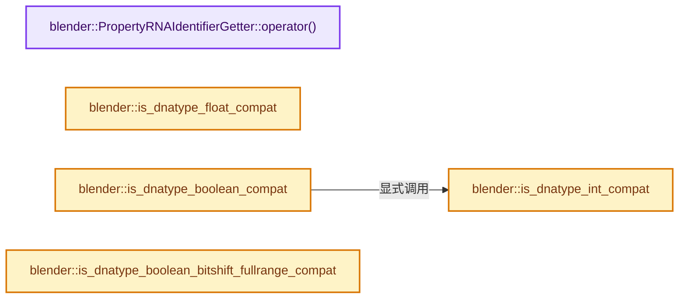
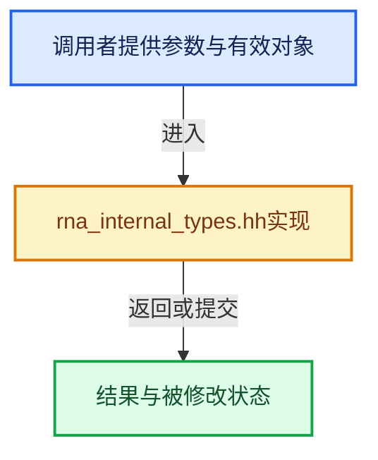

# 实现依赖专题：source/blender/makesrna/intern/rna_internal_types.hh

[实现依赖导航](../../../README.md) · [符号索引](../../../../00-课程指南/02-源码与提交索引/符号依赖与实现索引.md)

本专题从正文实际调用进入，集中保存共享实现。函数有稳定锚点，可从调用处直接跳到对应完整函数；递归与互相调用通过回链组织。

## 本文件的实现关系






<a id="m-372200629219"></a>

## 宏 `CONTAINER_RNA_ID`

<!-- annotated:c6ecc129750a36 -->

```cpp
#define CONTAINER_RNA_ID(cont) (*(const char **)(((ContainerRNA *)(cont)) + 1))

```

<details>
<summary>核对原始源码：source/blender/makesrna/intern/rna_internal_types.hh · L775—L776</summary>

<!-- original:c6ecc129750a36:source/blender/makesrna/intern/rna_internal_types.hh:775:776 -->

```cpp
#define CONTAINER_RNA_ID(cont) (*(const char **)(((ContainerRNA *)(cont)) + 1))

```

</details>

宏在预处理阶段展开，参数替换、重复求值和条件编译应直接从该定义检查。与普通函数不同，宏不会自动提供参数类型检查；构建配置选择哪个定义需结合外围条件。

## 完整成员与函数实现

<a id="f-13e8f72be1b7c83b"></a>

### `blender::PropertyRNAIdentifierGetter::operator()`

实现位置：[source/blender/makesrna/intern/rna_internal_types.hh](../../../../../../../../source/blender/makesrna/intern/rna_internal_types.hh) · L495—L498。

接口参数：

- `const PropertyRNA *prop`

**教学注释版**

<!-- annotated:4e5044eda58f53 -->

```cpp
inline UString PropertyRNAIdentifierGetter::operator()(const PropertyRNA *prop) const
{
  return prop->identifier;
}
```

<details>
<summary>核对原始源码：source/blender/makesrna/intern/rna_internal_types.hh · L495—L498</summary>

<!-- original:4e5044eda58f53:source/blender/makesrna/intern/rna_internal_types.hh:495:498 -->

```cpp
inline UString PropertyRNAIdentifierGetter::operator()(const PropertyRNA *prop) const
{
  return prop->identifier;
}
```

</details>

**结果出口**

- `return prop->identifier;`

**继续追踪实现**

本实现没有需要继续展开的显式调用；检查返回表达式、对象转换和调用者前置条件。

<a id="f-bfc074b0a66b7ff5"></a>

### `blender::is_dnatype_float_compat`

实现位置：[source/blender/makesrna/intern/rna_internal_types.hh](../../../../../../../../source/blender/makesrna/intern/rna_internal_types.hh) · L778—L781。

接口参数：

- `const StringRef dnatype`

**教学注释版**

<!-- annotated:b2664e9602c225 -->

```cpp
inline bool is_dnatype_float_compat(const StringRef dnatype)
{
  return ELEM(dnatype, "float", "double");
}
```

<details>
<summary>核对原始源码：source/blender/makesrna/intern/rna_internal_types.hh · L778—L781</summary>

<!-- original:b2664e9602c225:source/blender/makesrna/intern/rna_internal_types.hh:778:781 -->

```cpp
inline bool is_dnatype_float_compat(const StringRef dnatype)
{
  return ELEM(dnatype, "float", "double");
}
```

</details>

**结果出口**

- `return ELEM(dnatype, "float", "double");`

**继续追踪实现**

- `ELEM` → [ELEM · L88](../../../07-Intern运行时与平台/ghost/intern/GHOST_utildefines.hh.md#m-d28724a15928)；[ELEM · L135](../../../01-BLI基础库/BLI_utildefines.hh.md#m-d6572de7cae0)。宏定义由构建条件选择。

<a id="f-1d66a887b7309d1e"></a>

### `blender::is_dnatype_int_compat`

实现位置：[source/blender/makesrna/intern/rna_internal_types.hh](../../../../../../../../source/blender/makesrna/intern/rna_internal_types.hh) · L782—L785。

接口参数：

- `const StringRef dnatype`

**教学注释版**

<!-- annotated:575ab457e1c117 -->

```cpp
inline bool is_dnatype_int_compat(const StringRef dnatype)
{
  return ELEM(dnatype, "int", "short", "char", "uchar", "ushort", "int8_t");
}
```

<details>
<summary>核对原始源码：source/blender/makesrna/intern/rna_internal_types.hh · L782—L785</summary>

<!-- original:575ab457e1c117:source/blender/makesrna/intern/rna_internal_types.hh:782:785 -->

```cpp
inline bool is_dnatype_int_compat(const StringRef dnatype)
{
  return ELEM(dnatype, "int", "short", "char", "uchar", "ushort", "int8_t");
}
```

</details>

**结果出口**

- `return ELEM(dnatype, "int", "short", "char", "uchar", "ushort", "int8_t");`

**继续追踪实现**

- `ELEM` → [ELEM · L88](../../../07-Intern运行时与平台/ghost/intern/GHOST_utildefines.hh.md#m-d28724a15928)；[ELEM · L135](../../../01-BLI基础库/BLI_utildefines.hh.md#m-d6572de7cae0)。宏定义由构建条件选择。

<a id="f-de3e36a1110134c9"></a>

### `blender::is_dnatype_boolean_compat`

实现位置：[source/blender/makesrna/intern/rna_internal_types.hh](../../../../../../../../source/blender/makesrna/intern/rna_internal_types.hh) · L786—L789。

接口参数：

- `const StringRef dnatype`

**教学注释版**

<!-- annotated:785a9fe5a8a2f9 -->

```cpp
inline bool is_dnatype_boolean_compat(const StringRef dnatype)
{
  return is_dnatype_int_compat(dnatype) || ELEM(dnatype, "int64_t", "uint64_t");
}
```

<details>
<summary>核对原始源码：source/blender/makesrna/intern/rna_internal_types.hh · L786—L789</summary>

<!-- original:785a9fe5a8a2f9:source/blender/makesrna/intern/rna_internal_types.hh:786:789 -->

```cpp
inline bool is_dnatype_boolean_compat(const StringRef dnatype)
{
  return is_dnatype_int_compat(dnatype) || ELEM(dnatype, "int64_t", "uint64_t");
}
```

</details>

**结果出口**

- `return is_dnatype_int_compat(dnatype) || ELEM(dnatype, "int64_t", "uint64_t");`

**继续追踪实现**

- `is_dnatype_int_compat` → [blender::is_dnatype_int_compat · L782](rna_internal_types.hh.md#f-1d66a887b7309d1e)。
- `ELEM` → [ELEM · L88](../../../07-Intern运行时与平台/ghost/intern/GHOST_utildefines.hh.md#m-d28724a15928)；[ELEM · L135](../../../01-BLI基础库/BLI_utildefines.hh.md#m-d6572de7cae0)。宏定义由构建条件选择。

<a id="f-6554492ae728ab5e"></a>

### `blender::is_dnatype_boolean_bitshift_fullrange_compat`

实现位置：[source/blender/makesrna/intern/rna_internal_types.hh](../../../../../../../../source/blender/makesrna/intern/rna_internal_types.hh) · L790—L797。

接口参数：

- `const StringRef dnatype`

**教学注释版**

<!-- annotated:51dfee24cb03dd -->

```cpp
inline bool is_dnatype_boolean_bitshift_fullrange_compat(const StringRef dnatype)
{
  /* Several types cannot use all their bytes to store a bit-set (bit-shift operations on negative
   * numbers are "arithmetic", i.e. preserve the sign, i.e. are not "pure" binary shifting).
   *
   * Currently, all signed types and `uint64_t` cannot use their left-most bit (i.e. sign bit). */
  return ELEM(dnatype, "char", "uchar", "ushort", "uint", "uint8_t", "uint16_t", "uint32_t");
}
```

<details>
<summary>核对原始源码：source/blender/makesrna/intern/rna_internal_types.hh · L790—L797</summary>

<!-- original:51dfee24cb03dd:source/blender/makesrna/intern/rna_internal_types.hh:790:797 -->

```cpp
inline bool is_dnatype_boolean_bitshift_fullrange_compat(const StringRef dnatype)
{
  /* Several types cannot use all their bytes to store a bit-set (bit-shift operations on negative
   * numbers are "arithmetic", i.e. preserve the sign, i.e. are not "pure" binary shifting).
   *
   * Currently, all signed types and `uint64_t` cannot use their left-most bit (i.e. sign bit). */
  return ELEM(dnatype, "char", "uchar", "ushort", "uint", "uint8_t", "uint16_t", "uint32_t");
}
```

</details>

**结果出口**

- `return ELEM(dnatype, "char", "uchar", "ushort", "uint", "uint8_t", "uint16_t", "uint32_t");`

**继续追踪实现**

- `ELEM` → [ELEM · L88](../../../07-Intern运行时与平台/ghost/intern/GHOST_utildefines.hh.md#m-d28724a15928)；[ELEM · L135](../../../01-BLI基础库/BLI_utildefines.hh.md#m-d6572de7cae0)。宏定义由构建条件选择。
