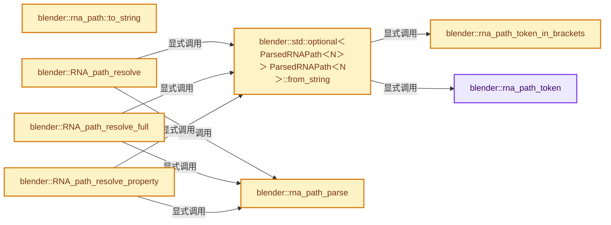
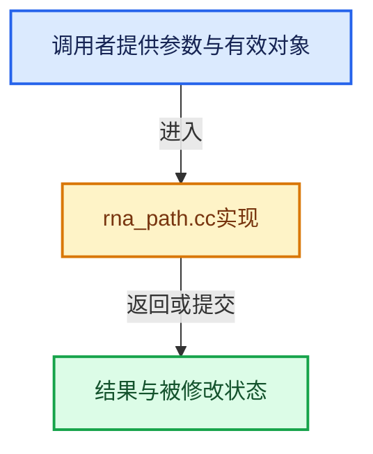

# 实现依赖专题：source/blender/makesrna/intern/rna_path.cc

[实现依赖导航](../../../README.md) · [符号索引](../../../../00-课程指南/02-源码与提交索引/符号依赖与实现索引.md)

本专题从正文实际调用进入，集中保存共享实现。函数有稳定锚点，可从调用处直接跳到对应完整函数；递归与互相调用通过回链组织。

## 本文件的实现关系






## 完整成员与函数实现

<a id="f-0a6df879ed8bf758"></a>

### `blender::rna_path_token`

实现位置：[source/blender/makesrna/intern/rna_path.cc](../../../../../../../../source/blender/makesrna/intern/rna_path.cc) · L68—L96。

接口参数：

- `const char **path`
- `char *fixedbuf`
- `int fixedlen`

**教学注释版**

<!-- annotated:a0a5b433e94fa3 -->

```cpp
static char *rna_path_token(const char **path, char *fixedbuf, int fixedlen)
{
  int len = 0;

  /* Get data until `.` or `[`. */
  const char *p = *path;
  while (*p && !ELEM(*p, '.', '[')) {
    len++;
    p++;
  }

  /* Empty, return. */
  if (len == 0) [[unlikely]] {
    return nullptr;
  }

  /* Try to use fixed buffer if possible. */
  char *buf = (len + 1 < fixedlen) ? fixedbuf :
                                     MEM_new_array_uninitialized<char>(size_t(len) + 1, __func__);
  // [讲解] memcpy：复制字节，源与目标不应重叠。类型生命周期、对齐和可复制表示须由调用者证明，不是任意对象的复制构造。
  memcpy(buf, *path, sizeof(char) * len);
  buf[len] = '\0';

  if (*p == '.') {
    p++;
  }
  *path = p;

  return buf;
}
```

<details>
<summary>核对原始源码：source/blender/makesrna/intern/rna_path.cc · L68—L96</summary>

<!-- original:a0a5b433e94fa3:source/blender/makesrna/intern/rna_path.cc:68:96 -->

```cpp
static char *rna_path_token(const char **path, char *fixedbuf, int fixedlen)
{
  int len = 0;

  /* Get data until `.` or `[`. */
  const char *p = *path;
  while (*p && !ELEM(*p, '.', '[')) {
    len++;
    p++;
  }

  /* Empty, return. */
  if (len == 0) [[unlikely]] {
    return nullptr;
  }

  /* Try to use fixed buffer if possible. */
  char *buf = (len + 1 < fixedlen) ? fixedbuf :
                                     MEM_new_array_uninitialized<char>(size_t(len) + 1, __func__);
  memcpy(buf, *path, sizeof(char) * len);
  buf[len] = '\0';

  if (*p == '.') {
    p++;
  }
  *path = p;

  return buf;
}
```

</details>

**沿实际写入检查状态**

- `buf[len] = '\0';`

**结果出口**

- `return nullptr;`
- `return buf;`

**继续追踪实现**

- `ELEM` → [ELEM · L88](../../../07-Intern运行时与平台/ghost/intern/GHOST_utildefines.hh.md#m-d28724a15928)；[ELEM · L135](../../../01-BLI基础库/BLI_utildefines.hh.md#m-d6572de7cae0)。宏定义由构建条件选择。
- `MEM_new_array_uninitialized<char>` → [MEM_new_array_uninitialized · L608](../../../07-Intern运行时与平台/guardedalloc/MEM_guardedalloc.h.md#f-b7103eae8eb57b05)；[MEM_new_array_uninitialized · L129](../../../07-Intern运行时与平台/guardedalloc/intern/mallocn.cc.md#f-bf6ef4ddcfb6e5df)。同名重载需按实参类型选择。
- `memcpy` → [外部契约](https://eel.is/c++draft/cstring.syn)：复制字节，源与目标不应重叠。类型生命周期、对齐和可复制表示须由调用者证明，不是任意对象的复制构造。

<a id="f-8a6306a67f5374fc"></a>

### `blender::rna_path_token_in_brackets`

实现位置：[source/blender/makesrna/intern/rna_path.cc](../../../../../../../../source/blender/makesrna/intern/rna_path.cc) · L108—L191。

接口参数：

- `const char **path`
- `char *fixedbuf`
- `int fixedlen`
- `bool *r_quoted`

**教学注释版**

<!-- annotated:1ccd76f70e0621 -->

```cpp
static char *rna_path_token_in_brackets(const char **path,
                                        char *fixedbuf,
                                        int fixedlen,
                                        bool *r_quoted)
{
  int len = 0;
  bool quoted = false;

  BLI_assert(r_quoted != nullptr);

  /* Get data between `[]`, check escaping quotes and back-slashes with #BLI_str_unescape. */
  if (**path != '[') [[unlikely]] {
    return nullptr;
  }

  (*path)++;
  const char *p = *path;

  /* 2 kinds of look-ups now, quoted or unquoted. */
  if (*p == '"') {
    /* Find the matching quote. */
    (*path)++;
    p = *path;
    const char *p_end = BLI_str_escape_find_quote(p);
    if (p_end == nullptr) {
      /* No Matching quote. */
      return nullptr;
    }
    /* Exclude the last quote from the length. */
    len += (p_end - p);

    /* Skip the last quoted char to get the `]`. */
    p_end += 1;
    p = p_end;
    quoted = true;
  }
  else {
    /* Find the matching bracket. */
    while (*p && (*p != ']')) {
      len++;
      p++;
    }
  }

  if (*p != ']') [[unlikely]] {
    return nullptr;
  }

  /* Support empty strings in quotes, as this is a valid key for an ID-property. */
  if (!quoted) {
    /* Empty, return. */
    if (len == 0) [[unlikely]] {
      return nullptr;
    }
  }

  /* Try to use fixed buffer if possible. */
  char *buf = (len + 1 < fixedlen) ? fixedbuf :
                                     MEM_new_array_uninitialized<char>(size_t(len) + 1, __func__);

  /* Copy string, taking into account escaped `]`. */
  if (quoted) {
    BLI_str_unescape(buf, *path, len);
    /* +1 to step over the last quote. */
    BLI_assert((*path)[len] == '"');
    p = (*path) + len + 1;
  }
  else {
    // [讲解] memcpy：复制字节，源与目标不应重叠。类型生命周期、对齐和可复制表示须由调用者证明，不是任意对象的复制构造。
    memcpy(buf, *path, sizeof(char) * len);
    buf[len] = '\0';
  }
  /* Set path to start of next token. */
  if (*p == ']') {
    p++;
  }
  if (*p == '.') {
    p++;
  }
  *path = p;

  *r_quoted = quoted;

  return buf;
}
```

<details>
<summary>核对原始源码：source/blender/makesrna/intern/rna_path.cc · L108—L191</summary>

<!-- original:1ccd76f70e0621:source/blender/makesrna/intern/rna_path.cc:108:191 -->

```cpp
static char *rna_path_token_in_brackets(const char **path,
                                        char *fixedbuf,
                                        int fixedlen,
                                        bool *r_quoted)
{
  int len = 0;
  bool quoted = false;

  BLI_assert(r_quoted != nullptr);

  /* Get data between `[]`, check escaping quotes and back-slashes with #BLI_str_unescape. */
  if (**path != '[') [[unlikely]] {
    return nullptr;
  }

  (*path)++;
  const char *p = *path;

  /* 2 kinds of look-ups now, quoted or unquoted. */
  if (*p == '"') {
    /* Find the matching quote. */
    (*path)++;
    p = *path;
    const char *p_end = BLI_str_escape_find_quote(p);
    if (p_end == nullptr) {
      /* No Matching quote. */
      return nullptr;
    }
    /* Exclude the last quote from the length. */
    len += (p_end - p);

    /* Skip the last quoted char to get the `]`. */
    p_end += 1;
    p = p_end;
    quoted = true;
  }
  else {
    /* Find the matching bracket. */
    while (*p && (*p != ']')) {
      len++;
      p++;
    }
  }

  if (*p != ']') [[unlikely]] {
    return nullptr;
  }

  /* Support empty strings in quotes, as this is a valid key for an ID-property. */
  if (!quoted) {
    /* Empty, return. */
    if (len == 0) [[unlikely]] {
      return nullptr;
    }
  }

  /* Try to use fixed buffer if possible. */
  char *buf = (len + 1 < fixedlen) ? fixedbuf :
                                     MEM_new_array_uninitialized<char>(size_t(len) + 1, __func__);

  /* Copy string, taking into account escaped `]`. */
  if (quoted) {
    BLI_str_unescape(buf, *path, len);
    /* +1 to step over the last quote. */
    BLI_assert((*path)[len] == '"');
    p = (*path) + len + 1;
  }
  else {
    memcpy(buf, *path, sizeof(char) * len);
    buf[len] = '\0';
  }
  /* Set path to start of next token. */
  if (*p == ']') {
    p++;
  }
  if (*p == '.') {
    p++;
  }
  *path = p;

  *r_quoted = quoted;

  return buf;
}
```

</details>

**沿实际写入检查状态**

- `p = *path;`
- `len += (p_end - p);`
- `p_end += 1;`
- `p = p_end;`
- `quoted = true;`
- `p = (*path) + len + 1;`
- `buf[len] = '\0';`

**结果出口**

- `return nullptr;`
- `return buf;`

**继续追踪实现**

- `BLI_assert` → [BLI_assert · L48](../../../01-BLI基础库/BLI_assert.hh.md#m-57a88495704d)；[BLI_assert · L63](../../../01-BLI基础库/BLI_assert.hh.md#m-d07050020cb5)。宏定义由构建条件选择。
- `BLI_str_escape_find_quote` → [blender::BLI_str_escape_find_quote · L444](../../../01-BLI基础库/intern/string.cc.md#f-b971b60f6d94ca3c)。
- `MEM_new_array_uninitialized<char>` → [MEM_new_array_uninitialized · L608](../../../07-Intern运行时与平台/guardedalloc/MEM_guardedalloc.h.md#f-b7103eae8eb57b05)；[MEM_new_array_uninitialized · L129](../../../07-Intern运行时与平台/guardedalloc/intern/mallocn.cc.md#f-bf6ef4ddcfb6e5df)。同名重载需按实参类型选择。
- `BLI_str_unescape` → [blender::BLI_str_unescape · L428](../../../01-BLI基础库/intern/string.cc.md#f-15c9c9e5a203af4e)。
- `memcpy` → [外部契约](https://eel.is/c++draft/cstring.syn)：复制字节，源与目标不应重叠。类型生命周期、对齐和可复制表示须由调用者证明，不是任意对象的复制构造。

<a id="f-29fb30a98412611d"></a>

### `blender::std::optional<ParsedRNAPath<N>> ParsedRNAPath<N>::from_string`

实现位置：[source/blender/makesrna/intern/rna_path.cc](../../../../../../../../source/blender/makesrna/intern/rna_path.cc) · L193—L239。

接口参数：

- `const StringRefNull path`

**教学注释版**

<!-- annotated:b9fd728fcb52f9 -->

```cpp
template<int64_t N>
std::optional<ParsedRNAPath<N>> ParsedRNAPath<N>::from_string(const StringRefNull path)
{
  if (path.is_empty()) {
    return std::nullopt;
  }
  /* Work directly in optional to avoid having to move it later when it is returned. */
  std::optional<ParsedRNAPath<N>> parsed;
  parsed.emplace();
  const char *current = path.c_str();
  while (*current) {
    const char c = *current;
    if (c == '[') {
      char buffer[256];
      bool quoted;
      char *token = rna_path_token_in_brackets(&current, buffer, sizeof(buffer), &quoted);
      if (!token) {
        return std::nullopt;
      }
      if (quoted) {
        parsed->items.append(rna_path::LookupKey(UString(token)));
      }
      else {
        const int64_t index = atoi(token);
        if (index == 0 && (token[0] != '0' || token[1] != '\0')) {
          return std::nullopt;
        }
        parsed->items.append(rna_path::LookupIndex(index));
      }
      if (buffer != token) {
        MEM_delete(token);
      }
    }
    else {
      char buffer[256];
      char *token = rna_path_token(&current, buffer, sizeof(buffer));
      if (!token) {
        return std::nullopt;
      }
      parsed->items.append(rna_path::Member(UString(token)));
      if (buffer != token) {
        MEM_delete(token);
      }
    }
  }
  return parsed;
}
```

<details>
<summary>核对原始源码：source/blender/makesrna/intern/rna_path.cc · L193—L239</summary>

<!-- original:b9fd728fcb52f9:source/blender/makesrna/intern/rna_path.cc:193:239 -->

```cpp
template<int64_t N>
std::optional<ParsedRNAPath<N>> ParsedRNAPath<N>::from_string(const StringRefNull path)
{
  if (path.is_empty()) {
    return std::nullopt;
  }
  /* Work directly in optional to avoid having to move it later when it is returned. */
  std::optional<ParsedRNAPath<N>> parsed;
  parsed.emplace();
  const char *current = path.c_str();
  while (*current) {
    const char c = *current;
    if (c == '[') {
      char buffer[256];
      bool quoted;
      char *token = rna_path_token_in_brackets(&current, buffer, sizeof(buffer), &quoted);
      if (!token) {
        return std::nullopt;
      }
      if (quoted) {
        parsed->items.append(rna_path::LookupKey(UString(token)));
      }
      else {
        const int64_t index = atoi(token);
        if (index == 0 && (token[0] != '0' || token[1] != '\0')) {
          return std::nullopt;
        }
        parsed->items.append(rna_path::LookupIndex(index));
      }
      if (buffer != token) {
        MEM_delete(token);
      }
    }
    else {
      char buffer[256];
      char *token = rna_path_token(&current, buffer, sizeof(buffer));
      if (!token) {
        return std::nullopt;
      }
      parsed->items.append(rna_path::Member(UString(token)));
      if (buffer != token) {
        MEM_delete(token);
      }
    }
  }
  return parsed;
}
```

</details>

**结果出口**

- `return std::nullopt;`
- `return parsed;`

**继续追踪实现**

- `path.is_empty` → [blender::Bounds<T>::is_empty · L533](../../../../12-空间数据结构与几何算法/07-Bounds与BVH对比.md#f-55ac376b3d0a0944)；[blender::GVArrayCommon::is_empty · L767](../../../../04-虚拟数组与索引选择/05-GVArray运行时类型.md#f-c1da602ffc5555f9)；[blender::StringRefBase::is_empty · L201](../../../../01-基础容器与现代CPP/15-StringRef字符串视图.md#f-9f6c3d2da1cb1796)；[blender::KDTreeNew<T>::is_empty · L498](../../../../12-空间数据结构与几何算法/05-K近邻与范围查询.md#f-67f0ff91cf00b00b)。同名重载需按实参类型选择。
- `parsed.emplace` → [外部契约](https://eel.is/c++draft/)：这个边界按实际表达式及所属类型核对参数、返回值、寿命与失败行为。这里提供接口入口，不声称已解释该第三方版本的内部实现。
- `path.c_str` → [blender::StringRefNull::c_str · L544](../../../../01-基础容器与现代CPP/15-StringRef字符串视图.md#f-4a8bbfe1e6d00757)。
- `rna_path_token_in_brackets` → [blender::rna_path_token_in_brackets · L108](rna_path.cc.md#f-8a6306a67f5374fc)。
- `parsed->items.append` → [调用协议](../../../../00-课程指南/01-路线与规范/模板宏与动态分派协议.md)：接收对象类型依赖auto、返回值或模板实例；不按同名猜测目标。调用位置L213。
- `rna_path::LookupKey` → [blender::rna_path::LookupKey](../../makesdna/DNA_anim_types.h.md#t-88b374544092)；[blender::rna_path::LookupKey](../RNA_path_fwd.hh.md#t-fcf58560884f)；[blender::rna_path::LookupKey](../RNA_path.hh.md#t-6bf3f6687f74)。
- `UString` → [blender::UString::UString · L65](../../../01-BLI基础库/BLI_ustring.hh.md#f-af044c001f6ab696)；[blender::UString::UString · L68](../../../01-BLI基础库/BLI_ustring.hh.md#f-acdd59bd65bf3333)；[blender::UString::UString · L69](../../../01-BLI基础库/BLI_ustring.hh.md#f-bc4cac73ffd771a5)。同名重载需按实参类型选择。
- `atoi` → [调用协议](../../../../00-课程指南/01-路线与规范/模板宏与动态分派协议.md)：函数指针、局部可调用对象或未展开的宏；必须结合调用者环境。调用位置L216。
- `rna_path::LookupIndex` → [blender::rna_path::LookupIndex](../../makesdna/DNA_anim_types.h.md#t-21dcf2d090a1)；[blender::rna_path::LookupIndex](../RNA_path_fwd.hh.md#t-a8b3e3ffc393)；[blender::rna_path::LookupIndex](../RNA_path.hh.md#t-efb89e8dd2f8)。
- `MEM_delete` → [MEM_delete · L400](../../../07-Intern运行时与平台/guardedalloc/MEM_guardedalloc.h.md#f-9049ffdd1682887c)。
- `rna_path_token` → [blender::rna_path_token · L68](rna_path.cc.md#f-0a6df879ed8bf758)。
- `rna_path::Member` → [blender::rna_path::Member](../../makesdna/DNA_anim_types.h.md#t-da69cfd552a8)；[blender::rna_path::Member](../RNA_path_fwd.hh.md#t-80e7a784e595)；[blender::rna_path::Member](../RNA_path.hh.md#t-8781b4581a6c)。

<a id="f-6d63a196e04aca1b"></a>

### `blender::rna_path::to_string`

实现位置：[source/blender/makesrna/intern/rna_path.cc](../../../../../../../../source/blender/makesrna/intern/rna_path.cc) · L243—L278。

接口参数：

- `const Span<Item> items`

**教学注释版**

<!-- annotated:57869e67ffadb6 -->

```cpp
std::string to_string(const Span<Item> items)
{
  std::string result;
  for (const auto &item : items) {
    if (const Member *member = std::get_if<Member>(&item)) {
      if (!result.empty()) {
        result.append(".");
      }
      result.append(member->identifier.c_str());
    }
    else if (const LookupIndex *lookup_index = std::get_if<LookupIndex>(&item)) {
      result.append("[");
      result.append(std::to_string(lookup_index->index));
      result.append("]");
    }
    else if (const LookupKey *lookup_key = std::get_if<LookupKey>(&item)) {
      result.append("[\"");
      for (const char c : lookup_key->key.ref()) {
        if (c == '\\') {
          result.append("\\\\");
        }
        else if (c == '"') {
          result.append("\\\"");
        }
        else {
          result.append(1, c);
        }
      }
      result.append("\"]");
    }
    else {
      BLI_assert_unreachable();
    }
  }
  return result;
}
```

<details>
<summary>核对原始源码：source/blender/makesrna/intern/rna_path.cc · L243—L278</summary>

<!-- original:57869e67ffadb6:source/blender/makesrna/intern/rna_path.cc:243:278 -->

```cpp
std::string to_string(const Span<Item> items)
{
  std::string result;
  for (const auto &item : items) {
    if (const Member *member = std::get_if<Member>(&item)) {
      if (!result.empty()) {
        result.append(".");
      }
      result.append(member->identifier.c_str());
    }
    else if (const LookupIndex *lookup_index = std::get_if<LookupIndex>(&item)) {
      result.append("[");
      result.append(std::to_string(lookup_index->index));
      result.append("]");
    }
    else if (const LookupKey *lookup_key = std::get_if<LookupKey>(&item)) {
      result.append("[\"");
      for (const char c : lookup_key->key.ref()) {
        if (c == '\\') {
          result.append("\\\\");
        }
        else if (c == '"') {
          result.append("\\\"");
        }
        else {
          result.append(1, c);
        }
      }
      result.append("\"]");
    }
    else {
      BLI_assert_unreachable();
    }
  }
  return result;
}
```

</details>

**结果出口**

- `return result;`

**继续追踪实现**

- `std::get_if<Member>` → [外部契约](https://eel.is/c++draft/)：这个边界按实际表达式及所属类型核对参数、返回值、寿命与失败行为。这里提供接口入口，不声称已解释该第三方版本的内部实现。
- `result.empty` → [外部契约](https://eel.is/c++draft/)：这个边界按实际表达式及所属类型核对参数、返回值、寿命与失败行为。这里提供接口入口，不声称已解释该第三方版本的内部实现。
- `result.append` → [外部契约](https://eel.is/c++draft/)：这个边界按实际表达式及所属类型核对参数、返回值、寿命与失败行为。这里提供接口入口，不声称已解释该第三方版本的内部实现。
- `member->identifier.c_str` → [调用协议](../../../../00-课程指南/01-路线与规范/模板宏与动态分派协议.md)：接收对象类型依赖auto、返回值或模板实例；不按同名猜测目标。调用位置L251。
- `std::get_if<LookupIndex>` → [外部契约](https://eel.is/c++draft/)：这个边界按实际表达式及所属类型核对参数、返回值、寿命与失败行为。这里提供接口入口，不声称已解释该第三方版本的内部实现。
- `std::to_string` → [外部契约](https://eel.is/c++draft/)：这个边界按实际表达式及所属类型核对参数、返回值、寿命与失败行为。这里提供接口入口，不声称已解释该第三方版本的内部实现。
- `std::get_if<LookupKey>` → [外部契约](https://eel.is/c++draft/)：这个边界按实际表达式及所属类型核对参数、返回值、寿命与失败行为。这里提供接口入口，不声称已解释该第三方版本的内部实现。
- `lookup_key->key.ref` → [调用协议](../../../../00-课程指南/01-路线与规范/模板宏与动态分派协议.md)：接收对象类型依赖auto、返回值或模板实例；不按同名猜测目标。调用位置L260。
- `BLI_assert_unreachable` → [BLI_assert_unreachable · L77](../../../01-BLI基础库/BLI_assert.hh.md#m-7a2d91a67d8e)。宏定义由构建条件选择。

<a id="f-99cb90f4a58f1713"></a>

### `blender::rna_path_parse`

实现位置：[source/blender/makesrna/intern/rna_path.cc](../../../../../../../../source/blender/makesrna/intern/rna_path.cc) · L311—L524。

接口参数：

- `const PointerRNA *ptr`
- `const ParsedRNAPathRef path`
- `PointerRNA *r_ptr`
- `PropertyRNA **r_prop`
- `int *r_index`
- `PointerRNA *r_item_ptr`
- `Vector<PropertyElemRNA> *r_elements`
- `const bool eval_pointer`

**教学注释版**

<!-- annotated:a6c35e48814728 -->

```cpp
static bool rna_path_parse(const PointerRNA *ptr,
                           const ParsedRNAPathRef path,
                           PointerRNA *r_ptr,
                           PropertyRNA **r_prop,
                           int *r_index,
                           PointerRNA *r_item_ptr,
                           Vector<PropertyElemRNA> *r_elements,
                           const bool eval_pointer)
{
  BLI_assert(r_item_ptr == nullptr || !eval_pointer);
  PropertyRNA *prop;
  PointerRNA curptr, nextptr;
  int index = -1;
  const bool do_item_ptr = r_item_ptr != nullptr && !eval_pointer;

  if (do_item_ptr) {
    nextptr.invalidate();
  }

  prop = nullptr;
  curptr = *ptr;

  if (path.is_empty()) {
    return false;
  }

  const rna_path::Item *item_iter = path.begin();
  while (item_iter != path.end()) {
    if (do_item_ptr) {
      nextptr.invalidate();
    }

    if (!curptr) {
      return false;
    }

    /* look up property name in current struct */
    prop = nullptr;
    if (const auto *member = std::get_if<rna_path::Member>(item_iter)) {
      prop = RNA_struct_find_property(&curptr, member->identifier);
    }
    else if (const auto *lookup_key = std::get_if<rna_path::LookupKey>(item_iter)) {
      IDProperty *group = RNA_struct_idprops(&curptr, false);
      if (group) {
        prop = reinterpret_cast<PropertyRNA *>(
            IDP_GetPropertyFromGroup(group, lookup_key->key.c_str()));
      }
    }
    else {
      /* LookupIndex is never a valid property identifier. */
      return false;
    }

    if (!prop) {
      return false;
    }

    if (r_elements) {
      /* index will be added later, if needed. */
      // [讲解] r_elements->append：在尾部建立新元素，必要时先扩大存储。
      r_elements->append(PropertyElemRNA{
          .ptr = curptr,
          .prop = prop,
          .index = -1,
      });
    }

    item_iter++;

    /* now look up the value of this property if it is a pointer or
     * collection, otherwise return the property rna so that the
     * caller can read the value of the property itself */
    switch (RNA_property_type(prop)) {
      case PROP_POINTER: {
        /* resolve pointer if further path elements follow
         * or explicitly requested
         */
        if (do_item_ptr || eval_pointer || item_iter != path.end()) {
          nextptr = RNA_property_pointer_get(&curptr, prop);
        }

        if (eval_pointer || item_iter != path.end()) {
          curptr = nextptr;
          prop = nullptr; /* now we have a PointerRNA, the prop is our parent so forget it */
          index = -1;
        }
        break;
      }
      case PROP_COLLECTION: {
        /* Resolve pointer if further path elements follow. */
        if (item_iter != path.end()) {
          if (const auto *lookup_key = std::get_if<rna_path::LookupKey>(item_iter)) {
            if (!RNA_property_collection_lookup_string(
                    &curptr, prop, lookup_key->key.c_str(), &nextptr))
            {
              return false;
            }
            item_iter++;
          }
          else if (const auto *lookup_index = std::get_if<rna_path::LookupIndex>(item_iter)) {
            if (!RNA_property_collection_lookup_int(
                    &curptr, prop, int(lookup_index->index), &nextptr))
            {
              return false;
            }
            item_iter++;
          }
          else {
            /* Member follows collection: resolve to collection's type pointer.
             * Don't consume the Member; leave it for the next outer iteration. */
            std::optional<PointerRNA> ptr = RNA_property_collection_type_get(&curptr, prop);
            if (!ptr) {
              return false;
            }
            nextptr = *ptr;
          }

          if (eval_pointer || item_iter != path.end()) {
            curptr = nextptr;
            prop = nullptr; /* now we have a PointerRNA, the prop is our parent so forget it */
            index = -1;
          }
        }
        break;
      }
      default:
        if (r_index || r_elements) {
          if (item_iter == path.end()) {
            /* A potential array index is not specified. */
            break;
          }

          int array_indices[RNA_MAX_ARRAY_DIMENSION] = {0};
          int dimension_size[RNA_MAX_ARRAY_DIMENSION];
          const int dim = RNA_property_array_dimension(&curptr, prop, dimension_size);
          for (const int d : IndexRange(dim)) {
            if (item_iter == path.end()) {
              /* Fewer items than dimensions. */
              return false;
            }

            if (const auto *lookup_index = std::get_if<rna_path::LookupIndex>(item_iter)) {
              array_indices[d] = int(lookup_index->index);
            }
            else if (const auto *lookup_key = std::get_if<rna_path::LookupKey>(item_iter)) {
              /* ["x"] quoted-bracket style. */
              array_indices[d] = RNA_property_array_item_index(prop, lookup_key->key[0]);
            }
            else if (dim == 1) {
              /* .x/.y/.x single letter collection property access. */
              const auto *member = std::get_if<rna_path::Member>(item_iter);
              if (!member) {
                return false;
              }
              array_indices[d] = RNA_property_array_item_index(prop, member->identifier[0]);
            }
            else {
              /* Multi-dimensional arrays cannot use a single letter #rna_path::Member. */
              return false;
            }

            if (array_indices[d] < 0 || array_indices[d] >= dimension_size[d]) {
              return false;
            }
            item_iter++;
          }

          /* Besides pointer and collections (handled above), indices are always the path end. */
          if (item_iter != path.end()) {
            return false;
          }

          /* Flatten index over all dimensions. */
          int dim_total = 1;
          int flat_index = 0;
          for (int d = dim - 1; d >= 0; d--) {
            flat_index += array_indices[d] * dim_total;
            dim_total *= dimension_size[d];
          }
          index = flat_index;

          if (r_elements) {
            // [讲解] r_elements->last：访问有效范围首端或末端元素。
            r_elements->last().index = index;
          }
        }
        break;
    }
  }

  if (r_ptr) {
    *r_ptr = curptr;
  }
  if (r_prop) {
    *r_prop = prop;
  }
  if (r_index) {
    *r_index = index;
  }
  if (r_item_ptr && do_item_ptr) {
    *r_item_ptr = nextptr;
  }

  if (r_elements) {
    PropertyElemRNA &last = r_elements->last();
    if ((last.ptr.data != curptr.data || last.prop != prop || last.index != index)) {
      r_elements->append(PropertyElemRNA{
          .ptr = curptr,
          .prop = prop,
          .index = index,
      });
    }
  }

  return true;
}
```

<details>
<summary>核对原始源码：source/blender/makesrna/intern/rna_path.cc · L311—L524</summary>

<!-- original:a6c35e48814728:source/blender/makesrna/intern/rna_path.cc:311:524 -->

```cpp
static bool rna_path_parse(const PointerRNA *ptr,
                           const ParsedRNAPathRef path,
                           PointerRNA *r_ptr,
                           PropertyRNA **r_prop,
                           int *r_index,
                           PointerRNA *r_item_ptr,
                           Vector<PropertyElemRNA> *r_elements,
                           const bool eval_pointer)
{
  BLI_assert(r_item_ptr == nullptr || !eval_pointer);
  PropertyRNA *prop;
  PointerRNA curptr, nextptr;
  int index = -1;
  const bool do_item_ptr = r_item_ptr != nullptr && !eval_pointer;

  if (do_item_ptr) {
    nextptr.invalidate();
  }

  prop = nullptr;
  curptr = *ptr;

  if (path.is_empty()) {
    return false;
  }

  const rna_path::Item *item_iter = path.begin();
  while (item_iter != path.end()) {
    if (do_item_ptr) {
      nextptr.invalidate();
    }

    if (!curptr) {
      return false;
    }

    /* look up property name in current struct */
    prop = nullptr;
    if (const auto *member = std::get_if<rna_path::Member>(item_iter)) {
      prop = RNA_struct_find_property(&curptr, member->identifier);
    }
    else if (const auto *lookup_key = std::get_if<rna_path::LookupKey>(item_iter)) {
      IDProperty *group = RNA_struct_idprops(&curptr, false);
      if (group) {
        prop = reinterpret_cast<PropertyRNA *>(
            IDP_GetPropertyFromGroup(group, lookup_key->key.c_str()));
      }
    }
    else {
      /* LookupIndex is never a valid property identifier. */
      return false;
    }

    if (!prop) {
      return false;
    }

    if (r_elements) {
      /* index will be added later, if needed. */
      r_elements->append(PropertyElemRNA{
          .ptr = curptr,
          .prop = prop,
          .index = -1,
      });
    }

    item_iter++;

    /* now look up the value of this property if it is a pointer or
     * collection, otherwise return the property rna so that the
     * caller can read the value of the property itself */
    switch (RNA_property_type(prop)) {
      case PROP_POINTER: {
        /* resolve pointer if further path elements follow
         * or explicitly requested
         */
        if (do_item_ptr || eval_pointer || item_iter != path.end()) {
          nextptr = RNA_property_pointer_get(&curptr, prop);
        }

        if (eval_pointer || item_iter != path.end()) {
          curptr = nextptr;
          prop = nullptr; /* now we have a PointerRNA, the prop is our parent so forget it */
          index = -1;
        }
        break;
      }
      case PROP_COLLECTION: {
        /* Resolve pointer if further path elements follow. */
        if (item_iter != path.end()) {
          if (const auto *lookup_key = std::get_if<rna_path::LookupKey>(item_iter)) {
            if (!RNA_property_collection_lookup_string(
                    &curptr, prop, lookup_key->key.c_str(), &nextptr))
            {
              return false;
            }
            item_iter++;
          }
          else if (const auto *lookup_index = std::get_if<rna_path::LookupIndex>(item_iter)) {
            if (!RNA_property_collection_lookup_int(
                    &curptr, prop, int(lookup_index->index), &nextptr))
            {
              return false;
            }
            item_iter++;
          }
          else {
            /* Member follows collection: resolve to collection's type pointer.
             * Don't consume the Member; leave it for the next outer iteration. */
            std::optional<PointerRNA> ptr = RNA_property_collection_type_get(&curptr, prop);
            if (!ptr) {
              return false;
            }
            nextptr = *ptr;
          }

          if (eval_pointer || item_iter != path.end()) {
            curptr = nextptr;
            prop = nullptr; /* now we have a PointerRNA, the prop is our parent so forget it */
            index = -1;
          }
        }
        break;
      }
      default:
        if (r_index || r_elements) {
          if (item_iter == path.end()) {
            /* A potential array index is not specified. */
            break;
          }

          int array_indices[RNA_MAX_ARRAY_DIMENSION] = {0};
          int dimension_size[RNA_MAX_ARRAY_DIMENSION];
          const int dim = RNA_property_array_dimension(&curptr, prop, dimension_size);
          for (const int d : IndexRange(dim)) {
            if (item_iter == path.end()) {
              /* Fewer items than dimensions. */
              return false;
            }

            if (const auto *lookup_index = std::get_if<rna_path::LookupIndex>(item_iter)) {
              array_indices[d] = int(lookup_index->index);
            }
            else if (const auto *lookup_key = std::get_if<rna_path::LookupKey>(item_iter)) {
              /* ["x"] quoted-bracket style. */
              array_indices[d] = RNA_property_array_item_index(prop, lookup_key->key[0]);
            }
            else if (dim == 1) {
              /* .x/.y/.x single letter collection property access. */
              const auto *member = std::get_if<rna_path::Member>(item_iter);
              if (!member) {
                return false;
              }
              array_indices[d] = RNA_property_array_item_index(prop, member->identifier[0]);
            }
            else {
              /* Multi-dimensional arrays cannot use a single letter #rna_path::Member. */
              return false;
            }

            if (array_indices[d] < 0 || array_indices[d] >= dimension_size[d]) {
              return false;
            }
            item_iter++;
          }

          /* Besides pointer and collections (handled above), indices are always the path end. */
          if (item_iter != path.end()) {
            return false;
          }

          /* Flatten index over all dimensions. */
          int dim_total = 1;
          int flat_index = 0;
          for (int d = dim - 1; d >= 0; d--) {
            flat_index += array_indices[d] * dim_total;
            dim_total *= dimension_size[d];
          }
          index = flat_index;

          if (r_elements) {
            r_elements->last().index = index;
          }
        }
        break;
    }
  }

  if (r_ptr) {
    *r_ptr = curptr;
  }
  if (r_prop) {
    *r_prop = prop;
  }
  if (r_index) {
    *r_index = index;
  }
  if (r_item_ptr && do_item_ptr) {
    *r_item_ptr = nextptr;
  }

  if (r_elements) {
    PropertyElemRNA &last = r_elements->last();
    if ((last.ptr.data != curptr.data || last.prop != prop || last.index != index)) {
      r_elements->append(PropertyElemRNA{
          .ptr = curptr,
          .prop = prop,
          .index = index,
      });
    }
  }

  return true;
}
```

</details>

**沿实际写入检查状态**

- `prop = nullptr;`
- `curptr = *ptr;`
- `prop = RNA_struct_find_property(&curptr, member->identifier);`
- `prop = reinterpret_cast<PropertyRNA *>(`
- `.ptr = curptr,`
- `.prop = prop,`
- `.index = -1,`
- `nextptr = RNA_property_pointer_get(&curptr, prop);`
- `curptr = nextptr;`
- `prop = nullptr; /* now we have a PointerRNA, the prop is our parent so forget it */`
- `index = -1;`
- `nextptr = *ptr;`
- `array_indices[d] = int(lookup_index->index);`
- `array_indices[d] = RNA_property_array_item_index(prop, lookup_key->key[0]);`
- `array_indices[d] = RNA_property_array_item_index(prop, member->identifier[0]);`
- `flat_index += array_indices[d] * dim_total;`
- `dim_total *= dimension_size[d];`
- `index = flat_index;`
- `.index = index,`

**结果出口**

- `return false;`
- `return true;`

**继续追踪实现**

- `BLI_assert` → [BLI_assert · L48](../../../01-BLI基础库/BLI_assert.hh.md#m-57a88495704d)；[BLI_assert · L63](../../../01-BLI基础库/BLI_assert.hh.md#m-d07050020cb5)。宏定义由构建条件选择。
- `nextptr.invalidate` → [调用协议](../../../../00-课程指南/01-路线与规范/模板宏与动态分派协议.md)：接收对象类型依赖auto、返回值或模板实例；不按同名猜测目标。调用位置L327。
- `path.is_empty` → [blender::Bounds<T>::is_empty · L533](../../../../12-空间数据结构与几何算法/07-Bounds与BVH对比.md#f-55ac376b3d0a0944)；[blender::GVArrayCommon::is_empty · L767](../../../../04-虚拟数组与索引选择/05-GVArray运行时类型.md#f-c1da602ffc5555f9)；[blender::StringRefBase::is_empty · L201](../../../../01-基础容器与现代CPP/15-StringRef字符串视图.md#f-9f6c3d2da1cb1796)；[blender::KDTreeNew<T>::is_empty · L498](../../../../12-空间数据结构与几何算法/05-K近邻与范围查询.md#f-67f0ff91cf00b00b)。同名重载需按实参类型选择。
- `path.begin` → [blender::StringRefBase::begin · L233](../../../../01-基础容器与现代CPP/15-StringRef字符串视图.md#f-0fa50fe40314532d)。
- `path.end` → [blender::StringRefBase::end · L238](../../../../01-基础容器与现代CPP/15-StringRef字符串视图.md#f-6197aad1986222a5)；[blender::GreasePencilFrame::end · L1077](../../../02-BKE几何与数据/BKE_grease_pencil.hh.md#f-1293ef8adad46989)。同名重载需按实参类型选择。
- `std::get_if<rna_path::Member>` → [外部契约](https://eel.is/c++draft/)：这个边界按实际表达式及所属类型核对参数、返回值、寿命与失败行为。这里提供接口入口，不声称已解释该第三方版本的内部实现。
- `RNA_struct_find_property` → [blender::RNA_struct_find_property · L855](rna_access.cc.md#f-75b0f3b3cc89dd4c)；[blender::RNA_struct_find_property · L874](rna_access.cc.md#f-7fb7ab238d64680f)。同名重载需按实参类型选择。
- `std::get_if<rna_path::LookupKey>` → [外部契约](https://eel.is/c++draft/)：这个边界按实际表达式及所属类型核对参数、返回值、寿命与失败行为。这里提供接口入口，不声称已解释该第三方版本的内部实现。
- `RNA_struct_idprops` → [blender::RNA_struct_idprops · L284](rna_access.cc.md#f-a5bf68e0fc1eb45c)。
- `IDP_GetPropertyFromGroup` → [blender::IDP_GetPropertyFromGroup · L818](../../../02-BKE几何与数据/intern/idprop.cc.md#f-a8d678499d89359e)。
- `lookup_key->key.c_str` → [调用协议](../../../../00-课程指南/01-路线与规范/模板宏与动态分派协议.md)：接收对象类型依赖auto、返回值或模板实例；不按同名猜测目标。调用位置L356。
- `r_elements->append` → [blender::Vector::append · L498](../../../../01-基础容器与现代CPP/11-Vector插入删除与重排.md#f-5bde268a69e443ec)；[blender::Vector::append · L502](../../../../01-基础容器与现代CPP/11-Vector插入删除与重排.md#f-591e0b15e6308532)。同名重载需按实参类型选择。
- `RNA_property_type` → [blender::RNA_property_type · L1293](rna_access.cc.md#f-4465a90d55f022df)。
- `RNA_property_pointer_get` → [blender::RNA_property_pointer_get · L4660](rna_access.cc.md#f-bca774eb7a868daa)。
- `RNA_property_collection_lookup_string` → [blender::RNA_property_collection_lookup_string · L5415](rna_access.cc.md#f-8fe2ed5dfd0cabc6)。
- `std::get_if<rna_path::LookupIndex>` → [外部契约](https://eel.is/c++draft/)：这个边界按实际表达式及所属类型核对参数、返回值、寿命与失败行为。这里提供接口入口，不声称已解释该第三方版本的内部实现。
- `RNA_property_collection_lookup_int` → [blender::RNA_property_collection_lookup_int · L5317](rna_access.cc.md#f-6df8f319957cdab2)。
- `RNA_property_collection_type_get` → [blender::RNA_property_collection_type_get · L5443](rna_access.cc.md#f-a94bf0c92c568644)。
- `RNA_property_array_dimension` → [blender::RNA_property_array_dimension · L1381](rna_access.cc.md#f-6ea6bed1f6abd9fe)。
- `IndexRange` → [blender::IndexRange](../../../01-BLI基础库/BLI_index_range.hh.md#t-caa3466d6776)；[blender::gpu::shader::parser::IndexRange](../../gpu/shader_tool/utils.hh.md#t-82d2bd4ea71c)；[blender::IndexRange](../../makesdna/DNA_node_types.h.md#t-0448cc889d39)。
- `RNA_property_array_item_index` → [blender::RNA_property_array_item_index · L1434](rna_access.cc.md#f-a0c61cf9609233ca)。
- `r_elements->last` → [blender::Vector::last · L749](../../../../01-基础容器与现代CPP/11-Vector插入删除与重排.md#f-d32e1fd895e766b4)；[blender::Vector::last · L755](../../../../01-基础容器与现代CPP/11-Vector插入删除与重排.md#f-66b262993c080d9d)。同名重载需按实参类型选择。

<a id="f-308769359a317652"></a>

### `blender::RNA_path_resolve`

实现位置：[source/blender/makesrna/intern/rna_path.cc](../../../../../../../../source/blender/makesrna/intern/rna_path.cc) · L526—L543。

接口参数：

- `const PointerRNA *ptr`
- `const char *path`
- `PointerRNA *r_ptr`
- `PropertyRNA **r_prop`

**教学注释版**

<!-- annotated:644464922d07ca -->

```cpp
bool RNA_path_resolve(const PointerRNA *ptr,
                      const char *path,
                      PointerRNA *r_ptr,
                      PropertyRNA **r_prop)
{
  if (!path) {
    return false;
  }
  const std::optional<ParsedRNAPath<>> parsed_path = ParsedRNAPath<>::from_string(path);
  if (!parsed_path) {
    return false;
  }
  if (!rna_path_parse(ptr, *parsed_path, r_ptr, r_prop, nullptr, nullptr, nullptr, true)) {
    return false;
  }

  return *r_ptr;
}
```

<details>
<summary>核对原始源码：source/blender/makesrna/intern/rna_path.cc · L526—L543</summary>

<!-- original:644464922d07ca:source/blender/makesrna/intern/rna_path.cc:526:543 -->

```cpp
bool RNA_path_resolve(const PointerRNA *ptr,
                      const char *path,
                      PointerRNA *r_ptr,
                      PropertyRNA **r_prop)
{
  if (!path) {
    return false;
  }
  const std::optional<ParsedRNAPath<>> parsed_path = ParsedRNAPath<>::from_string(path);
  if (!parsed_path) {
    return false;
  }
  if (!rna_path_parse(ptr, *parsed_path, r_ptr, r_prop, nullptr, nullptr, nullptr, true)) {
    return false;
  }

  return *r_ptr;
}
```

</details>

**结果出口**

- `return false;`
- `return *r_ptr;`

**继续追踪实现**

- `ParsedRNAPath<>::from_string` → [blender::std::optional<ParsedRNAPath<N>> ParsedRNAPath<N>::from_string · L193](rna_path.cc.md#f-29fb30a98412611d)。
- `rna_path_parse` → [blender::rna_path_parse · L311](rna_path.cc.md#f-99cb90f4a58f1713)。

<a id="f-df07a240b3b9a13a"></a>

### `blender::RNA_path_resolve_full`

实现位置：[source/blender/makesrna/intern/rna_path.cc](../../../../../../../../source/blender/makesrna/intern/rna_path.cc) · L545—L560。

接口参数：

- `const PointerRNA *ptr`
- `const char *path`
- `PointerRNA *r_ptr`
- `PropertyRNA **r_prop`
- `int *r_index`

**教学注释版**

<!-- annotated:e7abed1c88b43c -->

```cpp
bool RNA_path_resolve_full(
    const PointerRNA *ptr, const char *path, PointerRNA *r_ptr, PropertyRNA **r_prop, int *r_index)
{
  if (!path) {
    return false;
  }
  const std::optional<ParsedRNAPath<>> parsed_path = ParsedRNAPath<>::from_string(path);
  if (!parsed_path) {
    return false;
  }
  if (!rna_path_parse(ptr, *parsed_path, r_ptr, r_prop, r_index, nullptr, nullptr, true)) {
    return false;
  }

  return *r_ptr;
}
```

<details>
<summary>核对原始源码：source/blender/makesrna/intern/rna_path.cc · L545—L560</summary>

<!-- original:e7abed1c88b43c:source/blender/makesrna/intern/rna_path.cc:545:560 -->

```cpp
bool RNA_path_resolve_full(
    const PointerRNA *ptr, const char *path, PointerRNA *r_ptr, PropertyRNA **r_prop, int *r_index)
{
  if (!path) {
    return false;
  }
  const std::optional<ParsedRNAPath<>> parsed_path = ParsedRNAPath<>::from_string(path);
  if (!parsed_path) {
    return false;
  }
  if (!rna_path_parse(ptr, *parsed_path, r_ptr, r_prop, r_index, nullptr, nullptr, true)) {
    return false;
  }

  return *r_ptr;
}
```

</details>

**结果出口**

- `return false;`
- `return *r_ptr;`

**继续追踪实现**

- `ParsedRNAPath<>::from_string` → [blender::std::optional<ParsedRNAPath<N>> ParsedRNAPath<N>::from_string · L193](rna_path.cc.md#f-29fb30a98412611d)。
- `rna_path_parse` → [blender::rna_path_parse · L311](rna_path.cc.md#f-99cb90f4a58f1713)。

<a id="f-9ccab9d4f53550b5"></a>

### `blender::RNA_path_resolve_property`

实现位置：[source/blender/makesrna/intern/rna_path.cc](../../../../../../../../source/blender/makesrna/intern/rna_path.cc) · L575—L592。

接口参数：

- `const PointerRNA *ptr`
- `const char *path`
- `PointerRNA *r_ptr`
- `PropertyRNA **r_prop`

**教学注释版**

<!-- annotated:37f4c7a942b97c -->

```cpp
bool RNA_path_resolve_property(const PointerRNA *ptr,
                               const char *path,
                               PointerRNA *r_ptr,
                               PropertyRNA **r_prop)
{
  if (!path) {
    return false;
  }
  const std::optional<ParsedRNAPath<>> parsed_path = ParsedRNAPath<>::from_string(path);
  if (!parsed_path) {
    return false;
  }
  if (!rna_path_parse(ptr, *parsed_path, r_ptr, r_prop, nullptr, nullptr, nullptr, false)) {
    return false;
  }

  return *r_ptr && *r_prop != nullptr;
}
```

<details>
<summary>核对原始源码：source/blender/makesrna/intern/rna_path.cc · L575—L592</summary>

<!-- original:37f4c7a942b97c:source/blender/makesrna/intern/rna_path.cc:575:592 -->

```cpp
bool RNA_path_resolve_property(const PointerRNA *ptr,
                               const char *path,
                               PointerRNA *r_ptr,
                               PropertyRNA **r_prop)
{
  if (!path) {
    return false;
  }
  const std::optional<ParsedRNAPath<>> parsed_path = ParsedRNAPath<>::from_string(path);
  if (!parsed_path) {
    return false;
  }
  if (!rna_path_parse(ptr, *parsed_path, r_ptr, r_prop, nullptr, nullptr, nullptr, false)) {
    return false;
  }

  return *r_ptr && *r_prop != nullptr;
}
```

</details>

**结果出口**

- `return false;`
- `return *r_ptr && *r_prop != nullptr;`

**继续追踪实现**

- `ParsedRNAPath<>::from_string` → [blender::std::optional<ParsedRNAPath<N>> ParsedRNAPath<N>::from_string · L193](rna_path.cc.md#f-29fb30a98412611d)。
- `rna_path_parse` → [blender::rna_path_parse · L311](rna_path.cc.md#f-99cb90f4a58f1713)。

<a id="f-ea2ad4371e6f4b35"></a>

### `blender::RNA_path_resolve_property`

实现位置：[source/blender/makesrna/intern/rna_path.cc](../../../../../../../../source/blender/makesrna/intern/rna_path.cc) · L594—L604。

接口参数：

- `const PointerRNA *ptr`
- `ParsedRNAPathRef path`
- `PointerRNA *r_ptr`
- `PropertyRNA **r_prop`

**教学注释版**

<!-- annotated:21a6dbf5c22a3e -->

```cpp
bool RNA_path_resolve_property(const PointerRNA *ptr,
                               ParsedRNAPathRef path,
                               PointerRNA *r_ptr,
                               PropertyRNA **r_prop)
{
  if (!rna_path_parse(ptr, path, r_ptr, r_prop, nullptr, nullptr, nullptr, false)) {
    return false;
  }

  return *r_ptr && *r_prop != nullptr;
}
```

<details>
<summary>核对原始源码：source/blender/makesrna/intern/rna_path.cc · L594—L604</summary>

<!-- original:21a6dbf5c22a3e:source/blender/makesrna/intern/rna_path.cc:594:604 -->

```cpp
bool RNA_path_resolve_property(const PointerRNA *ptr,
                               ParsedRNAPathRef path,
                               PointerRNA *r_ptr,
                               PropertyRNA **r_prop)
{
  if (!rna_path_parse(ptr, path, r_ptr, r_prop, nullptr, nullptr, nullptr, false)) {
    return false;
  }

  return *r_ptr && *r_prop != nullptr;
}
```

</details>

**结果出口**

- `return false;`
- `return *r_ptr && *r_prop != nullptr;`

**继续追踪实现**

- `rna_path_parse` → [blender::rna_path_parse · L311](rna_path.cc.md#f-99cb90f4a58f1713)。

<a id="f-3aacaeb1ce8798a6"></a>

### `blender::RNA_path_resolve_property_and_item_pointer`

实现位置：[source/blender/makesrna/intern/rna_path.cc](../../../../../../../../source/blender/makesrna/intern/rna_path.cc) · L623—L641。

接口参数：

- `const PointerRNA *ptr`
- `const char *path`
- `PointerRNA *r_ptr`
- `PropertyRNA **r_prop`
- `PointerRNA *r_item_ptr`

**教学注释版**

<!-- annotated:192b3eab16919b -->

```cpp
bool RNA_path_resolve_property_and_item_pointer(const PointerRNA *ptr,
                                                const char *path,
                                                PointerRNA *r_ptr,
                                                PropertyRNA **r_prop,
                                                PointerRNA *r_item_ptr)
{
  if (!path) {
    return false;
  }
  const std::optional<ParsedRNAPath<>> parsed_path = ParsedRNAPath<>::from_string(path);
  if (!parsed_path) {
    return false;
  }
  if (!rna_path_parse(ptr, *parsed_path, r_ptr, r_prop, nullptr, r_item_ptr, nullptr, false)) {
    return false;
  }

  return *r_ptr && *r_prop != nullptr;
}
```

<details>
<summary>核对原始源码：source/blender/makesrna/intern/rna_path.cc · L623—L641</summary>

<!-- original:192b3eab16919b:source/blender/makesrna/intern/rna_path.cc:623:641 -->

```cpp
bool RNA_path_resolve_property_and_item_pointer(const PointerRNA *ptr,
                                                const char *path,
                                                PointerRNA *r_ptr,
                                                PropertyRNA **r_prop,
                                                PointerRNA *r_item_ptr)
{
  if (!path) {
    return false;
  }
  const std::optional<ParsedRNAPath<>> parsed_path = ParsedRNAPath<>::from_string(path);
  if (!parsed_path) {
    return false;
  }
  if (!rna_path_parse(ptr, *parsed_path, r_ptr, r_prop, nullptr, r_item_ptr, nullptr, false)) {
    return false;
  }

  return *r_ptr && *r_prop != nullptr;
}
```

</details>

**结果出口**

- `return false;`
- `return *r_ptr && *r_prop != nullptr;`

**继续追踪实现**

- `ParsedRNAPath<>::from_string` → [blender::std::optional<ParsedRNAPath<N>> ParsedRNAPath<N>::from_string · L193](rna_path.cc.md#f-29fb30a98412611d)。
- `rna_path_parse` → [blender::rna_path_parse · L311](rna_path.cc.md#f-99cb90f4a58f1713)。

<a id="f-e64967b20a407493"></a>

### `blender::RNA_path_resolve_elements`

实现位置：[source/blender/makesrna/intern/rna_path.cc](../../../../../../../../source/blender/makesrna/intern/rna_path.cc) · L663—L675。

接口参数：

- `PointerRNA *ptr`
- `const char *path`
- `Vector<PropertyElemRNA> *r_elements`

**教学注释版**

<!-- annotated:192e7077275df0 -->

```cpp
bool RNA_path_resolve_elements(PointerRNA *ptr,
                               const char *path,
                               Vector<PropertyElemRNA> *r_elements)
{
  if (!path) {
    return false;
  }
  const std::optional<ParsedRNAPath<>> parsed_path = ParsedRNAPath<>::from_string(path);
  if (!parsed_path) {
    return false;
  }
  return rna_path_parse(ptr, *parsed_path, nullptr, nullptr, nullptr, nullptr, r_elements, false);
}
```

<details>
<summary>核对原始源码：source/blender/makesrna/intern/rna_path.cc · L663—L675</summary>

<!-- original:192e7077275df0:source/blender/makesrna/intern/rna_path.cc:663:675 -->

```cpp
bool RNA_path_resolve_elements(PointerRNA *ptr,
                               const char *path,
                               Vector<PropertyElemRNA> *r_elements)
{
  if (!path) {
    return false;
  }
  const std::optional<ParsedRNAPath<>> parsed_path = ParsedRNAPath<>::from_string(path);
  if (!parsed_path) {
    return false;
  }
  return rna_path_parse(ptr, *parsed_path, nullptr, nullptr, nullptr, nullptr, r_elements, false);
}
```

</details>

**结果出口**

- `return false;`
- `return rna_path_parse(ptr, *parsed_path, nullptr, nullptr, nullptr, nullptr, r_elements, false);`

**继续追踪实现**

- `ParsedRNAPath<>::from_string` → [blender::std::optional<ParsedRNAPath<N>> ParsedRNAPath<N>::from_string · L193](rna_path.cc.md#f-29fb30a98412611d)。
- `rna_path_parse` → [blender::rna_path_parse · L311](rna_path.cc.md#f-99cb90f4a58f1713)。

<a id="f-e2913d1ae4260754"></a>

### `blender::rna_idp_path_create`

实现位置：[source/blender/makesrna/intern/rna_path.cc](../../../../../../../../source/blender/makesrna/intern/rna_path.cc) · L845—L884。

接口参数：

- `IDP_Chain *child_link`

**教学注释版**

<!-- annotated:8518382c9c55a0 -->

```cpp
static char *rna_idp_path_create(IDP_Chain *child_link)
{
  DynStr *dynstr = BLI_dynstr_new();
  char *path;
  bool is_first = true;

  IDP_Chain *link = child_link;

  /* reverse the list */
  IDP_Chain *link_prev;
  link_prev = nullptr;
  while (link) {
    IDP_Chain *link_next = link->up;
    link->up = link_prev;
    link_prev = link;
    link = link_next;
  }

  for (link = link_prev; link; link = link->up) {
    /* pass */
    if (link->index >= 0) {
      BLI_dynstr_appendf(dynstr, is_first ? "%s[%d]" : ".%s[%d]", link->name, link->index);
    }
    else {
      BLI_dynstr_appendf(dynstr, is_first ? "%s" : ".%s", link->name);
    }

    is_first = false;
  }

  path = BLI_dynstr_get_cstring(dynstr);
  BLI_dynstr_free(dynstr);

  if (*path == '\0') {
    MEM_delete(path);
    path = nullptr;
  }

  return path;
}
```

<details>
<summary>核对原始源码：source/blender/makesrna/intern/rna_path.cc · L845—L884</summary>

<!-- original:8518382c9c55a0:source/blender/makesrna/intern/rna_path.cc:845:884 -->

```cpp
static char *rna_idp_path_create(IDP_Chain *child_link)
{
  DynStr *dynstr = BLI_dynstr_new();
  char *path;
  bool is_first = true;

  IDP_Chain *link = child_link;

  /* reverse the list */
  IDP_Chain *link_prev;
  link_prev = nullptr;
  while (link) {
    IDP_Chain *link_next = link->up;
    link->up = link_prev;
    link_prev = link;
    link = link_next;
  }

  for (link = link_prev; link; link = link->up) {
    /* pass */
    if (link->index >= 0) {
      BLI_dynstr_appendf(dynstr, is_first ? "%s[%d]" : ".%s[%d]", link->name, link->index);
    }
    else {
      BLI_dynstr_appendf(dynstr, is_first ? "%s" : ".%s", link->name);
    }

    is_first = false;
  }

  path = BLI_dynstr_get_cstring(dynstr);
  BLI_dynstr_free(dynstr);

  if (*path == '\0') {
    MEM_delete(path);
    path = nullptr;
  }

  return path;
}
```

</details>

**沿实际写入检查状态**

- `link_prev = nullptr;`
- `link->up = link_prev;`
- `link_prev = link;`
- `link = link_next;`
- `is_first = false;`
- `path = BLI_dynstr_get_cstring(dynstr);`
- `path = nullptr;`

**结果出口**

- `return path;`

**继续追踪实现**

- `BLI_dynstr_new` → [blender::BLI_dynstr_new · L39](../../../01-BLI基础库/intern/BLI_dynstr.cc.md#f-175f7e29ab0bb527)。
- `BLI_dynstr_appendf` → [blender::BLI_dynstr_appendf · L108](../../../01-BLI基础库/intern/BLI_dynstr.cc.md#f-4c5a9394eb5ed39c)。
- `BLI_dynstr_get_cstring` → [blender::BLI_dynstr_get_cstring · L145](../../../01-BLI基础库/intern/BLI_dynstr.cc.md#f-96bf160f2e4e8179)。
- `BLI_dynstr_free` → [blender::BLI_dynstr_free · L170](../../../01-BLI基础库/intern/BLI_dynstr.cc.md#f-9c73673642d1e91f)。
- `MEM_delete` → [MEM_delete · L400](../../../07-Intern运行时与平台/guardedalloc/MEM_guardedalloc.h.md#f-9049ffdd1682887c)。

<a id="f-73596573a7fb9a76"></a>

### `blender::rna_idp_path`

实现位置：[source/blender/makesrna/intern/rna_path.cc](../../../../../../../../source/blender/makesrna/intern/rna_path.cc) · L886—L979。

接口参数：

- `PointerRNA *ptr`
- `const IDProperty *haystack`
- `const IDProperty *needle`
- `IDP_Chain *parent_link`

**教学注释版**

<!-- annotated:0e49e37c329d23 -->

```cpp
static char *rna_idp_path(PointerRNA *ptr,
                          const IDProperty *haystack,
                          const IDProperty *needle,
                          IDP_Chain *parent_link)
{
  char *path = nullptr;
  IDP_Chain link;

  const IDProperty *iter;

  BLI_assert(haystack->type == IDP_GROUP);

  link.up = parent_link;
  /* Always set both name and index, else a stale value might get used. */
  link.name = nullptr;
  link.index = -1;

  for (iter = haystack->data.group.first(); iter; iter = iter->next) {
    if (needle == iter) { /* found! */
      link.name = iter->name;
      link.index = -1;
      path = rna_idp_path_create(&link);
      break;
    }

    /* Early out in case the IDProperty type cannot contain RNA properties. */
    if (!ELEM(iter->type, IDP_GROUP, IDP_IDPARRAY)) {
      continue;
    }

    /* Ensure this is RNA. */
    /* NOTE: `iter` might be a fully user-defined IDProperty (a.k.a. custom data), which name
     * collides with an actual fully static RNA property of the same struct (which would then not
     * be flagged with `PROP_IDPROPERTY`).
     *
     * That case must be ignored here, we only want to deal with runtime RNA properties stored in
     * IDProps.
     *
     * See #84091. */
    PropertyRNA *prop = RNA_struct_find_property(ptr, iter->name);
    if (prop == nullptr || (prop->flag & PROP_IDPROPERTY) == 0) {
      continue;
    }

    if (iter->type == IDP_GROUP) {
      if (prop->type == PROP_POINTER) {
        PointerRNA child_ptr = RNA_property_pointer_get(ptr, prop);
        if (!child_ptr) {
          /* Pointer ID prop might be a 'leaf' in the IDProp group hierarchy, in which case a null
           * value is perfectly valid. Just means it won't match the searched needle. */
          continue;
        }

        link.name = iter->name;
        link.index = -1;
        if ((path = rna_idp_path(&child_ptr, iter, needle, &link))) {
          break;
        }
      }
    }
    else if (iter->type == IDP_IDPARRAY) {
      if (prop->type == PROP_COLLECTION) {
        const IDProperty *array = IDP_property_array_get(iter);
        if (needle >= array && needle < (iter->len + array)) { /* found! */
          link.name = iter->name;
          link.index = int(needle - array);
          path = rna_idp_path_create(&link);
          break;
        }
        int j;
        link.name = iter->name;
        for (j = 0; j < iter->len; j++, array++) {
          PointerRNA child_ptr;
          if (RNA_property_collection_lookup_int(ptr, prop, j, &child_ptr)) {
            if (!child_ptr) {
              /* Array item ID prop might be a 'leaf' in the IDProp group hierarchy, in which case
               * a null value is perfectly valid. Just means it won't match the searched needle. */
              continue;
            }
            link.index = j;
            if ((path = rna_idp_path(&child_ptr, array, needle, &link))) {
              break;
            }
          }
        }
        if (path) {
          break;
        }
      }
    }
  }

  return path;
}
```

<details>
<summary>核对原始源码：source/blender/makesrna/intern/rna_path.cc · L886—L979</summary>

<!-- original:0e49e37c329d23:source/blender/makesrna/intern/rna_path.cc:886:979 -->

```cpp
static char *rna_idp_path(PointerRNA *ptr,
                          const IDProperty *haystack,
                          const IDProperty *needle,
                          IDP_Chain *parent_link)
{
  char *path = nullptr;
  IDP_Chain link;

  const IDProperty *iter;

  BLI_assert(haystack->type == IDP_GROUP);

  link.up = parent_link;
  /* Always set both name and index, else a stale value might get used. */
  link.name = nullptr;
  link.index = -1;

  for (iter = haystack->data.group.first(); iter; iter = iter->next) {
    if (needle == iter) { /* found! */
      link.name = iter->name;
      link.index = -1;
      path = rna_idp_path_create(&link);
      break;
    }

    /* Early out in case the IDProperty type cannot contain RNA properties. */
    if (!ELEM(iter->type, IDP_GROUP, IDP_IDPARRAY)) {
      continue;
    }

    /* Ensure this is RNA. */
    /* NOTE: `iter` might be a fully user-defined IDProperty (a.k.a. custom data), which name
     * collides with an actual fully static RNA property of the same struct (which would then not
     * be flagged with `PROP_IDPROPERTY`).
     *
     * That case must be ignored here, we only want to deal with runtime RNA properties stored in
     * IDProps.
     *
     * See #84091. */
    PropertyRNA *prop = RNA_struct_find_property(ptr, iter->name);
    if (prop == nullptr || (prop->flag & PROP_IDPROPERTY) == 0) {
      continue;
    }

    if (iter->type == IDP_GROUP) {
      if (prop->type == PROP_POINTER) {
        PointerRNA child_ptr = RNA_property_pointer_get(ptr, prop);
        if (!child_ptr) {
          /* Pointer ID prop might be a 'leaf' in the IDProp group hierarchy, in which case a null
           * value is perfectly valid. Just means it won't match the searched needle. */
          continue;
        }

        link.name = iter->name;
        link.index = -1;
        if ((path = rna_idp_path(&child_ptr, iter, needle, &link))) {
          break;
        }
      }
    }
    else if (iter->type == IDP_IDPARRAY) {
      if (prop->type == PROP_COLLECTION) {
        const IDProperty *array = IDP_property_array_get(iter);
        if (needle >= array && needle < (iter->len + array)) { /* found! */
          link.name = iter->name;
          link.index = int(needle - array);
          path = rna_idp_path_create(&link);
          break;
        }
        int j;
        link.name = iter->name;
        for (j = 0; j < iter->len; j++, array++) {
          PointerRNA child_ptr;
          if (RNA_property_collection_lookup_int(ptr, prop, j, &child_ptr)) {
            if (!child_ptr) {
              /* Array item ID prop might be a 'leaf' in the IDProp group hierarchy, in which case
               * a null value is perfectly valid. Just means it won't match the searched needle. */
              continue;
            }
            link.index = j;
            if ((path = rna_idp_path(&child_ptr, array, needle, &link))) {
              break;
            }
          }
        }
        if (path) {
          break;
        }
      }
    }
  }

  return path;
}
```

</details>

**沿实际写入检查状态**

- `link.up = parent_link;`
- `link.name = nullptr;`
- `link.index = -1;`
- `link.name = iter->name;`
- `path = rna_idp_path_create(&link);`
- `link.index = int(needle - array);`
- `link.index = j;`

**结果出口**

- `return path;`

**继续追踪实现**

- `BLI_assert` → [BLI_assert · L48](../../../01-BLI基础库/BLI_assert.hh.md#m-57a88495704d)；[BLI_assert · L63](../../../01-BLI基础库/BLI_assert.hh.md#m-d07050020cb5)。宏定义由构建条件选择。
- `haystack->data.group.first` → [调用协议](../../../../00-课程指南/01-路线与规范/模板宏与动态分派协议.md)：接收对象类型依赖auto、返回值或模板实例；不按同名猜测目标。调用位置L903。
- `rna_idp_path_create` → [blender::rna_idp_path_create · L845](rna_path.cc.md#f-e2913d1ae4260754)。
- `ELEM` → [ELEM · L88](../../../07-Intern运行时与平台/ghost/intern/GHOST_utildefines.hh.md#m-d28724a15928)；[ELEM · L135](../../../01-BLI基础库/BLI_utildefines.hh.md#m-d6572de7cae0)。宏定义由构建条件选择。
- `RNA_struct_find_property` → [blender::RNA_struct_find_property · L855](rna_access.cc.md#f-75b0f3b3cc89dd4c)；[blender::RNA_struct_find_property · L874](rna_access.cc.md#f-7fb7ab238d64680f)。同名重载需按实参类型选择。
- `RNA_property_pointer_get` → [blender::RNA_property_pointer_get · L4660](rna_access.cc.md#f-bca774eb7a868daa)。
- `rna_idp_path` → [blender::rna_idp_path · L886](rna_path.cc.md#f-73596573a7fb9a76)。
- `IDP_property_array_get` → [IDP_property_array_get · L372](../../../02-BKE几何与数据/BKE_idprop.hh.md#m-726e461f0236)。宏定义由构建条件选择。
- `RNA_property_collection_lookup_int` → [blender::RNA_property_collection_lookup_int · L5317](rna_access.cc.md#f-6df8f319957cdab2)。

<a id="f-c148db68afe5cd80"></a>

### `blender::RNA_path_from_struct_to_idproperty`

实现位置：[source/blender/makesrna/intern/rna_path.cc](../../../../../../../../source/blender/makesrna/intern/rna_path.cc) · L981—L999。

接口参数：

- `PointerRNA *ptr`
- `const IDProperty *needle`

**教学注释版**

<!-- annotated:af7216a8e77306 -->

```cpp
std::optional<std::string> RNA_path_from_struct_to_idproperty(PointerRNA *ptr,
                                                              const IDProperty *needle)
{
  const IDProperty *haystack = RNA_struct_system_idprops(ptr, false);

  if (!haystack) { /* can fail when called on bones */
    return std::nullopt;
  }

  const char *path = rna_idp_path(ptr, haystack, needle, nullptr);
  if (!path) {
    return std::nullopt;
  }

  std::string string_path(path);
  MEM_delete(path);

  return string_path;
}
```

<details>
<summary>核对原始源码：source/blender/makesrna/intern/rna_path.cc · L981—L999</summary>

<!-- original:af7216a8e77306:source/blender/makesrna/intern/rna_path.cc:981:999 -->

```cpp
std::optional<std::string> RNA_path_from_struct_to_idproperty(PointerRNA *ptr,
                                                              const IDProperty *needle)
{
  const IDProperty *haystack = RNA_struct_system_idprops(ptr, false);

  if (!haystack) { /* can fail when called on bones */
    return std::nullopt;
  }

  const char *path = rna_idp_path(ptr, haystack, needle, nullptr);
  if (!path) {
    return std::nullopt;
  }

  std::string string_path(path);
  MEM_delete(path);

  return string_path;
}
```

</details>

**结果出口**

- `return std::nullopt;`
- `return string_path;`

**继续追踪实现**

- `RNA_struct_system_idprops` → [blender::RNA_struct_system_idprops · L336](rna_access.cc.md#f-42187dd64ef170c6)。
- `rna_idp_path` → [blender::rna_idp_path · L886](rna_path.cc.md#f-73596573a7fb9a76)。
- `MEM_delete` → [MEM_delete · L400](../../../07-Intern运行时与平台/guardedalloc/MEM_guardedalloc.h.md#f-9049ffdd1682887c)。

<a id="f-3c6a18e843e3cbaa"></a>

### `blender::rna_path_from_ID_to_idpgroup`

实现位置：[source/blender/makesrna/intern/rna_path.cc](../../../../../../../../source/blender/makesrna/intern/rna_path.cc) · L1001—L1013。

接口参数：

- `const PointerRNA *ptr`

**教学注释版**

<!-- annotated:e00c7028793d39 -->

```cpp
static std::optional<std::string> rna_path_from_ID_to_idpgroup(const PointerRNA *ptr)
{
  BLI_assert(ptr->owner_id != nullptr);

  /* TODO: Support Bones/PoseBones. no pointers stored to the bones from here, only the ID.
   *       See example in #25746.
   *       Unless this is added only way to find this is to also search
   *       all bones and pose bones of an armature or object.
   */
  PointerRNA id_ptr = RNA_id_pointer_create(ptr->owner_id);

  return RNA_path_from_struct_to_idproperty(&id_ptr, static_cast<const IDProperty *>(ptr->data));
}
```

<details>
<summary>核对原始源码：source/blender/makesrna/intern/rna_path.cc · L1001—L1013</summary>

<!-- original:e00c7028793d39:source/blender/makesrna/intern/rna_path.cc:1001:1013 -->

```cpp
static std::optional<std::string> rna_path_from_ID_to_idpgroup(const PointerRNA *ptr)
{
  BLI_assert(ptr->owner_id != nullptr);

  /* TODO: Support Bones/PoseBones. no pointers stored to the bones from here, only the ID.
   *       See example in #25746.
   *       Unless this is added only way to find this is to also search
   *       all bones and pose bones of an armature or object.
   */
  PointerRNA id_ptr = RNA_id_pointer_create(ptr->owner_id);

  return RNA_path_from_struct_to_idproperty(&id_ptr, static_cast<const IDProperty *>(ptr->data));
}
```

</details>

**结果出口**

- `return RNA_path_from_struct_to_idproperty(&id_ptr, static_cast<const IDProperty *>(ptr->data));`

**继续追踪实现**

- `BLI_assert` → [BLI_assert · L48](../../../01-BLI基础库/BLI_assert.hh.md#m-57a88495704d)；[BLI_assert · L63](../../../01-BLI基础库/BLI_assert.hh.md#m-d07050020cb5)。宏定义由构建条件选择。
- `RNA_id_pointer_create` → [blender::RNA_id_pointer_create · L170](rna_access.cc.md#f-d41a2d612ae3a7b6)。
- `RNA_path_from_struct_to_idproperty` → [blender::RNA_path_from_struct_to_idproperty · L981](rna_path.cc.md#f-c148db68afe5cd80)。

<a id="f-cabd75a28ae71045"></a>

### `blender::RNA_find_real_ID_and_path`

实现位置：[source/blender/makesrna/intern/rna_path.cc](../../../../../../../../source/blender/makesrna/intern/rna_path.cc) · L1015—L1041。

接口参数：

- `ID *id`
- `const char **r_path`

**教学注释版**

<!-- annotated:799e5e9f74ccd4 -->

```cpp
ID *RNA_find_real_ID_and_path(ID *id, const char **r_path)
{
  if (r_path) {
    *r_path = "";
  }

  if ((id == nullptr) || (id->flag & ID_FLAG_EMBEDDED_DATA) == 0) {
    return id;
  }

  if (r_path) {
    switch (id->id_type()) {
      case ID_NT:
        *r_path = "node_tree";
        break;
      case ID_GR:
        *r_path = "collection";
        break;
      default:
        BLI_assert_msg(0, "Missing handling of embedded id type.");
    }
  }

  ID *owner_id = BKE_id_owner_get(id);
  BLI_assert_msg(owner_id != nullptr, "Missing handling of embedded id type.");
  return (owner_id != nullptr) ? owner_id : id;
}
```

<details>
<summary>核对原始源码：source/blender/makesrna/intern/rna_path.cc · L1015—L1041</summary>

<!-- original:799e5e9f74ccd4:source/blender/makesrna/intern/rna_path.cc:1015:1041 -->

```cpp
ID *RNA_find_real_ID_and_path(ID *id, const char **r_path)
{
  if (r_path) {
    *r_path = "";
  }

  if ((id == nullptr) || (id->flag & ID_FLAG_EMBEDDED_DATA) == 0) {
    return id;
  }

  if (r_path) {
    switch (id->id_type()) {
      case ID_NT:
        *r_path = "node_tree";
        break;
      case ID_GR:
        *r_path = "collection";
        break;
      default:
        BLI_assert_msg(0, "Missing handling of embedded id type.");
    }
  }

  ID *owner_id = BKE_id_owner_get(id);
  BLI_assert_msg(owner_id != nullptr, "Missing handling of embedded id type.");
  return (owner_id != nullptr) ? owner_id : id;
}
```

</details>

**结果出口**

- `return id;`
- `return (owner_id != nullptr) ? owner_id : id;`

**继续追踪实现**

- `id->id_type` → [blender::ID::id_type · L544](../../makesdna/DNA_ID.h.md#f-ee8fe63f3948aa47)。
- `BLI_assert_msg` → [BLI_assert_msg · L55](../../../01-BLI基础库/BLI_assert.hh.md#m-695eed20dceb)；[BLI_assert_msg · L64](../../../01-BLI基础库/BLI_assert.hh.md#m-7de5563de4db)。宏定义由构建条件选择。
- `BKE_id_owner_get` → [blender::BKE_id_owner_get · L2770](../../../02-BKE几何与数据/intern/lib_id.cc.md#f-a51c741e122bfc1f)。

<a id="f-fa3d75dda405d96f"></a>

### `blender::RNA_path_from_ID_to_struct`

实现位置：[source/blender/makesrna/intern/rna_path.cc](../../../../../../../../source/blender/makesrna/intern/rna_path.cc) · L1075—L1115。

接口参数：

- `const PointerRNA *ptr`

**教学注释版**

<!-- annotated:31a62a2ad1d9ee -->

```cpp
std::optional<std::string> RNA_path_from_ID_to_struct(const PointerRNA *ptr)
{
  std::optional<std::string> ptrpath;

  if (!ptr->has_owner_id() || !*ptr) {
    return std::nullopt;
  }

  if (!RNA_struct_is_ID(ptr->type)) {
    if (ptr->type->path) {
      /* if type has a path to some ID, use it */
      ptrpath = ptr->type->path(const_cast<PointerRNA *>(ptr));
    }
    else if (ptr->type->nested && RNA_struct_is_ID(ptr->type->nested)) {
      PropertyRNA *userprop;

      /* find the property in the struct we're nested in that references this struct, and
       * use its identifier as the first part of the path used...
       */
      PointerRNA parentptr = RNA_id_pointer_create(ptr->owner_id);
      userprop = rna_struct_find_nested(&parentptr, ptr->type);

      if (userprop) {
        ptrpath = RNA_property_identifier(userprop);
      }
      else {
        /* can't do anything about this case yet... */
        return std::nullopt;
      }
    }
    else if (RNA_struct_is_a(ptr->type, RNA_PropertyGroup)) {
      /* special case, easier to deal with here than in ptr->type->path() */
      return rna_path_from_ID_to_idpgroup(ptr);
    }
    else {
      return std::nullopt;
    }
  }

  return ptrpath;
}
```

<details>
<summary>核对原始源码：source/blender/makesrna/intern/rna_path.cc · L1075—L1115</summary>

<!-- original:31a62a2ad1d9ee:source/blender/makesrna/intern/rna_path.cc:1075:1115 -->

```cpp
std::optional<std::string> RNA_path_from_ID_to_struct(const PointerRNA *ptr)
{
  std::optional<std::string> ptrpath;

  if (!ptr->has_owner_id() || !*ptr) {
    return std::nullopt;
  }

  if (!RNA_struct_is_ID(ptr->type)) {
    if (ptr->type->path) {
      /* if type has a path to some ID, use it */
      ptrpath = ptr->type->path(const_cast<PointerRNA *>(ptr));
    }
    else if (ptr->type->nested && RNA_struct_is_ID(ptr->type->nested)) {
      PropertyRNA *userprop;

      /* find the property in the struct we're nested in that references this struct, and
       * use its identifier as the first part of the path used...
       */
      PointerRNA parentptr = RNA_id_pointer_create(ptr->owner_id);
      userprop = rna_struct_find_nested(&parentptr, ptr->type);

      if (userprop) {
        ptrpath = RNA_property_identifier(userprop);
      }
      else {
        /* can't do anything about this case yet... */
        return std::nullopt;
      }
    }
    else if (RNA_struct_is_a(ptr->type, RNA_PropertyGroup)) {
      /* special case, easier to deal with here than in ptr->type->path() */
      return rna_path_from_ID_to_idpgroup(ptr);
    }
    else {
      return std::nullopt;
    }
  }

  return ptrpath;
}
```

</details>

**沿实际写入检查状态**

- `ptrpath = ptr->type->path(const_cast<PointerRNA *>(ptr));`
- `userprop = rna_struct_find_nested(&parentptr, ptr->type);`
- `ptrpath = RNA_property_identifier(userprop);`

**结果出口**

- `return std::nullopt;`
- `return rna_path_from_ID_to_idpgroup(ptr);`
- `return ptrpath;`

**继续追踪实现**

- `ptr->has_owner_id` → [blender::PointerRNA::has_owner_id · L186](../RNA_types.hh.md#f-cbf91657dbf38780)。
- `RNA_struct_is_ID` → [blender::RNA_struct_is_ID · L793](rna_access.cc.md#f-d146fa9a7698b857)。
- `ptr->type->path` → [调用协议](../../../../00-课程指南/01-路线与规范/模板宏与动态分派协议.md)：接收对象类型依赖auto、返回值或模板实例；不按同名猜测目标。调用位置L1086。
- `RNA_id_pointer_create` → [blender::RNA_id_pointer_create · L170](rna_access.cc.md#f-d41a2d612ae3a7b6)。
- `rna_struct_find_nested` → [blender::rna_struct_find_nested · L975](rna_access.cc.md#f-1136cdfe00e2c4fb)。
- `RNA_property_identifier` → [blender::RNA_property_identifier · L1275](rna_access.cc.md#f-67de6dc6c76092df)。
- `RNA_struct_is_a` → [blender::RNA_struct_is_a · L833](rna_access.cc.md#f-9eaabe3c6e731ea5)。
- `rna_path_from_ID_to_idpgroup` → [blender::rna_path_from_ID_to_idpgroup · L1001](rna_path.cc.md#f-3c6a18e843e3cbaa)。

<a id="f-8e65779856c097c3"></a>

### `blender::rna_path_array_multi_from_flat_index`

实现位置：[source/blender/makesrna/intern/rna_path.cc](../../../../../../../../source/blender/makesrna/intern/rna_path.cc) · L1127—L1146。

接口参数：

- `const int dimsize[RNA_MAX_ARRAY_LENGTH]`
- `const int totdims`
- `const int index_dim`
- `int index`
- `int r_index_multi[RNA_MAX_ARRAY_LENGTH]`

**教学注释版**

<!-- annotated:a6b222abaf2fc5 -->

```cpp
static void rna_path_array_multi_from_flat_index(const int dimsize[RNA_MAX_ARRAY_LENGTH],
                                                 const int totdims,
                                                 const int index_dim,
                                                 int index,
                                                 int r_index_multi[RNA_MAX_ARRAY_LENGTH])
{
  int dimsize_step[RNA_MAX_ARRAY_LENGTH + 1];
  int i = totdims - 1;
  dimsize_step[i + 1] = 1;
  dimsize_step[i] = dimsize[i];
  while (--i != -1) {
    dimsize_step[i] = dimsize[i] * dimsize_step[i + 1];
  }
  while (++i != index_dim) {
    int index_round = index / dimsize_step[i + 1];
    r_index_multi[i] = index_round;
    index -= (index_round * dimsize_step[i + 1]);
  }
  BLI_assert(index == 0);
}
```

<details>
<summary>核对原始源码：source/blender/makesrna/intern/rna_path.cc · L1127—L1146</summary>

<!-- original:a6b222abaf2fc5:source/blender/makesrna/intern/rna_path.cc:1127:1146 -->

```cpp
static void rna_path_array_multi_from_flat_index(const int dimsize[RNA_MAX_ARRAY_LENGTH],
                                                 const int totdims,
                                                 const int index_dim,
                                                 int index,
                                                 int r_index_multi[RNA_MAX_ARRAY_LENGTH])
{
  int dimsize_step[RNA_MAX_ARRAY_LENGTH + 1];
  int i = totdims - 1;
  dimsize_step[i + 1] = 1;
  dimsize_step[i] = dimsize[i];
  while (--i != -1) {
    dimsize_step[i] = dimsize[i] * dimsize_step[i + 1];
  }
  while (++i != index_dim) {
    int index_round = index / dimsize_step[i + 1];
    r_index_multi[i] = index_round;
    index -= (index_round * dimsize_step[i + 1]);
  }
  BLI_assert(index == 0);
}
```

</details>

**沿实际写入检查状态**

- `dimsize_step[i] = dimsize[i];`
- `dimsize_step[i] = dimsize[i] * dimsize_step[i + 1];`
- `r_index_multi[i] = index_round;`
- `index -= (index_round * dimsize_step[i + 1]);`

**继续追踪实现**

- `BLI_assert` → [BLI_assert · L48](../../../01-BLI基础库/BLI_assert.hh.md#m-57a88495704d)；[BLI_assert · L63](../../../01-BLI基础库/BLI_assert.hh.md#m-d07050020cb5)。宏定义由构建条件选择。

<a id="f-c7acda09b1bedfa5"></a>

### `blender::rna_path_array_multi_string_from_flat_index`

实现位置：[source/blender/makesrna/intern/rna_path.cc](../../../../../../../../source/blender/makesrna/intern/rna_path.cc) · L1148—L1165。

接口参数：

- `const PointerRNA *ptr`
- `PropertyRNA *prop`
- `int index_dim`
- `int index`
- `char *index_str`
- `int index_str_maxncpy`

**教学注释版**

<!-- annotated:a171e6e1986c0d -->

```cpp
static void rna_path_array_multi_string_from_flat_index(const PointerRNA *ptr,
                                                        PropertyRNA *prop,
                                                        int index_dim,
                                                        int index,
                                                        char *index_str,
                                                        int index_str_maxncpy)
{
  int dimsize[RNA_MAX_ARRAY_LENGTH];
  int totdims = RNA_property_array_dimension(ptr, prop, dimsize);
  int index_multi[RNA_MAX_ARRAY_LENGTH];

  rna_path_array_multi_from_flat_index(dimsize, totdims, index_dim, index, index_multi);

  for (int i = 0, offset = 0; (i < index_dim) && (offset < index_str_maxncpy); i++) {
    offset += BLI_snprintf_rlen(
        &index_str[offset], index_str_maxncpy - offset, "[%d]", index_multi[i]);
  }
}
```

<details>
<summary>核对原始源码：source/blender/makesrna/intern/rna_path.cc · L1148—L1165</summary>

<!-- original:a171e6e1986c0d:source/blender/makesrna/intern/rna_path.cc:1148:1165 -->

```cpp
static void rna_path_array_multi_string_from_flat_index(const PointerRNA *ptr,
                                                        PropertyRNA *prop,
                                                        int index_dim,
                                                        int index,
                                                        char *index_str,
                                                        int index_str_maxncpy)
{
  int dimsize[RNA_MAX_ARRAY_LENGTH];
  int totdims = RNA_property_array_dimension(ptr, prop, dimsize);
  int index_multi[RNA_MAX_ARRAY_LENGTH];

  rna_path_array_multi_from_flat_index(dimsize, totdims, index_dim, index, index_multi);

  for (int i = 0, offset = 0; (i < index_dim) && (offset < index_str_maxncpy); i++) {
    offset += BLI_snprintf_rlen(
        &index_str[offset], index_str_maxncpy - offset, "[%d]", index_multi[i]);
  }
}
```

</details>

**沿实际写入检查状态**

- `offset += BLI_snprintf_rlen(`

**继续追踪实现**

- `RNA_property_array_dimension` → [blender::RNA_property_array_dimension · L1381](rna_access.cc.md#f-6ea6bed1f6abd9fe)。
- `rna_path_array_multi_from_flat_index` → [blender::rna_path_array_multi_from_flat_index · L1127](rna_path.cc.md#f-8e65779856c097c3)。
- `BLI_snprintf_rlen` → [blender::BLI_snprintf_rlen · L213](../../../01-BLI基础库/intern/string.cc.md#f-935c2eb6daad7a3a)。

<a id="f-79a70601204986f4"></a>

### `blender::rna_path_from_ptr_to_property_index_ex`

实现位置：[source/blender/makesrna/intern/rna_path.cc](../../../../../../../../source/blender/makesrna/intern/rna_path.cc) · L1167—L1207。

接口参数：

- `const PointerRNA *ptr`
- `PropertyRNA *prop`
- `int index_dim`
- `int index`
- `const StringRef path_prefix`

**教学注释版**

<!-- annotated:8873a3dc8d4cdd -->

```cpp
static std::string rna_path_from_ptr_to_property_index_ex(const PointerRNA *ptr,
                                                          PropertyRNA *prop,
                                                          int index_dim,
                                                          int index,
                                                          const StringRef path_prefix)
{
  const bool is_rna = (prop->magic == RNA_MAGIC);

  const char *propname = RNA_property_identifier(prop);

  /* support indexing w/ multi-dimensional arrays */
  char index_str[RNA_MAX_ARRAY_LENGTH * 12 + 1];
  if (index_dim == 0) {
    index_str[0] = '\0';
  }
  else {
    rna_path_array_multi_string_from_flat_index(
        ptr, prop, index_dim, index, index_str, sizeof(index_str));
  }

  if (!path_prefix.is_empty()) {
    if (is_rna) {
      return fmt::format("{}.{}{}", path_prefix, propname, index_str);
    }
    char propname_esc[MAX_IDPROP_NAME * 2];
    BLI_str_escape(propname_esc, propname, sizeof(propname_esc));
    return fmt::format("{}[\"{}\"]{}", path_prefix, propname_esc, index_str);
  }

  if (is_rna) {
    if (index_dim == 0) {
      /* Use direct duplication instead of #fmt::format because it's faster. */
      return propname;
    }
    return fmt::format("{}{}", propname, index_str);
  }

  char propname_esc[MAX_IDPROP_NAME * 2];
  BLI_str_escape(propname_esc, propname, sizeof(propname_esc));
  return fmt::format("[\"{}\"]{}", propname_esc, index_str);
}
```

<details>
<summary>核对原始源码：source/blender/makesrna/intern/rna_path.cc · L1167—L1207</summary>

<!-- original:8873a3dc8d4cdd:source/blender/makesrna/intern/rna_path.cc:1167:1207 -->

```cpp
static std::string rna_path_from_ptr_to_property_index_ex(const PointerRNA *ptr,
                                                          PropertyRNA *prop,
                                                          int index_dim,
                                                          int index,
                                                          const StringRef path_prefix)
{
  const bool is_rna = (prop->magic == RNA_MAGIC);

  const char *propname = RNA_property_identifier(prop);

  /* support indexing w/ multi-dimensional arrays */
  char index_str[RNA_MAX_ARRAY_LENGTH * 12 + 1];
  if (index_dim == 0) {
    index_str[0] = '\0';
  }
  else {
    rna_path_array_multi_string_from_flat_index(
        ptr, prop, index_dim, index, index_str, sizeof(index_str));
  }

  if (!path_prefix.is_empty()) {
    if (is_rna) {
      return fmt::format("{}.{}{}", path_prefix, propname, index_str);
    }
    char propname_esc[MAX_IDPROP_NAME * 2];
    BLI_str_escape(propname_esc, propname, sizeof(propname_esc));
    return fmt::format("{}[\"{}\"]{}", path_prefix, propname_esc, index_str);
  }

  if (is_rna) {
    if (index_dim == 0) {
      /* Use direct duplication instead of #fmt::format because it's faster. */
      return propname;
    }
    return fmt::format("{}{}", propname, index_str);
  }

  char propname_esc[MAX_IDPROP_NAME * 2];
  BLI_str_escape(propname_esc, propname, sizeof(propname_esc));
  return fmt::format("[\"{}\"]{}", propname_esc, index_str);
}
```

</details>

**沿实际写入检查状态**

- `index_str[0] = '\0';`

**结果出口**

- `return fmt::format("{}.{}{}", path_prefix, propname, index_str);`
- `return fmt::format("{}[\"{}\"]{}", path_prefix, propname_esc, index_str);`
- `return propname;`
- `return fmt::format("{}{}", propname, index_str);`
- `return fmt::format("[\"{}\"]{}", propname_esc, index_str);`

**继续追踪实现**

- `RNA_property_identifier` → [blender::RNA_property_identifier · L1275](rna_access.cc.md#f-67de6dc6c76092df)。
- `rna_path_array_multi_string_from_flat_index` → [blender::rna_path_array_multi_string_from_flat_index · L1148](rna_path.cc.md#f-c7acda09b1bedfa5)。
- `path_prefix.is_empty` → [blender::Bounds<T>::is_empty · L533](../../../../12-空间数据结构与几何算法/07-Bounds与BVH对比.md#f-55ac376b3d0a0944)；[blender::GVArrayCommon::is_empty · L767](../../../../04-虚拟数组与索引选择/05-GVArray运行时类型.md#f-c1da602ffc5555f9)；[blender::StringRefBase::is_empty · L201](../../../../01-基础容器与现代CPP/15-StringRef字符串视图.md#f-9f6c3d2da1cb1796)；[blender::KDTreeNew<T>::is_empty · L498](../../../../12-空间数据结构与几何算法/05-K近邻与范围查询.md#f-67f0ff91cf00b00b)。同名重载需按实参类型选择。
- `fmt::format` → [外部契约](https://fmt.dev/latest/api/)：按fmt接口的格式字符串与参数类型契约使用，格式化不改变被格式化对象的拥有关系。
- `BLI_str_escape` → [blender::BLI_str_escape · L335](../../../01-BLI基础库/intern/string.cc.md#f-ade392f6fb397ef6)；[blender::BLI_str_escape · L366](../../../01-BLI基础库/intern/string.cc.md#f-56725a2c129075c6)。同名重载需按实参类型选择。

<a id="f-6b379e5d01454a93"></a>

### `blender::RNA_path_from_ptr_to_property_index`

实现位置：[source/blender/makesrna/intern/rna_path.cc](../../../../../../../../source/blender/makesrna/intern/rna_path.cc) · L1209—L1215。

接口参数：

- `const PointerRNA *ptr`
- `PropertyRNA *prop`
- `int index_dim`
- `int index`

**教学注释版**

<!-- annotated:36846a9b53c823 -->

```cpp
std::string RNA_path_from_ptr_to_property_index(const PointerRNA *ptr,
                                                PropertyRNA *prop,
                                                int index_dim,
                                                int index)
{
  return rna_path_from_ptr_to_property_index_ex(ptr, prop, index_dim, index, "");
}
```

<details>
<summary>核对原始源码：source/blender/makesrna/intern/rna_path.cc · L1209—L1215</summary>

<!-- original:36846a9b53c823:source/blender/makesrna/intern/rna_path.cc:1209:1215 -->

```cpp
std::string RNA_path_from_ptr_to_property_index(const PointerRNA *ptr,
                                                PropertyRNA *prop,
                                                int index_dim,
                                                int index)
{
  return rna_path_from_ptr_to_property_index_ex(ptr, prop, index_dim, index, "");
}
```

</details>

**结果出口**

- `return rna_path_from_ptr_to_property_index_ex(ptr, prop, index_dim, index, "");`

**继续追踪实现**

- `rna_path_from_ptr_to_property_index_ex` → [blender::rna_path_from_ptr_to_property_index_ex · L1167](rna_path.cc.md#f-79a70601204986f4)。

<a id="f-d2e3a99f9effa1af"></a>

### `blender::RNA_path_from_ID_to_property_index`

实现位置：[source/blender/makesrna/intern/rna_path.cc](../../../../../../../../source/blender/makesrna/intern/rna_path.cc) · L1217—L1232。

接口参数：

- `const PointerRNA *ptr`
- `PropertyRNA *prop`
- `int index_dim`
- `int index`

**教学注释版**

<!-- annotated:79ce788b4aa993 -->

```cpp
std::optional<std::string> RNA_path_from_ID_to_property_index(const PointerRNA *ptr,
                                                              PropertyRNA *prop,
                                                              int index_dim,
                                                              int index)
{
  if (!ptr->has_owner_id() || !*ptr) {
    return std::nullopt;
  }
  /* Path from ID to the struct holding this property. */
  std::optional<std::string> ptrpath = RNA_path_from_ID_to_struct(ptr);
  /* When there is no path and this is not an ID, there is no path to the ID. */
  if (!ptrpath && !RNA_struct_is_ID(ptr->type)) {
    return std::nullopt;
  }
  return rna_path_from_ptr_to_property_index_ex(ptr, prop, index_dim, index, ptrpath.value_or(""));
}
```

<details>
<summary>核对原始源码：source/blender/makesrna/intern/rna_path.cc · L1217—L1232</summary>

<!-- original:79ce788b4aa993:source/blender/makesrna/intern/rna_path.cc:1217:1232 -->

```cpp
std::optional<std::string> RNA_path_from_ID_to_property_index(const PointerRNA *ptr,
                                                              PropertyRNA *prop,
                                                              int index_dim,
                                                              int index)
{
  if (!ptr->has_owner_id() || !*ptr) {
    return std::nullopt;
  }
  /* Path from ID to the struct holding this property. */
  std::optional<std::string> ptrpath = RNA_path_from_ID_to_struct(ptr);
  /* When there is no path and this is not an ID, there is no path to the ID. */
  if (!ptrpath && !RNA_struct_is_ID(ptr->type)) {
    return std::nullopt;
  }
  return rna_path_from_ptr_to_property_index_ex(ptr, prop, index_dim, index, ptrpath.value_or(""));
}
```

</details>

**结果出口**

- `return std::nullopt;`
- `return rna_path_from_ptr_to_property_index_ex(ptr, prop, index_dim, index, ptrpath.value_or(""));`

**继续追踪实现**

- `ptr->has_owner_id` → [blender::PointerRNA::has_owner_id · L186](../RNA_types.hh.md#f-cbf91657dbf38780)。
- `RNA_path_from_ID_to_struct` → [blender::RNA_path_from_ID_to_struct · L1075](rna_path.cc.md#f-fa3d75dda405d96f)。
- `RNA_struct_is_ID` → [blender::RNA_struct_is_ID · L793](rna_access.cc.md#f-d146fa9a7698b857)。
- `rna_path_from_ptr_to_property_index_ex` → [blender::rna_path_from_ptr_to_property_index_ex · L1167](rna_path.cc.md#f-79a70601204986f4)。
- `ptrpath.value_or` → [外部契约](https://eel.is/c++draft/)：这个边界按实际表达式及所属类型核对参数、返回值、寿命与失败行为。这里提供接口入口，不声称已解释该第三方版本的内部实现。

<a id="f-ef329046496e4c69"></a>

### `blender::RNA_path_from_ID_to_property`

实现位置：[source/blender/makesrna/intern/rna_path.cc](../../../../../../../../source/blender/makesrna/intern/rna_path.cc) · L1234—L1237。

接口参数：

- `const PointerRNA *ptr`
- `PropertyRNA *prop`

**教学注释版**

<!-- annotated:af24da658cd43b -->

```cpp
std::optional<std::string> RNA_path_from_ID_to_property(const PointerRNA *ptr, PropertyRNA *prop)
{
  return RNA_path_from_ID_to_property_index(ptr, prop, 0, -1);
}
```

<details>
<summary>核对原始源码：source/blender/makesrna/intern/rna_path.cc · L1234—L1237</summary>

<!-- original:af24da658cd43b:source/blender/makesrna/intern/rna_path.cc:1234:1237 -->

```cpp
std::optional<std::string> RNA_path_from_ID_to_property(const PointerRNA *ptr, PropertyRNA *prop)
{
  return RNA_path_from_ID_to_property_index(ptr, prop, 0, -1);
}
```

</details>

**结果出口**

- `return RNA_path_from_ID_to_property_index(ptr, prop, 0, -1);`

**继续追踪实现**

- `RNA_path_from_ID_to_property_index` → [blender::RNA_path_from_ID_to_property_index · L1217](rna_path.cc.md#f-d2e3a99f9effa1af)。

<a id="f-9a823d11f04b1bbc"></a>

### `blender::RNA_path_resolve_from_type_to_property`

实现位置：[source/blender/makesrna/intern/rna_path.cc](../../../../../../../../source/blender/makesrna/intern/rna_path.cc) · L1257—L1285。

接口参数：

- `const PointerRNA *ptr`
- `PropertyRNA *prop`
- `const StructRNA *type`

**教学注释版**

<!-- annotated:df6a63c5aaa170 -->

```cpp
std::optional<std::string> RNA_path_resolve_from_type_to_property(const PointerRNA *ptr,
                                                                  PropertyRNA *prop,
                                                                  const StructRNA *type)
{
  /* Try to recursively find an "type"'d ancestor,
   * to handle situations where path from ID is not enough. */
  const std::optional<std::string> full_path = RNA_path_from_ID_to_property(ptr, prop);
  if (!full_path) {
    return std::nullopt;
  }

  PointerRNA idptr = RNA_id_pointer_create(ptr->owner_id);

  std::optional<std::string> path;
  Vector<PropertyElemRNA> path_elems;
  if (RNA_path_resolve_elements(&idptr, full_path->c_str(), &path_elems)) {
    for (PropertyElemRNA &prop_elem : path_elems | std::views::reverse) {
      if (RNA_struct_is_a(prop_elem.ptr.type, type)) {
        if (const std::optional<std::string> ref_path = RNA_path_from_ID_to_struct(&prop_elem.ptr))
        {
          path = StringRef(*full_path).drop_prefix(ref_path->size() + 1);
        }
        break;
      }
    }
  }

  return path;
}
```

<details>
<summary>核对原始源码：source/blender/makesrna/intern/rna_path.cc · L1257—L1285</summary>

<!-- original:df6a63c5aaa170:source/blender/makesrna/intern/rna_path.cc:1257:1285 -->

```cpp
std::optional<std::string> RNA_path_resolve_from_type_to_property(const PointerRNA *ptr,
                                                                  PropertyRNA *prop,
                                                                  const StructRNA *type)
{
  /* Try to recursively find an "type"'d ancestor,
   * to handle situations where path from ID is not enough. */
  const std::optional<std::string> full_path = RNA_path_from_ID_to_property(ptr, prop);
  if (!full_path) {
    return std::nullopt;
  }

  PointerRNA idptr = RNA_id_pointer_create(ptr->owner_id);

  std::optional<std::string> path;
  Vector<PropertyElemRNA> path_elems;
  if (RNA_path_resolve_elements(&idptr, full_path->c_str(), &path_elems)) {
    for (PropertyElemRNA &prop_elem : path_elems | std::views::reverse) {
      if (RNA_struct_is_a(prop_elem.ptr.type, type)) {
        if (const std::optional<std::string> ref_path = RNA_path_from_ID_to_struct(&prop_elem.ptr))
        {
          path = StringRef(*full_path).drop_prefix(ref_path->size() + 1);
        }
        break;
      }
    }
  }

  return path;
}
```

</details>

**沿实际写入检查状态**

- `path = StringRef(*full_path).drop_prefix(ref_path->size() + 1);`

**结果出口**

- `return std::nullopt;`
- `return path;`

**继续追踪实现**

- `RNA_path_from_ID_to_property` → [blender::RNA_path_from_ID_to_property · L1234](rna_path.cc.md#f-ef329046496e4c69)。
- `RNA_id_pointer_create` → [blender::RNA_id_pointer_create · L170](rna_access.cc.md#f-d41a2d612ae3a7b6)。
- `RNA_path_resolve_elements` → [blender::RNA_path_resolve_elements · L663](rna_path.cc.md#f-e64967b20a407493)。
- `full_path->c_str` → [外部契约](https://eel.is/c++draft/)：这个边界按实际表达式及所属类型核对参数、返回值、寿命与失败行为。这里提供接口入口，不声称已解释该第三方版本的内部实现。
- `RNA_struct_is_a` → [blender::RNA_struct_is_a · L833](rna_access.cc.md#f-9eaabe3c6e731ea5)。
- `RNA_path_from_ID_to_struct` → [blender::RNA_path_from_ID_to_struct · L1075](rna_path.cc.md#f-fa3d75dda405d96f)。
- `StringRef(*full_path).drop_prefix` → [调用协议](../../../../00-课程指南/01-路线与规范/模板宏与动态分派协议.md)：接收对象类型依赖auto、返回值或模板实例；不按同名猜测目标。调用位置L1277。
- `StringRef` → [blender::StringRef::StringRef · L555](../../../../01-基础容器与现代CPP/15-StringRef字符串视图.md#f-f6aca324a36faa7e)；[blender::StringRef::StringRef · L560](../../../../01-基础容器与现代CPP/15-StringRef字符串视图.md#f-ab9714781ca51bac)；[blender::StringRef::StringRef · L565](../../../../01-基础容器与现代CPP/15-StringRef字符串视图.md#f-95f0b483bbdd7739)；[blender::StringRef::StringRef · L570](../../../../01-基础容器与现代CPP/15-StringRef字符串视图.md#f-808d05699cb33334)；[blender::StringRef::StringRef · L631](../../../../01-基础容器与现代CPP/15-StringRef字符串视图.md#f-37788e5f3fa3b736)；[blender::StringRef::StringRef · L641](../../../../01-基础容器与现代CPP/15-StringRef字符串视图.md#f-11abd0510fb6b926)；[blender::StringRef::StringRef · L646](../../../../01-基础容器与现代CPP/15-StringRef字符串视图.md#f-8437dbd8a582eefd)；[blender::StringRef::StringRef · L651](../../../../01-基础容器与现代CPP/15-StringRef字符串视图.md#f-70bcb338de0db978)。同名重载需按实参类型选择。
- `ref_path->size` → [外部契约](https://eel.is/c++draft/)：这个边界按实际表达式及所属类型核对参数、返回值、寿命与失败行为。这里提供接口入口，不声称已解释该第三方版本的内部实现。

<a id="f-e34b15c8c9f43d8b"></a>

### `blender::RNA_path_full_ID_py`

实现位置：[source/blender/makesrna/intern/rna_path.cc](../../../../../../../../source/blender/makesrna/intern/rna_path.cc) · L1287—L1320。

接口参数：

- `ID *id`

**教学注释版**

<!-- annotated:5d44f9c716f2dc -->

```cpp
std::string RNA_path_full_ID_py(ID *id)
{
  const char *path;
  ID *id_real = RNA_find_real_ID_and_path(id, &path);

  if (id_real) {
    id = id_real;
  }
  else {
    path = "";
  }

  char lib_filepath_esc[(sizeof(id->lib->filepath) * 2) + 4];
  if (ID_IS_LINKED(id)) {
    int ofs = 0;
    // [讲解] memcpy：复制字节，源与目标不应重叠。类型生命周期、对齐和可复制表示须由调用者证明，不是任意对象的复制构造。
    memcpy(lib_filepath_esc, ", \"", 3);
    ofs += 3;
    ofs += BLI_str_escape(lib_filepath_esc + ofs, id->lib->filepath, sizeof(lib_filepath_esc));
    memcpy(lib_filepath_esc + ofs, "\"", 2);
  }
  else {
    lib_filepath_esc[0] = '\0';
  }

  char id_esc[(sizeof(id->name) - 2) * 2];
  BLI_str_escape(id_esc, id->name + 2, sizeof(id_esc));

  return fmt::format("bpy.data.{}[\"{}\"{}]{}{}",
                     BKE_idtype_idcode_to_name_plural(id->id_type()),
                     id_esc,
                     lib_filepath_esc,
                     path[0] ? "." : "",
                     path);
}
```

<details>
<summary>核对原始源码：source/blender/makesrna/intern/rna_path.cc · L1287—L1320</summary>

<!-- original:5d44f9c716f2dc:source/blender/makesrna/intern/rna_path.cc:1287:1320 -->

```cpp
std::string RNA_path_full_ID_py(ID *id)
{
  const char *path;
  ID *id_real = RNA_find_real_ID_and_path(id, &path);

  if (id_real) {
    id = id_real;
  }
  else {
    path = "";
  }

  char lib_filepath_esc[(sizeof(id->lib->filepath) * 2) + 4];
  if (ID_IS_LINKED(id)) {
    int ofs = 0;
    memcpy(lib_filepath_esc, ", \"", 3);
    ofs += 3;
    ofs += BLI_str_escape(lib_filepath_esc + ofs, id->lib->filepath, sizeof(lib_filepath_esc));
    memcpy(lib_filepath_esc + ofs, "\"", 2);
  }
  else {
    lib_filepath_esc[0] = '\0';
  }

  char id_esc[(sizeof(id->name) - 2) * 2];
  BLI_str_escape(id_esc, id->name + 2, sizeof(id_esc));

  return fmt::format("bpy.data.{}[\"{}\"{}]{}{}",
                     BKE_idtype_idcode_to_name_plural(id->id_type()),
                     id_esc,
                     lib_filepath_esc,
                     path[0] ? "." : "",
                     path);
}
```

</details>

**沿实际写入检查状态**

- `id = id_real;`
- `path = "";`
- `ofs += 3;`
- `ofs += BLI_str_escape(lib_filepath_esc + ofs, id->lib->filepath, sizeof(lib_filepath_esc));`
- `lib_filepath_esc[0] = '\0';`

**结果出口**

- `return fmt::format("bpy.data.{}[\"{}\"{}]{}{}",`

**继续追踪实现**

- `RNA_find_real_ID_and_path` → [blender::RNA_find_real_ID_and_path · L1015](rna_path.cc.md#f-cabd75a28ae71045)。
- `ID_IS_LINKED` → [ID_IS_LINKED · L697](../../makesdna/DNA_ID.h.md#m-7e1e1e9b20e6)。宏定义由构建条件选择。
- `memcpy` → [外部契约](https://eel.is/c++draft/cstring.syn)：复制字节，源与目标不应重叠。类型生命周期、对齐和可复制表示须由调用者证明，不是任意对象的复制构造。
- `BLI_str_escape` → [blender::BLI_str_escape · L335](../../../01-BLI基础库/intern/string.cc.md#f-ade392f6fb397ef6)；[blender::BLI_str_escape · L366](../../../01-BLI基础库/intern/string.cc.md#f-56725a2c129075c6)。同名重载需按实参类型选择。
- `fmt::format` → [外部契约](https://fmt.dev/latest/api/)：按fmt接口的格式字符串与参数类型契约使用，格式化不改变被格式化对象的拥有关系。
- `BKE_idtype_idcode_to_name_plural` → [blender::BKE_idtype_idcode_to_name_plural · L268](../../../02-BKE几何与数据/intern/idtype.cc.md#f-52880b295f558cdc)。
- `id->id_type` → [blender::ID::id_type · L544](../../makesdna/DNA_ID.h.md#f-ee8fe63f3948aa47)。

<a id="f-8e7137aa73251332"></a>

### `blender::RNA_path_full_struct_py`

实现位置：[source/blender/makesrna/intern/rna_path.cc](../../../../../../../../source/blender/makesrna/intern/rna_path.cc) · L1322—L1336。

接口参数：

- `const PointerRNA *ptr`

**教学注释版**

<!-- annotated:7af2b4236f4876 -->

```cpp
std::optional<std::string> RNA_path_full_struct_py(const PointerRNA *ptr)
{
  if (!ptr->owner_id) {
    return std::nullopt;
  }

  /* never fails */
  std::string id_path = RNA_path_full_ID_py(ptr->owner_id);

  std::optional<std::string> data_path = RNA_path_from_ID_to_struct(ptr);

  /* XXX data_path may be null (see #36788),
   * do we want to get the 'bpy.data.foo["bar"].(null)' stuff? */
  return fmt::format("{}.{}", id_path, data_path.value_or(""));
}
```

<details>
<summary>核对原始源码：source/blender/makesrna/intern/rna_path.cc · L1322—L1336</summary>

<!-- original:7af2b4236f4876:source/blender/makesrna/intern/rna_path.cc:1322:1336 -->

```cpp
std::optional<std::string> RNA_path_full_struct_py(const PointerRNA *ptr)
{
  if (!ptr->owner_id) {
    return std::nullopt;
  }

  /* never fails */
  std::string id_path = RNA_path_full_ID_py(ptr->owner_id);

  std::optional<std::string> data_path = RNA_path_from_ID_to_struct(ptr);

  /* XXX data_path may be null (see #36788),
   * do we want to get the 'bpy.data.foo["bar"].(null)' stuff? */
  return fmt::format("{}.{}", id_path, data_path.value_or(""));
}
```

</details>

**结果出口**

- `return std::nullopt;`
- `return fmt::format("{}.{}", id_path, data_path.value_or(""));`

**继续追踪实现**

- `RNA_path_full_ID_py` → [blender::RNA_path_full_ID_py · L1287](rna_path.cc.md#f-e34b15c8c9f43d8b)。
- `RNA_path_from_ID_to_struct` → [blender::RNA_path_from_ID_to_struct · L1075](rna_path.cc.md#f-fa3d75dda405d96f)。
- `fmt::format` → [外部契约](https://fmt.dev/latest/api/)：按fmt接口的格式字符串与参数类型契约使用，格式化不改变被格式化对象的拥有关系。
- `data_path.value_or` → [外部契约](https://eel.is/c++draft/)：这个边界按实际表达式及所属类型核对参数、返回值、寿命与失败行为。这里提供接口入口，不声称已解释该第三方版本的内部实现。

<a id="f-b3daeee9ea0d55b1"></a>

### `blender::RNA_path_full_property_py_ex`

实现位置：[source/blender/makesrna/intern/rna_path.cc](../../../../../../../../source/blender/makesrna/intern/rna_path.cc) · L1338—L1371。

接口参数：

- `const PointerRNA *ptr`
- `PropertyRNA *prop`
- `int index`
- `bool use_fallback`

**教学注释版**

<!-- annotated:0e4e07712f04d0 -->

```cpp
std::optional<std::string> RNA_path_full_property_py_ex(const PointerRNA *ptr,
                                                        PropertyRNA *prop,
                                                        int index,
                                                        bool use_fallback)
{
  const char *data_delim;

  if (!ptr->owner_id) {
    return std::nullopt;
  }

  /* never fails */
  std::string id_path = RNA_path_full_ID_py(ptr->owner_id);

  std::optional<std::string> data_path = RNA_path_from_ID_to_property(ptr, prop);
  if (data_path) {
    data_delim = ((*data_path)[0] == '[') ? "" : ".";
  }
  else {
    if (use_fallback) {
      /* Fuzzy fallback. Be explicit in our ignorance. */
      data_path = RNA_property_identifier(prop);
      data_delim = " ... ";
    }
    else {
      data_delim = ".";
    }
  }

  if ((index == -1) || (RNA_property_array_check(prop) == false)) {
    return fmt::format("{}{}{}", id_path, data_delim, data_path.value_or(""));
  }
  return fmt::format("{}{}{}[{}]", id_path, data_delim, data_path.value_or(""), index);
}
```

<details>
<summary>核对原始源码：source/blender/makesrna/intern/rna_path.cc · L1338—L1371</summary>

<!-- original:0e4e07712f04d0:source/blender/makesrna/intern/rna_path.cc:1338:1371 -->

```cpp
std::optional<std::string> RNA_path_full_property_py_ex(const PointerRNA *ptr,
                                                        PropertyRNA *prop,
                                                        int index,
                                                        bool use_fallback)
{
  const char *data_delim;

  if (!ptr->owner_id) {
    return std::nullopt;
  }

  /* never fails */
  std::string id_path = RNA_path_full_ID_py(ptr->owner_id);

  std::optional<std::string> data_path = RNA_path_from_ID_to_property(ptr, prop);
  if (data_path) {
    data_delim = ((*data_path)[0] == '[') ? "" : ".";
  }
  else {
    if (use_fallback) {
      /* Fuzzy fallback. Be explicit in our ignorance. */
      data_path = RNA_property_identifier(prop);
      data_delim = " ... ";
    }
    else {
      data_delim = ".";
    }
  }

  if ((index == -1) || (RNA_property_array_check(prop) == false)) {
    return fmt::format("{}{}{}", id_path, data_delim, data_path.value_or(""));
  }
  return fmt::format("{}{}{}[{}]", id_path, data_delim, data_path.value_or(""), index);
}
```

</details>

**沿实际写入检查状态**

- `data_delim = ((*data_path)[0] == '[') ? "" : ".";`
- `data_path = RNA_property_identifier(prop);`
- `data_delim = " ... ";`
- `data_delim = ".";`

**结果出口**

- `return std::nullopt;`
- `return fmt::format("{}{}{}", id_path, data_delim, data_path.value_or(""));`
- `return fmt::format("{}{}{}[{}]", id_path, data_delim, data_path.value_or(""), index);`

**继续追踪实现**

- `RNA_path_full_ID_py` → [blender::RNA_path_full_ID_py · L1287](rna_path.cc.md#f-e34b15c8c9f43d8b)。
- `RNA_path_from_ID_to_property` → [blender::RNA_path_from_ID_to_property · L1234](rna_path.cc.md#f-ef329046496e4c69)。
- `RNA_property_identifier` → [blender::RNA_property_identifier · L1275](rna_access.cc.md#f-67de6dc6c76092df)。
- `RNA_property_array_check` → [blender::RNA_property_array_check · L1376](rna_access.cc.md#f-efbdada33e42c28c)。
- `fmt::format` → [外部契约](https://fmt.dev/latest/api/)：按fmt接口的格式字符串与参数类型契约使用，格式化不改变被格式化对象的拥有关系。
- `data_path.value_or` → [外部契约](https://eel.is/c++draft/)：这个边界按实际表达式及所属类型核对参数、返回值、寿命与失败行为。这里提供接口入口，不声称已解释该第三方版本的内部实现。

<a id="f-7cd7a28e195ffbac"></a>

### `blender::RNA_path_full_property_py`

实现位置：[source/blender/makesrna/intern/rna_path.cc](../../../../../../../../source/blender/makesrna/intern/rna_path.cc) · L1373—L1378。

接口参数：

- `const PointerRNA *ptr`
- `PropertyRNA *prop`
- `int index`

**教学注释版**

<!-- annotated:a8a418accfe985 -->

```cpp
std::optional<std::string> RNA_path_full_property_py(const PointerRNA *ptr,
                                                     PropertyRNA *prop,
                                                     int index)
{
  return RNA_path_full_property_py_ex(ptr, prop, index, false);
}
```

<details>
<summary>核对原始源码：source/blender/makesrna/intern/rna_path.cc · L1373—L1378</summary>

<!-- original:a8a418accfe985:source/blender/makesrna/intern/rna_path.cc:1373:1378 -->

```cpp
std::optional<std::string> RNA_path_full_property_py(const PointerRNA *ptr,
                                                     PropertyRNA *prop,
                                                     int index)
{
  return RNA_path_full_property_py_ex(ptr, prop, index, false);
}
```

</details>

**结果出口**

- `return RNA_path_full_property_py_ex(ptr, prop, index, false);`

**继续追踪实现**

- `RNA_path_full_property_py_ex` → [blender::RNA_path_full_property_py_ex · L1338](rna_path.cc.md#f-b3daeee9ea0d55b1)。

<a id="f-611e2d8b0f4d92a8"></a>

### `blender::RNA_path_property_py`

实现位置：[source/blender/makesrna/intern/rna_path.cc](../../../../../../../../source/blender/makesrna/intern/rna_path.cc) · L1407—L1414。

接口参数：

- `const PointerRNA *ptr`
- `PropertyRNA *prop`
- `int index`

**教学注释版**

<!-- annotated:3cb46d940cac85 -->

```cpp
std::string RNA_path_property_py(const PointerRNA *ptr, PropertyRNA *prop, int index)
{
  if (RNA_property_array_check(prop) == false) {
    index = -1;
  }
  const int index_dim = (index == -1) ? 0 : 1;
  return RNA_path_from_ptr_to_property_index(ptr, prop, index_dim, index);
}
```

<details>
<summary>核对原始源码：source/blender/makesrna/intern/rna_path.cc · L1407—L1414</summary>

<!-- original:3cb46d940cac85:source/blender/makesrna/intern/rna_path.cc:1407:1414 -->

```cpp
std::string RNA_path_property_py(const PointerRNA *ptr, PropertyRNA *prop, int index)
{
  if (RNA_property_array_check(prop) == false) {
    index = -1;
  }
  const int index_dim = (index == -1) ? 0 : 1;
  return RNA_path_from_ptr_to_property_index(ptr, prop, index_dim, index);
}
```

</details>

**沿实际写入检查状态**

- `index = -1;`

**结果出口**

- `return RNA_path_from_ptr_to_property_index(ptr, prop, index_dim, index);`

**继续追踪实现**

- `RNA_property_array_check` → [blender::RNA_property_array_check · L1376](rna_access.cc.md#f-efbdada33e42c28c)。
- `RNA_path_from_ptr_to_property_index` → [blender::RNA_path_from_ptr_to_property_index · L1209](rna_path.cc.md#f-6b379e5d01454a93)。

<a id="f-8a0460224c9dd680"></a>

### `blender::RNA_path_name_to_infix`

实现位置：[source/blender/makesrna/intern/rna_path.cc](../../../../../../../../source/blender/makesrna/intern/rna_path.cc) · L1416—L1420。

接口参数：

- `const StringRefNull string`

**教学注释版**

<!-- annotated:c3c80aac80e396 -->

```cpp
std::string RNA_path_name_to_infix(const StringRefNull string)
{
  const std::string old_name_esc = BLI_str_escape(string);
  return fmt::format("[\"{}\"]", old_name_esc);
}
```

<details>
<summary>核对原始源码：source/blender/makesrna/intern/rna_path.cc · L1416—L1420</summary>

<!-- original:c3c80aac80e396:source/blender/makesrna/intern/rna_path.cc:1416:1420 -->

```cpp
std::string RNA_path_name_to_infix(const StringRefNull string)
{
  const std::string old_name_esc = BLI_str_escape(string);
  return fmt::format("[\"{}\"]", old_name_esc);
}
```

</details>

**结果出口**

- `return fmt::format("[\"{}\"]", old_name_esc);`

**继续追踪实现**

- `BLI_str_escape` → [blender::BLI_str_escape · L335](../../../01-BLI基础库/intern/string.cc.md#f-ade392f6fb397ef6)；[blender::BLI_str_escape · L366](../../../01-BLI基础库/intern/string.cc.md#f-56725a2c129075c6)。同名重载需按实参类型选择。
- `fmt::format` → [外部契约](https://fmt.dev/latest/api/)：按fmt接口的格式字符串与参数类型契约使用，格式化不改变被格式化对象的拥有关系。

<a id="f-903f4c4efe958947"></a>

### `blender::RNA_path_number_to_infix`

实现位置：[source/blender/makesrna/intern/rna_path.cc](../../../../../../../../source/blender/makesrna/intern/rna_path.cc) · L1422—L1425。

接口参数：

- `const int number`

**教学注释版**

<!-- annotated:9b2d6451fccda3 -->

```cpp
std::string RNA_path_number_to_infix(const int number)
{
  return fmt::format("[{}]", number);
}
```

<details>
<summary>核对原始源码：source/blender/makesrna/intern/rna_path.cc · L1422—L1425</summary>

<!-- original:9b2d6451fccda3:source/blender/makesrna/intern/rna_path.cc:1422:1425 -->

```cpp
std::string RNA_path_number_to_infix(const int number)
{
  return fmt::format("[{}]", number);
}
```

</details>

**结果出口**

- `return fmt::format("[{}]", number);`

**继续追踪实现**

- `fmt::format` → [外部契约](https://fmt.dev/latest/api/)：按fmt接口的格式字符串与参数类型契约使用，格式化不改变被格式化对象的拥有关系。
