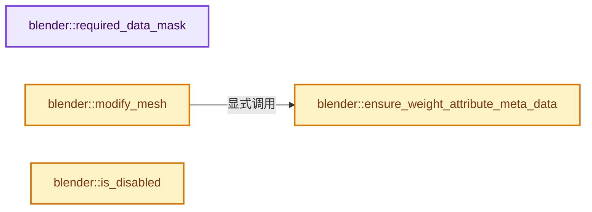
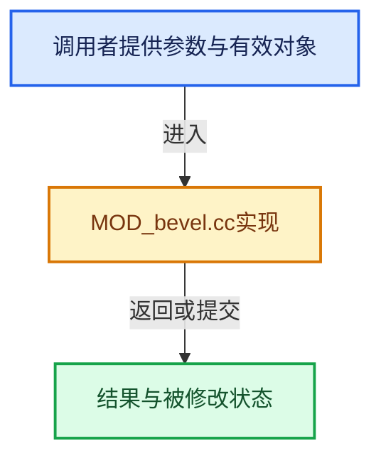

# 实现依赖专题：source/blender/modifiers/intern/MOD_bevel.cc

[实现依赖导航](../../../README.md) · [符号索引](../../../../00-课程指南/02-源码与提交索引/符号依赖与实现索引.md)

本专题从正文实际调用进入，集中保存共享实现。函数有稳定锚点，可从调用处直接跳到对应完整函数；递归与互相调用通过回链组织。

## 本文件的实现关系






## 完整成员与函数实现

<a id="f-fac0aed3d807a279"></a>

### `blender::required_data_mask`

实现位置：[source/blender/modifiers/intern/MOD_bevel.cc](../../../../../../../../source/blender/modifiers/intern/MOD_bevel.cc) · L69—L77。

接口参数：

- `ModifierData *md`
- `CustomData_MeshMasks *r_cddata_masks`

**教学注释版**

<!-- annotated:2c9f92f953f61b -->

```cpp
static void required_data_mask(ModifierData *md, CustomData_MeshMasks *r_cddata_masks)
{
  BevelModifierData *bmd = reinterpret_cast<BevelModifierData *>(md);

  /* Ask for vertex-groups if we need them. */
  if (bmd->defgrp_name[0] != '\0') {
    r_cddata_masks->vmask |= CD_MASK_MDEFORMVERT;
  }
}
```

<details>
<summary>核对原始源码：source/blender/modifiers/intern/MOD_bevel.cc · L69—L77</summary>

<!-- original:2c9f92f953f61b:source/blender/modifiers/intern/MOD_bevel.cc:69:77 -->

```cpp
static void required_data_mask(ModifierData *md, CustomData_MeshMasks *r_cddata_masks)
{
  BevelModifierData *bmd = reinterpret_cast<BevelModifierData *>(md);

  /* Ask for vertex-groups if we need them. */
  if (bmd->defgrp_name[0] != '\0') {
    r_cddata_masks->vmask |= CD_MASK_MDEFORMVERT;
  }
}
```

</details>

**沿实际写入检查状态**

- `r_cddata_masks->vmask |= CD_MASK_MDEFORMVERT;`

**继续追踪实现**

本实现没有需要继续展开的显式调用；检查返回表达式、对象转换和调用者前置条件。

<a id="f-a74aca3cff4878ec"></a>

### `blender::ensure_weight_attribute_meta_data`

实现位置：[source/blender/modifiers/intern/MOD_bevel.cc](../../../../../../../../source/blender/modifiers/intern/MOD_bevel.cc) · L79—L106。

接口参数：

- `Mesh &mesh`
- `const StringRef name`
- `const bke::AttrDomain domain`
- `bool &r_attr_converted`

**教学注释版**

<!-- annotated:c23b73bdb61542 -->

```cpp
static std::string ensure_weight_attribute_meta_data(Mesh &mesh,
                                                     const StringRef name,
                                                     const bke::AttrDomain domain,
                                                     bool &r_attr_converted)
{
  if (!bke::allow_procedural_attribute_access(name)) {
    return "";
  }
  bke::MutableAttributeAccessor attributes = mesh.attributes_for_write();
  const std::optional<bke::AttributeMetaData> meta_data = attributes.lookup_meta_data(name);
  if (!meta_data) {
    r_attr_converted = false;
    return name;
  }
  if (meta_data->domain == domain && meta_data->data_type == bke::AttrType::Float) {
    r_attr_converted = false;
    return name;
  }

  Array<float> weight(attributes.domain_size(domain));
  attributes.lookup<float>(name, domain).varray.materialize(weight);
  const std::string new_name = BKE_attribute_calc_unique_name(AttributeOwner::from_id(&mesh.id),
                                                              name);
  attributes.add<float>(
      new_name, domain, bke::AttributeInitVArray(VArray<float>::from_span(weight)));
  r_attr_converted = true;
  return new_name;
}
```

<details>
<summary>核对原始源码：source/blender/modifiers/intern/MOD_bevel.cc · L79—L106</summary>

<!-- original:c23b73bdb61542:source/blender/modifiers/intern/MOD_bevel.cc:79:106 -->

```cpp
static std::string ensure_weight_attribute_meta_data(Mesh &mesh,
                                                     const StringRef name,
                                                     const bke::AttrDomain domain,
                                                     bool &r_attr_converted)
{
  if (!bke::allow_procedural_attribute_access(name)) {
    return "";
  }
  bke::MutableAttributeAccessor attributes = mesh.attributes_for_write();
  const std::optional<bke::AttributeMetaData> meta_data = attributes.lookup_meta_data(name);
  if (!meta_data) {
    r_attr_converted = false;
    return name;
  }
  if (meta_data->domain == domain && meta_data->data_type == bke::AttrType::Float) {
    r_attr_converted = false;
    return name;
  }

  Array<float> weight(attributes.domain_size(domain));
  attributes.lookup<float>(name, domain).varray.materialize(weight);
  const std::string new_name = BKE_attribute_calc_unique_name(AttributeOwner::from_id(&mesh.id),
                                                              name);
  attributes.add<float>(
      new_name, domain, bke::AttributeInitVArray(VArray<float>::from_span(weight)));
  r_attr_converted = true;
  return new_name;
}
```

</details>

**沿实际写入检查状态**

- `r_attr_converted = false;`
- `r_attr_converted = true;`

**结果出口**

- `return "";`
- `return name;`
- `return new_name;`

**继续追踪实现**

- `bke::allow_procedural_attribute_access` → [blender::bke::allow_procedural_attribute_access · L214](../../../02-BKE几何与数据/intern/attribute_access.cc.md#f-ad250cc5467d3ea3)。
- `mesh.attributes_for_write` → [Mesh::attributes_for_write · L1303](../../../../05-几何存储与拓扑映射/03-MPoly迁移与兼容.md#f-ca7af2f1a15f0bc4)。
- `attributes.lookup_meta_data` → [调用协议](../../../../00-课程指南/01-路线与规范/模板宏与动态分派协议.md)：由接收对象具体类型或运行时策略提供实现。调用位置L88。
- `attributes.domain_size` → [调用协议](../../../../00-课程指南/01-路线与规范/模板宏与动态分派协议.md)：由接收对象具体类型或运行时策略提供实现。调用位置L98。
- `attributes.lookup<float>(name, domain).varray.materialize` → [调用协议](../../../../00-课程指南/01-路线与规范/模板宏与动态分派协议.md)：接收对象类型依赖auto、返回值或模板实例；不按同名猜测目标。调用位置L99。
- `attributes.lookup<float>` → [blender::GLVaoCache::lookup · L182](../../gpu/opengl/gl_batch.cc.md#f-e4f56cc3d9a969de)。
- `BKE_attribute_calc_unique_name` → [blender::BKE_attribute_calc_unique_name · L351](../../../02-BKE几何与数据/intern/attribute.cc.md#f-c4ca40dc5668ffb2)。
- `AttributeOwner::from_id` → [blender::AttributeOwner::from_id · L46](../../../02-BKE几何与数据/intern/attribute.cc.md#f-866554bb7829a861)。
- `attributes.add<float>` → [blender::bke::MutableAttributeAccessor::add · L769](../../../../05-几何存储与拓扑映射/08-AttributeAccessor接口.md#f-5fa7f06d7e22891a)；[blender::bke::MutableAttributeAccessor::add · L785](../../../../05-几何存储与拓扑映射/08-AttributeAccessor接口.md#f-42998ceb23ada8cc)。同名重载需按实参类型选择。
- `bke::AttributeInitVArray` → [blender::bke::AttributeInitVArray::AttributeInitVArray · L121](../../../../05-几何存储与拓扑映射/08-AttributeAccessor接口.md#f-956e4152f3f1e0b2)。
- `VArray<float>::from_span` → [blender::GVArray::from_span · L895](../../../../04-虚拟数组与索引选择/05-GVArray运行时类型.md#f-e8b978ca15febb67)。

<a id="f-6c1ffde44f5e210f"></a>

### `blender::modify_mesh`

实现位置：[source/blender/modifiers/intern/MOD_bevel.cc](../../../../../../../../source/blender/modifiers/intern/MOD_bevel.cc) · L111—L295。

接口参数：

- `ModifierData *md`
- `const ModifierEvalContext *ctx`
- `Mesh *mesh`

**教学注释版**

<!-- annotated:29060df1678ac9 -->

```cpp
static Mesh *modify_mesh(ModifierData *md, const ModifierEvalContext *ctx, Mesh *mesh)
{
  if (mesh->verts_num == 0) {
    return mesh;
  }
#ifdef DEBUG_TIME
  printf("BEVEL MODIFIER starts\n");
  const timeit::TimePoint start_time = timeit::Clock::now();
#endif
  Mesh *result;
  BMesh *bm;
  BMIter iter;
  BMEdge *e;
  BMVert *v;
  float weight, weight2;
  int vgroup = -1;
  const MDeformVert *dvert = nullptr;
  BevelModifierData *bmd = reinterpret_cast<BevelModifierData *>(md);
  const float threshold = cosf(bmd->bevel_angle + 0.000000175f);
  const bool do_clamp = !(bmd->flags & MOD_BEVEL_OVERLAP_OK);
  const int offset_type = bmd->val_flags;
  const int profile_type = bmd->profile_type;
  const float value = bmd->value;
  const int mat = std::clamp(int(bmd->mat), -1, ctx->object->totcol - 1);
  const bool loop_slide = (bmd->flags & MOD_BEVEL_EVEN_WIDTHS) == 0;
  const bool mark_seam = (bmd->edge_flags & MOD_BEVEL_MARK_SEAM);
  const bool mark_sharp = (bmd->edge_flags & MOD_BEVEL_MARK_SHARP);
  bool harden_normals = (bmd->flags & MOD_BEVEL_HARDEN_NORMALS);
  const int face_strength_mode = bmd->face_str_mode;
  const int miter_outer = bmd->miter_outer;
  const int miter_inner = bmd->miter_inner;
  const float spread = bmd->spread;
  const bool invert_vgroup = (bmd->flags & MOD_BEVEL_INVERT_VGROUP) != 0;

  BMeshCreateParams create_params{};
  BMeshFromMeshParams convert_params{};
  convert_params.calc_face_normal = true;
  convert_params.calc_vert_normal = true;
  convert_params.add_key_index = false;
  convert_params.use_shapekey = false;
  convert_params.active_shapekey = 0;
  convert_params.cd_mask_extra.vmask = CD_MASK_ORIGINDEX;
  convert_params.cd_mask_extra.emask = CD_MASK_ORIGINDEX;
  convert_params.cd_mask_extra.pmask = CD_MASK_ORIGINDEX;

  bool vert_weight_converted;
  const std::string vert_weight_name = ensure_weight_attribute_meta_data(
      *mesh, bmd->vertex_weight_name, bke::AttrDomain::Point, vert_weight_converted);
  bool edge_weight_converted;
  const std::string edge_weight_name = ensure_weight_attribute_meta_data(
      *mesh, bmd->edge_weight_name, bke::AttrDomain::Edge, edge_weight_converted);

  bm = BKE_mesh_to_bmesh_ex(mesh, &create_params, &convert_params);

  if ((bmd->lim_flags & MOD_BEVEL_VGROUP) && bmd->defgrp_name[0]) {
    MOD_get_vgroup(ctx->object, mesh, bmd->defgrp_name, &dvert, &vgroup);
  }

  const int bweight_offset_vert = CustomData_get_offset_named(
      &bm->vdata, CD_PROP_FLOAT, vert_weight_name);
  const int bweight_offset_edge = CustomData_get_offset_named(
      &bm->edata, CD_PROP_FLOAT, edge_weight_name);

  if (bmd->affect_type == MOD_BEVEL_AFFECT_VERTICES) {
    BM_ITER_MESH (v, &iter, bm, BM_VERTS_OF_MESH) {
      if (bmd->lim_flags & MOD_BEVEL_WEIGHT) {
        weight = bweight_offset_vert == -1 ? 0.0f : BM_ELEM_CD_GET_FLOAT(v, bweight_offset_vert);
        if (weight == 0.0f) {
          continue;
        }
      }
      else {
        weight = BKE_defvert_array_find_weight_safe(
            dvert, BM_elem_index_get(v), vgroup, invert_vgroup);
        /* Check is against 0.5 rather than != 0.0 because cascaded bevel modifiers will
         * interpolate weights for newly created vertices, and may cause unexpected "selection" */
        if (weight < 0.5f) {
          continue;
        }
      }
      BM_elem_flag_enable(v, BM_ELEM_TAG);
    }
  }
  else if (bmd->lim_flags & MOD_BEVEL_ANGLE) {
    BM_ITER_MESH (e, &iter, bm, BM_EDGES_OF_MESH) {
      /* check for 1 edge having 2 face users */
      BMLoop *l_a, *l_b;
      if (BM_edge_loop_pair(e, &l_a, &l_b)) {
        if (dot_v3v3(l_a->f->no, l_b->f->no) < threshold) {
          BM_elem_flag_enable(e, BM_ELEM_TAG);
          BM_elem_flag_enable(e->v1, BM_ELEM_TAG);
          BM_elem_flag_enable(e->v2, BM_ELEM_TAG);
        }
      }
    }
  }
  else {
    /* crummy, is there a way just to operator on all? - campbell */
    BM_ITER_MESH (e, &iter, bm, BM_EDGES_OF_MESH) {
      if (BM_edge_is_manifold(e)) {
        if (bmd->lim_flags & MOD_BEVEL_WEIGHT) {
          weight = bweight_offset_edge == -1 ? 0.0f : BM_ELEM_CD_GET_FLOAT(e, bweight_offset_edge);
          if (weight == 0.0f) {
            continue;
          }
        }
        else {
          weight = BKE_defvert_array_find_weight_safe(
              dvert, BM_elem_index_get(e->v1), vgroup, invert_vgroup);
          weight2 = BKE_defvert_array_find_weight_safe(
              dvert, BM_elem_index_get(e->v2), vgroup, invert_vgroup);
          if (weight < 0.5f || weight2 < 0.5f) {
            continue;
          }
        }
        BM_elem_flag_enable(e, BM_ELEM_TAG);
        BM_elem_flag_enable(e->v1, BM_ELEM_TAG);
        BM_elem_flag_enable(e->v2, BM_ELEM_TAG);
      }
    }
  }

#ifdef DEBUG_TIME
  const timeit::TimePoint bmeshes_made_time = timeit::Clock::now();
  const float t1_ms = (bmeshes_made_time - start_time).count() / 1.0e6f;
  printf("BEVEL MODIFIER bmeshes made, %.1f ms\n", t1_ms);
#endif
  BM_mesh_bevel(bm,
                value,
                offset_type,
                profile_type,
                bmd->res,
                bmd->profile,
                bmd->affect_type,
                bmd->lim_flags & MOD_BEVEL_WEIGHT,
                do_clamp,
                dvert,
                vgroup,
                mat,
                loop_slide,
                mark_seam,
                mark_sharp,
                harden_normals,
                face_strength_mode,
                miter_outer,
                miter_inner,
                spread,
                bmd->custom_profile,
                bmd->vmesh_method,
                bweight_offset_vert,
                bweight_offset_edge);

#ifdef DEBUG_TIME
  const timeit::TimePoint bevel_time = timeit::Clock::now();
  const float t2_ms = (bevel_time - bmeshes_made_time).count() / 1.0e6f;
  printf("BEVEL MODIFIER bevel, %.1f ms\n", t2_ms);
#endif

  result = BKE_mesh_from_bmesh_for_eval_nomain(bm, nullptr, mesh);

  /* Make sure we never allocated these. */
  BLI_assert(bm->vtoolflagpool == nullptr && bm->etoolflagpool == nullptr &&
             bm->ftoolflagpool == nullptr);

  BM_mesh_free(bm);

  if (vert_weight_converted) {
    result->attributes_for_write().remove(vert_weight_name);
  }
  if (edge_weight_converted) {
    result->attributes_for_write().remove(edge_weight_name);
  }

#ifdef DEBUG_TIME
  const timeit::TimePoint end_time = timeit::Clock::now();
  const float t3_ms = (end_time - bevel_time).count() / 1.0e6f;
  const float t4_ms = (end_time - start_time).count() / 1.0e6f;
  printf("BEVEL MODIFIER back to mesh, %.1f ms\n", t3_ms);
  printf("BEVEL MODIFIER total, %.1f ms\n", t4_ms);
#endif

  geometry::debug_randomize_mesh_order(result);

  return result;
}
```

<details>
<summary>核对原始源码：source/blender/modifiers/intern/MOD_bevel.cc · L111—L295</summary>

<!-- original:29060df1678ac9:source/blender/modifiers/intern/MOD_bevel.cc:111:295 -->

```cpp
static Mesh *modify_mesh(ModifierData *md, const ModifierEvalContext *ctx, Mesh *mesh)
{
  if (mesh->verts_num == 0) {
    return mesh;
  }
#ifdef DEBUG_TIME
  printf("BEVEL MODIFIER starts\n");
  const timeit::TimePoint start_time = timeit::Clock::now();
#endif
  Mesh *result;
  BMesh *bm;
  BMIter iter;
  BMEdge *e;
  BMVert *v;
  float weight, weight2;
  int vgroup = -1;
  const MDeformVert *dvert = nullptr;
  BevelModifierData *bmd = reinterpret_cast<BevelModifierData *>(md);
  const float threshold = cosf(bmd->bevel_angle + 0.000000175f);
  const bool do_clamp = !(bmd->flags & MOD_BEVEL_OVERLAP_OK);
  const int offset_type = bmd->val_flags;
  const int profile_type = bmd->profile_type;
  const float value = bmd->value;
  const int mat = std::clamp(int(bmd->mat), -1, ctx->object->totcol - 1);
  const bool loop_slide = (bmd->flags & MOD_BEVEL_EVEN_WIDTHS) == 0;
  const bool mark_seam = (bmd->edge_flags & MOD_BEVEL_MARK_SEAM);
  const bool mark_sharp = (bmd->edge_flags & MOD_BEVEL_MARK_SHARP);
  bool harden_normals = (bmd->flags & MOD_BEVEL_HARDEN_NORMALS);
  const int face_strength_mode = bmd->face_str_mode;
  const int miter_outer = bmd->miter_outer;
  const int miter_inner = bmd->miter_inner;
  const float spread = bmd->spread;
  const bool invert_vgroup = (bmd->flags & MOD_BEVEL_INVERT_VGROUP) != 0;

  BMeshCreateParams create_params{};
  BMeshFromMeshParams convert_params{};
  convert_params.calc_face_normal = true;
  convert_params.calc_vert_normal = true;
  convert_params.add_key_index = false;
  convert_params.use_shapekey = false;
  convert_params.active_shapekey = 0;
  convert_params.cd_mask_extra.vmask = CD_MASK_ORIGINDEX;
  convert_params.cd_mask_extra.emask = CD_MASK_ORIGINDEX;
  convert_params.cd_mask_extra.pmask = CD_MASK_ORIGINDEX;

  bool vert_weight_converted;
  const std::string vert_weight_name = ensure_weight_attribute_meta_data(
      *mesh, bmd->vertex_weight_name, bke::AttrDomain::Point, vert_weight_converted);
  bool edge_weight_converted;
  const std::string edge_weight_name = ensure_weight_attribute_meta_data(
      *mesh, bmd->edge_weight_name, bke::AttrDomain::Edge, edge_weight_converted);

  bm = BKE_mesh_to_bmesh_ex(mesh, &create_params, &convert_params);

  if ((bmd->lim_flags & MOD_BEVEL_VGROUP) && bmd->defgrp_name[0]) {
    MOD_get_vgroup(ctx->object, mesh, bmd->defgrp_name, &dvert, &vgroup);
  }

  const int bweight_offset_vert = CustomData_get_offset_named(
      &bm->vdata, CD_PROP_FLOAT, vert_weight_name);
  const int bweight_offset_edge = CustomData_get_offset_named(
      &bm->edata, CD_PROP_FLOAT, edge_weight_name);

  if (bmd->affect_type == MOD_BEVEL_AFFECT_VERTICES) {
    BM_ITER_MESH (v, &iter, bm, BM_VERTS_OF_MESH) {
      if (bmd->lim_flags & MOD_BEVEL_WEIGHT) {
        weight = bweight_offset_vert == -1 ? 0.0f : BM_ELEM_CD_GET_FLOAT(v, bweight_offset_vert);
        if (weight == 0.0f) {
          continue;
        }
      }
      else {
        weight = BKE_defvert_array_find_weight_safe(
            dvert, BM_elem_index_get(v), vgroup, invert_vgroup);
        /* Check is against 0.5 rather than != 0.0 because cascaded bevel modifiers will
         * interpolate weights for newly created vertices, and may cause unexpected "selection" */
        if (weight < 0.5f) {
          continue;
        }
      }
      BM_elem_flag_enable(v, BM_ELEM_TAG);
    }
  }
  else if (bmd->lim_flags & MOD_BEVEL_ANGLE) {
    BM_ITER_MESH (e, &iter, bm, BM_EDGES_OF_MESH) {
      /* check for 1 edge having 2 face users */
      BMLoop *l_a, *l_b;
      if (BM_edge_loop_pair(e, &l_a, &l_b)) {
        if (dot_v3v3(l_a->f->no, l_b->f->no) < threshold) {
          BM_elem_flag_enable(e, BM_ELEM_TAG);
          BM_elem_flag_enable(e->v1, BM_ELEM_TAG);
          BM_elem_flag_enable(e->v2, BM_ELEM_TAG);
        }
      }
    }
  }
  else {
    /* crummy, is there a way just to operator on all? - campbell */
    BM_ITER_MESH (e, &iter, bm, BM_EDGES_OF_MESH) {
      if (BM_edge_is_manifold(e)) {
        if (bmd->lim_flags & MOD_BEVEL_WEIGHT) {
          weight = bweight_offset_edge == -1 ? 0.0f : BM_ELEM_CD_GET_FLOAT(e, bweight_offset_edge);
          if (weight == 0.0f) {
            continue;
          }
        }
        else {
          weight = BKE_defvert_array_find_weight_safe(
              dvert, BM_elem_index_get(e->v1), vgroup, invert_vgroup);
          weight2 = BKE_defvert_array_find_weight_safe(
              dvert, BM_elem_index_get(e->v2), vgroup, invert_vgroup);
          if (weight < 0.5f || weight2 < 0.5f) {
            continue;
          }
        }
        BM_elem_flag_enable(e, BM_ELEM_TAG);
        BM_elem_flag_enable(e->v1, BM_ELEM_TAG);
        BM_elem_flag_enable(e->v2, BM_ELEM_TAG);
      }
    }
  }

#ifdef DEBUG_TIME
  const timeit::TimePoint bmeshes_made_time = timeit::Clock::now();
  const float t1_ms = (bmeshes_made_time - start_time).count() / 1.0e6f;
  printf("BEVEL MODIFIER bmeshes made, %.1f ms\n", t1_ms);
#endif
  BM_mesh_bevel(bm,
                value,
                offset_type,
                profile_type,
                bmd->res,
                bmd->profile,
                bmd->affect_type,
                bmd->lim_flags & MOD_BEVEL_WEIGHT,
                do_clamp,
                dvert,
                vgroup,
                mat,
                loop_slide,
                mark_seam,
                mark_sharp,
                harden_normals,
                face_strength_mode,
                miter_outer,
                miter_inner,
                spread,
                bmd->custom_profile,
                bmd->vmesh_method,
                bweight_offset_vert,
                bweight_offset_edge);

#ifdef DEBUG_TIME
  const timeit::TimePoint bevel_time = timeit::Clock::now();
  const float t2_ms = (bevel_time - bmeshes_made_time).count() / 1.0e6f;
  printf("BEVEL MODIFIER bevel, %.1f ms\n", t2_ms);
#endif

  result = BKE_mesh_from_bmesh_for_eval_nomain(bm, nullptr, mesh);

  /* Make sure we never allocated these. */
  BLI_assert(bm->vtoolflagpool == nullptr && bm->etoolflagpool == nullptr &&
             bm->ftoolflagpool == nullptr);

  BM_mesh_free(bm);

  if (vert_weight_converted) {
    result->attributes_for_write().remove(vert_weight_name);
  }
  if (edge_weight_converted) {
    result->attributes_for_write().remove(edge_weight_name);
  }

#ifdef DEBUG_TIME
  const timeit::TimePoint end_time = timeit::Clock::now();
  const float t3_ms = (end_time - bevel_time).count() / 1.0e6f;
  const float t4_ms = (end_time - start_time).count() / 1.0e6f;
  printf("BEVEL MODIFIER back to mesh, %.1f ms\n", t3_ms);
  printf("BEVEL MODIFIER total, %.1f ms\n", t4_ms);
#endif

  geometry::debug_randomize_mesh_order(result);

  return result;
}
```

</details>

**沿实际写入检查状态**

- `convert_params.calc_face_normal = true;`
- `convert_params.calc_vert_normal = true;`
- `convert_params.add_key_index = false;`
- `convert_params.use_shapekey = false;`
- `convert_params.active_shapekey = 0;`
- `convert_params.cd_mask_extra.vmask = CD_MASK_ORIGINDEX;`
- `convert_params.cd_mask_extra.emask = CD_MASK_ORIGINDEX;`
- `convert_params.cd_mask_extra.pmask = CD_MASK_ORIGINDEX;`
- `bm = BKE_mesh_to_bmesh_ex(mesh, &create_params, &convert_params);`
- `weight = bweight_offset_vert == -1 ? 0.0f : BM_ELEM_CD_GET_FLOAT(v, bweight_offset_vert);`
- `weight = BKE_defvert_array_find_weight_safe(`
- `weight = bweight_offset_edge == -1 ? 0.0f : BM_ELEM_CD_GET_FLOAT(e, bweight_offset_edge);`
- `weight2 = BKE_defvert_array_find_weight_safe(`
- `result = BKE_mesh_from_bmesh_for_eval_nomain(bm, nullptr, mesh);`

**结果出口**

- `return mesh;`
- `return result;`

**继续追踪实现**

- `printf` → [外部契约](https://eel.is/c++draft/)：这个边界按实际表达式及所属类型核对参数、返回值、寿命与失败行为。这里提供接口入口，不声称已解释该第三方版本的内部实现。
- `timeit::Clock::now` → [调用协议](../../../../00-课程指南/01-路线与规范/模板宏与动态分派协议.md)：函数指针、局部可调用对象或未展开的宏；必须结合调用者环境。调用位置L118。
- `cosf` → [cosf · L20](../../../07-Intern运行时与平台/cycles/kernel/svm/radial_tiling_shared.h.md#m-cee9ebf67d86)；[cosf · L42](../../../07-Intern运行时与平台/cycles/kernel/svm/radial_tiling_shared.h.md#m-346533627567)；[cosf · L73](../../../07-Intern运行时与平台/cycles/kernel/svm/radial_tiling_shared.h.md#m-e01b94a43b72)；[cosf · L24](../../../01-BLI基础库/intern/radial_tiling_shared.hh.md#m-c317cb08dec6)；[cosf · L46](../../../01-BLI基础库/intern/radial_tiling_shared.hh.md#m-93325b515297)；[cosf · L77](../../../01-BLI基础库/intern/radial_tiling_shared.hh.md#m-d3058af0b490)；[cosf · L20](../../../07-Intern运行时与平台/cycles/kernel/osl/shaders/node_radial_tiling_shared.h.md#m-4c6aea22a560)；[cosf · L42](../../../07-Intern运行时与平台/cycles/kernel/osl/shaders/node_radial_tiling_shared.h.md#m-1fd6a5414477)；[cosf · L73](../../../07-Intern运行时与平台/cycles/kernel/osl/shaders/node_radial_tiling_shared.h.md#m-de2402f85270)；[cosf · L186](../../../07-Intern运行时与平台/cycles/kernel/device/oneapi/compat.h.md#m-7fdbd99009e0)；[cosf · L288](../../../07-Intern运行时与平台/cycles/kernel/device/metal/compat.h.md#m-68fe984e8b68)；[cosf · L93](../../../07-Intern运行时与平台/cycles/kernel/device/hip/compat.h.md#m-21bb557a23f1)；[cosf · L91](../../../07-Intern运行时与平台/cycles/kernel/device/cuda/compat.h.md#m-7721be419a49)；[cosf · L43](../../gpu/GPU_shader_shared_utils.hh.md#m-25d02fd11b3b)；[cosf · L64](../../gpu/GPU_shader_shared_utils.hh.md#m-698fc51ccda3)。宏定义由构建条件选择。
- `std::clamp` → [外部契约](https://eel.is/c++draft/)：这个边界按实际表达式及所属类型核对参数、返回值、寿命与失败行为。这里提供接口入口，不声称已解释该第三方版本的内部实现。
- `ensure_weight_attribute_meta_data` → [blender::ensure_weight_attribute_meta_data · L79](MOD_bevel.cc.md#f-a74aca3cff4878ec)。
- `BKE_mesh_to_bmesh_ex` → [BKE_mesh_to_bmesh_ex · L1583](../../../../05-几何存储与拓扑映射/03-MPoly迁移与兼容.md#f-dd2f413684da0188)。
- `MOD_get_vgroup` → [blender::MOD_get_vgroup · L158](MOD_util.cc.md#f-f461611d86b94405)。
- `CustomData_get_offset_named` → [blender::CustomData_get_offset_named · L3398](../../../02-BKE几何与数据/intern/customdata.cc.md#f-fe199f3da62e9c30)。
- `BM_ITER_MESH` → [BM_ITER_MESH · L72](../../bmesh/intern/bmesh_iterators.hh.md#m-cfc837c73218)。宏定义由构建条件选择。
- `BM_ELEM_CD_GET_FLOAT` → [BM_ELEM_CD_GET_FLOAT · L630](../../bmesh/bmesh_class.hh.md#m-f02a9920f7a0)。宏定义由构建条件选择。
- `BKE_defvert_array_find_weight_safe` → [blender::BKE_defvert_array_find_weight_safe · L785](../../../02-BKE几何与数据/intern/deform.cc.md#f-bcfeaa449f8510e6)。
- `BM_elem_index_get` → [BM_elem_index_get · L120](../../bmesh/intern/bmesh_inline.hh.md#m-201981cdc62d)。宏定义由构建条件选择。
- `BM_elem_flag_enable` → [BM_elem_flag_enable · L23](../../bmesh/intern/bmesh_inline.hh.md#m-4400242f1540)。宏定义由构建条件选择。
- `BM_edge_loop_pair` → [blender::BM_edge_loop_pair · L565](../../bmesh/intern/bmesh_query.cc.md#f-18337b6d26e6aa9d)。
- `dot_v3v3` → [blender::dot_v3v3 · L646](../../../01-BLI基础库/intern/math_vector_inline.cc.md#f-c88befa67d07591a)。
- `BM_edge_is_manifold` → [blender::BM_edge_is_manifold · L79](../../bmesh/intern/bmesh_query_inline.hh.md#f-4944cfa861683f59)；[blender::BM_edge_is_manifold · L86](../../bmesh/intern/bmesh_query_inline.hh.md#f-f07686548bcc2440)。同名重载需按实参类型选择。
- `(bmeshes_made_time - start_time).count` → [调用协议](../../../../00-课程指南/01-路线与规范/模板宏与动态分派协议.md)：接收对象类型依赖auto、返回值或模板实例；不按同名猜测目标。调用位置L235。
- `BM_mesh_bevel` → [blender::BM_mesh_bevel · L8239](../../bmesh/tools/bmesh_bevel.cc.md#f-977b1eba65ca1a05)。
- `(bevel_time - bmeshes_made_time).count` → [调用协议](../../../../00-课程指南/01-路线与规范/模板宏与动态分派协议.md)：接收对象类型依赖auto、返回值或模板实例；不按同名猜测目标。调用位置L265。
- `BKE_mesh_from_bmesh_for_eval_nomain` → [BKE_mesh_from_bmesh_for_eval_nomain · L1620](../../../../05-几何存储与拓扑映射/03-MPoly迁移与兼容.md#f-92b713674a1be50c)。
- `BLI_assert` → [BLI_assert · L48](../../../01-BLI基础库/BLI_assert.hh.md#m-57a88495704d)；[BLI_assert · L63](../../../01-BLI基础库/BLI_assert.hh.md#m-d07050020cb5)。宏定义由构建条件选择。
- `BM_mesh_free` → [blender::BM_mesh_free · L264](../../bmesh/intern/bmesh_mesh.cc.md#f-3871ddd58daba48c)。
- `result->attributes_for_write().remove` → [调用协议](../../../../00-课程指南/01-路线与规范/模板宏与动态分派协议.md)：接收对象类型依赖auto、返回值或模板实例；不按同名猜测目标。调用位置L278。
- `result->attributes_for_write` → [Mesh::attributes_for_write · L1303](../../../../05-几何存储与拓扑映射/03-MPoly迁移与兼容.md#f-ca7af2f1a15f0bc4)。
- `(end_time - bevel_time).count` → [调用协议](../../../../00-课程指南/01-路线与规范/模板宏与动态分派协议.md)：接收对象类型依赖auto、返回值或模板实例；不按同名猜测目标。调用位置L286。
- `(end_time - start_time).count` → [调用协议](../../../../00-课程指南/01-路线与规范/模板宏与动态分派协议.md)：接收对象类型依赖auto、返回值或模板实例；不按同名猜测目标。调用位置L287。
- `geometry::debug_randomize_mesh_order` → [blender::geometry::debug_randomize_mesh_order · L305](../../../05-Geometry几何算法/intern/randomize.cc.md#f-268bd8d8f3608806)。

<a id="f-60c56c6eeeef0756"></a>

### `blender::is_disabled`

实现位置：[source/blender/modifiers/intern/MOD_bevel.cc](../../../../../../../../source/blender/modifiers/intern/MOD_bevel.cc) · L303—L307。

接口参数：

- `const Scene *`
- `ModifierData *md`
- `bool`

**教学注释版**

<!-- annotated:39925c3fe0b401 -->

```cpp
static bool is_disabled(const Scene * /*scene*/, ModifierData *md, bool /*use_render_params*/)
{
  BevelModifierData *bmd = reinterpret_cast<BevelModifierData *>(md);
  return (bmd->value == 0.0f);
}
```

<details>
<summary>核对原始源码：source/blender/modifiers/intern/MOD_bevel.cc · L303—L307</summary>

<!-- original:39925c3fe0b401:source/blender/modifiers/intern/MOD_bevel.cc:303:307 -->

```cpp
static bool is_disabled(const Scene * /*scene*/, ModifierData *md, bool /*use_render_params*/)
{
  BevelModifierData *bmd = reinterpret_cast<BevelModifierData *>(md);
  return (bmd->value == 0.0f);
}
```

</details>

**结果出口**

- `return (bmd->value == 0.0f);`

**继续追踪实现**

本实现没有需要继续展开的显式调用；检查返回表达式、对象转换和调用者前置条件。
