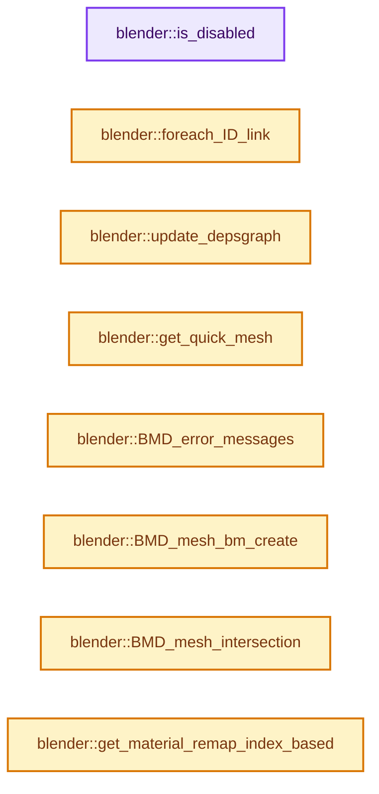
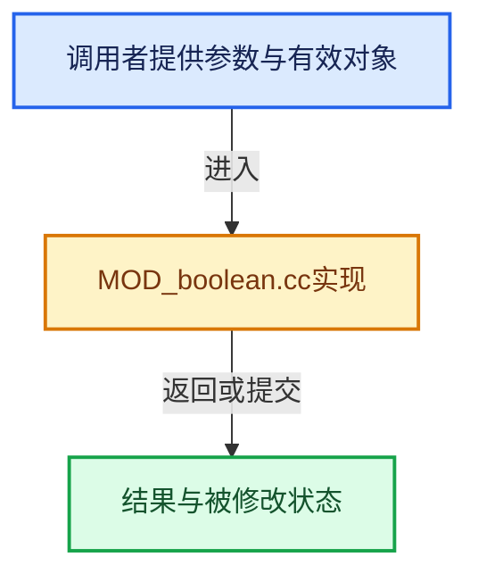

# 实现依赖专题：source/blender/modifiers/intern/MOD_boolean.cc

[实现依赖导航](../../../README.md) · [符号索引](../../../../00-课程指南/02-源码与提交索引/符号依赖与实现索引.md)

本专题从正文实际调用进入，集中保存共享实现。函数有稳定锚点，可从调用处直接跳到对应完整函数；递归与互相调用通过回链组织。

## 本文件的实现关系






## 完整成员与函数实现

<a id="f-10ba59baf87b0176"></a>

### `blender::is_disabled`

实现位置：[source/blender/modifiers/intern/MOD_boolean.cc](../../../../../../../../source/blender/modifiers/intern/MOD_boolean.cc) · L67—L80。

接口参数：

- `const Scene *`
- `ModifierData *md`
- `bool`

**教学注释版**

<!-- annotated:8cae31aba9782d -->

```cpp
static bool is_disabled(const Scene * /*scene*/, ModifierData *md, bool /*use_render_params*/)
{
  BooleanModifierData *bmd = reinterpret_cast<BooleanModifierData *>(md);
  Collection *col = bmd->collection;

  if (bmd->flag & eBooleanModifierFlag_Object) {
    return !bmd->object || bmd->object->type != OB_MESH;
  }
  if (bmd->flag & eBooleanModifierFlag_Collection) {
    /* The Exact solver tolerates an empty collection. */
    return !col && bmd->solver != eBooleanModifierSolver_Mesh_Arr;
  }
  return false;
}
```

<details>
<summary>核对原始源码：source/blender/modifiers/intern/MOD_boolean.cc · L67—L80</summary>

<!-- original:8cae31aba9782d:source/blender/modifiers/intern/MOD_boolean.cc:67:80 -->

```cpp
static bool is_disabled(const Scene * /*scene*/, ModifierData *md, bool /*use_render_params*/)
{
  BooleanModifierData *bmd = reinterpret_cast<BooleanModifierData *>(md);
  Collection *col = bmd->collection;

  if (bmd->flag & eBooleanModifierFlag_Object) {
    return !bmd->object || bmd->object->type != OB_MESH;
  }
  if (bmd->flag & eBooleanModifierFlag_Collection) {
    /* The Exact solver tolerates an empty collection. */
    return !col && bmd->solver != eBooleanModifierSolver_Mesh_Arr;
  }
  return false;
}
```

</details>

**结果出口**

- `return !bmd->object || bmd->object->type != OB_MESH;`
- `return !col && bmd->solver != eBooleanModifierSolver_Mesh_Arr;`
- `return false;`

**继续追踪实现**

本实现没有需要继续展开的显式调用；检查返回表达式、对象转换和调用者前置条件。

<a id="f-b57958a0b00ef930"></a>

### `blender::foreach_ID_link`

实现位置：[source/blender/modifiers/intern/MOD_boolean.cc](../../../../../../../../source/blender/modifiers/intern/MOD_boolean.cc) · L82—L88。

接口参数：

- `ModifierData *md`
- `Object *ob`
- `IDWalkFunc walk`
- `void *user_data`

**教学注释版**

<!-- annotated:5624f57363421e -->

```cpp
static void foreach_ID_link(ModifierData *md, Object *ob, IDWalkFunc walk, void *user_data)
{
  BooleanModifierData *bmd = reinterpret_cast<BooleanModifierData *>(md);

  walk(user_data, ob, reinterpret_cast<ID **>(&bmd->collection), IDWALK_CB_USER);
  walk(user_data, ob, reinterpret_cast<ID **>(&bmd->object), IDWALK_CB_NOP);
}
```

<details>
<summary>核对原始源码：source/blender/modifiers/intern/MOD_boolean.cc · L82—L88</summary>

<!-- original:5624f57363421e:source/blender/modifiers/intern/MOD_boolean.cc:82:88 -->

```cpp
static void foreach_ID_link(ModifierData *md, Object *ob, IDWalkFunc walk, void *user_data)
{
  BooleanModifierData *bmd = reinterpret_cast<BooleanModifierData *>(md);

  walk(user_data, ob, reinterpret_cast<ID **>(&bmd->collection), IDWALK_CB_USER);
  walk(user_data, ob, reinterpret_cast<ID **>(&bmd->object), IDWALK_CB_NOP);
}
```

</details>

**继续追踪实现**

- `walk` → [调用协议](../../../../00-课程指南/01-路线与规范/模板宏与动态分派协议.md)：局部可调用对象，须结合其初始化与捕获环境。调用位置L86。

<a id="f-2a42b756fba339d5"></a>

### `blender::update_depsgraph`

实现位置：[source/blender/modifiers/intern/MOD_boolean.cc](../../../../../../../../source/blender/modifiers/intern/MOD_boolean.cc) · L90—L105。

接口参数：

- `ModifierData *md`
- `const ModifierUpdateDepsgraphContext *ctx`

**教学注释版**

<!-- annotated:6289635c1799f3 -->

```cpp
static void update_depsgraph(ModifierData *md, const ModifierUpdateDepsgraphContext *ctx)
{
  BooleanModifierData *bmd = reinterpret_cast<BooleanModifierData *>(md);
  if ((bmd->flag & eBooleanModifierFlag_Object) && bmd->object != nullptr) {
    DEG_add_object_relation(ctx->node, bmd->object, DEG_OB_COMP_TRANSFORM, "Boolean Modifier");
    DEG_add_object_relation(ctx->node, bmd->object, DEG_OB_COMP_GEOMETRY, "Boolean Modifier");
  }

  Collection *col = bmd->collection;

  if ((bmd->flag & eBooleanModifierFlag_Collection) && col != nullptr) {
    DEG_add_collection_geometry_relation(ctx->node, col, "Boolean Modifier");
  }
  /* We need own transformation as well. */
  DEG_add_depends_on_transform_relation(ctx->node, "Boolean Modifier");
}
```

<details>
<summary>核对原始源码：source/blender/modifiers/intern/MOD_boolean.cc · L90—L105</summary>

<!-- original:6289635c1799f3:source/blender/modifiers/intern/MOD_boolean.cc:90:105 -->

```cpp
static void update_depsgraph(ModifierData *md, const ModifierUpdateDepsgraphContext *ctx)
{
  BooleanModifierData *bmd = reinterpret_cast<BooleanModifierData *>(md);
  if ((bmd->flag & eBooleanModifierFlag_Object) && bmd->object != nullptr) {
    DEG_add_object_relation(ctx->node, bmd->object, DEG_OB_COMP_TRANSFORM, "Boolean Modifier");
    DEG_add_object_relation(ctx->node, bmd->object, DEG_OB_COMP_GEOMETRY, "Boolean Modifier");
  }

  Collection *col = bmd->collection;

  if ((bmd->flag & eBooleanModifierFlag_Collection) && col != nullptr) {
    DEG_add_collection_geometry_relation(ctx->node, col, "Boolean Modifier");
  }
  /* We need own transformation as well. */
  DEG_add_depends_on_transform_relation(ctx->node, "Boolean Modifier");
}
```

</details>

**继续追踪实现**

- `DEG_add_object_relation` → [blender::DEG_add_object_relation · L123](../../../06-Depsgraph依赖图/intern/depsgraph_build.cc.md#f-f570cffae97e273c)。
- `DEG_add_collection_geometry_relation` → [blender::DEG_add_collection_geometry_relation · L139](../../../06-Depsgraph依赖图/intern/depsgraph_build.cc.md#f-df8183be0167db8e)。
- `DEG_add_depends_on_transform_relation` → [blender::DEG_add_depends_on_transform_relation · L240](../../../06-Depsgraph依赖图/intern/depsgraph_build.cc.md#f-47c32a354defa20d)。

<a id="f-f9e30f84d28c9b13"></a>

### `blender::get_quick_mesh`

实现位置：[source/blender/modifiers/intern/MOD_boolean.cc](../../../../../../../../source/blender/modifiers/intern/MOD_boolean.cc) · L107—L148。

接口参数：

- `Object *ob_self`
- `Mesh *mesh_self`
- `Object *ob_operand_ob`
- `Mesh *mesh_operand_ob`
- `int operation`

**教学注释版**

<!-- annotated:74e15bb8713329 -->

```cpp
static Mesh *get_quick_mesh(
    Object *ob_self, Mesh *mesh_self, Object *ob_operand_ob, Mesh *mesh_operand_ob, int operation)
{
  Mesh *result = nullptr;

  if (mesh_self->faces_num == 0 || mesh_operand_ob->faces_num == 0) {
    switch (operation) {
      case eBooleanModifierOp_Intersect:
        result = BKE_mesh_new_nomain(0, 0, 0, 0);
        break;

      case eBooleanModifierOp_Union:
        if (mesh_self->faces_num != 0) {
          result = mesh_self;
        }
        else {
          result = id_cast<Mesh *>(
              BKE_id_copy_ex(nullptr, &mesh_operand_ob->id, nullptr, LIB_ID_COPY_LOCALIZE));

          float imat[4][4];
          float omat[4][4];
          invert_m4_m4(imat, ob_self->object_to_world().ptr());
          mul_m4_m4m4(omat, imat, ob_operand_ob->object_to_world().ptr());

          MutableSpan<float3> positions = result->vert_positions_for_write();
          // [讲解] positions.index_range：查询视图长度或生成对应有效索引区间。
          for (const int i : positions.index_range()) {
            mul_m4_v3(omat, positions[i]);
          }

          result->tag_positions_changed();
        }

        break;

      case eBooleanModifierOp_Difference:
        result = mesh_self;
        break;
    }
  }

  return result;
}
```

<details>
<summary>核对原始源码：source/blender/modifiers/intern/MOD_boolean.cc · L107—L148</summary>

<!-- original:74e15bb8713329:source/blender/modifiers/intern/MOD_boolean.cc:107:148 -->

```cpp
static Mesh *get_quick_mesh(
    Object *ob_self, Mesh *mesh_self, Object *ob_operand_ob, Mesh *mesh_operand_ob, int operation)
{
  Mesh *result = nullptr;

  if (mesh_self->faces_num == 0 || mesh_operand_ob->faces_num == 0) {
    switch (operation) {
      case eBooleanModifierOp_Intersect:
        result = BKE_mesh_new_nomain(0, 0, 0, 0);
        break;

      case eBooleanModifierOp_Union:
        if (mesh_self->faces_num != 0) {
          result = mesh_self;
        }
        else {
          result = id_cast<Mesh *>(
              BKE_id_copy_ex(nullptr, &mesh_operand_ob->id, nullptr, LIB_ID_COPY_LOCALIZE));

          float imat[4][4];
          float omat[4][4];
          invert_m4_m4(imat, ob_self->object_to_world().ptr());
          mul_m4_m4m4(omat, imat, ob_operand_ob->object_to_world().ptr());

          MutableSpan<float3> positions = result->vert_positions_for_write();
          for (const int i : positions.index_range()) {
            mul_m4_v3(omat, positions[i]);
          }

          result->tag_positions_changed();
        }

        break;

      case eBooleanModifierOp_Difference:
        result = mesh_self;
        break;
    }
  }

  return result;
}
```

</details>

**沿实际写入检查状态**

- `result = BKE_mesh_new_nomain(0, 0, 0, 0);`
- `result = mesh_self;`
- `result = id_cast<Mesh *>(`

**结果出口**

- `return result;`

**继续追踪实现**

- `BKE_mesh_new_nomain` → [BKE_mesh_new_nomain · L1376](../../../../05-几何存储与拓扑映射/03-MPoly迁移与兼容.md#f-d63806a6e34190f2)。
- `id_cast<Mesh *>` → [blender::id_cast · L1417](../../makesdna/DNA_ID.h.md#f-6c8ac6412850ac5a)。
- `BKE_id_copy_ex` → [blender::BKE_id_copy_ex · L851](../../../02-BKE几何与数据/intern/lib_id.cc.md#f-24272170c95f49fb)。
- `invert_m4_m4` → [blender::invert_m4_m4 · L1150](../../../01-BLI基础库/intern/math_matrix_c.cc.md#f-c75789f10cdd5b92)。
- `ob_self->object_to_world().ptr` → [调用协议](../../../../00-课程指南/01-路线与规范/模板宏与动态分派协议.md)：接收对象类型依赖auto、返回值或模板实例；不按同名猜测目标。调用位置L128。
- `ob_self->object_to_world` → [blender::Object::object_to_world · L5761](../../../02-BKE几何与数据/intern/object.cc.md#f-12fc20026327d50c)。
- `mul_m4_m4m4` → [blender::mul_m4_m4m4 · L217](../../../01-BLI基础库/intern/math_matrix_c.cc.md#f-b5272136b543b73b)。
- `ob_operand_ob->object_to_world().ptr` → [调用协议](../../../../00-课程指南/01-路线与规范/模板宏与动态分派协议.md)：接收对象类型依赖auto、返回值或模板实例；不按同名猜测目标。调用位置L129。
- `ob_operand_ob->object_to_world` → [blender::Object::object_to_world · L5761](../../../02-BKE几何与数据/intern/object.cc.md#f-12fc20026327d50c)。
- `result->vert_positions_for_write` → [Mesh::vert_positions_for_write · L1199](../../../../05-几何存储与拓扑映射/03-MPoly迁移与兼容.md#f-ae8d77205112d843)。
- `positions.index_range` → [blender::MutableSpan::index_range · L676](../../../../01-基础容器与现代CPP/06-MutableSpan可写视图.md#f-f9a9d59a69ca64b5)。
- `mul_m4_v3` → [blender::mul_m4_v3 · L677](../../../01-BLI基础库/intern/math_matrix_c.cc.md#f-14a8c267710d47a3)。
- `result->tag_positions_changed` → [blender::Mesh::tag_positions_changed · L407](../../../../06-隐式共享与缓存系统/10-局部更新与失效修复.md#f-90e852663d44ad53)。

<a id="f-3a614641cfb09cc8"></a>

### `blender::BMD_error_messages`

实现位置：[source/blender/modifiers/intern/MOD_boolean.cc](../../../../../../../../source/blender/modifiers/intern/MOD_boolean.cc) · L161—L208。

接口参数：

- `const Object *ob`
- `ModifierData *md`

**教学注释版**

<!-- annotated:decf00cfd534d9 -->

```cpp
static bool BMD_error_messages(const Object *ob, ModifierData *md)
{
  BooleanModifierData *bmd = reinterpret_cast<BooleanModifierData *>(md);
  Collection *col = bmd->collection;

  bool error_returns_result = false;

  const bool operand_collection = (bmd->flag & eBooleanModifierFlag_Collection) != 0;
  const bool use_exact = bmd->solver == eBooleanModifierSolver_Mesh_Arr;
  const bool use_manifold = bmd->solver == eBooleanModifierSolver_Manifold;
  const bool operation_intersect = bmd->operation == eBooleanModifierOp_Intersect;

#ifndef WITH_GMP
  /* If compiled without GMP, return a error. */
  if (use_exact) {
    BKE_modifier_set_error(ob, md, "Compiled without GMP, using \"float\" solver");
    error_returns_result = false;
  }
#endif

  /* If intersect is selected using "float" solver, return a error. */
  if (operand_collection && operation_intersect && !(use_exact || use_manifold)) {
    BKE_modifier_set_error(ob, md, "Cannot execute, intersect only available using exact solver");
    error_returns_result = true;
  }

  /* If the selected collection is empty and using "float" solver, return a error. */
  if (operand_collection) {
    if (!use_exact && BKE_collection_is_empty(col)) {
      BKE_modifier_set_error(ob, md, "Cannot execute, non-exact solver and empty collection");
      error_returns_result = true;
    }

    /* If the selected collection contain non mesh objects, return a error. */
    if (col) {
      FOREACH_COLLECTION_OBJECT_RECURSIVE_BEGIN (col, operand_ob) {
        if (operand_ob->type != OB_MESH) {
          BKE_modifier_set_error(
              ob, md, "Cannot execute, the selected collection contains non mesh objects");
          error_returns_result = true;
        }
      }
      FOREACH_COLLECTION_OBJECT_RECURSIVE_END;
    }
  }

  return error_returns_result;
}
```

<details>
<summary>核对原始源码：source/blender/modifiers/intern/MOD_boolean.cc · L161—L208</summary>

<!-- original:decf00cfd534d9:source/blender/modifiers/intern/MOD_boolean.cc:161:208 -->

```cpp
static bool BMD_error_messages(const Object *ob, ModifierData *md)
{
  BooleanModifierData *bmd = reinterpret_cast<BooleanModifierData *>(md);
  Collection *col = bmd->collection;

  bool error_returns_result = false;

  const bool operand_collection = (bmd->flag & eBooleanModifierFlag_Collection) != 0;
  const bool use_exact = bmd->solver == eBooleanModifierSolver_Mesh_Arr;
  const bool use_manifold = bmd->solver == eBooleanModifierSolver_Manifold;
  const bool operation_intersect = bmd->operation == eBooleanModifierOp_Intersect;

#ifndef WITH_GMP
  /* If compiled without GMP, return a error. */
  if (use_exact) {
    BKE_modifier_set_error(ob, md, "Compiled without GMP, using \"float\" solver");
    error_returns_result = false;
  }
#endif

  /* If intersect is selected using "float" solver, return a error. */
  if (operand_collection && operation_intersect && !(use_exact || use_manifold)) {
    BKE_modifier_set_error(ob, md, "Cannot execute, intersect only available using exact solver");
    error_returns_result = true;
  }

  /* If the selected collection is empty and using "float" solver, return a error. */
  if (operand_collection) {
    if (!use_exact && BKE_collection_is_empty(col)) {
      BKE_modifier_set_error(ob, md, "Cannot execute, non-exact solver and empty collection");
      error_returns_result = true;
    }

    /* If the selected collection contain non mesh objects, return a error. */
    if (col) {
      FOREACH_COLLECTION_OBJECT_RECURSIVE_BEGIN (col, operand_ob) {
        if (operand_ob->type != OB_MESH) {
          BKE_modifier_set_error(
              ob, md, "Cannot execute, the selected collection contains non mesh objects");
          error_returns_result = true;
        }
      }
      FOREACH_COLLECTION_OBJECT_RECURSIVE_END;
    }
  }

  return error_returns_result;
}
```

</details>

**沿实际写入检查状态**

- `error_returns_result = false;`
- `error_returns_result = true;`

**结果出口**

- `return error_returns_result;`

**继续追踪实现**

- `BKE_modifier_set_error` → [blender::BKE_modifier_set_error · L416](../../../02-BKE几何与数据/intern/modifier.cc.md#f-6241829f21c08456)。
- `BKE_collection_is_empty` → [blender::BKE_collection_is_empty · L1221](../../../02-BKE几何与数据/intern/collection.cc.md#f-7ff31123ec8c9a85)。

<a id="f-3b8bd7273de167b3"></a>

### `blender::BMD_mesh_bm_create`

实现位置：[source/blender/modifiers/intern/MOD_boolean.cc](../../../../../../../../source/blender/modifiers/intern/MOD_boolean.cc) · L210—L251。

接口参数：

- `Mesh *mesh`
- `Object *object`
- `Mesh *mesh_operand_ob`
- `Object *operand_ob`
- `bool *r_is_flip`

**教学注释版**

<!-- annotated:8b08db039b3c00 -->

```cpp
static BMesh *BMD_mesh_bm_create(
    Mesh *mesh, Object *object, Mesh *mesh_operand_ob, Object *operand_ob, bool *r_is_flip)
{
#ifdef DEBUG_TIME
  SCOPED_TIMER(__func__);
#endif

  *r_is_flip = (is_negative_m4(object->object_to_world().ptr()) !=
                is_negative_m4(operand_ob->object_to_world().ptr()));

  const BMAllocTemplate allocsize = BMALLOC_TEMPLATE_FROM_ME(mesh, mesh_operand_ob);

  BMeshCreateParams bmesh_create_params{};
  BMesh *bm = BM_mesh_create(&allocsize, &bmesh_create_params);

  /* Keep `mesh` first, needed so active layers are set based on `mesh` not `mesh_operand_ob`,
   * otherwise the wrong active render layer is used, see #92384.
   *
   * NOTE: while initializing customer data layers the is not essential,
   * it avoids the overhead of having to re-allocate #BMHeader.data when the 2nd mesh is added
   * (if it contains additional custom-data layers). */
  const Mesh *mesh_array[2] = {mesh, mesh_operand_ob};
  BM_mesh_copy_init_customdata_from_mesh_array(bm, mesh_array, ARRAY_SIZE(mesh_array), &allocsize);

  BMeshFromMeshParams bmesh_from_mesh_params{};
  bmesh_from_mesh_params.calc_face_normal = true;
  bmesh_from_mesh_params.calc_vert_normal = true;
  BM_mesh_bm_from_me(bm, mesh_operand_ob, &bmesh_from_mesh_params);

  if (*r_is_flip) [[unlikely]] {
    const int cd_loop_mdisp_offset = CustomData_get_offset(&bm->ldata, CD_MDISPS);
    BMIter iter;
    BMFace *efa;
    BM_ITER_MESH (efa, &iter, bm, BM_FACES_OF_MESH) {
      BM_face_normal_flip_ex(bm, efa, cd_loop_mdisp_offset, true);
    }
  }

  BM_mesh_bm_from_me(bm, mesh, &bmesh_from_mesh_params);

  return bm;
}
```

<details>
<summary>核对原始源码：source/blender/modifiers/intern/MOD_boolean.cc · L210—L251</summary>

<!-- original:8b08db039b3c00:source/blender/modifiers/intern/MOD_boolean.cc:210:251 -->

```cpp
static BMesh *BMD_mesh_bm_create(
    Mesh *mesh, Object *object, Mesh *mesh_operand_ob, Object *operand_ob, bool *r_is_flip)
{
#ifdef DEBUG_TIME
  SCOPED_TIMER(__func__);
#endif

  *r_is_flip = (is_negative_m4(object->object_to_world().ptr()) !=
                is_negative_m4(operand_ob->object_to_world().ptr()));

  const BMAllocTemplate allocsize = BMALLOC_TEMPLATE_FROM_ME(mesh, mesh_operand_ob);

  BMeshCreateParams bmesh_create_params{};
  BMesh *bm = BM_mesh_create(&allocsize, &bmesh_create_params);

  /* Keep `mesh` first, needed so active layers are set based on `mesh` not `mesh_operand_ob`,
   * otherwise the wrong active render layer is used, see #92384.
   *
   * NOTE: while initializing customer data layers the is not essential,
   * it avoids the overhead of having to re-allocate #BMHeader.data when the 2nd mesh is added
   * (if it contains additional custom-data layers). */
  const Mesh *mesh_array[2] = {mesh, mesh_operand_ob};
  BM_mesh_copy_init_customdata_from_mesh_array(bm, mesh_array, ARRAY_SIZE(mesh_array), &allocsize);

  BMeshFromMeshParams bmesh_from_mesh_params{};
  bmesh_from_mesh_params.calc_face_normal = true;
  bmesh_from_mesh_params.calc_vert_normal = true;
  BM_mesh_bm_from_me(bm, mesh_operand_ob, &bmesh_from_mesh_params);

  if (*r_is_flip) [[unlikely]] {
    const int cd_loop_mdisp_offset = CustomData_get_offset(&bm->ldata, CD_MDISPS);
    BMIter iter;
    BMFace *efa;
    BM_ITER_MESH (efa, &iter, bm, BM_FACES_OF_MESH) {
      BM_face_normal_flip_ex(bm, efa, cd_loop_mdisp_offset, true);
    }
  }

  BM_mesh_bm_from_me(bm, mesh, &bmesh_from_mesh_params);

  return bm;
}
```

</details>

**沿实际写入检查状态**

- `bmesh_from_mesh_params.calc_face_normal = true;`
- `bmesh_from_mesh_params.calc_vert_normal = true;`

**结果出口**

- `return bm;`

**继续追踪实现**

- `SCOPED_TIMER` → [SCOPED_TIMER · L64](../../../01-BLI基础库/BLI_timeit.hh.md#m-583d4ad21fbe)。宏定义由构建条件选择。
- `is_negative_m4` → [blender::is_negative_m4 · L2297](../../../01-BLI基础库/intern/math_matrix_c.cc.md#f-96d7f70cc2200141)。
- `object->object_to_world().ptr` → [调用协议](../../../../00-课程指南/01-路线与规范/模板宏与动态分派协议.md)：接收对象类型依赖auto、返回值或模板实例；不按同名猜测目标。调用位置L217。
- `object->object_to_world` → [blender::Object::object_to_world · L5761](../../../02-BKE几何与数据/intern/object.cc.md#f-12fc20026327d50c)。
- `operand_ob->object_to_world().ptr` → [调用协议](../../../../00-课程指南/01-路线与规范/模板宏与动态分派协议.md)：接收对象类型依赖auto、返回值或模板实例；不按同名猜测目标。调用位置L218。
- `operand_ob->object_to_world` → [blender::Object::object_to_world · L5761](../../../02-BKE几何与数据/intern/object.cc.md#f-12fc20026327d50c)。
- `BMALLOC_TEMPLATE_FROM_ME` → [BMALLOC_TEMPLATE_FROM_ME · L206](../../bmesh/intern/bmesh_mesh.hh.md#m-5e1aa99d2227)。宏定义由构建条件选择。
- `BM_mesh_create` → [blender::BM_mesh_create · L128](../../bmesh/intern/bmesh_mesh.cc.md#f-af852087bbdba512)。
- `BM_mesh_copy_init_customdata_from_mesh_array` → [blender::BM_mesh_copy_init_customdata_from_mesh_array · L477](../../bmesh/intern/bmesh_construct.cc.md#f-136a664637202840)。
- `ARRAY_SIZE` → [blender::ARRAY_SIZE · L608](../../../01-BLI基础库/BLI_utildefines.hh.md#f-eaec3a7e47b85c7c)。
- `BM_mesh_bm_from_me` → [blender::BM_mesh_bm_from_me · L318](../../bmesh/intern/bmesh_mesh_convert.cc.md#f-42cdcd301dcfbcd6)。
- `CustomData_get_offset` → [blender::CustomData_get_offset · L3379](../../../02-BKE几何与数据/intern/customdata.cc.md#f-e0e230c6120acc9a)。
- `BM_ITER_MESH` → [BM_ITER_MESH · L72](../../bmesh/intern/bmesh_iterators.hh.md#m-cfc837c73218)。宏定义由构建条件选择。
- `BM_face_normal_flip_ex` → [blender::BM_face_normal_flip_ex · L1068](../../bmesh/intern/bmesh_polygon.cc.md#f-5aa6a665802f7449)。

<a id="f-fd7b35e74e137ba6"></a>

### `blender::BMD_mesh_intersection`

实现位置：[source/blender/modifiers/intern/MOD_boolean.cc](../../../../../../../../source/blender/modifiers/intern/MOD_boolean.cc) · L253—L361。

接口参数：

- `BMesh *bm`
- `ModifierData *md`
- `const ModifierEvalContext *ctx`
- `Mesh *mesh_operand_ob`
- `Object *object`
- `Object *operand_ob`
- `bool is_flip`

**教学注释版**

<!-- annotated:acf9890f1e2b36 -->

```cpp
static void BMD_mesh_intersection(BMesh *bm,
                                  ModifierData *md,
                                  const ModifierEvalContext *ctx,
                                  Mesh *mesh_operand_ob,
                                  Object *object,
                                  Object *operand_ob,
                                  bool is_flip)
{
#ifdef DEBUG_TIME
  SCOPED_TIMER(__func__);
#endif

  BooleanModifierData *bmd = reinterpret_cast<BooleanModifierData *>(md);

  /* Main BMesh intersection setup. */
  /* Create tessellation & intersect. */
  const int looptris_tot = poly_to_tri_count(bm->totface, bm->totloop);
  Array<std::array<BMLoop *, 3>> looptris(looptris_tot);
  BM_mesh_calc_tessellation_beauty(bm, looptris);

  /* postpone this until after tessellating
   * so we can use the original normals before the vertex are moved */
  {
    BMIter iter;
    int i;
    const int i_verts_end = mesh_operand_ob->verts_num;
    const int i_faces_end = mesh_operand_ob->faces_num;

    float imat[4][4];
    float omat[4][4];
    invert_m4_m4(imat, object->object_to_world().ptr());
    mul_m4_m4m4(omat, imat, operand_ob->object_to_world().ptr());

    BMVert *eve;
    i = 0;
    BM_ITER_MESH (eve, &iter, bm, BM_VERTS_OF_MESH) {
      mul_m4_v3(omat, eve->co);
      if (++i == i_verts_end) {
        break;
      }
    }

    /* we need face normals because of 'BM_face_split_edgenet'
     * we could calculate on the fly too (before calling split). */
    float nmat[3][3];
    copy_m3_m4(nmat, omat);
    invert_m3(nmat);

    if (is_flip) [[unlikely]] {
      negate_m3(nmat);
    }

    Array<short> material_remap(operand_ob->totcol ? operand_ob->totcol : 1);

    /* Using original (not evaluated) object here since we are writing to it. */
    /* XXX Pretty sure comment above is fully wrong now with copy-on-eval & co ? */
    // [讲解] material_remap.data：提供数组的借用访问入口。
    BKE_object_material_remap_calc(ctx->object, operand_ob, material_remap.data());

    BMFace *efa;
    i = 0;
    BM_ITER_MESH (efa, &iter, bm, BM_FACES_OF_MESH) {
      mul_transposed_m3_v3(nmat, efa->no);
      normalize_v3(efa->no);

      /* Temp tag to test which side split faces are from. */
      BM_elem_flag_enable(efa, BM_FACE_TAG);

      /* remap material */
      if (efa->mat_nr < operand_ob->totcol) [[likely]] {
        efa->mat_nr = material_remap[efa->mat_nr];
      }
      else {
        efa->mat_nr = 0;
      }

      if (++i == i_faces_end) {
        break;
      }
    }
  }

  /* not needed, but normals for 'dm' will be invalid,
   * currently this is ok for 'BM_mesh_intersect' */
  // BM_mesh_normals_update(bm);

  bool use_separate = false;
  bool use_dissolve = true;
  bool use_island_connect = true;

  /* change for testing */
  if (G.debug & G_DEBUG) {
    use_separate = (bmd->bm_flag & eBooleanModifierBMeshFlag_BMesh_Separate) != 0;
    use_dissolve = (bmd->bm_flag & eBooleanModifierBMeshFlag_BMesh_NoDissolve) == 0;
    use_island_connect = (bmd->bm_flag & eBooleanModifierBMeshFlag_BMesh_NoConnectRegions) == 0;
  }

  BM_mesh_intersect(bm,
                    looptris,
                    bm_face_isect_pair,
                    nullptr,
                    false,
                    use_separate,
                    use_dissolve,
                    use_island_connect,
                    false,
                    false,
                    bmd->operation,
                    bmd->double_threshold);
}
```

<details>
<summary>核对原始源码：source/blender/modifiers/intern/MOD_boolean.cc · L253—L361</summary>

<!-- original:acf9890f1e2b36:source/blender/modifiers/intern/MOD_boolean.cc:253:361 -->

```cpp
static void BMD_mesh_intersection(BMesh *bm,
                                  ModifierData *md,
                                  const ModifierEvalContext *ctx,
                                  Mesh *mesh_operand_ob,
                                  Object *object,
                                  Object *operand_ob,
                                  bool is_flip)
{
#ifdef DEBUG_TIME
  SCOPED_TIMER(__func__);
#endif

  BooleanModifierData *bmd = reinterpret_cast<BooleanModifierData *>(md);

  /* Main BMesh intersection setup. */
  /* Create tessellation & intersect. */
  const int looptris_tot = poly_to_tri_count(bm->totface, bm->totloop);
  Array<std::array<BMLoop *, 3>> looptris(looptris_tot);
  BM_mesh_calc_tessellation_beauty(bm, looptris);

  /* postpone this until after tessellating
   * so we can use the original normals before the vertex are moved */
  {
    BMIter iter;
    int i;
    const int i_verts_end = mesh_operand_ob->verts_num;
    const int i_faces_end = mesh_operand_ob->faces_num;

    float imat[4][4];
    float omat[4][4];
    invert_m4_m4(imat, object->object_to_world().ptr());
    mul_m4_m4m4(omat, imat, operand_ob->object_to_world().ptr());

    BMVert *eve;
    i = 0;
    BM_ITER_MESH (eve, &iter, bm, BM_VERTS_OF_MESH) {
      mul_m4_v3(omat, eve->co);
      if (++i == i_verts_end) {
        break;
      }
    }

    /* we need face normals because of 'BM_face_split_edgenet'
     * we could calculate on the fly too (before calling split). */
    float nmat[3][3];
    copy_m3_m4(nmat, omat);
    invert_m3(nmat);

    if (is_flip) [[unlikely]] {
      negate_m3(nmat);
    }

    Array<short> material_remap(operand_ob->totcol ? operand_ob->totcol : 1);

    /* Using original (not evaluated) object here since we are writing to it. */
    /* XXX Pretty sure comment above is fully wrong now with copy-on-eval & co ? */
    BKE_object_material_remap_calc(ctx->object, operand_ob, material_remap.data());

    BMFace *efa;
    i = 0;
    BM_ITER_MESH (efa, &iter, bm, BM_FACES_OF_MESH) {
      mul_transposed_m3_v3(nmat, efa->no);
      normalize_v3(efa->no);

      /* Temp tag to test which side split faces are from. */
      BM_elem_flag_enable(efa, BM_FACE_TAG);

      /* remap material */
      if (efa->mat_nr < operand_ob->totcol) [[likely]] {
        efa->mat_nr = material_remap[efa->mat_nr];
      }
      else {
        efa->mat_nr = 0;
      }

      if (++i == i_faces_end) {
        break;
      }
    }
  }

  /* not needed, but normals for 'dm' will be invalid,
   * currently this is ok for 'BM_mesh_intersect' */
  // BM_mesh_normals_update(bm);

  bool use_separate = false;
  bool use_dissolve = true;
  bool use_island_connect = true;

  /* change for testing */
  if (G.debug & G_DEBUG) {
    use_separate = (bmd->bm_flag & eBooleanModifierBMeshFlag_BMesh_Separate) != 0;
    use_dissolve = (bmd->bm_flag & eBooleanModifierBMeshFlag_BMesh_NoDissolve) == 0;
    use_island_connect = (bmd->bm_flag & eBooleanModifierBMeshFlag_BMesh_NoConnectRegions) == 0;
  }

  BM_mesh_intersect(bm,
                    looptris,
                    bm_face_isect_pair,
                    nullptr,
                    false,
                    use_separate,
                    use_dissolve,
                    use_island_connect,
                    false,
                    false,
                    bmd->operation,
                    bmd->double_threshold);
}
```

</details>

**沿实际写入检查状态**

- `i = 0;`
- `efa->mat_nr = material_remap[efa->mat_nr];`
- `efa->mat_nr = 0;`
- `use_separate = (bmd->bm_flag & eBooleanModifierBMeshFlag_BMesh_Separate) != 0;`
- `use_dissolve = (bmd->bm_flag & eBooleanModifierBMeshFlag_BMesh_NoDissolve) == 0;`
- `use_island_connect = (bmd->bm_flag & eBooleanModifierBMeshFlag_BMesh_NoConnectRegions) == 0;`

**继续追踪实现**

- `SCOPED_TIMER` → [SCOPED_TIMER · L64](../../../01-BLI基础库/BLI_timeit.hh.md#m-583d4ad21fbe)。宏定义由构建条件选择。
- `poly_to_tri_count` → [blender::poly_to_tri_count · L118](../../../01-BLI基础库/intern/math_geom_inline.cc.md#f-fd5a0e76d62e3b0b)。
- `BM_mesh_calc_tessellation_beauty` → [blender::BM_mesh_calc_tessellation_beauty · L537](../../bmesh/intern/bmesh_mesh_tessellate.cc.md#f-46f71d023aa796a3)。
- `invert_m4_m4` → [blender::invert_m4_m4 · L1150](../../../01-BLI基础库/intern/math_matrix_c.cc.md#f-c75789f10cdd5b92)。
- `object->object_to_world().ptr` → [调用协议](../../../../00-课程指南/01-路线与规范/模板宏与动态分派协议.md)：接收对象类型依赖auto、返回值或模板实例；不按同名猜测目标。调用位置L283。
- `object->object_to_world` → [blender::Object::object_to_world · L5761](../../../02-BKE几何与数据/intern/object.cc.md#f-12fc20026327d50c)。
- `mul_m4_m4m4` → [blender::mul_m4_m4m4 · L217](../../../01-BLI基础库/intern/math_matrix_c.cc.md#f-b5272136b543b73b)。
- `operand_ob->object_to_world().ptr` → [调用协议](../../../../00-课程指南/01-路线与规范/模板宏与动态分派协议.md)：接收对象类型依赖auto、返回值或模板实例；不按同名猜测目标。调用位置L284。
- `operand_ob->object_to_world` → [blender::Object::object_to_world · L5761](../../../02-BKE几何与数据/intern/object.cc.md#f-12fc20026327d50c)。
- `BM_ITER_MESH` → [BM_ITER_MESH · L72](../../bmesh/intern/bmesh_iterators.hh.md#m-cfc837c73218)。宏定义由构建条件选择。
- `mul_m4_v3` → [blender::mul_m4_v3 · L677](../../../01-BLI基础库/intern/math_matrix_c.cc.md#f-14a8c267710d47a3)。
- `copy_m3_m4` → [blender::copy_m3_m4 · L94](../../../01-BLI基础库/intern/math_matrix_c.cc.md#f-1141cb3624c754b0)。
- `invert_m3` → [blender::invert_m3 · L1034](../../../01-BLI基础库/intern/math_matrix_c.cc.md#f-0d44d9713a300227)。
- `negate_m3` → [blender::negate_m3 · L916](../../../01-BLI基础库/intern/math_matrix_c.cc.md#f-f0fba3192107fad0)。
- `BKE_object_material_remap_calc` → [blender::BKE_object_material_remap_calc · L1326](../../../02-BKE几何与数据/intern/material.cc.md#f-beffe030de2aaa4a)。
- `material_remap.data` → [blender::Array::data · L323](../../../../01-基础容器与现代CPP/08-Array复制移动与销毁.md#f-95648c799002f4ba)；[blender::Array::data · L327](../../../../01-基础容器与现代CPP/08-Array复制移动与销毁.md#f-50c18301f8c40f9e)。同名重载需按实参类型选择。
- `mul_transposed_m3_v3` → [blender::mul_transposed_m3_v3 · L863](../../../01-BLI基础库/intern/math_matrix_c.cc.md#f-269b1e75c64cf91a)。
- `normalize_v3` → [blender::normalize_v3 · L933](../../../01-BLI基础库/intern/math_vector_inline.cc.md#f-5f3257e657ef732c)。
- `BM_elem_flag_enable` → [BM_elem_flag_enable · L23](../../bmesh/intern/bmesh_inline.hh.md#m-4400242f1540)。宏定义由构建条件选择。
- `BM_mesh_intersect` → [blender::BM_mesh_intersect · L955](../../bmesh/tools/bmesh_intersect.cc.md#f-d96a66932dd7ab7a)。

<a id="f-337d0168b5d5420f"></a>

### `blender::get_material_remap_index_based`

实现位置：[source/blender/modifiers/intern/MOD_boolean.cc](../../../../../../../../source/blender/modifiers/intern/MOD_boolean.cc) · L368—L377。

接口参数：

- `Object *dest_ob`
- `Object *src_ob`

**教学注释版**

<!-- annotated:d55895573a6ce4 -->

```cpp
static Array<short> get_material_remap_index_based(Object *dest_ob, Object *src_ob)
{
  const int n = src_ob->totcol;
  if (n <= 0) {
    return Array<short>(1, 0);
  }
  Array<short> remap(n);
  // [讲解] remap.data：提供数组的借用访问入口。
  BKE_object_material_remap_calc(dest_ob, src_ob, remap.data());
  return remap;
}
```

<details>
<summary>核对原始源码：source/blender/modifiers/intern/MOD_boolean.cc · L368—L377</summary>

<!-- original:d55895573a6ce4:source/blender/modifiers/intern/MOD_boolean.cc:368:377 -->

```cpp
static Array<short> get_material_remap_index_based(Object *dest_ob, Object *src_ob)
{
  const int n = src_ob->totcol;
  if (n <= 0) {
    return Array<short>(1, 0);
  }
  Array<short> remap(n);
  BKE_object_material_remap_calc(dest_ob, src_ob, remap.data());
  return remap;
}
```

</details>

**结果出口**

- `return Array<short>(1, 0);`
- `return remap;`

**继续追踪实现**

- `Array<short>` → [blender::Array::Array · L78](../../../../01-基础容器与现代CPP/07-Array构造与存储.md#f-001fd5eb3c658238)；[blender::Array::Array · L84](../../../../01-基础容器与现代CPP/07-Array构造与存储.md#f-674e2f10361a462b)；[blender::Array::Array · L89](../../../../01-基础容器与现代CPP/07-Array构造与存储.md#f-aa1e5908a9b67557)；[blender::Array::Array · L103](../../../../01-基础容器与现代CPP/07-Array构造与存储.md#f-b141be39084346f3)；[blender::Array::Array · L110](../../../../01-基础容器与现代CPP/07-Array构造与存储.md#f-452e276f39e81a2a)；[blender::Array::Array · L123](../../../../01-基础容器与现代CPP/07-Array构造与存储.md#f-646aa58152ec44f6)；[blender::Array::Array · L135](../../../../01-基础容器与现代CPP/07-Array构造与存储.md#f-0a9de4a549125f99)；[blender::Array::Array · L168](../../../../01-基础容器与现代CPP/07-Array构造与存储.md#f-31f001eb92069e9d)；[blender::Array::Array · L176](../../../../01-基础容器与现代CPP/07-Array构造与存储.md#f-cf8148f06fc6747a)；[blender::Array::Array · L178](../../../../01-基础容器与现代CPP/07-Array构造与存储.md#f-2ddca2fb9dd964b3)。同名重载需按实参类型选择。
- `BKE_object_material_remap_calc` → [blender::BKE_object_material_remap_calc · L1326](../../../02-BKE几何与数据/intern/material.cc.md#f-beffe030de2aaa4a)。
- `remap.data` → [blender::Array::data · L323](../../../../01-基础容器与现代CPP/08-Array复制移动与销毁.md#f-95648c799002f4ba)；[blender::Array::data · L327](../../../../01-基础容器与现代CPP/08-Array复制移动与销毁.md#f-50c18301f8c40f9e)。同名重载需按实参类型选择。

<a id="f-333e6b50d3f46db0"></a>

### `blender::get_material_remap_transfer`

实现位置：[source/blender/modifiers/intern/MOD_boolean.cc](../../../../../../../../source/blender/modifiers/intern/MOD_boolean.cc) · L381—L392。

接口参数：

- `Object &object`
- `const Mesh &mesh`
- `VectorSet<Material *> &materials`

**教学注释版**

<!-- annotated:683a84818ecd3d -->

```cpp
static Array<short> get_material_remap_transfer(Object &object,
                                                const Mesh &mesh,
                                                VectorSet<Material *> &materials)
{
  const int material_num = mesh.totcol;
  Array<short> map(material_num);
  for (const int i : IndexRange(material_num)) {
    Material *material = BKE_object_material_get_eval(&object, i + 1);
    map[i] = material ? materials.index_of_or_add(material) : -1;
  }
  return map;
}
```

<details>
<summary>核对原始源码：source/blender/modifiers/intern/MOD_boolean.cc · L381—L392</summary>

<!-- original:683a84818ecd3d:source/blender/modifiers/intern/MOD_boolean.cc:381:392 -->

```cpp
static Array<short> get_material_remap_transfer(Object &object,
                                                const Mesh &mesh,
                                                VectorSet<Material *> &materials)
{
  const int material_num = mesh.totcol;
  Array<short> map(material_num);
  for (const int i : IndexRange(material_num)) {
    Material *material = BKE_object_material_get_eval(&object, i + 1);
    map[i] = material ? materials.index_of_or_add(material) : -1;
  }
  return map;
}
```

</details>

**沿实际写入检查状态**

- `map[i] = material ? materials.index_of_or_add(material) : -1;`

**结果出口**

- `return map;`

**继续追踪实现**

- `IndexRange` → [blender::IndexRange](../../../01-BLI基础库/BLI_index_range.hh.md#t-caa3466d6776)；[blender::gpu::shader::parser::IndexRange](../../gpu/shader_tool/utils.hh.md#t-82d2bd4ea71c)；[blender::IndexRange](../../makesdna/DNA_node_types.h.md#t-0448cc889d39)。
- `BKE_object_material_get_eval` → [blender::BKE_object_material_get_eval · L787](../../../02-BKE几何与数据/intern/material.cc.md#f-fe6f97fc391647f0)；[blender::BKE_object_material_get_eval · L793](../../../02-BKE几何与数据/intern/material.cc.md#f-854520efc76ed2e3)。同名重载需按实参类型选择。
- `materials.index_of_or_add` → [blender::VectorSet::index_of_or_add · L505](../../../../01-基础容器与现代CPP/14-VectorSet稳定索引与去重.md#f-f2628fdd122b5270)；[blender::VectorSet::index_of_or_add · L509](../../../../01-基础容器与现代CPP/14-VectorSet稳定索引与去重.md#f-7134ab7d140dfd6a)。同名重载需按实参类型选择。

<a id="f-dcc79d50b8f25b7a"></a>

### `blender::non_float_boolean_mesh`

实现位置：[source/blender/modifiers/intern/MOD_boolean.cc](../../../../../../../../source/blender/modifiers/intern/MOD_boolean.cc) · L394—L526。

接口参数：

- `BooleanModifierData *bmd`
- `const ModifierEvalContext *ctx`
- `Mesh *mesh`

**教学注释版**

<!-- annotated:14399b959db6ca -->

```cpp
static Mesh *non_float_boolean_mesh(BooleanModifierData *bmd,
                                    const ModifierEvalContext *ctx,
                                    Mesh *mesh)
{
  const float4x4 &world_to_object = ctx->object->world_to_object();
  Vector<const Mesh *> meshes;
  Vector<float4x4> transforms;

  Vector<Array<short>> material_remaps;

#  ifdef DEBUG_TIME
  SCOPED_TIMER(__func__);
#  endif

  if ((bmd->flag & eBooleanModifierFlag_Object) && bmd->object == nullptr) {
    return mesh;
  }

  geometry::boolean::Solver solver = bmd->solver == eBooleanModifierSolver_Mesh_Arr ?
                                         geometry::boolean::Solver::MeshArr :
                                         geometry::boolean::Solver::Manifold;
  // [讲解] meshes.append：在尾部建立新元素，必要时先扩大存储。
  meshes.append(mesh);
  transforms.append(float4x4::identity());
  material_remaps.append({});

  Vector<const char *> object_names;
  object_names.append(BKE_id_name(ctx->object->id));

  const BooleanModifierMaterialMode material_mode = BooleanModifierMaterialMode(
      bmd->material_mode);
  VectorSet<Material *> materials;
  if (material_mode == eBooleanModifierMaterialMode_Transfer) {
    if (mesh->totcol == 0) {
      /* Necessary for faces using the default material when there are no material slots. */
      // [讲解] materials.add：按哈希与相等关系加入键或键值。
      materials.add(nullptr);
    }
    else {
      materials.add_multiple({mesh->mat, mesh->totcol});
    }
  }

  if (bmd->flag & eBooleanModifierFlag_Object) {
    Mesh *mesh_operand = BKE_modifier_get_evaluated_mesh_from_evaluated_object(bmd->object);
    if (!mesh_operand) {
      return mesh;
    }
    BKE_mesh_wrapper_ensure_mdata(mesh_operand);
    meshes.append(mesh_operand);
    transforms.append(world_to_object * bmd->object->object_to_world());
    object_names.append(BKE_id_name(bmd->object->id));
    if (material_mode == eBooleanModifierMaterialMode_Index) {
      material_remaps.append(get_material_remap_index_based(ctx->object, bmd->object));
    }
    else {
      material_remaps.append(get_material_remap_transfer(*bmd->object, *mesh_operand, materials));
    }
  }
  else if (bmd->flag & eBooleanModifierFlag_Collection) {
    Collection *collection = bmd->collection;
    /* Allow collection to be empty; then target mesh will just removed self-intersections. */
    if (collection) {
      FOREACH_COLLECTION_OBJECT_RECURSIVE_BEGIN (collection, ob) {
        if (ob->type == OB_MESH && ob != ctx->object) {
          Mesh *collection_mesh = BKE_modifier_get_evaluated_mesh_from_evaluated_object(ob);
          if (!collection_mesh) {
            continue;
          }
          BKE_mesh_wrapper_ensure_mdata(collection_mesh);
          meshes.append(collection_mesh);
          transforms.append(world_to_object * ob->object_to_world());
          object_names.append(BKE_id_name(ob->id));
          if (material_mode == eBooleanModifierMaterialMode_Index) {
            material_remaps.append(get_material_remap_index_based(ctx->object, ob));
          }
          else {
            material_remaps.append(get_material_remap_transfer(*ob, *collection_mesh, materials));
          }
        }
      }
      FOREACH_COLLECTION_OBJECT_RECURSIVE_END;
    }
  }

  const bool use_self = (bmd->flag & eBooleanModifierFlag_Self) != 0;
  const bool hole_tolerant = (bmd->flag & eBooleanModifierFlag_HoleTolerant) != 0;
  geometry::boolean::BooleanOpParameters op_params;
  op_params.boolean_mode = geometry::boolean::Operation(bmd->operation);
  op_params.no_self_intersections = !use_self;
  op_params.watertight = !hole_tolerant;
  op_params.no_nested_components = false;
  geometry::boolean::BooleanError error;
  Mesh *result = geometry::boolean::mesh_boolean(
      meshes, transforms, material_remaps, op_params, solver, nullptr, &error);

  if (error.type != geometry::boolean::BooleanErrorType::NoError) {
    if (error.type == geometry::boolean::BooleanErrorType::NonManifold) {
      if (!error.non_manifold_mesh_indices.is_empty()) {
        std::string names;
        for (const auto index : error.non_manifold_mesh_indices) {
          if (!names.empty()) {
            names += ", ";
          }
          names += fmt::format("'{}'", object_names[index]);
        }
        BKE_modifier_set_error(ctx->object,
                               (ModifierData *)bmd,
                               "Cannot execute, object(s) %s have non-manifold geometry",
                               names.c_str());
      }
      else {
        BKE_modifier_set_error(
            ctx->object, (ModifierData *)bmd, "Cannot execute, non-manifold inputs");
      }
    }
    else if (error.type == geometry::boolean::BooleanErrorType::UnknownError) {
      BKE_modifier_set_error(ctx->object, (ModifierData *)(bmd), "Cannot execute, unknown error");
    }
    return result;
  }

  if (result) {
    if (material_mode == eBooleanModifierMaterialMode_Transfer) {
      MEM_SAFE_DELETE(result->mat);
      // [讲解] materials.size：查询活项数量或键是否存在。
      result->mat = MEM_new_array_uninitialized<Material *>(size_t(materials.size()), __func__);
      result->totcol = materials.size();
      MutableSpan(result->mat, result->totcol).copy_from(materials);
    }

    geometry::debug_randomize_mesh_order(result);
  }

  return result;
}
```

<details>
<summary>核对原始源码：source/blender/modifiers/intern/MOD_boolean.cc · L394—L526</summary>

<!-- original:14399b959db6ca:source/blender/modifiers/intern/MOD_boolean.cc:394:526 -->

```cpp
static Mesh *non_float_boolean_mesh(BooleanModifierData *bmd,
                                    const ModifierEvalContext *ctx,
                                    Mesh *mesh)
{
  const float4x4 &world_to_object = ctx->object->world_to_object();
  Vector<const Mesh *> meshes;
  Vector<float4x4> transforms;

  Vector<Array<short>> material_remaps;

#  ifdef DEBUG_TIME
  SCOPED_TIMER(__func__);
#  endif

  if ((bmd->flag & eBooleanModifierFlag_Object) && bmd->object == nullptr) {
    return mesh;
  }

  geometry::boolean::Solver solver = bmd->solver == eBooleanModifierSolver_Mesh_Arr ?
                                         geometry::boolean::Solver::MeshArr :
                                         geometry::boolean::Solver::Manifold;
  meshes.append(mesh);
  transforms.append(float4x4::identity());
  material_remaps.append({});

  Vector<const char *> object_names;
  object_names.append(BKE_id_name(ctx->object->id));

  const BooleanModifierMaterialMode material_mode = BooleanModifierMaterialMode(
      bmd->material_mode);
  VectorSet<Material *> materials;
  if (material_mode == eBooleanModifierMaterialMode_Transfer) {
    if (mesh->totcol == 0) {
      /* Necessary for faces using the default material when there are no material slots. */
      materials.add(nullptr);
    }
    else {
      materials.add_multiple({mesh->mat, mesh->totcol});
    }
  }

  if (bmd->flag & eBooleanModifierFlag_Object) {
    Mesh *mesh_operand = BKE_modifier_get_evaluated_mesh_from_evaluated_object(bmd->object);
    if (!mesh_operand) {
      return mesh;
    }
    BKE_mesh_wrapper_ensure_mdata(mesh_operand);
    meshes.append(mesh_operand);
    transforms.append(world_to_object * bmd->object->object_to_world());
    object_names.append(BKE_id_name(bmd->object->id));
    if (material_mode == eBooleanModifierMaterialMode_Index) {
      material_remaps.append(get_material_remap_index_based(ctx->object, bmd->object));
    }
    else {
      material_remaps.append(get_material_remap_transfer(*bmd->object, *mesh_operand, materials));
    }
  }
  else if (bmd->flag & eBooleanModifierFlag_Collection) {
    Collection *collection = bmd->collection;
    /* Allow collection to be empty; then target mesh will just removed self-intersections. */
    if (collection) {
      FOREACH_COLLECTION_OBJECT_RECURSIVE_BEGIN (collection, ob) {
        if (ob->type == OB_MESH && ob != ctx->object) {
          Mesh *collection_mesh = BKE_modifier_get_evaluated_mesh_from_evaluated_object(ob);
          if (!collection_mesh) {
            continue;
          }
          BKE_mesh_wrapper_ensure_mdata(collection_mesh);
          meshes.append(collection_mesh);
          transforms.append(world_to_object * ob->object_to_world());
          object_names.append(BKE_id_name(ob->id));
          if (material_mode == eBooleanModifierMaterialMode_Index) {
            material_remaps.append(get_material_remap_index_based(ctx->object, ob));
          }
          else {
            material_remaps.append(get_material_remap_transfer(*ob, *collection_mesh, materials));
          }
        }
      }
      FOREACH_COLLECTION_OBJECT_RECURSIVE_END;
    }
  }

  const bool use_self = (bmd->flag & eBooleanModifierFlag_Self) != 0;
  const bool hole_tolerant = (bmd->flag & eBooleanModifierFlag_HoleTolerant) != 0;
  geometry::boolean::BooleanOpParameters op_params;
  op_params.boolean_mode = geometry::boolean::Operation(bmd->operation);
  op_params.no_self_intersections = !use_self;
  op_params.watertight = !hole_tolerant;
  op_params.no_nested_components = false;
  geometry::boolean::BooleanError error;
  Mesh *result = geometry::boolean::mesh_boolean(
      meshes, transforms, material_remaps, op_params, solver, nullptr, &error);

  if (error.type != geometry::boolean::BooleanErrorType::NoError) {
    if (error.type == geometry::boolean::BooleanErrorType::NonManifold) {
      if (!error.non_manifold_mesh_indices.is_empty()) {
        std::string names;
        for (const auto index : error.non_manifold_mesh_indices) {
          if (!names.empty()) {
            names += ", ";
          }
          names += fmt::format("'{}'", object_names[index]);
        }
        BKE_modifier_set_error(ctx->object,
                               (ModifierData *)bmd,
                               "Cannot execute, object(s) %s have non-manifold geometry",
                               names.c_str());
      }
      else {
        BKE_modifier_set_error(
            ctx->object, (ModifierData *)bmd, "Cannot execute, non-manifold inputs");
      }
    }
    else if (error.type == geometry::boolean::BooleanErrorType::UnknownError) {
      BKE_modifier_set_error(ctx->object, (ModifierData *)(bmd), "Cannot execute, unknown error");
    }
    return result;
  }

  if (result) {
    if (material_mode == eBooleanModifierMaterialMode_Transfer) {
      MEM_SAFE_DELETE(result->mat);
      result->mat = MEM_new_array_uninitialized<Material *>(size_t(materials.size()), __func__);
      result->totcol = materials.size();
      MutableSpan(result->mat, result->totcol).copy_from(materials);
    }

    geometry::debug_randomize_mesh_order(result);
  }

  return result;
}
```

</details>

**沿实际写入检查状态**

- `op_params.boolean_mode = geometry::boolean::Operation(bmd->operation);`
- `op_params.no_self_intersections = !use_self;`
- `op_params.watertight = !hole_tolerant;`
- `op_params.no_nested_components = false;`
- `names += ", ";`
- `names += fmt::format("'{}'", object_names[index]);`
- `result->mat = MEM_new_array_uninitialized<Material *>(size_t(materials.size()), __func__);`
- `result->totcol = materials.size();`

**结果出口**

- `return mesh;`
- `return result;`

**继续追踪实现**

- `ctx->object->world_to_object` → [调用协议](../../../../00-课程指南/01-路线与规范/模板宏与动态分派协议.md)：接收对象类型依赖auto、返回值或模板实例；不按同名猜测目标。调用位置L398。
- `SCOPED_TIMER` → [SCOPED_TIMER · L64](../../../01-BLI基础库/BLI_timeit.hh.md#m-583d4ad21fbe)。宏定义由构建条件选择。
- `meshes.append` → [blender::Vector::append · L498](../../../../01-基础容器与现代CPP/11-Vector插入删除与重排.md#f-5bde268a69e443ec)；[blender::Vector::append · L502](../../../../01-基础容器与现代CPP/11-Vector插入删除与重排.md#f-591e0b15e6308532)。同名重载需按实参类型选择。
- `transforms.append` → [blender::Vector::append · L498](../../../../01-基础容器与现代CPP/11-Vector插入删除与重排.md#f-5bde268a69e443ec)；[blender::Vector::append · L502](../../../../01-基础容器与现代CPP/11-Vector插入删除与重排.md#f-591e0b15e6308532)。同名重载需按实参类型选择。
- `float4x4::identity` → [调用协议](../../../../00-课程指南/01-路线与规范/模板宏与动态分派协议.md)：函数指针、局部可调用对象或未展开的宏；必须结合调用者环境。调用位置L416。
- `material_remaps.append` → [blender::Vector::append · L498](../../../../01-基础容器与现代CPP/11-Vector插入删除与重排.md#f-5bde268a69e443ec)；[blender::Vector::append · L502](../../../../01-基础容器与现代CPP/11-Vector插入删除与重排.md#f-591e0b15e6308532)。同名重载需按实参类型选择。
- `object_names.append` → [blender::Vector::append · L498](../../../../01-基础容器与现代CPP/11-Vector插入删除与重排.md#f-5bde268a69e443ec)；[blender::Vector::append · L502](../../../../01-基础容器与现代CPP/11-Vector插入删除与重排.md#f-591e0b15e6308532)。同名重载需按实参类型选择。
- `BKE_id_name` → [blender::BKE_id_name · L1001](../../../02-BKE几何与数据/BKE_lib_id.hh.md#f-b9397f1fe1fcc017)；[blender::BKE_id_name · L1005](../../../02-BKE几何与数据/BKE_lib_id.hh.md#f-c026427d13979145)。同名重载需按实参类型选择。
- `BooleanModifierMaterialMode` → [blender::BooleanModifierMaterialMode](../../makesdna/DNA_modifier_types.h.md#t-6ac0c6ff6d14)。
- `materials.add` → [blender::VectorSet::add · L351](../../../../01-基础容器与现代CPP/14-VectorSet稳定索引与去重.md#f-96bfe2bf376d6298)；[blender::VectorSet::add · L355](../../../../01-基础容器与现代CPP/14-VectorSet稳定索引与去重.md#f-c0474f6a0568033b)。同名重载需按实参类型选择。
- `materials.add_multiple` → [blender::VectorSet::add_multiple · L394](../../../../01-基础容器与现代CPP/14-VectorSet稳定索引与去重.md#f-911e364c3013b35e)。
- `BKE_modifier_get_evaluated_mesh_from_evaluated_object` → [blender::BKE_modifier_get_evaluated_mesh_from_evaluated_object · L1041](../../../02-BKE几何与数据/intern/modifier.cc.md#f-75729c35b147b115)。
- `BKE_mesh_wrapper_ensure_mdata` → [blender::BKE_mesh_wrapper_ensure_mdata · L79](../../../02-BKE几何与数据/intern/mesh_wrapper.cc.md#f-391cdba59bba6a12)。
- `bmd->object->object_to_world` → [调用协议](../../../../00-课程指南/01-路线与规范/模板宏与动态分派协议.md)：接收对象类型依赖auto、返回值或模板实例；不按同名猜测目标。调用位置L442。
- `get_material_remap_index_based` → [blender::get_material_remap_index_based · L368](MOD_boolean.cc.md#f-337d0168b5d5420f)。
- `get_material_remap_transfer` → [blender::get_material_remap_transfer · L381](MOD_boolean.cc.md#f-333e6b50d3f46db0)。
- `ob->object_to_world` → [调用协议](../../../../00-课程指南/01-路线与规范/模板宏与动态分派协议.md)：接收对象类型依赖auto、返回值或模板实例；不按同名猜测目标。调用位置L463。
- `geometry::boolean::Operation` → [blender::compositor::Operation::Operation · L22](../../compositor/intern/operation.cc.md#f-591239602b1a943d)。
- `geometry::boolean::mesh_boolean` → [blender::geometry::boolean::mesh_boolean · L1230](../../../05-Geometry几何算法/intern/mesh_boolean.cc.md#f-9c2d8b1e830be6c6)。
- `error.non_manifold_mesh_indices.is_empty` → [调用协议](../../../../00-课程指南/01-路线与规范/模板宏与动态分派协议.md)：接收对象类型依赖auto、返回值或模板实例；不按同名猜测目标。调用位置L490。
- `names.empty` → [外部契约](https://eel.is/c++draft/)：这个边界按实际表达式及所属类型核对参数、返回值、寿命与失败行为。这里提供接口入口，不声称已解释该第三方版本的内部实现。
- `fmt::format` → [外部契约](https://fmt.dev/latest/api/)：按fmt接口的格式字符串与参数类型契约使用，格式化不改变被格式化对象的拥有关系。
- `BKE_modifier_set_error` → [blender::BKE_modifier_set_error · L416](../../../02-BKE几何与数据/intern/modifier.cc.md#f-6241829f21c08456)。
- `names.c_str` → [外部契约](https://eel.is/c++draft/)：这个边界按实际表达式及所属类型核对参数、返回值、寿命与失败行为。这里提供接口入口，不声称已解释该第三方版本的内部实现。
- `MEM_SAFE_DELETE` → [MEM_SAFE_DELETE · L436](../../../07-Intern运行时与平台/guardedalloc/MEM_guardedalloc.h.md#m-eadb3bc5b902)。宏定义由构建条件选择。
- `MEM_new_array_uninitialized<Material *>` → [MEM_new_array_uninitialized · L608](../../../07-Intern运行时与平台/guardedalloc/MEM_guardedalloc.h.md#f-b7103eae8eb57b05)；[MEM_new_array_uninitialized · L129](../../../07-Intern运行时与平台/guardedalloc/intern/mallocn.cc.md#f-bf6ef4ddcfb6e5df)。同名重载需按实参类型选择。
- `materials.size` → [blender::VectorSet::size · L611](../../../../01-基础容器与现代CPP/14-VectorSet稳定索引与去重.md#f-f42667f4f31e3349)。
- `MutableSpan(result->mat, result->totcol).copy_from` → [调用协议](../../../../00-课程指南/01-路线与规范/模板宏与动态分派协议.md)：接收对象类型依赖auto、返回值或模板实例；不按同名猜测目标。调用位置L519。
- `MutableSpan` → [blender::MutableSpan::MutableSpan · L462](../../../../01-基础容器与现代CPP/06-MutableSpan可写视图.md#f-0f07034aaffc3384)；[blender::MutableSpan::MutableSpan · L464](../../../../01-基础容器与现代CPP/06-MutableSpan可写视图.md#f-39977234ad0ce192)；[blender::MutableSpan::MutableSpan · L466](../../../../01-基础容器与现代CPP/06-MutableSpan可写视图.md#f-ee249b5042dd38aa)；[blender::MutableSpan::MutableSpan · L468](../../../../01-基础容器与现代CPP/06-MutableSpan可写视图.md#f-479c5f85921e531f)；[blender::MutableSpan::MutableSpan · L477](../../../../01-基础容器与现代CPP/06-MutableSpan可写视图.md#f-afcce5325e6f19e0)。同名重载需按实参类型选择。
- `geometry::debug_randomize_mesh_order` → [blender::geometry::debug_randomize_mesh_order · L305](../../../05-Geometry几何算法/intern/randomize.cc.md#f-268bd8d8f3608806)。

<a id="f-a2d36bcc6b6ded5e"></a>

### `blender::modify_mesh`

实现位置：[source/blender/modifiers/intern/MOD_boolean.cc](../../../../../../../../source/blender/modifiers/intern/MOD_boolean.cc) · L529—L625。

接口参数：

- `ModifierData *md`
- `const ModifierEvalContext *ctx`
- `Mesh *mesh`

**教学注释版**

<!-- annotated:1ab9020e6700e7 -->

```cpp
static Mesh *modify_mesh(ModifierData *md, const ModifierEvalContext *ctx, Mesh *mesh)
{
  BooleanModifierData *bmd = reinterpret_cast<BooleanModifierData *>(md);
  Object *object = ctx->object;
  Mesh *result = mesh;
  Collection *collection = bmd->collection;

  /* Return result for certain errors. */
  if (BMD_error_messages(ctx->object, md)) {
    return result;
  }

#ifdef WITH_GMP
  if (bmd->solver != eBooleanModifierSolver_Float) {
    return non_float_boolean_mesh(bmd, ctx, mesh);
  }
#endif

#ifdef DEBUG_TIME
  SCOPED_TIMER(__func__);
#endif

  if (bmd->flag & eBooleanModifierFlag_Object) {
    if (bmd->object == nullptr) {
      return result;
    }

    Object *operand_ob = bmd->object;

    Mesh *mesh_operand_ob = BKE_modifier_get_evaluated_mesh_from_evaluated_object(operand_ob);

    if (mesh_operand_ob) {
      /* XXX This is utterly non-optimal, we may go from a bmesh to a mesh back to a bmesh!
       * But for 2.90 better not try to be smart here. */
      BKE_mesh_wrapper_ensure_mdata(mesh_operand_ob);
      /* when one of objects is empty (has got no faces) we could speed up
       * calculation a bit returning one of objects' derived meshes (or empty one)
       * Returning mesh is dependent on modifiers operation (sergey) */
      result = get_quick_mesh(object, mesh, operand_ob, mesh_operand_ob, bmd->operation);

      if (result == nullptr) {
        bool is_flip;
        BMesh *bm = BMD_mesh_bm_create(mesh, object, mesh_operand_ob, operand_ob, &is_flip);

        BMD_mesh_intersection(bm, md, ctx, mesh_operand_ob, object, operand_ob, is_flip);

        result = BKE_mesh_from_bmesh_for_eval_nomain(bm, nullptr, mesh);

        BM_mesh_free(bm);
      }

      if (result == nullptr) {
        BKE_modifier_set_error(object, md, "Cannot execute boolean operation");
      }
    }
  }
  else {
    if (collection == nullptr) {
      return result;
    }

    FOREACH_COLLECTION_OBJECT_RECURSIVE_BEGIN (collection, operand_ob) {
      if (operand_ob->type == OB_MESH && operand_ob != ctx->object) {
        Mesh *mesh_operand_ob = BKE_modifier_get_evaluated_mesh_from_evaluated_object(operand_ob);

        if (mesh_operand_ob == nullptr) {
          continue;
        }

        /* XXX This is utterly non-optimal, we may go from a bmesh to a mesh back to a bmesh!
         * But for 2.90 better not try to be smart here. */
        BKE_mesh_wrapper_ensure_mdata(mesh_operand_ob);

        bool is_flip;
        BMesh *bm = BMD_mesh_bm_create(result, object, mesh_operand_ob, operand_ob, &is_flip);

        BMD_mesh_intersection(bm, md, ctx, mesh_operand_ob, object, operand_ob, is_flip);

        /* Needed for multiple objects to work. */
        if (result == mesh) {
          result = BKE_mesh_from_bmesh_for_eval_nomain(bm, nullptr, mesh);
        }
        else {
          BMeshToMeshParams bmesh_to_mesh_params{};
          bmesh_to_mesh_params.calc_object_remap = false;
          BM_mesh_bm_to_me(nullptr, bm, result, &bmesh_to_mesh_params);
        }
        BM_mesh_free(bm);
      }
    }
    FOREACH_COLLECTION_OBJECT_RECURSIVE_END;
  }

  geometry::debug_randomize_mesh_order(result);

  return result;
}
```

<details>
<summary>核对原始源码：source/blender/modifiers/intern/MOD_boolean.cc · L529—L625</summary>

<!-- original:1ab9020e6700e7:source/blender/modifiers/intern/MOD_boolean.cc:529:625 -->

```cpp
static Mesh *modify_mesh(ModifierData *md, const ModifierEvalContext *ctx, Mesh *mesh)
{
  BooleanModifierData *bmd = reinterpret_cast<BooleanModifierData *>(md);
  Object *object = ctx->object;
  Mesh *result = mesh;
  Collection *collection = bmd->collection;

  /* Return result for certain errors. */
  if (BMD_error_messages(ctx->object, md)) {
    return result;
  }

#ifdef WITH_GMP
  if (bmd->solver != eBooleanModifierSolver_Float) {
    return non_float_boolean_mesh(bmd, ctx, mesh);
  }
#endif

#ifdef DEBUG_TIME
  SCOPED_TIMER(__func__);
#endif

  if (bmd->flag & eBooleanModifierFlag_Object) {
    if (bmd->object == nullptr) {
      return result;
    }

    Object *operand_ob = bmd->object;

    Mesh *mesh_operand_ob = BKE_modifier_get_evaluated_mesh_from_evaluated_object(operand_ob);

    if (mesh_operand_ob) {
      /* XXX This is utterly non-optimal, we may go from a bmesh to a mesh back to a bmesh!
       * But for 2.90 better not try to be smart here. */
      BKE_mesh_wrapper_ensure_mdata(mesh_operand_ob);
      /* when one of objects is empty (has got no faces) we could speed up
       * calculation a bit returning one of objects' derived meshes (or empty one)
       * Returning mesh is dependent on modifiers operation (sergey) */
      result = get_quick_mesh(object, mesh, operand_ob, mesh_operand_ob, bmd->operation);

      if (result == nullptr) {
        bool is_flip;
        BMesh *bm = BMD_mesh_bm_create(mesh, object, mesh_operand_ob, operand_ob, &is_flip);

        BMD_mesh_intersection(bm, md, ctx, mesh_operand_ob, object, operand_ob, is_flip);

        result = BKE_mesh_from_bmesh_for_eval_nomain(bm, nullptr, mesh);

        BM_mesh_free(bm);
      }

      if (result == nullptr) {
        BKE_modifier_set_error(object, md, "Cannot execute boolean operation");
      }
    }
  }
  else {
    if (collection == nullptr) {
      return result;
    }

    FOREACH_COLLECTION_OBJECT_RECURSIVE_BEGIN (collection, operand_ob) {
      if (operand_ob->type == OB_MESH && operand_ob != ctx->object) {
        Mesh *mesh_operand_ob = BKE_modifier_get_evaluated_mesh_from_evaluated_object(operand_ob);

        if (mesh_operand_ob == nullptr) {
          continue;
        }

        /* XXX This is utterly non-optimal, we may go from a bmesh to a mesh back to a bmesh!
         * But for 2.90 better not try to be smart here. */
        BKE_mesh_wrapper_ensure_mdata(mesh_operand_ob);

        bool is_flip;
        BMesh *bm = BMD_mesh_bm_create(result, object, mesh_operand_ob, operand_ob, &is_flip);

        BMD_mesh_intersection(bm, md, ctx, mesh_operand_ob, object, operand_ob, is_flip);

        /* Needed for multiple objects to work. */
        if (result == mesh) {
          result = BKE_mesh_from_bmesh_for_eval_nomain(bm, nullptr, mesh);
        }
        else {
          BMeshToMeshParams bmesh_to_mesh_params{};
          bmesh_to_mesh_params.calc_object_remap = false;
          BM_mesh_bm_to_me(nullptr, bm, result, &bmesh_to_mesh_params);
        }
        BM_mesh_free(bm);
      }
    }
    FOREACH_COLLECTION_OBJECT_RECURSIVE_END;
  }

  geometry::debug_randomize_mesh_order(result);

  return result;
}
```

</details>

**沿实际写入检查状态**

- `result = get_quick_mesh(object, mesh, operand_ob, mesh_operand_ob, bmd->operation);`
- `result = BKE_mesh_from_bmesh_for_eval_nomain(bm, nullptr, mesh);`
- `bmesh_to_mesh_params.calc_object_remap = false;`

**结果出口**

- `return result;`
- `return non_float_boolean_mesh(bmd, ctx, mesh);`

**继续追踪实现**

- `BMD_error_messages` → [blender::BMD_error_messages · L161](MOD_boolean.cc.md#f-3a614641cfb09cc8)。
- `non_float_boolean_mesh` → [blender::non_float_boolean_mesh · L394](MOD_boolean.cc.md#f-dcc79d50b8f25b7a)。
- `SCOPED_TIMER` → [SCOPED_TIMER · L64](../../../01-BLI基础库/BLI_timeit.hh.md#m-583d4ad21fbe)。宏定义由构建条件选择。
- `BKE_modifier_get_evaluated_mesh_from_evaluated_object` → [blender::BKE_modifier_get_evaluated_mesh_from_evaluated_object · L1041](../../../02-BKE几何与数据/intern/modifier.cc.md#f-75729c35b147b115)。
- `BKE_mesh_wrapper_ensure_mdata` → [blender::BKE_mesh_wrapper_ensure_mdata · L79](../../../02-BKE几何与数据/intern/mesh_wrapper.cc.md#f-391cdba59bba6a12)。
- `get_quick_mesh` → [blender::get_quick_mesh · L107](MOD_boolean.cc.md#f-f9e30f84d28c9b13)。
- `BMD_mesh_bm_create` → [blender::BMD_mesh_bm_create · L210](MOD_boolean.cc.md#f-3b8bd7273de167b3)。
- `BMD_mesh_intersection` → [blender::BMD_mesh_intersection · L253](MOD_boolean.cc.md#f-fd7b35e74e137ba6)。
- `BKE_mesh_from_bmesh_for_eval_nomain` → [BKE_mesh_from_bmesh_for_eval_nomain · L1620](../../../../05-几何存储与拓扑映射/03-MPoly迁移与兼容.md#f-92b713674a1be50c)。
- `BM_mesh_free` → [blender::BM_mesh_free · L264](../../bmesh/intern/bmesh_mesh.cc.md#f-3871ddd58daba48c)。
- `BKE_modifier_set_error` → [blender::BKE_modifier_set_error · L416](../../../02-BKE几何与数据/intern/modifier.cc.md#f-6241829f21c08456)。
- `BM_mesh_bm_to_me` → [blender::BM_mesh_bm_to_me · L1668](../../bmesh/intern/bmesh_mesh_convert.cc.md#f-32502224f5928f98)。
- `geometry::debug_randomize_mesh_order` → [blender::geometry::debug_randomize_mesh_order · L305](../../../05-Geometry几何算法/intern/randomize.cc.md#f-268bd8d8f3608806)。

<a id="f-141a0122c7a6434c"></a>

### `blender::required_data_mask`

实现位置：[source/blender/modifiers/intern/MOD_boolean.cc](../../../../../../../../source/blender/modifiers/intern/MOD_boolean.cc) · L627—L631。

接口参数：

- `ModifierData *`
- `CustomData_MeshMasks *r_cddata_masks`

**教学注释版**

<!-- annotated:4e213a62791222 -->

```cpp
static void required_data_mask(ModifierData * /*md*/, CustomData_MeshMasks *r_cddata_masks)
{
  r_cddata_masks->vmask |= CD_MASK_MDEFORMVERT;
  r_cddata_masks->fmask |= CD_MASK_MTFACE;
}
```

<details>
<summary>核对原始源码：source/blender/modifiers/intern/MOD_boolean.cc · L627—L631</summary>

<!-- original:4e213a62791222:source/blender/modifiers/intern/MOD_boolean.cc:627:631 -->

```cpp
static void required_data_mask(ModifierData * /*md*/, CustomData_MeshMasks *r_cddata_masks)
{
  r_cddata_masks->vmask |= CD_MASK_MDEFORMVERT;
  r_cddata_masks->fmask |= CD_MASK_MTFACE;
}
```

</details>

**沿实际写入检查状态**

- `r_cddata_masks->vmask |= CD_MASK_MDEFORMVERT;`
- `r_cddata_masks->fmask |= CD_MASK_MTFACE;`

**继续追踪实现**

本实现没有需要继续展开的显式调用；检查返回表达式、对象转换和调用者前置条件。
