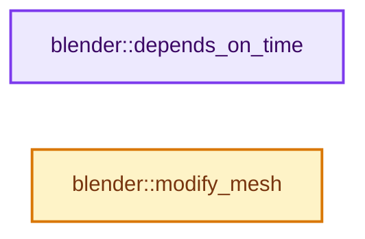
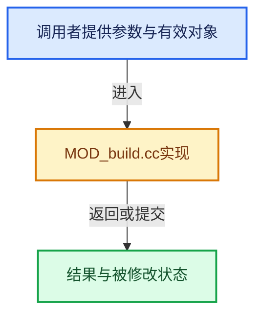

# 实现依赖专题：source/blender/modifiers/intern/MOD_build.cc

[实现依赖导航](../../../README.md) · [符号索引](../../../../00-课程指南/02-源码与提交索引/符号依赖与实现索引.md)

本专题从正文实际调用进入，集中保存共享实现。函数有稳定锚点，可从调用处直接跳到对应完整函数；递归与互相调用通过回链组织。

## 本文件的实现关系






## 完整成员与函数实现

<a id="f-bbcacfbc405bb2e1"></a>

### `blender::depends_on_time`

实现位置：[source/blender/modifiers/intern/MOD_build.cc](../../../../../../../../source/blender/modifiers/intern/MOD_build.cc) · L46—L49。

接口参数：

- `Scene *`
- `ModifierData *`

**教学注释版**

<!-- annotated:c6103b048db627 -->

```cpp
static bool depends_on_time(Scene * /*scene*/, ModifierData * /*md*/)
{
  return true;
}
```

<details>
<summary>核对原始源码：source/blender/modifiers/intern/MOD_build.cc · L46—L49</summary>

<!-- original:c6103b048db627:source/blender/modifiers/intern/MOD_build.cc:46:49 -->

```cpp
static bool depends_on_time(Scene * /*scene*/, ModifierData * /*md*/)
{
  return true;
}
```

</details>

**结果出口**

- `return true;`

**继续追踪实现**

本实现没有需要继续展开的显式调用；检查返回表达式、对象转换和调用者前置条件。

<a id="f-8cf9bea3f3d62f86"></a>

### `blender::modify_mesh`

实现位置：[source/blender/modifiers/intern/MOD_build.cc](../../../../../../../../source/blender/modifiers/intern/MOD_build.cc) · L51—L237。

接口参数：

- `ModifierData *md`
- `const ModifierEvalContext *ctx`
- `Mesh *mesh`

**教学注释版**

<!-- annotated:057dd80bd561d1 -->

```cpp
static Mesh *modify_mesh(ModifierData *md, const ModifierEvalContext *ctx, Mesh *mesh)
{
  Mesh *result;
  BuildModifierData *bmd = reinterpret_cast<BuildModifierData *>(md);
  int i, j, k;
  int faces_dst_num, edges_dst_num, loops_dst_num = 0;
  float frac;
  /* maps vert indices in old mesh to indices in new mesh */
  Map<int, int> vertHash;
  /* maps edge indices in new mesh to indices in old mesh */
  Map<int, int> edgeHash;
  /* maps edge indices in old mesh to indices in new mesh */
  Map<int, int> edgeHash2;

  const int vert_src_num = mesh->verts_num;
  const Span<int2> edges_src = mesh->edges();
  const OffsetIndices faces_src = mesh->faces();
  const Span<int> corner_verts_src = mesh->corner_verts();
  const Span<int> corner_edges_src = mesh->corner_edges();

  int *vertMap = MEM_new_array_uninitialized<int>(size_t(vert_src_num), __func__);
  // [讲解] edges_src.size：查询视图长度或生成对应有效索引区间。
  int *edgeMap = MEM_new_array_uninitialized<int>(size_t(edges_src.size()), __func__);
  int *faceMap = MEM_new_array_uninitialized<int>(size_t(faces_src.size()), __func__);

  array_utils::fill_index_range<int>({vertMap, vert_src_num});
  array_utils::fill_index_range<int>({edgeMap, edges_src.size()});
  array_utils::fill_index_range<int>({faceMap, faces_src.size()});

  Scene *scene = DEG_get_input_scene(ctx->depsgraph);
  frac = (BKE_scene_ctime_get(scene) - bmd->start) / bmd->length;
  CLAMP(frac, 0.0f, 1.0f);
  if (bmd->flag & MOD_BUILD_FLAG_REVERSE) {
    frac = 1.0f - frac;
  }

  faces_dst_num = faces_src.size() * frac;
  edges_dst_num = edges_src.size() * frac;

  /* if there's at least one face, build based on faces */
  if (faces_dst_num) {
    uintptr_t hash_num, hash_num_alt;

    if (bmd->flag & MOD_BUILD_FLAG_RANDOMIZE) {
      BLI_array_randomize(faceMap, sizeof(*faceMap), faces_src.size(), bmd->seed);
    }

    /* get the set of all vert indices that will be in the final mesh,
     * mapped to the new indices
     */
    hash_num = 0;
    for (i = 0; i < faces_dst_num; i++) {
      const IndexRange face = faces_src[faceMap[i]];
      for (j = 0; j < face.size(); j++) {
        const int vert_i = corner_verts_src[face[j]];
        // [讲解] vertHash.add：按哈希与相等关系加入键或键值。
        if (vertHash.add(vert_i, hash_num)) {
          hash_num++;
        }
      }

      loops_dst_num += face.size();
    }
    BLI_assert(hash_num == vertHash.size());

    /* get the set of edges that will be in the new mesh (i.e. all edges
     * that have both verts in the new mesh)
     */
    hash_num = 0;
    hash_num_alt = 0;
    for (i = 0; i < edges_src.size(); i++, hash_num_alt++) {
      const int2 &edge = edges_src[i];

      // [讲解] vertHash.contains：查询活项数量或键是否存在。
      if (vertHash.contains(edge[0]) && vertHash.contains(edge[1])) {
        edgeHash.add(hash_num, hash_num_alt);
        edgeHash2.add(hash_num_alt, hash_num);
        hash_num++;
      }
    }
    BLI_assert(hash_num == edgeHash.size());
  }
  else if (edges_dst_num) {
    uintptr_t hash_num;

    if (bmd->flag & MOD_BUILD_FLAG_RANDOMIZE) {
      BLI_array_randomize(edgeMap, sizeof(*edgeMap), edges_src.size(), bmd->seed);
    }

    /* get the set of all vert indices that will be in the final mesh,
     * mapped to the new indices
     */
    // [讲解] edges_src.data：返回借用范围的地址。
    const int2 *edges = edges_src.data();
    hash_num = 0;
    BLI_assert(hash_num == vertHash.size());
    for (i = 0; i < edges_dst_num; i++) {
      const int2 &edge = edges[edgeMap[i]];
      if (vertHash.add(edge[0], hash_num)) {
        hash_num++;
      }
      if (vertHash.add(edge[1], hash_num)) {
        hash_num++;
      }
    }
    BLI_assert(hash_num == vertHash.size());

    /* get the set of edges that will be in the new mesh */
    for (i = 0; i < edges_dst_num; i++) {
      j = edgeHash.size();

      edgeHash.add(j, edgeMap[i]);
      edgeHash2.add(edgeMap[i], j);
    }
  }
  else {
    int verts_num = vert_src_num * frac;

    if (bmd->flag & MOD_BUILD_FLAG_RANDOMIZE) {
      BLI_array_randomize(vertMap, sizeof(*vertMap), vert_src_num, bmd->seed);
    }

    /* get the set of all vert indices that will be in the final mesh,
     * mapped to the new indices
     */
    for (i = 0; i < verts_num; i++) {
      vertHash.add(vertMap[i], i);
    }
  }

  /* now we know the number of verts, edges and faces, we can create the mesh. */
  result = BKE_mesh_new_nomain_from_template(
      mesh, vertHash.size(), edgeHash.size(), faces_dst_num, loops_dst_num);
  MutableSpan<int2> result_edges = result->edges_for_write();
  MutableSpan<int> result_face_offsets = result->face_offsets_for_write();
  MutableSpan<int> result_corner_verts = result->corner_verts_for_write();
  MutableSpan<int> result_corner_edges = result->corner_edges_for_write();

  bke::LegacyMeshInterpolator vert_interp(*mesh, *result, bke::AttrDomain::Point);
  bke::LegacyMeshInterpolator edge_interp(*mesh, *result, bke::AttrDomain::Edge);
  bke::LegacyMeshInterpolator face_interp(*mesh, *result, bke::AttrDomain::Face);
  bke::LegacyMeshInterpolator corner_interp(*mesh, *result, bke::AttrDomain::Corner);

  /* copy the vertices across */
  for (const auto &item : vertHash.items()) {
    const int oldIndex = item.key;
    const int newIndex = item.value;
    vert_interp.copy(oldIndex, newIndex, 1);
  }

  /* copy the edges across, remapping indices */
  for (i = 0; i < edgeHash.size(); i++) {
    int2 source;
    int2 *dest;
    // [讲解] edgeHash.lookup：按键查找对应项。
    int oldIndex = edgeHash.lookup(i);

    source = edges_src[oldIndex];
    dest = &result_edges[i];

    source[0] = vertHash.lookup(source[0]);
    source[1] = vertHash.lookup(source[1]);

    edge_interp.copy(oldIndex, i, 1);
    *dest = source;
  }

  /* copy the faces across, remapping indices */
  k = 0;
  for (i = 0; i < faces_dst_num; i++) {
    const IndexRange src_face = faces_src[faceMap[i]];
    result_face_offsets[i] = k;

    face_interp.copy(faceMap[i], i, 1);

    // [讲解] src_face.start：读取连续区间或分组的边界信息。
    corner_interp.copy(src_face.start(), k, src_face.size());

    for (j = 0; j < src_face.size(); j++, k++) {
      const int vert_src = corner_verts_src[src_face[j]];
      const int edge_src = corner_edges_src[src_face[j]];
      result_corner_verts[k] = vertHash.lookup(vert_src);
      result_corner_edges[k] = edgeHash2.lookup(edge_src);
    }
  }

  MEM_delete(vertMap);
  MEM_delete(edgeMap);
  MEM_delete(faceMap);

  /* TODO(sybren): also copy flags & tags? */
  return result;
}
```

<details>
<summary>核对原始源码：source/blender/modifiers/intern/MOD_build.cc · L51—L237</summary>

<!-- original:057dd80bd561d1:source/blender/modifiers/intern/MOD_build.cc:51:237 -->

```cpp
static Mesh *modify_mesh(ModifierData *md, const ModifierEvalContext *ctx, Mesh *mesh)
{
  Mesh *result;
  BuildModifierData *bmd = reinterpret_cast<BuildModifierData *>(md);
  int i, j, k;
  int faces_dst_num, edges_dst_num, loops_dst_num = 0;
  float frac;
  /* maps vert indices in old mesh to indices in new mesh */
  Map<int, int> vertHash;
  /* maps edge indices in new mesh to indices in old mesh */
  Map<int, int> edgeHash;
  /* maps edge indices in old mesh to indices in new mesh */
  Map<int, int> edgeHash2;

  const int vert_src_num = mesh->verts_num;
  const Span<int2> edges_src = mesh->edges();
  const OffsetIndices faces_src = mesh->faces();
  const Span<int> corner_verts_src = mesh->corner_verts();
  const Span<int> corner_edges_src = mesh->corner_edges();

  int *vertMap = MEM_new_array_uninitialized<int>(size_t(vert_src_num), __func__);
  int *edgeMap = MEM_new_array_uninitialized<int>(size_t(edges_src.size()), __func__);
  int *faceMap = MEM_new_array_uninitialized<int>(size_t(faces_src.size()), __func__);

  array_utils::fill_index_range<int>({vertMap, vert_src_num});
  array_utils::fill_index_range<int>({edgeMap, edges_src.size()});
  array_utils::fill_index_range<int>({faceMap, faces_src.size()});

  Scene *scene = DEG_get_input_scene(ctx->depsgraph);
  frac = (BKE_scene_ctime_get(scene) - bmd->start) / bmd->length;
  CLAMP(frac, 0.0f, 1.0f);
  if (bmd->flag & MOD_BUILD_FLAG_REVERSE) {
    frac = 1.0f - frac;
  }

  faces_dst_num = faces_src.size() * frac;
  edges_dst_num = edges_src.size() * frac;

  /* if there's at least one face, build based on faces */
  if (faces_dst_num) {
    uintptr_t hash_num, hash_num_alt;

    if (bmd->flag & MOD_BUILD_FLAG_RANDOMIZE) {
      BLI_array_randomize(faceMap, sizeof(*faceMap), faces_src.size(), bmd->seed);
    }

    /* get the set of all vert indices that will be in the final mesh,
     * mapped to the new indices
     */
    hash_num = 0;
    for (i = 0; i < faces_dst_num; i++) {
      const IndexRange face = faces_src[faceMap[i]];
      for (j = 0; j < face.size(); j++) {
        const int vert_i = corner_verts_src[face[j]];
        if (vertHash.add(vert_i, hash_num)) {
          hash_num++;
        }
      }

      loops_dst_num += face.size();
    }
    BLI_assert(hash_num == vertHash.size());

    /* get the set of edges that will be in the new mesh (i.e. all edges
     * that have both verts in the new mesh)
     */
    hash_num = 0;
    hash_num_alt = 0;
    for (i = 0; i < edges_src.size(); i++, hash_num_alt++) {
      const int2 &edge = edges_src[i];

      if (vertHash.contains(edge[0]) && vertHash.contains(edge[1])) {
        edgeHash.add(hash_num, hash_num_alt);
        edgeHash2.add(hash_num_alt, hash_num);
        hash_num++;
      }
    }
    BLI_assert(hash_num == edgeHash.size());
  }
  else if (edges_dst_num) {
    uintptr_t hash_num;

    if (bmd->flag & MOD_BUILD_FLAG_RANDOMIZE) {
      BLI_array_randomize(edgeMap, sizeof(*edgeMap), edges_src.size(), bmd->seed);
    }

    /* get the set of all vert indices that will be in the final mesh,
     * mapped to the new indices
     */
    const int2 *edges = edges_src.data();
    hash_num = 0;
    BLI_assert(hash_num == vertHash.size());
    for (i = 0; i < edges_dst_num; i++) {
      const int2 &edge = edges[edgeMap[i]];
      if (vertHash.add(edge[0], hash_num)) {
        hash_num++;
      }
      if (vertHash.add(edge[1], hash_num)) {
        hash_num++;
      }
    }
    BLI_assert(hash_num == vertHash.size());

    /* get the set of edges that will be in the new mesh */
    for (i = 0; i < edges_dst_num; i++) {
      j = edgeHash.size();

      edgeHash.add(j, edgeMap[i]);
      edgeHash2.add(edgeMap[i], j);
    }
  }
  else {
    int verts_num = vert_src_num * frac;

    if (bmd->flag & MOD_BUILD_FLAG_RANDOMIZE) {
      BLI_array_randomize(vertMap, sizeof(*vertMap), vert_src_num, bmd->seed);
    }

    /* get the set of all vert indices that will be in the final mesh,
     * mapped to the new indices
     */
    for (i = 0; i < verts_num; i++) {
      vertHash.add(vertMap[i], i);
    }
  }

  /* now we know the number of verts, edges and faces, we can create the mesh. */
  result = BKE_mesh_new_nomain_from_template(
      mesh, vertHash.size(), edgeHash.size(), faces_dst_num, loops_dst_num);
  MutableSpan<int2> result_edges = result->edges_for_write();
  MutableSpan<int> result_face_offsets = result->face_offsets_for_write();
  MutableSpan<int> result_corner_verts = result->corner_verts_for_write();
  MutableSpan<int> result_corner_edges = result->corner_edges_for_write();

  bke::LegacyMeshInterpolator vert_interp(*mesh, *result, bke::AttrDomain::Point);
  bke::LegacyMeshInterpolator edge_interp(*mesh, *result, bke::AttrDomain::Edge);
  bke::LegacyMeshInterpolator face_interp(*mesh, *result, bke::AttrDomain::Face);
  bke::LegacyMeshInterpolator corner_interp(*mesh, *result, bke::AttrDomain::Corner);

  /* copy the vertices across */
  for (const auto &item : vertHash.items()) {
    const int oldIndex = item.key;
    const int newIndex = item.value;
    vert_interp.copy(oldIndex, newIndex, 1);
  }

  /* copy the edges across, remapping indices */
  for (i = 0; i < edgeHash.size(); i++) {
    int2 source;
    int2 *dest;
    int oldIndex = edgeHash.lookup(i);

    source = edges_src[oldIndex];
    dest = &result_edges[i];

    source[0] = vertHash.lookup(source[0]);
    source[1] = vertHash.lookup(source[1]);

    edge_interp.copy(oldIndex, i, 1);
    *dest = source;
  }

  /* copy the faces across, remapping indices */
  k = 0;
  for (i = 0; i < faces_dst_num; i++) {
    const IndexRange src_face = faces_src[faceMap[i]];
    result_face_offsets[i] = k;

    face_interp.copy(faceMap[i], i, 1);

    corner_interp.copy(src_face.start(), k, src_face.size());

    for (j = 0; j < src_face.size(); j++, k++) {
      const int vert_src = corner_verts_src[src_face[j]];
      const int edge_src = corner_edges_src[src_face[j]];
      result_corner_verts[k] = vertHash.lookup(vert_src);
      result_corner_edges[k] = edgeHash2.lookup(edge_src);
    }
  }

  MEM_delete(vertMap);
  MEM_delete(edgeMap);
  MEM_delete(faceMap);

  /* TODO(sybren): also copy flags & tags? */
  return result;
}
```

</details>

**沿实际写入检查状态**

- `frac = (BKE_scene_ctime_get(scene) - bmd->start) / bmd->length;`
- `frac = 1.0f - frac;`
- `faces_dst_num = faces_src.size() * frac;`
- `edges_dst_num = edges_src.size() * frac;`
- `hash_num = 0;`
- `loops_dst_num += face.size();`
- `hash_num_alt = 0;`
- `j = edgeHash.size();`
- `result = BKE_mesh_new_nomain_from_template(`
- `source = edges_src[oldIndex];`
- `dest = &result_edges[i];`
- `source[0] = vertHash.lookup(source[0]);`
- `source[1] = vertHash.lookup(source[1]);`
- `k = 0;`
- `result_face_offsets[i] = k;`
- `result_corner_verts[k] = vertHash.lookup(vert_src);`
- `result_corner_edges[k] = edgeHash2.lookup(edge_src);`

**结果出口**

- `return result;`

**继续追踪实现**

- `mesh->edges` → [Mesh::edges · L1205](../../../../05-几何存储与拓扑映射/03-MPoly迁移与兼容.md#f-7232f6756b674d12)。
- `mesh->faces` → [Mesh::faces · L1217](../../../../05-几何存储与拓扑映射/03-MPoly迁移与兼容.md#f-ea444760154e17b2)。
- `mesh->corner_verts` → [Mesh::corner_verts · L1238](../../../../05-几何存储与拓扑映射/03-MPoly迁移与兼容.md#f-a59c61f583b64bc4)。
- `mesh->corner_edges` → [Mesh::corner_edges · L1252](../../../../05-几何存储与拓扑映射/03-MPoly迁移与兼容.md#f-687b790868e7f257)。
- `MEM_new_array_uninitialized<int>` → [MEM_new_array_uninitialized · L608](../../../07-Intern运行时与平台/guardedalloc/MEM_guardedalloc.h.md#f-b7103eae8eb57b05)；[MEM_new_array_uninitialized · L129](../../../07-Intern运行时与平台/guardedalloc/intern/mallocn.cc.md#f-bf6ef4ddcfb6e5df)。同名重载需按实参类型选择。
- `edges_src.size` → [blender::Span::size · L256](../../../../01-基础容器与现代CPP/05-Span只读连续视图.md#f-5f80fa006089c998)。
- `faces_src.size` → [blender::offset_indices::OffsetIndices::size · L67](../../../../05-几何存储与拓扑映射/02-OffsetIndices完整接口.md#f-e238abc62ed42abd)。
- `array_utils::fill_index_range<int>` → [blender::array_utils::fill_index_range · L434](../../../../05-几何存储与拓扑映射/07-分组访问与反向索引.md#f-f8128b104d76df0f)；[blender::array_utils::fill_index_range · L439](../../../../05-几何存储与拓扑映射/07-分组访问与反向索引.md#f-95ca84458bfc7e7e)；[blender::array_utils::fill_index_range · L445](../../../../05-几何存储与拓扑映射/07-分组访问与反向索引.md#f-c11b114c213cd61a)。同名重载需按实参类型选择。
- `DEG_get_input_scene` → [blender::DEG_get_input_scene · L81](../../../06-Depsgraph依赖图/intern/depsgraph_query.cc.md#f-674b6004195dc1ed)。
- `BKE_scene_ctime_get` → [blender::BKE_scene_ctime_get · L2591](../../../02-BKE几何与数据/intern/scene.cc.md#f-5e28483f19a62bf5)。
- `CLAMP` → [CLAMP · L200](../../../01-BLI基础库/BLI_utildefines.hh.md#m-69703e497120)。宏定义由构建条件选择。
- `BLI_array_randomize` → [RNG::BLI_array_randomize · L158](../../../01-BLI基础库/intern/rand.cc.md#f-527f498096e29f49)。
- `face.size` → [blender::IndexRange::size · L156](../../../../01-基础容器与现代CPP/04-IndexRange连续整数区间.md#f-05f66c3ebb2fdfec)。
- `vertHash.add` → [blender::Map::add · L295](../../../../02-哈希表与关联数据结构/04-Map查找与键访问.md#f-8d38101abf162f88)；[blender::Map::add · L299](../../../../02-哈希表与关联数据结构/04-Map查找与键访问.md#f-1f59510cdfbd9f87)；[blender::Map::add · L303](../../../../02-哈希表与关联数据结构/04-Map查找与键访问.md#f-645e0522347aa018)；[blender::Map::add · L307](../../../../02-哈希表与关联数据结构/04-Map查找与键访问.md#f-03405db0730cedc0)。同名重载需按实参类型选择。
- `BLI_assert` → [BLI_assert · L48](../../../01-BLI基础库/BLI_assert.hh.md#m-57a88495704d)；[BLI_assert · L63](../../../01-BLI基础库/BLI_assert.hh.md#m-d07050020cb5)。宏定义由构建条件选择。
- `vertHash.size` → [blender::Map::size · L976](../../../../02-哈希表与关联数据结构/06-删除墓碑与值销毁.md#f-ac1e466c97fbbebe)。
- `vertHash.contains` → [blender::Map::contains · L353](../../../../02-哈希表与关联数据结构/04-Map查找与键访问.md#f-70237c86261ee04d)。
- `edgeHash.add` → [blender::Map::add · L295](../../../../02-哈希表与关联数据结构/04-Map查找与键访问.md#f-8d38101abf162f88)；[blender::Map::add · L299](../../../../02-哈希表与关联数据结构/04-Map查找与键访问.md#f-1f59510cdfbd9f87)；[blender::Map::add · L303](../../../../02-哈希表与关联数据结构/04-Map查找与键访问.md#f-645e0522347aa018)；[blender::Map::add · L307](../../../../02-哈希表与关联数据结构/04-Map查找与键访问.md#f-03405db0730cedc0)。同名重载需按实参类型选择。
- `edgeHash2.add` → [blender::Map::add · L295](../../../../02-哈希表与关联数据结构/04-Map查找与键访问.md#f-8d38101abf162f88)；[blender::Map::add · L299](../../../../02-哈希表与关联数据结构/04-Map查找与键访问.md#f-1f59510cdfbd9f87)；[blender::Map::add · L303](../../../../02-哈希表与关联数据结构/04-Map查找与键访问.md#f-645e0522347aa018)；[blender::Map::add · L307](../../../../02-哈希表与关联数据结构/04-Map查找与键访问.md#f-03405db0730cedc0)。同名重载需按实参类型选择。
- `edgeHash.size` → [blender::Map::size · L976](../../../../02-哈希表与关联数据结构/06-删除墓碑与值销毁.md#f-ac1e466c97fbbebe)。
- `edges_src.data` → [blender::Span::data · L219](../../../../01-基础容器与现代CPP/05-Span只读连续视图.md#f-10c5889198935800)。
- `BKE_mesh_new_nomain_from_template` → [BKE_mesh_new_nomain_from_template · L1567](../../../../05-几何存储与拓扑映射/03-MPoly迁移与兼容.md#f-ec9d18994432323b)。
- `result->edges_for_write` → [Mesh::edges_for_write · L1211](../../../../05-几何存储与拓扑映射/03-MPoly迁移与兼容.md#f-a4c919c44eeede7c)。
- `result->face_offsets_for_write` → [Mesh::face_offsets_for_write · L1228](../../../../05-几何存储与拓扑映射/03-MPoly迁移与兼容.md#f-483f42747ab436a2)。
- `result->corner_verts_for_write` → [Mesh::corner_verts_for_write · L1246](../../../../05-几何存储与拓扑映射/03-MPoly迁移与兼容.md#f-6dfaf316a81ba215)。
- `result->corner_edges_for_write` → [Mesh::corner_edges_for_write · L1260](../../../../05-几何存储与拓扑映射/03-MPoly迁移与兼容.md#f-51e939a4353adb83)。
- `vertHash.items` → [blender::Map::items · L902](../../../../02-哈希表与关联数据结构/06-删除墓碑与值销毁.md#f-9ef4f6f70cba8f81)；[blender::Map::items · L913](../../../../02-哈希表与关联数据结构/06-删除墓碑与值销毁.md#f-0a69f4e73db8973e)；[blender::Map::items · L926](../../../../02-哈希表与关联数据结构/06-删除墓碑与值销毁.md#f-092add737130dcfb)；[blender::Map::items · L927](../../../../02-哈希表与关联数据结构/06-删除墓碑与值销毁.md#f-4bfc999f60cdede4)。同名重载需按实参类型选择。
- `vert_interp.copy` → [blender::bke::LegacyMeshInterpolator::copy · L348](../../../02-BKE几何与数据/intern/attribute_legacy_convert.cc.md#f-4e462b4a9febc9f7)。
- `edgeHash.lookup` → [blender::Map::lookup · L545](../../../../02-哈希表与关联数据结构/04-Map查找与键访问.md#f-f25ef95f1454656d)；[blender::Map::lookup · L549](../../../../02-哈希表与关联数据结构/04-Map查找与键访问.md#f-742f9454fa7ea4b9)。同名重载需按实参类型选择。
- `vertHash.lookup` → [blender::Map::lookup · L545](../../../../02-哈希表与关联数据结构/04-Map查找与键访问.md#f-f25ef95f1454656d)；[blender::Map::lookup · L549](../../../../02-哈希表与关联数据结构/04-Map查找与键访问.md#f-742f9454fa7ea4b9)。同名重载需按实参类型选择。
- `edge_interp.copy` → [blender::bke::LegacyMeshInterpolator::copy · L348](../../../02-BKE几何与数据/intern/attribute_legacy_convert.cc.md#f-4e462b4a9febc9f7)。
- `face_interp.copy` → [blender::bke::LegacyMeshInterpolator::copy · L348](../../../02-BKE几何与数据/intern/attribute_legacy_convert.cc.md#f-4e462b4a9febc9f7)。
- `corner_interp.copy` → [blender::bke::LegacyMeshInterpolator::copy · L348](../../../02-BKE几何与数据/intern/attribute_legacy_convert.cc.md#f-4e462b4a9febc9f7)。
- `src_face.start` → [blender::IndexRange::start · L243](../../../../01-基础容器与现代CPP/04-IndexRange连续整数区间.md#f-99d2195bd9cfd1f0)。
- `src_face.size` → [blender::IndexRange::size · L156](../../../../01-基础容器与现代CPP/04-IndexRange连续整数区间.md#f-05f66c3ebb2fdfec)。
- `edgeHash2.lookup` → [blender::Map::lookup · L545](../../../../02-哈希表与关联数据结构/04-Map查找与键访问.md#f-f25ef95f1454656d)；[blender::Map::lookup · L549](../../../../02-哈希表与关联数据结构/04-Map查找与键访问.md#f-742f9454fa7ea4b9)。同名重载需按实参类型选择。
- `MEM_delete` → [MEM_delete · L400](../../../07-Intern运行时与平台/guardedalloc/MEM_guardedalloc.h.md#f-9049ffdd1682887c)。
