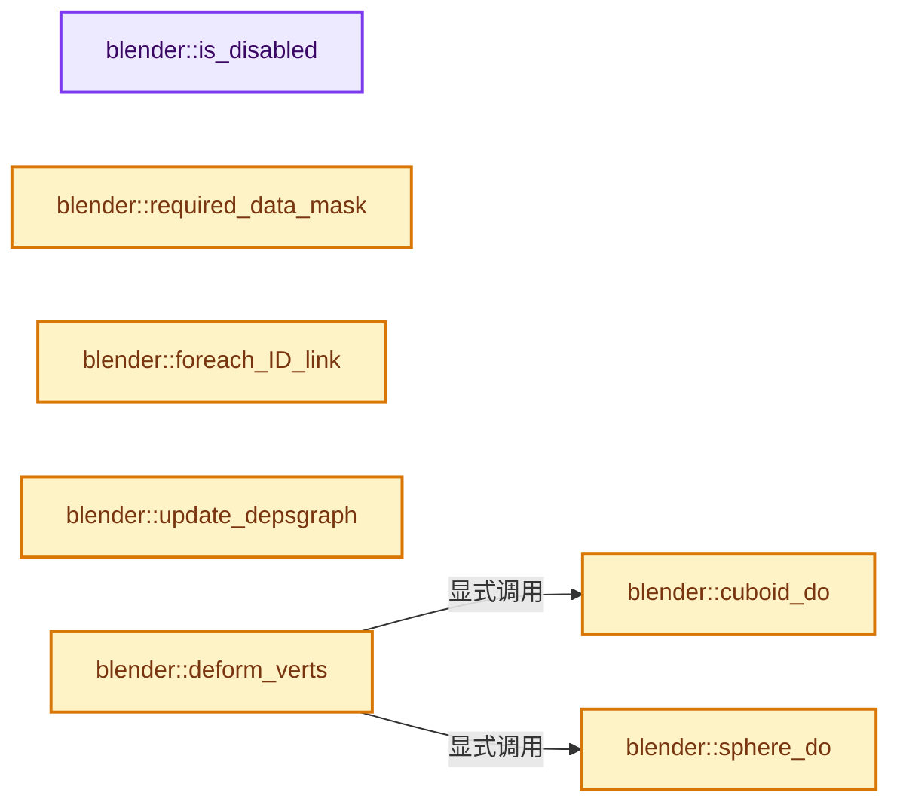
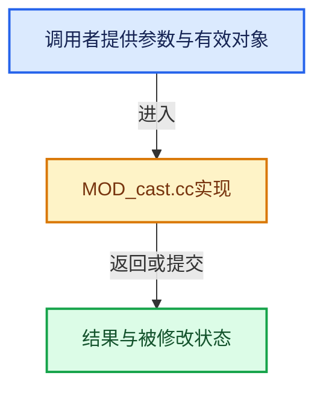

# 实现依赖专题：source/blender/modifiers/intern/MOD_cast.cc

[实现依赖导航](../../../README.md) · [符号索引](../../../../00-课程指南/02-源码与提交索引/符号依赖与实现索引.md)

本专题从正文实际调用进入，集中保存共享实现。函数有稳定锚点，可从调用处直接跳到对应完整函数；递归与互相调用通过回链组织。

## 本文件的实现关系






## 完整成员与函数实现

<a id="f-e8066e41ace3db74"></a>

### `blender::is_disabled`

实现位置：[source/blender/modifiers/intern/MOD_cast.cc](../../../../../../../../source/blender/modifiers/intern/MOD_cast.cc) · L41—L53。

接口参数：

- `const Scene *`
- `ModifierData *md`
- `bool`

**教学注释版**

<!-- annotated:549f4be1866e3f -->

```cpp
static bool is_disabled(const Scene * /*scene*/, ModifierData *md, bool /*use_render_params*/)
{
  CastModifierData *cmd = reinterpret_cast<CastModifierData *>(md);
  short flag;

  flag = cmd->flag & (MOD_CAST_X | MOD_CAST_Y | MOD_CAST_Z);

  if ((cmd->fac == 0.0f) || flag == 0) {
    return true;
  }

  return false;
}
```

<details>
<summary>核对原始源码：source/blender/modifiers/intern/MOD_cast.cc · L41—L53</summary>

<!-- original:549f4be1866e3f:source/blender/modifiers/intern/MOD_cast.cc:41:53 -->

```cpp
static bool is_disabled(const Scene * /*scene*/, ModifierData *md, bool /*use_render_params*/)
{
  CastModifierData *cmd = reinterpret_cast<CastModifierData *>(md);
  short flag;

  flag = cmd->flag & (MOD_CAST_X | MOD_CAST_Y | MOD_CAST_Z);

  if ((cmd->fac == 0.0f) || flag == 0) {
    return true;
  }

  return false;
}
```

</details>

**沿实际写入检查状态**

- `flag = cmd->flag & (MOD_CAST_X | MOD_CAST_Y | MOD_CAST_Z);`

**结果出口**

- `return true;`
- `return false;`

**继续追踪实现**

本实现没有需要继续展开的显式调用；检查返回表达式、对象转换和调用者前置条件。

<a id="f-afa52ef8a577516c"></a>

### `blender::required_data_mask`

实现位置：[source/blender/modifiers/intern/MOD_cast.cc](../../../../../../../../source/blender/modifiers/intern/MOD_cast.cc) · L55—L63。

接口参数：

- `ModifierData *md`
- `CustomData_MeshMasks *r_cddata_masks`

**教学注释版**

<!-- annotated:57c45f0ef353a7 -->

```cpp
static void required_data_mask(ModifierData *md, CustomData_MeshMasks *r_cddata_masks)
{
  CastModifierData *cmd = reinterpret_cast<CastModifierData *>(md);

  /* Ask for vertex-groups if we need them. */
  if (cmd->defgrp_name[0] != '\0') {
    r_cddata_masks->vmask |= CD_MASK_MDEFORMVERT;
  }
}
```

<details>
<summary>核对原始源码：source/blender/modifiers/intern/MOD_cast.cc · L55—L63</summary>

<!-- original:57c45f0ef353a7:source/blender/modifiers/intern/MOD_cast.cc:55:63 -->

```cpp
static void required_data_mask(ModifierData *md, CustomData_MeshMasks *r_cddata_masks)
{
  CastModifierData *cmd = reinterpret_cast<CastModifierData *>(md);

  /* Ask for vertex-groups if we need them. */
  if (cmd->defgrp_name[0] != '\0') {
    r_cddata_masks->vmask |= CD_MASK_MDEFORMVERT;
  }
}
```

</details>

**沿实际写入检查状态**

- `r_cddata_masks->vmask |= CD_MASK_MDEFORMVERT;`

**继续追踪实现**

本实现没有需要继续展开的显式调用；检查返回表达式、对象转换和调用者前置条件。

<a id="f-9726c811e9837b83"></a>

### `blender::foreach_ID_link`

实现位置：[source/blender/modifiers/intern/MOD_cast.cc](../../../../../../../../source/blender/modifiers/intern/MOD_cast.cc) · L65—L70。

接口参数：

- `ModifierData *md`
- `Object *ob`
- `IDWalkFunc walk`
- `void *user_data`

**教学注释版**

<!-- annotated:7959a796cd7213 -->

```cpp
static void foreach_ID_link(ModifierData *md, Object *ob, IDWalkFunc walk, void *user_data)
{
  CastModifierData *cmd = reinterpret_cast<CastModifierData *>(md);

  walk(user_data, ob, reinterpret_cast<ID **>(&cmd->object), IDWALK_CB_NOP);
}
```

<details>
<summary>核对原始源码：source/blender/modifiers/intern/MOD_cast.cc · L65—L70</summary>

<!-- original:7959a796cd7213:source/blender/modifiers/intern/MOD_cast.cc:65:70 -->

```cpp
static void foreach_ID_link(ModifierData *md, Object *ob, IDWalkFunc walk, void *user_data)
{
  CastModifierData *cmd = reinterpret_cast<CastModifierData *>(md);

  walk(user_data, ob, reinterpret_cast<ID **>(&cmd->object), IDWALK_CB_NOP);
}
```

</details>

**继续追踪实现**

- `walk` → [调用协议](../../../../00-课程指南/01-路线与规范/模板宏与动态分派协议.md)：局部可调用对象，须结合其初始化与捕获环境。调用位置L69。

<a id="f-8a94f7e968b29689"></a>

### `blender::update_depsgraph`

实现位置：[source/blender/modifiers/intern/MOD_cast.cc](../../../../../../../../source/blender/modifiers/intern/MOD_cast.cc) · L72—L79。

接口参数：

- `ModifierData *md`
- `const ModifierUpdateDepsgraphContext *ctx`

**教学注释版**

<!-- annotated:46006b1e3c1a53 -->

```cpp
static void update_depsgraph(ModifierData *md, const ModifierUpdateDepsgraphContext *ctx)
{
  CastModifierData *cmd = reinterpret_cast<CastModifierData *>(md);
  if (cmd->object != nullptr) {
    DEG_add_object_relation(ctx->node, cmd->object, DEG_OB_COMP_TRANSFORM, "Cast Modifier");
    DEG_add_depends_on_transform_relation(ctx->node, "Cast Modifier");
  }
}
```

<details>
<summary>核对原始源码：source/blender/modifiers/intern/MOD_cast.cc · L72—L79</summary>

<!-- original:46006b1e3c1a53:source/blender/modifiers/intern/MOD_cast.cc:72:79 -->

```cpp
static void update_depsgraph(ModifierData *md, const ModifierUpdateDepsgraphContext *ctx)
{
  CastModifierData *cmd = reinterpret_cast<CastModifierData *>(md);
  if (cmd->object != nullptr) {
    DEG_add_object_relation(ctx->node, cmd->object, DEG_OB_COMP_TRANSFORM, "Cast Modifier");
    DEG_add_depends_on_transform_relation(ctx->node, "Cast Modifier");
  }
}
```

</details>

**继续追踪实现**

- `DEG_add_object_relation` → [blender::DEG_add_object_relation · L123](../../../06-Depsgraph依赖图/intern/depsgraph_build.cc.md#f-f570cffae97e273c)。
- `DEG_add_depends_on_transform_relation` → [blender::DEG_add_depends_on_transform_relation · L240](../../../06-Depsgraph依赖图/intern/depsgraph_build.cc.md#f-47c32a354defa20d)。

<a id="f-0c0fef0ff190b257"></a>

### `blender::sphere_do`

实现位置：[source/blender/modifiers/intern/MOD_cast.cc](../../../../../../../../source/blender/modifiers/intern/MOD_cast.cc) · L81—L219。

接口参数：

- `CastModifierData *cmd`
- `const ModifierEvalContext *`
- `Object *ob`
- `Mesh *mesh`
- `MutableSpan<float3> positions`

**教学注释版**

<!-- annotated:587090a25c3a6a -->

```cpp
static void sphere_do(CastModifierData *cmd,
                      const ModifierEvalContext * /*ctx*/,
                      Object *ob,
                      Mesh *mesh,
                      MutableSpan<float3> positions)
{
  const MDeformVert *dvert = nullptr;
  const bool invert_vgroup = (cmd->flag & MOD_CAST_INVERT_VGROUP) != 0;

  Object *ctrl_ob = nullptr;

  int i, defgrp_index;
  bool has_radius = false;
  short flag, type;
  float len = 0.0f;
  float fac = cmd->fac;
  float facm = 1.0f - fac;
  const float fac_orig = fac;
  float vec[3], center[3] = {0.0f, 0.0f, 0.0f};
  float mat[4][4], imat[4][4];

  flag = cmd->flag;
  type = cmd->type; /* projection type: sphere or cylinder */

  if (type == MOD_CAST_TYPE_CYLINDER) {
    flag &= ~MOD_CAST_Z;
  }

  ctrl_ob = cmd->object;

  /* The spheres center is {0, 0, 0} (the ob's own center in its local space),
   * by default, but if the user defined a control object,
   * we use its location, transformed to ob's local space. */
  if (ctrl_ob) {
    if (flag & MOD_CAST_USE_OB_TRANSFORM) {
      invert_m4_m4(imat, ctrl_ob->object_to_world().ptr());
      mul_m4_m4m4(mat, imat, ob->object_to_world().ptr());
      invert_m4_m4(imat, mat);
    }

    invert_m4_m4(ob->runtime->world_to_object.ptr(), ob->object_to_world().ptr());
    mul_v3_m4v3(center, ob->world_to_object().ptr(), ctrl_ob->object_to_world().location());
  }

  /* now we check which options the user wants */

  /* 1) (flag was checked in the "if (ctrl_ob)" block above) */
  /* 2) cmd->radius > 0.0f: only the vertices within this radius from
   * the center of the effect should be deformed */
  if (cmd->radius > FLT_EPSILON) {
    has_radius = true;
  }

  /* 3) if we were given a vertex group name,
   * only those vertices should be affected */
  if (cmd->defgrp_name[0] != '\0') {
    MOD_get_vgroup(ob, mesh, cmd->defgrp_name, &dvert, &defgrp_index);
  }

  if (flag & MOD_CAST_SIZE_FROM_RADIUS) {
    len = cmd->radius;
  }
  else {
    len = cmd->size;
  }

  if (len <= 0) {
    // [讲解] positions.size：查询视图长度或生成对应有效索引区间。
    for (i = 0; i < positions.size(); i++) {
      len += len_v3v3(center, positions[i]);
    }
    len /= positions.size();

    if (len == 0.0f) {
      len = 10.0f;
    }
  }

  for (i = 0; i < positions.size(); i++) {
    float tmp_co[3];

    copy_v3_v3(tmp_co, positions[i]);
    if (ctrl_ob) {
      if (flag & MOD_CAST_USE_OB_TRANSFORM) {
        mul_m4_v3(mat, tmp_co);
      }
      else {
        sub_v3_v3(tmp_co, center);
      }
    }

    copy_v3_v3(vec, tmp_co);

    if (type == MOD_CAST_TYPE_CYLINDER) {
      vec[2] = 0.0f;
    }

    if (has_radius) {
      if (len_v3(vec) > cmd->radius) {
        continue;
      }
    }

    if (dvert) {
      const float weight = invert_vgroup ?
                               1.0f - BKE_defvert_find_weight(&dvert[i], defgrp_index) :
                               BKE_defvert_find_weight(&dvert[i], defgrp_index);

      if (weight == 0.0f) {
        continue;
      }

      fac = fac_orig * weight;
      facm = 1.0f - fac;
    }

    normalize_v3(vec);

    if (flag & MOD_CAST_X) {
      tmp_co[0] = fac * vec[0] * len + facm * tmp_co[0];
    }
    if (flag & MOD_CAST_Y) {
      tmp_co[1] = fac * vec[1] * len + facm * tmp_co[1];
    }
    if (flag & MOD_CAST_Z) {
      tmp_co[2] = fac * vec[2] * len + facm * tmp_co[2];
    }

    if (ctrl_ob) {
      if (flag & MOD_CAST_USE_OB_TRANSFORM) {
        mul_m4_v3(imat, tmp_co);
      }
      else {
        add_v3_v3(tmp_co, center);
      }
    }

    copy_v3_v3(positions[i], tmp_co);
  }
}
```

<details>
<summary>核对原始源码：source/blender/modifiers/intern/MOD_cast.cc · L81—L219</summary>

<!-- original:587090a25c3a6a:source/blender/modifiers/intern/MOD_cast.cc:81:219 -->

```cpp
static void sphere_do(CastModifierData *cmd,
                      const ModifierEvalContext * /*ctx*/,
                      Object *ob,
                      Mesh *mesh,
                      MutableSpan<float3> positions)
{
  const MDeformVert *dvert = nullptr;
  const bool invert_vgroup = (cmd->flag & MOD_CAST_INVERT_VGROUP) != 0;

  Object *ctrl_ob = nullptr;

  int i, defgrp_index;
  bool has_radius = false;
  short flag, type;
  float len = 0.0f;
  float fac = cmd->fac;
  float facm = 1.0f - fac;
  const float fac_orig = fac;
  float vec[3], center[3] = {0.0f, 0.0f, 0.0f};
  float mat[4][4], imat[4][4];

  flag = cmd->flag;
  type = cmd->type; /* projection type: sphere or cylinder */

  if (type == MOD_CAST_TYPE_CYLINDER) {
    flag &= ~MOD_CAST_Z;
  }

  ctrl_ob = cmd->object;

  /* The spheres center is {0, 0, 0} (the ob's own center in its local space),
   * by default, but if the user defined a control object,
   * we use its location, transformed to ob's local space. */
  if (ctrl_ob) {
    if (flag & MOD_CAST_USE_OB_TRANSFORM) {
      invert_m4_m4(imat, ctrl_ob->object_to_world().ptr());
      mul_m4_m4m4(mat, imat, ob->object_to_world().ptr());
      invert_m4_m4(imat, mat);
    }

    invert_m4_m4(ob->runtime->world_to_object.ptr(), ob->object_to_world().ptr());
    mul_v3_m4v3(center, ob->world_to_object().ptr(), ctrl_ob->object_to_world().location());
  }

  /* now we check which options the user wants */

  /* 1) (flag was checked in the "if (ctrl_ob)" block above) */
  /* 2) cmd->radius > 0.0f: only the vertices within this radius from
   * the center of the effect should be deformed */
  if (cmd->radius > FLT_EPSILON) {
    has_radius = true;
  }

  /* 3) if we were given a vertex group name,
   * only those vertices should be affected */
  if (cmd->defgrp_name[0] != '\0') {
    MOD_get_vgroup(ob, mesh, cmd->defgrp_name, &dvert, &defgrp_index);
  }

  if (flag & MOD_CAST_SIZE_FROM_RADIUS) {
    len = cmd->radius;
  }
  else {
    len = cmd->size;
  }

  if (len <= 0) {
    for (i = 0; i < positions.size(); i++) {
      len += len_v3v3(center, positions[i]);
    }
    len /= positions.size();

    if (len == 0.0f) {
      len = 10.0f;
    }
  }

  for (i = 0; i < positions.size(); i++) {
    float tmp_co[3];

    copy_v3_v3(tmp_co, positions[i]);
    if (ctrl_ob) {
      if (flag & MOD_CAST_USE_OB_TRANSFORM) {
        mul_m4_v3(mat, tmp_co);
      }
      else {
        sub_v3_v3(tmp_co, center);
      }
    }

    copy_v3_v3(vec, tmp_co);

    if (type == MOD_CAST_TYPE_CYLINDER) {
      vec[2] = 0.0f;
    }

    if (has_radius) {
      if (len_v3(vec) > cmd->radius) {
        continue;
      }
    }

    if (dvert) {
      const float weight = invert_vgroup ?
                               1.0f - BKE_defvert_find_weight(&dvert[i], defgrp_index) :
                               BKE_defvert_find_weight(&dvert[i], defgrp_index);

      if (weight == 0.0f) {
        continue;
      }

      fac = fac_orig * weight;
      facm = 1.0f - fac;
    }

    normalize_v3(vec);

    if (flag & MOD_CAST_X) {
      tmp_co[0] = fac * vec[0] * len + facm * tmp_co[0];
    }
    if (flag & MOD_CAST_Y) {
      tmp_co[1] = fac * vec[1] * len + facm * tmp_co[1];
    }
    if (flag & MOD_CAST_Z) {
      tmp_co[2] = fac * vec[2] * len + facm * tmp_co[2];
    }

    if (ctrl_ob) {
      if (flag & MOD_CAST_USE_OB_TRANSFORM) {
        mul_m4_v3(imat, tmp_co);
      }
      else {
        add_v3_v3(tmp_co, center);
      }
    }

    copy_v3_v3(positions[i], tmp_co);
  }
}
```

</details>

**沿实际写入检查状态**

- `flag = cmd->flag;`
- `type = cmd->type; /* projection type: sphere or cylinder */`
- `flag &= ~MOD_CAST_Z;`
- `ctrl_ob = cmd->object;`
- `has_radius = true;`
- `len = cmd->radius;`
- `len = cmd->size;`
- `len += len_v3v3(center, positions[i]);`
- `len = 10.0f;`
- `vec[2] = 0.0f;`
- `fac = fac_orig * weight;`
- `facm = 1.0f - fac;`
- `tmp_co[0] = fac * vec[0] * len + facm * tmp_co[0];`
- `tmp_co[1] = fac * vec[1] * len + facm * tmp_co[1];`
- `tmp_co[2] = fac * vec[2] * len + facm * tmp_co[2];`

**继续追踪实现**

- `invert_m4_m4` → [blender::invert_m4_m4 · L1150](../../../01-BLI基础库/intern/math_matrix_c.cc.md#f-c75789f10cdd5b92)。
- `ctrl_ob->object_to_world().ptr` → [调用协议](../../../../00-课程指南/01-路线与规范/模板宏与动态分派协议.md)：接收对象类型依赖auto、返回值或模板实例；不按同名猜测目标。调用位置L116。
- `ctrl_ob->object_to_world` → [blender::Object::object_to_world · L5761](../../../02-BKE几何与数据/intern/object.cc.md#f-12fc20026327d50c)。
- `mul_m4_m4m4` → [blender::mul_m4_m4m4 · L217](../../../01-BLI基础库/intern/math_matrix_c.cc.md#f-b5272136b543b73b)。
- `ob->object_to_world().ptr` → [调用协议](../../../../00-课程指南/01-路线与规范/模板宏与动态分派协议.md)：接收对象类型依赖auto、返回值或模板实例；不按同名猜测目标。调用位置L117。
- `ob->object_to_world` → [blender::Object::object_to_world · L5761](../../../02-BKE几何与数据/intern/object.cc.md#f-12fc20026327d50c)。
- `ob->runtime->world_to_object.ptr` → [调用协议](../../../../00-课程指南/01-路线与规范/模板宏与动态分派协议.md)：接收对象类型依赖auto、返回值或模板实例；不按同名猜测目标。调用位置L121。
- `mul_v3_m4v3` → [blender::mul_v3_m4v3 · L687](../../../01-BLI基础库/intern/math_matrix_c.cc.md#f-31076c71c40783a8)。
- `ob->world_to_object().ptr` → [调用协议](../../../../00-课程指南/01-路线与规范/模板宏与动态分派协议.md)：接收对象类型依赖auto、返回值或模板实例；不按同名猜测目标。调用位置L122。
- `ob->world_to_object` → [blender::Object::world_to_object · L5766](../../../02-BKE几何与数据/intern/object.cc.md#f-dd4d8d55d6195233)。
- `ctrl_ob->object_to_world().location` → [调用协议](../../../../00-课程指南/01-路线与规范/模板宏与动态分派协议.md)：接收对象类型依赖auto、返回值或模板实例；不按同名猜测目标。调用位置L122。
- `MOD_get_vgroup` → [blender::MOD_get_vgroup · L158](MOD_util.cc.md#f-f461611d86b94405)。
- `positions.size` → [blender::MutableSpan::size · L499](../../../../01-基础容器与现代CPP/06-MutableSpan可写视图.md#f-1de6a66839c304a8)；[blender::gpu::shader::parser::MutableSpan::size · L87](../../gpu/shader_tool/utils.hh.md#f-5e684af6ee7990e9)。同名重载需按实参类型选择。
- `len_v3v3` → [blender::len_v3v3 · L826](../../../01-BLI基础库/intern/math_vector_inline.cc.md#f-c873370566848169)。
- `copy_v3_v3` → [blender::copy_v3_v3 · L47](../../../01-BLI基础库/intern/math_vector_inline.cc.md#f-037a0d5fa5060bd6)。
- `mul_m4_v3` → [blender::mul_m4_v3 · L677](../../../01-BLI基础库/intern/math_matrix_c.cc.md#f-14a8c267710d47a3)。
- `sub_v3_v3` → [blender::sub_v3_v3 · L353](../../../01-BLI基础库/intern/math_vector_inline.cc.md#f-da39d7342c417f4b)。
- `len_v3` → [blender::len_v3 · L781](../../../01-BLI基础库/intern/math_vector_inline.cc.md#f-4ad88eb0aa8d70ab)。
- `BKE_defvert_find_weight` → [blender::BKE_defvert_find_weight · L779](../../../02-BKE几何与数据/intern/deform.cc.md#f-c117fcd05c4fd453)。
- `normalize_v3` → [blender::normalize_v3 · L933](../../../01-BLI基础库/intern/math_vector_inline.cc.md#f-5f3257e657ef732c)。
- `add_v3_v3` → [blender::add_v3_v3 · L286](../../../01-BLI基础库/intern/math_vector_inline.cc.md#f-e7930c6fdefe462c)。

<a id="f-ad74e64b15bced5e"></a>

### `blender::cuboid_do`

实现位置：[source/blender/modifiers/intern/MOD_cast.cc](../../../../../../../../source/blender/modifiers/intern/MOD_cast.cc) · L221—L443。

接口参数：

- `CastModifierData *cmd`
- `const ModifierEvalContext *`
- `Object *ob`
- `Mesh *mesh`
- `MutableSpan<float3> positions`

**教学注释版**

<!-- annotated:fa82962a9c1a55 -->

```cpp
static void cuboid_do(CastModifierData *cmd,
                      const ModifierEvalContext * /*ctx*/,
                      Object *ob,
                      Mesh *mesh,
                      MutableSpan<float3> positions)
{
  const MDeformVert *dvert = nullptr;
  int defgrp_index;
  const bool invert_vgroup = (cmd->flag & MOD_CAST_INVERT_VGROUP) != 0;

  Object *ctrl_ob = nullptr;

  int i;
  bool has_radius = false;
  short flag;
  float fac = cmd->fac;
  float facm = 1.0f - fac;
  const float fac_orig = fac;
  float min[3], max[3], bb[8][3];
  float center[3] = {0.0f, 0.0f, 0.0f};
  float mat[4][4], imat[4][4];

  flag = cmd->flag;

  ctrl_ob = cmd->object;

  /* now we check which options the user wants */

  /* 1) (flag was checked in the "if (ctrl_ob)" block above) */
  /* 2) cmd->radius > 0.0f: only the vertices within this radius from
   * the center of the effect should be deformed */
  if (cmd->radius > FLT_EPSILON) {
    has_radius = true;
  }

  /* 3) if we were given a vertex group name,
   * only those vertices should be affected */
  if (cmd->defgrp_name[0] != '\0') {
    MOD_get_vgroup(ob, mesh, cmd->defgrp_name, &dvert, &defgrp_index);
  }

  if (ctrl_ob) {
    if (flag & MOD_CAST_USE_OB_TRANSFORM) {
      invert_m4_m4(imat, ctrl_ob->object_to_world().ptr());
      mul_m4_m4m4(mat, imat, ob->object_to_world().ptr());
      invert_m4_m4(imat, mat);
    }

    invert_m4_m4(ob->runtime->world_to_object.ptr(), ob->object_to_world().ptr());
    mul_v3_m4v3(center, ob->world_to_object().ptr(), ctrl_ob->object_to_world().location());
  }

  if ((flag & MOD_CAST_SIZE_FROM_RADIUS) && has_radius) {
    for (i = 0; i < 3; i++) {
      min[i] = -cmd->radius;
      max[i] = cmd->radius;
    }
  }
  else if (!(flag & MOD_CAST_SIZE_FROM_RADIUS) && cmd->size > 0) {
    for (i = 0; i < 3; i++) {
      min[i] = -cmd->size;
      max[i] = cmd->size;
    }
  }
  else {
    /* get bound box */
    /* We can't use the object's bound box because other modifiers
     * may have changed the vertex data. */
    INIT_MINMAX(min, max);

    /* Cast's center is the ob's own center in its local space,
     * by default, but if the user defined a control object, we use
     * its location, transformed to ob's local space. */
    if (ctrl_ob) {
      float vec[3];

      /* let the center of the ctrl_ob be part of the bound box: */
      minmax_v3v3_v3(min, max, center);

      // [讲解] positions.size：查询视图长度或生成对应有效索引区间。
      for (i = 0; i < positions.size(); i++) {
        sub_v3_v3v3(vec, positions[i], center);
        minmax_v3v3_v3(min, max, vec);
      }
    }
    else {
      for (i = 0; i < positions.size(); i++) {
        minmax_v3v3_v3(min, max, positions[i]);
      }
    }

    /* we want a symmetric bound box around the origin */
    if (fabsf(min[0]) > fabsf(max[0])) {
      max[0] = fabsf(min[0]);
    }
    if (fabsf(min[1]) > fabsf(max[1])) {
      max[1] = fabsf(min[1]);
    }
    if (fabsf(min[2]) > fabsf(max[2])) {
      max[2] = fabsf(min[2]);
    }
    min[0] = -max[0];
    min[1] = -max[1];
    min[2] = -max[2];
  }

  /* building our custom bounding box */
  bb[0][0] = bb[2][0] = bb[4][0] = bb[6][0] = min[0];
  bb[1][0] = bb[3][0] = bb[5][0] = bb[7][0] = max[0];
  bb[0][1] = bb[1][1] = bb[4][1] = bb[5][1] = min[1];
  bb[2][1] = bb[3][1] = bb[6][1] = bb[7][1] = max[1];
  bb[0][2] = bb[1][2] = bb[2][2] = bb[3][2] = min[2];
  bb[4][2] = bb[5][2] = bb[6][2] = bb[7][2] = max[2];

  /* ready to apply the effect, one vertex at a time */
  for (i = 0; i < positions.size(); i++) {
    int octant, coord;
    float d[3], dmax, apex[3], fbb;
    float tmp_co[3];

    copy_v3_v3(tmp_co, positions[i]);
    if (ctrl_ob) {
      if (flag & MOD_CAST_USE_OB_TRANSFORM) {
        mul_m4_v3(mat, tmp_co);
      }
      else {
        sub_v3_v3(tmp_co, center);
      }
    }

    if (has_radius) {
      if (fabsf(tmp_co[0]) > cmd->radius || fabsf(tmp_co[1]) > cmd->radius ||
          fabsf(tmp_co[2]) > cmd->radius)
      {
        continue;
      }
    }

    if (dvert) {
      const float weight = invert_vgroup ?
                               1.0f - BKE_defvert_find_weight(&dvert[i], defgrp_index) :
                               BKE_defvert_find_weight(&dvert[i], defgrp_index);

      if (weight == 0.0f) {
        continue;
      }

      fac = fac_orig * weight;
      facm = 1.0f - fac;
    }

    /* The algorithm used to project the vertices to their
     * bounding box (bb) is pretty simple:
     * for each vertex v:
     * 1) find in which octant v is in;
     * 2) find which outer "wall" of that octant is closer to v;
     * 3) calculate factor (var fbb) to project v to that wall;
     * 4) project. */

    /* find in which octant this vertex is in */
    octant = 0;
    if (tmp_co[0] > 0.0f) {
      octant += 1;
    }
    if (tmp_co[1] > 0.0f) {
      octant += 2;
    }
    if (tmp_co[2] > 0.0f) {
      octant += 4;
    }

    /* apex is the bb's vertex at the chosen octant */
    copy_v3_v3(apex, bb[octant]);

    /* find which bb plane is closest to this vertex ... */
    d[0] = tmp_co[0] / apex[0];
    d[1] = tmp_co[1] / apex[1];
    d[2] = tmp_co[2] / apex[2];

    /* ... (the closest has the higher (closer to 1) d value) */
    dmax = d[0];
    coord = 0;
    if (d[1] > dmax) {
      dmax = d[1];
      coord = 1;
    }
    if (d[2] > dmax) {
      // dmax = d[2]; /* commented, we don't need it */
      coord = 2;
    }

    /* ok, now we know which coordinate of the vertex to use */

    if (fabsf(tmp_co[coord]) < FLT_EPSILON) { /* avoid division by zero */
      continue;
    }

    /* finally, this is the factor we wanted, to project the vertex
     * to its bounding box (bb) */
    fbb = apex[coord] / tmp_co[coord];

    /* calculate the new vertex position */
    if (flag & MOD_CAST_X) {
      tmp_co[0] = facm * tmp_co[0] + fac * tmp_co[0] * fbb;
    }
    if (flag & MOD_CAST_Y) {
      tmp_co[1] = facm * tmp_co[1] + fac * tmp_co[1] * fbb;
    }
    if (flag & MOD_CAST_Z) {
      tmp_co[2] = facm * tmp_co[2] + fac * tmp_co[2] * fbb;
    }

    if (ctrl_ob) {
      if (flag & MOD_CAST_USE_OB_TRANSFORM) {
        mul_m4_v3(imat, tmp_co);
      }
      else {
        add_v3_v3(tmp_co, center);
      }
    }

    copy_v3_v3(positions[i], tmp_co);
  }
}
```

<details>
<summary>核对原始源码：source/blender/modifiers/intern/MOD_cast.cc · L221—L443</summary>

<!-- original:fa82962a9c1a55:source/blender/modifiers/intern/MOD_cast.cc:221:443 -->

```cpp
static void cuboid_do(CastModifierData *cmd,
                      const ModifierEvalContext * /*ctx*/,
                      Object *ob,
                      Mesh *mesh,
                      MutableSpan<float3> positions)
{
  const MDeformVert *dvert = nullptr;
  int defgrp_index;
  const bool invert_vgroup = (cmd->flag & MOD_CAST_INVERT_VGROUP) != 0;

  Object *ctrl_ob = nullptr;

  int i;
  bool has_radius = false;
  short flag;
  float fac = cmd->fac;
  float facm = 1.0f - fac;
  const float fac_orig = fac;
  float min[3], max[3], bb[8][3];
  float center[3] = {0.0f, 0.0f, 0.0f};
  float mat[4][4], imat[4][4];

  flag = cmd->flag;

  ctrl_ob = cmd->object;

  /* now we check which options the user wants */

  /* 1) (flag was checked in the "if (ctrl_ob)" block above) */
  /* 2) cmd->radius > 0.0f: only the vertices within this radius from
   * the center of the effect should be deformed */
  if (cmd->radius > FLT_EPSILON) {
    has_radius = true;
  }

  /* 3) if we were given a vertex group name,
   * only those vertices should be affected */
  if (cmd->defgrp_name[0] != '\0') {
    MOD_get_vgroup(ob, mesh, cmd->defgrp_name, &dvert, &defgrp_index);
  }

  if (ctrl_ob) {
    if (flag & MOD_CAST_USE_OB_TRANSFORM) {
      invert_m4_m4(imat, ctrl_ob->object_to_world().ptr());
      mul_m4_m4m4(mat, imat, ob->object_to_world().ptr());
      invert_m4_m4(imat, mat);
    }

    invert_m4_m4(ob->runtime->world_to_object.ptr(), ob->object_to_world().ptr());
    mul_v3_m4v3(center, ob->world_to_object().ptr(), ctrl_ob->object_to_world().location());
  }

  if ((flag & MOD_CAST_SIZE_FROM_RADIUS) && has_radius) {
    for (i = 0; i < 3; i++) {
      min[i] = -cmd->radius;
      max[i] = cmd->radius;
    }
  }
  else if (!(flag & MOD_CAST_SIZE_FROM_RADIUS) && cmd->size > 0) {
    for (i = 0; i < 3; i++) {
      min[i] = -cmd->size;
      max[i] = cmd->size;
    }
  }
  else {
    /* get bound box */
    /* We can't use the object's bound box because other modifiers
     * may have changed the vertex data. */
    INIT_MINMAX(min, max);

    /* Cast's center is the ob's own center in its local space,
     * by default, but if the user defined a control object, we use
     * its location, transformed to ob's local space. */
    if (ctrl_ob) {
      float vec[3];

      /* let the center of the ctrl_ob be part of the bound box: */
      minmax_v3v3_v3(min, max, center);

      for (i = 0; i < positions.size(); i++) {
        sub_v3_v3v3(vec, positions[i], center);
        minmax_v3v3_v3(min, max, vec);
      }
    }
    else {
      for (i = 0; i < positions.size(); i++) {
        minmax_v3v3_v3(min, max, positions[i]);
      }
    }

    /* we want a symmetric bound box around the origin */
    if (fabsf(min[0]) > fabsf(max[0])) {
      max[0] = fabsf(min[0]);
    }
    if (fabsf(min[1]) > fabsf(max[1])) {
      max[1] = fabsf(min[1]);
    }
    if (fabsf(min[2]) > fabsf(max[2])) {
      max[2] = fabsf(min[2]);
    }
    min[0] = -max[0];
    min[1] = -max[1];
    min[2] = -max[2];
  }

  /* building our custom bounding box */
  bb[0][0] = bb[2][0] = bb[4][0] = bb[6][0] = min[0];
  bb[1][0] = bb[3][0] = bb[5][0] = bb[7][0] = max[0];
  bb[0][1] = bb[1][1] = bb[4][1] = bb[5][1] = min[1];
  bb[2][1] = bb[3][1] = bb[6][1] = bb[7][1] = max[1];
  bb[0][2] = bb[1][2] = bb[2][2] = bb[3][2] = min[2];
  bb[4][2] = bb[5][2] = bb[6][2] = bb[7][2] = max[2];

  /* ready to apply the effect, one vertex at a time */
  for (i = 0; i < positions.size(); i++) {
    int octant, coord;
    float d[3], dmax, apex[3], fbb;
    float tmp_co[3];

    copy_v3_v3(tmp_co, positions[i]);
    if (ctrl_ob) {
      if (flag & MOD_CAST_USE_OB_TRANSFORM) {
        mul_m4_v3(mat, tmp_co);
      }
      else {
        sub_v3_v3(tmp_co, center);
      }
    }

    if (has_radius) {
      if (fabsf(tmp_co[0]) > cmd->radius || fabsf(tmp_co[1]) > cmd->radius ||
          fabsf(tmp_co[2]) > cmd->radius)
      {
        continue;
      }
    }

    if (dvert) {
      const float weight = invert_vgroup ?
                               1.0f - BKE_defvert_find_weight(&dvert[i], defgrp_index) :
                               BKE_defvert_find_weight(&dvert[i], defgrp_index);

      if (weight == 0.0f) {
        continue;
      }

      fac = fac_orig * weight;
      facm = 1.0f - fac;
    }

    /* The algorithm used to project the vertices to their
     * bounding box (bb) is pretty simple:
     * for each vertex v:
     * 1) find in which octant v is in;
     * 2) find which outer "wall" of that octant is closer to v;
     * 3) calculate factor (var fbb) to project v to that wall;
     * 4) project. */

    /* find in which octant this vertex is in */
    octant = 0;
    if (tmp_co[0] > 0.0f) {
      octant += 1;
    }
    if (tmp_co[1] > 0.0f) {
      octant += 2;
    }
    if (tmp_co[2] > 0.0f) {
      octant += 4;
    }

    /* apex is the bb's vertex at the chosen octant */
    copy_v3_v3(apex, bb[octant]);

    /* find which bb plane is closest to this vertex ... */
    d[0] = tmp_co[0] / apex[0];
    d[1] = tmp_co[1] / apex[1];
    d[2] = tmp_co[2] / apex[2];

    /* ... (the closest has the higher (closer to 1) d value) */
    dmax = d[0];
    coord = 0;
    if (d[1] > dmax) {
      dmax = d[1];
      coord = 1;
    }
    if (d[2] > dmax) {
      // dmax = d[2]; /* commented, we don't need it */
      coord = 2;
    }

    /* ok, now we know which coordinate of the vertex to use */

    if (fabsf(tmp_co[coord]) < FLT_EPSILON) { /* avoid division by zero */
      continue;
    }

    /* finally, this is the factor we wanted, to project the vertex
     * to its bounding box (bb) */
    fbb = apex[coord] / tmp_co[coord];

    /* calculate the new vertex position */
    if (flag & MOD_CAST_X) {
      tmp_co[0] = facm * tmp_co[0] + fac * tmp_co[0] * fbb;
    }
    if (flag & MOD_CAST_Y) {
      tmp_co[1] = facm * tmp_co[1] + fac * tmp_co[1] * fbb;
    }
    if (flag & MOD_CAST_Z) {
      tmp_co[2] = facm * tmp_co[2] + fac * tmp_co[2] * fbb;
    }

    if (ctrl_ob) {
      if (flag & MOD_CAST_USE_OB_TRANSFORM) {
        mul_m4_v3(imat, tmp_co);
      }
      else {
        add_v3_v3(tmp_co, center);
      }
    }

    copy_v3_v3(positions[i], tmp_co);
  }
}
```

</details>

**沿实际写入检查状态**

- `flag = cmd->flag;`
- `ctrl_ob = cmd->object;`
- `has_radius = true;`
- `min[i] = -cmd->radius;`
- `max[i] = cmd->radius;`
- `min[i] = -cmd->size;`
- `max[i] = cmd->size;`
- `max[0] = fabsf(min[0]);`
- `max[1] = fabsf(min[1]);`
- `max[2] = fabsf(min[2]);`
- `min[0] = -max[0];`
- `min[1] = -max[1];`
- `min[2] = -max[2];`
- `bb[0][0] = bb[2][0] = bb[4][0] = bb[6][0] = min[0];`
- `bb[1][0] = bb[3][0] = bb[5][0] = bb[7][0] = max[0];`
- `bb[0][1] = bb[1][1] = bb[4][1] = bb[5][1] = min[1];`
- `bb[2][1] = bb[3][1] = bb[6][1] = bb[7][1] = max[1];`
- `bb[0][2] = bb[1][2] = bb[2][2] = bb[3][2] = min[2];`
- `bb[4][2] = bb[5][2] = bb[6][2] = bb[7][2] = max[2];`
- `fac = fac_orig * weight;`
- `facm = 1.0f - fac;`
- `octant = 0;`
- `octant += 1;`
- `octant += 2;`
- `octant += 4;`
- `d[0] = tmp_co[0] / apex[0];`
- `d[1] = tmp_co[1] / apex[1];`
- `d[2] = tmp_co[2] / apex[2];`
- `dmax = d[0];`
- `coord = 0;`
- `dmax = d[1];`
- `coord = 1;`
- `coord = 2;`
- `fbb = apex[coord] / tmp_co[coord];`
- `tmp_co[0] = facm * tmp_co[0] + fac * tmp_co[0] * fbb;`
- `tmp_co[1] = facm * tmp_co[1] + fac * tmp_co[1] * fbb;`
- `tmp_co[2] = facm * tmp_co[2] + fac * tmp_co[2] * fbb;`

**继续追踪实现**

- `MOD_get_vgroup` → [blender::MOD_get_vgroup · L158](MOD_util.cc.md#f-f461611d86b94405)。
- `invert_m4_m4` → [blender::invert_m4_m4 · L1150](../../../01-BLI基础库/intern/math_matrix_c.cc.md#f-c75789f10cdd5b92)。
- `ctrl_ob->object_to_world().ptr` → [调用协议](../../../../00-课程指南/01-路线与规范/模板宏与动态分派协议.md)：接收对象类型依赖auto、返回值或模板实例；不按同名猜测目标。调用位置L264。
- `ctrl_ob->object_to_world` → [blender::Object::object_to_world · L5761](../../../02-BKE几何与数据/intern/object.cc.md#f-12fc20026327d50c)。
- `mul_m4_m4m4` → [blender::mul_m4_m4m4 · L217](../../../01-BLI基础库/intern/math_matrix_c.cc.md#f-b5272136b543b73b)。
- `ob->object_to_world().ptr` → [调用协议](../../../../00-课程指南/01-路线与规范/模板宏与动态分派协议.md)：接收对象类型依赖auto、返回值或模板实例；不按同名猜测目标。调用位置L265。
- `ob->object_to_world` → [blender::Object::object_to_world · L5761](../../../02-BKE几何与数据/intern/object.cc.md#f-12fc20026327d50c)。
- `ob->runtime->world_to_object.ptr` → [调用协议](../../../../00-课程指南/01-路线与规范/模板宏与动态分派协议.md)：接收对象类型依赖auto、返回值或模板实例；不按同名猜测目标。调用位置L269。
- `mul_v3_m4v3` → [blender::mul_v3_m4v3 · L687](../../../01-BLI基础库/intern/math_matrix_c.cc.md#f-31076c71c40783a8)。
- `ob->world_to_object().ptr` → [调用协议](../../../../00-课程指南/01-路线与规范/模板宏与动态分派协议.md)：接收对象类型依赖auto、返回值或模板实例；不按同名猜测目标。调用位置L270。
- `ob->world_to_object` → [blender::Object::world_to_object · L5766](../../../02-BKE几何与数据/intern/object.cc.md#f-dd4d8d55d6195233)。
- `ctrl_ob->object_to_world().location` → [调用协议](../../../../00-课程指南/01-路线与规范/模板宏与动态分派协议.md)：接收对象类型依赖auto、返回值或模板实例；不按同名猜测目标。调用位置L270。
- `INIT_MINMAX` → [INIT_MINMAX · L31](../../../01-BLI基础库/BLI_utildefines.hh.md#m-958c70eca94e)。宏定义由构建条件选择。
- `minmax_v3v3_v3` → [blender::minmax_v3v3_v3 · L716](../../../01-BLI基础库/intern/math_vector.cc.md#f-9d9c3397f2360838)。
- `positions.size` → [blender::MutableSpan::size · L499](../../../../01-基础容器与现代CPP/06-MutableSpan可写视图.md#f-1de6a66839c304a8)；[blender::gpu::shader::parser::MutableSpan::size · L87](../../gpu/shader_tool/utils.hh.md#f-5e684af6ee7990e9)。同名重载需按实参类型选择。
- `sub_v3_v3v3` → [blender::sub_v3_v3v3 · L360](../../../01-BLI基础库/intern/math_vector_inline.cc.md#f-23781c252db8b30c)。
- `fabsf` → [fabsf · L21](../../../07-Intern运行时与平台/cycles/kernel/svm/radial_tiling_shared.h.md#m-02cc4c69cfb3)；[fabsf · L43](../../../07-Intern运行时与平台/cycles/kernel/svm/radial_tiling_shared.h.md#m-04effe61803b)；[fabsf · L74](../../../07-Intern运行时与平台/cycles/kernel/svm/radial_tiling_shared.h.md#m-927dd4eba7dc)；[fabsf · L25](../../../01-BLI基础库/intern/radial_tiling_shared.hh.md#m-8348d6b3d08f)；[fabsf · L47](../../../01-BLI基础库/intern/radial_tiling_shared.hh.md#m-13b7e0b6d84f)；[fabsf · L78](../../../01-BLI基础库/intern/radial_tiling_shared.hh.md#m-326c83464a0d)；[fabsf · L21](../../../07-Intern运行时与平台/cycles/kernel/osl/shaders/node_radial_tiling_shared.h.md#m-7c3ee12fc119)；[fabsf · L43](../../../07-Intern运行时与平台/cycles/kernel/osl/shaders/node_radial_tiling_shared.h.md#m-9112db0e2dd1)；[fabsf · L74](../../../07-Intern运行时与平台/cycles/kernel/osl/shaders/node_radial_tiling_shared.h.md#m-ee4e61908a6f)；[fabsf · L167](../../../07-Intern运行时与平台/cycles/kernel/device/oneapi/compat.h.md#m-b039ee6c1601)；[fabsf · L265](../../../07-Intern运行时与平台/cycles/kernel/device/metal/compat.h.md#m-6b21869e9f3f)。宏定义由构建条件选择。
- `copy_v3_v3` → [blender::copy_v3_v3 · L47](../../../01-BLI基础库/intern/math_vector_inline.cc.md#f-037a0d5fa5060bd6)。
- `mul_m4_v3` → [blender::mul_m4_v3 · L677](../../../01-BLI基础库/intern/math_matrix_c.cc.md#f-14a8c267710d47a3)。
- `sub_v3_v3` → [blender::sub_v3_v3 · L353](../../../01-BLI基础库/intern/math_vector_inline.cc.md#f-da39d7342c417f4b)。
- `BKE_defvert_find_weight` → [blender::BKE_defvert_find_weight · L779](../../../02-BKE几何与数据/intern/deform.cc.md#f-c117fcd05c4fd453)。
- `add_v3_v3` → [blender::add_v3_v3 · L286](../../../01-BLI基础库/intern/math_vector_inline.cc.md#f-e7930c6fdefe462c)。

<a id="f-e68dfcf9b31b2381"></a>

### `blender::deform_verts`

实现位置：[source/blender/modifiers/intern/MOD_cast.cc](../../../../../../../../source/blender/modifiers/intern/MOD_cast.cc) · L445—L458。

接口参数：

- `ModifierData *md`
- `const ModifierEvalContext *ctx`
- `Mesh *mesh`
- `MutableSpan<float3> positions`

**教学注释版**

<!-- annotated:9e0b505978c43d -->

```cpp
static void deform_verts(ModifierData *md,
                         const ModifierEvalContext *ctx,
                         Mesh *mesh,
                         MutableSpan<float3> positions)
{
  CastModifierData *cmd = reinterpret_cast<CastModifierData *>(md);

  if (cmd->type == MOD_CAST_TYPE_CUBOID) {
    cuboid_do(cmd, ctx, ctx->object, mesh, positions);
  }
  else { /* MOD_CAST_TYPE_SPHERE or MOD_CAST_TYPE_CYLINDER */
    sphere_do(cmd, ctx, ctx->object, mesh, positions);
  }
}
```

<details>
<summary>核对原始源码：source/blender/modifiers/intern/MOD_cast.cc · L445—L458</summary>

<!-- original:9e0b505978c43d:source/blender/modifiers/intern/MOD_cast.cc:445:458 -->

```cpp
static void deform_verts(ModifierData *md,
                         const ModifierEvalContext *ctx,
                         Mesh *mesh,
                         MutableSpan<float3> positions)
{
  CastModifierData *cmd = reinterpret_cast<CastModifierData *>(md);

  if (cmd->type == MOD_CAST_TYPE_CUBOID) {
    cuboid_do(cmd, ctx, ctx->object, mesh, positions);
  }
  else { /* MOD_CAST_TYPE_SPHERE or MOD_CAST_TYPE_CYLINDER */
    sphere_do(cmd, ctx, ctx->object, mesh, positions);
  }
}
```

</details>

**继续追踪实现**

- `cuboid_do` → [blender::cuboid_do · L221](MOD_cast.cc.md#f-ad74e64b15bced5e)。
- `sphere_do` → [blender::sphere_do · L81](MOD_cast.cc.md#f-0c0fef0ff190b257)。
