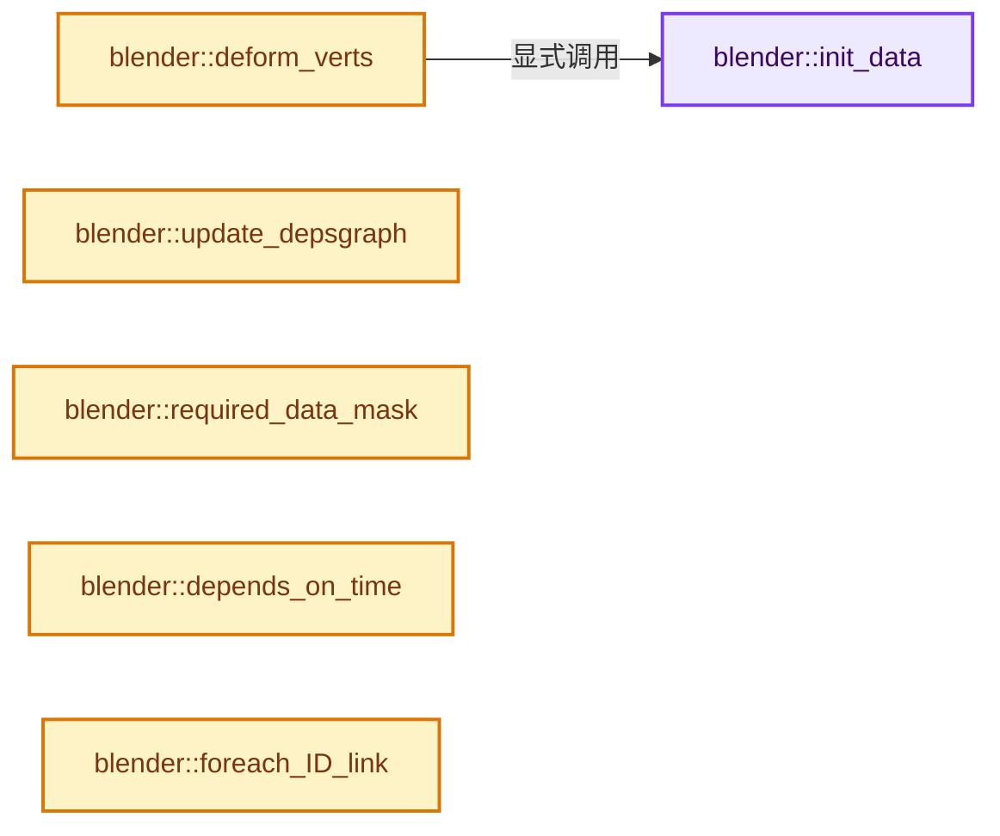
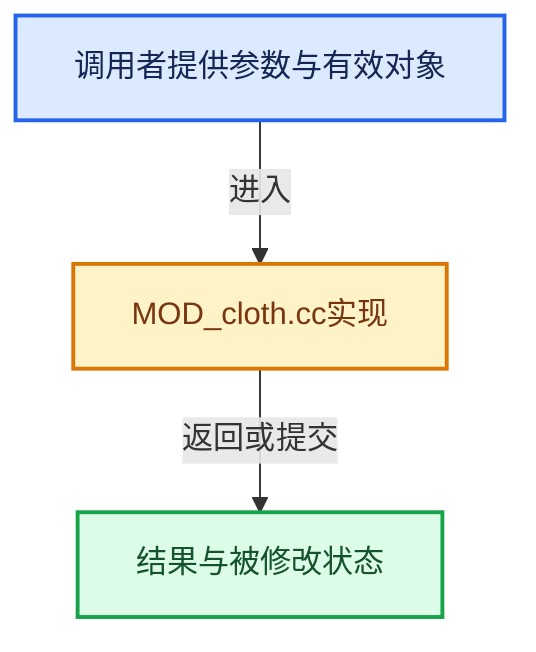

# 实现依赖专题：source/blender/modifiers/intern/MOD_cloth.cc

[实现依赖导航](../../../README.md) · [符号索引](../../../../00-课程指南/02-源码与提交索引/符号依赖与实现索引.md)

本专题从正文实际调用进入，集中保存共享实现。函数有稳定锚点，可从调用处直接跳到对应完整函数；递归与互相调用通过回链组织。

## 本文件的实现关系






## 完整成员与函数实现

<a id="f-2cc6a0bec5491812"></a>

### `blender::init_data`

实现位置：[source/blender/modifiers/intern/MOD_cloth.cc](../../../../../../../../source/blender/modifiers/intern/MOD_cloth.cc) · L48—L70。

接口参数：

- `ModifierData *md`

**教学注释版**

<!-- annotated:8d42cd741b947a -->

```cpp
static void init_data(ModifierData *md)
{
  ClothModifierData *clmd = reinterpret_cast<ClothModifierData *>(md);

  INIT_DEFAULT_STRUCT_AFTER(clmd, modifier);
  clmd->sim_parms = MEM_new<ClothSimSettings>(__func__);
  clmd->coll_parms = MEM_new<ClothCollSettings>(__func__);

  clmd->point_cache = BKE_ptcache_add(&clmd->ptcaches);

  /* check for alloc failing */
  if (!clmd->sim_parms || !clmd->coll_parms || !clmd->point_cache) {
    return;
  }

  if (!clmd->sim_parms->effector_weights) {
    clmd->sim_parms->effector_weights = BKE_effector_add_weights(nullptr);
  }

  if (clmd->point_cache) {
    clmd->point_cache->step = 1;
  }
}
```

<details>
<summary>核对原始源码：source/blender/modifiers/intern/MOD_cloth.cc · L48—L70</summary>

<!-- original:8d42cd741b947a:source/blender/modifiers/intern/MOD_cloth.cc:48:70 -->

```cpp
static void init_data(ModifierData *md)
{
  ClothModifierData *clmd = reinterpret_cast<ClothModifierData *>(md);

  INIT_DEFAULT_STRUCT_AFTER(clmd, modifier);
  clmd->sim_parms = MEM_new<ClothSimSettings>(__func__);
  clmd->coll_parms = MEM_new<ClothCollSettings>(__func__);

  clmd->point_cache = BKE_ptcache_add(&clmd->ptcaches);

  /* check for alloc failing */
  if (!clmd->sim_parms || !clmd->coll_parms || !clmd->point_cache) {
    return;
  }

  if (!clmd->sim_parms->effector_weights) {
    clmd->sim_parms->effector_weights = BKE_effector_add_weights(nullptr);
  }

  if (clmd->point_cache) {
    clmd->point_cache->step = 1;
  }
}
```

</details>

**沿实际写入检查状态**

- `clmd->sim_parms = MEM_new<ClothSimSettings>(__func__);`
- `clmd->coll_parms = MEM_new<ClothCollSettings>(__func__);`
- `clmd->point_cache = BKE_ptcache_add(&clmd->ptcaches);`
- `clmd->sim_parms->effector_weights = BKE_effector_add_weights(nullptr);`
- `clmd->point_cache->step = 1;`

**继续追踪实现**

- `INIT_DEFAULT_STRUCT_AFTER` → [INIT_DEFAULT_STRUCT_AFTER · L422](../../../01-BLI基础库/BLI_utildefines.hh.md#m-30b1f74075b1)。宏定义由构建条件选择。
- `MEM_new<ClothSimSettings>` → [MEM_new · L351](../../../07-Intern运行时与平台/guardedalloc/MEM_guardedalloc.h.md#f-115f9b6784f89912)。
- `MEM_new<ClothCollSettings>` → [MEM_new · L351](../../../07-Intern运行时与平台/guardedalloc/MEM_guardedalloc.h.md#f-115f9b6784f89912)。
- `BKE_ptcache_add` → [blender::BKE_ptcache_add · L2946](../../../02-BKE几何与数据/intern/pointcache.cc.md#f-38defead0f419693)。
- `BKE_effector_add_weights` → [blender::BKE_effector_add_weights · L63](../../../02-BKE几何与数据/intern/effect.cc.md#f-ce184d2946a57299)。

<a id="f-3cf7020249825dc5"></a>

### `blender::deform_verts`

实现位置：[source/blender/modifiers/intern/MOD_cloth.cc](../../../../../../../../source/blender/modifiers/intern/MOD_cloth.cc) · L72—L119。

接口参数：

- `ModifierData *md`
- `const ModifierEvalContext *ctx`
- `Mesh *mesh`
- `MutableSpan<float3> positions`

**教学注释版**

<!-- annotated:c1f7bb838620fb -->

```cpp
static void deform_verts(ModifierData *md,
                         const ModifierEvalContext *ctx,
                         Mesh *mesh,
                         MutableSpan<float3> positions)
{
  ClothModifierData *clmd = reinterpret_cast<ClothModifierData *>(md);
  Scene *scene = DEG_get_evaluated_scene(ctx->depsgraph);

  /* check for alloc failing */
  if (!clmd->sim_parms || !clmd->coll_parms) {
    init_data(md);

    if (!clmd->sim_parms || !clmd->coll_parms) {
      return;
    }
  }

  /* TODO(sergey): For now it actually duplicates logic from mesh_data_update.cc
   * and needs some more generic solution. But starting experimenting with
   * this so close to the release is not that nice..
   *
   * Also hopefully new cloth system will arrive soon..
   */
  if (mesh == nullptr && clmd->sim_parms->shapekey_rest) {
    KeyBlock *kb = BKE_keyblock_find_by_index(BKE_key_from_object(ctx->object),
                                              clmd->sim_parms->shapekey_rest);
    if (kb && kb->data != nullptr) {
      float (*layerorco)[3] = static_cast<float (*)[3]>(
          CustomData_get_layer_for_write(&mesh->vert_data, CD_CLOTH_ORCO, mesh->verts_num));
      if (!layerorco) {
        layerorco = static_cast<float (*)[3]>(CustomData_add_layer(
            &mesh->vert_data, CD_CLOTH_ORCO, CD_SET_DEFAULT, mesh->verts_num));
      }

      // [讲解] memcpy：复制字节，源与目标不应重叠。类型生命周期、对齐和可复制表示须由调用者证明，不是任意对象的复制构造。
      memcpy(layerorco, kb->data, sizeof(float[3]) * positions.size());
    }
  }

  mesh->vert_positions_for_write().copy_from(positions);
  mesh->tag_positions_changed();

  clothModifier_do(clmd,
                   ctx->depsgraph,
                   scene,
                   ctx->object,
                   mesh,
                   // [讲解] positions.data：返回借用范围的地址。
                   reinterpret_cast<float (*)[3]>(positions.data()));
}
```

<details>
<summary>核对原始源码：source/blender/modifiers/intern/MOD_cloth.cc · L72—L119</summary>

<!-- original:c1f7bb838620fb:source/blender/modifiers/intern/MOD_cloth.cc:72:119 -->

```cpp
static void deform_verts(ModifierData *md,
                         const ModifierEvalContext *ctx,
                         Mesh *mesh,
                         MutableSpan<float3> positions)
{
  ClothModifierData *clmd = reinterpret_cast<ClothModifierData *>(md);
  Scene *scene = DEG_get_evaluated_scene(ctx->depsgraph);

  /* check for alloc failing */
  if (!clmd->sim_parms || !clmd->coll_parms) {
    init_data(md);

    if (!clmd->sim_parms || !clmd->coll_parms) {
      return;
    }
  }

  /* TODO(sergey): For now it actually duplicates logic from mesh_data_update.cc
   * and needs some more generic solution. But starting experimenting with
   * this so close to the release is not that nice..
   *
   * Also hopefully new cloth system will arrive soon..
   */
  if (mesh == nullptr && clmd->sim_parms->shapekey_rest) {
    KeyBlock *kb = BKE_keyblock_find_by_index(BKE_key_from_object(ctx->object),
                                              clmd->sim_parms->shapekey_rest);
    if (kb && kb->data != nullptr) {
      float (*layerorco)[3] = static_cast<float (*)[3]>(
          CustomData_get_layer_for_write(&mesh->vert_data, CD_CLOTH_ORCO, mesh->verts_num));
      if (!layerorco) {
        layerorco = static_cast<float (*)[3]>(CustomData_add_layer(
            &mesh->vert_data, CD_CLOTH_ORCO, CD_SET_DEFAULT, mesh->verts_num));
      }

      memcpy(layerorco, kb->data, sizeof(float[3]) * positions.size());
    }
  }

  mesh->vert_positions_for_write().copy_from(positions);
  mesh->tag_positions_changed();

  clothModifier_do(clmd,
                   ctx->depsgraph,
                   scene,
                   ctx->object,
                   mesh,
                   reinterpret_cast<float (*)[3]>(positions.data()));
}
```

</details>

**沿实际写入检查状态**

- `layerorco = static_cast<float (*)[3]>(CustomData_add_layer(`

**继续追踪实现**

- `DEG_get_evaluated_scene` → [blender::DEG_get_evaluated_scene · L212](../../../06-Depsgraph依赖图/intern/depsgraph_query.cc.md#f-be7729d26a71d3fd)。
- `init_data` → [blender::init_data · L48](MOD_cloth.cc.md#f-2cc6a0bec5491812)。
- `BKE_keyblock_find_by_index` → [blender::BKE_keyblock_find_by_index · L1425](../../../02-BKE几何与数据/intern/key.cc.md#f-0693ed595207ecc7)。
- `BKE_key_from_object` → [blender::BKE_key_from_object · L1311](../../../02-BKE几何与数据/intern/key.cc.md#f-c191304ae3a652d6)。
- `CustomData_get_layer_for_write` → [blender::CustomData_get_layer_for_write · L3318](../../../02-BKE几何与数据/intern/customdata.cc.md#f-6af158905e2c1274)。
- `CustomData_add_layer` → [blender::CustomData_add_layer · L2851](../../../02-BKE几何与数据/intern/customdata.cc.md#f-4c7988e825541059)。
- `memcpy` → [外部契约](https://eel.is/c++draft/cstring.syn)：复制字节，源与目标不应重叠。类型生命周期、对齐和可复制表示须由调用者证明，不是任意对象的复制构造。
- `positions.size` → [blender::MutableSpan::size · L499](../../../../01-基础容器与现代CPP/06-MutableSpan可写视图.md#f-1de6a66839c304a8)；[blender::gpu::shader::parser::MutableSpan::size · L87](../../gpu/shader_tool/utils.hh.md#f-5e684af6ee7990e9)。同名重载需按实参类型选择。
- `mesh->vert_positions_for_write().copy_from` → [调用协议](../../../../00-课程指南/01-路线与规范/模板宏与动态分派协议.md)：接收对象类型依赖auto、返回值或模板实例；不按同名猜测目标。调用位置L110。
- `mesh->vert_positions_for_write` → [Mesh::vert_positions_for_write · L1199](../../../../05-几何存储与拓扑映射/03-MPoly迁移与兼容.md#f-ae8d77205112d843)。
- `mesh->tag_positions_changed` → [blender::Mesh::tag_positions_changed · L407](../../../../06-隐式共享与缓存系统/10-局部更新与失效修复.md#f-90e852663d44ad53)。
- `clothModifier_do` → [blender::clothModifier_do · L327](../../../02-BKE几何与数据/intern/cloth.cc.md#f-187ebaf7bab8982f)。
- `positions.data` → [blender::MutableSpan::data · L545](../../../../01-基础容器与现代CPP/06-MutableSpan可写视图.md#f-eb45a6e4d8211efd)；[blender::gpu::shader::parser::MutableSpan::data · L82](../../gpu/shader_tool/utils.hh.md#f-ad0a09cec9741c65)。同名重载需按实参类型选择。

<a id="f-d787b79293fff917"></a>

### `blender::update_depsgraph`

实现位置：[source/blender/modifiers/intern/MOD_cloth.cc](../../../../../../../../source/blender/modifiers/intern/MOD_cloth.cc) · L121—L137。

接口参数：

- `ModifierData *md`
- `const ModifierUpdateDepsgraphContext *ctx`

**教学注释版**

<!-- annotated:5205b0360de4a1 -->

```cpp
static void update_depsgraph(ModifierData *md, const ModifierUpdateDepsgraphContext *ctx)
{
  ClothModifierData *clmd = reinterpret_cast<ClothModifierData *>(md);
  if (clmd != nullptr) {
    if (clmd->coll_parms->flags & CLOTH_COLLSETTINGS_FLAG_ENABLED) {
      DEG_add_collision_relations(ctx->node,
                                  ctx->object,
                                  clmd->coll_parms->group,
                                  eModifierType_Collision,
                                  nullptr,
                                  "Cloth Collision");
    }
    DEG_add_forcefield_relations(
        ctx->node, ctx->object, clmd->sim_parms->effector_weights, true, 0, "Cloth Field");
  }
  DEG_add_depends_on_transform_relation(ctx->node, "Cloth Modifier");
}
```

<details>
<summary>核对原始源码：source/blender/modifiers/intern/MOD_cloth.cc · L121—L137</summary>

<!-- original:5205b0360de4a1:source/blender/modifiers/intern/MOD_cloth.cc:121:137 -->

```cpp
static void update_depsgraph(ModifierData *md, const ModifierUpdateDepsgraphContext *ctx)
{
  ClothModifierData *clmd = reinterpret_cast<ClothModifierData *>(md);
  if (clmd != nullptr) {
    if (clmd->coll_parms->flags & CLOTH_COLLSETTINGS_FLAG_ENABLED) {
      DEG_add_collision_relations(ctx->node,
                                  ctx->object,
                                  clmd->coll_parms->group,
                                  eModifierType_Collision,
                                  nullptr,
                                  "Cloth Collision");
    }
    DEG_add_forcefield_relations(
        ctx->node, ctx->object, clmd->sim_parms->effector_weights, true, 0, "Cloth Field");
  }
  DEG_add_depends_on_transform_relation(ctx->node, "Cloth Modifier");
}
```

</details>

**继续追踪实现**

- `DEG_add_collision_relations` → [blender::DEG_add_collision_relations · L112](../../../06-Depsgraph依赖图/intern/depsgraph_physics.cc.md#f-a8a23fb36db5feb5)。
- `DEG_add_forcefield_relations` → [blender::DEG_add_forcefield_relations · L203](../../../06-Depsgraph依赖图/intern/depsgraph_physics.cc.md#f-1a87e7be20724278)。
- `DEG_add_depends_on_transform_relation` → [blender::DEG_add_depends_on_transform_relation · L240](../../../06-Depsgraph依赖图/intern/depsgraph_build.cc.md#f-47c32a354defa20d)。

<a id="f-09d56e8404c6885b"></a>

### `blender::required_data_mask`

实现位置：[source/blender/modifiers/intern/MOD_cloth.cc](../../../../../../../../source/blender/modifiers/intern/MOD_cloth.cc) · L139—L150。

接口参数：

- `ModifierData *md`
- `CustomData_MeshMasks *r_cddata_masks`

**教学注释版**

<!-- annotated:cb9dfc88e6f5d3 -->

```cpp
static void required_data_mask(ModifierData *md, CustomData_MeshMasks *r_cddata_masks)
{
  ClothModifierData *clmd = reinterpret_cast<ClothModifierData *>(md);

  if (cloth_uses_vgroup(clmd)) {
    r_cddata_masks->vmask |= CD_MASK_MDEFORMVERT;
  }

  if (clmd->sim_parms->shapekey_rest != 0) {
    r_cddata_masks->vmask |= CD_MASK_CLOTH_ORCO;
  }
}
```

<details>
<summary>核对原始源码：source/blender/modifiers/intern/MOD_cloth.cc · L139—L150</summary>

<!-- original:cb9dfc88e6f5d3:source/blender/modifiers/intern/MOD_cloth.cc:139:150 -->

```cpp
static void required_data_mask(ModifierData *md, CustomData_MeshMasks *r_cddata_masks)
{
  ClothModifierData *clmd = reinterpret_cast<ClothModifierData *>(md);

  if (cloth_uses_vgroup(clmd)) {
    r_cddata_masks->vmask |= CD_MASK_MDEFORMVERT;
  }

  if (clmd->sim_parms->shapekey_rest != 0) {
    r_cddata_masks->vmask |= CD_MASK_CLOTH_ORCO;
  }
}
```

</details>

**沿实际写入检查状态**

- `r_cddata_masks->vmask |= CD_MASK_MDEFORMVERT;`
- `r_cddata_masks->vmask |= CD_MASK_CLOTH_ORCO;`

**继续追踪实现**

- `cloth_uses_vgroup` → [blender::cloth_uses_vgroup · L599](../../../02-BKE几何与数据/intern/cloth.cc.md#f-ecde1d0a422584e4)。

<a id="f-c6403bc2d5884a87"></a>

### `blender::depends_on_time`

实现位置：[source/blender/modifiers/intern/MOD_cloth.cc](../../../../../../../../source/blender/modifiers/intern/MOD_cloth.cc) · L193—L196。

接口参数：

- `Scene *`
- `ModifierData *`

**教学注释版**

<!-- annotated:7c39a83ba9282f -->

```cpp
static bool depends_on_time(Scene * /*scene*/, ModifierData * /*md*/)
{
  return true;
}
```

<details>
<summary>核对原始源码：source/blender/modifiers/intern/MOD_cloth.cc · L193—L196</summary>

<!-- original:7c39a83ba9282f:source/blender/modifiers/intern/MOD_cloth.cc:193:196 -->

```cpp
static bool depends_on_time(Scene * /*scene*/, ModifierData * /*md*/)
{
  return true;
}
```

</details>

**结果出口**

- `return true;`

**继续追踪实现**

本实现没有需要继续展开的显式调用；检查返回表达式、对象转换和调用者前置条件。

<a id="f-a5fd681b7408cce9"></a>

### `blender::foreach_ID_link`

实现位置：[source/blender/modifiers/intern/MOD_cloth.cc](../../../../../../../../source/blender/modifiers/intern/MOD_cloth.cc) · L237—L251。

接口参数：

- `ModifierData *md`
- `Object *ob`
- `IDWalkFunc walk`
- `void *user_data`

**教学注释版**

<!-- annotated:93d349d76dd21f -->

```cpp
static void foreach_ID_link(ModifierData *md, Object *ob, IDWalkFunc walk, void *user_data)
{
  ClothModifierData *clmd = reinterpret_cast<ClothModifierData *>(md);

  if (clmd->coll_parms) {
    walk(user_data, ob, reinterpret_cast<ID **>(&clmd->coll_parms->group), IDWALK_CB_NOP);
  }

  if (clmd->sim_parms && clmd->sim_parms->effector_weights) {
    walk(user_data,
         ob,
         reinterpret_cast<ID **>(&clmd->sim_parms->effector_weights->group),
         IDWALK_CB_USER);
  }
}
```

<details>
<summary>核对原始源码：source/blender/modifiers/intern/MOD_cloth.cc · L237—L251</summary>

<!-- original:93d349d76dd21f:source/blender/modifiers/intern/MOD_cloth.cc:237:251 -->

```cpp
static void foreach_ID_link(ModifierData *md, Object *ob, IDWalkFunc walk, void *user_data)
{
  ClothModifierData *clmd = reinterpret_cast<ClothModifierData *>(md);

  if (clmd->coll_parms) {
    walk(user_data, ob, reinterpret_cast<ID **>(&clmd->coll_parms->group), IDWALK_CB_NOP);
  }

  if (clmd->sim_parms && clmd->sim_parms->effector_weights) {
    walk(user_data,
         ob,
         reinterpret_cast<ID **>(&clmd->sim_parms->effector_weights->group),
         IDWALK_CB_USER);
  }
}
```

</details>

**继续追踪实现**

- `walk` → [调用协议](../../../../00-课程指南/01-路线与规范/模板宏与动态分派协议.md)：局部可调用对象，须结合其初始化与捕获环境。调用位置L242。
