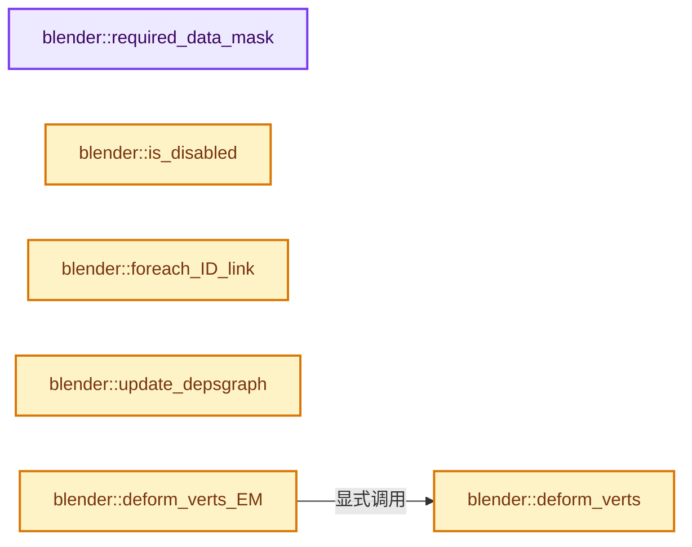
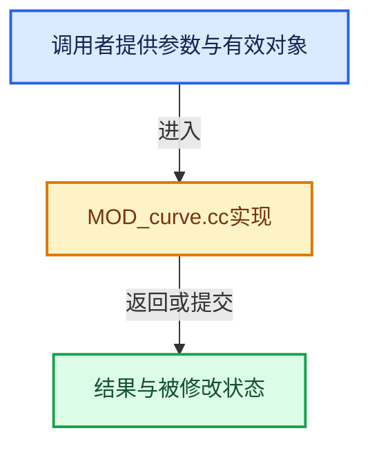

# 实现依赖专题：source/blender/modifiers/intern/MOD_curve.cc

[实现依赖导航](../../../README.md) · [符号索引](../../../../00-课程指南/02-源码与提交索引/符号依赖与实现索引.md)

本专题从正文实际调用进入，集中保存共享实现。函数有稳定锚点，可从调用处直接跳到对应完整函数；递归与互相调用通过回链组织。

## 本文件的实现关系






## 完整成员与函数实现

<a id="f-3c5df6b8b8be0fb3"></a>

### `blender::required_data_mask`

实现位置：[source/blender/modifiers/intern/MOD_curve.cc](../../../../../../../../source/blender/modifiers/intern/MOD_curve.cc) · L45—L53。

接口参数：

- `ModifierData *md`
- `CustomData_MeshMasks *r_cddata_masks`

**教学注释版**

<!-- annotated:668d31dfdb9335 -->

```cpp
static void required_data_mask(ModifierData *md, CustomData_MeshMasks *r_cddata_masks)
{
  CurveModifierData *cmd = reinterpret_cast<CurveModifierData *>(md);

  /* Ask for vertex-groups if we need them. */
  if (cmd->name[0] != '\0') {
    r_cddata_masks->vmask |= CD_MASK_MDEFORMVERT;
  }
}
```

<details>
<summary>核对原始源码：source/blender/modifiers/intern/MOD_curve.cc · L45—L53</summary>

<!-- original:668d31dfdb9335:source/blender/modifiers/intern/MOD_curve.cc:45:53 -->

```cpp
static void required_data_mask(ModifierData *md, CustomData_MeshMasks *r_cddata_masks)
{
  CurveModifierData *cmd = reinterpret_cast<CurveModifierData *>(md);

  /* Ask for vertex-groups if we need them. */
  if (cmd->name[0] != '\0') {
    r_cddata_masks->vmask |= CD_MASK_MDEFORMVERT;
  }
}
```

</details>

**沿实际写入检查状态**

- `r_cddata_masks->vmask |= CD_MASK_MDEFORMVERT;`

**继续追踪实现**

本实现没有需要继续展开的显式调用；检查返回表达式、对象转换和调用者前置条件。

<a id="f-7e7d110d02c4185d"></a>

### `blender::is_disabled`

实现位置：[source/blender/modifiers/intern/MOD_curve.cc](../../../../../../../../source/blender/modifiers/intern/MOD_curve.cc) · L55—L65。

接口参数：

- `const Scene *`
- `ModifierData *md`
- `bool`

**教学注释版**

<!-- annotated:725de0d17daaa6 -->

```cpp
static bool is_disabled(const Scene * /*scene*/, ModifierData *md, bool /*use_render_params*/)
{
  CurveModifierData *cmd = reinterpret_cast<CurveModifierData *>(md);

  /* The object type check is only needed here in case we have a placeholder
   * object assigned (because the library containing the curve is missing).
   *
   * In other cases it should be impossible to have a type mismatch.
   */
  return !cmd->object || cmd->object->type != OB_CURVES_LEGACY;
}
```

<details>
<summary>核对原始源码：source/blender/modifiers/intern/MOD_curve.cc · L55—L65</summary>

<!-- original:725de0d17daaa6:source/blender/modifiers/intern/MOD_curve.cc:55:65 -->

```cpp
static bool is_disabled(const Scene * /*scene*/, ModifierData *md, bool /*use_render_params*/)
{
  CurveModifierData *cmd = reinterpret_cast<CurveModifierData *>(md);

  /* The object type check is only needed here in case we have a placeholder
   * object assigned (because the library containing the curve is missing).
   *
   * In other cases it should be impossible to have a type mismatch.
   */
  return !cmd->object || cmd->object->type != OB_CURVES_LEGACY;
}
```

</details>

**结果出口**

- `return !cmd->object || cmd->object->type != OB_CURVES_LEGACY;`

**继续追踪实现**

本实现没有需要继续展开的显式调用；检查返回表达式、对象转换和调用者前置条件。

<a id="f-fcfe4735b430f223"></a>

### `blender::foreach_ID_link`

实现位置：[source/blender/modifiers/intern/MOD_curve.cc](../../../../../../../../source/blender/modifiers/intern/MOD_curve.cc) · L67—L72。

接口参数：

- `ModifierData *md`
- `Object *ob`
- `IDWalkFunc walk`
- `void *user_data`

**教学注释版**

<!-- annotated:de46c97115a8aa -->

```cpp
static void foreach_ID_link(ModifierData *md, Object *ob, IDWalkFunc walk, void *user_data)
{
  CurveModifierData *cmd = reinterpret_cast<CurveModifierData *>(md);

  walk(user_data, ob, reinterpret_cast<ID **>(&cmd->object), IDWALK_CB_NOP);
}
```

<details>
<summary>核对原始源码：source/blender/modifiers/intern/MOD_curve.cc · L67—L72</summary>

<!-- original:de46c97115a8aa:source/blender/modifiers/intern/MOD_curve.cc:67:72 -->

```cpp
static void foreach_ID_link(ModifierData *md, Object *ob, IDWalkFunc walk, void *user_data)
{
  CurveModifierData *cmd = reinterpret_cast<CurveModifierData *>(md);

  walk(user_data, ob, reinterpret_cast<ID **>(&cmd->object), IDWALK_CB_NOP);
}
```

</details>

**继续追踪实现**

- `walk` → [调用协议](../../../../00-课程指南/01-路线与规范/模板宏与动态分派协议.md)：局部可调用对象，须结合其初始化与捕获环境。调用位置L71。

<a id="f-40ff17e7df2cd09f"></a>

### `blender::update_depsgraph`

实现位置：[source/blender/modifiers/intern/MOD_curve.cc](../../../../../../../../source/blender/modifiers/intern/MOD_curve.cc) · L74—L90。

接口参数：

- `ModifierData *md`
- `const ModifierUpdateDepsgraphContext *ctx`

**教学注释版**

<!-- annotated:769b9dfae34f36 -->

```cpp
static void update_depsgraph(ModifierData *md, const ModifierUpdateDepsgraphContext *ctx)
{
  CurveModifierData *cmd = reinterpret_cast<CurveModifierData *>(md);
  if (cmd->object != nullptr) {
    /* TODO(sergey): Need to do the same eval_flags trick for path
     * as happening in legacy depsgraph callback.
     */
    /* TODO(sergey): Currently path is evaluated as a part of modifier stack,
     * might be changed in the future.
     */
    DEG_add_object_relation(ctx->node, cmd->object, DEG_OB_COMP_TRANSFORM, "Curve Modifier");
    DEG_add_object_relation(ctx->node, cmd->object, DEG_OB_COMP_GEOMETRY, "Curve Modifier");
    DEG_add_special_eval_flag(ctx->node, &cmd->object->id, DAG_EVAL_NEED_CURVE_PATH);
  }

  DEG_add_depends_on_transform_relation(ctx->node, "Curve Modifier");
}
```

<details>
<summary>核对原始源码：source/blender/modifiers/intern/MOD_curve.cc · L74—L90</summary>

<!-- original:769b9dfae34f36:source/blender/modifiers/intern/MOD_curve.cc:74:90 -->

```cpp
static void update_depsgraph(ModifierData *md, const ModifierUpdateDepsgraphContext *ctx)
{
  CurveModifierData *cmd = reinterpret_cast<CurveModifierData *>(md);
  if (cmd->object != nullptr) {
    /* TODO(sergey): Need to do the same eval_flags trick for path
     * as happening in legacy depsgraph callback.
     */
    /* TODO(sergey): Currently path is evaluated as a part of modifier stack,
     * might be changed in the future.
     */
    DEG_add_object_relation(ctx->node, cmd->object, DEG_OB_COMP_TRANSFORM, "Curve Modifier");
    DEG_add_object_relation(ctx->node, cmd->object, DEG_OB_COMP_GEOMETRY, "Curve Modifier");
    DEG_add_special_eval_flag(ctx->node, &cmd->object->id, DAG_EVAL_NEED_CURVE_PATH);
  }

  DEG_add_depends_on_transform_relation(ctx->node, "Curve Modifier");
}
```

</details>

**继续追踪实现**

- `DEG_add_object_relation` → [blender::DEG_add_object_relation · L123](../../../06-Depsgraph依赖图/intern/depsgraph_build.cc.md#f-f570cffae97e273c)。
- `DEG_add_special_eval_flag` → [blender::DEG_add_special_eval_flag · L253](../../../06-Depsgraph依赖图/intern/depsgraph_build.cc.md#f-d68e9c73ded33dd2)。
- `DEG_add_depends_on_transform_relation` → [blender::DEG_add_depends_on_transform_relation · L240](../../../06-Depsgraph依赖图/intern/depsgraph_build.cc.md#f-47c32a354defa20d)。

<a id="f-d99984e6cde8d521"></a>

### `blender::deform_verts`

实现位置：[source/blender/modifiers/intern/MOD_curve.cc](../../../../../../../../source/blender/modifiers/intern/MOD_curve.cc) · L92—L114。

接口参数：

- `ModifierData *md`
- `const ModifierEvalContext *ctx`
- `Mesh *mesh`
- `MutableSpan<float3> positions`

**教学注释版**

<!-- annotated:ddf2a5d503046a -->

```cpp
static void deform_verts(ModifierData *md,
                         const ModifierEvalContext *ctx,
                         Mesh *mesh,
                         MutableSpan<float3> positions)
{
  CurveModifierData *cmd = reinterpret_cast<CurveModifierData *>(md);

  const MDeformVert *dvert = nullptr;
  int defgrp_index = -1;
  MOD_get_vgroup(ctx->object, mesh, cmd->name, &dvert, &defgrp_index);

  /* Silly that defaxis and BKE_curve_deform_coords are off by 1
   * but leave for now to save having to call do_versions */
  const int defaxis = std::clamp(cmd->defaxis - 1, 0, 5);
  BKE_curve_deform_coords(cmd->object,
                          ctx->object,
                          // [讲解] positions.data：返回借用范围的地址。
                          reinterpret_cast<float (*)[3]>(positions.data()),
                          // [讲解] positions.size：查询视图长度或生成对应有效索引区间。
                          positions.size(),
                          dvert,
                          defgrp_index,
                          cmd->flag,
                          defaxis);
}
```

<details>
<summary>核对原始源码：source/blender/modifiers/intern/MOD_curve.cc · L92—L114</summary>

<!-- original:ddf2a5d503046a:source/blender/modifiers/intern/MOD_curve.cc:92:114 -->

```cpp
static void deform_verts(ModifierData *md,
                         const ModifierEvalContext *ctx,
                         Mesh *mesh,
                         MutableSpan<float3> positions)
{
  CurveModifierData *cmd = reinterpret_cast<CurveModifierData *>(md);

  const MDeformVert *dvert = nullptr;
  int defgrp_index = -1;
  MOD_get_vgroup(ctx->object, mesh, cmd->name, &dvert, &defgrp_index);

  /* Silly that defaxis and BKE_curve_deform_coords are off by 1
   * but leave for now to save having to call do_versions */
  const int defaxis = std::clamp(cmd->defaxis - 1, 0, 5);
  BKE_curve_deform_coords(cmd->object,
                          ctx->object,
                          reinterpret_cast<float (*)[3]>(positions.data()),
                          positions.size(),
                          dvert,
                          defgrp_index,
                          cmd->flag,
                          defaxis);
}
```

</details>

**继续追踪实现**

- `MOD_get_vgroup` → [blender::MOD_get_vgroup · L158](MOD_util.cc.md#f-f461611d86b94405)。
- `std::clamp` → [外部契约](https://eel.is/c++draft/)：这个边界按实际表达式及所属类型核对参数、返回值、寿命与失败行为。这里提供接口入口，不声称已解释该第三方版本的内部实现。
- `BKE_curve_deform_coords` → [blender::BKE_curve_deform_coords · L370](../../../02-BKE几何与数据/intern/curve_deform.cc.md#f-b6299dde8180fd5e)。
- `positions.data` → [blender::MutableSpan::data · L545](../../../../01-基础容器与现代CPP/06-MutableSpan可写视图.md#f-eb45a6e4d8211efd)；[blender::gpu::shader::parser::MutableSpan::data · L82](../../gpu/shader_tool/utils.hh.md#f-ad0a09cec9741c65)。同名重载需按实参类型选择。
- `positions.size` → [blender::MutableSpan::size · L499](../../../../01-基础容器与现代CPP/06-MutableSpan可写视图.md#f-1de6a66839c304a8)；[blender::gpu::shader::parser::MutableSpan::size · L87](../../gpu/shader_tool/utils.hh.md#f-5e684af6ee7990e9)。同名重载需按实参类型选择。

<a id="f-fe2775b9d313805f"></a>

### `blender::deform_verts_EM`

实现位置：[source/blender/modifiers/intern/MOD_curve.cc](../../../../../../../../source/blender/modifiers/intern/MOD_curve.cc) · L116—L159。

接口参数：

- `ModifierData *md`
- `const ModifierEvalContext *ctx`
- `const BMEditMesh *em`
- `Mesh *mesh`
- `MutableSpan<float3> positions`

**教学注释版**

<!-- annotated:7d0d4cef255666 -->

```cpp
static void deform_verts_EM(ModifierData *md,
                            const ModifierEvalContext *ctx,
                            const BMEditMesh *em,
                            Mesh *mesh,
                            MutableSpan<float3> positions)
{
  if (mesh->runtime->wrapper_type == ME_WRAPPER_TYPE_MDATA) {
    deform_verts(md, ctx, mesh, positions);
    return;
  }

  CurveModifierData *cmd = reinterpret_cast<CurveModifierData *>(md);
  bool use_dverts = false;
  int defgrp_index = -1;

  if (ctx->object->type == OB_MESH && cmd->name[0] != '\0') {
    defgrp_index = BKE_object_defgroup_name_index(ctx->object, cmd->name);
    if (defgrp_index != -1) {
      use_dverts = true;
    }
  }

  const int defaxis = std::clamp(cmd->defaxis - 1, 0, 5);
  if (use_dverts) {
    BKE_curve_deform_coords_with_editmesh(cmd->object,
                                          ctx->object,
                                          // [讲解] positions.data：返回借用范围的地址。
                                          reinterpret_cast<float (*)[3]>(positions.data()),
                                          // [讲解] positions.size：查询视图长度或生成对应有效索引区间。
                                          positions.size(),
                                          defgrp_index,
                                          cmd->flag,
                                          defaxis,
                                          em);
  }
  else {
    BKE_curve_deform_coords(cmd->object,
                            ctx->object,
                            reinterpret_cast<float (*)[3]>(positions.data()),
                            positions.size(),
                            nullptr,
                            defgrp_index,
                            cmd->flag,
                            defaxis);
  }
}
```

<details>
<summary>核对原始源码：source/blender/modifiers/intern/MOD_curve.cc · L116—L159</summary>

<!-- original:7d0d4cef255666:source/blender/modifiers/intern/MOD_curve.cc:116:159 -->

```cpp
static void deform_verts_EM(ModifierData *md,
                            const ModifierEvalContext *ctx,
                            const BMEditMesh *em,
                            Mesh *mesh,
                            MutableSpan<float3> positions)
{
  if (mesh->runtime->wrapper_type == ME_WRAPPER_TYPE_MDATA) {
    deform_verts(md, ctx, mesh, positions);
    return;
  }

  CurveModifierData *cmd = reinterpret_cast<CurveModifierData *>(md);
  bool use_dverts = false;
  int defgrp_index = -1;

  if (ctx->object->type == OB_MESH && cmd->name[0] != '\0') {
    defgrp_index = BKE_object_defgroup_name_index(ctx->object, cmd->name);
    if (defgrp_index != -1) {
      use_dverts = true;
    }
  }

  const int defaxis = std::clamp(cmd->defaxis - 1, 0, 5);
  if (use_dverts) {
    BKE_curve_deform_coords_with_editmesh(cmd->object,
                                          ctx->object,
                                          reinterpret_cast<float (*)[3]>(positions.data()),
                                          positions.size(),
                                          defgrp_index,
                                          cmd->flag,
                                          defaxis,
                                          em);
  }
  else {
    BKE_curve_deform_coords(cmd->object,
                            ctx->object,
                            reinterpret_cast<float (*)[3]>(positions.data()),
                            positions.size(),
                            nullptr,
                            defgrp_index,
                            cmd->flag,
                            defaxis);
  }
}
```

</details>

**沿实际写入检查状态**

- `defgrp_index = BKE_object_defgroup_name_index(ctx->object, cmd->name);`
- `use_dverts = true;`

**继续追踪实现**

- `deform_verts` → [blender::deform_verts · L92](MOD_curve.cc.md#f-d99984e6cde8d521)。
- `BKE_object_defgroup_name_index` → [blender::BKE_object_defgroup_name_index · L597](../../../02-BKE几何与数据/intern/deform.cc.md#f-ad856e5bba5cd758)。
- `std::clamp` → [外部契约](https://eel.is/c++draft/)：这个边界按实际表达式及所属类型核对参数、返回值、寿命与失败行为。这里提供接口入口，不声称已解释该第三方版本的内部实现。
- `BKE_curve_deform_coords_with_editmesh` → [blender::BKE_curve_deform_coords_with_editmesh · L390](../../../02-BKE几何与数据/intern/curve_deform.cc.md#f-4cd1168f5d1b2448)。
- `positions.data` → [blender::MutableSpan::data · L545](../../../../01-基础容器与现代CPP/06-MutableSpan可写视图.md#f-eb45a6e4d8211efd)；[blender::gpu::shader::parser::MutableSpan::data · L82](../../gpu/shader_tool/utils.hh.md#f-ad0a09cec9741c65)。同名重载需按实参类型选择。
- `positions.size` → [blender::MutableSpan::size · L499](../../../../01-基础容器与现代CPP/06-MutableSpan可写视图.md#f-1de6a66839c304a8)；[blender::gpu::shader::parser::MutableSpan::size · L87](../../gpu/shader_tool/utils.hh.md#f-5e684af6ee7990e9)。同名重载需按实参类型选择。
- `BKE_curve_deform_coords` → [blender::BKE_curve_deform_coords · L370](../../../02-BKE几何与数据/intern/curve_deform.cc.md#f-b6299dde8180fd5e)。
