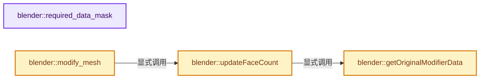
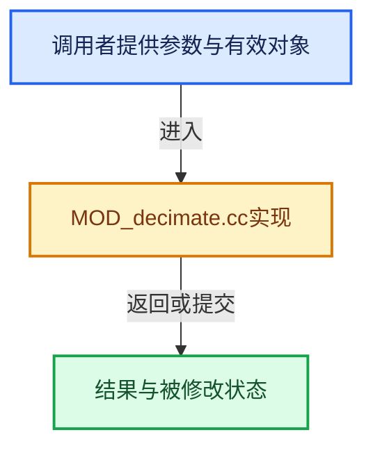

# 实现依赖专题：source/blender/modifiers/intern/MOD_decimate.cc

[实现依赖导航](../../../README.md) · [符号索引](../../../../00-课程指南/02-源码与提交索引/符号依赖与实现索引.md)

本专题从正文实际调用进入，集中保存共享实现。函数有稳定锚点，可从调用处直接跳到对应完整函数；递归与互相调用通过回链组织。

## 本文件的实现关系






## 完整成员与函数实现

<a id="f-cb372527c91a996f"></a>

### `blender::required_data_mask`

实现位置：[source/blender/modifiers/intern/MOD_decimate.cc](../../../../../../../../source/blender/modifiers/intern/MOD_decimate.cc) · L57—L65。

接口参数：

- `ModifierData *md`
- `CustomData_MeshMasks *r_cddata_masks`

**教学注释版**

<!-- annotated:c6edc58733e8ff -->

```cpp
static void required_data_mask(ModifierData *md, CustomData_MeshMasks *r_cddata_masks)
{
  DecimateModifierData *dmd = reinterpret_cast<DecimateModifierData *>(md);

  /* Ask for vertex-groups if we need them. */
  if (dmd->defgrp_name[0] != '\0' && (dmd->defgrp_factor > 0.0f)) {
    r_cddata_masks->vmask |= CD_MASK_MDEFORMVERT;
  }
}
```

<details>
<summary>核对原始源码：source/blender/modifiers/intern/MOD_decimate.cc · L57—L65</summary>

<!-- original:c6edc58733e8ff:source/blender/modifiers/intern/MOD_decimate.cc:57:65 -->

```cpp
static void required_data_mask(ModifierData *md, CustomData_MeshMasks *r_cddata_masks)
{
  DecimateModifierData *dmd = reinterpret_cast<DecimateModifierData *>(md);

  /* Ask for vertex-groups if we need them. */
  if (dmd->defgrp_name[0] != '\0' && (dmd->defgrp_factor > 0.0f)) {
    r_cddata_masks->vmask |= CD_MASK_MDEFORMVERT;
  }
}
```

</details>

**沿实际写入检查状态**

- `r_cddata_masks->vmask |= CD_MASK_MDEFORMVERT;`

**继续追踪实现**

本实现没有需要继续展开的显式调用；检查返回表达式、对象转换和调用者前置条件。

<a id="f-0fdf84088e9e26ae"></a>

### `blender::getOriginalModifierData`

实现位置：[source/blender/modifiers/intern/MOD_decimate.cc](../../../../../../../../source/blender/modifiers/intern/MOD_decimate.cc) · L67—L73。

接口参数：

- `const DecimateModifierData *dmd`
- `const ModifierEvalContext *ctx`

**教学注释版**

<!-- annotated:7d484165f86ad0 -->

```cpp
static DecimateModifierData *getOriginalModifierData(const DecimateModifierData *dmd,
                                                     const ModifierEvalContext *ctx)
{
  Object *ob_orig = DEG_get_original(ctx->object);
  return reinterpret_cast<DecimateModifierData *>(
      BKE_modifiers_findby_name(ob_orig, dmd->modifier.name));
}
```

<details>
<summary>核对原始源码：source/blender/modifiers/intern/MOD_decimate.cc · L67—L73</summary>

<!-- original:7d484165f86ad0:source/blender/modifiers/intern/MOD_decimate.cc:67:73 -->

```cpp
static DecimateModifierData *getOriginalModifierData(const DecimateModifierData *dmd,
                                                     const ModifierEvalContext *ctx)
{
  Object *ob_orig = DEG_get_original(ctx->object);
  return reinterpret_cast<DecimateModifierData *>(
      BKE_modifiers_findby_name(ob_orig, dmd->modifier.name));
}
```

</details>

**结果出口**

- `return reinterpret_cast<DecimateModifierData *>(`

**继续追踪实现**

- `DEG_get_original` → [blender::DEG_get_original · L128](../../../06-Depsgraph依赖图/DEG_depsgraph_query.hh.md#f-79782eab82a92d86)；[blender::DEG_get_original · L134](../../../06-Depsgraph依赖图/DEG_depsgraph_query.hh.md#f-c032f06e9ef8f0cb)。同名重载需按实参类型选择。
- `BKE_modifiers_findby_name` → [blender::BKE_modifiers_findby_name · L266](../../../02-BKE几何与数据/intern/modifier.cc.md#f-cf0acdc5b2818add)。

<a id="f-8a04129aea6648ae"></a>

### `blender::updateFaceCount`

实现位置：[source/blender/modifiers/intern/MOD_decimate.cc](../../../../../../../../source/blender/modifiers/intern/MOD_decimate.cc) · L75—L86。

接口参数：

- `const ModifierEvalContext *ctx`
- `DecimateModifierData *dmd`
- `int face_count`

**教学注释版**

<!-- annotated:cbd94b4d7465f1 -->

```cpp
static void updateFaceCount(const ModifierEvalContext *ctx,
                            DecimateModifierData *dmd,
                            int face_count)
{
  dmd->face_count = face_count;

  if (DEG_is_active(ctx->depsgraph)) {
    /* update for display only */
    DecimateModifierData *dmd_orig = getOriginalModifierData(dmd, ctx);
    dmd_orig->face_count = face_count;
  }
}
```

<details>
<summary>核对原始源码：source/blender/modifiers/intern/MOD_decimate.cc · L75—L86</summary>

<!-- original:cbd94b4d7465f1:source/blender/modifiers/intern/MOD_decimate.cc:75:86 -->

```cpp
static void updateFaceCount(const ModifierEvalContext *ctx,
                            DecimateModifierData *dmd,
                            int face_count)
{
  dmd->face_count = face_count;

  if (DEG_is_active(ctx->depsgraph)) {
    /* update for display only */
    DecimateModifierData *dmd_orig = getOriginalModifierData(dmd, ctx);
    dmd_orig->face_count = face_count;
  }
}
```

</details>

**沿实际写入检查状态**

- `dmd->face_count = face_count;`
- `dmd_orig->face_count = face_count;`

**继续追踪实现**

- `DEG_is_active` → [blender::DEG_is_active · L324](../../../06-Depsgraph依赖图/intern/depsgraph.cc.md#f-d561ff15ce03c64a)。
- `getOriginalModifierData` → [blender::getOriginalModifierData · L67](MOD_decimate.cc.md#f-0fdf84088e9e26ae)。

<a id="f-496f30be359e788a"></a>

### `blender::modify_mesh`

实现位置：[source/blender/modifiers/intern/MOD_decimate.cc](../../../../../../../../source/blender/modifiers/intern/MOD_decimate.cc) · L88—L218。

接口参数：

- `ModifierData *md`
- `const ModifierEvalContext *ctx`
- `Mesh *meshData`

**教学注释版**

<!-- annotated:dad79bb45c08f5 -->

```cpp
static Mesh *modify_mesh(ModifierData *md, const ModifierEvalContext *ctx, Mesh *meshData)
{
  DecimateModifierData *dmd = reinterpret_cast<DecimateModifierData *>(md);
  Mesh *mesh = meshData, *result = nullptr;
  BMesh *bm;
  bool calc_vert_normal;
  bool calc_face_normal;
  float *vweights = nullptr;

#ifdef USE_TIMEIT
  TIMEIT_START(decim);
#endif

  /* Set up front so we don't show invalid info in the UI. */
  updateFaceCount(ctx, dmd, mesh->faces_num);

  switch (dmd->mode) {
    case MOD_DECIM_MODE_COLLAPSE:
      if (dmd->percent == 1.0f) {
        return mesh;
      }
      calc_face_normal = true;
      calc_vert_normal = true;
      break;
    case MOD_DECIM_MODE_UNSUBDIV:
      if (dmd->iter == 0) {
        return mesh;
      }
      calc_face_normal = false;
      calc_vert_normal = false;
      break;
    case MOD_DECIM_MODE_DISSOLVE:
      if (dmd->angle == 0.0f) {
        return mesh;
      }
      calc_face_normal = true;
      calc_vert_normal = false;
      break;
    default:
      return mesh;
  }

  if (dmd->face_count <= 3) {
    BKE_modifier_set_error(ctx->object, md, "Modifier requires more than 3 input faces");
    return mesh;
  }

  if (dmd->mode == MOD_DECIM_MODE_COLLAPSE) {
    if (dmd->defgrp_name[0] && (dmd->defgrp_factor > 0.0f)) {
      const MDeformVert *dvert;
      int defgrp_index;

      MOD_get_vgroup(ctx->object, mesh, dmd->defgrp_name, &dvert, &defgrp_index);

      if (dvert) {
        const uint vert_tot = mesh->verts_num;
        uint i;

        vweights = MEM_new_array_uninitialized<float>(vert_tot, __func__);

        if (dmd->flag & MOD_DECIM_FLAG_INVERT_VGROUP) {
          for (i = 0; i < vert_tot; i++) {
            vweights[i] = 1.0f - BKE_defvert_find_weight(&dvert[i], defgrp_index);
          }
        }
        else {
          for (i = 0; i < vert_tot; i++) {
            vweights[i] = BKE_defvert_find_weight(&dvert[i], defgrp_index);
          }
        }
      }
    }
  }

  BMeshCreateParams create_params{};
  BMeshFromMeshParams convert_params{};
  convert_params.calc_face_normal = calc_face_normal;
  convert_params.calc_vert_normal = calc_vert_normal;
  convert_params.cd_mask_extra.vmask = CD_MASK_ORIGINDEX;
  convert_params.cd_mask_extra.emask = CD_MASK_ORIGINDEX;
  convert_params.cd_mask_extra.pmask = CD_MASK_ORIGINDEX;

  bm = BKE_mesh_to_bmesh_ex(mesh, &create_params, &convert_params);

  switch (dmd->mode) {
    case MOD_DECIM_MODE_COLLAPSE: {
      const bool do_triangulate = (dmd->flag & MOD_DECIM_FLAG_TRIANGULATE) != 0;
      const int symmetry_axis = (dmd->flag & MOD_DECIM_FLAG_SYMMETRY) ? dmd->symmetry_axis : -1;
      const float symmetry_eps = 0.00002f;
      BM_mesh_decimate_collapse(bm,
                                dmd->percent,
                                vweights,
                                dmd->defgrp_factor,
                                do_triangulate,
                                symmetry_axis,
                                symmetry_eps);
      break;
    }
    case MOD_DECIM_MODE_UNSUBDIV: {
      BM_mesh_decimate_unsubdivide(bm, dmd->iter);
      break;
    }
    case MOD_DECIM_MODE_DISSOLVE: {
      const bool do_dissolve_boundaries = (dmd->flag & MOD_DECIM_FLAG_ALL_BOUNDARY_VERTS) != 0;
      BM_mesh_decimate_dissolve(bm, dmd->angle, do_dissolve_boundaries, BMO_Delimit(dmd->delimit));
      break;
    }
  }

  if (vweights) {
    MEM_delete(vweights);
  }

  updateFaceCount(ctx, dmd, bm->totface);

  /* Make sure we never allocated these. */
  BLI_assert(bm->vtoolflagpool == nullptr && bm->etoolflagpool == nullptr &&
             bm->ftoolflagpool == nullptr);

  result = BKE_mesh_from_bmesh_for_eval_nomain(bm, nullptr, mesh);

  BM_mesh_free(bm);

  geometry::debug_randomize_mesh_order(result);

#ifdef USE_TIMEIT
  TIMEIT_END(decim);
#endif

  return result;
}
```

<details>
<summary>核对原始源码：source/blender/modifiers/intern/MOD_decimate.cc · L88—L218</summary>

<!-- original:dad79bb45c08f5:source/blender/modifiers/intern/MOD_decimate.cc:88:218 -->

```cpp
static Mesh *modify_mesh(ModifierData *md, const ModifierEvalContext *ctx, Mesh *meshData)
{
  DecimateModifierData *dmd = reinterpret_cast<DecimateModifierData *>(md);
  Mesh *mesh = meshData, *result = nullptr;
  BMesh *bm;
  bool calc_vert_normal;
  bool calc_face_normal;
  float *vweights = nullptr;

#ifdef USE_TIMEIT
  TIMEIT_START(decim);
#endif

  /* Set up front so we don't show invalid info in the UI. */
  updateFaceCount(ctx, dmd, mesh->faces_num);

  switch (dmd->mode) {
    case MOD_DECIM_MODE_COLLAPSE:
      if (dmd->percent == 1.0f) {
        return mesh;
      }
      calc_face_normal = true;
      calc_vert_normal = true;
      break;
    case MOD_DECIM_MODE_UNSUBDIV:
      if (dmd->iter == 0) {
        return mesh;
      }
      calc_face_normal = false;
      calc_vert_normal = false;
      break;
    case MOD_DECIM_MODE_DISSOLVE:
      if (dmd->angle == 0.0f) {
        return mesh;
      }
      calc_face_normal = true;
      calc_vert_normal = false;
      break;
    default:
      return mesh;
  }

  if (dmd->face_count <= 3) {
    BKE_modifier_set_error(ctx->object, md, "Modifier requires more than 3 input faces");
    return mesh;
  }

  if (dmd->mode == MOD_DECIM_MODE_COLLAPSE) {
    if (dmd->defgrp_name[0] && (dmd->defgrp_factor > 0.0f)) {
      const MDeformVert *dvert;
      int defgrp_index;

      MOD_get_vgroup(ctx->object, mesh, dmd->defgrp_name, &dvert, &defgrp_index);

      if (dvert) {
        const uint vert_tot = mesh->verts_num;
        uint i;

        vweights = MEM_new_array_uninitialized<float>(vert_tot, __func__);

        if (dmd->flag & MOD_DECIM_FLAG_INVERT_VGROUP) {
          for (i = 0; i < vert_tot; i++) {
            vweights[i] = 1.0f - BKE_defvert_find_weight(&dvert[i], defgrp_index);
          }
        }
        else {
          for (i = 0; i < vert_tot; i++) {
            vweights[i] = BKE_defvert_find_weight(&dvert[i], defgrp_index);
          }
        }
      }
    }
  }

  BMeshCreateParams create_params{};
  BMeshFromMeshParams convert_params{};
  convert_params.calc_face_normal = calc_face_normal;
  convert_params.calc_vert_normal = calc_vert_normal;
  convert_params.cd_mask_extra.vmask = CD_MASK_ORIGINDEX;
  convert_params.cd_mask_extra.emask = CD_MASK_ORIGINDEX;
  convert_params.cd_mask_extra.pmask = CD_MASK_ORIGINDEX;

  bm = BKE_mesh_to_bmesh_ex(mesh, &create_params, &convert_params);

  switch (dmd->mode) {
    case MOD_DECIM_MODE_COLLAPSE: {
      const bool do_triangulate = (dmd->flag & MOD_DECIM_FLAG_TRIANGULATE) != 0;
      const int symmetry_axis = (dmd->flag & MOD_DECIM_FLAG_SYMMETRY) ? dmd->symmetry_axis : -1;
      const float symmetry_eps = 0.00002f;
      BM_mesh_decimate_collapse(bm,
                                dmd->percent,
                                vweights,
                                dmd->defgrp_factor,
                                do_triangulate,
                                symmetry_axis,
                                symmetry_eps);
      break;
    }
    case MOD_DECIM_MODE_UNSUBDIV: {
      BM_mesh_decimate_unsubdivide(bm, dmd->iter);
      break;
    }
    case MOD_DECIM_MODE_DISSOLVE: {
      const bool do_dissolve_boundaries = (dmd->flag & MOD_DECIM_FLAG_ALL_BOUNDARY_VERTS) != 0;
      BM_mesh_decimate_dissolve(bm, dmd->angle, do_dissolve_boundaries, BMO_Delimit(dmd->delimit));
      break;
    }
  }

  if (vweights) {
    MEM_delete(vweights);
  }

  updateFaceCount(ctx, dmd, bm->totface);

  /* Make sure we never allocated these. */
  BLI_assert(bm->vtoolflagpool == nullptr && bm->etoolflagpool == nullptr &&
             bm->ftoolflagpool == nullptr);

  result = BKE_mesh_from_bmesh_for_eval_nomain(bm, nullptr, mesh);

  BM_mesh_free(bm);

  geometry::debug_randomize_mesh_order(result);

#ifdef USE_TIMEIT
  TIMEIT_END(decim);
#endif

  return result;
}
```

</details>

**沿实际写入检查状态**

- `calc_face_normal = true;`
- `calc_vert_normal = true;`
- `calc_face_normal = false;`
- `calc_vert_normal = false;`
- `vweights = MEM_new_array_uninitialized<float>(vert_tot, __func__);`
- `vweights[i] = 1.0f - BKE_defvert_find_weight(&dvert[i], defgrp_index);`
- `vweights[i] = BKE_defvert_find_weight(&dvert[i], defgrp_index);`
- `convert_params.calc_face_normal = calc_face_normal;`
- `convert_params.calc_vert_normal = calc_vert_normal;`
- `convert_params.cd_mask_extra.vmask = CD_MASK_ORIGINDEX;`
- `convert_params.cd_mask_extra.emask = CD_MASK_ORIGINDEX;`
- `convert_params.cd_mask_extra.pmask = CD_MASK_ORIGINDEX;`
- `bm = BKE_mesh_to_bmesh_ex(mesh, &create_params, &convert_params);`
- `result = BKE_mesh_from_bmesh_for_eval_nomain(bm, nullptr, mesh);`

**结果出口**

- `return mesh;`
- `return result;`

**继续追踪实现**

- `TIMEIT_START` → [TIMEIT_START · L15](../../../01-BLI基础库/BLI_time_utildefines.hh.md#m-646b4fe09e37)。宏定义由构建条件选择。
- `updateFaceCount` → [blender::updateFaceCount · L75](MOD_decimate.cc.md#f-8a04129aea6648ae)。
- `BKE_modifier_set_error` → [blender::BKE_modifier_set_error · L416](../../../02-BKE几何与数据/intern/modifier.cc.md#f-6241829f21c08456)。
- `MOD_get_vgroup` → [blender::MOD_get_vgroup · L158](MOD_util.cc.md#f-f461611d86b94405)。
- `MEM_new_array_uninitialized<float>` → [MEM_new_array_uninitialized · L608](../../../07-Intern运行时与平台/guardedalloc/MEM_guardedalloc.h.md#f-b7103eae8eb57b05)；[MEM_new_array_uninitialized · L129](../../../07-Intern运行时与平台/guardedalloc/intern/mallocn.cc.md#f-bf6ef4ddcfb6e5df)。同名重载需按实参类型选择。
- `BKE_defvert_find_weight` → [blender::BKE_defvert_find_weight · L779](../../../02-BKE几何与数据/intern/deform.cc.md#f-c117fcd05c4fd453)。
- `BKE_mesh_to_bmesh_ex` → [BKE_mesh_to_bmesh_ex · L1583](../../../../05-几何存储与拓扑映射/03-MPoly迁移与兼容.md#f-dd2f413684da0188)。
- `BM_mesh_decimate_collapse` → [blender::BM_mesh_decimate_collapse · L1293](../../bmesh/tools/bmesh_decimate_collapse.cc.md#f-686fd233a6957e08)。
- `BM_mesh_decimate_unsubdivide` → [blender::BM_mesh_decimate_unsubdivide · L568](../../bmesh/tools/bmesh_decimate_unsubdivide.cc.md#f-8578daa87faecb64)。
- `BM_mesh_decimate_dissolve` → [blender::BM_mesh_decimate_dissolve · L551](../../bmesh/tools/bmesh_decimate_dissolve.cc.md#f-dded4913bbc5b108)。
- `BMO_Delimit` → [blender::BMO_Delimit](../../bmesh/intern/bmesh_operator_api.hh.md#t-01c321503108)。
- `MEM_delete` → [MEM_delete · L400](../../../07-Intern运行时与平台/guardedalloc/MEM_guardedalloc.h.md#f-9049ffdd1682887c)。
- `BLI_assert` → [BLI_assert · L48](../../../01-BLI基础库/BLI_assert.hh.md#m-57a88495704d)；[BLI_assert · L63](../../../01-BLI基础库/BLI_assert.hh.md#m-d07050020cb5)。宏定义由构建条件选择。
- `BKE_mesh_from_bmesh_for_eval_nomain` → [BKE_mesh_from_bmesh_for_eval_nomain · L1620](../../../../05-几何存储与拓扑映射/03-MPoly迁移与兼容.md#f-92b713674a1be50c)。
- `BM_mesh_free` → [blender::BM_mesh_free · L264](../../bmesh/intern/bmesh_mesh.cc.md#f-3871ddd58daba48c)。
- `geometry::debug_randomize_mesh_order` → [blender::geometry::debug_randomize_mesh_order · L305](../../../05-Geometry几何算法/intern/randomize.cc.md#f-268bd8d8f3608806)。
- `TIMEIT_END` → [TIMEIT_END · L38](../../../01-BLI基础库/BLI_time_utildefines.hh.md#m-6e76ec35c4d4)。宏定义由构建条件选择。
