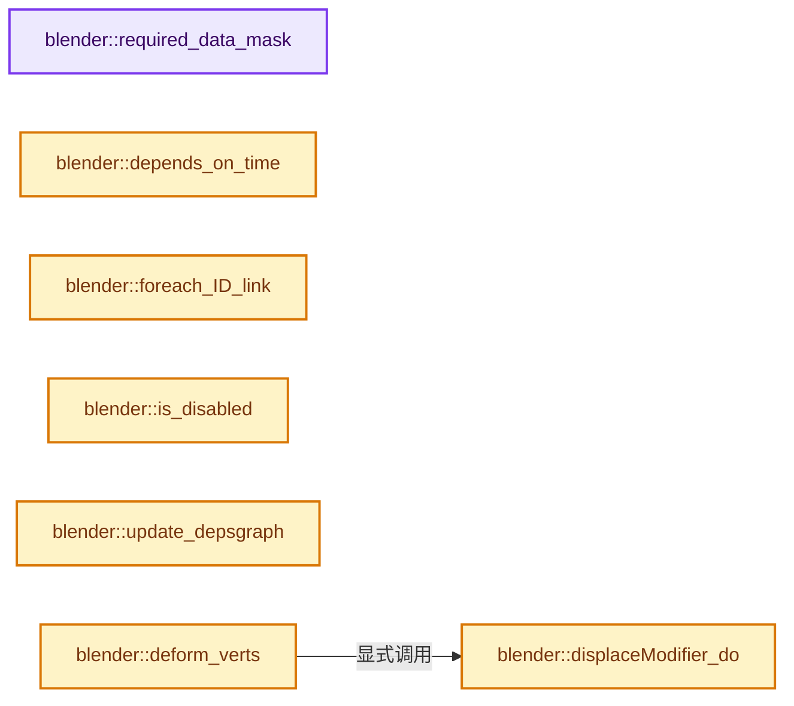

# 实现依赖专题：source/blender/modifiers/intern/MOD_displace.cc

[实现依赖导航](../../../README.md) · [符号索引](../../../../00-课程指南/02-源码与提交索引/符号依赖与实现索引.md)

本专题从正文实际调用进入，集中保存共享实现。函数有稳定锚点，可从调用处直接跳到对应完整函数；递归与互相调用通过回链组织。

## 本文件的实现关系




## 完整成员与函数实现

<a id="f-f735ecf3a0beb370"></a>

### `blender::required_data_mask`

实现位置：[source/blender/modifiers/intern/MOD_displace.cc](../../../../../../../../source/blender/modifiers/intern/MOD_displace.cc) · L57—L70。

接口参数：

- `ModifierData *md`
- `CustomData_MeshMasks *r_cddata_masks`

**教学注释版**

<!-- annotated:60a6ef3392b067 -->

```cpp
static void required_data_mask(ModifierData *md, CustomData_MeshMasks *r_cddata_masks)
{
  DisplaceModifierData *dmd = reinterpret_cast<DisplaceModifierData *>(md);

  /* Ask for vertex-groups if we need them. */
  if (dmd->defgrp_name[0] != '\0') {
    r_cddata_masks->vmask |= CD_MASK_MDEFORMVERT;
  }

  /* ask for UV coordinates if we need them */
  if (dmd->texmapping == MOD_DISP_MAP_UV) {
    r_cddata_masks->fmask |= CD_MASK_MTFACE;
  }
}
```

<details>
<summary>核对原始源码：source/blender/modifiers/intern/MOD_displace.cc · L57—L70</summary>

<!-- original:60a6ef3392b067:source/blender/modifiers/intern/MOD_displace.cc:57:70 -->

```cpp
static void required_data_mask(ModifierData *md, CustomData_MeshMasks *r_cddata_masks)
{
  DisplaceModifierData *dmd = reinterpret_cast<DisplaceModifierData *>(md);

  /* Ask for vertex-groups if we need them. */
  if (dmd->defgrp_name[0] != '\0') {
    r_cddata_masks->vmask |= CD_MASK_MDEFORMVERT;
  }

  /* ask for UV coordinates if we need them */
  if (dmd->texmapping == MOD_DISP_MAP_UV) {
    r_cddata_masks->fmask |= CD_MASK_MTFACE;
  }
}
```

</details>

**沿实际写入检查状态**

- `r_cddata_masks->vmask |= CD_MASK_MDEFORMVERT;`
- `r_cddata_masks->fmask |= CD_MASK_MTFACE;`

**继续追踪实现**

本实现没有需要继续展开的显式调用；检查返回表达式、对象转换和调用者前置条件。

<a id="f-aace5c916ee7ae31"></a>

### `blender::depends_on_time`

实现位置：[source/blender/modifiers/intern/MOD_displace.cc](../../../../../../../../source/blender/modifiers/intern/MOD_displace.cc) · L72—L81。

接口参数：

- `Scene *`
- `ModifierData *md`

**教学注释版**

<!-- annotated:85f954452a1318 -->

```cpp
static bool depends_on_time(Scene * /*scene*/, ModifierData *md)
{
  DisplaceModifierData *dmd = reinterpret_cast<DisplaceModifierData *>(md);

  if (dmd->texture) {
    return BKE_texture_dependsOnTime(dmd->texture);
  }

  return false;
}
```

<details>
<summary>核对原始源码：source/blender/modifiers/intern/MOD_displace.cc · L72—L81</summary>

<!-- original:85f954452a1318:source/blender/modifiers/intern/MOD_displace.cc:72:81 -->

```cpp
static bool depends_on_time(Scene * /*scene*/, ModifierData *md)
{
  DisplaceModifierData *dmd = reinterpret_cast<DisplaceModifierData *>(md);

  if (dmd->texture) {
    return BKE_texture_dependsOnTime(dmd->texture);
  }

  return false;
}
```

</details>

**结果出口**

- `return BKE_texture_dependsOnTime(dmd->texture);`
- `return false;`

**继续追踪实现**

- `BKE_texture_dependsOnTime` → [blender::BKE_texture_dependsOnTime · L600](../../../02-BKE几何与数据/intern/texture.cc.md#f-d94d173f823e5f13)。

<a id="f-6a655dcb551a066b"></a>

### `blender::foreach_ID_link`

实现位置：[source/blender/modifiers/intern/MOD_displace.cc](../../../../../../../../source/blender/modifiers/intern/MOD_displace.cc) · L83—L89。

接口参数：

- `ModifierData *md`
- `Object *ob`
- `IDWalkFunc walk`
- `void *user_data`

**教学注释版**

<!-- annotated:2ce78e04ade4b7 -->

```cpp
static void foreach_ID_link(ModifierData *md, Object *ob, IDWalkFunc walk, void *user_data)
{
  DisplaceModifierData *dmd = reinterpret_cast<DisplaceModifierData *>(md);

  walk(user_data, ob, reinterpret_cast<ID **>(&dmd->texture), IDWALK_CB_USER);
  walk(user_data, ob, reinterpret_cast<ID **>(&dmd->map_object), IDWALK_CB_NOP);
}
```

<details>
<summary>核对原始源码：source/blender/modifiers/intern/MOD_displace.cc · L83—L89</summary>

<!-- original:2ce78e04ade4b7:source/blender/modifiers/intern/MOD_displace.cc:83:89 -->

```cpp
static void foreach_ID_link(ModifierData *md, Object *ob, IDWalkFunc walk, void *user_data)
{
  DisplaceModifierData *dmd = reinterpret_cast<DisplaceModifierData *>(md);

  walk(user_data, ob, reinterpret_cast<ID **>(&dmd->texture), IDWALK_CB_USER);
  walk(user_data, ob, reinterpret_cast<ID **>(&dmd->map_object), IDWALK_CB_NOP);
}
```

</details>

**继续追踪实现**

- `walk` → [调用协议](../../../../00-课程指南/01-路线与规范/模板宏与动态分派协议.md)：局部可调用对象，须结合其初始化与捕获环境。调用位置L87。

<a id="f-1b57de5c7c5ed986"></a>

### `blender::is_disabled`

实现位置：[source/blender/modifiers/intern/MOD_displace.cc](../../../../../../../../source/blender/modifiers/intern/MOD_displace.cc) · L98—L102。

接口参数：

- `const Scene *`
- `ModifierData *md`
- `bool`

**教学注释版**

<!-- annotated:5afa29316e1b0d -->

```cpp
static bool is_disabled(const Scene * /*scene*/, ModifierData *md, bool /*use_render_params*/)
{
  DisplaceModifierData *dmd = reinterpret_cast<DisplaceModifierData *>(md);
  return ((!dmd->texture && dmd->direction == MOD_DISP_DIR_RGB_XYZ) || dmd->strength == 0.0f);
}
```

<details>
<summary>核对原始源码：source/blender/modifiers/intern/MOD_displace.cc · L98—L102</summary>

<!-- original:5afa29316e1b0d:source/blender/modifiers/intern/MOD_displace.cc:98:102 -->

```cpp
static bool is_disabled(const Scene * /*scene*/, ModifierData *md, bool /*use_render_params*/)
{
  DisplaceModifierData *dmd = reinterpret_cast<DisplaceModifierData *>(md);
  return ((!dmd->texture && dmd->direction == MOD_DISP_DIR_RGB_XYZ) || dmd->strength == 0.0f);
}
```

</details>

**结果出口**

- `return ((!dmd->texture && dmd->direction == MOD_DISP_DIR_RGB_XYZ) || dmd->strength == 0.0f);`

**继续追踪实现**

本实现没有需要继续展开的显式调用；检查返回表达式、对象转换和调用者前置条件。

<a id="f-8679969e87e763df"></a>

### `blender::update_depsgraph`

实现位置：[source/blender/modifiers/intern/MOD_displace.cc](../../../../../../../../source/blender/modifiers/intern/MOD_displace.cc) · L104—L131。

接口参数：

- `ModifierData *md`
- `const ModifierUpdateDepsgraphContext *ctx`

**教学注释版**

<!-- annotated:c6f30c4430ded1 -->

```cpp
static void update_depsgraph(ModifierData *md, const ModifierUpdateDepsgraphContext *ctx)
{
  DisplaceModifierData *dmd = reinterpret_cast<DisplaceModifierData *>(md);
  bool need_transform_relation = false;

  if (dmd->space == MOD_DISP_SPACE_GLOBAL &&
      ELEM(dmd->direction, MOD_DISP_DIR_X, MOD_DISP_DIR_Y, MOD_DISP_DIR_Z, MOD_DISP_DIR_RGB_XYZ))
  {
    need_transform_relation = true;
  }

  if (dmd->texture != nullptr) {
    DEG_add_generic_id_relation(ctx->node, &dmd->texture->id, "Displace Modifier");

    if (dmd->map_object != nullptr && dmd->texmapping == MOD_DISP_MAP_OBJECT) {
      MOD_depsgraph_update_object_bone_relation(
          ctx->node, dmd->map_object, dmd->map_bone, "Displace Modifier");
      need_transform_relation = true;
    }
    if (dmd->texmapping == MOD_DISP_MAP_GLOBAL) {
      need_transform_relation = true;
    }
  }

  if (need_transform_relation) {
    DEG_add_depends_on_transform_relation(ctx->node, "Displace Modifier");
  }
}
```

<details>
<summary>核对原始源码：source/blender/modifiers/intern/MOD_displace.cc · L104—L131</summary>

<!-- original:c6f30c4430ded1:source/blender/modifiers/intern/MOD_displace.cc:104:131 -->

```cpp
static void update_depsgraph(ModifierData *md, const ModifierUpdateDepsgraphContext *ctx)
{
  DisplaceModifierData *dmd = reinterpret_cast<DisplaceModifierData *>(md);
  bool need_transform_relation = false;

  if (dmd->space == MOD_DISP_SPACE_GLOBAL &&
      ELEM(dmd->direction, MOD_DISP_DIR_X, MOD_DISP_DIR_Y, MOD_DISP_DIR_Z, MOD_DISP_DIR_RGB_XYZ))
  {
    need_transform_relation = true;
  }

  if (dmd->texture != nullptr) {
    DEG_add_generic_id_relation(ctx->node, &dmd->texture->id, "Displace Modifier");

    if (dmd->map_object != nullptr && dmd->texmapping == MOD_DISP_MAP_OBJECT) {
      MOD_depsgraph_update_object_bone_relation(
          ctx->node, dmd->map_object, dmd->map_bone, "Displace Modifier");
      need_transform_relation = true;
    }
    if (dmd->texmapping == MOD_DISP_MAP_GLOBAL) {
      need_transform_relation = true;
    }
  }

  if (need_transform_relation) {
    DEG_add_depends_on_transform_relation(ctx->node, "Displace Modifier");
  }
}
```

</details>

**沿实际写入检查状态**

- `need_transform_relation = true;`

**继续追踪实现**

- `ELEM` → [ELEM · L88](../../../07-Intern运行时与平台/ghost/intern/GHOST_utildefines.hh.md#m-d28724a15928)；[ELEM · L135](../../../01-BLI基础库/BLI_utildefines.hh.md#m-d6572de7cae0)。宏定义由构建条件选择。
- `DEG_add_generic_id_relation` → [blender::DEG_add_generic_id_relation · L232](../../../06-Depsgraph依赖图/intern/depsgraph_build.cc.md#f-43ef8aa495db0d98)。
- `MOD_depsgraph_update_object_bone_relation` → [blender::MOD_depsgraph_update_object_bone_relation · L188](MOD_util.cc.md#f-b4d8d5d84915768b)。
- `DEG_add_depends_on_transform_relation` → [blender::DEG_add_depends_on_transform_relation · L240](../../../06-Depsgraph依赖图/intern/depsgraph_build.cc.md#f-47c32a354defa20d)。

<a id="f-70be80183db135b8"></a>

### `blender::displaceModifier_do`

实现位置：[source/blender/modifiers/intern/MOD_displace.cc](../../../../../../../../source/blender/modifiers/intern/MOD_displace.cc) · L243—L324。

接口参数：

- `DisplaceModifierData *dmd`
- `const ModifierEvalContext *ctx`
- `Mesh *mesh`
- `MutableSpan<float3> positions`

**教学注释版**

<!-- annotated:dbbaccbeda275f -->

```cpp
static void displaceModifier_do(DisplaceModifierData *dmd,
                                const ModifierEvalContext *ctx,
                                Mesh *mesh,
                                MutableSpan<float3> positions)
{
  Object *ob = ctx->object;
  const MDeformVert *dvert;
  int direction = dmd->direction;
  int defgrp_index;
  float (*tex_co)[3];
  float weight = 1.0f; /* init value unused but some compilers may complain */
  const bool use_global_direction = dmd->space == MOD_DISP_SPACE_GLOBAL;

  if (dmd->texture == nullptr && dmd->direction == MOD_DISP_DIR_RGB_XYZ) {
    return;
  }
  if (dmd->strength == 0.0f) {
    return;
  }

  MOD_get_vgroup(ob, mesh, dmd->defgrp_name, &dvert, &defgrp_index);

  if (defgrp_index >= 0 && dvert == nullptr) {
    /* There is a vertex group, but it has no vertices. */
    return;
  }

  Tex *tex_target = dmd->texture;
  if (tex_target != nullptr) {
    // [讲解] positions.size：查询视图长度或生成对应有效索引区间。
    tex_co = MEM_new_array_zeroed<float[3]>(positions.size(), "displaceModifier_do tex_co");
    MOD_get_texture_coords(reinterpret_cast<MappingInfoModifierData *>(dmd),
                           ctx,
                           ob,
                           mesh,
                           // [讲解] positions.data：返回借用范围的地址。
                           reinterpret_cast<float (*)[3]>(positions.data()),
                           tex_co);

    MOD_init_texture(reinterpret_cast<MappingInfoModifierData *>(dmd), ctx);
  }
  else {
    tex_co = nullptr;
  }

  DisplaceUserdata data = {nullptr};
  data.scene = DEG_get_evaluated_scene(ctx->depsgraph);
  data.dmd = dmd;
  data.dvert = dvert;
  data.weight = weight;
  data.defgrp_index = defgrp_index;
  data.direction = direction;
  data.use_global_direction = use_global_direction;
  data.tex_target = tex_target;
  data.tex_co = tex_co;
  data.positions = positions;
  if (direction == MOD_DISP_DIR_NOR) {
    data.vert_normals = mesh->vert_normals_true();
  }
  else if (direction == MOD_DISP_DIR_CLNOR) {
    data.vert_normals = mesh->vert_normals();
  }
  else if (ELEM(direction, MOD_DISP_DIR_X, MOD_DISP_DIR_Y, MOD_DISP_DIR_Z, MOD_DISP_DIR_RGB_XYZ) &&
           use_global_direction)
  {
    copy_m4_m4(data.local_mat, ob->object_to_world().ptr());
  }
  if (tex_target != nullptr) {
    data.pool = BKE_image_pool_new();
    BKE_texture_fetch_images_for_pool(tex_target, data.pool);
  }
  TaskParallelSettings settings;
  BLI_parallel_range_settings_defaults(&settings);
  settings.use_threading = (positions.size() > 512);
  BLI_task_parallel_range(0, positions.size(), &data, displaceModifier_do_task, &settings);

  if (data.pool != nullptr) {
    BKE_image_pool_free(data.pool);
  }

  if (tex_co) {
    MEM_delete(tex_co);
  }
}
```

<details>
<summary>核对原始源码：source/blender/modifiers/intern/MOD_displace.cc · L243—L324</summary>

<!-- original:dbbaccbeda275f:source/blender/modifiers/intern/MOD_displace.cc:243:324 -->

```cpp
static void displaceModifier_do(DisplaceModifierData *dmd,
                                const ModifierEvalContext *ctx,
                                Mesh *mesh,
                                MutableSpan<float3> positions)
{
  Object *ob = ctx->object;
  const MDeformVert *dvert;
  int direction = dmd->direction;
  int defgrp_index;
  float (*tex_co)[3];
  float weight = 1.0f; /* init value unused but some compilers may complain */
  const bool use_global_direction = dmd->space == MOD_DISP_SPACE_GLOBAL;

  if (dmd->texture == nullptr && dmd->direction == MOD_DISP_DIR_RGB_XYZ) {
    return;
  }
  if (dmd->strength == 0.0f) {
    return;
  }

  MOD_get_vgroup(ob, mesh, dmd->defgrp_name, &dvert, &defgrp_index);

  if (defgrp_index >= 0 && dvert == nullptr) {
    /* There is a vertex group, but it has no vertices. */
    return;
  }

  Tex *tex_target = dmd->texture;
  if (tex_target != nullptr) {
    tex_co = MEM_new_array_zeroed<float[3]>(positions.size(), "displaceModifier_do tex_co");
    MOD_get_texture_coords(reinterpret_cast<MappingInfoModifierData *>(dmd),
                           ctx,
                           ob,
                           mesh,
                           reinterpret_cast<float (*)[3]>(positions.data()),
                           tex_co);

    MOD_init_texture(reinterpret_cast<MappingInfoModifierData *>(dmd), ctx);
  }
  else {
    tex_co = nullptr;
  }

  DisplaceUserdata data = {nullptr};
  data.scene = DEG_get_evaluated_scene(ctx->depsgraph);
  data.dmd = dmd;
  data.dvert = dvert;
  data.weight = weight;
  data.defgrp_index = defgrp_index;
  data.direction = direction;
  data.use_global_direction = use_global_direction;
  data.tex_target = tex_target;
  data.tex_co = tex_co;
  data.positions = positions;
  if (direction == MOD_DISP_DIR_NOR) {
    data.vert_normals = mesh->vert_normals_true();
  }
  else if (direction == MOD_DISP_DIR_CLNOR) {
    data.vert_normals = mesh->vert_normals();
  }
  else if (ELEM(direction, MOD_DISP_DIR_X, MOD_DISP_DIR_Y, MOD_DISP_DIR_Z, MOD_DISP_DIR_RGB_XYZ) &&
           use_global_direction)
  {
    copy_m4_m4(data.local_mat, ob->object_to_world().ptr());
  }
  if (tex_target != nullptr) {
    data.pool = BKE_image_pool_new();
    BKE_texture_fetch_images_for_pool(tex_target, data.pool);
  }
  TaskParallelSettings settings;
  BLI_parallel_range_settings_defaults(&settings);
  settings.use_threading = (positions.size() > 512);
  BLI_task_parallel_range(0, positions.size(), &data, displaceModifier_do_task, &settings);

  if (data.pool != nullptr) {
    BKE_image_pool_free(data.pool);
  }

  if (tex_co) {
    MEM_delete(tex_co);
  }
}
```

</details>

**沿实际写入检查状态**

- `tex_co = MEM_new_array_zeroed<float[3]>(positions.size(), "displaceModifier_do tex_co");`
- `tex_co = nullptr;`
- `data.scene = DEG_get_evaluated_scene(ctx->depsgraph);`
- `data.dmd = dmd;`
- `data.dvert = dvert;`
- `data.weight = weight;`
- `data.defgrp_index = defgrp_index;`
- `data.direction = direction;`
- `data.use_global_direction = use_global_direction;`
- `data.tex_target = tex_target;`
- `data.tex_co = tex_co;`
- `data.positions = positions;`
- `data.vert_normals = mesh->vert_normals_true();`
- `data.vert_normals = mesh->vert_normals();`
- `data.pool = BKE_image_pool_new();`
- `settings.use_threading = (positions.size() > 512);`

**继续追踪实现**

- `MOD_get_vgroup` → [blender::MOD_get_vgroup · L158](MOD_util.cc.md#f-f461611d86b94405)。
- `MEM_new_array_zeroed<float[3]>` → [MEM_new_array_zeroed · L566](../../../07-Intern运行时与平台/guardedalloc/MEM_guardedalloc.h.md#f-3a0cf63fb5216500)；[MEM_new_array_zeroed · L119](../../../07-Intern运行时与平台/guardedalloc/intern/mallocn.cc.md#f-6825557da566fdbe)。同名重载需按实参类型选择。
- `positions.size` → [blender::MutableSpan::size · L499](../../../../01-基础容器与现代CPP/06-MutableSpan可写视图.md#f-1de6a66839c304a8)；[blender::gpu::shader::parser::MutableSpan::size · L87](../../gpu/shader_tool/utils.hh.md#f-5e684af6ee7990e9)。同名重载需按实参类型选择。
- `MOD_get_texture_coords` → [blender::MOD_get_texture_coords · L51](MOD_util.cc.md#f-93137e45acd248b6)。
- `positions.data` → [blender::MutableSpan::data · L545](../../../../01-基础容器与现代CPP/06-MutableSpan可写视图.md#f-eb45a6e4d8211efd)；[blender::gpu::shader::parser::MutableSpan::data · L82](../../gpu/shader_tool/utils.hh.md#f-ad0a09cec9741c65)。同名重载需按实参类型选择。
- `MOD_init_texture` → [blender::MOD_init_texture · L38](MOD_util.cc.md#f-a8c2c947afb32236)。
- `DEG_get_evaluated_scene` → [blender::DEG_get_evaluated_scene · L212](../../../06-Depsgraph依赖图/intern/depsgraph_query.cc.md#f-be7729d26a71d3fd)。
- `mesh->vert_normals_true` → [blender::Mesh::vert_normals_true · L400](../../../../06-隐式共享与缓存系统/08-法线缓存的真实依赖.md#f-9f843a18ab6ce3ef)。
- `mesh->vert_normals` → [blender::Mesh::vert_normals · L349](../../../../06-隐式共享与缓存系统/08-法线缓存的真实依赖.md#f-e9a9d50dc8e15fba)。
- `ELEM` → [ELEM · L88](../../../07-Intern运行时与平台/ghost/intern/GHOST_utildefines.hh.md#m-d28724a15928)；[ELEM · L135](../../../01-BLI基础库/BLI_utildefines.hh.md#m-d6572de7cae0)。宏定义由构建条件选择。
- `copy_m4_m4` → [blender::copy_m4_m4 · L84](../../../01-BLI基础库/intern/math_matrix_c.cc.md#f-b4390cf8c94710f5)。
- `ob->object_to_world().ptr` → [调用协议](../../../../00-课程指南/01-路线与规范/模板宏与动态分派协议.md)：接收对象类型依赖auto、返回值或模板实例；不按同名猜测目标。调用位置L306。
- `ob->object_to_world` → [blender::Object::object_to_world · L5761](../../../02-BKE几何与数据/intern/object.cc.md#f-12fc20026327d50c)。
- `BKE_image_pool_new` → [blender::BKE_image_pool_new · L5209](../../../02-BKE几何与数据/intern/image.cc.md#f-b999eaba93c91d86)。
- `BKE_texture_fetch_images_for_pool` → [blender::BKE_texture_fetch_images_for_pool · L663](../../../02-BKE几何与数据/intern/texture.cc.md#f-fe00d4ccaaf52128)。
- `BLI_parallel_range_settings_defaults` → [blender::BLI_parallel_range_settings_defaults · L218](../../../01-BLI基础库/BLI_task_c.hh.md#f-3858ad801a98e123)。
- `BLI_task_parallel_range` → [blender::BLI_task_parallel_range · L101](../../../../11-Depsgraph与并行任务系统/08-任务隔离死锁与实战.md#f-9d237d7e4e78d7e2)。
- `BKE_image_pool_free` → [blender::BKE_image_pool_free · L5216](../../../02-BKE几何与数据/intern/image.cc.md#f-380e306ad8a0fd8a)。
- `MEM_delete` → [MEM_delete · L400](../../../07-Intern运行时与平台/guardedalloc/MEM_guardedalloc.h.md#f-9049ffdd1682887c)。

<a id="f-5dd2136571461346"></a>

### `blender::deform_verts`

实现位置：[source/blender/modifiers/intern/MOD_displace.cc](../../../../../../../../source/blender/modifiers/intern/MOD_displace.cc) · L326—L332。

接口参数：

- `ModifierData *md`
- `const ModifierEvalContext *ctx`
- `Mesh *mesh`
- `MutableSpan<float3> positions`

**教学注释版**

<!-- annotated:c8b96a08555075 -->

```cpp
static void deform_verts(ModifierData *md,
                         const ModifierEvalContext *ctx,
                         Mesh *mesh,
                         MutableSpan<float3> positions)
{
  displaceModifier_do(reinterpret_cast<DisplaceModifierData *>(md), ctx, mesh, positions);
}
```

<details>
<summary>核对原始源码：source/blender/modifiers/intern/MOD_displace.cc · L326—L332</summary>

<!-- original:c8b96a08555075:source/blender/modifiers/intern/MOD_displace.cc:326:332 -->

```cpp
static void deform_verts(ModifierData *md,
                         const ModifierEvalContext *ctx,
                         Mesh *mesh,
                         MutableSpan<float3> positions)
{
  displaceModifier_do(reinterpret_cast<DisplaceModifierData *>(md), ctx, mesh, positions);
}
```

</details>

**继续追踪实现**

- `displaceModifier_do` → [blender::displaceModifier_do · L243](MOD_displace.cc.md#f-70be80183db135b8)。
