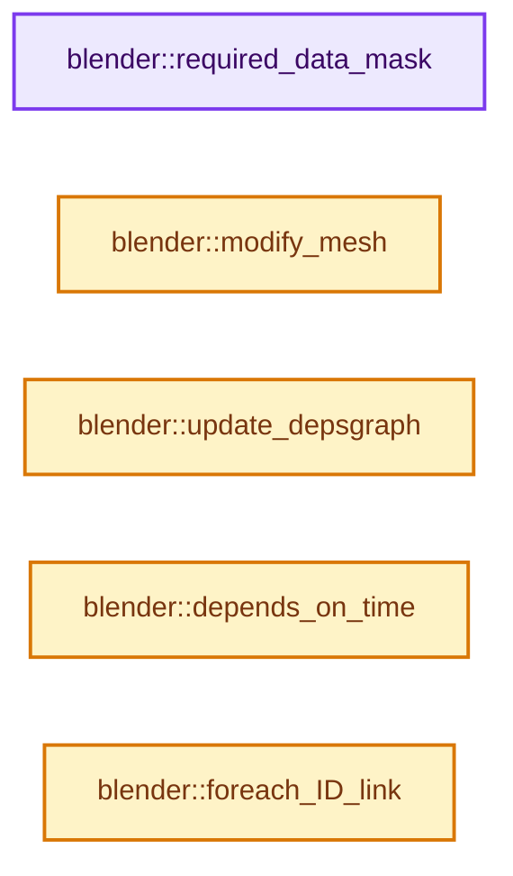
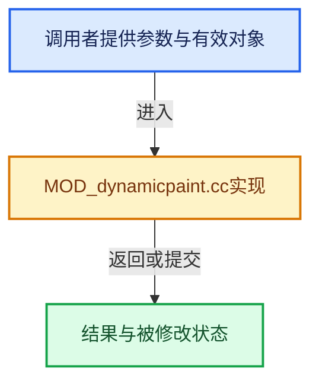

# 实现依赖专题：source/blender/modifiers/intern/MOD_dynamicpaint.cc

[实现依赖导航](../../../README.md) · [符号索引](../../../../00-课程指南/02-源码与提交索引/符号依赖与实现索引.md)

本专题从正文实际调用进入，集中保存共享实现。函数有稳定锚点，可从调用处直接跳到对应完整函数；递归与互相调用通过回链组织。

## 本文件的实现关系






## 完整成员与函数实现

<a id="f-2f9a279d0a76a394"></a>

### `blender::required_data_mask`

实现位置：[source/blender/modifiers/intern/MOD_dynamicpaint.cc](../../../../../../../../source/blender/modifiers/intern/MOD_dynamicpaint.cc) · L69—L94。

接口参数：

- `ModifierData *md`
- `CustomData_MeshMasks *r_cddata_masks`

**教学注释版**

<!-- annotated:ec7adc3f2b5052 -->

```cpp
static void required_data_mask(ModifierData *md, CustomData_MeshMasks *r_cddata_masks)
{
  DynamicPaintModifierData *pmd = reinterpret_cast<DynamicPaintModifierData *>(md);

  if (pmd->canvas) {
    DynamicPaintSurface *surface = pmd->canvas->surfaces.first();
    for (; surface; surface = surface->next) {
      /* UVs: #CD_PROP_FLOAT2. */
      if (surface->format == MOD_DPAINT_SURFACE_F_IMAGESEQ ||
          surface->init_color_type == MOD_DPAINT_INITIAL_TEXTURE)
      {
        r_cddata_masks->lmask |= CD_MASK_PROP_FLOAT2;
      }
      /* Vertex Colors: #CD_PROP_BYTE_COLOR. */
      if (surface->type == MOD_DPAINT_SURFACE_T_PAINT ||
          surface->init_color_type == MOD_DPAINT_INITIAL_VERTEXCOLOR)
      {
        r_cddata_masks->lmask |= CD_MASK_PROP_BYTE_COLOR;
      }
      /* Vertex Weights: #CD_MDEFORMVERT. */
      if (surface->type == MOD_DPAINT_SURFACE_T_WEIGHT) {
        r_cddata_masks->vmask |= CD_MASK_MDEFORMVERT;
      }
    }
  }
}
```

<details>
<summary>核对原始源码：source/blender/modifiers/intern/MOD_dynamicpaint.cc · L69—L94</summary>

<!-- original:ec7adc3f2b5052:source/blender/modifiers/intern/MOD_dynamicpaint.cc:69:94 -->

```cpp
static void required_data_mask(ModifierData *md, CustomData_MeshMasks *r_cddata_masks)
{
  DynamicPaintModifierData *pmd = reinterpret_cast<DynamicPaintModifierData *>(md);

  if (pmd->canvas) {
    DynamicPaintSurface *surface = pmd->canvas->surfaces.first();
    for (; surface; surface = surface->next) {
      /* UVs: #CD_PROP_FLOAT2. */
      if (surface->format == MOD_DPAINT_SURFACE_F_IMAGESEQ ||
          surface->init_color_type == MOD_DPAINT_INITIAL_TEXTURE)
      {
        r_cddata_masks->lmask |= CD_MASK_PROP_FLOAT2;
      }
      /* Vertex Colors: #CD_PROP_BYTE_COLOR. */
      if (surface->type == MOD_DPAINT_SURFACE_T_PAINT ||
          surface->init_color_type == MOD_DPAINT_INITIAL_VERTEXCOLOR)
      {
        r_cddata_masks->lmask |= CD_MASK_PROP_BYTE_COLOR;
      }
      /* Vertex Weights: #CD_MDEFORMVERT. */
      if (surface->type == MOD_DPAINT_SURFACE_T_WEIGHT) {
        r_cddata_masks->vmask |= CD_MASK_MDEFORMVERT;
      }
    }
  }
}
```

</details>

**沿实际写入检查状态**

- `r_cddata_masks->lmask |= CD_MASK_PROP_FLOAT2;`
- `r_cddata_masks->lmask |= CD_MASK_PROP_BYTE_COLOR;`
- `r_cddata_masks->vmask |= CD_MASK_MDEFORMVERT;`

**继续追踪实现**

- `pmd->canvas->surfaces.first` → [调用协议](../../../../00-课程指南/01-路线与规范/模板宏与动态分派协议.md)：接收对象类型依赖auto、返回值或模板实例；不按同名猜测目标。调用位置L74。

<a id="f-e7f6366ff47651d8"></a>

### `blender::modify_mesh`

实现位置：[source/blender/modifiers/intern/MOD_dynamicpaint.cc](../../../../../../../../source/blender/modifiers/intern/MOD_dynamicpaint.cc) · L96—L106。

接口参数：

- `ModifierData *md`
- `const ModifierEvalContext *ctx`
- `Mesh *mesh`

**教学注释版**

<!-- annotated:ee02e20d338b31 -->

```cpp
static Mesh *modify_mesh(ModifierData *md, const ModifierEvalContext *ctx, Mesh *mesh)
{
  DynamicPaintModifierData *pmd = reinterpret_cast<DynamicPaintModifierData *>(md);

  /* Don't apply dynamic paint on ORCO mesh stack. */
  if (!(ctx->flag & MOD_APPLY_ORCO)) {
    Scene *scene = DEG_get_evaluated_scene(ctx->depsgraph);
    return dynamicPaint_Modifier_do(pmd, ctx->depsgraph, scene, ctx->object, mesh);
  }
  return mesh;
}
```

<details>
<summary>核对原始源码：source/blender/modifiers/intern/MOD_dynamicpaint.cc · L96—L106</summary>

<!-- original:ee02e20d338b31:source/blender/modifiers/intern/MOD_dynamicpaint.cc:96:106 -->

```cpp
static Mesh *modify_mesh(ModifierData *md, const ModifierEvalContext *ctx, Mesh *mesh)
{
  DynamicPaintModifierData *pmd = reinterpret_cast<DynamicPaintModifierData *>(md);

  /* Don't apply dynamic paint on ORCO mesh stack. */
  if (!(ctx->flag & MOD_APPLY_ORCO)) {
    Scene *scene = DEG_get_evaluated_scene(ctx->depsgraph);
    return dynamicPaint_Modifier_do(pmd, ctx->depsgraph, scene, ctx->object, mesh);
  }
  return mesh;
}
```

</details>

**结果出口**

- `return dynamicPaint_Modifier_do(pmd, ctx->depsgraph, scene, ctx->object, mesh);`
- `return mesh;`

**继续追踪实现**

- `DEG_get_evaluated_scene` → [blender::DEG_get_evaluated_scene · L212](../../../06-Depsgraph依赖图/intern/depsgraph_query.cc.md#f-be7729d26a71d3fd)。
- `dynamicPaint_Modifier_do` → [blender::dynamicPaint_Modifier_do · L2193](../../../02-BKE几何与数据/intern/dynamicpaint.cc.md#f-48706425670b0f8c)。

<a id="f-3658b75913398ba4"></a>

### `blender::update_depsgraph`

实现位置：[source/blender/modifiers/intern/MOD_dynamicpaint.cc](../../../../../../../../source/blender/modifiers/intern/MOD_dynamicpaint.cc) · L114—L135。

接口参数：

- `ModifierData *md`
- `const ModifierUpdateDepsgraphContext *ctx`

**教学注释版**

<!-- annotated:e74fcc09ec3bf0 -->

```cpp
static void update_depsgraph(ModifierData *md, const ModifierUpdateDepsgraphContext *ctx)
{
  DynamicPaintModifierData *pmd = reinterpret_cast<DynamicPaintModifierData *>(md);
  /* Add relation from canvases to all brush objects. */
  if (pmd->canvas != nullptr && pmd->type == MOD_DYNAMICPAINT_TYPE_CANVAS) {
    for (DynamicPaintSurface &surface : pmd->canvas->surfaces) {
      if (surface.effect & MOD_DPAINT_EFFECT_DO_DRIP) {
        DEG_add_forcefield_relations(
            ctx->node, ctx->object, surface.effector_weights, true, 0, "Dynamic Paint Field");
      }

      /* Actual code uses custom loop over group/scene
       * without layer checks in dynamicPaint_doStep. */
      DEG_add_collision_relations(ctx->node,
                                  ctx->object,
                                  surface.brush_group,
                                  eModifierType_DynamicPaint,
                                  is_brush_cb,
                                  "Dynamic Paint Brush");
    }
  }
}
```

<details>
<summary>核对原始源码：source/blender/modifiers/intern/MOD_dynamicpaint.cc · L114—L135</summary>

<!-- original:e74fcc09ec3bf0:source/blender/modifiers/intern/MOD_dynamicpaint.cc:114:135 -->

```cpp
static void update_depsgraph(ModifierData *md, const ModifierUpdateDepsgraphContext *ctx)
{
  DynamicPaintModifierData *pmd = reinterpret_cast<DynamicPaintModifierData *>(md);
  /* Add relation from canvases to all brush objects. */
  if (pmd->canvas != nullptr && pmd->type == MOD_DYNAMICPAINT_TYPE_CANVAS) {
    for (DynamicPaintSurface &surface : pmd->canvas->surfaces) {
      if (surface.effect & MOD_DPAINT_EFFECT_DO_DRIP) {
        DEG_add_forcefield_relations(
            ctx->node, ctx->object, surface.effector_weights, true, 0, "Dynamic Paint Field");
      }

      /* Actual code uses custom loop over group/scene
       * without layer checks in dynamicPaint_doStep. */
      DEG_add_collision_relations(ctx->node,
                                  ctx->object,
                                  surface.brush_group,
                                  eModifierType_DynamicPaint,
                                  is_brush_cb,
                                  "Dynamic Paint Brush");
    }
  }
}
```

</details>

**继续追踪实现**

- `DEG_add_forcefield_relations` → [blender::DEG_add_forcefield_relations · L203](../../../06-Depsgraph依赖图/intern/depsgraph_physics.cc.md#f-1a87e7be20724278)。
- `DEG_add_collision_relations` → [blender::DEG_add_collision_relations · L112](../../../06-Depsgraph依赖图/intern/depsgraph_physics.cc.md#f-a8a23fb36db5feb5)。

<a id="f-b0918e45ab9bdeaf"></a>

### `blender::depends_on_time`

实现位置：[source/blender/modifiers/intern/MOD_dynamicpaint.cc](../../../../../../../../source/blender/modifiers/intern/MOD_dynamicpaint.cc) · L137—L140。

接口参数：

- `Scene *`
- `ModifierData *`

**教学注释版**

<!-- annotated:10dc793a8e54ed -->

```cpp
static bool depends_on_time(Scene * /*scene*/, ModifierData * /*md*/)
{
  return true;
}
```

<details>
<summary>核对原始源码：source/blender/modifiers/intern/MOD_dynamicpaint.cc · L137—L140</summary>

<!-- original:10dc793a8e54ed:source/blender/modifiers/intern/MOD_dynamicpaint.cc:137:140 -->

```cpp
static bool depends_on_time(Scene * /*scene*/, ModifierData * /*md*/)
{
  return true;
}
```

</details>

**结果出口**

- `return true;`

**继续追踪实现**

本实现没有需要继续展开的显式调用；检查返回表达式、对象转换和调用者前置条件。

<a id="f-88fbf106ff0570fe"></a>

### `blender::foreach_ID_link`

实现位置：[source/blender/modifiers/intern/MOD_dynamicpaint.cc](../../../../../../../../source/blender/modifiers/intern/MOD_dynamicpaint.cc) · L142—L160。

接口参数：

- `ModifierData *md`
- `Object *ob`
- `IDWalkFunc walk`
- `void *user_data`

**教学注释版**

<!-- annotated:95b6449e64ffcf -->

```cpp
static void foreach_ID_link(ModifierData *md, Object *ob, IDWalkFunc walk, void *user_data)
{
  DynamicPaintModifierData *pmd = reinterpret_cast<DynamicPaintModifierData *>(md);

  if (pmd->canvas) {
    DynamicPaintSurface *surface = pmd->canvas->surfaces.first();

    for (; surface; surface = surface->next) {
      walk(user_data, ob, reinterpret_cast<ID **>(&surface->brush_group), IDWALK_CB_NOP);
      walk(user_data, ob, reinterpret_cast<ID **>(&surface->init_texture), IDWALK_CB_USER);
      if (surface->effector_weights) {
        walk(user_data,
             ob,
             reinterpret_cast<ID **>(&surface->effector_weights->group),
             IDWALK_CB_USER);
      }
    }
  }
}
```

<details>
<summary>核对原始源码：source/blender/modifiers/intern/MOD_dynamicpaint.cc · L142—L160</summary>

<!-- original:95b6449e64ffcf:source/blender/modifiers/intern/MOD_dynamicpaint.cc:142:160 -->

```cpp
static void foreach_ID_link(ModifierData *md, Object *ob, IDWalkFunc walk, void *user_data)
{
  DynamicPaintModifierData *pmd = reinterpret_cast<DynamicPaintModifierData *>(md);

  if (pmd->canvas) {
    DynamicPaintSurface *surface = pmd->canvas->surfaces.first();

    for (; surface; surface = surface->next) {
      walk(user_data, ob, reinterpret_cast<ID **>(&surface->brush_group), IDWALK_CB_NOP);
      walk(user_data, ob, reinterpret_cast<ID **>(&surface->init_texture), IDWALK_CB_USER);
      if (surface->effector_weights) {
        walk(user_data,
             ob,
             reinterpret_cast<ID **>(&surface->effector_weights->group),
             IDWALK_CB_USER);
      }
    }
  }
}
```

</details>

**继续追踪实现**

- `pmd->canvas->surfaces.first` → [调用协议](../../../../00-课程指南/01-路线与规范/模板宏与动态分派协议.md)：接收对象类型依赖auto、返回值或模板实例；不按同名猜测目标。调用位置L147。
- `walk` → [调用协议](../../../../00-课程指南/01-路线与规范/模板宏与动态分派协议.md)：局部可调用对象，须结合其初始化与捕获环境。调用位置L150。
