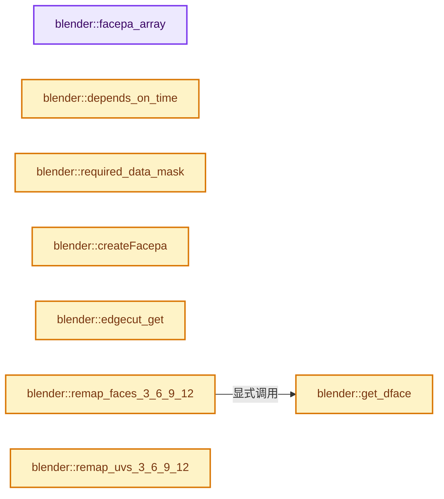
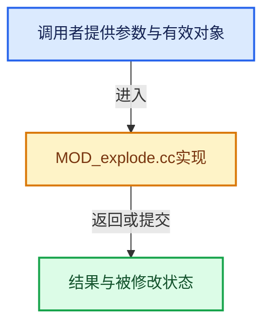

# 实现依赖专题：source/blender/modifiers/intern/MOD_explode.cc

[实现依赖导航](../../../README.md) · [符号索引](../../../../00-课程指南/02-源码与提交索引/符号依赖与实现索引.md)

本专题从正文实际调用进入，集中保存共享实现。函数有稳定锚点，可从调用处直接跳到对应完整函数；递归与互相调用通过回链组织。

## 本文件的实现关系






<a id="m-3ac8158724d6"></a>

## 宏 `SET_VERTS`

<!-- annotated:e4ff7de5147a07 -->

```cpp
#define SET_VERTS(a, b, c, d) \
  { \
    v[0] = mf->v##a; \
    uv[0] = a - 1; \
    v[1] = mf->v##b; \
    uv[1] = b - 1; \
    v[2] = mf->v##c; \
    uv[2] = c - 1; \
    v[3] = mf->v##d; \
    uv[3] = d - 1; \
  } \
  (void)0

```

<details>
<summary>核对原始源码：source/blender/modifiers/intern/MOD_explode.cc · L234—L246</summary>

<!-- original:e4ff7de5147a07:source/blender/modifiers/intern/MOD_explode.cc:234:246 -->

```cpp
#define SET_VERTS(a, b, c, d) \
  { \
    v[0] = mf->v##a; \
    uv[0] = a - 1; \
    v[1] = mf->v##b; \
    uv[1] = b - 1; \
    v[2] = mf->v##c; \
    uv[2] = c - 1; \
    v[3] = mf->v##d; \
    uv[3] = d - 1; \
  } \
  (void)0

```

</details>

宏在预处理阶段展开，参数替换、重复求值和条件编译应直接从该定义检查。与普通函数不同，宏不会自动提供参数类型检查；构建配置选择哪个定义需结合外围条件。

<a id="m-871380d418ef"></a>

## 宏 `GET_ES`

<!-- annotated:59b44fb52939f0 -->

```cpp
#define GET_ES(v1, v2) edgecut_get(eh, v1, v2)
#define INT_UV(uvf, c0, c1) mid_v2_v2v2(uvf, mf->uv[c0], mf->uv[c1])
```

<details>
<summary>核对原始源码：source/blender/modifiers/intern/MOD_explode.cc · L247—L248</summary>

<!-- original:59b44fb52939f0:source/blender/modifiers/intern/MOD_explode.cc:247:248 -->

```cpp
#define GET_ES(v1, v2) edgecut_get(eh, v1, v2)
#define INT_UV(uvf, c0, c1) mid_v2_v2v2(uvf, mf->uv[c0], mf->uv[c1])
```

</details>

宏在预处理阶段展开，参数替换、重复求值和条件编译应直接从该定义检查。与普通函数不同，宏不会自动提供参数类型检查；构建配置选择哪个定义需结合外围条件。

<a id="m-a1c880a71e19"></a>

## 宏 `INT_UV`

<!-- annotated:5db86d02529c95 -->

```cpp
#define INT_UV(uvf, c0, c1) mid_v2_v2v2(uvf, mf->uv[c0], mf->uv[c1])

```

<details>
<summary>核对原始源码：source/blender/modifiers/intern/MOD_explode.cc · L248—L249</summary>

<!-- original:5db86d02529c95:source/blender/modifiers/intern/MOD_explode.cc:248:249 -->

```cpp
#define INT_UV(uvf, c0, c1) mid_v2_v2v2(uvf, mf->uv[c0], mf->uv[c1])

```

</details>

宏在预处理阶段展开，参数替换、重复求值和条件编译应直接从该定义检查。与普通函数不同，宏不会自动提供参数类型检查；构建配置选择哪个定义需结合外围条件。

## 完整成员与函数实现

<a id="f-6aca1c596b7d7f37"></a>

### `blender::facepa_array`

实现位置：[source/blender/modifiers/intern/MOD_explode.cc](../../../../../../../../source/blender/modifiers/intern/MOD_explode.cc) · L52—L55。

接口参数：

- `ExplodeModifierData *emd`

**教学注释版**

<!-- annotated:e2e63b71755b8c -->

```cpp
static Array<int, 0> *facepa_array(ExplodeModifierData *emd)
{
  return static_cast<Array<int, 0> *>(emd->facepa);
}
```

<details>
<summary>核对原始源码：source/blender/modifiers/intern/MOD_explode.cc · L52—L55</summary>

<!-- original:e2e63b71755b8c:source/blender/modifiers/intern/MOD_explode.cc:52:55 -->

```cpp
static Array<int, 0> *facepa_array(ExplodeModifierData *emd)
{
  return static_cast<Array<int, 0> *>(emd->facepa);
}
```

</details>

**结果出口**

- `return static_cast<Array<int, 0> *>(emd->facepa);`

**继续追踪实现**

本实现没有需要继续展开的显式调用；检查返回表达式、对象转换和调用者前置条件。

<a id="f-bfc63e8f13a644dd"></a>

### `blender::depends_on_time`

实现位置：[source/blender/modifiers/intern/MOD_explode.cc](../../../../../../../../source/blender/modifiers/intern/MOD_explode.cc) · L82—L85。

接口参数：

- `Scene *`
- `ModifierData *`

**教学注释版**

<!-- annotated:6f9d660fe02e07 -->

```cpp
static bool depends_on_time(Scene * /*scene*/, ModifierData * /*md*/)
{
  return true;
}
```

<details>
<summary>核对原始源码：source/blender/modifiers/intern/MOD_explode.cc · L82—L85</summary>

<!-- original:6f9d660fe02e07:source/blender/modifiers/intern/MOD_explode.cc:82:85 -->

```cpp
static bool depends_on_time(Scene * /*scene*/, ModifierData * /*md*/)
{
  return true;
}
```

</details>

**结果出口**

- `return true;`

**继续追踪实现**

本实现没有需要继续展开的显式调用；检查返回表达式、对象转换和调用者前置条件。

<a id="f-afa5a87db7339c42"></a>

### `blender::required_data_mask`

实现位置：[source/blender/modifiers/intern/MOD_explode.cc](../../../../../../../../source/blender/modifiers/intern/MOD_explode.cc) · L86—L93。

接口参数：

- `ModifierData *md`
- `CustomData_MeshMasks *r_cddata_masks`

**教学注释版**

<!-- annotated:4365a0209434c1 -->

```cpp
static void required_data_mask(ModifierData *md, CustomData_MeshMasks *r_cddata_masks)
{
  ExplodeModifierData *emd = reinterpret_cast<ExplodeModifierData *>(md);

  if (emd->vgroup) {
    r_cddata_masks->vmask |= CD_MASK_MDEFORMVERT;
  }
}
```

<details>
<summary>核对原始源码：source/blender/modifiers/intern/MOD_explode.cc · L86—L93</summary>

<!-- original:4365a0209434c1:source/blender/modifiers/intern/MOD_explode.cc:86:93 -->

```cpp
static void required_data_mask(ModifierData *md, CustomData_MeshMasks *r_cddata_masks)
{
  ExplodeModifierData *emd = reinterpret_cast<ExplodeModifierData *>(md);

  if (emd->vgroup) {
    r_cddata_masks->vmask |= CD_MASK_MDEFORMVERT;
  }
}
```

</details>

**沿实际写入检查状态**

- `r_cddata_masks->vmask |= CD_MASK_MDEFORMVERT;`

**继续追踪实现**

本实现没有需要继续展开的显式调用；检查返回表达式、对象转换和调用者前置条件。

<a id="f-f9e768d0fb035fe9"></a>

### `blender::createFacepa`

实现位置：[source/blender/modifiers/intern/MOD_explode.cc](../../../../../../../../source/blender/modifiers/intern/MOD_explode.cc) · L95—L213。

接口参数：

- `ExplodeModifierData *emd`
- `ParticleSystemModifierData *psmd`
- `Mesh *mesh`

**教学注释版**

<!-- annotated:f8777196a9049e -->

```cpp
static void createFacepa(ExplodeModifierData *emd, ParticleSystemModifierData *psmd, Mesh *mesh)
{
  ParticleSystem *psys = psmd->psys;
  MFace *fa = nullptr, *mface = nullptr;
  ParticleData *pa;
  KDTree<float3> *tree;
  RNG *rng;
  float center[3], co[3];
  int *facepa = nullptr, *vertpa = nullptr, totvert = 0, totface = 0, totpart = 0;
  int i, p, v1, v2, v3, v4 = 0;
  const bool invert_vgroup = (emd->flag & eExplodeFlag_INVERT_VGROUP) != 0;

  MutableSpan<float3> positions = mesh->vert_positions_for_write();
  mface = static_cast<MFace *>(
      CustomData_get_layer_for_write(&mesh->fdata_legacy, CD_MFACE, mesh->totface_legacy));
  totvert = mesh->verts_num;
  totface = mesh->totface_legacy;
  totpart = psmd->psys->totpart;

  rng = BLI_rng_new_srandom(psys->seed);

  if (emd->facepa) {
    MEM_delete(facepa_array(emd));
  }
  auto *facepa_array = MEM_new<Array<int, 0>>(__func__, totface, 0);
  emd->facepa = facepa_array;
  facepa = facepa_array->data();

  vertpa = MEM_new_array_zeroed<int>(totvert, __func__);

  /* initialize all faces & verts to no particle */
  for (i = 0; i < totface; i++) {
    facepa[i] = totpart;
  }
  for (i = 0; i < totvert; i++) {
    vertpa[i] = totpart;
  }

  /* set protected verts */
  if (emd->vgroup) {
    const MDeformVert *dvert = mesh->deform_verts().data();
    if (dvert) {
      const int defgrp_index = emd->vgroup - 1;
      for (i = 0; i < totvert; i++, dvert++) {
        float val = BLI_rng_get_float(rng);
        val = (1.0f - emd->protect) * val + emd->protect * 0.5f;
        const float weight = invert_vgroup ? 1.0f - BKE_defvert_find_weight(dvert, defgrp_index) :
                                             BKE_defvert_find_weight(dvert, defgrp_index);
        if (val < weight) {
          vertpa[i] = -1;
        }
      }
    }
  }

  /* make tree of emitter locations */
  tree = kdtree_new<float3>(totpart);
  for (p = 0, pa = psys->particles; p < totpart; p++, pa++) {
    psys_particle_on_emitter(psmd,
                             psys->part->from,
                             pa->num,
                             pa->num_dmcache,
                             pa->fuv,
                             pa->foffset,
                             co,
                             nullptr,
                             nullptr,
                             nullptr,
                             nullptr);
    kdtree_insert<float3>(tree, p, co);
  }
  kdtree_balance<float3>(tree);

  /* set face-particle-indexes to nearest particle to face center */
  for (i = 0, fa = mface; i < totface; i++, fa++) {
    add_v3_v3v3(center, positions[fa->v1], positions[fa->v2]);
    add_v3_v3(center, positions[fa->v3]);
    if (fa->v4) {
      add_v3_v3(center, positions[fa->v4]);
      mul_v3_fl(center, 0.25);
    }
    else {
      mul_v3_fl(center, 1.0f / 3.0f);
    }

    p = kdtree_find_nearest<float3>(tree, center, nullptr);

    v1 = vertpa[fa->v1];
    v2 = vertpa[fa->v2];
    v3 = vertpa[fa->v3];
    if (fa->v4) {
      v4 = vertpa[fa->v4];
    }

    if (v1 >= 0 && v2 >= 0 && v3 >= 0 && (fa->v4 == 0 || v4 >= 0)) {
      facepa[i] = p;
    }

    if (v1 >= 0) {
      vertpa[fa->v1] = p;
    }
    if (v2 >= 0) {
      vertpa[fa->v2] = p;
    }
    if (v3 >= 0) {
      vertpa[fa->v3] = p;
    }
    if (fa->v4 && v4 >= 0) {
      vertpa[fa->v4] = p;
    }
  }

  if (vertpa) {
    MEM_delete(vertpa);
  }
  kdtree_free<float3>(tree);

  BLI_rng_free(rng);
}
```

<details>
<summary>核对原始源码：source/blender/modifiers/intern/MOD_explode.cc · L95—L213</summary>

<!-- original:f8777196a9049e:source/blender/modifiers/intern/MOD_explode.cc:95:213 -->

```cpp
static void createFacepa(ExplodeModifierData *emd, ParticleSystemModifierData *psmd, Mesh *mesh)
{
  ParticleSystem *psys = psmd->psys;
  MFace *fa = nullptr, *mface = nullptr;
  ParticleData *pa;
  KDTree<float3> *tree;
  RNG *rng;
  float center[3], co[3];
  int *facepa = nullptr, *vertpa = nullptr, totvert = 0, totface = 0, totpart = 0;
  int i, p, v1, v2, v3, v4 = 0;
  const bool invert_vgroup = (emd->flag & eExplodeFlag_INVERT_VGROUP) != 0;

  MutableSpan<float3> positions = mesh->vert_positions_for_write();
  mface = static_cast<MFace *>(
      CustomData_get_layer_for_write(&mesh->fdata_legacy, CD_MFACE, mesh->totface_legacy));
  totvert = mesh->verts_num;
  totface = mesh->totface_legacy;
  totpart = psmd->psys->totpart;

  rng = BLI_rng_new_srandom(psys->seed);

  if (emd->facepa) {
    MEM_delete(facepa_array(emd));
  }
  auto *facepa_array = MEM_new<Array<int, 0>>(__func__, totface, 0);
  emd->facepa = facepa_array;
  facepa = facepa_array->data();

  vertpa = MEM_new_array_zeroed<int>(totvert, __func__);

  /* initialize all faces & verts to no particle */
  for (i = 0; i < totface; i++) {
    facepa[i] = totpart;
  }
  for (i = 0; i < totvert; i++) {
    vertpa[i] = totpart;
  }

  /* set protected verts */
  if (emd->vgroup) {
    const MDeformVert *dvert = mesh->deform_verts().data();
    if (dvert) {
      const int defgrp_index = emd->vgroup - 1;
      for (i = 0; i < totvert; i++, dvert++) {
        float val = BLI_rng_get_float(rng);
        val = (1.0f - emd->protect) * val + emd->protect * 0.5f;
        const float weight = invert_vgroup ? 1.0f - BKE_defvert_find_weight(dvert, defgrp_index) :
                                             BKE_defvert_find_weight(dvert, defgrp_index);
        if (val < weight) {
          vertpa[i] = -1;
        }
      }
    }
  }

  /* make tree of emitter locations */
  tree = kdtree_new<float3>(totpart);
  for (p = 0, pa = psys->particles; p < totpart; p++, pa++) {
    psys_particle_on_emitter(psmd,
                             psys->part->from,
                             pa->num,
                             pa->num_dmcache,
                             pa->fuv,
                             pa->foffset,
                             co,
                             nullptr,
                             nullptr,
                             nullptr,
                             nullptr);
    kdtree_insert<float3>(tree, p, co);
  }
  kdtree_balance<float3>(tree);

  /* set face-particle-indexes to nearest particle to face center */
  for (i = 0, fa = mface; i < totface; i++, fa++) {
    add_v3_v3v3(center, positions[fa->v1], positions[fa->v2]);
    add_v3_v3(center, positions[fa->v3]);
    if (fa->v4) {
      add_v3_v3(center, positions[fa->v4]);
      mul_v3_fl(center, 0.25);
    }
    else {
      mul_v3_fl(center, 1.0f / 3.0f);
    }

    p = kdtree_find_nearest<float3>(tree, center, nullptr);

    v1 = vertpa[fa->v1];
    v2 = vertpa[fa->v2];
    v3 = vertpa[fa->v3];
    if (fa->v4) {
      v4 = vertpa[fa->v4];
    }

    if (v1 >= 0 && v2 >= 0 && v3 >= 0 && (fa->v4 == 0 || v4 >= 0)) {
      facepa[i] = p;
    }

    if (v1 >= 0) {
      vertpa[fa->v1] = p;
    }
    if (v2 >= 0) {
      vertpa[fa->v2] = p;
    }
    if (v3 >= 0) {
      vertpa[fa->v3] = p;
    }
    if (fa->v4 && v4 >= 0) {
      vertpa[fa->v4] = p;
    }
  }

  if (vertpa) {
    MEM_delete(vertpa);
  }
  kdtree_free<float3>(tree);

  BLI_rng_free(rng);
}
```

</details>

**沿实际写入检查状态**

- `mface = static_cast<MFace *>(`
- `totvert = mesh->verts_num;`
- `totface = mesh->totface_legacy;`
- `totpart = psmd->psys->totpart;`
- `rng = BLI_rng_new_srandom(psys->seed);`
- `emd->facepa = facepa_array;`
- `facepa = facepa_array->data();`
- `vertpa = MEM_new_array_zeroed<int>(totvert, __func__);`
- `facepa[i] = totpart;`
- `vertpa[i] = totpart;`
- `val = (1.0f - emd->protect) * val + emd->protect * 0.5f;`
- `vertpa[i] = -1;`
- `tree = kdtree_new<float3>(totpart);`
- `p = kdtree_find_nearest<float3>(tree, center, nullptr);`
- `v1 = vertpa[fa->v1];`
- `v2 = vertpa[fa->v2];`
- `v3 = vertpa[fa->v3];`
- `v4 = vertpa[fa->v4];`
- `facepa[i] = p;`
- `vertpa[fa->v1] = p;`
- `vertpa[fa->v2] = p;`
- `vertpa[fa->v3] = p;`
- `vertpa[fa->v4] = p;`

**继续追踪实现**

- `mesh->vert_positions_for_write` → [Mesh::vert_positions_for_write · L1199](../../../../05-几何存储与拓扑映射/03-MPoly迁移与兼容.md#f-ae8d77205112d843)。
- `CustomData_get_layer_for_write` → [blender::CustomData_get_layer_for_write · L3318](../../../02-BKE几何与数据/intern/customdata.cc.md#f-6af158905e2c1274)。
- `BLI_rng_new_srandom` → [RNG::BLI_rng_new_srandom · L48](../../../01-BLI基础库/intern/rand.cc.md#f-61072c8c2d17d98d)。
- `MEM_delete` → [MEM_delete · L400](../../../07-Intern运行时与平台/guardedalloc/MEM_guardedalloc.h.md#f-9049ffdd1682887c)。
- `facepa_array` → [调用协议](../../../../00-课程指南/01-路线与规范/模板宏与动态分派协议.md)：局部可调用对象，须结合其初始化与捕获环境。调用位置L117。
- `MEM_new<Array<int, 0>>` → [MEM_new · L351](../../../07-Intern运行时与平台/guardedalloc/MEM_guardedalloc.h.md#f-115f9b6784f89912)。
- `facepa_array->data` → [调用协议](../../../../00-课程指南/01-路线与规范/模板宏与动态分派协议.md)：接收对象类型依赖auto、返回值或模板实例；不按同名猜测目标。调用位置L121。
- `MEM_new_array_zeroed<int>` → [MEM_new_array_zeroed · L566](../../../07-Intern运行时与平台/guardedalloc/MEM_guardedalloc.h.md#f-3a0cf63fb5216500)；[MEM_new_array_zeroed · L119](../../../07-Intern运行时与平台/guardedalloc/intern/mallocn.cc.md#f-6825557da566fdbe)。同名重载需按实参类型选择。
- `mesh->deform_verts().data` → [调用协议](../../../../00-课程指南/01-路线与规范/模板宏与动态分派协议.md)：接收对象类型依赖auto、返回值或模板实例；不按同名猜测目标。调用位置L135。
- `mesh->deform_verts` → [Mesh::deform_verts · L1266](../../../../05-几何存储与拓扑映射/03-MPoly迁移与兼容.md#f-4c0433aad24aa301)。
- `BLI_rng_get_float` → [RNG::BLI_rng_get_float · L90](../../../01-BLI基础库/intern/rand.cc.md#f-964cd94e36f95d8f)。
- `BKE_defvert_find_weight` → [blender::BKE_defvert_find_weight · L779](../../../02-BKE几何与数据/intern/deform.cc.md#f-c117fcd05c4fd453)。
- `kdtree_new<float3>` → [blender::kdtree_new · L65](../../../01-BLI基础库/BLI_kdtree.hh.md#f-46a3316dfd09a49e)。
- `psys_particle_on_emitter` → [psys_particle_on_emitter · L2252](../../../02-BKE几何与数据/intern/particle.cc.md#f-8f457781875a8df6)。
- `kdtree_insert<float3>` → [blender::kdtree_insert · L95](../../../01-BLI基础库/BLI_kdtree.hh.md#f-ed9cb6449add9ae9)。
- `kdtree_balance<float3>` → [blender::kdtree_balance · L183](../../../01-BLI基础库/BLI_kdtree.hh.md#f-c4ab209b5302fead)。
- `add_v3_v3v3` → [blender::add_v3_v3v3 · L300](../../../01-BLI基础库/intern/math_vector_inline.cc.md#f-7343b459d0d3db69)。
- `add_v3_v3` → [blender::add_v3_v3 · L286](../../../01-BLI基础库/intern/math_vector_inline.cc.md#f-e7930c6fdefe462c)。
- `mul_v3_fl` → [blender::mul_v3_fl · L414](../../../01-BLI基础库/intern/math_vector_inline.cc.md#f-00165156a06d1224)。
- `kdtree_find_nearest<float3>` → [blender::kdtree_find_nearest · L303](../../../01-BLI基础库/BLI_kdtree.hh.md#f-3b06f2cb2fa18fa7)。
- `kdtree_free<float3>` → [blender::kdtree_free · L84](../../../01-BLI基础库/BLI_kdtree.hh.md#f-29e79484de22f4be)。
- `BLI_rng_free` → [RNG::BLI_rng_free · L55](../../../01-BLI基础库/intern/rand.cc.md#f-366aa1dd842611e9)。

<a id="f-8bec350d980a0bfa"></a>

### `blender::edgecut_get`

实现位置：[source/blender/modifiers/intern/MOD_explode.cc](../../../../../../../../source/blender/modifiers/intern/MOD_explode.cc) · L215—L218。

接口参数：

- `const Map<OrderedEdge, int> &edgehash`
- `uint v1`
- `uint v2`

**教学注释版**

<!-- annotated:ae398e121d7ba1 -->

```cpp
static int edgecut_get(const Map<OrderedEdge, int> &edgehash, uint v1, uint v2)
{
  // [讲解] edgehash.lookup：按键查找对应项。
  return edgehash.lookup({int(v1), int(v2)});
}
```

<details>
<summary>核对原始源码：source/blender/modifiers/intern/MOD_explode.cc · L215—L218</summary>

<!-- original:ae398e121d7ba1:source/blender/modifiers/intern/MOD_explode.cc:215:218 -->

```cpp
static int edgecut_get(const Map<OrderedEdge, int> &edgehash, uint v1, uint v2)
{
  return edgehash.lookup({int(v1), int(v2)});
}
```

</details>

**结果出口**

- `return edgehash.lookup({int(v1), int(v2)});`

**继续追踪实现**

- `edgehash.lookup` → [blender::Map::lookup · L545](../../../../02-哈希表与关联数据结构/04-Map查找与键访问.md#f-f25ef95f1454656d)；[blender::Map::lookup · L549](../../../../02-哈希表与关联数据结构/04-Map查找与键访问.md#f-742f9454fa7ea4b9)。同名重载需按实参类型选择。

<a id="f-5eae6bde85364f58"></a>

### `blender::get_dface`

实现位置：[source/blender/modifiers/intern/MOD_explode.cc](../../../../../../../../source/blender/modifiers/intern/MOD_explode.cc) · L224—L232。

接口参数：

- `Mesh *mesh`
- `Mesh *split`
- `int cur`
- `int i`
- `MFace *mf`

**教学注释版**

<!-- annotated:56ee958d4499dd -->

```cpp
static MFace *get_dface(Mesh *mesh, Mesh *split, int cur, int i, MFace *mf)
{
  MFace *mfaces = static_cast<MFace *>(
      CustomData_get_layer_for_write(&split->fdata_legacy, CD_MFACE, split->totface_legacy));
  MFace *df = &mfaces[cur];
  CustomData_copy_data(&mesh->fdata_legacy, &split->fdata_legacy, i, cur, 1);
  *df = *mf;
  return df;
}
```

<details>
<summary>核对原始源码：source/blender/modifiers/intern/MOD_explode.cc · L224—L232</summary>

<!-- original:56ee958d4499dd:source/blender/modifiers/intern/MOD_explode.cc:224:232 -->

```cpp
static MFace *get_dface(Mesh *mesh, Mesh *split, int cur, int i, MFace *mf)
{
  MFace *mfaces = static_cast<MFace *>(
      CustomData_get_layer_for_write(&split->fdata_legacy, CD_MFACE, split->totface_legacy));
  MFace *df = &mfaces[cur];
  CustomData_copy_data(&mesh->fdata_legacy, &split->fdata_legacy, i, cur, 1);
  *df = *mf;
  return df;
}
```

</details>

**结果出口**

- `return df;`

**继续追踪实现**

- `CustomData_get_layer_for_write` → [blender::CustomData_get_layer_for_write · L3318](../../../02-BKE几何与数据/intern/customdata.cc.md#f-6af158905e2c1274)。
- `CustomData_copy_data` → [blender::CustomData_copy_data · L3115](../../../02-BKE几何与数据/intern/customdata.cc.md#f-02b97940f7d20d25)。

<a id="f-b64bd5386780596f"></a>

### `blender::remap_faces_3_6_9_12`

实现位置：[source/blender/modifiers/intern/MOD_explode.cc](../../../../../../../../source/blender/modifiers/intern/MOD_explode.cc) · L250—L287。

接口参数：

- `Mesh *mesh`
- `Mesh *split`
- `MFace *mf`
- `int *facepa`
- `const int *vertpa`
- `int i`
- `const Map<OrderedEdge, int> &eh`
- `int cur`
- `int v1`
- `int v2`
- `int v3`
- `int v4`

**教学注释版**

<!-- annotated:e38b9927cc47ff -->

```cpp
static void remap_faces_3_6_9_12(Mesh *mesh,
                                 Mesh *split,
                                 MFace *mf,
                                 int *facepa,
                                 const int *vertpa,
                                 int i,
                                 const Map<OrderedEdge, int> &eh,
                                 int cur,
                                 int v1,
                                 int v2,
                                 int v3,
                                 int v4)
{
  MFace *df1 = get_dface(mesh, split, cur, i, mf);
  MFace *df2 = get_dface(mesh, split, cur + 1, i, mf);
  MFace *df3 = get_dface(mesh, split, cur + 2, i, mf);

  facepa[cur] = vertpa[v1];
  df1->v1 = v1;
  df1->v2 = GET_ES(v1, v2);
  df1->v3 = GET_ES(v2, v3);
  df1->v4 = v3;
  df1->flag |= ME_FACE_SEL;

  facepa[cur + 1] = vertpa[v2];
  df2->v1 = GET_ES(v1, v2);
  df2->v2 = v2;
  df2->v3 = GET_ES(v2, v3);
  df2->v4 = 0;
  df2->flag &= ~ME_FACE_SEL;

  facepa[cur + 2] = vertpa[v1];
  df3->v1 = v1;
  df3->v2 = v3;
  df3->v3 = v4;
  df3->v4 = 0;
  df3->flag &= ~ME_FACE_SEL;
}
```

<details>
<summary>核对原始源码：source/blender/modifiers/intern/MOD_explode.cc · L250—L287</summary>

<!-- original:e38b9927cc47ff:source/blender/modifiers/intern/MOD_explode.cc:250:287 -->

```cpp
static void remap_faces_3_6_9_12(Mesh *mesh,
                                 Mesh *split,
                                 MFace *mf,
                                 int *facepa,
                                 const int *vertpa,
                                 int i,
                                 const Map<OrderedEdge, int> &eh,
                                 int cur,
                                 int v1,
                                 int v2,
                                 int v3,
                                 int v4)
{
  MFace *df1 = get_dface(mesh, split, cur, i, mf);
  MFace *df2 = get_dface(mesh, split, cur + 1, i, mf);
  MFace *df3 = get_dface(mesh, split, cur + 2, i, mf);

  facepa[cur] = vertpa[v1];
  df1->v1 = v1;
  df1->v2 = GET_ES(v1, v2);
  df1->v3 = GET_ES(v2, v3);
  df1->v4 = v3;
  df1->flag |= ME_FACE_SEL;

  facepa[cur + 1] = vertpa[v2];
  df2->v1 = GET_ES(v1, v2);
  df2->v2 = v2;
  df2->v3 = GET_ES(v2, v3);
  df2->v4 = 0;
  df2->flag &= ~ME_FACE_SEL;

  facepa[cur + 2] = vertpa[v1];
  df3->v1 = v1;
  df3->v2 = v3;
  df3->v3 = v4;
  df3->v4 = 0;
  df3->flag &= ~ME_FACE_SEL;
}
```

</details>

**沿实际写入检查状态**

- `facepa[cur] = vertpa[v1];`
- `df1->v1 = v1;`
- `df1->v2 = GET_ES(v1, v2);`
- `df1->v3 = GET_ES(v2, v3);`
- `df1->v4 = v3;`
- `df1->flag |= ME_FACE_SEL;`
- `df2->v1 = GET_ES(v1, v2);`
- `df2->v2 = v2;`
- `df2->v3 = GET_ES(v2, v3);`
- `df2->v4 = 0;`
- `df2->flag &= ~ME_FACE_SEL;`
- `df3->v1 = v1;`
- `df3->v2 = v3;`
- `df3->v3 = v4;`
- `df3->v4 = 0;`
- `df3->flag &= ~ME_FACE_SEL;`

**继续追踪实现**

- `get_dface` → [blender::get_dface · L224](MOD_explode.cc.md#f-5eae6bde85364f58)。
- `GET_ES` → [GET_ES · L247](MOD_explode.cc.md#m-871380d418ef)。宏定义由构建条件选择。

<a id="f-bba2854d37ad7ada"></a>

### `blender::remap_uvs_3_6_9_12`

实现位置：[source/blender/modifiers/intern/MOD_explode.cc](../../../../../../../../source/blender/modifiers/intern/MOD_explode.cc) · L289—L318。

接口参数：

- `Mesh *mesh`
- `Mesh *split`
- `int layers_num`
- `int i`
- `int cur`
- `int c0`
- `int c1`
- `int c2`
- `int c3`

**教学注释版**

<!-- annotated:d9341b84552f08 -->

```cpp
static void remap_uvs_3_6_9_12(
    Mesh *mesh, Mesh *split, int layers_num, int i, int cur, int c0, int c1, int c2, int c3)
{
  MTFace *mf, *df1, *df2, *df3;
  int l;

  for (l = 0; l < layers_num; l++) {
    mf = static_cast<MTFace *>(CustomData_get_layer_n_for_write(
        &split->fdata_legacy, CD_MTFACE, l, split->totface_legacy));
    df1 = mf + cur;
    df2 = df1 + 1;
    df3 = df1 + 2;
    mf = static_cast<MTFace *>(
        CustomData_get_layer_n_for_write(&mesh->fdata_legacy, CD_MTFACE, l, mesh->totface_legacy));
    mf += i;

    copy_v2_v2(df1->uv[0], mf->uv[c0]);
    INT_UV(df1->uv[1], c0, c1);
    INT_UV(df1->uv[2], c1, c2);
    copy_v2_v2(df1->uv[3], mf->uv[c2]);

    INT_UV(df2->uv[0], c0, c1);
    copy_v2_v2(df2->uv[1], mf->uv[c1]);
    INT_UV(df2->uv[2], c1, c2);

    copy_v2_v2(df3->uv[0], mf->uv[c0]);
    copy_v2_v2(df3->uv[1], mf->uv[c2]);
    copy_v2_v2(df3->uv[2], mf->uv[c3]);
  }
}
```

<details>
<summary>核对原始源码：source/blender/modifiers/intern/MOD_explode.cc · L289—L318</summary>

<!-- original:d9341b84552f08:source/blender/modifiers/intern/MOD_explode.cc:289:318 -->

```cpp
static void remap_uvs_3_6_9_12(
    Mesh *mesh, Mesh *split, int layers_num, int i, int cur, int c0, int c1, int c2, int c3)
{
  MTFace *mf, *df1, *df2, *df3;
  int l;

  for (l = 0; l < layers_num; l++) {
    mf = static_cast<MTFace *>(CustomData_get_layer_n_for_write(
        &split->fdata_legacy, CD_MTFACE, l, split->totface_legacy));
    df1 = mf + cur;
    df2 = df1 + 1;
    df3 = df1 + 2;
    mf = static_cast<MTFace *>(
        CustomData_get_layer_n_for_write(&mesh->fdata_legacy, CD_MTFACE, l, mesh->totface_legacy));
    mf += i;

    copy_v2_v2(df1->uv[0], mf->uv[c0]);
    INT_UV(df1->uv[1], c0, c1);
    INT_UV(df1->uv[2], c1, c2);
    copy_v2_v2(df1->uv[3], mf->uv[c2]);

    INT_UV(df2->uv[0], c0, c1);
    copy_v2_v2(df2->uv[1], mf->uv[c1]);
    INT_UV(df2->uv[2], c1, c2);

    copy_v2_v2(df3->uv[0], mf->uv[c0]);
    copy_v2_v2(df3->uv[1], mf->uv[c2]);
    copy_v2_v2(df3->uv[2], mf->uv[c3]);
  }
}
```

</details>

**沿实际写入检查状态**

- `mf = static_cast<MTFace *>(CustomData_get_layer_n_for_write(`
- `df1 = mf + cur;`
- `df2 = df1 + 1;`
- `df3 = df1 + 2;`
- `mf = static_cast<MTFace *>(`
- `mf += i;`

**继续追踪实现**

- `CustomData_get_layer_n_for_write` → [blender::CustomData_get_layer_n_for_write · L3340](../../../02-BKE几何与数据/intern/customdata.cc.md#f-5008e6a9e9497c36)。
- `copy_v2_v2` → [blender::copy_v2_v2 · L41](../../../01-BLI基础库/intern/math_vector_inline.cc.md#f-e736ee2dd71cd821)。
- `INT_UV` → [INT_UV · L248](MOD_explode.cc.md#m-a1c880a71e19)。宏定义由构建条件选择。

<a id="f-b6966f628ae8d4ae"></a>

### `blender::remap_faces_5_10`

实现位置：[source/blender/modifiers/intern/MOD_explode.cc](../../../../../../../../source/blender/modifiers/intern/MOD_explode.cc) · L320—L349。

接口参数：

- `Mesh *mesh`
- `Mesh *split`
- `MFace *mf`
- `int *facepa`
- `const int *vertpa`
- `int i`
- `const Map<OrderedEdge, int> &eh`
- `int cur`
- `int v1`
- `int v2`
- `int v3`
- `int v4`

**教学注释版**

<!-- annotated:4cbcc255ee1ba7 -->

```cpp
static void remap_faces_5_10(Mesh *mesh,
                             Mesh *split,
                             MFace *mf,
                             int *facepa,
                             const int *vertpa,
                             int i,
                             const Map<OrderedEdge, int> &eh,
                             int cur,
                             int v1,
                             int v2,
                             int v3,
                             int v4)
{
  MFace *df1 = get_dface(mesh, split, cur, i, mf);
  MFace *df2 = get_dface(mesh, split, cur + 1, i, mf);

  facepa[cur] = vertpa[v1];
  df1->v1 = v1;
  df1->v2 = v2;
  df1->v3 = GET_ES(v2, v3);
  df1->v4 = GET_ES(v1, v4);
  df1->flag |= ME_FACE_SEL;

  facepa[cur + 1] = vertpa[v3];
  df2->v1 = GET_ES(v1, v4);
  df2->v2 = GET_ES(v2, v3);
  df2->v3 = v3;
  df2->v4 = v4;
  df2->flag |= ME_FACE_SEL;
}
```

<details>
<summary>核对原始源码：source/blender/modifiers/intern/MOD_explode.cc · L320—L349</summary>

<!-- original:4cbcc255ee1ba7:source/blender/modifiers/intern/MOD_explode.cc:320:349 -->

```cpp
static void remap_faces_5_10(Mesh *mesh,
                             Mesh *split,
                             MFace *mf,
                             int *facepa,
                             const int *vertpa,
                             int i,
                             const Map<OrderedEdge, int> &eh,
                             int cur,
                             int v1,
                             int v2,
                             int v3,
                             int v4)
{
  MFace *df1 = get_dface(mesh, split, cur, i, mf);
  MFace *df2 = get_dface(mesh, split, cur + 1, i, mf);

  facepa[cur] = vertpa[v1];
  df1->v1 = v1;
  df1->v2 = v2;
  df1->v3 = GET_ES(v2, v3);
  df1->v4 = GET_ES(v1, v4);
  df1->flag |= ME_FACE_SEL;

  facepa[cur + 1] = vertpa[v3];
  df2->v1 = GET_ES(v1, v4);
  df2->v2 = GET_ES(v2, v3);
  df2->v3 = v3;
  df2->v4 = v4;
  df2->flag |= ME_FACE_SEL;
}
```

</details>

**沿实际写入检查状态**

- `facepa[cur] = vertpa[v1];`
- `df1->v1 = v1;`
- `df1->v2 = v2;`
- `df1->v3 = GET_ES(v2, v3);`
- `df1->v4 = GET_ES(v1, v4);`
- `df1->flag |= ME_FACE_SEL;`
- `df2->v1 = GET_ES(v1, v4);`
- `df2->v2 = GET_ES(v2, v3);`
- `df2->v3 = v3;`
- `df2->v4 = v4;`
- `df2->flag |= ME_FACE_SEL;`

**继续追踪实现**

- `get_dface` → [blender::get_dface · L224](MOD_explode.cc.md#f-5eae6bde85364f58)。
- `GET_ES` → [GET_ES · L247](MOD_explode.cc.md#m-871380d418ef)。宏定义由构建条件选择。

<a id="f-8d22cb5aa8d455c6"></a>

### `blender::remap_uvs_5_10`

实现位置：[source/blender/modifiers/intern/MOD_explode.cc](../../../../../../../../source/blender/modifiers/intern/MOD_explode.cc) · L351—L376。

接口参数：

- `Mesh *mesh`
- `Mesh *split`
- `int layers_num`
- `int i`
- `int cur`
- `int c0`
- `int c1`
- `int c2`
- `int c3`

**教学注释版**

<!-- annotated:8c4267d4895e68 -->

```cpp
static void remap_uvs_5_10(
    Mesh *mesh, Mesh *split, int layers_num, int i, int cur, int c0, int c1, int c2, int c3)
{
  MTFace *mf, *df1, *df2;
  int l;

  for (l = 0; l < layers_num; l++) {
    mf = static_cast<MTFace *>(CustomData_get_layer_n_for_write(
        &split->fdata_legacy, CD_MTFACE, l, split->totface_legacy));
    df1 = mf + cur;
    df2 = df1 + 1;
    mf = static_cast<MTFace *>(
        CustomData_get_layer_n_for_write(&mesh->fdata_legacy, CD_MTFACE, l, mesh->totface_legacy));
    mf += i;

    copy_v2_v2(df1->uv[0], mf->uv[c0]);
    copy_v2_v2(df1->uv[1], mf->uv[c1]);
    INT_UV(df1->uv[2], c1, c2);
    INT_UV(df1->uv[3], c0, c3);

    INT_UV(df2->uv[0], c0, c3);
    INT_UV(df2->uv[1], c1, c2);
    copy_v2_v2(df2->uv[2], mf->uv[c2]);
    copy_v2_v2(df2->uv[3], mf->uv[c3]);
  }
}
```

<details>
<summary>核对原始源码：source/blender/modifiers/intern/MOD_explode.cc · L351—L376</summary>

<!-- original:8c4267d4895e68:source/blender/modifiers/intern/MOD_explode.cc:351:376 -->

```cpp
static void remap_uvs_5_10(
    Mesh *mesh, Mesh *split, int layers_num, int i, int cur, int c0, int c1, int c2, int c3)
{
  MTFace *mf, *df1, *df2;
  int l;

  for (l = 0; l < layers_num; l++) {
    mf = static_cast<MTFace *>(CustomData_get_layer_n_for_write(
        &split->fdata_legacy, CD_MTFACE, l, split->totface_legacy));
    df1 = mf + cur;
    df2 = df1 + 1;
    mf = static_cast<MTFace *>(
        CustomData_get_layer_n_for_write(&mesh->fdata_legacy, CD_MTFACE, l, mesh->totface_legacy));
    mf += i;

    copy_v2_v2(df1->uv[0], mf->uv[c0]);
    copy_v2_v2(df1->uv[1], mf->uv[c1]);
    INT_UV(df1->uv[2], c1, c2);
    INT_UV(df1->uv[3], c0, c3);

    INT_UV(df2->uv[0], c0, c3);
    INT_UV(df2->uv[1], c1, c2);
    copy_v2_v2(df2->uv[2], mf->uv[c2]);
    copy_v2_v2(df2->uv[3], mf->uv[c3]);
  }
}
```

</details>

**沿实际写入检查状态**

- `mf = static_cast<MTFace *>(CustomData_get_layer_n_for_write(`
- `df1 = mf + cur;`
- `df2 = df1 + 1;`
- `mf = static_cast<MTFace *>(`
- `mf += i;`

**继续追踪实现**

- `CustomData_get_layer_n_for_write` → [blender::CustomData_get_layer_n_for_write · L3340](../../../02-BKE几何与数据/intern/customdata.cc.md#f-5008e6a9e9497c36)。
- `copy_v2_v2` → [blender::copy_v2_v2 · L41](../../../01-BLI基础库/intern/math_vector_inline.cc.md#f-e736ee2dd71cd821)。
- `INT_UV` → [INT_UV · L248](MOD_explode.cc.md#m-a1c880a71e19)。宏定义由构建条件选择。

<a id="f-699bcaaabc9690d7"></a>

### `blender::remap_faces_15`

实现位置：[source/blender/modifiers/intern/MOD_explode.cc](../../../../../../../../source/blender/modifiers/intern/MOD_explode.cc) · L378—L423。

接口参数：

- `Mesh *mesh`
- `Mesh *split`
- `MFace *mf`
- `int *facepa`
- `const int *vertpa`
- `int i`
- `const Map<OrderedEdge, int> &eh`
- `int cur`
- `int v1`
- `int v2`
- `int v3`
- `int v4`

**教学注释版**

<!-- annotated:3381dd99131ea7 -->

```cpp
static void remap_faces_15(Mesh *mesh,
                           Mesh *split,
                           MFace *mf,
                           int *facepa,
                           const int *vertpa,
                           int i,
                           const Map<OrderedEdge, int> &eh,
                           int cur,
                           int v1,
                           int v2,
                           int v3,
                           int v4)
{
  MFace *df1 = get_dface(mesh, split, cur, i, mf);
  MFace *df2 = get_dface(mesh, split, cur + 1, i, mf);
  MFace *df3 = get_dface(mesh, split, cur + 2, i, mf);
  MFace *df4 = get_dface(mesh, split, cur + 3, i, mf);

  facepa[cur] = vertpa[v1];
  df1->v1 = v1;
  df1->v2 = GET_ES(v1, v2);
  df1->v3 = GET_ES(v1, v3);
  df1->v4 = GET_ES(v1, v4);
  df1->flag |= ME_FACE_SEL;

  facepa[cur + 1] = vertpa[v2];
  df2->v1 = GET_ES(v1, v2);
  df2->v2 = v2;
  df2->v3 = GET_ES(v2, v3);
  df2->v4 = GET_ES(v1, v3);
  df2->flag |= ME_FACE_SEL;

  facepa[cur + 2] = vertpa[v3];
  df3->v1 = GET_ES(v1, v3);
  df3->v2 = GET_ES(v2, v3);
  df3->v3 = v3;
  df3->v4 = GET_ES(v3, v4);
  df3->flag |= ME_FACE_SEL;

  facepa[cur + 3] = vertpa[v4];
  df4->v1 = GET_ES(v1, v4);
  df4->v2 = GET_ES(v1, v3);
  df4->v3 = GET_ES(v3, v4);
  df4->v4 = v4;
  df4->flag |= ME_FACE_SEL;
}
```

<details>
<summary>核对原始源码：source/blender/modifiers/intern/MOD_explode.cc · L378—L423</summary>

<!-- original:3381dd99131ea7:source/blender/modifiers/intern/MOD_explode.cc:378:423 -->

```cpp
static void remap_faces_15(Mesh *mesh,
                           Mesh *split,
                           MFace *mf,
                           int *facepa,
                           const int *vertpa,
                           int i,
                           const Map<OrderedEdge, int> &eh,
                           int cur,
                           int v1,
                           int v2,
                           int v3,
                           int v4)
{
  MFace *df1 = get_dface(mesh, split, cur, i, mf);
  MFace *df2 = get_dface(mesh, split, cur + 1, i, mf);
  MFace *df3 = get_dface(mesh, split, cur + 2, i, mf);
  MFace *df4 = get_dface(mesh, split, cur + 3, i, mf);

  facepa[cur] = vertpa[v1];
  df1->v1 = v1;
  df1->v2 = GET_ES(v1, v2);
  df1->v3 = GET_ES(v1, v3);
  df1->v4 = GET_ES(v1, v4);
  df1->flag |= ME_FACE_SEL;

  facepa[cur + 1] = vertpa[v2];
  df2->v1 = GET_ES(v1, v2);
  df2->v2 = v2;
  df2->v3 = GET_ES(v2, v3);
  df2->v4 = GET_ES(v1, v3);
  df2->flag |= ME_FACE_SEL;

  facepa[cur + 2] = vertpa[v3];
  df3->v1 = GET_ES(v1, v3);
  df3->v2 = GET_ES(v2, v3);
  df3->v3 = v3;
  df3->v4 = GET_ES(v3, v4);
  df3->flag |= ME_FACE_SEL;

  facepa[cur + 3] = vertpa[v4];
  df4->v1 = GET_ES(v1, v4);
  df4->v2 = GET_ES(v1, v3);
  df4->v3 = GET_ES(v3, v4);
  df4->v4 = v4;
  df4->flag |= ME_FACE_SEL;
}
```

</details>

**沿实际写入检查状态**

- `facepa[cur] = vertpa[v1];`
- `df1->v1 = v1;`
- `df1->v2 = GET_ES(v1, v2);`
- `df1->v3 = GET_ES(v1, v3);`
- `df1->v4 = GET_ES(v1, v4);`
- `df1->flag |= ME_FACE_SEL;`
- `df2->v1 = GET_ES(v1, v2);`
- `df2->v2 = v2;`
- `df2->v3 = GET_ES(v2, v3);`
- `df2->v4 = GET_ES(v1, v3);`
- `df2->flag |= ME_FACE_SEL;`
- `df3->v1 = GET_ES(v1, v3);`
- `df3->v2 = GET_ES(v2, v3);`
- `df3->v3 = v3;`
- `df3->v4 = GET_ES(v3, v4);`
- `df3->flag |= ME_FACE_SEL;`
- `df4->v1 = GET_ES(v1, v4);`
- `df4->v2 = GET_ES(v1, v3);`
- `df4->v3 = GET_ES(v3, v4);`
- `df4->v4 = v4;`
- `df4->flag |= ME_FACE_SEL;`

**继续追踪实现**

- `get_dface` → [blender::get_dface · L224](MOD_explode.cc.md#f-5eae6bde85364f58)。
- `GET_ES` → [GET_ES · L247](MOD_explode.cc.md#m-871380d418ef)。宏定义由构建条件选择。

<a id="f-6d3f362f1bfb9e85"></a>

### `blender::remap_uvs_15`

实现位置：[source/blender/modifiers/intern/MOD_explode.cc](../../../../../../../../source/blender/modifiers/intern/MOD_explode.cc) · L425—L462。

接口参数：

- `Mesh *mesh`
- `Mesh *split`
- `int layers_num`
- `int i`
- `int cur`
- `int c0`
- `int c1`
- `int c2`
- `int c3`

**教学注释版**

<!-- annotated:5ae9449fb2fc62 -->

```cpp
static void remap_uvs_15(
    Mesh *mesh, Mesh *split, int layers_num, int i, int cur, int c0, int c1, int c2, int c3)
{
  MTFace *mf, *df1, *df2, *df3, *df4;
  int l;

  for (l = 0; l < layers_num; l++) {
    mf = static_cast<MTFace *>(CustomData_get_layer_n_for_write(
        &split->fdata_legacy, CD_MTFACE, l, split->totface_legacy));
    df1 = mf + cur;
    df2 = df1 + 1;
    df3 = df1 + 2;
    df4 = df1 + 3;
    mf = static_cast<MTFace *>(
        CustomData_get_layer_n_for_write(&mesh->fdata_legacy, CD_MTFACE, l, mesh->totface_legacy));
    mf += i;

    copy_v2_v2(df1->uv[0], mf->uv[c0]);
    INT_UV(df1->uv[1], c0, c1);
    INT_UV(df1->uv[2], c0, c2);
    INT_UV(df1->uv[3], c0, c3);

    INT_UV(df2->uv[0], c0, c1);
    copy_v2_v2(df2->uv[1], mf->uv[c1]);
    INT_UV(df2->uv[2], c1, c2);
    INT_UV(df2->uv[3], c0, c2);

    INT_UV(df3->uv[0], c0, c2);
    INT_UV(df3->uv[1], c1, c2);
    copy_v2_v2(df3->uv[2], mf->uv[c2]);
    INT_UV(df3->uv[3], c2, c3);

    INT_UV(df4->uv[0], c0, c3);
    INT_UV(df4->uv[1], c0, c2);
    INT_UV(df4->uv[2], c2, c3);
    copy_v2_v2(df4->uv[3], mf->uv[c3]);
  }
}
```

<details>
<summary>核对原始源码：source/blender/modifiers/intern/MOD_explode.cc · L425—L462</summary>

<!-- original:5ae9449fb2fc62:source/blender/modifiers/intern/MOD_explode.cc:425:462 -->

```cpp
static void remap_uvs_15(
    Mesh *mesh, Mesh *split, int layers_num, int i, int cur, int c0, int c1, int c2, int c3)
{
  MTFace *mf, *df1, *df2, *df3, *df4;
  int l;

  for (l = 0; l < layers_num; l++) {
    mf = static_cast<MTFace *>(CustomData_get_layer_n_for_write(
        &split->fdata_legacy, CD_MTFACE, l, split->totface_legacy));
    df1 = mf + cur;
    df2 = df1 + 1;
    df3 = df1 + 2;
    df4 = df1 + 3;
    mf = static_cast<MTFace *>(
        CustomData_get_layer_n_for_write(&mesh->fdata_legacy, CD_MTFACE, l, mesh->totface_legacy));
    mf += i;

    copy_v2_v2(df1->uv[0], mf->uv[c0]);
    INT_UV(df1->uv[1], c0, c1);
    INT_UV(df1->uv[2], c0, c2);
    INT_UV(df1->uv[3], c0, c3);

    INT_UV(df2->uv[0], c0, c1);
    copy_v2_v2(df2->uv[1], mf->uv[c1]);
    INT_UV(df2->uv[2], c1, c2);
    INT_UV(df2->uv[3], c0, c2);

    INT_UV(df3->uv[0], c0, c2);
    INT_UV(df3->uv[1], c1, c2);
    copy_v2_v2(df3->uv[2], mf->uv[c2]);
    INT_UV(df3->uv[3], c2, c3);

    INT_UV(df4->uv[0], c0, c3);
    INT_UV(df4->uv[1], c0, c2);
    INT_UV(df4->uv[2], c2, c3);
    copy_v2_v2(df4->uv[3], mf->uv[c3]);
  }
}
```

</details>

**沿实际写入检查状态**

- `mf = static_cast<MTFace *>(CustomData_get_layer_n_for_write(`
- `df1 = mf + cur;`
- `df2 = df1 + 1;`
- `df3 = df1 + 2;`
- `df4 = df1 + 3;`
- `mf = static_cast<MTFace *>(`
- `mf += i;`

**继续追踪实现**

- `CustomData_get_layer_n_for_write` → [blender::CustomData_get_layer_n_for_write · L3340](../../../02-BKE几何与数据/intern/customdata.cc.md#f-5008e6a9e9497c36)。
- `copy_v2_v2` → [blender::copy_v2_v2 · L41](../../../01-BLI基础库/intern/math_vector_inline.cc.md#f-e736ee2dd71cd821)。
- `INT_UV` → [INT_UV · L248](MOD_explode.cc.md#m-a1c880a71e19)。宏定义由构建条件选择。

<a id="f-e5ab52a676c6aa4b"></a>

### `blender::remap_faces_7_11_13_14`

实现位置：[source/blender/modifiers/intern/MOD_explode.cc](../../../../../../../../source/blender/modifiers/intern/MOD_explode.cc) · L464—L501。

接口参数：

- `Mesh *mesh`
- `Mesh *split`
- `MFace *mf`
- `int *facepa`
- `const int *vertpa`
- `int i`
- `const Map<OrderedEdge, int> &eh`
- `int cur`
- `int v1`
- `int v2`
- `int v3`
- `int v4`

**教学注释版**

<!-- annotated:49c6c8524a74a6 -->

```cpp
static void remap_faces_7_11_13_14(Mesh *mesh,
                                   Mesh *split,
                                   MFace *mf,
                                   int *facepa,
                                   const int *vertpa,
                                   int i,
                                   const Map<OrderedEdge, int> &eh,
                                   int cur,
                                   int v1,
                                   int v2,
                                   int v3,
                                   int v4)
{
  MFace *df1 = get_dface(mesh, split, cur, i, mf);
  MFace *df2 = get_dface(mesh, split, cur + 1, i, mf);
  MFace *df3 = get_dface(mesh, split, cur + 2, i, mf);

  facepa[cur] = vertpa[v1];
  df1->v1 = v1;
  df1->v2 = GET_ES(v1, v2);
  df1->v3 = GET_ES(v2, v3);
  df1->v4 = GET_ES(v1, v4);
  df1->flag |= ME_FACE_SEL;

  facepa[cur + 1] = vertpa[v2];
  df2->v1 = GET_ES(v1, v2);
  df2->v2 = v2;
  df2->v3 = GET_ES(v2, v3);
  df2->v4 = 0;
  df2->flag &= ~ME_FACE_SEL;

  facepa[cur + 2] = vertpa[v4];
  df3->v1 = GET_ES(v1, v4);
  df3->v2 = GET_ES(v2, v3);
  df3->v3 = v3;
  df3->v4 = v4;
  df3->flag |= ME_FACE_SEL;
}
```

<details>
<summary>核对原始源码：source/blender/modifiers/intern/MOD_explode.cc · L464—L501</summary>

<!-- original:49c6c8524a74a6:source/blender/modifiers/intern/MOD_explode.cc:464:501 -->

```cpp
static void remap_faces_7_11_13_14(Mesh *mesh,
                                   Mesh *split,
                                   MFace *mf,
                                   int *facepa,
                                   const int *vertpa,
                                   int i,
                                   const Map<OrderedEdge, int> &eh,
                                   int cur,
                                   int v1,
                                   int v2,
                                   int v3,
                                   int v4)
{
  MFace *df1 = get_dface(mesh, split, cur, i, mf);
  MFace *df2 = get_dface(mesh, split, cur + 1, i, mf);
  MFace *df3 = get_dface(mesh, split, cur + 2, i, mf);

  facepa[cur] = vertpa[v1];
  df1->v1 = v1;
  df1->v2 = GET_ES(v1, v2);
  df1->v3 = GET_ES(v2, v3);
  df1->v4 = GET_ES(v1, v4);
  df1->flag |= ME_FACE_SEL;

  facepa[cur + 1] = vertpa[v2];
  df2->v1 = GET_ES(v1, v2);
  df2->v2 = v2;
  df2->v3 = GET_ES(v2, v3);
  df2->v4 = 0;
  df2->flag &= ~ME_FACE_SEL;

  facepa[cur + 2] = vertpa[v4];
  df3->v1 = GET_ES(v1, v4);
  df3->v2 = GET_ES(v2, v3);
  df3->v3 = v3;
  df3->v4 = v4;
  df3->flag |= ME_FACE_SEL;
}
```

</details>

**沿实际写入检查状态**

- `facepa[cur] = vertpa[v1];`
- `df1->v1 = v1;`
- `df1->v2 = GET_ES(v1, v2);`
- `df1->v3 = GET_ES(v2, v3);`
- `df1->v4 = GET_ES(v1, v4);`
- `df1->flag |= ME_FACE_SEL;`
- `df2->v1 = GET_ES(v1, v2);`
- `df2->v2 = v2;`
- `df2->v3 = GET_ES(v2, v3);`
- `df2->v4 = 0;`
- `df2->flag &= ~ME_FACE_SEL;`
- `df3->v1 = GET_ES(v1, v4);`
- `df3->v2 = GET_ES(v2, v3);`
- `df3->v3 = v3;`
- `df3->v4 = v4;`
- `df3->flag |= ME_FACE_SEL;`

**继续追踪实现**

- `get_dface` → [blender::get_dface · L224](MOD_explode.cc.md#f-5eae6bde85364f58)。
- `GET_ES` → [GET_ES · L247](MOD_explode.cc.md#m-871380d418ef)。宏定义由构建条件选择。

<a id="f-8f4af2b3a432aa67"></a>

### `blender::remap_uvs_7_11_13_14`

实现位置：[source/blender/modifiers/intern/MOD_explode.cc](../../../../../../../../source/blender/modifiers/intern/MOD_explode.cc) · L503—L533。

接口参数：

- `Mesh *mesh`
- `Mesh *split`
- `int layers_num`
- `int i`
- `int cur`
- `int c0`
- `int c1`
- `int c2`
- `int c3`

**教学注释版**

<!-- annotated:70462ba213deb9 -->

```cpp
static void remap_uvs_7_11_13_14(
    Mesh *mesh, Mesh *split, int layers_num, int i, int cur, int c0, int c1, int c2, int c3)
{
  MTFace *mf, *df1, *df2, *df3;
  int l;

  for (l = 0; l < layers_num; l++) {
    mf = static_cast<MTFace *>(CustomData_get_layer_n_for_write(
        &split->fdata_legacy, CD_MTFACE, l, split->totface_legacy));
    df1 = mf + cur;
    df2 = df1 + 1;
    df3 = df1 + 2;
    mf = static_cast<MTFace *>(
        CustomData_get_layer_n_for_write(&mesh->fdata_legacy, CD_MTFACE, l, mesh->totface_legacy));
    mf += i;

    copy_v2_v2(df1->uv[0], mf->uv[c0]);
    INT_UV(df1->uv[1], c0, c1);
    INT_UV(df1->uv[2], c1, c2);
    INT_UV(df1->uv[3], c0, c3);

    INT_UV(df2->uv[0], c0, c1);
    copy_v2_v2(df2->uv[1], mf->uv[c1]);
    INT_UV(df2->uv[2], c1, c2);

    INT_UV(df3->uv[0], c0, c3);
    INT_UV(df3->uv[1], c1, c2);
    copy_v2_v2(df3->uv[2], mf->uv[c2]);
    copy_v2_v2(df3->uv[3], mf->uv[c3]);
  }
}
```

<details>
<summary>核对原始源码：source/blender/modifiers/intern/MOD_explode.cc · L503—L533</summary>

<!-- original:70462ba213deb9:source/blender/modifiers/intern/MOD_explode.cc:503:533 -->

```cpp
static void remap_uvs_7_11_13_14(
    Mesh *mesh, Mesh *split, int layers_num, int i, int cur, int c0, int c1, int c2, int c3)
{
  MTFace *mf, *df1, *df2, *df3;
  int l;

  for (l = 0; l < layers_num; l++) {
    mf = static_cast<MTFace *>(CustomData_get_layer_n_for_write(
        &split->fdata_legacy, CD_MTFACE, l, split->totface_legacy));
    df1 = mf + cur;
    df2 = df1 + 1;
    df3 = df1 + 2;
    mf = static_cast<MTFace *>(
        CustomData_get_layer_n_for_write(&mesh->fdata_legacy, CD_MTFACE, l, mesh->totface_legacy));
    mf += i;

    copy_v2_v2(df1->uv[0], mf->uv[c0]);
    INT_UV(df1->uv[1], c0, c1);
    INT_UV(df1->uv[2], c1, c2);
    INT_UV(df1->uv[3], c0, c3);

    INT_UV(df2->uv[0], c0, c1);
    copy_v2_v2(df2->uv[1], mf->uv[c1]);
    INT_UV(df2->uv[2], c1, c2);

    INT_UV(df3->uv[0], c0, c3);
    INT_UV(df3->uv[1], c1, c2);
    copy_v2_v2(df3->uv[2], mf->uv[c2]);
    copy_v2_v2(df3->uv[3], mf->uv[c3]);
  }
}
```

</details>

**沿实际写入检查状态**

- `mf = static_cast<MTFace *>(CustomData_get_layer_n_for_write(`
- `df1 = mf + cur;`
- `df2 = df1 + 1;`
- `df3 = df1 + 2;`
- `mf = static_cast<MTFace *>(`
- `mf += i;`

**继续追踪实现**

- `CustomData_get_layer_n_for_write` → [blender::CustomData_get_layer_n_for_write · L3340](../../../02-BKE几何与数据/intern/customdata.cc.md#f-5008e6a9e9497c36)。
- `copy_v2_v2` → [blender::copy_v2_v2 · L41](../../../01-BLI基础库/intern/math_vector_inline.cc.md#f-e736ee2dd71cd821)。
- `INT_UV` → [INT_UV · L248](MOD_explode.cc.md#m-a1c880a71e19)。宏定义由构建条件选择。

<a id="f-8a16ba47b8e08c0e"></a>

### `blender::remap_faces_19_21_22`

实现位置：[source/blender/modifiers/intern/MOD_explode.cc](../../../../../../../../source/blender/modifiers/intern/MOD_explode.cc) · L535—L563。

接口参数：

- `Mesh *mesh`
- `Mesh *split`
- `MFace *mf`
- `int *facepa`
- `const int *vertpa`
- `int i`
- `const Map<OrderedEdge, int> &eh`
- `int cur`
- `int v1`
- `int v2`
- `int v3`

**教学注释版**

<!-- annotated:35b11417a43e79 -->

```cpp
static void remap_faces_19_21_22(Mesh *mesh,
                                 Mesh *split,
                                 MFace *mf,
                                 int *facepa,
                                 const int *vertpa,
                                 int i,
                                 const Map<OrderedEdge, int> &eh,
                                 int cur,
                                 int v1,
                                 int v2,
                                 int v3)
{
  MFace *df1 = get_dface(mesh, split, cur, i, mf);
  MFace *df2 = get_dface(mesh, split, cur + 1, i, mf);

  facepa[cur] = vertpa[v1];
  df1->v1 = v1;
  df1->v2 = GET_ES(v1, v2);
  df1->v3 = GET_ES(v1, v3);
  df1->v4 = 0;
  df1->flag &= ~ME_FACE_SEL;

  facepa[cur + 1] = vertpa[v2];
  df2->v1 = GET_ES(v1, v2);
  df2->v2 = v2;
  df2->v3 = v3;
  df2->v4 = GET_ES(v1, v3);
  df2->flag |= ME_FACE_SEL;
}
```

<details>
<summary>核对原始源码：source/blender/modifiers/intern/MOD_explode.cc · L535—L563</summary>

<!-- original:35b11417a43e79:source/blender/modifiers/intern/MOD_explode.cc:535:563 -->

```cpp
static void remap_faces_19_21_22(Mesh *mesh,
                                 Mesh *split,
                                 MFace *mf,
                                 int *facepa,
                                 const int *vertpa,
                                 int i,
                                 const Map<OrderedEdge, int> &eh,
                                 int cur,
                                 int v1,
                                 int v2,
                                 int v3)
{
  MFace *df1 = get_dface(mesh, split, cur, i, mf);
  MFace *df2 = get_dface(mesh, split, cur + 1, i, mf);

  facepa[cur] = vertpa[v1];
  df1->v1 = v1;
  df1->v2 = GET_ES(v1, v2);
  df1->v3 = GET_ES(v1, v3);
  df1->v4 = 0;
  df1->flag &= ~ME_FACE_SEL;

  facepa[cur + 1] = vertpa[v2];
  df2->v1 = GET_ES(v1, v2);
  df2->v2 = v2;
  df2->v3 = v3;
  df2->v4 = GET_ES(v1, v3);
  df2->flag |= ME_FACE_SEL;
}
```

</details>

**沿实际写入检查状态**

- `facepa[cur] = vertpa[v1];`
- `df1->v1 = v1;`
- `df1->v2 = GET_ES(v1, v2);`
- `df1->v3 = GET_ES(v1, v3);`
- `df1->v4 = 0;`
- `df1->flag &= ~ME_FACE_SEL;`
- `df2->v1 = GET_ES(v1, v2);`
- `df2->v2 = v2;`
- `df2->v3 = v3;`
- `df2->v4 = GET_ES(v1, v3);`
- `df2->flag |= ME_FACE_SEL;`

**继续追踪实现**

- `get_dface` → [blender::get_dface · L224](MOD_explode.cc.md#f-5eae6bde85364f58)。
- `GET_ES` → [GET_ES · L247](MOD_explode.cc.md#m-871380d418ef)。宏定义由构建条件选择。

<a id="f-fea1672db0a75194"></a>

### `blender::remap_uvs_19_21_22`

实现位置：[source/blender/modifiers/intern/MOD_explode.cc](../../../../../../../../source/blender/modifiers/intern/MOD_explode.cc) · L565—L589。

接口参数：

- `Mesh *mesh`
- `Mesh *split`
- `int layers_num`
- `int i`
- `int cur`
- `int c0`
- `int c1`
- `int c2`

**教学注释版**

<!-- annotated:d5b8015e71de87 -->

```cpp
static void remap_uvs_19_21_22(
    Mesh *mesh, Mesh *split, int layers_num, int i, int cur, int c0, int c1, int c2)
{
  MTFace *mf, *df1, *df2;
  int l;

  for (l = 0; l < layers_num; l++) {
    mf = static_cast<MTFace *>(CustomData_get_layer_n_for_write(
        &split->fdata_legacy, CD_MTFACE, l, split->totface_legacy));
    df1 = mf + cur;
    df2 = df1 + 1;
    mf = static_cast<MTFace *>(
        CustomData_get_layer_n_for_write(&mesh->fdata_legacy, CD_MTFACE, l, mesh->totface_legacy));
    mf += i;

    copy_v2_v2(df1->uv[0], mf->uv[c0]);
    INT_UV(df1->uv[1], c0, c1);
    INT_UV(df1->uv[2], c0, c2);

    INT_UV(df2->uv[0], c0, c1);
    copy_v2_v2(df2->uv[1], mf->uv[c1]);
    copy_v2_v2(df2->uv[2], mf->uv[c2]);
    INT_UV(df2->uv[3], c0, c2);
  }
}
```

<details>
<summary>核对原始源码：source/blender/modifiers/intern/MOD_explode.cc · L565—L589</summary>

<!-- original:d5b8015e71de87:source/blender/modifiers/intern/MOD_explode.cc:565:589 -->

```cpp
static void remap_uvs_19_21_22(
    Mesh *mesh, Mesh *split, int layers_num, int i, int cur, int c0, int c1, int c2)
{
  MTFace *mf, *df1, *df2;
  int l;

  for (l = 0; l < layers_num; l++) {
    mf = static_cast<MTFace *>(CustomData_get_layer_n_for_write(
        &split->fdata_legacy, CD_MTFACE, l, split->totface_legacy));
    df1 = mf + cur;
    df2 = df1 + 1;
    mf = static_cast<MTFace *>(
        CustomData_get_layer_n_for_write(&mesh->fdata_legacy, CD_MTFACE, l, mesh->totface_legacy));
    mf += i;

    copy_v2_v2(df1->uv[0], mf->uv[c0]);
    INT_UV(df1->uv[1], c0, c1);
    INT_UV(df1->uv[2], c0, c2);

    INT_UV(df2->uv[0], c0, c1);
    copy_v2_v2(df2->uv[1], mf->uv[c1]);
    copy_v2_v2(df2->uv[2], mf->uv[c2]);
    INT_UV(df2->uv[3], c0, c2);
  }
}
```

</details>

**沿实际写入检查状态**

- `mf = static_cast<MTFace *>(CustomData_get_layer_n_for_write(`
- `df1 = mf + cur;`
- `df2 = df1 + 1;`
- `mf = static_cast<MTFace *>(`
- `mf += i;`

**继续追踪实现**

- `CustomData_get_layer_n_for_write` → [blender::CustomData_get_layer_n_for_write · L3340](../../../02-BKE几何与数据/intern/customdata.cc.md#f-5008e6a9e9497c36)。
- `copy_v2_v2` → [blender::copy_v2_v2 · L41](../../../01-BLI基础库/intern/math_vector_inline.cc.md#f-e736ee2dd71cd821)。
- `INT_UV` → [INT_UV · L248](MOD_explode.cc.md#m-a1c880a71e19)。宏定义由构建条件选择。

<a id="f-14f4cc53b81d3013"></a>

### `blender::remap_faces_23`

实现位置：[source/blender/modifiers/intern/MOD_explode.cc](../../../../../../../../source/blender/modifiers/intern/MOD_explode.cc) · L591—L627。

接口参数：

- `Mesh *mesh`
- `Mesh *split`
- `MFace *mf`
- `int *facepa`
- `const int *vertpa`
- `int i`
- `const Map<OrderedEdge, int> &eh`
- `int cur`
- `int v1`
- `int v2`
- `int v3`

**教学注释版**

<!-- annotated:6cde6f1ea096f1 -->

```cpp
static void remap_faces_23(Mesh *mesh,
                           Mesh *split,
                           MFace *mf,
                           int *facepa,
                           const int *vertpa,
                           int i,
                           const Map<OrderedEdge, int> &eh,
                           int cur,
                           int v1,
                           int v2,
                           int v3)
{
  MFace *df1 = get_dface(mesh, split, cur, i, mf);
  MFace *df2 = get_dface(mesh, split, cur + 1, i, mf);
  MFace *df3 = get_dface(mesh, split, cur + 2, i, mf);

  facepa[cur] = vertpa[v1];
  df1->v1 = v1;
  df1->v2 = GET_ES(v1, v2);
  df1->v3 = GET_ES(v2, v3);
  df1->v4 = GET_ES(v1, v3);
  df1->flag |= ME_FACE_SEL;

  facepa[cur + 1] = vertpa[v2];
  df2->v1 = GET_ES(v1, v2);
  df2->v2 = v2;
  df2->v3 = GET_ES(v2, v3);
  df2->v4 = 0;
  df2->flag &= ~ME_FACE_SEL;

  facepa[cur + 2] = vertpa[v3];
  df3->v1 = GET_ES(v1, v3);
  df3->v2 = GET_ES(v2, v3);
  df3->v3 = v3;
  df3->v4 = 0;
  df3->flag &= ~ME_FACE_SEL;
}
```

<details>
<summary>核对原始源码：source/blender/modifiers/intern/MOD_explode.cc · L591—L627</summary>

<!-- original:6cde6f1ea096f1:source/blender/modifiers/intern/MOD_explode.cc:591:627 -->

```cpp
static void remap_faces_23(Mesh *mesh,
                           Mesh *split,
                           MFace *mf,
                           int *facepa,
                           const int *vertpa,
                           int i,
                           const Map<OrderedEdge, int> &eh,
                           int cur,
                           int v1,
                           int v2,
                           int v3)
{
  MFace *df1 = get_dface(mesh, split, cur, i, mf);
  MFace *df2 = get_dface(mesh, split, cur + 1, i, mf);
  MFace *df3 = get_dface(mesh, split, cur + 2, i, mf);

  facepa[cur] = vertpa[v1];
  df1->v1 = v1;
  df1->v2 = GET_ES(v1, v2);
  df1->v3 = GET_ES(v2, v3);
  df1->v4 = GET_ES(v1, v3);
  df1->flag |= ME_FACE_SEL;

  facepa[cur + 1] = vertpa[v2];
  df2->v1 = GET_ES(v1, v2);
  df2->v2 = v2;
  df2->v3 = GET_ES(v2, v3);
  df2->v4 = 0;
  df2->flag &= ~ME_FACE_SEL;

  facepa[cur + 2] = vertpa[v3];
  df3->v1 = GET_ES(v1, v3);
  df3->v2 = GET_ES(v2, v3);
  df3->v3 = v3;
  df3->v4 = 0;
  df3->flag &= ~ME_FACE_SEL;
}
```

</details>

**沿实际写入检查状态**

- `facepa[cur] = vertpa[v1];`
- `df1->v1 = v1;`
- `df1->v2 = GET_ES(v1, v2);`
- `df1->v3 = GET_ES(v2, v3);`
- `df1->v4 = GET_ES(v1, v3);`
- `df1->flag |= ME_FACE_SEL;`
- `df2->v1 = GET_ES(v1, v2);`
- `df2->v2 = v2;`
- `df2->v3 = GET_ES(v2, v3);`
- `df2->v4 = 0;`
- `df2->flag &= ~ME_FACE_SEL;`
- `df3->v1 = GET_ES(v1, v3);`
- `df3->v2 = GET_ES(v2, v3);`
- `df3->v3 = v3;`
- `df3->v4 = 0;`
- `df3->flag &= ~ME_FACE_SEL;`

**继续追踪实现**

- `get_dface` → [blender::get_dface · L224](MOD_explode.cc.md#f-5eae6bde85364f58)。
- `GET_ES` → [GET_ES · L247](MOD_explode.cc.md#m-871380d418ef)。宏定义由构建条件选择。

<a id="f-3e7fe23650de6c30"></a>

### `blender::remap_uvs_23`

实现位置：[source/blender/modifiers/intern/MOD_explode.cc](../../../../../../../../source/blender/modifiers/intern/MOD_explode.cc) · L629—L657。

接口参数：

- `Mesh *mesh`
- `Mesh *split`
- `int layers_num`
- `int i`
- `int cur`
- `int c0`
- `int c1`
- `int c2`

**教学注释版**

<!-- annotated:c479fb5b59c1d4 -->

```cpp
static void remap_uvs_23(
    Mesh *mesh, Mesh *split, int layers_num, int i, int cur, int c0, int c1, int c2)
{
  MTFace *mf, *df1, *df2;
  int l;

  for (l = 0; l < layers_num; l++) {
    mf = static_cast<MTFace *>(CustomData_get_layer_n_for_write(
        &split->fdata_legacy, CD_MTFACE, l, split->totface_legacy));
    df1 = mf + cur;
    df2 = df1 + 1;
    mf = static_cast<MTFace *>(
        CustomData_get_layer_n_for_write(&mesh->fdata_legacy, CD_MTFACE, l, mesh->totface_legacy));
    mf += i;

    copy_v2_v2(df1->uv[0], mf->uv[c0]);
    INT_UV(df1->uv[1], c0, c1);
    INT_UV(df1->uv[2], c1, c2);
    INT_UV(df1->uv[3], c0, c2);

    INT_UV(df2->uv[0], c0, c1);
    copy_v2_v2(df2->uv[1], mf->uv[c1]);
    INT_UV(df2->uv[2], c1, c2);

    INT_UV(df2->uv[0], c0, c2);
    INT_UV(df2->uv[1], c1, c2);
    copy_v2_v2(df2->uv[2], mf->uv[c2]);
  }
}
```

<details>
<summary>核对原始源码：source/blender/modifiers/intern/MOD_explode.cc · L629—L657</summary>

<!-- original:c479fb5b59c1d4:source/blender/modifiers/intern/MOD_explode.cc:629:657 -->

```cpp
static void remap_uvs_23(
    Mesh *mesh, Mesh *split, int layers_num, int i, int cur, int c0, int c1, int c2)
{
  MTFace *mf, *df1, *df2;
  int l;

  for (l = 0; l < layers_num; l++) {
    mf = static_cast<MTFace *>(CustomData_get_layer_n_for_write(
        &split->fdata_legacy, CD_MTFACE, l, split->totface_legacy));
    df1 = mf + cur;
    df2 = df1 + 1;
    mf = static_cast<MTFace *>(
        CustomData_get_layer_n_for_write(&mesh->fdata_legacy, CD_MTFACE, l, mesh->totface_legacy));
    mf += i;

    copy_v2_v2(df1->uv[0], mf->uv[c0]);
    INT_UV(df1->uv[1], c0, c1);
    INT_UV(df1->uv[2], c1, c2);
    INT_UV(df1->uv[3], c0, c2);

    INT_UV(df2->uv[0], c0, c1);
    copy_v2_v2(df2->uv[1], mf->uv[c1]);
    INT_UV(df2->uv[2], c1, c2);

    INT_UV(df2->uv[0], c0, c2);
    INT_UV(df2->uv[1], c1, c2);
    copy_v2_v2(df2->uv[2], mf->uv[c2]);
  }
}
```

</details>

**沿实际写入检查状态**

- `mf = static_cast<MTFace *>(CustomData_get_layer_n_for_write(`
- `df1 = mf + cur;`
- `df2 = df1 + 1;`
- `mf = static_cast<MTFace *>(`
- `mf += i;`

**继续追踪实现**

- `CustomData_get_layer_n_for_write` → [blender::CustomData_get_layer_n_for_write · L3340](../../../02-BKE几何与数据/intern/customdata.cc.md#f-5008e6a9e9497c36)。
- `copy_v2_v2` → [blender::copy_v2_v2 · L41](../../../01-BLI基础库/intern/math_vector_inline.cc.md#f-e736ee2dd71cd821)。
- `INT_UV` → [INT_UV · L248](MOD_explode.cc.md#m-a1c880a71e19)。宏定义由构建条件选择。

<a id="f-2cd322dd6ababbf4"></a>

### `blender::cutEdges`

实现位置：[source/blender/modifiers/intern/MOD_explode.cc](../../../../../../../../source/blender/modifiers/intern/MOD_explode.cc) · L659—L902。

接口参数：

- `ExplodeModifierData *emd`
- `Mesh *mesh`

**教学注释版**

<!-- annotated:d96df8ff5f24aa -->

```cpp
static Mesh *cutEdges(ExplodeModifierData *emd, Mesh *mesh)
{
  Mesh *split_m;
  MFace *mf = nullptr, *df1 = nullptr;
  MFace *mface = static_cast<MFace *>(
      CustomData_get_layer_for_write(&mesh->fdata_legacy, CD_MFACE, mesh->totface_legacy));
  float *dupve;
  int totvert = mesh->verts_num;
  int totface = mesh->totface_legacy;

  int *facesplit = MEM_new_array_zeroed<int>(totface, __func__);
  int *vertpa = MEM_new_array_zeroed<int>(totvert, __func__);
  int *facepa = facepa_array(emd)->data();
  int *fs, totfsplit = 0, curdupface = 0;
  int i, v1, v2, v3, v4, v[4] = {0, 0, 0, 0}, /* To quite gcc barking... */
      uv[4] = {0, 0, 0, 0};                   /* To quite gcc barking... */
  int layers_num;

  int totesplit = totvert;
  Map<OrderedEdge, int> edgehash;

  /* recreate vertpa from facepa calculation */
  for (i = 0, mf = mface; i < totface; i++, mf++) {
    vertpa[mf->v1] = facepa[i];
    vertpa[mf->v2] = facepa[i];
    vertpa[mf->v3] = facepa[i];
    if (mf->v4) {
      vertpa[mf->v4] = facepa[i];
    }
  }

  /* mark edges for splitting and how to split faces */
  for (i = 0, mf = mface, fs = facesplit; i < totface; i++, mf++, fs++) {
    v1 = vertpa[mf->v1];
    v2 = vertpa[mf->v2];
    v3 = vertpa[mf->v3];

    if (v1 != v2) {
      // [讲解] edgehash.lookup_or_add_cb：把查找与缺失时创建合成一次操作。
      edgehash.lookup_or_add_cb({mf->v1, mf->v2}, [&]() { return totesplit++; });
      (*fs) |= 1;
    }

    if (v2 != v3) {
      edgehash.lookup_or_add_cb({mf->v2, mf->v3}, [&]() { return totesplit++; });
      (*fs) |= 2;
    }

    if (mf->v4) {
      v4 = vertpa[mf->v4];

      if (v3 != v4) {
        edgehash.lookup_or_add_cb({mf->v3, mf->v4}, [&]() { return totesplit++; });
        (*fs) |= 4;
      }

      if (v1 != v4) {
        edgehash.lookup_or_add_cb({mf->v1, mf->v4}, [&]() { return totesplit++; });
        (*fs) |= 8;
      }

      /* mark center vertex as a fake edge split */
      if (*fs == 15) {
        edgehash.lookup_or_add_cb({mf->v1, mf->v3}, [&]() { return totesplit++; });
      }
    }
    else {
      (*fs) |= 16; /* mark face as tri */

      if (v1 != v3) {
        edgehash.lookup_or_add_cb({mf->v1, mf->v3}, [&]() { return totesplit++; });
        (*fs) |= 4;
      }
    }
  }

  /* count splits & create indexes for new verts */

  /* count new faces due to splitting */
  for (i = 0, fs = facesplit; i < totface; i++, fs++) {
    totfsplit += add_faces[*fs];
  }

  split_m = BKE_mesh_new_nomain_from_template_ex(
      mesh, totesplit, 0, totface + totfsplit, 0, 0, CD_MASK_EVERYTHING);

  layers_num = CustomData_number_of_layers(&split_m->fdata_legacy, CD_MTFACE);

  MutableSpan<float3> split_m_positions = split_m->vert_positions_for_write();

  /* copy new faces & verts (is it really this painful with custom data??) */
  bke::LegacyMeshInterpolator vert_interp(*mesh, *split_m, bke::AttrDomain::Point);
  for (i = 0; i < totvert; i++) {
    vert_interp.copy(i, i, 1);
  }

  /* override original facepa (original pointer is saved in caller function) */

  /* TODO(@ideasman42): `(totfsplit * 2)` over allocation is used since the quads are
   * later interpreted as triangles, for this to work right I think we probably
   * have to stop using tessface. */

  auto *facepa_array = MEM_new<Array<int, 0>>(
      __func__, size_t(totface) + (size_t(totfsplit) * 2), 0);
  facepa = facepa_array->data();
  // memcpy(facepa, emd->facepa, totface*sizeof(int));
  emd->facepa = facepa_array;

  /* create new verts */
  for (const auto [edge, esplit] : edgehash.items()) {
    const int ed_v1 = edge.v_low;
    const int ed_v2 = edge.v_high;

    vert_interp.copy(ed_v2, esplit, 1);

    dupve = split_m_positions[esplit];
    copy_v3_v3(dupve, split_m_positions[ed_v2]);

    mid_v3_v3v3(dupve, dupve, split_m_positions[ed_v1]);
  }

  /* create new faces */
  curdupface = 0;  //=totface;
  // curdupin=totesplit;
  for (i = 0, fs = facesplit; i < totface; i++, fs++) {
    mf = &mface[i];

    switch (*fs) {
      case 3:
      case 10:
      case 11:
      case 15:
        SET_VERTS(1, 2, 3, 4);
        break;
      case 5:
      case 6:
      case 7:
        SET_VERTS(2, 3, 4, 1);
        break;
      case 9:
      case 13:
        SET_VERTS(4, 1, 2, 3);
        break;
      case 12:
      case 14:
        SET_VERTS(3, 4, 1, 2);
        break;
      case 21:
      case 23:
        SET_VERTS(1, 2, 3, 4);
        break;
      case 19:
        SET_VERTS(2, 3, 1, 4);
        break;
      case 22:
        SET_VERTS(3, 1, 2, 4);
        break;
    }

    switch (*fs) {
      case 3:
      case 6:
      case 9:
      case 12:
        remap_faces_3_6_9_12(
            mesh, split_m, mf, facepa, vertpa, i, edgehash, curdupface, v[0], v[1], v[2], v[3]);
        if (layers_num) {
          remap_uvs_3_6_9_12(mesh, split_m, layers_num, i, curdupface, uv[0], uv[1], uv[2], uv[3]);
        }
        break;
      case 5:
      case 10:
        remap_faces_5_10(
            mesh, split_m, mf, facepa, vertpa, i, edgehash, curdupface, v[0], v[1], v[2], v[3]);
        if (layers_num) {
          remap_uvs_5_10(mesh, split_m, layers_num, i, curdupface, uv[0], uv[1], uv[2], uv[3]);
        }
        break;
      case 15:
        remap_faces_15(
            mesh, split_m, mf, facepa, vertpa, i, edgehash, curdupface, v[0], v[1], v[2], v[3]);
        if (layers_num) {
          remap_uvs_15(mesh, split_m, layers_num, i, curdupface, uv[0], uv[1], uv[2], uv[3]);
        }
        break;
      case 7:
      case 11:
      case 13:
      case 14:
        remap_faces_7_11_13_14(
            mesh, split_m, mf, facepa, vertpa, i, edgehash, curdupface, v[0], v[1], v[2], v[3]);
        if (layers_num) {
          remap_uvs_7_11_13_14(
              mesh, split_m, layers_num, i, curdupface, uv[0], uv[1], uv[2], uv[3]);
        }
        break;
      case 19:
      case 21:
      case 22:
        remap_faces_19_21_22(
            mesh, split_m, mf, facepa, vertpa, i, edgehash, curdupface, v[0], v[1], v[2]);
        if (layers_num) {
          remap_uvs_19_21_22(mesh, split_m, layers_num, i, curdupface, uv[0], uv[1], uv[2]);
        }
        break;
      case 23:
        remap_faces_23(
            mesh, split_m, mf, facepa, vertpa, i, edgehash, curdupface, v[0], v[1], v[2]);
        if (layers_num) {
          remap_uvs_23(mesh, split_m, layers_num, i, curdupface, uv[0], uv[1], uv[2]);
        }
        break;
      case 0:
      case 16:
        df1 = get_dface(mesh, split_m, curdupface, i, mf);
        facepa[curdupface] = vertpa[mf->v1];

        if (df1->v4) {
          df1->flag |= ME_FACE_SEL;
        }
        else {
          df1->flag &= ~ME_FACE_SEL;
        }
        break;
    }

    curdupface += add_faces[*fs] + 1;
  }

  MFace *split_mface = static_cast<MFace *>(
      CustomData_get_layer_for_write(&split_m->fdata_legacy, CD_MFACE, split_m->totface_legacy));
  for (i = 0; i < curdupface; i++) {
    mf = &split_mface[i];
    BKE_mesh_mface_index_validate(
        mf, &split_m->fdata_legacy, i, ((mf->flag & ME_FACE_SEL) ? 4 : 3));
  }

  MEM_delete(facesplit);
  MEM_delete(vertpa);

  BKE_mesh_calc_edges_tessface(split_m);
  BKE_mesh_convert_mfaces_to_mpolys(split_m);

  return split_m;
}
```

<details>
<summary>核对原始源码：source/blender/modifiers/intern/MOD_explode.cc · L659—L902</summary>

<!-- original:d96df8ff5f24aa:source/blender/modifiers/intern/MOD_explode.cc:659:902 -->

```cpp
static Mesh *cutEdges(ExplodeModifierData *emd, Mesh *mesh)
{
  Mesh *split_m;
  MFace *mf = nullptr, *df1 = nullptr;
  MFace *mface = static_cast<MFace *>(
      CustomData_get_layer_for_write(&mesh->fdata_legacy, CD_MFACE, mesh->totface_legacy));
  float *dupve;
  int totvert = mesh->verts_num;
  int totface = mesh->totface_legacy;

  int *facesplit = MEM_new_array_zeroed<int>(totface, __func__);
  int *vertpa = MEM_new_array_zeroed<int>(totvert, __func__);
  int *facepa = facepa_array(emd)->data();
  int *fs, totfsplit = 0, curdupface = 0;
  int i, v1, v2, v3, v4, v[4] = {0, 0, 0, 0}, /* To quite gcc barking... */
      uv[4] = {0, 0, 0, 0};                   /* To quite gcc barking... */
  int layers_num;

  int totesplit = totvert;
  Map<OrderedEdge, int> edgehash;

  /* recreate vertpa from facepa calculation */
  for (i = 0, mf = mface; i < totface; i++, mf++) {
    vertpa[mf->v1] = facepa[i];
    vertpa[mf->v2] = facepa[i];
    vertpa[mf->v3] = facepa[i];
    if (mf->v4) {
      vertpa[mf->v4] = facepa[i];
    }
  }

  /* mark edges for splitting and how to split faces */
  for (i = 0, mf = mface, fs = facesplit; i < totface; i++, mf++, fs++) {
    v1 = vertpa[mf->v1];
    v2 = vertpa[mf->v2];
    v3 = vertpa[mf->v3];

    if (v1 != v2) {
      edgehash.lookup_or_add_cb({mf->v1, mf->v2}, [&]() { return totesplit++; });
      (*fs) |= 1;
    }

    if (v2 != v3) {
      edgehash.lookup_or_add_cb({mf->v2, mf->v3}, [&]() { return totesplit++; });
      (*fs) |= 2;
    }

    if (mf->v4) {
      v4 = vertpa[mf->v4];

      if (v3 != v4) {
        edgehash.lookup_or_add_cb({mf->v3, mf->v4}, [&]() { return totesplit++; });
        (*fs) |= 4;
      }

      if (v1 != v4) {
        edgehash.lookup_or_add_cb({mf->v1, mf->v4}, [&]() { return totesplit++; });
        (*fs) |= 8;
      }

      /* mark center vertex as a fake edge split */
      if (*fs == 15) {
        edgehash.lookup_or_add_cb({mf->v1, mf->v3}, [&]() { return totesplit++; });
      }
    }
    else {
      (*fs) |= 16; /* mark face as tri */

      if (v1 != v3) {
        edgehash.lookup_or_add_cb({mf->v1, mf->v3}, [&]() { return totesplit++; });
        (*fs) |= 4;
      }
    }
  }

  /* count splits & create indexes for new verts */

  /* count new faces due to splitting */
  for (i = 0, fs = facesplit; i < totface; i++, fs++) {
    totfsplit += add_faces[*fs];
  }

  split_m = BKE_mesh_new_nomain_from_template_ex(
      mesh, totesplit, 0, totface + totfsplit, 0, 0, CD_MASK_EVERYTHING);

  layers_num = CustomData_number_of_layers(&split_m->fdata_legacy, CD_MTFACE);

  MutableSpan<float3> split_m_positions = split_m->vert_positions_for_write();

  /* copy new faces & verts (is it really this painful with custom data??) */
  bke::LegacyMeshInterpolator vert_interp(*mesh, *split_m, bke::AttrDomain::Point);
  for (i = 0; i < totvert; i++) {
    vert_interp.copy(i, i, 1);
  }

  /* override original facepa (original pointer is saved in caller function) */

  /* TODO(@ideasman42): `(totfsplit * 2)` over allocation is used since the quads are
   * later interpreted as triangles, for this to work right I think we probably
   * have to stop using tessface. */

  auto *facepa_array = MEM_new<Array<int, 0>>(
      __func__, size_t(totface) + (size_t(totfsplit) * 2), 0);
  facepa = facepa_array->data();
  // memcpy(facepa, emd->facepa, totface*sizeof(int));
  emd->facepa = facepa_array;

  /* create new verts */
  for (const auto [edge, esplit] : edgehash.items()) {
    const int ed_v1 = edge.v_low;
    const int ed_v2 = edge.v_high;

    vert_interp.copy(ed_v2, esplit, 1);

    dupve = split_m_positions[esplit];
    copy_v3_v3(dupve, split_m_positions[ed_v2]);

    mid_v3_v3v3(dupve, dupve, split_m_positions[ed_v1]);
  }

  /* create new faces */
  curdupface = 0;  //=totface;
  // curdupin=totesplit;
  for (i = 0, fs = facesplit; i < totface; i++, fs++) {
    mf = &mface[i];

    switch (*fs) {
      case 3:
      case 10:
      case 11:
      case 15:
        SET_VERTS(1, 2, 3, 4);
        break;
      case 5:
      case 6:
      case 7:
        SET_VERTS(2, 3, 4, 1);
        break;
      case 9:
      case 13:
        SET_VERTS(4, 1, 2, 3);
        break;
      case 12:
      case 14:
        SET_VERTS(3, 4, 1, 2);
        break;
      case 21:
      case 23:
        SET_VERTS(1, 2, 3, 4);
        break;
      case 19:
        SET_VERTS(2, 3, 1, 4);
        break;
      case 22:
        SET_VERTS(3, 1, 2, 4);
        break;
    }

    switch (*fs) {
      case 3:
      case 6:
      case 9:
      case 12:
        remap_faces_3_6_9_12(
            mesh, split_m, mf, facepa, vertpa, i, edgehash, curdupface, v[0], v[1], v[2], v[3]);
        if (layers_num) {
          remap_uvs_3_6_9_12(mesh, split_m, layers_num, i, curdupface, uv[0], uv[1], uv[2], uv[3]);
        }
        break;
      case 5:
      case 10:
        remap_faces_5_10(
            mesh, split_m, mf, facepa, vertpa, i, edgehash, curdupface, v[0], v[1], v[2], v[3]);
        if (layers_num) {
          remap_uvs_5_10(mesh, split_m, layers_num, i, curdupface, uv[0], uv[1], uv[2], uv[3]);
        }
        break;
      case 15:
        remap_faces_15(
            mesh, split_m, mf, facepa, vertpa, i, edgehash, curdupface, v[0], v[1], v[2], v[3]);
        if (layers_num) {
          remap_uvs_15(mesh, split_m, layers_num, i, curdupface, uv[0], uv[1], uv[2], uv[3]);
        }
        break;
      case 7:
      case 11:
      case 13:
      case 14:
        remap_faces_7_11_13_14(
            mesh, split_m, mf, facepa, vertpa, i, edgehash, curdupface, v[0], v[1], v[2], v[3]);
        if (layers_num) {
          remap_uvs_7_11_13_14(
              mesh, split_m, layers_num, i, curdupface, uv[0], uv[1], uv[2], uv[3]);
        }
        break;
      case 19:
      case 21:
      case 22:
        remap_faces_19_21_22(
            mesh, split_m, mf, facepa, vertpa, i, edgehash, curdupface, v[0], v[1], v[2]);
        if (layers_num) {
          remap_uvs_19_21_22(mesh, split_m, layers_num, i, curdupface, uv[0], uv[1], uv[2]);
        }
        break;
      case 23:
        remap_faces_23(
            mesh, split_m, mf, facepa, vertpa, i, edgehash, curdupface, v[0], v[1], v[2]);
        if (layers_num) {
          remap_uvs_23(mesh, split_m, layers_num, i, curdupface, uv[0], uv[1], uv[2]);
        }
        break;
      case 0:
      case 16:
        df1 = get_dface(mesh, split_m, curdupface, i, mf);
        facepa[curdupface] = vertpa[mf->v1];

        if (df1->v4) {
          df1->flag |= ME_FACE_SEL;
        }
        else {
          df1->flag &= ~ME_FACE_SEL;
        }
        break;
    }

    curdupface += add_faces[*fs] + 1;
  }

  MFace *split_mface = static_cast<MFace *>(
      CustomData_get_layer_for_write(&split_m->fdata_legacy, CD_MFACE, split_m->totface_legacy));
  for (i = 0; i < curdupface; i++) {
    mf = &split_mface[i];
    BKE_mesh_mface_index_validate(
        mf, &split_m->fdata_legacy, i, ((mf->flag & ME_FACE_SEL) ? 4 : 3));
  }

  MEM_delete(facesplit);
  MEM_delete(vertpa);

  BKE_mesh_calc_edges_tessface(split_m);
  BKE_mesh_convert_mfaces_to_mpolys(split_m);

  return split_m;
}
```

</details>

**沿实际写入检查状态**

- `uv[4] = {0, 0, 0, 0};                   /* To quite gcc barking... */`
- `vertpa[mf->v1] = facepa[i];`
- `vertpa[mf->v2] = facepa[i];`
- `vertpa[mf->v3] = facepa[i];`
- `vertpa[mf->v4] = facepa[i];`
- `v1 = vertpa[mf->v1];`
- `v2 = vertpa[mf->v2];`
- `v3 = vertpa[mf->v3];`
- `v4 = vertpa[mf->v4];`
- `totfsplit += add_faces[*fs];`
- `split_m = BKE_mesh_new_nomain_from_template_ex(`
- `layers_num = CustomData_number_of_layers(&split_m->fdata_legacy, CD_MTFACE);`
- `facepa = facepa_array->data();`
- `emd->facepa = facepa_array;`
- `dupve = split_m_positions[esplit];`
- `curdupface = 0;  //=totface;`
- `mf = &mface[i];`
- `df1 = get_dface(mesh, split_m, curdupface, i, mf);`
- `facepa[curdupface] = vertpa[mf->v1];`
- `df1->flag |= ME_FACE_SEL;`
- `df1->flag &= ~ME_FACE_SEL;`
- `curdupface += add_faces[*fs] + 1;`
- `mf = &split_mface[i];`

**结果出口**

- `return split_m;`

**继续追踪实现**

- `CustomData_get_layer_for_write` → [blender::CustomData_get_layer_for_write · L3318](../../../02-BKE几何与数据/intern/customdata.cc.md#f-6af158905e2c1274)。
- `MEM_new_array_zeroed<int>` → [MEM_new_array_zeroed · L566](../../../07-Intern运行时与平台/guardedalloc/MEM_guardedalloc.h.md#f-3a0cf63fb5216500)；[MEM_new_array_zeroed · L119](../../../07-Intern运行时与平台/guardedalloc/intern/mallocn.cc.md#f-6825557da566fdbe)。同名重载需按实参类型选择。
- `facepa_array(emd)->data` → [调用协议](../../../../00-课程指南/01-路线与规范/模板宏与动态分派协议.md)：接收对象类型依赖auto、返回值或模板实例；不按同名猜测目标。调用位置L671。
- `facepa_array` → [调用协议](../../../../00-课程指南/01-路线与规范/模板宏与动态分派协议.md)：局部可调用对象，须结合其初始化与捕获环境。调用位置L671。
- `edgehash.lookup_or_add_cb` → [blender::Map::lookup_or_add_cb · L619](../../../../02-哈希表与关联数据结构/05-Map插入与回调.md#f-6e15bb75721c1170)；[blender::Map::lookup_or_add_cb · L624](../../../../02-哈希表与关联数据结构/05-Map插入与回调.md#f-9685875870107c12)。同名重载需按实参类型选择。
- `BKE_mesh_new_nomain_from_template_ex` → [BKE_mesh_new_nomain_from_template_ex · L1507](../../../../05-几何存储与拓扑映射/03-MPoly迁移与兼容.md#f-3c31b7952495cb58)。
- `CustomData_number_of_layers` → [blender::CustomData_number_of_layers · L3010](../../../02-BKE几何与数据/intern/customdata.cc.md#f-32d0d8916c76103d)。
- `split_m->vert_positions_for_write` → [Mesh::vert_positions_for_write · L1199](../../../../05-几何存储与拓扑映射/03-MPoly迁移与兼容.md#f-ae8d77205112d843)。
- `vert_interp.copy` → [blender::bke::LegacyMeshInterpolator::copy · L348](../../../02-BKE几何与数据/intern/attribute_legacy_convert.cc.md#f-4e462b4a9febc9f7)。
- `MEM_new<Array<int, 0>>` → [MEM_new · L351](../../../07-Intern运行时与平台/guardedalloc/MEM_guardedalloc.h.md#f-115f9b6784f89912)。
- `facepa_array->data` → [调用协议](../../../../00-课程指南/01-路线与规范/模板宏与动态分派协议.md)：接收对象类型依赖auto、返回值或模板实例；不按同名猜测目标。调用位置L762。
- `edgehash.items` → [blender::Map::items · L902](../../../../02-哈希表与关联数据结构/06-删除墓碑与值销毁.md#f-9ef4f6f70cba8f81)；[blender::Map::items · L913](../../../../02-哈希表与关联数据结构/06-删除墓碑与值销毁.md#f-0a69f4e73db8973e)；[blender::Map::items · L926](../../../../02-哈希表与关联数据结构/06-删除墓碑与值销毁.md#f-092add737130dcfb)；[blender::Map::items · L927](../../../../02-哈希表与关联数据结构/06-删除墓碑与值销毁.md#f-4bfc999f60cdede4)。同名重载需按实参类型选择。
- `copy_v3_v3` → [blender::copy_v3_v3 · L47](../../../01-BLI基础库/intern/math_vector_inline.cc.md#f-037a0d5fa5060bd6)。
- `mid_v3_v3v3` → [blender::mid_v3_v3v3 · L183](../../../01-BLI基础库/intern/math_vector.cc.md#f-b748c1b0b472ad9b)。
- `SET_VERTS` → [SET_VERTS · L234](MOD_explode.cc.md#m-3ac8158724d6)。宏定义由构建条件选择。
- `remap_faces_3_6_9_12` → [blender::remap_faces_3_6_9_12 · L250](MOD_explode.cc.md#f-b64bd5386780596f)。
- `remap_uvs_3_6_9_12` → [blender::remap_uvs_3_6_9_12 · L289](MOD_explode.cc.md#f-bba2854d37ad7ada)。
- `remap_faces_5_10` → [blender::remap_faces_5_10 · L320](MOD_explode.cc.md#f-b6966f628ae8d4ae)。
- `remap_uvs_5_10` → [blender::remap_uvs_5_10 · L351](MOD_explode.cc.md#f-8d22cb5aa8d455c6)。
- `remap_faces_15` → [blender::remap_faces_15 · L378](MOD_explode.cc.md#f-699bcaaabc9690d7)。
- `remap_uvs_15` → [blender::remap_uvs_15 · L425](MOD_explode.cc.md#f-6d3f362f1bfb9e85)。
- `remap_faces_7_11_13_14` → [blender::remap_faces_7_11_13_14 · L464](MOD_explode.cc.md#f-e5ab52a676c6aa4b)。
- `remap_uvs_7_11_13_14` → [blender::remap_uvs_7_11_13_14 · L503](MOD_explode.cc.md#f-8f4af2b3a432aa67)。
- `remap_faces_19_21_22` → [blender::remap_faces_19_21_22 · L535](MOD_explode.cc.md#f-8a16ba47b8e08c0e)。
- `remap_uvs_19_21_22` → [blender::remap_uvs_19_21_22 · L565](MOD_explode.cc.md#f-fea1672db0a75194)。
- `remap_faces_23` → [blender::remap_faces_23 · L591](MOD_explode.cc.md#f-14f4cc53b81d3013)。
- `remap_uvs_23` → [blender::remap_uvs_23 · L629](MOD_explode.cc.md#f-3e7fe23650de6c30)。
- `get_dface` → [blender::get_dface · L224](MOD_explode.cc.md#f-5eae6bde85364f58)。
- `BKE_mesh_mface_index_validate` → [blender::BKE_mesh_mface_index_validate · L924](../../../02-BKE几何与数据/intern/mesh_legacy_convert.cc.md#f-1d279eb614077d16)。
- `MEM_delete` → [MEM_delete · L400](../../../07-Intern运行时与平台/guardedalloc/MEM_guardedalloc.h.md#f-9049ffdd1682887c)。
- `BKE_mesh_calc_edges_tessface` → [BKE_mesh_calc_edges_tessface · L2763](../../../02-BKE几何与数据/intern/mesh_legacy_convert.cc.md#f-b95475be144c91ce)。
- `BKE_mesh_convert_mfaces_to_mpolys` → [blender::BKE_mesh_convert_mfaces_to_mpolys · L741](../../../02-BKE几何与数据/intern/mesh_legacy_convert.cc.md#f-148d6aabab0e02e2)。

<a id="f-689f85fcb96817c1"></a>

### `blender::explodeMesh`

实现位置：[source/blender/modifiers/intern/MOD_explode.cc](../../../../../../../../source/blender/modifiers/intern/MOD_explode.cc) · L903—L1108。

接口参数：

- `ExplodeModifierData *emd`
- `ParticleSystemModifierData *psmd`
- `const ModifierEvalContext *ctx`
- `Scene *scene`
- `Mesh *to_explode`

**教学注释版**

<!-- annotated:41b4e49b023be3 -->

```cpp
static Mesh *explodeMesh(ExplodeModifierData *emd,
                         ParticleSystemModifierData *psmd,
                         const ModifierEvalContext *ctx,
                         Scene *scene,
                         Mesh *to_explode)
{
  Mesh *explode, *mesh = to_explode;
  MFace *mf = nullptr, *mface;
  // ParticleSettings *part=psmd->psys->part; /* UNUSED */
  ParticleSimulationData sim = {nullptr};
  ParticleData *pa = nullptr, *pars = psmd->psys->particles;
  ParticleKey state, birth;
  float *vertco = nullptr, imat[4][4];
  float rot[4];
  float ctime;
  // float timestep;
  const int *facepa = facepa_array(emd)->data();
  int totdup = 0, totvert = 0, totface = 0, totpart = 0, delface = 0;
  int i, u;
  uint mindex = 0;

  totface = mesh->totface_legacy;
  totvert = mesh->verts_num;
  mface = static_cast<MFace *>(
      CustomData_get_layer_for_write(&mesh->fdata_legacy, CD_MFACE, mesh->totface_legacy));
  totpart = psmd->psys->totpart;

  sim.depsgraph = ctx->depsgraph;
  sim.scene = scene;
  sim.ob = ctx->object;
  sim.psys = psmd->psys;
  sim.psmd = psmd;

  // timestep = psys_get_timestep(&sim);

  ctime = BKE_scene_ctime_get(scene);

  /* hash table for vertex <-> particle relations */
  Map<OrderedEdge, int> vertpahash;

  for (i = 0; i < totface; i++) {
    if (facepa[i] != totpart) {
      pa = pars + facepa[i];

      if ((pa->alive == PARS_UNBORN && (emd->flag & eExplodeFlag_Unborn) == 0) ||
          (pa->alive == PARS_ALIVE && (emd->flag & eExplodeFlag_Alive) == 0) ||
          (pa->alive == PARS_DEAD && (emd->flag & eExplodeFlag_Dead) == 0))
      {
        delface++;
        continue;
      }
    }
    else {
      pa = nullptr;
    }

    /* do mindex + totvert to ensure the vertex index to be the first. */
    if (pa == nullptr || ctime < pa->time) {
      mindex = totvert + totpart;
    }
    else {
      mindex = totvert + facepa[i];
    }

    mf = &mface[i];

    /* set face vertices to exist in particle group */
    // [讲解] vertpahash.lookup_or_add_cb：把查找与缺失时创建合成一次操作。
    vertpahash.lookup_or_add_cb({mf->v1, mindex}, [&]() { return totdup++; });
    vertpahash.lookup_or_add_cb({mf->v2, mindex}, [&]() { return totdup++; });
    vertpahash.lookup_or_add_cb({mf->v3, mindex}, [&]() { return totdup++; });
    if (mf->v4) {
      vertpahash.lookup_or_add_cb({mf->v4, mindex}, [&]() { return totdup++; });
    }
  }

  /* the final duplicated vertices */
  explode = BKE_mesh_new_nomain_from_template_ex(
      mesh, totdup, 0, totface - delface, 0, 0, CD_MASK_EVERYTHING);

  MTFace *mtface = static_cast<MTFace *>(CustomData_get_layer_named_for_write(
      &explode->fdata_legacy, CD_MTFACE, emd->uvname, explode->totface_legacy));

  /* getting back to object space */
  invert_m4_m4(imat, ctx->object->object_to_world().ptr());

  psys_sim_data_init(&sim);

  const Span<float3> positions = mesh->vert_positions();
  MutableSpan<float3> explode_positions = explode->vert_positions_for_write();

  bke::LegacyMeshInterpolator vert_interp(*mesh, *explode, bke::AttrDomain::Point);

  for (const auto [edge, v] : vertpahash.items()) {
    int ed_v1 = edge.v_low;
    int ed_v2 = edge.v_high;
    ed_v2 -= totvert;

    copy_v3_v3(explode_positions[v], positions[ed_v1]);

    vert_interp.copy(ed_v1, v, 1);

    copy_v3_v3(explode_positions[v], positions[ed_v1]);

    if (ed_v2 != totpart) {
      /* get particle */
      pa = pars + ed_v2;

      psys_get_birth_coords(&sim, pa, &birth, 0, 0);

      state.time = ctime;
      psys_get_particle_state(&sim, ed_v2, &state, true);

      vertco = explode_positions[v];
      mul_m4_v3(ctx->object->object_to_world().ptr(), vertco);

      sub_v3_v3(vertco, birth.co);

      /* apply rotation, size & location */
      sub_qt_qtqt(rot, state.rot, birth.rot);
      mul_qt_v3(rot, vertco);

      if (emd->flag & eExplodeFlag_PaSize) {
        mul_v3_fl(vertco, pa->size);
      }

      add_v3_v3(vertco, state.co);

      mul_m4_v3(imat, vertco);
    }
    else {
      pa = nullptr;
    }
  }

  /* Map new vertices to faces. */
  MFace *explode_mface = static_cast<MFace *>(
      CustomData_get_layer_for_write(&explode->fdata_legacy, CD_MFACE, explode->totface_legacy));
  for (i = 0, u = 0; i < totface; i++) {
    MFace source;
    int orig_v4;

    if (facepa[i] != totpart) {
      pa = pars + facepa[i];

      if (pa->alive == PARS_UNBORN && (emd->flag & eExplodeFlag_Unborn) == 0) {
        continue;
      }
      if (pa->alive == PARS_ALIVE && (emd->flag & eExplodeFlag_Alive) == 0) {
        continue;
      }
      if (pa->alive == PARS_DEAD && (emd->flag & eExplodeFlag_Dead) == 0) {
        continue;
      }
    }
    else {
      pa = nullptr;
    }

    source = mface[i];
    mf = &explode_mface[u];

    orig_v4 = source.v4;

    /* Same as above in the first loop over mesh's faces. */
    if (pa == nullptr || ctime < pa->time) {
      mindex = totvert + totpart;
    }
    else {
      mindex = totvert + facepa[i];
    }

    source.v1 = edgecut_get(vertpahash, source.v1, mindex);
    source.v2 = edgecut_get(vertpahash, source.v2, mindex);
    source.v3 = edgecut_get(vertpahash, source.v3, mindex);
    if (source.v4) {
      source.v4 = edgecut_get(vertpahash, source.v4, mindex);
    }

    CustomData_copy_data(&mesh->fdata_legacy, &explode->fdata_legacy, i, u, 1);

    *mf = source;

    /* override uv channel for particle age */
    if (mtface) {
      float age = (pa != nullptr) ? (ctime - pa->time) / pa->lifetime : 0.0f;
      /* Clamp to this range to avoid flipping to the other side of the coordinates. */
      CLAMP(age, 0.001f, 0.999f);

      MTFace *mtf = mtface + u;

      mtf->uv[0][0] = mtf->uv[1][0] = mtf->uv[2][0] = mtf->uv[3][0] = age;
      mtf->uv[0][1] = mtf->uv[1][1] = mtf->uv[2][1] = mtf->uv[3][1] = 0.5f;
    }

    BKE_mesh_mface_index_validate(mf, &explode->fdata_legacy, u, (orig_v4 ? 4 : 3));
    u++;
  }

  /* finalization */
  BKE_mesh_calc_edges_tessface(explode);
  BKE_mesh_convert_mfaces_to_mpolys(explode);

  psys_sim_data_free(&sim);

  return explode;
}
```

<details>
<summary>核对原始源码：source/blender/modifiers/intern/MOD_explode.cc · L903—L1108</summary>

<!-- original:41b4e49b023be3:source/blender/modifiers/intern/MOD_explode.cc:903:1108 -->

```cpp
static Mesh *explodeMesh(ExplodeModifierData *emd,
                         ParticleSystemModifierData *psmd,
                         const ModifierEvalContext *ctx,
                         Scene *scene,
                         Mesh *to_explode)
{
  Mesh *explode, *mesh = to_explode;
  MFace *mf = nullptr, *mface;
  // ParticleSettings *part=psmd->psys->part; /* UNUSED */
  ParticleSimulationData sim = {nullptr};
  ParticleData *pa = nullptr, *pars = psmd->psys->particles;
  ParticleKey state, birth;
  float *vertco = nullptr, imat[4][4];
  float rot[4];
  float ctime;
  // float timestep;
  const int *facepa = facepa_array(emd)->data();
  int totdup = 0, totvert = 0, totface = 0, totpart = 0, delface = 0;
  int i, u;
  uint mindex = 0;

  totface = mesh->totface_legacy;
  totvert = mesh->verts_num;
  mface = static_cast<MFace *>(
      CustomData_get_layer_for_write(&mesh->fdata_legacy, CD_MFACE, mesh->totface_legacy));
  totpart = psmd->psys->totpart;

  sim.depsgraph = ctx->depsgraph;
  sim.scene = scene;
  sim.ob = ctx->object;
  sim.psys = psmd->psys;
  sim.psmd = psmd;

  // timestep = psys_get_timestep(&sim);

  ctime = BKE_scene_ctime_get(scene);

  /* hash table for vertex <-> particle relations */
  Map<OrderedEdge, int> vertpahash;

  for (i = 0; i < totface; i++) {
    if (facepa[i] != totpart) {
      pa = pars + facepa[i];

      if ((pa->alive == PARS_UNBORN && (emd->flag & eExplodeFlag_Unborn) == 0) ||
          (pa->alive == PARS_ALIVE && (emd->flag & eExplodeFlag_Alive) == 0) ||
          (pa->alive == PARS_DEAD && (emd->flag & eExplodeFlag_Dead) == 0))
      {
        delface++;
        continue;
      }
    }
    else {
      pa = nullptr;
    }

    /* do mindex + totvert to ensure the vertex index to be the first. */
    if (pa == nullptr || ctime < pa->time) {
      mindex = totvert + totpart;
    }
    else {
      mindex = totvert + facepa[i];
    }

    mf = &mface[i];

    /* set face vertices to exist in particle group */
    vertpahash.lookup_or_add_cb({mf->v1, mindex}, [&]() { return totdup++; });
    vertpahash.lookup_or_add_cb({mf->v2, mindex}, [&]() { return totdup++; });
    vertpahash.lookup_or_add_cb({mf->v3, mindex}, [&]() { return totdup++; });
    if (mf->v4) {
      vertpahash.lookup_or_add_cb({mf->v4, mindex}, [&]() { return totdup++; });
    }
  }

  /* the final duplicated vertices */
  explode = BKE_mesh_new_nomain_from_template_ex(
      mesh, totdup, 0, totface - delface, 0, 0, CD_MASK_EVERYTHING);

  MTFace *mtface = static_cast<MTFace *>(CustomData_get_layer_named_for_write(
      &explode->fdata_legacy, CD_MTFACE, emd->uvname, explode->totface_legacy));

  /* getting back to object space */
  invert_m4_m4(imat, ctx->object->object_to_world().ptr());

  psys_sim_data_init(&sim);

  const Span<float3> positions = mesh->vert_positions();
  MutableSpan<float3> explode_positions = explode->vert_positions_for_write();

  bke::LegacyMeshInterpolator vert_interp(*mesh, *explode, bke::AttrDomain::Point);

  for (const auto [edge, v] : vertpahash.items()) {
    int ed_v1 = edge.v_low;
    int ed_v2 = edge.v_high;
    ed_v2 -= totvert;

    copy_v3_v3(explode_positions[v], positions[ed_v1]);

    vert_interp.copy(ed_v1, v, 1);

    copy_v3_v3(explode_positions[v], positions[ed_v1]);

    if (ed_v2 != totpart) {
      /* get particle */
      pa = pars + ed_v2;

      psys_get_birth_coords(&sim, pa, &birth, 0, 0);

      state.time = ctime;
      psys_get_particle_state(&sim, ed_v2, &state, true);

      vertco = explode_positions[v];
      mul_m4_v3(ctx->object->object_to_world().ptr(), vertco);

      sub_v3_v3(vertco, birth.co);

      /* apply rotation, size & location */
      sub_qt_qtqt(rot, state.rot, birth.rot);
      mul_qt_v3(rot, vertco);

      if (emd->flag & eExplodeFlag_PaSize) {
        mul_v3_fl(vertco, pa->size);
      }

      add_v3_v3(vertco, state.co);

      mul_m4_v3(imat, vertco);
    }
    else {
      pa = nullptr;
    }
  }

  /* Map new vertices to faces. */
  MFace *explode_mface = static_cast<MFace *>(
      CustomData_get_layer_for_write(&explode->fdata_legacy, CD_MFACE, explode->totface_legacy));
  for (i = 0, u = 0; i < totface; i++) {
    MFace source;
    int orig_v4;

    if (facepa[i] != totpart) {
      pa = pars + facepa[i];

      if (pa->alive == PARS_UNBORN && (emd->flag & eExplodeFlag_Unborn) == 0) {
        continue;
      }
      if (pa->alive == PARS_ALIVE && (emd->flag & eExplodeFlag_Alive) == 0) {
        continue;
      }
      if (pa->alive == PARS_DEAD && (emd->flag & eExplodeFlag_Dead) == 0) {
        continue;
      }
    }
    else {
      pa = nullptr;
    }

    source = mface[i];
    mf = &explode_mface[u];

    orig_v4 = source.v4;

    /* Same as above in the first loop over mesh's faces. */
    if (pa == nullptr || ctime < pa->time) {
      mindex = totvert + totpart;
    }
    else {
      mindex = totvert + facepa[i];
    }

    source.v1 = edgecut_get(vertpahash, source.v1, mindex);
    source.v2 = edgecut_get(vertpahash, source.v2, mindex);
    source.v3 = edgecut_get(vertpahash, source.v3, mindex);
    if (source.v4) {
      source.v4 = edgecut_get(vertpahash, source.v4, mindex);
    }

    CustomData_copy_data(&mesh->fdata_legacy, &explode->fdata_legacy, i, u, 1);

    *mf = source;

    /* override uv channel for particle age */
    if (mtface) {
      float age = (pa != nullptr) ? (ctime - pa->time) / pa->lifetime : 0.0f;
      /* Clamp to this range to avoid flipping to the other side of the coordinates. */
      CLAMP(age, 0.001f, 0.999f);

      MTFace *mtf = mtface + u;

      mtf->uv[0][0] = mtf->uv[1][0] = mtf->uv[2][0] = mtf->uv[3][0] = age;
      mtf->uv[0][1] = mtf->uv[1][1] = mtf->uv[2][1] = mtf->uv[3][1] = 0.5f;
    }

    BKE_mesh_mface_index_validate(mf, &explode->fdata_legacy, u, (orig_v4 ? 4 : 3));
    u++;
  }

  /* finalization */
  BKE_mesh_calc_edges_tessface(explode);
  BKE_mesh_convert_mfaces_to_mpolys(explode);

  psys_sim_data_free(&sim);

  return explode;
}
```

</details>

**沿实际写入检查状态**

- `totface = mesh->totface_legacy;`
- `totvert = mesh->verts_num;`
- `mface = static_cast<MFace *>(`
- `totpart = psmd->psys->totpart;`
- `sim.depsgraph = ctx->depsgraph;`
- `sim.scene = scene;`
- `sim.ob = ctx->object;`
- `sim.psys = psmd->psys;`
- `sim.psmd = psmd;`
- `ctime = BKE_scene_ctime_get(scene);`
- `pa = pars + facepa[i];`
- `pa = nullptr;`
- `mindex = totvert + totpart;`
- `mindex = totvert + facepa[i];`
- `mf = &mface[i];`
- `explode = BKE_mesh_new_nomain_from_template_ex(`
- `ed_v2 -= totvert;`
- `pa = pars + ed_v2;`
- `state.time = ctime;`
- `vertco = explode_positions[v];`
- `source = mface[i];`
- `mf = &explode_mface[u];`
- `orig_v4 = source.v4;`
- `source.v1 = edgecut_get(vertpahash, source.v1, mindex);`
- `source.v2 = edgecut_get(vertpahash, source.v2, mindex);`
- `source.v3 = edgecut_get(vertpahash, source.v3, mindex);`
- `source.v4 = edgecut_get(vertpahash, source.v4, mindex);`
- `mtf->uv[0][0] = mtf->uv[1][0] = mtf->uv[2][0] = mtf->uv[3][0] = age;`
- `mtf->uv[0][1] = mtf->uv[1][1] = mtf->uv[2][1] = mtf->uv[3][1] = 0.5f;`

**结果出口**

- `return explode;`

**继续追踪实现**

- `facepa_array(emd)->data` → [调用协议](../../../../00-课程指南/01-路线与规范/模板宏与动态分派协议.md)：接收对象类型依赖auto、返回值或模板实例；不按同名猜测目标。调用位置L919。
- `facepa_array` → [blender::facepa_array · L52](MOD_explode.cc.md#f-6aca1c596b7d7f37)。
- `CustomData_get_layer_for_write` → [blender::CustomData_get_layer_for_write · L3318](../../../02-BKE几何与数据/intern/customdata.cc.md#f-6af158905e2c1274)。
- `BKE_scene_ctime_get` → [blender::BKE_scene_ctime_get · L2591](../../../02-BKE几何与数据/intern/scene.cc.md#f-5e28483f19a62bf5)。
- `vertpahash.lookup_or_add_cb` → [blender::Map::lookup_or_add_cb · L619](../../../../02-哈希表与关联数据结构/05-Map插入与回调.md#f-6e15bb75721c1170)；[blender::Map::lookup_or_add_cb · L624](../../../../02-哈希表与关联数据结构/05-Map插入与回调.md#f-9685875870107c12)。同名重载需按实参类型选择。
- `BKE_mesh_new_nomain_from_template_ex` → [BKE_mesh_new_nomain_from_template_ex · L1507](../../../../05-几何存储与拓扑映射/03-MPoly迁移与兼容.md#f-3c31b7952495cb58)。
- `CustomData_get_layer_named_for_write` → [blender::CustomData_get_layer_named_for_write · L3365](../../../02-BKE几何与数据/intern/customdata.cc.md#f-705c2eebfa5f1f86)。
- `invert_m4_m4` → [blender::invert_m4_m4 · L1150](../../../01-BLI基础库/intern/math_matrix_c.cc.md#f-c75789f10cdd5b92)。
- `ctx->object->object_to_world().ptr` → [调用协议](../../../../00-课程指南/01-路线与规范/模板宏与动态分派协议.md)：接收对象类型依赖auto、返回值或模板实例；不按同名猜测目标。调用位置L986。
- `ctx->object->object_to_world` → [调用协议](../../../../00-课程指南/01-路线与规范/模板宏与动态分派协议.md)：接收对象类型依赖auto、返回值或模板实例；不按同名猜测目标。调用位置L986。
- `psys_sim_data_init` → [psys_sim_data_init · L588](../../../02-BKE几何与数据/intern/particle.cc.md#f-872abe6c35893054)。
- `mesh->vert_positions` → [调用协议](../../../../00-课程指南/01-路线与规范/模板宏与动态分派协议.md)：接收对象类型依赖auto、返回值或模板实例；不按同名猜测目标。调用位置L990。
- `explode->vert_positions_for_write` → [Mesh::vert_positions_for_write · L1199](../../../../05-几何存储与拓扑映射/03-MPoly迁移与兼容.md#f-ae8d77205112d843)。
- `vertpahash.items` → [blender::Map::items · L902](../../../../02-哈希表与关联数据结构/06-删除墓碑与值销毁.md#f-9ef4f6f70cba8f81)；[blender::Map::items · L913](../../../../02-哈希表与关联数据结构/06-删除墓碑与值销毁.md#f-0a69f4e73db8973e)；[blender::Map::items · L926](../../../../02-哈希表与关联数据结构/06-删除墓碑与值销毁.md#f-092add737130dcfb)；[blender::Map::items · L927](../../../../02-哈希表与关联数据结构/06-删除墓碑与值销毁.md#f-4bfc999f60cdede4)。同名重载需按实参类型选择。
- `copy_v3_v3` → [blender::copy_v3_v3 · L47](../../../01-BLI基础库/intern/math_vector_inline.cc.md#f-037a0d5fa5060bd6)。
- `vert_interp.copy` → [blender::bke::LegacyMeshInterpolator::copy · L348](../../../02-BKE几何与数据/intern/attribute_legacy_convert.cc.md#f-4e462b4a9febc9f7)。
- `psys_get_birth_coords` → [psys_get_birth_coords · L703](../../../02-BKE几何与数据/intern/particle_system.cc.md#f-2d648b45ce8a343b)。
- `psys_get_particle_state` → [psys_get_particle_state · L4897](../../../02-BKE几何与数据/intern/particle.cc.md#f-1b07e801823be7b7)。
- `mul_m4_v3` → [blender::mul_m4_v3 · L677](../../../01-BLI基础库/intern/math_matrix_c.cc.md#f-14a8c267710d47a3)。
- `sub_v3_v3` → [blender::sub_v3_v3 · L353](../../../01-BLI基础库/intern/math_vector_inline.cc.md#f-da39d7342c417f4b)。
- `sub_qt_qtqt` → [blender::sub_qt_qtqt · L153](../../../01-BLI基础库/intern/math_rotation_c.cc.md#f-c003026efa0a7134)。
- `mul_qt_v3` → [blender::mul_qt_v3 · L77](../../../01-BLI基础库/intern/math_rotation_c.cc.md#f-de1eaa8cb3a56e7b)。
- `mul_v3_fl` → [blender::mul_v3_fl · L414](../../../01-BLI基础库/intern/math_vector_inline.cc.md#f-00165156a06d1224)。
- `add_v3_v3` → [blender::add_v3_v3 · L286](../../../01-BLI基础库/intern/math_vector_inline.cc.md#f-e7930c6fdefe462c)。
- `edgecut_get` → [blender::edgecut_get · L215](MOD_explode.cc.md#f-8bec350d980a0bfa)。
- `CustomData_copy_data` → [blender::CustomData_copy_data · L3115](../../../02-BKE几何与数据/intern/customdata.cc.md#f-02b97940f7d20d25)。
- `CLAMP` → [CLAMP · L200](../../../01-BLI基础库/BLI_utildefines.hh.md#m-69703e497120)。宏定义由构建条件选择。
- `BKE_mesh_mface_index_validate` → [blender::BKE_mesh_mface_index_validate · L924](../../../02-BKE几何与数据/intern/mesh_legacy_convert.cc.md#f-1d279eb614077d16)。
- `BKE_mesh_calc_edges_tessface` → [BKE_mesh_calc_edges_tessface · L2763](../../../02-BKE几何与数据/intern/mesh_legacy_convert.cc.md#f-b95475be144c91ce)。
- `BKE_mesh_convert_mfaces_to_mpolys` → [blender::BKE_mesh_convert_mfaces_to_mpolys · L741](../../../02-BKE几何与数据/intern/mesh_legacy_convert.cc.md#f-148d6aabab0e02e2)。
- `psys_sim_data_free` → [psys_sim_data_free · L629](../../../02-BKE几何与数据/intern/particle.cc.md#f-6580337f40740928)。

<a id="f-ed90e8d0167ffc1b"></a>

### `blender::findPrecedingParticlesystem`

实现位置：[source/blender/modifiers/intern/MOD_explode.cc](../../../../../../../../source/blender/modifiers/intern/MOD_explode.cc) · L1110—L1121。

接口参数：

- `Object *ob`
- `ModifierData *emd`

**教学注释版**

<!-- annotated:218136a297524f -->

```cpp
static ParticleSystemModifierData *findPrecedingParticlesystem(Object *ob, ModifierData *emd)
{
  ModifierData *md;
  ParticleSystemModifierData *psmd = nullptr;

  for (md = ob->modifiers.first(); emd != md; md = md->next) {
    if (md->type == eModifierType_ParticleSystem) {
      psmd = reinterpret_cast<ParticleSystemModifierData *>(md);
    }
  }
  return psmd;
}
```

<details>
<summary>核对原始源码：source/blender/modifiers/intern/MOD_explode.cc · L1110—L1121</summary>

<!-- original:218136a297524f:source/blender/modifiers/intern/MOD_explode.cc:1110:1121 -->

```cpp
static ParticleSystemModifierData *findPrecedingParticlesystem(Object *ob, ModifierData *emd)
{
  ModifierData *md;
  ParticleSystemModifierData *psmd = nullptr;

  for (md = ob->modifiers.first(); emd != md; md = md->next) {
    if (md->type == eModifierType_ParticleSystem) {
      psmd = reinterpret_cast<ParticleSystemModifierData *>(md);
    }
  }
  return psmd;
}
```

</details>

**沿实际写入检查状态**

- `psmd = reinterpret_cast<ParticleSystemModifierData *>(md);`

**结果出口**

- `return psmd;`

**继续追踪实现**

- `ob->modifiers.first` → [调用协议](../../../../00-课程指南/01-路线与规范/模板宏与动态分派协议.md)：接收对象类型依赖auto、返回值或模板实例；不按同名猜测目标。调用位置L1115。

<a id="f-3e07754de9b473fc"></a>

### `blender::modify_mesh`

实现位置：[source/blender/modifiers/intern/MOD_explode.cc](../../../../../../../../source/blender/modifiers/intern/MOD_explode.cc) · L1122—L1170。

接口参数：

- `ModifierData *md`
- `const ModifierEvalContext *ctx`
- `Mesh *mesh`

**教学注释版**

<!-- annotated:5bdf1eb36f46cf -->

```cpp
static Mesh *modify_mesh(ModifierData *md, const ModifierEvalContext *ctx, Mesh *mesh)
{
  ExplodeModifierData *emd = reinterpret_cast<ExplodeModifierData *>(md);
  ParticleSystemModifierData *psmd = findPrecedingParticlesystem(ctx->object, md);

  if (psmd) {
    ParticleSystem *psys = psmd->psys;

    if (psys == nullptr || psys->totpart == 0) {
      return mesh;
    }
    if (psys->part == nullptr || psys->particles == nullptr) {
      return mesh;
    }
    if (psmd->mesh_final == nullptr) {
      return mesh;
    }

    BKE_mesh_tessface_ensure(mesh); /* BMESH - UNTIL MODIFIER IS UPDATED FOR POLYGONS */

    /* 1. find faces to be exploded if needed */
    if (emd->facepa == nullptr || psmd->flag & eParticleSystemFlag_Pars ||
        emd->flag & eExplodeFlag_CalcFaces || facepa_array(emd)->size() != mesh->totface_legacy)
    {
      if (psmd->flag & eParticleSystemFlag_Pars) {
        psmd->flag &= ~eParticleSystemFlag_Pars;
      }
      if (emd->flag & eExplodeFlag_CalcFaces) {
        emd->flag &= ~eExplodeFlag_CalcFaces;
      }
      createFacepa(emd, psmd, mesh);
    }
    /* 2. create new mesh */
    Scene *scene = DEG_get_evaluated_scene(ctx->depsgraph);
    if (emd->flag & eExplodeFlag_EdgeCut) {
      void *facepa = emd->facepa;
      Mesh *split_m = cutEdges(emd, mesh);
      Mesh *explode = explodeMesh(emd, psmd, ctx, scene, split_m);

      MEM_delete(facepa_array(emd));
      emd->facepa = facepa;
      BKE_id_free(nullptr, split_m);
      return explode;
    }

    return explodeMesh(emd, psmd, ctx, scene, mesh);
  }
  return mesh;
}
```

<details>
<summary>核对原始源码：source/blender/modifiers/intern/MOD_explode.cc · L1122—L1170</summary>

<!-- original:5bdf1eb36f46cf:source/blender/modifiers/intern/MOD_explode.cc:1122:1170 -->

```cpp
static Mesh *modify_mesh(ModifierData *md, const ModifierEvalContext *ctx, Mesh *mesh)
{
  ExplodeModifierData *emd = reinterpret_cast<ExplodeModifierData *>(md);
  ParticleSystemModifierData *psmd = findPrecedingParticlesystem(ctx->object, md);

  if (psmd) {
    ParticleSystem *psys = psmd->psys;

    if (psys == nullptr || psys->totpart == 0) {
      return mesh;
    }
    if (psys->part == nullptr || psys->particles == nullptr) {
      return mesh;
    }
    if (psmd->mesh_final == nullptr) {
      return mesh;
    }

    BKE_mesh_tessface_ensure(mesh); /* BMESH - UNTIL MODIFIER IS UPDATED FOR POLYGONS */

    /* 1. find faces to be exploded if needed */
    if (emd->facepa == nullptr || psmd->flag & eParticleSystemFlag_Pars ||
        emd->flag & eExplodeFlag_CalcFaces || facepa_array(emd)->size() != mesh->totface_legacy)
    {
      if (psmd->flag & eParticleSystemFlag_Pars) {
        psmd->flag &= ~eParticleSystemFlag_Pars;
      }
      if (emd->flag & eExplodeFlag_CalcFaces) {
        emd->flag &= ~eExplodeFlag_CalcFaces;
      }
      createFacepa(emd, psmd, mesh);
    }
    /* 2. create new mesh */
    Scene *scene = DEG_get_evaluated_scene(ctx->depsgraph);
    if (emd->flag & eExplodeFlag_EdgeCut) {
      void *facepa = emd->facepa;
      Mesh *split_m = cutEdges(emd, mesh);
      Mesh *explode = explodeMesh(emd, psmd, ctx, scene, split_m);

      MEM_delete(facepa_array(emd));
      emd->facepa = facepa;
      BKE_id_free(nullptr, split_m);
      return explode;
    }

    return explodeMesh(emd, psmd, ctx, scene, mesh);
  }
  return mesh;
}
```

</details>

**沿实际写入检查状态**

- `psmd->flag &= ~eParticleSystemFlag_Pars;`
- `emd->flag &= ~eExplodeFlag_CalcFaces;`
- `emd->facepa = facepa;`

**结果出口**

- `return mesh;`
- `return explode;`
- `return explodeMesh(emd, psmd, ctx, scene, mesh);`

**继续追踪实现**

- `findPrecedingParticlesystem` → [blender::findPrecedingParticlesystem · L1110](MOD_explode.cc.md#f-ed90e8d0167ffc1b)。
- `BKE_mesh_tessface_ensure` → [BKE_mesh_tessface_ensure · L1246](../../../02-BKE几何与数据/intern/mesh_legacy_convert.cc.md#f-75cbf0000e6885fb)。
- `facepa_array(emd)->size` → [调用协议](../../../../00-课程指南/01-路线与规范/模板宏与动态分派协议.md)：接收对象类型依赖auto、返回值或模板实例；不按同名猜测目标。调用位置L1144。
- `facepa_array` → [blender::facepa_array · L52](MOD_explode.cc.md#f-6aca1c596b7d7f37)。
- `createFacepa` → [blender::createFacepa · L95](MOD_explode.cc.md#f-f9e768d0fb035fe9)。
- `DEG_get_evaluated_scene` → [blender::DEG_get_evaluated_scene · L212](../../../06-Depsgraph依赖图/intern/depsgraph_query.cc.md#f-be7729d26a71d3fd)。
- `cutEdges` → [blender::cutEdges · L659](MOD_explode.cc.md#f-2cd322dd6ababbf4)。
- `explodeMesh` → [blender::explodeMesh · L903](MOD_explode.cc.md#f-689f85fcb96817c1)。
- `MEM_delete` → [MEM_delete · L400](../../../07-Intern运行时与平台/guardedalloc/MEM_guardedalloc.h.md#f-9049ffdd1682887c)。
- `BKE_id_free` → [blender::BKE_id_free · L224](../../../02-BKE几何与数据/intern/lib_id_delete.cc.md#f-28ed02c41d0f2d5b)。
