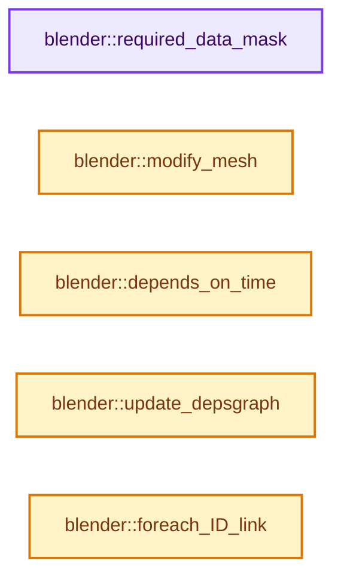
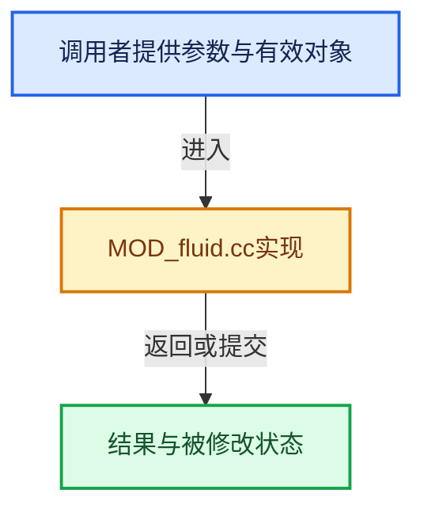

# 实现依赖专题：source/blender/modifiers/intern/MOD_fluid.cc

[实现依赖导航](../../../README.md) · [符号索引](../../../../00-课程指南/02-源码与提交索引/符号依赖与实现索引.md)

本专题从正文实际调用进入，集中保存共享实现。函数有稳定锚点，可从调用处直接跳到对应完整函数；递归与互相调用通过回链组织。

## 本文件的实现关系






## 完整成员与函数实现

<a id="f-55c8d7c01bbbf7e5"></a>

### `blender::required_data_mask`

实现位置：[source/blender/modifiers/intern/MOD_fluid.cc](../../../../../../../../source/blender/modifiers/intern/MOD_fluid.cc) · L67—L83。

接口参数：

- `ModifierData *md`
- `CustomData_MeshMasks *r_cddata_masks`

**教学注释版**

<!-- annotated:1be6f31978700a -->

```cpp
static void required_data_mask(ModifierData *md, CustomData_MeshMasks *r_cddata_masks)
{
  FluidModifierData *fmd = reinterpret_cast<FluidModifierData *>(md);

  if (fmd && (fmd->type & MOD_FLUID_TYPE_FLOW) && fmd->flow) {
    if (fmd->flow->source == FLUID_FLOW_SOURCE_MESH) {
      /* vertex groups */
      if (fmd->flow->vgroup_density) {
        r_cddata_masks->vmask |= CD_MASK_MDEFORMVERT;
      }
      /* uv layer */
      if (fmd->flow->texture_type == FLUID_FLOW_TEXTURE_MAP_UV) {
        r_cddata_masks->fmask |= CD_MASK_MTFACE;
      }
    }
  }
}
```

<details>
<summary>核对原始源码：source/blender/modifiers/intern/MOD_fluid.cc · L67—L83</summary>

<!-- original:1be6f31978700a:source/blender/modifiers/intern/MOD_fluid.cc:67:83 -->

```cpp
static void required_data_mask(ModifierData *md, CustomData_MeshMasks *r_cddata_masks)
{
  FluidModifierData *fmd = reinterpret_cast<FluidModifierData *>(md);

  if (fmd && (fmd->type & MOD_FLUID_TYPE_FLOW) && fmd->flow) {
    if (fmd->flow->source == FLUID_FLOW_SOURCE_MESH) {
      /* vertex groups */
      if (fmd->flow->vgroup_density) {
        r_cddata_masks->vmask |= CD_MASK_MDEFORMVERT;
      }
      /* uv layer */
      if (fmd->flow->texture_type == FLUID_FLOW_TEXTURE_MAP_UV) {
        r_cddata_masks->fmask |= CD_MASK_MTFACE;
      }
    }
  }
}
```

</details>

**沿实际写入检查状态**

- `r_cddata_masks->vmask |= CD_MASK_MDEFORMVERT;`
- `r_cddata_masks->fmask |= CD_MASK_MTFACE;`

**继续追踪实现**

本实现没有需要继续展开的显式调用；检查返回表达式、对象转换和调用者前置条件。

<a id="f-91b6794656049368"></a>

### `blender::modify_mesh`

实现位置：[source/blender/modifiers/intern/MOD_fluid.cc](../../../../../../../../source/blender/modifiers/intern/MOD_fluid.cc) · L110—L136。

接口参数：

- `ModifierData *md`
- `const ModifierEvalContext *ctx`
- `Mesh *mesh`

**教学注释版**

<!-- annotated:1b3f5a575bb302 -->

```cpp
static Mesh *modify_mesh(ModifierData *md, const ModifierEvalContext *ctx, Mesh *mesh)
{
#ifndef WITH_FLUID
  UNUSED_VARS(md, ctx);
  return mesh;
#else
  FluidModifierData *fmd = (FluidModifierData *)md;

  if (ctx->flag & MOD_APPLY_ORCO) {
    return mesh;
  }

  /* Isolate execution of Mantaflow when running from dependency graph. The reason for this is
   * because Mantaflow uses TBB to parallel its own computation which without isolation will start
   * stealing tasks from dependency graph. Stealing tasks from the dependency graph might cause
   * a recursive lock when Python drivers are used (because Mantaflow is interfaced via Python as
   * well). */
  FluidIsolationData isolation_data;
  isolation_data.depsgraph = ctx->depsgraph;
  isolation_data.object = ctx->object;
  isolation_data.mesh = mesh;
  isolation_data.fmd = fmd;
  BLI_task_isolate(fluid_modifier_do_isolated, &isolation_data);

  return isolation_data.result;
#endif /* WITH_FLUID */
}
```

<details>
<summary>核对原始源码：source/blender/modifiers/intern/MOD_fluid.cc · L110—L136</summary>

<!-- original:1b3f5a575bb302:source/blender/modifiers/intern/MOD_fluid.cc:110:136 -->

```cpp
static Mesh *modify_mesh(ModifierData *md, const ModifierEvalContext *ctx, Mesh *mesh)
{
#ifndef WITH_FLUID
  UNUSED_VARS(md, ctx);
  return mesh;
#else
  FluidModifierData *fmd = (FluidModifierData *)md;

  if (ctx->flag & MOD_APPLY_ORCO) {
    return mesh;
  }

  /* Isolate execution of Mantaflow when running from dependency graph. The reason for this is
   * because Mantaflow uses TBB to parallel its own computation which without isolation will start
   * stealing tasks from dependency graph. Stealing tasks from the dependency graph might cause
   * a recursive lock when Python drivers are used (because Mantaflow is interfaced via Python as
   * well). */
  FluidIsolationData isolation_data;
  isolation_data.depsgraph = ctx->depsgraph;
  isolation_data.object = ctx->object;
  isolation_data.mesh = mesh;
  isolation_data.fmd = fmd;
  BLI_task_isolate(fluid_modifier_do_isolated, &isolation_data);

  return isolation_data.result;
#endif /* WITH_FLUID */
}
```

</details>

**沿实际写入检查状态**

- `isolation_data.depsgraph = ctx->depsgraph;`
- `isolation_data.object = ctx->object;`
- `isolation_data.mesh = mesh;`
- `isolation_data.fmd = fmd;`

**结果出口**

- `return mesh;`
- `return isolation_data.result;`

**继续追踪实现**

- `UNUSED_VARS` → [UNUSED_VARS · L522](../../../01-BLI基础库/BLI_utildefines.hh.md#m-013582537634)；[UNUSED_VARS · L41](../../gpu/GPU_shader_shared_utils.hh.md#m-05d9d7a33da0)；[UNUSED_VARS · L62](../../gpu/GPU_shader_shared_utils.hh.md#m-e12c683a4aca)。宏定义由构建条件选择。
- `BLI_task_isolate` → [blender::BLI_task_isolate · L115](../../../../11-Depsgraph与并行任务系统/07-任务池与TBB接入.md#f-a745b4ecb6c311ab)。

<a id="f-5fb0bd41f1dd7229"></a>

### `blender::depends_on_time`

实现位置：[source/blender/modifiers/intern/MOD_fluid.cc](../../../../../../../../source/blender/modifiers/intern/MOD_fluid.cc) · L138—L141。

接口参数：

- `Scene *`
- `ModifierData *`

**教学注释版**

<!-- annotated:1bd9e7bdd062a5 -->

```cpp
static bool depends_on_time(Scene * /*scene*/, ModifierData * /*md*/)
{
  return true;
}
```

<details>
<summary>核对原始源码：source/blender/modifiers/intern/MOD_fluid.cc · L138—L141</summary>

<!-- original:1bd9e7bdd062a5:source/blender/modifiers/intern/MOD_fluid.cc:138:141 -->

```cpp
static bool depends_on_time(Scene * /*scene*/, ModifierData * /*md*/)
{
  return true;
}
```

</details>

**结果出口**

- `return true;`

**继续追踪实现**

本实现没有需要继续展开的显式调用；检查返回表达式、对象转换和调用者前置条件。

<a id="f-0c4806a071015a67"></a>

### `blender::update_depsgraph`

实现位置：[source/blender/modifiers/intern/MOD_fluid.cc](../../../../../../../../source/blender/modifiers/intern/MOD_fluid.cc) · L155—L186。

接口参数：

- `ModifierData *md`
- `const ModifierUpdateDepsgraphContext *ctx`

**教学注释版**

<!-- annotated:81ae3fb20be26f -->

```cpp
static void update_depsgraph(ModifierData *md, const ModifierUpdateDepsgraphContext *ctx)
{
  FluidModifierData *fmd = reinterpret_cast<FluidModifierData *>(md);

  if (fmd && (fmd->type & MOD_FLUID_TYPE_DOMAIN) && fmd->domain) {
    DEG_add_collision_relations(ctx->node,
                                ctx->object,
                                fmd->domain->fluid_group,
                                eModifierType_Fluid,
                                is_flow_cb,
                                "Fluid Flow");
    DEG_add_collision_relations(ctx->node,
                                ctx->object,
                                fmd->domain->effector_group,
                                eModifierType_Fluid,
                                is_coll_cb,
                                "Fluid Effector");
    DEG_add_forcefield_relations(ctx->node,
                                 ctx->object,
                                 fmd->domain->effector_weights,
                                 true,
                                 PFIELD_FLUIDFLOW,
                                 "Fluid Force Field");

    if (fmd->domain->guide_parent != nullptr) {
      DEG_add_object_relation(
          ctx->node, fmd->domain->guide_parent, DEG_OB_COMP_TRANSFORM, "Fluid Guiding Object");
      DEG_add_object_relation(
          ctx->node, fmd->domain->guide_parent, DEG_OB_COMP_GEOMETRY, "Fluid Guiding Object");
    }
  }
}
```

<details>
<summary>核对原始源码：source/blender/modifiers/intern/MOD_fluid.cc · L155—L186</summary>

<!-- original:81ae3fb20be26f:source/blender/modifiers/intern/MOD_fluid.cc:155:186 -->

```cpp
static void update_depsgraph(ModifierData *md, const ModifierUpdateDepsgraphContext *ctx)
{
  FluidModifierData *fmd = reinterpret_cast<FluidModifierData *>(md);

  if (fmd && (fmd->type & MOD_FLUID_TYPE_DOMAIN) && fmd->domain) {
    DEG_add_collision_relations(ctx->node,
                                ctx->object,
                                fmd->domain->fluid_group,
                                eModifierType_Fluid,
                                is_flow_cb,
                                "Fluid Flow");
    DEG_add_collision_relations(ctx->node,
                                ctx->object,
                                fmd->domain->effector_group,
                                eModifierType_Fluid,
                                is_coll_cb,
                                "Fluid Effector");
    DEG_add_forcefield_relations(ctx->node,
                                 ctx->object,
                                 fmd->domain->effector_weights,
                                 true,
                                 PFIELD_FLUIDFLOW,
                                 "Fluid Force Field");

    if (fmd->domain->guide_parent != nullptr) {
      DEG_add_object_relation(
          ctx->node, fmd->domain->guide_parent, DEG_OB_COMP_TRANSFORM, "Fluid Guiding Object");
      DEG_add_object_relation(
          ctx->node, fmd->domain->guide_parent, DEG_OB_COMP_GEOMETRY, "Fluid Guiding Object");
    }
  }
}
```

</details>

**继续追踪实现**

- `DEG_add_collision_relations` → [blender::DEG_add_collision_relations · L112](../../../06-Depsgraph依赖图/intern/depsgraph_physics.cc.md#f-a8a23fb36db5feb5)。
- `DEG_add_forcefield_relations` → [blender::DEG_add_forcefield_relations · L203](../../../06-Depsgraph依赖图/intern/depsgraph_physics.cc.md#f-1a87e7be20724278)。
- `DEG_add_object_relation` → [blender::DEG_add_object_relation · L123](../../../06-Depsgraph依赖图/intern/depsgraph_build.cc.md#f-f570cffae97e273c)。

<a id="f-98368271a676fdad"></a>

### `blender::foreach_ID_link`

实现位置：[source/blender/modifiers/intern/MOD_fluid.cc](../../../../../../../../source/blender/modifiers/intern/MOD_fluid.cc) · L188—L212。

接口参数：

- `ModifierData *md`
- `Object *ob`
- `IDWalkFunc walk`
- `void *user_data`

**教学注释版**

<!-- annotated:f81fbf7ffed266 -->

```cpp
static void foreach_ID_link(ModifierData *md, Object *ob, IDWalkFunc walk, void *user_data)
{
  FluidModifierData *fmd = reinterpret_cast<FluidModifierData *>(md);

  if (fmd->type == MOD_FLUID_TYPE_DOMAIN && fmd->domain) {
    walk(user_data, ob, reinterpret_cast<ID **>(&fmd->domain->effector_group), IDWALK_CB_NOP);
    walk(user_data, ob, reinterpret_cast<ID **>(&fmd->domain->fluid_group), IDWALK_CB_NOP);
    walk(user_data, ob, reinterpret_cast<ID **>(&fmd->domain->force_group), IDWALK_CB_NOP);

    if (fmd->domain->guide_parent) {
      walk(user_data, ob, reinterpret_cast<ID **>(&fmd->domain->guide_parent), IDWALK_CB_NOP);
    }

    if (fmd->domain->effector_weights) {
      walk(user_data,
           ob,
           reinterpret_cast<ID **>(&fmd->domain->effector_weights->group),
           IDWALK_CB_USER);
    }
  }

  if (fmd->type == MOD_FLUID_TYPE_FLOW && fmd->flow) {
    walk(user_data, ob, reinterpret_cast<ID **>(&fmd->flow->noise_texture), IDWALK_CB_USER);
  }
}
```

<details>
<summary>核对原始源码：source/blender/modifiers/intern/MOD_fluid.cc · L188—L212</summary>

<!-- original:f81fbf7ffed266:source/blender/modifiers/intern/MOD_fluid.cc:188:212 -->

```cpp
static void foreach_ID_link(ModifierData *md, Object *ob, IDWalkFunc walk, void *user_data)
{
  FluidModifierData *fmd = reinterpret_cast<FluidModifierData *>(md);

  if (fmd->type == MOD_FLUID_TYPE_DOMAIN && fmd->domain) {
    walk(user_data, ob, reinterpret_cast<ID **>(&fmd->domain->effector_group), IDWALK_CB_NOP);
    walk(user_data, ob, reinterpret_cast<ID **>(&fmd->domain->fluid_group), IDWALK_CB_NOP);
    walk(user_data, ob, reinterpret_cast<ID **>(&fmd->domain->force_group), IDWALK_CB_NOP);

    if (fmd->domain->guide_parent) {
      walk(user_data, ob, reinterpret_cast<ID **>(&fmd->domain->guide_parent), IDWALK_CB_NOP);
    }

    if (fmd->domain->effector_weights) {
      walk(user_data,
           ob,
           reinterpret_cast<ID **>(&fmd->domain->effector_weights->group),
           IDWALK_CB_USER);
    }
  }

  if (fmd->type == MOD_FLUID_TYPE_FLOW && fmd->flow) {
    walk(user_data, ob, reinterpret_cast<ID **>(&fmd->flow->noise_texture), IDWALK_CB_USER);
  }
}
```

</details>

**继续追踪实现**

- `walk` → [调用协议](../../../../00-课程指南/01-路线与规范/模板宏与动态分派协议.md)：局部可调用对象，须结合其初始化与捕获环境。调用位置L193。
