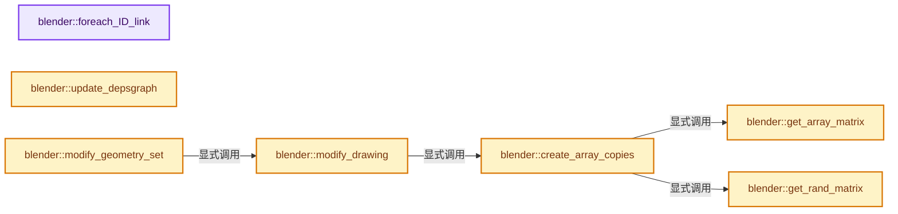
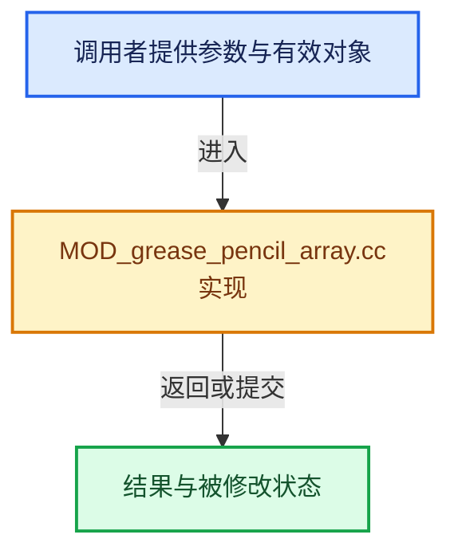

# 实现依赖专题：source/blender/modifiers/intern/MOD_grease_pencil_array.cc

[实现依赖导航](../../../README.md) · [符号索引](../../../../00-课程指南/02-源码与提交索引/符号依赖与实现索引.md)

本专题从正文实际调用进入，集中保存共享实现。函数有稳定锚点，可从调用处直接跳到对应完整函数；递归与互相调用通过回链组织。

## 本文件的实现关系






## 完整成员与函数实现

<a id="f-0179cdf8612697d5"></a>

### `blender::foreach_ID_link`

实现位置：[source/blender/modifiers/intern/MOD_grease_pencil_array.cc](../../../../../../../../source/blender/modifiers/intern/MOD_grease_pencil_array.cc) · L69—L74。

接口参数：

- `ModifierData *md`
- `Object *ob`
- `IDWalkFunc walk`
- `void *user_data`

**教学注释版**

<!-- annotated:cec6ab640ea49b -->

```cpp
static void foreach_ID_link(ModifierData *md, Object *ob, IDWalkFunc walk, void *user_data)
{
  auto *mmd = reinterpret_cast<GreasePencilArrayModifierData *>(md);
  walk(user_data, ob, reinterpret_cast<ID **>(&mmd->object), IDWALK_CB_NOP);
  modifier::greasepencil::foreach_influence_ID_link(&mmd->influence, ob, walk, user_data);
}
```

<details>
<summary>核对原始源码：source/blender/modifiers/intern/MOD_grease_pencil_array.cc · L69—L74</summary>

<!-- original:cec6ab640ea49b:source/blender/modifiers/intern/MOD_grease_pencil_array.cc:69:74 -->

```cpp
static void foreach_ID_link(ModifierData *md, Object *ob, IDWalkFunc walk, void *user_data)
{
  auto *mmd = reinterpret_cast<GreasePencilArrayModifierData *>(md);
  walk(user_data, ob, reinterpret_cast<ID **>(&mmd->object), IDWALK_CB_NOP);
  modifier::greasepencil::foreach_influence_ID_link(&mmd->influence, ob, walk, user_data);
}
```

</details>

**继续追踪实现**

- `walk` → [调用协议](../../../../00-课程指南/01-路线与规范/模板宏与动态分派协议.md)：局部可调用对象，须结合其初始化与捕获环境。调用位置L72。
- `modifier::greasepencil::foreach_influence_ID_link` → [blender::modifier::greasepencil::foreach_influence_ID_link · L69](MOD_grease_pencil_util.cc.md#f-247ba56fa4c4e56f)。

<a id="f-488fd7d7713067d0"></a>

### `blender::update_depsgraph`

实现位置：[source/blender/modifiers/intern/MOD_grease_pencil_array.cc](../../../../../../../../source/blender/modifiers/intern/MOD_grease_pencil_array.cc) · L76—L84。

接口参数：

- `ModifierData *md`
- `const ModifierUpdateDepsgraphContext *ctx`

**教学注释版**

<!-- annotated:d50900c5c9d69b -->

```cpp
static void update_depsgraph(ModifierData *md, const ModifierUpdateDepsgraphContext *ctx)
{
  auto *mmd = reinterpret_cast<GreasePencilArrayModifierData *>(md);
  if (mmd->object != nullptr) {
    DEG_add_object_relation(
        ctx->node, mmd->object, DEG_OB_COMP_TRANSFORM, "Grease Pencil Array Modifier");
    DEG_add_depends_on_transform_relation(ctx->node, "Grease Pencil Array Modifier");
  }
}
```

<details>
<summary>核对原始源码：source/blender/modifiers/intern/MOD_grease_pencil_array.cc · L76—L84</summary>

<!-- original:d50900c5c9d69b:source/blender/modifiers/intern/MOD_grease_pencil_array.cc:76:84 -->

```cpp
static void update_depsgraph(ModifierData *md, const ModifierUpdateDepsgraphContext *ctx)
{
  auto *mmd = reinterpret_cast<GreasePencilArrayModifierData *>(md);
  if (mmd->object != nullptr) {
    DEG_add_object_relation(
        ctx->node, mmd->object, DEG_OB_COMP_TRANSFORM, "Grease Pencil Array Modifier");
    DEG_add_depends_on_transform_relation(ctx->node, "Grease Pencil Array Modifier");
  }
}
```

</details>

**继续追踪实现**

- `DEG_add_object_relation` → [blender::DEG_add_object_relation · L123](../../../06-Depsgraph依赖图/intern/depsgraph_build.cc.md#f-f570cffae97e273c)。
- `DEG_add_depends_on_transform_relation` → [blender::DEG_add_depends_on_transform_relation · L240](../../../06-Depsgraph依赖图/intern/depsgraph_build.cc.md#f-47c32a354defa20d)。

<a id="f-0f1c875541b11223"></a>

### `blender::get_array_matrix`

实现位置：[source/blender/modifiers/intern/MOD_grease_pencil_array.cc](../../../../../../../../source/blender/modifiers/intern/MOD_grease_pencil_array.cc) · L86—L111。

接口参数：

- `const Object &ob`
- `const GreasePencilArrayModifierData &mmd`
- `const int elem_idx`
- `const bool use_object_offset`

**教学注释版**

<!-- annotated:0b8d34108a3fa7 -->

```cpp
static float4x4 get_array_matrix(const Object &ob,
                                 const GreasePencilArrayModifierData &mmd,
                                 const int elem_idx,
                                 const bool use_object_offset)
{

  if (use_object_offset) {
    float4x4 mat_offset = float4x4::identity();

    if (mmd.flag & MOD_GREASE_PENCIL_ARRAY_USE_OFFSET) {
      mat_offset[3] += mmd.offset;
    }
    const float4x4 &obinv = ob.world_to_object();

    return mat_offset * obinv * mmd.object->object_to_world();
  }

  const float3 offset = [&]() {
    if (mmd.flag & MOD_GREASE_PENCIL_ARRAY_USE_OFFSET) {
      return float3(mmd.offset) * elem_idx;
    }
    return float3(0.0f);
  }();

  return math::from_location<float4x4>(offset);
}
```

<details>
<summary>核对原始源码：source/blender/modifiers/intern/MOD_grease_pencil_array.cc · L86—L111</summary>

<!-- original:0b8d34108a3fa7:source/blender/modifiers/intern/MOD_grease_pencil_array.cc:86:111 -->

```cpp
static float4x4 get_array_matrix(const Object &ob,
                                 const GreasePencilArrayModifierData &mmd,
                                 const int elem_idx,
                                 const bool use_object_offset)
{

  if (use_object_offset) {
    float4x4 mat_offset = float4x4::identity();

    if (mmd.flag & MOD_GREASE_PENCIL_ARRAY_USE_OFFSET) {
      mat_offset[3] += mmd.offset;
    }
    const float4x4 &obinv = ob.world_to_object();

    return mat_offset * obinv * mmd.object->object_to_world();
  }

  const float3 offset = [&]() {
    if (mmd.flag & MOD_GREASE_PENCIL_ARRAY_USE_OFFSET) {
      return float3(mmd.offset) * elem_idx;
    }
    return float3(0.0f);
  }();

  return math::from_location<float4x4>(offset);
}
```

</details>

**沿实际写入检查状态**

- `mat_offset[3] += mmd.offset;`

**结果出口**

- `return mat_offset * obinv * mmd.object->object_to_world();`
- `return float3(mmd.offset) * elem_idx;`
- `return float3(0.0f);`
- `return math::from_location<float4x4>(offset);`

**继续追踪实现**

- `float4x4::identity` → [调用协议](../../../../00-课程指南/01-路线与规范/模板宏与动态分派协议.md)：函数指针、局部可调用对象或未展开的宏；必须结合调用者环境。调用位置L93。
- `ob.world_to_object` → [blender::Object::world_to_object · L5766](../../../02-BKE几何与数据/intern/object.cc.md#f-dd4d8d55d6195233)。
- `mmd.object->object_to_world` → [调用协议](../../../../00-课程指南/01-路线与规范/模板宏与动态分派协议.md)：接收对象类型依赖auto、返回值或模板实例；不按同名猜测目标。调用位置L100。
- `[&]() { if (mmd.flag & MOD_GREASE_PENCIL_ARRAY_USE_OFFSET) { return float3(mmd.offset) * elem_idx; } return float3(0.0f); }` → [blender::() · L390](../../../01-BLI基础库/BLI_math_vector_types.hh.md#f-26f597afed18e002)。
- `float3` → [float3 · L641](../../compositor/algorithms/intern/smaa.cc.md#m-0ea8254cfdb4)。宏定义由构建条件选择。
- `math::from_location<float4x4>` → [调用协议](../../../../00-课程指南/01-路线与规范/模板宏与动态分派协议.md)：函数指针、局部可调用对象或未展开的宏；必须结合调用者环境。调用位置L110。

<a id="f-a6dce13ad8779480"></a>

### `blender::get_rand_matrix`

实现位置：[source/blender/modifiers/intern/MOD_grease_pencil_array.cc](../../../../../../../../source/blender/modifiers/intern/MOD_grease_pencil_array.cc) · L113—L145。

接口参数：

- `const GreasePencilArrayModifierData &mmd`
- `const Object &ob`
- `const int elem_id`

**教学注释版**

<!-- annotated:c90ff11649615a -->

```cpp
static float4x4 get_rand_matrix(const GreasePencilArrayModifierData &mmd,
                                const Object &ob,
                                const int elem_id)
{
  int seed = mmd.seed;
  seed += BLI_hash_string(ob.id.name + 2);
  seed += BLI_hash_string(mmd.modifier.name);
  const float rand_offset = BLI_hash_int_01(seed);
  float3x3 rand;
  for (int j = 0; j < 3; j++) {
    const uint3 primes(2, 3, 7);
    double3 offset(0.0);
    double3 r;
    /* To ensure a nice distribution, we use halton sequence and offset using the seed. */
    BLI_halton_3d(primes, offset, elem_id, r);

    if ((mmd.flag & MOD_GREASE_PENCIL_ARRAY_UNIFORM_RANDOM_SCALE) && j == 2) {
      float rand_value;
      rand_value = math::mod(r[0] * 2.0 - 1.0 + rand_offset, 1.0);
      rand_value = math::mod(math::sin(rand_value * 12.9898 + j * 78.233) * 43758.5453, 1.0);
      rand[j] = float3(rand_value);
    }
    else {
      for (int i = 0; i < 3; i++) {
        rand[j][i] = math::mod(r[i] * 2.0 - 1.0 + rand_offset, 1.0);
        rand[j][i] = math::mod(math::sin(rand[j][i] * 12.9898 + j * 78.233) * 43758.5453, 1.0);
      }
    }
  }
  /* Calculate Random matrix. */
  return math::from_loc_rot_scale<float4x4>(
      mmd.rnd_offset * rand[0], mmd.rnd_rot * rand[1], float3(1.0f) + mmd.rnd_scale * rand[2]);
};
```

<details>
<summary>核对原始源码：source/blender/modifiers/intern/MOD_grease_pencil_array.cc · L113—L145</summary>

<!-- original:c90ff11649615a:source/blender/modifiers/intern/MOD_grease_pencil_array.cc:113:145 -->

```cpp
static float4x4 get_rand_matrix(const GreasePencilArrayModifierData &mmd,
                                const Object &ob,
                                const int elem_id)
{
  int seed = mmd.seed;
  seed += BLI_hash_string(ob.id.name + 2);
  seed += BLI_hash_string(mmd.modifier.name);
  const float rand_offset = BLI_hash_int_01(seed);
  float3x3 rand;
  for (int j = 0; j < 3; j++) {
    const uint3 primes(2, 3, 7);
    double3 offset(0.0);
    double3 r;
    /* To ensure a nice distribution, we use halton sequence and offset using the seed. */
    BLI_halton_3d(primes, offset, elem_id, r);

    if ((mmd.flag & MOD_GREASE_PENCIL_ARRAY_UNIFORM_RANDOM_SCALE) && j == 2) {
      float rand_value;
      rand_value = math::mod(r[0] * 2.0 - 1.0 + rand_offset, 1.0);
      rand_value = math::mod(math::sin(rand_value * 12.9898 + j * 78.233) * 43758.5453, 1.0);
      rand[j] = float3(rand_value);
    }
    else {
      for (int i = 0; i < 3; i++) {
        rand[j][i] = math::mod(r[i] * 2.0 - 1.0 + rand_offset, 1.0);
        rand[j][i] = math::mod(math::sin(rand[j][i] * 12.9898 + j * 78.233) * 43758.5453, 1.0);
      }
    }
  }
  /* Calculate Random matrix. */
  return math::from_loc_rot_scale<float4x4>(
      mmd.rnd_offset * rand[0], mmd.rnd_rot * rand[1], float3(1.0f) + mmd.rnd_scale * rand[2]);
};
```

</details>

**沿实际写入检查状态**

- `seed += BLI_hash_string(ob.id.name + 2);`
- `seed += BLI_hash_string(mmd.modifier.name);`
- `rand_value = math::mod(r[0] * 2.0 - 1.0 + rand_offset, 1.0);`
- `rand_value = math::mod(math::sin(rand_value * 12.9898 + j * 78.233) * 43758.5453, 1.0);`
- `rand[j] = float3(rand_value);`
- `rand[j][i] = math::mod(r[i] * 2.0 - 1.0 + rand_offset, 1.0);`
- `rand[j][i] = math::mod(math::sin(rand[j][i] * 12.9898 + j * 78.233) * 43758.5453, 1.0);`

**结果出口**

- `return math::from_loc_rot_scale<float4x4>(`

**继续追踪实现**

- `BLI_hash_string` → [blender::BLI_hash_string · L69](../../../01-BLI基础库/BLI_hash_c.hh.md#f-0f3487d576368d89)。
- `BLI_hash_int_01` → [blender::BLI_hash_int_01 · L94](../../../01-BLI基础库/BLI_hash_c.hh.md#f-5f15d616cd371045)。
- `BLI_halton_3d` → [RNG::BLI_halton_3d · L252](../../../01-BLI基础库/intern/rand.cc.md#f-5c37d529e0d07122)。
- `math::mod` → [blender::math::mod · L157](../../../01-BLI基础库/BLI_math_vector.hh.md#f-63a20db59a1da3e5)；[blender::math::mod · L163](../../../01-BLI基础库/BLI_math_vector.hh.md#f-f0283c16ea40d512)；[blender::math::mod · L79](../../../01-BLI基础库/BLI_math_base.hh.md#f-785d692213a12449)。同名重载需按实参类型选择。
- `math::sin` → [外部契约](https://eel.is/c++draft/)：这个边界按实际表达式及所属类型核对参数、返回值、寿命与失败行为。这里提供接口入口，不声称已解释该第三方版本的内部实现。
- `float3` → [float3 · L641](../../compositor/algorithms/intern/smaa.cc.md#m-0ea8254cfdb4)。宏定义由构建条件选择。
- `math::from_loc_rot_scale<float4x4>` → [调用协议](../../../../00-课程指南/01-路线与规范/模板宏与动态分派协议.md)：函数指针、局部可调用对象或未展开的宏；必须结合调用者环境。调用位置L143。

<a id="f-f08483cd0e337be5"></a>

### `blender::create_array_copies`

实现位置：[source/blender/modifiers/intern/MOD_grease_pencil_array.cc](../../../../../../../../source/blender/modifiers/intern/MOD_grease_pencil_array.cc) · L147—L222。

接口参数：

- `const Object &ob`
- `const GreasePencilArrayModifierData &mmd`
- `const bke::CurvesGeometry &base_curves`
- `bke::CurvesGeometry filtered_curves`

**教学注释版**

<!-- annotated:fc469f0dd349a0 -->

```cpp
static bke::CurvesGeometry create_array_copies(const Object &ob,
                                               const GreasePencilArrayModifierData &mmd,
                                               const bke::CurvesGeometry &base_curves,
                                               bke::CurvesGeometry filtered_curves)
{
  /* Assign replacement material on filtered curves so all copies can have this material when later
   * when they get instanced. */
  if (mmd.mat_rpl > 0) {
    bke::MutableAttributeAccessor attributes = filtered_curves.attributes_for_write();
    bke::SpanAttributeWriter<int> stroke_materials = attributes.lookup_or_add_for_write_span<int>(
        "material_index", bke::AttrDomain::Curve);
    stroke_materials.span.fill(mmd.mat_rpl - 1);
    stroke_materials.finish();
  }

  Curves *base_curves_id = bke::curves_new_nomain(base_curves);
  Curves *filtered_curves_id = bke::curves_new_nomain(filtered_curves);
  bke::GeometrySet base_geo = bke::GeometrySet::from_curves(base_curves_id);
  bke::GeometrySet filtered_geo = bke::GeometrySet::from_curves(filtered_curves_id);

  // [讲解] std::make_unique<bke::Instances>：创建独占拥有的对象，拥有关系可移动，get返回的借用指针不自动延长寿命。
  auto instances = std::make_unique<bke::Instances>(mmd.count);
  const int base_handle = instances->add_reference(bke::InstanceReference{base_geo});
  const int filtered_handle = instances->add_reference(bke::InstanceReference{filtered_geo});

  /* Always add untouched original curves. */
  MutableSpan<int> handles = instances->reference_handles_for_write();
  MutableSpan<float4x4> transforms = instances->transforms_for_write();

  // [讲解] handles.first：按视图边界访问元素。
  handles.first() = base_handle;
  transforms.first() = float4x4::identity();

  float3 size(0.0f);
  if (mmd.flag & MOD_GREASE_PENCIL_ARRAY_USE_RELATIVE) {
    std::optional<Bounds<float3>> bounds = filtered_curves.bounds_min_max();
    if (bounds.has_value()) {
      size = bounds.value().max - bounds.value().min;
      /* Need a minimum size (for flat drawings). */
      size = math::max(size, float3(0.01f));
    }
  }

  float4x4 current_offset = float4x4::identity();
  for (const int elem_id : IndexRange(1, mmd.count - 1)) {
    const bool use_object_offset = (mmd.flag & MOD_GREASE_PENCIL_ARRAY_USE_OB_OFFSET) &&
                                   (mmd.object);
    const float4x4 mat = get_array_matrix(ob, mmd, elem_id, use_object_offset);

    if (use_object_offset) {
      current_offset = current_offset * mat;
    }
    else {
      current_offset = mat;
    }

    /* Apply relative offset. */
    if (mmd.flag & MOD_GREASE_PENCIL_ARRAY_USE_RELATIVE) {
      float3 relative = size * float3(mmd.shift);
      float3 translate = relative * float3(float(elem_id));
      current_offset.w += float4(translate, 1.0f);
    }

    current_offset *= get_rand_matrix(mmd, ob, elem_id);

    handles[elem_id] = filtered_handle;
    transforms[elem_id] = current_offset;
  }

  geometry::RealizeInstancesOptions options;
  options.keep_original_ids = true;
  options.realize_instance_attributes = false; /* Should this be true? */
  bke::GeometrySet result_geo = geometry::realize_instances(
                                    // [讲解] std::move：把表达式转换成可供移动重载选择的值类别；不保证真的移动，不结束源对象寿命，对const值可能选择复制。
                                    bke::GeometrySet::from_instances(std::move(instances)),
                                    options)
                                    .geometry;
  return std::move(result_geo.get_curves_for_write()->geometry.wrap());
}
```

<details>
<summary>核对原始源码：source/blender/modifiers/intern/MOD_grease_pencil_array.cc · L147—L222</summary>

<!-- original:fc469f0dd349a0:source/blender/modifiers/intern/MOD_grease_pencil_array.cc:147:222 -->

```cpp
static bke::CurvesGeometry create_array_copies(const Object &ob,
                                               const GreasePencilArrayModifierData &mmd,
                                               const bke::CurvesGeometry &base_curves,
                                               bke::CurvesGeometry filtered_curves)
{
  /* Assign replacement material on filtered curves so all copies can have this material when later
   * when they get instanced. */
  if (mmd.mat_rpl > 0) {
    bke::MutableAttributeAccessor attributes = filtered_curves.attributes_for_write();
    bke::SpanAttributeWriter<int> stroke_materials = attributes.lookup_or_add_for_write_span<int>(
        "material_index", bke::AttrDomain::Curve);
    stroke_materials.span.fill(mmd.mat_rpl - 1);
    stroke_materials.finish();
  }

  Curves *base_curves_id = bke::curves_new_nomain(base_curves);
  Curves *filtered_curves_id = bke::curves_new_nomain(filtered_curves);
  bke::GeometrySet base_geo = bke::GeometrySet::from_curves(base_curves_id);
  bke::GeometrySet filtered_geo = bke::GeometrySet::from_curves(filtered_curves_id);

  auto instances = std::make_unique<bke::Instances>(mmd.count);
  const int base_handle = instances->add_reference(bke::InstanceReference{base_geo});
  const int filtered_handle = instances->add_reference(bke::InstanceReference{filtered_geo});

  /* Always add untouched original curves. */
  MutableSpan<int> handles = instances->reference_handles_for_write();
  MutableSpan<float4x4> transforms = instances->transforms_for_write();

  handles.first() = base_handle;
  transforms.first() = float4x4::identity();

  float3 size(0.0f);
  if (mmd.flag & MOD_GREASE_PENCIL_ARRAY_USE_RELATIVE) {
    std::optional<Bounds<float3>> bounds = filtered_curves.bounds_min_max();
    if (bounds.has_value()) {
      size = bounds.value().max - bounds.value().min;
      /* Need a minimum size (for flat drawings). */
      size = math::max(size, float3(0.01f));
    }
  }

  float4x4 current_offset = float4x4::identity();
  for (const int elem_id : IndexRange(1, mmd.count - 1)) {
    const bool use_object_offset = (mmd.flag & MOD_GREASE_PENCIL_ARRAY_USE_OB_OFFSET) &&
                                   (mmd.object);
    const float4x4 mat = get_array_matrix(ob, mmd, elem_id, use_object_offset);

    if (use_object_offset) {
      current_offset = current_offset * mat;
    }
    else {
      current_offset = mat;
    }

    /* Apply relative offset. */
    if (mmd.flag & MOD_GREASE_PENCIL_ARRAY_USE_RELATIVE) {
      float3 relative = size * float3(mmd.shift);
      float3 translate = relative * float3(float(elem_id));
      current_offset.w += float4(translate, 1.0f);
    }

    current_offset *= get_rand_matrix(mmd, ob, elem_id);

    handles[elem_id] = filtered_handle;
    transforms[elem_id] = current_offset;
  }

  geometry::RealizeInstancesOptions options;
  options.keep_original_ids = true;
  options.realize_instance_attributes = false; /* Should this be true? */
  bke::GeometrySet result_geo = geometry::realize_instances(
                                    bke::GeometrySet::from_instances(std::move(instances)),
                                    options)
                                    .geometry;
  return std::move(result_geo.get_curves_for_write()->geometry.wrap());
}
```

</details>

**沿实际写入检查状态**

- `size = bounds.value().max - bounds.value().min;`
- `size = math::max(size, float3(0.01f));`
- `current_offset = current_offset * mat;`
- `current_offset = mat;`
- `current_offset.w += float4(translate, 1.0f);`
- `current_offset *= get_rand_matrix(mmd, ob, elem_id);`
- `handles[elem_id] = filtered_handle;`
- `transforms[elem_id] = current_offset;`
- `options.keep_original_ids = true;`
- `options.realize_instance_attributes = false; /* Should this be true? */`

**结果出口**

- `return std::move(result_geo.get_curves_for_write()->geometry.wrap());`

**继续追踪实现**

- `filtered_curves.attributes_for_write` → [blender::bke::CurvesGeometry::attributes_for_write · L1913](../../../02-BKE几何与数据/intern/curves_geometry.cc.md#f-4930091b34fa9663)。
- `attributes.lookup_or_add_for_write_span<int>` → [blender::bke::MutableAttributeAccessor::lookup_or_add_for_write_span · L533](../../../02-BKE几何与数据/intern/attribute_access.cc.md#f-c533eff1b9a4973e)；[blender::bke::MutableAttributeAccessor::lookup_or_add_for_write_span · L861](../../../../05-几何存储与拓扑映射/08-AttributeAccessor接口.md#f-aa4c0d5a61437381)。同名重载需按实参类型选择。
- `stroke_materials.span.fill` → [调用协议](../../../../00-课程指南/01-路线与规范/模板宏与动态分派协议.md)：接收对象类型依赖auto、返回值或模板实例；不按同名猜测目标。调用位置L158。
- `stroke_materials.finish` → [blender::bke::SpanAttributeWriter::finish · L279](../../../../05-几何存储与拓扑映射/08-AttributeAccessor接口.md#f-585970a3b1bd4da4)。
- `bke::curves_new_nomain` → [blender::bke::curves_new_nomain · L293](../../../02-BKE几何与数据/intern/curves.cc.md#f-702debf916bbedac)；[blender::bke::curves_new_nomain · L312](../../../02-BKE几何与数据/intern/curves.cc.md#f-ba10c7025cf69460)。同名重载需按实参类型选择。
- `bke::GeometrySet::from_curves` → [blender::bke::GeometrySet::from_curves · L448](../../../../06-隐式共享与缓存系统/05-GeometrySet读写与复制.md#f-4a638adc47cc3b9f)。
- `std::make_unique<bke::Instances>` → [外部契约](https://eel.is/c++draft/unique.ptr.create)：创建独占拥有的对象，拥有关系可移动，get返回的借用指针不自动延长寿命。
- `instances->add_reference` → [调用协议](../../../../00-课程指南/01-路线与规范/模板宏与动态分派协议.md)：接收对象类型依赖auto、返回值或模板实例；不按同名猜测目标。调用位置L168。
- `instances->reference_handles_for_write` → [调用协议](../../../../00-课程指南/01-路线与规范/模板宏与动态分派协议.md)：接收对象类型依赖auto、返回值或模板实例；不按同名猜测目标。调用位置L172。
- `instances->transforms_for_write` → [调用协议](../../../../00-课程指南/01-路线与规范/模板宏与动态分派协议.md)：接收对象类型依赖auto、返回值或模板实例；不按同名猜测目标。调用位置L173。
- `handles.first` → [blender::MutableSpan::first · L685](../../../../01-基础容器与现代CPP/06-MutableSpan可写视图.md#f-3126bab9f43cee1c)。
- `transforms.first` → [blender::MutableSpan::first · L685](../../../../01-基础容器与现代CPP/06-MutableSpan可写视图.md#f-3126bab9f43cee1c)。
- `float4x4::identity` → [调用协议](../../../../00-课程指南/01-路线与规范/模板宏与动态分派协议.md)：函数指针、局部可调用对象或未展开的宏；必须结合调用者环境。调用位置L176。
- `filtered_curves.bounds_min_max` → [blender::bke::CurvesGeometry::bounds_min_max · L1387](../../../02-BKE几何与数据/intern/curves_geometry.cc.md#f-e78ebd6166cb7509)。
- `bounds.has_value` → [外部契约](https://eel.is/c++draft/)：这个边界按实际表达式及所属类型核对参数、返回值、寿命与失败行为。这里提供接口入口，不声称已解释该第三方版本的内部实现。
- `bounds.value` → [外部契约](https://eel.is/c++draft/)：这个边界按实际表达式及所属类型核对参数、返回值、寿命与失败行为。这里提供接口入口，不声称已解释该第三方版本的内部实现。
- `math::max` → [blender::math::max · L87](../../../01-BLI基础库/BLI_math_vector.hh.md#f-9be564a293777d6b)；[blender::math::max · L96](../../../01-BLI基础库/BLI_math_vector.hh.md#f-ce32dff37d0af3bc)；[blender::math::max · L112](../../../01-BLI基础库/BLI_math_vector.hh.md#f-668eb1fcf1fa8292)；[blender::math::max · L49](../../../01-BLI基础库/BLI_math_base.hh.md#f-a6991ca3d12937e1)。同名重载需按实参类型选择。
- `float3` → [float3 · L641](../../compositor/algorithms/intern/smaa.cc.md#m-0ea8254cfdb4)。宏定义由构建条件选择。
- `IndexRange` → [blender::IndexRange](../../../01-BLI基础库/BLI_index_range.hh.md#t-caa3466d6776)；[blender::gpu::shader::parser::IndexRange](../../gpu/shader_tool/utils.hh.md#t-82d2bd4ea71c)；[blender::IndexRange](../../makesdna/DNA_node_types.h.md#t-0448cc889d39)。
- `get_array_matrix` → [blender::get_array_matrix · L86](MOD_grease_pencil_array.cc.md#f-0f1c875541b11223)。
- `float4` → [float4 · L56](../../../07-Intern运行时与平台/cycles/kernel/svm/radial_tiling_shared.h.md#m-f0908e385c5b)；[float4 · L60](../../../01-BLI基础库/intern/radial_tiling_shared.hh.md#m-7962dcdc288b)；[float4 · L56](../../../07-Intern运行时与平台/cycles/kernel/osl/shaders/node_radial_tiling_shared.h.md#m-adb8e9e87775)；[float4 · L642](../../compositor/algorithms/intern/smaa.cc.md#m-9362daaa821c)。宏定义由构建条件选择。
- `get_rand_matrix` → [blender::get_rand_matrix · L113](MOD_grease_pencil_array.cc.md#f-a6dce13ad8779480)。
- `geometry::realize_instances` → [blender::geometry::realize_instances · L2925](../../../05-Geometry几何算法/intern/realize_instances.cc.md#f-1bab21a4d5d19aba)；[blender::geometry::realize_instances · L2939](../../../05-Geometry几何算法/intern/realize_instances.cc.md#f-7004abf3ef784a6a)。同名重载需按实参类型选择。
- `bke::GeometrySet::from_instances` → [blender::bke::GeometrySet::from_instances · L455](../../../../06-隐式共享与缓存系统/05-GeometrySet读写与复制.md#f-0c23a168248fb2cb)；[blender::bke::GeometrySet::from_instances · L462](../../../../06-隐式共享与缓存系统/05-GeometrySet读写与复制.md#f-447a100ea7cfda47)。同名重载需按实参类型选择。
- `std::move` → [外部契约](https://eel.is/c++draft/utility.forward)：把表达式转换成可供移动重载选择的值类别；不保证真的移动，不结束源对象寿命，对const值可能选择复制。
- `result_geo.get_curves_for_write()->geometry.wrap` → [调用协议](../../../../00-课程指南/01-路线与规范/模板宏与动态分派协议.md)：接收对象类型依赖auto、返回值或模板实例；不按同名猜测目标。调用位置L221。
- `result_geo.get_curves_for_write` → [blender::bke::GeometrySet::get_curves_for_write · L580](../../../../06-隐式共享与缓存系统/05-GeometrySet读写与复制.md#f-95199063db32b8f7)。

<a id="f-44bd7eb37cfeff63"></a>

### `blender::modify_drawing`

实现位置：[source/blender/modifiers/intern/MOD_grease_pencil_array.cc](../../../../../../../../source/blender/modifiers/intern/MOD_grease_pencil_array.cc) · L224—L254。

接口参数：

- `const GreasePencilArrayModifierData &mmd`
- `const ModifierEvalContext &ctx`
- `bke::greasepencil::Drawing &drawing`

**教学注释版**

<!-- annotated:64d667433efea0 -->

```cpp
static void modify_drawing(const GreasePencilArrayModifierData &mmd,
                           const ModifierEvalContext &ctx,
                           bke::greasepencil::Drawing &drawing)
{
  const bke::CurvesGeometry &src_curves = drawing.strokes();
  if (src_curves.curve_num == 0) {
    return;
  }

  IndexMaskMemory curve_mask_memory;
  const IndexMask curves_mask = modifier::greasepencil::get_filtered_stroke_mask(
      ctx.object, src_curves, mmd.influence, curve_mask_memory);

  if (curves_mask.size() == src_curves.curve_num) {
    /* Make a full copy so we can modify materials inside #create_array_copies before instancing.
     */
    bke::CurvesGeometry copy = bke::CurvesGeometry(src_curves);

    drawing.strokes_for_write() = create_array_copies(
        // [讲解] std::move：把表达式转换成可供移动重载选择的值类别；不保证真的移动，不结束源对象寿命，对const值可能选择复制。
        *ctx.object, mmd, src_curves, std::move(copy));
  }
  else {
    bke::CurvesGeometry masked_curves = bke::curves_copy_curve_selection(
        src_curves, curves_mask, {});

    drawing.strokes_for_write() = create_array_copies(
        *ctx.object, mmd, src_curves, std::move(masked_curves));
  }

  drawing.tag_topology_changed();
}
```

<details>
<summary>核对原始源码：source/blender/modifiers/intern/MOD_grease_pencil_array.cc · L224—L254</summary>

<!-- original:64d667433efea0:source/blender/modifiers/intern/MOD_grease_pencil_array.cc:224:254 -->

```cpp
static void modify_drawing(const GreasePencilArrayModifierData &mmd,
                           const ModifierEvalContext &ctx,
                           bke::greasepencil::Drawing &drawing)
{
  const bke::CurvesGeometry &src_curves = drawing.strokes();
  if (src_curves.curve_num == 0) {
    return;
  }

  IndexMaskMemory curve_mask_memory;
  const IndexMask curves_mask = modifier::greasepencil::get_filtered_stroke_mask(
      ctx.object, src_curves, mmd.influence, curve_mask_memory);

  if (curves_mask.size() == src_curves.curve_num) {
    /* Make a full copy so we can modify materials inside #create_array_copies before instancing.
     */
    bke::CurvesGeometry copy = bke::CurvesGeometry(src_curves);

    drawing.strokes_for_write() = create_array_copies(
        *ctx.object, mmd, src_curves, std::move(copy));
  }
  else {
    bke::CurvesGeometry masked_curves = bke::curves_copy_curve_selection(
        src_curves, curves_mask, {});

    drawing.strokes_for_write() = create_array_copies(
        *ctx.object, mmd, src_curves, std::move(masked_curves));
  }

  drawing.tag_topology_changed();
}
```

</details>

**继续追踪实现**

- `drawing.strokes` → [blender::bke::greasepencil::Drawing::strokes · L1007](../../../02-BKE几何与数据/intern/grease_pencil.cc.md#f-59e6522a8e8ac409)。
- `modifier::greasepencil::get_filtered_stroke_mask` → [blender::modifier::greasepencil::get_filtered_stroke_mask · L285](MOD_grease_pencil_util.cc.md#f-30c219d04de7dec3)；[blender::modifier::greasepencil::get_filtered_stroke_mask · L326](MOD_grease_pencil_util.cc.md#f-970c3bc880e4f350)。同名重载需按实参类型选择。
- `curves_mask.size` → [blender::index_mask::IndexMask::size · L743](../../../../04-虚拟数组与索引选择/09-分段存储与遍历.md#f-0163b32abc9a0d9c)。
- `bke::CurvesGeometry` → [blender::bke::CurvesGeometry::CurvesGeometry · L65](../../../02-BKE几何与数据/intern/curves_geometry.cc.md#f-006b40599dbee342)；[blender::bke::CurvesGeometry::CurvesGeometry · L67](../../../02-BKE几何与数据/intern/curves_geometry.cc.md#f-ca007a417604d0cf)；[blender::bke::CurvesGeometry::CurvesGeometry · L103](../../../02-BKE几何与数据/intern/curves_geometry.cc.md#f-a64d9d52bf663422)；[blender::bke::CurvesGeometry::CurvesGeometry · L163](../../../02-BKE几何与数据/intern/curves_geometry.cc.md#f-7eba5148b7d750c9)。同名重载需按实参类型选择。
- `drawing.strokes_for_write` → [blender::bke::greasepencil::Drawing::strokes_for_write · L1012](../../../02-BKE几何与数据/intern/grease_pencil.cc.md#f-0649333785d0aa95)。
- `create_array_copies` → [blender::create_array_copies · L147](MOD_grease_pencil_array.cc.md#f-f08483cd0e337be5)。
- `std::move` → [外部契约](https://eel.is/c++draft/utility.forward)：把表达式转换成可供移动重载选择的值类别；不保证真的移动，不结束源对象寿命，对const值可能选择复制。
- `bke::curves_copy_curve_selection` → [blender::bke::curves_copy_curve_selection · L1595](../../../02-BKE几何与数据/intern/curves_geometry.cc.md#f-20ed952a2282520e)。
- `drawing.tag_topology_changed` → [blender::bke::greasepencil::Drawing::tag_topology_changed · L1304](../../../02-BKE几何与数据/intern/grease_pencil.cc.md#f-6eefbf46d05d944b)；[blender::bke::greasepencil::Drawing::tag_topology_changed · L1311](../../../02-BKE几何与数据/intern/grease_pencil.cc.md#f-dbd37d071b845a58)。同名重载需按实参类型选择。

<a id="f-5bbc1bf941a9346b"></a>

### `blender::modify_geometry_set`

实现位置：[source/blender/modifiers/intern/MOD_grease_pencil_array.cc](../../../../../../../../source/blender/modifiers/intern/MOD_grease_pencil_array.cc) · L256—L278。

接口参数：

- `ModifierData *md`
- `const ModifierEvalContext *ctx`
- `bke::GeometrySet *geometry_set`

**教学注释版**

<!-- annotated:c6ac7dad92ee86 -->

```cpp
static void modify_geometry_set(ModifierData *md,
                                const ModifierEvalContext *ctx,
                                bke::GeometrySet *geometry_set)
{
  using bke::greasepencil::Drawing;

  auto *mmd = reinterpret_cast<GreasePencilArrayModifierData *>(md);

  if (!geometry_set->has_grease_pencil()) {
    return;
  }
  GreasePencil &grease_pencil = *geometry_set->get_grease_pencil_for_write();
  const int frame = grease_pencil.runtime->eval_frame;

  IndexMaskMemory mask_memory;
  const IndexMask layer_mask = modifier::greasepencil::get_filtered_layer_mask(
      grease_pencil, mmd->influence, mask_memory);

  const Vector<Drawing *> drawings = modifier::greasepencil::get_drawings_for_write(
      grease_pencil, layer_mask, frame);
  threading::parallel_for_each(drawings,
                               [&](Drawing *drawing) { modify_drawing(*mmd, *ctx, *drawing); });
}
```

<details>
<summary>核对原始源码：source/blender/modifiers/intern/MOD_grease_pencil_array.cc · L256—L278</summary>

<!-- original:c6ac7dad92ee86:source/blender/modifiers/intern/MOD_grease_pencil_array.cc:256:278 -->

```cpp
static void modify_geometry_set(ModifierData *md,
                                const ModifierEvalContext *ctx,
                                bke::GeometrySet *geometry_set)
{
  using bke::greasepencil::Drawing;

  auto *mmd = reinterpret_cast<GreasePencilArrayModifierData *>(md);

  if (!geometry_set->has_grease_pencil()) {
    return;
  }
  GreasePencil &grease_pencil = *geometry_set->get_grease_pencil_for_write();
  const int frame = grease_pencil.runtime->eval_frame;

  IndexMaskMemory mask_memory;
  const IndexMask layer_mask = modifier::greasepencil::get_filtered_layer_mask(
      grease_pencil, mmd->influence, mask_memory);

  const Vector<Drawing *> drawings = modifier::greasepencil::get_drawings_for_write(
      grease_pencil, layer_mask, frame);
  threading::parallel_for_each(drawings,
                               [&](Drawing *drawing) { modify_drawing(*mmd, *ctx, *drawing); });
}
```

</details>

**继续追踪实现**

- `geometry_set->has_grease_pencil` → [blender::bke::GeometrySet::has_grease_pencil · L415](../../../../06-隐式共享与缓存系统/05-GeometrySet读写与复制.md#f-357bcb62da7a8afd)。
- `geometry_set->get_grease_pencil_for_write` → [blender::bke::GeometrySet::get_grease_pencil_for_write · L622](../../../../06-隐式共享与缓存系统/05-GeometrySet读写与复制.md#f-bfc5e891a352651b)。
- `modifier::greasepencil::get_filtered_layer_mask` → [blender::modifier::greasepencil::get_filtered_layer_mask · L213](MOD_grease_pencil_util.cc.md#f-6438bea51141f9db)；[blender::modifier::greasepencil::get_filtered_layer_mask · L268](MOD_grease_pencil_util.cc.md#f-e3d0f9748ecdf34b)。同名重载需按实参类型选择。
- `modifier::greasepencil::get_drawings_for_write` → [blender::modifier::greasepencil::get_drawings_for_write · L368](MOD_grease_pencil_util.cc.md#f-cef3871c31259376)。
- `threading::parallel_for_each` → [blender::threading::parallel_for_each · L30](../../../../11-Depsgraph与并行任务系统/07-任务池与TBB接入.md#f-d5604027445ef0f5)。
- `modify_drawing` → [blender::modify_drawing · L224](MOD_grease_pencil_array.cc.md#f-44bd7eb37cfeff63)。
