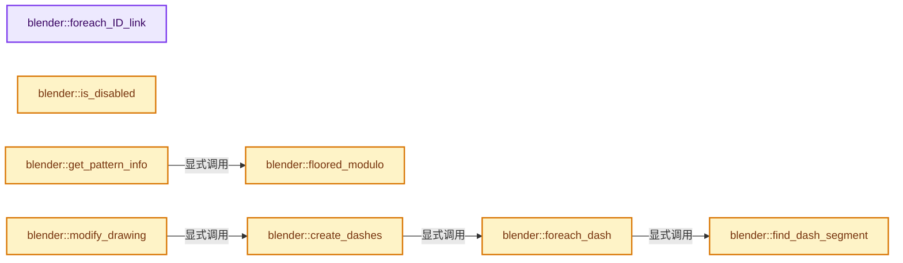
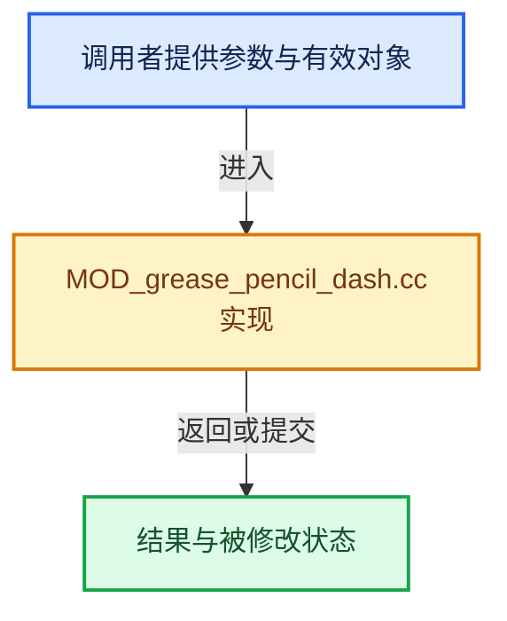

# 实现依赖专题：source/blender/modifiers/intern/MOD_grease_pencil_dash.cc

[实现依赖导航](../../../README.md) · [符号索引](../../../../00-课程指南/02-源码与提交索引/符号依赖与实现索引.md)

本专题从正文实际调用进入，集中保存共享实现。函数有稳定锚点，可从调用处直接跳到对应完整函数；递归与互相调用通过回链组织。

## 本文件的实现关系






## 完整成员与函数实现

<a id="f-d1486862b6f104e6"></a>

### `blender::foreach_ID_link`

实现位置：[source/blender/modifiers/intern/MOD_grease_pencil_dash.cc](../../../../../../../../source/blender/modifiers/intern/MOD_grease_pencil_dash.cc) · L80—L84。

接口参数：

- `ModifierData *md`
- `Object *ob`
- `IDWalkFunc walk`
- `void *user_data`

**教学注释版**

<!-- annotated:33498392583969 -->

```cpp
static void foreach_ID_link(ModifierData *md, Object *ob, IDWalkFunc walk, void *user_data)
{
  auto *dmd = reinterpret_cast<GreasePencilDashModifierData *>(md);
  modifier::greasepencil::foreach_influence_ID_link(&dmd->influence, ob, walk, user_data);
}
```

<details>
<summary>核对原始源码：source/blender/modifiers/intern/MOD_grease_pencil_dash.cc · L80—L84</summary>

<!-- original:33498392583969:source/blender/modifiers/intern/MOD_grease_pencil_dash.cc:80:84 -->

```cpp
static void foreach_ID_link(ModifierData *md, Object *ob, IDWalkFunc walk, void *user_data)
{
  auto *dmd = reinterpret_cast<GreasePencilDashModifierData *>(md);
  modifier::greasepencil::foreach_influence_ID_link(&dmd->influence, ob, walk, user_data);
}
```

</details>

**继续追踪实现**

- `modifier::greasepencil::foreach_influence_ID_link` → [blender::modifier::greasepencil::foreach_influence_ID_link · L69](MOD_grease_pencil_util.cc.md#f-247ba56fa4c4e56f)。

<a id="f-e4b2bdbede848e63"></a>

### `blender::is_disabled`

实现位置：[source/blender/modifiers/intern/MOD_grease_pencil_dash.cc](../../../../../../../../source/blender/modifiers/intern/MOD_grease_pencil_dash.cc) · L86—L96。

接口参数：

- `const Scene *`
- `ModifierData *md`
- `bool`

**教学注释版**

<!-- annotated:bf7e4638e11457 -->

```cpp
static bool is_disabled(const Scene * /*scene*/, ModifierData *md, bool /*use_render_params*/)
{
  const auto *dmd = reinterpret_cast<GreasePencilDashModifierData *>(md);
  /* Enable if at least one segment has non-zero length. */
  for (const GreasePencilDashModifierSegment &dash_segment : dmd->segments()) {
    if (dash_segment.dash + dash_segment.gap - 1 > 0) {
      return false;
    }
  }
  return true;
}
```

<details>
<summary>核对原始源码：source/blender/modifiers/intern/MOD_grease_pencil_dash.cc · L86—L96</summary>

<!-- original:bf7e4638e11457:source/blender/modifiers/intern/MOD_grease_pencil_dash.cc:86:96 -->

```cpp
static bool is_disabled(const Scene * /*scene*/, ModifierData *md, bool /*use_render_params*/)
{
  const auto *dmd = reinterpret_cast<GreasePencilDashModifierData *>(md);
  /* Enable if at least one segment has non-zero length. */
  for (const GreasePencilDashModifierSegment &dash_segment : dmd->segments()) {
    if (dash_segment.dash + dash_segment.gap - 1 > 0) {
      return false;
    }
  }
  return true;
}
```

</details>

**结果出口**

- `return false;`
- `return true;`

**继续追踪实现**

- `dmd->segments` → [调用协议](../../../../00-课程指南/01-路线与规范/模板宏与动态分派协议.md)：接收对象类型依赖auto、返回值或模板实例；不按同名猜测目标。调用位置L90。

<a id="f-8002907c6a23c6a7"></a>

### `blender::floored_modulo`

实现位置：[source/blender/modifiers/intern/MOD_grease_pencil_dash.cc](../../../../../../../../source/blender/modifiers/intern/MOD_grease_pencil_dash.cc) · L98—L101。

接口参数：

- `const int a`
- `const int b`

**教学注释版**

<!-- annotated:3057c19133b8cb -->

```cpp
static int floored_modulo(const int a, const int b)
{
  return a - math::floor(float(a) / float(b)) * b;
}
```

<details>
<summary>核对原始源码：source/blender/modifiers/intern/MOD_grease_pencil_dash.cc · L98—L101</summary>

<!-- original:3057c19133b8cb:source/blender/modifiers/intern/MOD_grease_pencil_dash.cc:98:101 -->

```cpp
static int floored_modulo(const int a, const int b)
{
  return a - math::floor(float(a) / float(b)) * b;
}
```

</details>

**结果出口**

- `return a - math::floor(float(a) / float(b)) * b;`

**继续追踪实现**

- `math::floor` → [外部契约](https://eel.is/c++draft/)：这个边界按实际表达式及所属类型核对参数、返回值、寿命与失败行为。这里提供接口入口，不声称已解释该第三方版本的内部实现。

<a id="f-e5a66673599e03c6"></a>

### `blender::get_pattern_info`

实现位置：[source/blender/modifiers/intern/MOD_grease_pencil_dash.cc](../../../../../../../../source/blender/modifiers/intern/MOD_grease_pencil_dash.cc) · L114—L142。

接口参数：

- `const GreasePencilDashModifierData &dmd`

**教学注释版**

<!-- annotated:a970fdac6c7026 -->

```cpp
static PatternInfo get_pattern_info(const GreasePencilDashModifierData &dmd)
{
  PatternInfo info;
  for (const GreasePencilDashModifierSegment &dash_segment : dmd.segments()) {
    info.length += dash_segment.dash + dash_segment.gap;
  }

  info.segments.reinitialize(dmd.segments().size());
  info.cyclic.reinitialize(dmd.segments().size());
  info.material.reinitialize(dmd.segments().size());
  info.radius.reinitialize(dmd.segments().size());
  info.opacity.reinitialize(dmd.segments().size());
  info.offset = floored_modulo(dmd.dash_offset, info.length);

  /* Store segments as ranges. */
  IndexRange dash_range(0);
  IndexRange gap_range(0);
  for (const int i : dmd.segments().index_range()) {
    const GreasePencilDashModifierSegment &dash_segment = dmd.segments()[i];
    dash_range = gap_range.after(dash_segment.dash);
    gap_range = dash_range.after(dash_segment.gap);
    info.segments[i] = dash_range;
    info.cyclic[i] = dash_segment.flag & MOD_GREASE_PENCIL_DASH_USE_CYCLIC;
    info.material[i] = dash_segment.mat_nr;
    info.radius[i] = dash_segment.radius;
    info.opacity[i] = dash_segment.opacity;
  }
  return info;
}
```

<details>
<summary>核对原始源码：source/blender/modifiers/intern/MOD_grease_pencil_dash.cc · L114—L142</summary>

<!-- original:a970fdac6c7026:source/blender/modifiers/intern/MOD_grease_pencil_dash.cc:114:142 -->

```cpp
static PatternInfo get_pattern_info(const GreasePencilDashModifierData &dmd)
{
  PatternInfo info;
  for (const GreasePencilDashModifierSegment &dash_segment : dmd.segments()) {
    info.length += dash_segment.dash + dash_segment.gap;
  }

  info.segments.reinitialize(dmd.segments().size());
  info.cyclic.reinitialize(dmd.segments().size());
  info.material.reinitialize(dmd.segments().size());
  info.radius.reinitialize(dmd.segments().size());
  info.opacity.reinitialize(dmd.segments().size());
  info.offset = floored_modulo(dmd.dash_offset, info.length);

  /* Store segments as ranges. */
  IndexRange dash_range(0);
  IndexRange gap_range(0);
  for (const int i : dmd.segments().index_range()) {
    const GreasePencilDashModifierSegment &dash_segment = dmd.segments()[i];
    dash_range = gap_range.after(dash_segment.dash);
    gap_range = dash_range.after(dash_segment.gap);
    info.segments[i] = dash_range;
    info.cyclic[i] = dash_segment.flag & MOD_GREASE_PENCIL_DASH_USE_CYCLIC;
    info.material[i] = dash_segment.mat_nr;
    info.radius[i] = dash_segment.radius;
    info.opacity[i] = dash_segment.opacity;
  }
  return info;
}
```

</details>

**沿实际写入检查状态**

- `info.length += dash_segment.dash + dash_segment.gap;`
- `info.offset = floored_modulo(dmd.dash_offset, info.length);`
- `dash_range = gap_range.after(dash_segment.dash);`
- `gap_range = dash_range.after(dash_segment.gap);`
- `info.segments[i] = dash_range;`
- `info.cyclic[i] = dash_segment.flag & MOD_GREASE_PENCIL_DASH_USE_CYCLIC;`
- `info.material[i] = dash_segment.mat_nr;`
- `info.radius[i] = dash_segment.radius;`
- `info.opacity[i] = dash_segment.opacity;`

**结果出口**

- `return info;`

**继续追踪实现**

- `dmd.segments` → [blender::GreasePencilDashModifierData::segments · L555](MOD_grease_pencil_dash.cc.md#f-6e6f240b27767d03)；[blender::GreasePencilDashModifierData::segments · L560](MOD_grease_pencil_dash.cc.md#f-3c0c655c891477ca)。同名重载需按实参类型选择。
- `info.segments.reinitialize` → [调用协议](../../../../00-课程指南/01-路线与规范/模板宏与动态分派协议.md)：接收对象类型依赖auto、返回值或模板实例；不按同名猜测目标。调用位置L121。
- `dmd.segments().size` → [调用协议](../../../../00-课程指南/01-路线与规范/模板宏与动态分派协议.md)：接收对象类型依赖auto、返回值或模板实例；不按同名猜测目标。调用位置L121。
- `info.cyclic.reinitialize` → [调用协议](../../../../00-课程指南/01-路线与规范/模板宏与动态分派协议.md)：接收对象类型依赖auto、返回值或模板实例；不按同名猜测目标。调用位置L122。
- `info.material.reinitialize` → [调用协议](../../../../00-课程指南/01-路线与规范/模板宏与动态分派协议.md)：接收对象类型依赖auto、返回值或模板实例；不按同名猜测目标。调用位置L123。
- `info.radius.reinitialize` → [调用协议](../../../../00-课程指南/01-路线与规范/模板宏与动态分派协议.md)：接收对象类型依赖auto、返回值或模板实例；不按同名猜测目标。调用位置L124。
- `info.opacity.reinitialize` → [调用协议](../../../../00-课程指南/01-路线与规范/模板宏与动态分派协议.md)：接收对象类型依赖auto、返回值或模板实例；不按同名猜测目标。调用位置L125。
- `floored_modulo` → [blender::floored_modulo · L98](MOD_grease_pencil_dash.cc.md#f-8002907c6a23c6a7)。
- `dmd.segments().index_range` → [调用协议](../../../../00-课程指南/01-路线与规范/模板宏与动态分派协议.md)：接收对象类型依赖auto、返回值或模板实例；不按同名猜测目标。调用位置L131。
- `gap_range.after` → [blender::IndexRange::after · L185](../../../../01-基础容器与现代CPP/04-IndexRange连续整数区间.md#f-33b01201b3ef9092)。
- `dash_range.after` → [blender::IndexRange::after · L185](../../../../01-基础容器与现代CPP/04-IndexRange连续整数区间.md#f-33b01201b3ef9092)。

<a id="f-56533ad2b0657c83"></a>

### `blender::find_dash_segment`

实现位置：[source/blender/modifiers/intern/MOD_grease_pencil_dash.cc](../../../../../../../../source/blender/modifiers/intern/MOD_grease_pencil_dash.cc) · L145—L159。

接口参数：

- `const PatternInfo &pattern_info`
- `const int index`

**教学注释版**

<!-- annotated:ac2299dbd12fff -->

```cpp
static int find_dash_segment(const PatternInfo &pattern_info, const int index)
{
  const int repeat = index / pattern_info.length;
  const int segments_num = pattern_info.segments.size();

  const int local_index = index - repeat * pattern_info.length;
  for (const int i : pattern_info.segments.index_range().drop_back(1)) {
    const IndexRange segment = pattern_info.segments[i];
    const IndexRange next_segment = pattern_info.segments[i + 1];
    // [讲解] segment.start：读取连续区间或分组的边界信息。
    if (local_index >= segment.start() && local_index < next_segment.start()) {
      return i + repeat * segments_num;
    }
  }
  return segments_num - 1 + repeat * segments_num;
}
```

<details>
<summary>核对原始源码：source/blender/modifiers/intern/MOD_grease_pencil_dash.cc · L145—L159</summary>

<!-- original:ac2299dbd12fff:source/blender/modifiers/intern/MOD_grease_pencil_dash.cc:145:159 -->

```cpp
static int find_dash_segment(const PatternInfo &pattern_info, const int index)
{
  const int repeat = index / pattern_info.length;
  const int segments_num = pattern_info.segments.size();

  const int local_index = index - repeat * pattern_info.length;
  for (const int i : pattern_info.segments.index_range().drop_back(1)) {
    const IndexRange segment = pattern_info.segments[i];
    const IndexRange next_segment = pattern_info.segments[i + 1];
    if (local_index >= segment.start() && local_index < next_segment.start()) {
      return i + repeat * segments_num;
    }
  }
  return segments_num - 1 + repeat * segments_num;
}
```

</details>

**结果出口**

- `return i + repeat * segments_num;`
- `return segments_num - 1 + repeat * segments_num;`

**继续追踪实现**

- `pattern_info.segments.size` → [调用协议](../../../../00-课程指南/01-路线与规范/模板宏与动态分派协议.md)：接收对象类型依赖auto、返回值或模板实例；不按同名猜测目标。调用位置L148。
- `pattern_info.segments.index_range().drop_back` → [调用协议](../../../../00-课程指南/01-路线与规范/模板宏与动态分派协议.md)：接收对象类型依赖auto、返回值或模板实例；不按同名猜测目标。调用位置L151。
- `pattern_info.segments.index_range` → [调用协议](../../../../00-课程指南/01-路线与规范/模板宏与动态分派协议.md)：接收对象类型依赖auto、返回值或模板实例；不按同名猜测目标。调用位置L151。
- `segment.start` → [blender::IndexRange::start · L243](../../../../01-基础容器与现代CPP/04-IndexRange连续整数区间.md#f-99d2195bd9cfd1f0)。
- `next_segment.start` → [blender::IndexRange::start · L243](../../../../01-基础容器与现代CPP/04-IndexRange连续整数区间.md#f-99d2195bd9cfd1f0)。

<a id="f-10791788ac0408f2"></a>

### `blender::foreach_dash`

实现位置：[source/blender/modifiers/intern/MOD_grease_pencil_dash.cc](../../../../../../../../source/blender/modifiers/intern/MOD_grease_pencil_dash.cc) · L166—L201。

接口参数：

- `const PatternInfo &pattern_info`
- `const IndexRange src_points`
- `const bool cyclic`
- `FunctionRef<void(IndexRange, bool, int, float, float)> fn`
- `IndexRange`
- `bool`
- `int`
- `float`
- `float`

**教学注释版**

<!-- annotated:094b3761d7a525 -->

```cpp
static void foreach_dash(const PatternInfo &pattern_info,
                         const IndexRange src_points,
                         const bool cyclic,
                         FunctionRef<void(IndexRange, bool, int, float, float)> fn)
{
  // [讲解] src_points.size：读取连续区间或分组的边界信息。
  const int points_num = src_points.size();
  const int segments_num = pattern_info.segments.size();

  const int first_segment = find_dash_segment(pattern_info, pattern_info.offset);
  const int last_segment = find_dash_segment(pattern_info, pattern_info.offset + points_num - 1);
  BLI_assert(first_segment < segments_num);
  BLI_assert(last_segment >= first_segment);

  const IndexRange all_segments = IndexRange(first_segment, last_segment - first_segment + 1);
  for (const int i : all_segments) {
    const int repeat = i / segments_num;
    const int segment_index = i - repeat * segments_num;
    const IndexRange range = pattern_info.segments[segment_index].shift(repeat *
                                                                        pattern_info.length);

    // [讲解] src_points.start：读取连续区间或分组的边界信息。
    const int64_t point_shift = src_points.start() - pattern_info.offset;
    const int64_t min_point = src_points.start();
    // [讲解] src_points.one_after_last：读取连续区间或分组的边界信息。
    const int64_t max_point = cyclic ? src_points.one_after_last() : src_points.last();
    const int64_t start = std::clamp(range.start() + point_shift, min_point, max_point);
    const int64_t end = std::clamp(range.one_after_last() + point_shift, min_point, max_point + 1);

    IndexRange points(start, end - start);
    // [讲解] points.is_empty：读取连续区间或分组的边界信息。
    if (!points.is_empty()) {
      fn(points,
         pattern_info.cyclic[segment_index],
         pattern_info.material[segment_index],
         pattern_info.radius[segment_index],
         pattern_info.opacity[segment_index]);
    }
  }
}
```

<details>
<summary>核对原始源码：source/blender/modifiers/intern/MOD_grease_pencil_dash.cc · L166—L201</summary>

<!-- original:094b3761d7a525:source/blender/modifiers/intern/MOD_grease_pencil_dash.cc:166:201 -->

```cpp
static void foreach_dash(const PatternInfo &pattern_info,
                         const IndexRange src_points,
                         const bool cyclic,
                         FunctionRef<void(IndexRange, bool, int, float, float)> fn)
{
  const int points_num = src_points.size();
  const int segments_num = pattern_info.segments.size();

  const int first_segment = find_dash_segment(pattern_info, pattern_info.offset);
  const int last_segment = find_dash_segment(pattern_info, pattern_info.offset + points_num - 1);
  BLI_assert(first_segment < segments_num);
  BLI_assert(last_segment >= first_segment);

  const IndexRange all_segments = IndexRange(first_segment, last_segment - first_segment + 1);
  for (const int i : all_segments) {
    const int repeat = i / segments_num;
    const int segment_index = i - repeat * segments_num;
    const IndexRange range = pattern_info.segments[segment_index].shift(repeat *
                                                                        pattern_info.length);

    const int64_t point_shift = src_points.start() - pattern_info.offset;
    const int64_t min_point = src_points.start();
    const int64_t max_point = cyclic ? src_points.one_after_last() : src_points.last();
    const int64_t start = std::clamp(range.start() + point_shift, min_point, max_point);
    const int64_t end = std::clamp(range.one_after_last() + point_shift, min_point, max_point + 1);

    IndexRange points(start, end - start);
    if (!points.is_empty()) {
      fn(points,
         pattern_info.cyclic[segment_index],
         pattern_info.material[segment_index],
         pattern_info.radius[segment_index],
         pattern_info.opacity[segment_index]);
    }
  }
}
```

</details>

**继续追踪实现**

- `src_points.size` → [blender::IndexRange::size · L156](../../../../01-基础容器与现代CPP/04-IndexRange连续整数区间.md#f-05f66c3ebb2fdfec)。
- `pattern_info.segments.size` → [调用协议](../../../../00-课程指南/01-路线与规范/模板宏与动态分派协议.md)：接收对象类型依赖auto、返回值或模板实例；不按同名猜测目标。调用位置L172。
- `find_dash_segment` → [blender::find_dash_segment · L145](MOD_grease_pencil_dash.cc.md#f-56533ad2b0657c83)。
- `BLI_assert` → [BLI_assert · L48](../../../01-BLI基础库/BLI_assert.hh.md#m-57a88495704d)；[BLI_assert · L63](../../../01-BLI基础库/BLI_assert.hh.md#m-d07050020cb5)。宏定义由构建条件选择。
- `IndexRange` → [blender::IndexRange](../../../01-BLI基础库/BLI_index_range.hh.md#t-caa3466d6776)；[blender::gpu::shader::parser::IndexRange](../../gpu/shader_tool/utils.hh.md#t-82d2bd4ea71c)；[blender::IndexRange](../../makesdna/DNA_node_types.h.md#t-0448cc889d39)。
- `pattern_info.segments[segment_index].shift` → [调用协议](../../../../00-课程指南/01-路线与规范/模板宏与动态分派协议.md)：接收对象类型依赖auto、返回值或模板实例；不按同名猜测目标。调用位置L183。
- `src_points.start` → [blender::IndexRange::start · L243](../../../../01-基础容器与现代CPP/04-IndexRange连续整数区间.md#f-99d2195bd9cfd1f0)。
- `src_points.one_after_last` → [blender::IndexRange::one_after_last · L235](../../../../01-基础容器与现代CPP/04-IndexRange连续整数区间.md#f-ed04bec9c731fc86)。
- `src_points.last` → [blender::IndexRange::last · L214](../../../../01-基础容器与现代CPP/04-IndexRange连续整数区间.md#f-66896c6351a40de1)；[blender::gpu::shader::parser::IndexRange::last · L62](../../gpu/shader_tool/utils.hh.md#f-373501206569c3b3)。同名重载需按实参类型选择。
- `std::clamp` → [外部契约](https://eel.is/c++draft/)：这个边界按实际表达式及所属类型核对参数、返回值、寿命与失败行为。这里提供接口入口，不声称已解释该第三方版本的内部实现。
- `range.start` → [blender::IndexRange::start · L243](../../../../01-基础容器与现代CPP/04-IndexRange连续整数区间.md#f-99d2195bd9cfd1f0)。
- `range.one_after_last` → [blender::IndexRange::one_after_last · L235](../../../../01-基础容器与现代CPP/04-IndexRange连续整数区间.md#f-ed04bec9c731fc86)。
- `points.is_empty` → [blender::IndexRange::is_empty · L169](../../../../01-基础容器与现代CPP/04-IndexRange连续整数区间.md#f-9501e070be01ff71)。
- `fn` → [调用协议](../../../../00-课程指南/01-路线与规范/模板宏与动态分派协议.md)：局部可调用对象，须结合其初始化与捕获环境。调用位置L194。

<a id="f-6c80770ee4ea7f7f"></a>

### `blender::create_dashes`

实现位置：[source/blender/modifiers/intern/MOD_grease_pencil_dash.cc](../../../../../../../../source/blender/modifiers/intern/MOD_grease_pencil_dash.cc) · L203—L345。

接口参数：

- `const PatternInfo &pattern_info`
- `const bke::CurvesGeometry &src_curves`
- `const IndexMask &curves_mask`

**教学注释版**

<!-- annotated:f3eb91800add50 -->

```cpp
static bke::CurvesGeometry create_dashes(const PatternInfo &pattern_info,
                                         const bke::CurvesGeometry &src_curves,
                                         const IndexMask &curves_mask)
{
  const bke::AttributeAccessor src_attributes = src_curves.attributes();
  const VArray<bool> src_cyclic = src_curves.cyclic();
  const VArray<int> src_material = *src_attributes.lookup_or_default(
      "material_index", bke::AttrDomain::Curve, 0);
  const VArray<float> src_radius = *src_attributes.lookup_or_default<float>(
      "radius", bke::AttrDomain::Point, 0.01f);
  const VArray<float> src_opacity = *src_attributes.lookup_or_default<float>(
      "opacity", bke::AttrDomain::Point, 1.0f);
  const VArray<int> src_fill_ids = *src_attributes.lookup_or_default<int>(
      "fill_id", bke::AttrDomain::Curve, 0);

  /* Count new curves and points. */
  int dst_point_num = 0;
  int dst_curve_num = 0;
  curves_mask.foreach_index([&](const int64_t src_curve_i) {
    const IndexRange src_points = src_curves.points_by_curve()[src_curve_i];

    foreach_dash(pattern_info,
                 src_points,
                 src_cyclic[src_curve_i],
                 [&](const IndexRange copy_points,
                     bool /*cyclic*/,
                     int /*material*/,
                     float /*radius*/,
                     float /*opacity*/) {
                   // [讲解] copy_points.size：读取连续区间或分组的边界信息。
                   dst_point_num += copy_points.size();
                   dst_curve_num += 1;
                 });
  });

  bke::CurvesGeometry dst_curves(dst_point_num, dst_curve_num);
  bke::MutableAttributeAccessor dst_attributes = dst_curves.attributes_for_write();
  bke::SpanAttributeWriter<bool> dst_cyclic = dst_attributes.lookup_or_add_for_write_span<bool>(
      "cyclic", bke::AttrDomain::Curve);
  bke::SpanAttributeWriter<int> dst_fill_ids = dst_attributes.lookup_or_add_for_write_span<int>(
      "fill_id", bke::AttrDomain::Curve);
  bke::SpanAttributeWriter<int> dst_material = dst_attributes.lookup_or_add_for_write_span<int>(
      "material_index", bke::AttrDomain::Curve);
  bke::SpanAttributeWriter<float> dst_radius = dst_attributes.lookup_or_add_for_write_span<float>(
      "radius", bke::AttrDomain::Point);
  bke::SpanAttributeWriter<float> dst_opacity = dst_attributes.lookup_or_add_for_write_span<float>(
      "opacity", bke::AttrDomain::Point);
  /* Map each destination point and curve to its source. */
  Array<int> src_point_indices(dst_point_num);
  Array<int> src_curve_indices(dst_curve_num);

  /* Start at `1` for the new geometry. */
  int fill_id_to_set = 1;

  {
    /* Start at curve offset and add points for each dash. */
    IndexRange dst_point_range(0);
    int dst_curve_i = 0;
    auto add_dash_curve = [&](const int src_curve,
                              const IndexRange src_points,
                              const IndexRange copy_points,
                              bool cyclic,
                              int material,
                              float radius,
                              float opacity) {
      dst_point_range = dst_point_range.after(copy_points.size());
      // [讲解] dst_point_range.start：读取连续区间或分组的边界信息。
      dst_curves.offsets_for_write()[dst_curve_i] = dst_point_range.start();

      // [讲解] copy_points.last：读取范围两端的有效索引或值。
      if (src_points.contains(copy_points.last())) {
        // [讲解] src_point_indices.as_mutable_span：提供数组的借用访问入口。
        array_utils::fill_index_range(src_point_indices.as_mutable_span().slice(dst_point_range),
                                      int(copy_points.start()));
      }
      else {
        /* Cyclic curve. */
        array_utils::fill_index_range(
            src_point_indices.as_mutable_span().slice(dst_point_range.drop_back(1)),
            int(copy_points.start()));
        // [讲解] src_points.first：读取范围两端的有效索引或值。
        src_point_indices[dst_point_range.last()] = src_points.first();
      }
      src_curve_indices[dst_curve_i] = src_curve;
      dst_cyclic.span[dst_curve_i] = cyclic;
      dst_material.span[dst_curve_i] = material >= 0 ? material : src_material[src_curve];
      for (const int i : dst_point_range) {
        dst_radius.span[i] = src_radius[src_point_indices[i]] * radius;
      }
      if (dst_opacity) {
        for (const int i : dst_point_range) {
          dst_opacity.span[i] = src_opacity[src_point_indices[i]] * opacity;
        }
      }
      if (src_fill_ids[src_curve] == 0) {
        dst_fill_ids.span[dst_curve_i] = 0;
      }
      else {
        dst_fill_ids.span[dst_curve_i] = fill_id_to_set;
        fill_id_to_set++;
      }

      ++dst_curve_i;
    };

    curves_mask.foreach_index([&](const int64_t src_curve_i) {
      const IndexRange src_points = src_curves.points_by_curve()[src_curve_i];
      foreach_dash(pattern_info,
                   src_points,
                   src_cyclic[src_curve_i],
                   [&](const IndexRange copy_points,
                       bool cyclic,
                       int material,
                       float radius,
                       float opacity) {
                     add_dash_curve(
                         src_curve_i, src_points, copy_points, cyclic, material, radius, opacity);
                   });
    });
    if (dst_curve_i > 0) {
      /* Last offset entry is total point count. */
      // [讲解] dst_point_range.one_after_last：读取连续区间或分组的边界信息。
      dst_curves.offsets_for_write()[dst_curve_i] = dst_point_range.one_after_last();
    }
  }

  bke::gather_attributes(src_attributes,
                         bke::AttrDomain::Point,
                         bke::AttrDomain::Point,
                         bke::attribute_filter_from_skip_ref({"radius", "opacity"}),
                         src_point_indices,
                         dst_attributes);
  bke::gather_attributes(
      src_attributes,
      bke::AttrDomain::Curve,
      bke::AttrDomain::Curve,
      bke::attribute_filter_from_skip_ref({"cyclic", "material_index", "fill_id"}),
      src_curve_indices,
      dst_attributes);

  dst_cyclic.finish();
  dst_material.finish();
  dst_radius.finish();
  dst_opacity.finish();
  dst_fill_ids.finish();
  dst_curves.update_curve_types();

  return dst_curves;
}
```

<details>
<summary>核对原始源码：source/blender/modifiers/intern/MOD_grease_pencil_dash.cc · L203—L345</summary>

<!-- original:f3eb91800add50:source/blender/modifiers/intern/MOD_grease_pencil_dash.cc:203:345 -->

```cpp
static bke::CurvesGeometry create_dashes(const PatternInfo &pattern_info,
                                         const bke::CurvesGeometry &src_curves,
                                         const IndexMask &curves_mask)
{
  const bke::AttributeAccessor src_attributes = src_curves.attributes();
  const VArray<bool> src_cyclic = src_curves.cyclic();
  const VArray<int> src_material = *src_attributes.lookup_or_default(
      "material_index", bke::AttrDomain::Curve, 0);
  const VArray<float> src_radius = *src_attributes.lookup_or_default<float>(
      "radius", bke::AttrDomain::Point, 0.01f);
  const VArray<float> src_opacity = *src_attributes.lookup_or_default<float>(
      "opacity", bke::AttrDomain::Point, 1.0f);
  const VArray<int> src_fill_ids = *src_attributes.lookup_or_default<int>(
      "fill_id", bke::AttrDomain::Curve, 0);

  /* Count new curves and points. */
  int dst_point_num = 0;
  int dst_curve_num = 0;
  curves_mask.foreach_index([&](const int64_t src_curve_i) {
    const IndexRange src_points = src_curves.points_by_curve()[src_curve_i];

    foreach_dash(pattern_info,
                 src_points,
                 src_cyclic[src_curve_i],
                 [&](const IndexRange copy_points,
                     bool /*cyclic*/,
                     int /*material*/,
                     float /*radius*/,
                     float /*opacity*/) {
                   dst_point_num += copy_points.size();
                   dst_curve_num += 1;
                 });
  });

  bke::CurvesGeometry dst_curves(dst_point_num, dst_curve_num);
  bke::MutableAttributeAccessor dst_attributes = dst_curves.attributes_for_write();
  bke::SpanAttributeWriter<bool> dst_cyclic = dst_attributes.lookup_or_add_for_write_span<bool>(
      "cyclic", bke::AttrDomain::Curve);
  bke::SpanAttributeWriter<int> dst_fill_ids = dst_attributes.lookup_or_add_for_write_span<int>(
      "fill_id", bke::AttrDomain::Curve);
  bke::SpanAttributeWriter<int> dst_material = dst_attributes.lookup_or_add_for_write_span<int>(
      "material_index", bke::AttrDomain::Curve);
  bke::SpanAttributeWriter<float> dst_radius = dst_attributes.lookup_or_add_for_write_span<float>(
      "radius", bke::AttrDomain::Point);
  bke::SpanAttributeWriter<float> dst_opacity = dst_attributes.lookup_or_add_for_write_span<float>(
      "opacity", bke::AttrDomain::Point);
  /* Map each destination point and curve to its source. */
  Array<int> src_point_indices(dst_point_num);
  Array<int> src_curve_indices(dst_curve_num);

  /* Start at `1` for the new geometry. */
  int fill_id_to_set = 1;

  {
    /* Start at curve offset and add points for each dash. */
    IndexRange dst_point_range(0);
    int dst_curve_i = 0;
    auto add_dash_curve = [&](const int src_curve,
                              const IndexRange src_points,
                              const IndexRange copy_points,
                              bool cyclic,
                              int material,
                              float radius,
                              float opacity) {
      dst_point_range = dst_point_range.after(copy_points.size());
      dst_curves.offsets_for_write()[dst_curve_i] = dst_point_range.start();

      if (src_points.contains(copy_points.last())) {
        array_utils::fill_index_range(src_point_indices.as_mutable_span().slice(dst_point_range),
                                      int(copy_points.start()));
      }
      else {
        /* Cyclic curve. */
        array_utils::fill_index_range(
            src_point_indices.as_mutable_span().slice(dst_point_range.drop_back(1)),
            int(copy_points.start()));
        src_point_indices[dst_point_range.last()] = src_points.first();
      }
      src_curve_indices[dst_curve_i] = src_curve;
      dst_cyclic.span[dst_curve_i] = cyclic;
      dst_material.span[dst_curve_i] = material >= 0 ? material : src_material[src_curve];
      for (const int i : dst_point_range) {
        dst_radius.span[i] = src_radius[src_point_indices[i]] * radius;
      }
      if (dst_opacity) {
        for (const int i : dst_point_range) {
          dst_opacity.span[i] = src_opacity[src_point_indices[i]] * opacity;
        }
      }
      if (src_fill_ids[src_curve] == 0) {
        dst_fill_ids.span[dst_curve_i] = 0;
      }
      else {
        dst_fill_ids.span[dst_curve_i] = fill_id_to_set;
        fill_id_to_set++;
      }

      ++dst_curve_i;
    };

    curves_mask.foreach_index([&](const int64_t src_curve_i) {
      const IndexRange src_points = src_curves.points_by_curve()[src_curve_i];
      foreach_dash(pattern_info,
                   src_points,
                   src_cyclic[src_curve_i],
                   [&](const IndexRange copy_points,
                       bool cyclic,
                       int material,
                       float radius,
                       float opacity) {
                     add_dash_curve(
                         src_curve_i, src_points, copy_points, cyclic, material, radius, opacity);
                   });
    });
    if (dst_curve_i > 0) {
      /* Last offset entry is total point count. */
      dst_curves.offsets_for_write()[dst_curve_i] = dst_point_range.one_after_last();
    }
  }

  bke::gather_attributes(src_attributes,
                         bke::AttrDomain::Point,
                         bke::AttrDomain::Point,
                         bke::attribute_filter_from_skip_ref({"radius", "opacity"}),
                         src_point_indices,
                         dst_attributes);
  bke::gather_attributes(
      src_attributes,
      bke::AttrDomain::Curve,
      bke::AttrDomain::Curve,
      bke::attribute_filter_from_skip_ref({"cyclic", "material_index", "fill_id"}),
      src_curve_indices,
      dst_attributes);

  dst_cyclic.finish();
  dst_material.finish();
  dst_radius.finish();
  dst_opacity.finish();
  dst_fill_ids.finish();
  dst_curves.update_curve_types();

  return dst_curves;
}
```

</details>

**沿实际写入检查状态**

- `dst_point_num += copy_points.size();`
- `dst_curve_num += 1;`
- `dst_point_range = dst_point_range.after(copy_points.size());`
- `src_curve_indices[dst_curve_i] = src_curve;`
- `dst_cyclic.span[dst_curve_i] = cyclic;`
- `dst_material.span[dst_curve_i] = material >= 0 ? material : src_material[src_curve];`
- `dst_radius.span[i] = src_radius[src_point_indices[i]] * radius;`
- `dst_opacity.span[i] = src_opacity[src_point_indices[i]] * opacity;`
- `dst_fill_ids.span[dst_curve_i] = 0;`
- `dst_fill_ids.span[dst_curve_i] = fill_id_to_set;`

**结果出口**

- `return dst_curves;`

**继续追踪实现**

- `src_curves.attributes` → [blender::bke::CurvesGeometry::attributes · L1908](../../../02-BKE几何与数据/intern/curves_geometry.cc.md#f-8e24fbf758862a22)。
- `src_curves.cyclic` → [blender::bke::CurvesGeometry::cyclic · L362](../../../02-BKE几何与数据/intern/curves_geometry.cc.md#f-ec08c2a1d6f3bfea)。
- `src_attributes.lookup_or_default` → [blender::bke::AttributeAccessor::lookup_or_default · L415](../../../02-BKE几何与数据/intern/attribute_access.cc.md#f-a0cc3e316f1da4bd)；[blender::bke::AttributeAccessor::lookup_or_default · L643](../../../../05-几何存储与拓扑映射/08-AttributeAccessor接口.md#f-e3d2ed81ebe0af61)。同名重载需按实参类型选择。
- `src_attributes.lookup_or_default<float>` → [blender::bke::AttributeAccessor::lookup_or_default · L415](../../../02-BKE几何与数据/intern/attribute_access.cc.md#f-a0cc3e316f1da4bd)；[blender::bke::AttributeAccessor::lookup_or_default · L643](../../../../05-几何存储与拓扑映射/08-AttributeAccessor接口.md#f-e3d2ed81ebe0af61)。同名重载需按实参类型选择。
- `src_attributes.lookup_or_default<int>` → [blender::bke::AttributeAccessor::lookup_or_default · L415](../../../02-BKE几何与数据/intern/attribute_access.cc.md#f-a0cc3e316f1da4bd)；[blender::bke::AttributeAccessor::lookup_or_default · L643](../../../../05-几何存储与拓扑映射/08-AttributeAccessor接口.md#f-e3d2ed81ebe0af61)。同名重载需按实参类型选择。
- `curves_mask.foreach_index` → [blender::index_mask::IndexMask::foreach_index · L855](../../../../04-虚拟数组与索引选择/09-分段存储与遍历.md#f-cd6cd317e2e2812c)。
- `src_curves.points_by_curve` → [blender::bke::CurvesGeometry::points_by_curve · L1058](../../../../05-几何存储与拓扑映射/04-CurvesGeometry存储.md#f-a0416697e10ec205)。
- `foreach_dash` → [blender::foreach_dash · L166](MOD_grease_pencil_dash.cc.md#f-10791788ac0408f2)。
- `copy_points.size` → [blender::IndexRange::size · L156](../../../../01-基础容器与现代CPP/04-IndexRange连续整数区间.md#f-05f66c3ebb2fdfec)。
- `dst_curves.attributes_for_write` → [blender::bke::CurvesGeometry::attributes_for_write · L1913](../../../02-BKE几何与数据/intern/curves_geometry.cc.md#f-4930091b34fa9663)。
- `dst_attributes.lookup_or_add_for_write_span<bool>` → [blender::bke::MutableAttributeAccessor::lookup_or_add_for_write_span · L533](../../../02-BKE几何与数据/intern/attribute_access.cc.md#f-c533eff1b9a4973e)；[blender::bke::MutableAttributeAccessor::lookup_or_add_for_write_span · L861](../../../../05-几何存储与拓扑映射/08-AttributeAccessor接口.md#f-aa4c0d5a61437381)。同名重载需按实参类型选择。
- `dst_attributes.lookup_or_add_for_write_span<int>` → [blender::bke::MutableAttributeAccessor::lookup_or_add_for_write_span · L533](../../../02-BKE几何与数据/intern/attribute_access.cc.md#f-c533eff1b9a4973e)；[blender::bke::MutableAttributeAccessor::lookup_or_add_for_write_span · L861](../../../../05-几何存储与拓扑映射/08-AttributeAccessor接口.md#f-aa4c0d5a61437381)。同名重载需按实参类型选择。
- `dst_attributes.lookup_or_add_for_write_span<float>` → [blender::bke::MutableAttributeAccessor::lookup_or_add_for_write_span · L533](../../../02-BKE几何与数据/intern/attribute_access.cc.md#f-c533eff1b9a4973e)；[blender::bke::MutableAttributeAccessor::lookup_or_add_for_write_span · L861](../../../../05-几何存储与拓扑映射/08-AttributeAccessor接口.md#f-aa4c0d5a61437381)。同名重载需按实参类型选择。
- `dst_point_range.after` → [blender::IndexRange::after · L185](../../../../01-基础容器与现代CPP/04-IndexRange连续整数区间.md#f-33b01201b3ef9092)。
- `dst_curves.offsets_for_write` → [blender::bke::CurvesGeometry::offsets_for_write · L352](../../../02-BKE几何与数据/intern/curves_geometry.cc.md#f-9ea1e4f36b216dd0)。
- `dst_point_range.start` → [blender::IndexRange::start · L243](../../../../01-基础容器与现代CPP/04-IndexRange连续整数区间.md#f-99d2195bd9cfd1f0)。
- `src_points.contains` → [blender::IndexRange::contains · L251](../../../../01-基础容器与现代CPP/04-IndexRange连续整数区间.md#f-1a01eaa28eaecd5c)；[blender::IndexRange::contains · L259](../../../../01-基础容器与现代CPP/04-IndexRange连续整数区间.md#f-8eb195a52f17a51f)。同名重载需按实参类型选择。
- `copy_points.last` → [blender::IndexRange::last · L214](../../../../01-基础容器与现代CPP/04-IndexRange连续整数区间.md#f-66896c6351a40de1)；[blender::gpu::shader::parser::IndexRange::last · L62](../../gpu/shader_tool/utils.hh.md#f-373501206569c3b3)。同名重载需按实参类型选择。
- `array_utils::fill_index_range` → [blender::array_utils::fill_index_range · L434](../../../../05-几何存储与拓扑映射/07-分组访问与反向索引.md#f-f8128b104d76df0f)；[blender::array_utils::fill_index_range · L439](../../../../05-几何存储与拓扑映射/07-分组访问与反向索引.md#f-95ca84458bfc7e7e)；[blender::array_utils::fill_index_range · L445](../../../../05-几何存储与拓扑映射/07-分组访问与反向索引.md#f-c11b114c213cd61a)。同名重载需按实参类型选择。
- `src_point_indices.as_mutable_span().slice` → [调用协议](../../../../00-课程指南/01-路线与规范/模板宏与动态分派协议.md)：接收对象类型依赖auto、返回值或模板实例；不按同名猜测目标。调用位置L271。
- `src_point_indices.as_mutable_span` → [blender::Array::as_mutable_span · L259](../../../../01-基础容器与现代CPP/08-Array复制移动与销毁.md#f-4e91de9f1337c144)。
- `copy_points.start` → [blender::IndexRange::start · L243](../../../../01-基础容器与现代CPP/04-IndexRange连续整数区间.md#f-99d2195bd9cfd1f0)。
- `dst_point_range.drop_back` → [blender::IndexRange::drop_back · L317](../../../../01-基础容器与现代CPP/04-IndexRange连续整数区间.md#f-be17c307e5b14575)。
- `dst_point_range.last` → [blender::IndexRange::last · L214](../../../../01-基础容器与现代CPP/04-IndexRange连续整数区间.md#f-66896c6351a40de1)；[blender::gpu::shader::parser::IndexRange::last · L62](../../gpu/shader_tool/utils.hh.md#f-373501206569c3b3)。同名重载需按实参类型选择。
- `src_points.first` → [blender::IndexRange::first · L204](../../../../01-基础容器与现代CPP/04-IndexRange连续整数区间.md#f-ab443c94e531befa)。
- `add_dash_curve` → [调用协议](../../../../00-课程指南/01-路线与规范/模板宏与动态分派协议.md)：局部可调用对象，须结合其初始化与捕获环境。调用位置L313。
- `dst_point_range.one_after_last` → [blender::IndexRange::one_after_last · L235](../../../../01-基础容器与现代CPP/04-IndexRange连续整数区间.md#f-ed04bec9c731fc86)。
- `bke::gather_attributes` → [blender::bke::gather_attributes · L443](../../../02-BKE几何与数据/intern/mesh_remesh_voxel.cc.md#f-eccc321412f0e74a)；[blender::bke::gather_attributes · L708](../../../02-BKE几何与数据/intern/attribute_access.cc.md#f-309a1e4720f70b4a)；[blender::bke::gather_attributes · L749](../../../02-BKE几何与数据/intern/attribute_access.cc.md#f-79f80f052936884d)。同名重载需按实参类型选择。
- `bke::attribute_filter_from_skip_ref` → [blender::bke::attribute_filter_from_skip_ref · L66](../../../../10-引用生命周期与Closure/04-引用传播与过滤.md#f-daf63eca081bf88f)；[blender::bke::attribute_filter_from_skip_ref · L77](../../../../10-引用生命周期与Closure/04-引用传播与过滤.md#f-cec0791774e42016)。同名重载需按实参类型选择。
- `dst_cyclic.finish` → [blender::bke::SpanAttributeWriter::finish · L279](../../../../05-几何存储与拓扑映射/08-AttributeAccessor接口.md#f-585970a3b1bd4da4)。
- `dst_material.finish` → [blender::bke::SpanAttributeWriter::finish · L279](../../../../05-几何存储与拓扑映射/08-AttributeAccessor接口.md#f-585970a3b1bd4da4)。
- `dst_radius.finish` → [blender::bke::SpanAttributeWriter::finish · L279](../../../../05-几何存储与拓扑映射/08-AttributeAccessor接口.md#f-585970a3b1bd4da4)。
- `dst_opacity.finish` → [blender::bke::SpanAttributeWriter::finish · L279](../../../../05-几何存储与拓扑映射/08-AttributeAccessor接口.md#f-585970a3b1bd4da4)。
- `dst_fill_ids.finish` → [blender::bke::SpanAttributeWriter::finish · L279](../../../../05-几何存储与拓扑映射/08-AttributeAccessor接口.md#f-585970a3b1bd4da4)。
- `dst_curves.update_curve_types` → [blender::bke::CurvesGeometry::update_curve_types · L318](../../../02-BKE几何与数据/intern/curves_geometry.cc.md#f-f7155d4f5776d2ad)。

<a id="f-2301e52ba791372d"></a>

### `blender::modify_drawing`

实现位置：[source/blender/modifiers/intern/MOD_grease_pencil_dash.cc](../../../../../../../../source/blender/modifiers/intern/MOD_grease_pencil_dash.cc) · L347—L381。

接口参数：

- `const GreasePencilDashModifierData &dmd`
- `const ModifierEvalContext &ctx`
- `const PatternInfo &pattern_info`
- `bke::greasepencil::Drawing &drawing`

**教学注释版**

<!-- annotated:42c9722b9b2a86 -->

```cpp
static void modify_drawing(const GreasePencilDashModifierData &dmd,
                           const ModifierEvalContext &ctx,
                           const PatternInfo &pattern_info,
                           bke::greasepencil::Drawing &drawing)
{
  modifier::greasepencil::ensure_no_bezier_curves(drawing);
  const bke::CurvesGeometry &src_curves = drawing.strokes();
  if (src_curves.curve_num == 0) {
    return;
  }
  /* Selected source curves. */
  IndexMaskMemory curve_mask_memory;
  const IndexMask curves_mask = modifier::greasepencil::get_filtered_stroke_mask(
      ctx.object, src_curves, dmd.influence, curve_mask_memory);
  const IndexMask unselected_mask = curves_mask.complement(src_curves.curves_range(),
                                                           curve_mask_memory);
  bke::CurvesGeometry unselected_curves = bke::curves_copy_curve_selection(
      src_curves, unselected_mask, {});

  bke::CurvesGeometry dashed_curves = create_dashes(pattern_info, src_curves, curves_mask);

  Curves *masked_curves_id = bke::curves_new_nomain(dashed_curves);
  Curves *unselected_curves_id = bke::curves_new_nomain(unselected_curves);
  bke::GeometrySet masked_geo = bke::GeometrySet::from_curves(masked_curves_id);
  bke::GeometrySet unselected_geo = bke::GeometrySet::from_curves(unselected_curves_id);
  bke::GeometrySet joined_geo = geometry::join_geometries({unselected_geo, masked_geo}, {});

  if (!joined_geo.has_curves()) {
    drawing.strokes_for_write() = {};
  }
  else {
    // [讲解] std::move：把表达式转换成可供移动重载选择的值类别；不保证真的移动，不结束源对象寿命，对const值可能选择复制。
    drawing.strokes_for_write() = std::move(joined_geo.get_curves_for_write()->geometry.wrap());
  }
  drawing.tag_topology_changed();
}
```

<details>
<summary>核对原始源码：source/blender/modifiers/intern/MOD_grease_pencil_dash.cc · L347—L381</summary>

<!-- original:42c9722b9b2a86:source/blender/modifiers/intern/MOD_grease_pencil_dash.cc:347:381 -->

```cpp
static void modify_drawing(const GreasePencilDashModifierData &dmd,
                           const ModifierEvalContext &ctx,
                           const PatternInfo &pattern_info,
                           bke::greasepencil::Drawing &drawing)
{
  modifier::greasepencil::ensure_no_bezier_curves(drawing);
  const bke::CurvesGeometry &src_curves = drawing.strokes();
  if (src_curves.curve_num == 0) {
    return;
  }
  /* Selected source curves. */
  IndexMaskMemory curve_mask_memory;
  const IndexMask curves_mask = modifier::greasepencil::get_filtered_stroke_mask(
      ctx.object, src_curves, dmd.influence, curve_mask_memory);
  const IndexMask unselected_mask = curves_mask.complement(src_curves.curves_range(),
                                                           curve_mask_memory);
  bke::CurvesGeometry unselected_curves = bke::curves_copy_curve_selection(
      src_curves, unselected_mask, {});

  bke::CurvesGeometry dashed_curves = create_dashes(pattern_info, src_curves, curves_mask);

  Curves *masked_curves_id = bke::curves_new_nomain(dashed_curves);
  Curves *unselected_curves_id = bke::curves_new_nomain(unselected_curves);
  bke::GeometrySet masked_geo = bke::GeometrySet::from_curves(masked_curves_id);
  bke::GeometrySet unselected_geo = bke::GeometrySet::from_curves(unselected_curves_id);
  bke::GeometrySet joined_geo = geometry::join_geometries({unselected_geo, masked_geo}, {});

  if (!joined_geo.has_curves()) {
    drawing.strokes_for_write() = {};
  }
  else {
    drawing.strokes_for_write() = std::move(joined_geo.get_curves_for_write()->geometry.wrap());
  }
  drawing.tag_topology_changed();
}
```

</details>

**继续追踪实现**

- `modifier::greasepencil::ensure_no_bezier_curves` → [blender::modifier::greasepencil::ensure_no_bezier_curves · L432](MOD_grease_pencil_util.cc.md#f-1fde6483ac30d59b)。
- `drawing.strokes` → [blender::bke::greasepencil::Drawing::strokes · L1007](../../../02-BKE几何与数据/intern/grease_pencil.cc.md#f-59e6522a8e8ac409)。
- `modifier::greasepencil::get_filtered_stroke_mask` → [blender::modifier::greasepencil::get_filtered_stroke_mask · L285](MOD_grease_pencil_util.cc.md#f-30c219d04de7dec3)；[blender::modifier::greasepencil::get_filtered_stroke_mask · L326](MOD_grease_pencil_util.cc.md#f-970c3bc880e4f350)。同名重载需按实参类型选择。
- `curves_mask.complement` → [blender::index_mask::IndexMask::complement · L407](../../../../04-虚拟数组与索引选择/10-IndexMask构建与并行.md#f-1e9932d5baa6f719)。
- `src_curves.curves_range` → [blender::bke::CurvesGeometry::curves_range · L1023](../../../../05-几何存储与拓扑映射/04-CurvesGeometry存储.md#f-9aedfb1afc5ebcfb)。
- `bke::curves_copy_curve_selection` → [blender::bke::curves_copy_curve_selection · L1595](../../../02-BKE几何与数据/intern/curves_geometry.cc.md#f-20ed952a2282520e)。
- `create_dashes` → [blender::create_dashes · L203](MOD_grease_pencil_dash.cc.md#f-6c80770ee4ea7f7f)。
- `bke::curves_new_nomain` → [blender::bke::curves_new_nomain · L293](../../../02-BKE几何与数据/intern/curves.cc.md#f-702debf916bbedac)；[blender::bke::curves_new_nomain · L312](../../../02-BKE几何与数据/intern/curves.cc.md#f-ba10c7025cf69460)。同名重载需按实参类型选择。
- `bke::GeometrySet::from_curves` → [blender::bke::GeometrySet::from_curves · L448](../../../../06-隐式共享与缓存系统/05-GeometrySet读写与复制.md#f-4a638adc47cc3b9f)。
- `geometry::join_geometries` → [blender::geometry::join_geometries · L249](../../../05-Geometry几何算法/intern/join_geometries.cc.md#f-438d80bb03a93ea4)。
- `joined_geo.has_curves` → [blender::bke::GeometrySet::has_curves · L394](../../../../06-隐式共享与缓存系统/05-GeometrySet读写与复制.md#f-56204772a0e108bd)。
- `drawing.strokes_for_write` → [blender::bke::greasepencil::Drawing::strokes_for_write · L1012](../../../02-BKE几何与数据/intern/grease_pencil.cc.md#f-0649333785d0aa95)。
- `std::move` → [外部契约](https://eel.is/c++draft/utility.forward)：把表达式转换成可供移动重载选择的值类别；不保证真的移动，不结束源对象寿命，对const值可能选择复制。
- `joined_geo.get_curves_for_write()->geometry.wrap` → [调用协议](../../../../00-课程指南/01-路线与规范/模板宏与动态分派协议.md)：接收对象类型依赖auto、返回值或模板实例；不按同名猜测目标。调用位置L378。
- `joined_geo.get_curves_for_write` → [blender::bke::GeometrySet::get_curves_for_write · L580](../../../../06-隐式共享与缓存系统/05-GeometrySet读写与复制.md#f-95199063db32b8f7)。
- `drawing.tag_topology_changed` → [blender::bke::greasepencil::Drawing::tag_topology_changed · L1304](../../../02-BKE几何与数据/intern/grease_pencil.cc.md#f-6eefbf46d05d944b)；[blender::bke::greasepencil::Drawing::tag_topology_changed · L1311](../../../02-BKE几何与数据/intern/grease_pencil.cc.md#f-dbd37d071b845a58)。同名重载需按实参类型选择。

<a id="f-77a5c0cf948381ba"></a>

### `blender::modify_geometry_set`

实现位置：[source/blender/modifiers/intern/MOD_grease_pencil_dash.cc](../../../../../../../../source/blender/modifiers/intern/MOD_grease_pencil_dash.cc) · L383—L407。

接口参数：

- `ModifierData *md`
- `const ModifierEvalContext *ctx`
- `bke::GeometrySet *geometry_set`

**教学注释版**

<!-- annotated:afda2c336f3939 -->

```cpp
static void modify_geometry_set(ModifierData *md,
                                const ModifierEvalContext *ctx,
                                bke::GeometrySet *geometry_set)
{
  using bke::greasepencil::Drawing;

  auto *dmd = reinterpret_cast<GreasePencilDashModifierData *>(md);

  if (!geometry_set->has_grease_pencil()) {
    return;
  }
  GreasePencil &grease_pencil = *geometry_set->get_grease_pencil_for_write();
  const int frame = grease_pencil.runtime->eval_frame;

  const PatternInfo pattern_info = get_pattern_info(*dmd);

  IndexMaskMemory mask_memory;
  const IndexMask layer_mask = modifier::greasepencil::get_filtered_layer_mask(
      grease_pencil, dmd->influence, mask_memory);

  const Vector<Drawing *> drawings = modifier::greasepencil::get_drawings_for_write(
      grease_pencil, layer_mask, frame);
  threading::parallel_for_each(
      drawings, [&](Drawing *drawing) { modify_drawing(*dmd, *ctx, pattern_info, *drawing); });
}
```

<details>
<summary>核对原始源码：source/blender/modifiers/intern/MOD_grease_pencil_dash.cc · L383—L407</summary>

<!-- original:afda2c336f3939:source/blender/modifiers/intern/MOD_grease_pencil_dash.cc:383:407 -->

```cpp
static void modify_geometry_set(ModifierData *md,
                                const ModifierEvalContext *ctx,
                                bke::GeometrySet *geometry_set)
{
  using bke::greasepencil::Drawing;

  auto *dmd = reinterpret_cast<GreasePencilDashModifierData *>(md);

  if (!geometry_set->has_grease_pencil()) {
    return;
  }
  GreasePencil &grease_pencil = *geometry_set->get_grease_pencil_for_write();
  const int frame = grease_pencil.runtime->eval_frame;

  const PatternInfo pattern_info = get_pattern_info(*dmd);

  IndexMaskMemory mask_memory;
  const IndexMask layer_mask = modifier::greasepencil::get_filtered_layer_mask(
      grease_pencil, dmd->influence, mask_memory);

  const Vector<Drawing *> drawings = modifier::greasepencil::get_drawings_for_write(
      grease_pencil, layer_mask, frame);
  threading::parallel_for_each(
      drawings, [&](Drawing *drawing) { modify_drawing(*dmd, *ctx, pattern_info, *drawing); });
}
```

</details>

**继续追踪实现**

- `geometry_set->has_grease_pencil` → [blender::bke::GeometrySet::has_grease_pencil · L415](../../../../06-隐式共享与缓存系统/05-GeometrySet读写与复制.md#f-357bcb62da7a8afd)。
- `geometry_set->get_grease_pencil_for_write` → [blender::bke::GeometrySet::get_grease_pencil_for_write · L622](../../../../06-隐式共享与缓存系统/05-GeometrySet读写与复制.md#f-bfc5e891a352651b)。
- `get_pattern_info` → [blender::get_pattern_info · L114](MOD_grease_pencil_dash.cc.md#f-e5a66673599e03c6)。
- `modifier::greasepencil::get_filtered_layer_mask` → [blender::modifier::greasepencil::get_filtered_layer_mask · L213](MOD_grease_pencil_util.cc.md#f-6438bea51141f9db)；[blender::modifier::greasepencil::get_filtered_layer_mask · L268](MOD_grease_pencil_util.cc.md#f-e3d0f9748ecdf34b)。同名重载需按实参类型选择。
- `modifier::greasepencil::get_drawings_for_write` → [blender::modifier::greasepencil::get_drawings_for_write · L368](MOD_grease_pencil_util.cc.md#f-cef3871c31259376)。
- `threading::parallel_for_each` → [blender::threading::parallel_for_each · L30](../../../../11-Depsgraph与并行任务系统/07-任务池与TBB接入.md#f-d5604027445ef0f5)。
- `modify_drawing` → [blender::modify_drawing · L347](MOD_grease_pencil_dash.cc.md#f-2301e52ba791372d)。

<a id="f-6e6f240b27767d03"></a>

### `blender::GreasePencilDashModifierData::segments`

实现位置：[source/blender/modifiers/intern/MOD_grease_pencil_dash.cc](../../../../../../../../source/blender/modifiers/intern/MOD_grease_pencil_dash.cc) · L555—L558。

**教学注释版**

<!-- annotated:78c16ed96f472e -->

```cpp
Span<GreasePencilDashModifierSegment> GreasePencilDashModifierData::segments() const
{
  return {this->segments_array, this->segments_num};
}
```

<details>
<summary>核对原始源码：source/blender/modifiers/intern/MOD_grease_pencil_dash.cc · L555—L558</summary>

<!-- original:78c16ed96f472e:source/blender/modifiers/intern/MOD_grease_pencil_dash.cc:555:558 -->

```cpp
Span<GreasePencilDashModifierSegment> GreasePencilDashModifierData::segments() const
{
  return {this->segments_array, this->segments_num};
}
```

</details>

**结果出口**

- `return {this->segments_array, this->segments_num};`

**继续追踪实现**

本实现没有需要继续展开的显式调用；检查返回表达式、对象转换和调用者前置条件。

<a id="f-3c0c655c891477ca"></a>

### `blender::GreasePencilDashModifierData::segments`

实现位置：[source/blender/modifiers/intern/MOD_grease_pencil_dash.cc](../../../../../../../../source/blender/modifiers/intern/MOD_grease_pencil_dash.cc) · L560—L563。

**教学注释版**

<!-- annotated:92fed10113b58f -->

```cpp
MutableSpan<GreasePencilDashModifierSegment> GreasePencilDashModifierData::segments()
{
  return {this->segments_array, this->segments_num};
}
```

<details>
<summary>核对原始源码：source/blender/modifiers/intern/MOD_grease_pencil_dash.cc · L560—L563</summary>

<!-- original:92fed10113b58f:source/blender/modifiers/intern/MOD_grease_pencil_dash.cc:560:563 -->

```cpp
MutableSpan<GreasePencilDashModifierSegment> GreasePencilDashModifierData::segments()
{
  return {this->segments_array, this->segments_num};
}
```

</details>

**结果出口**

- `return {this->segments_array, this->segments_num};`

**继续追踪实现**

本实现没有需要继续展开的显式调用；检查返回表达式、对象转换和调用者前置条件。
