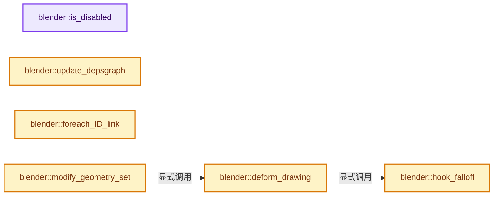
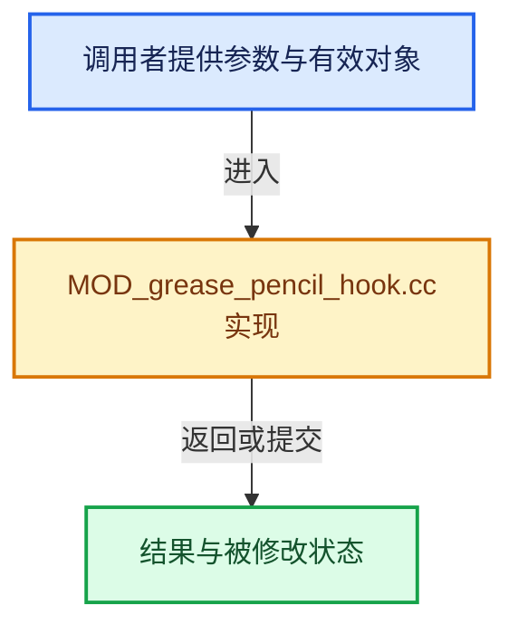

# 实现依赖专题：source/blender/modifiers/intern/MOD_grease_pencil_hook.cc

[实现依赖导航](../../../README.md) · [符号索引](../../../../00-课程指南/02-源码与提交索引/符号依赖与实现索引.md)

本专题从正文实际调用进入，集中保存共享实现。函数有稳定锚点，可从调用处直接跳到对应完整函数；递归与互相调用通过回链组织。

## 本文件的实现关系






## 完整成员与函数实现

<a id="f-7c4f2f87977f7ff4"></a>

### `blender::is_disabled`

实现位置：[source/blender/modifiers/intern/MOD_grease_pencil_hook.cc](../../../../../../../../source/blender/modifiers/intern/MOD_grease_pencil_hook.cc) · L64—L69。

接口参数：

- `const Scene *`
- `ModifierData *md`
- `bool`

**教学注释版**

<!-- annotated:58cc10545f7027 -->

```cpp
static bool is_disabled(const Scene * /*scene*/, ModifierData *md, bool /*use_render_params*/)
{
  auto *mmd = reinterpret_cast<GreasePencilHookModifierData *>(md);

  return (mmd->object == nullptr);
}
```

<details>
<summary>核对原始源码：source/blender/modifiers/intern/MOD_grease_pencil_hook.cc · L64—L69</summary>

<!-- original:58cc10545f7027:source/blender/modifiers/intern/MOD_grease_pencil_hook.cc:64:69 -->

```cpp
static bool is_disabled(const Scene * /*scene*/, ModifierData *md, bool /*use_render_params*/)
{
  auto *mmd = reinterpret_cast<GreasePencilHookModifierData *>(md);

  return (mmd->object == nullptr);
}
```

</details>

**结果出口**

- `return (mmd->object == nullptr);`

**继续追踪实现**

本实现没有需要继续展开的显式调用；检查返回表达式、对象转换和调用者前置条件。

<a id="f-9417449dc1009b20"></a>

### `blender::update_depsgraph`

实现位置：[source/blender/modifiers/intern/MOD_grease_pencil_hook.cc](../../../../../../../../source/blender/modifiers/intern/MOD_grease_pencil_hook.cc) · L71—L82。

接口参数：

- `ModifierData *md`
- `const ModifierUpdateDepsgraphContext *ctx`

**教学注释版**

<!-- annotated:83d7ef888a6abd -->

```cpp
static void update_depsgraph(ModifierData *md, const ModifierUpdateDepsgraphContext *ctx)
{
  auto *mmd = reinterpret_cast<GreasePencilHookModifierData *>(md);
  if (mmd->object != nullptr) {
    if (mmd->subtarget[0]) {
      DEG_add_bone_relation(
          ctx->node, mmd->object, mmd->subtarget, DEG_OB_COMP_BONE, "Hook Modifier");
    }
    DEG_add_object_relation(ctx->node, mmd->object, DEG_OB_COMP_TRANSFORM, "Hook Modifier");
  }
  DEG_add_object_relation(ctx->node, ctx->object, DEG_OB_COMP_TRANSFORM, "Hook Modifier");
}
```

<details>
<summary>核对原始源码：source/blender/modifiers/intern/MOD_grease_pencil_hook.cc · L71—L82</summary>

<!-- original:83d7ef888a6abd:source/blender/modifiers/intern/MOD_grease_pencil_hook.cc:71:82 -->

```cpp
static void update_depsgraph(ModifierData *md, const ModifierUpdateDepsgraphContext *ctx)
{
  auto *mmd = reinterpret_cast<GreasePencilHookModifierData *>(md);
  if (mmd->object != nullptr) {
    if (mmd->subtarget[0]) {
      DEG_add_bone_relation(
          ctx->node, mmd->object, mmd->subtarget, DEG_OB_COMP_BONE, "Hook Modifier");
    }
    DEG_add_object_relation(ctx->node, mmd->object, DEG_OB_COMP_TRANSFORM, "Hook Modifier");
  }
  DEG_add_object_relation(ctx->node, ctx->object, DEG_OB_COMP_TRANSFORM, "Hook Modifier");
}
```

</details>

**继续追踪实现**

- `DEG_add_bone_relation` → [blender::DEG_add_bone_relation · L189](../../../06-Depsgraph依赖图/intern/depsgraph_build.cc.md#f-39e93b3cc8a9913c)。
- `DEG_add_object_relation` → [blender::DEG_add_object_relation · L123](../../../06-Depsgraph依赖图/intern/depsgraph_build.cc.md#f-f570cffae97e273c)。

<a id="f-8ace23ea2fc1ce9a"></a>

### `blender::foreach_ID_link`

实现位置：[source/blender/modifiers/intern/MOD_grease_pencil_hook.cc](../../../../../../../../source/blender/modifiers/intern/MOD_grease_pencil_hook.cc) · L84—L91。

接口参数：

- `ModifierData *md`
- `Object *ob`
- `IDWalkFunc walk`
- `void *user_data`

**教学注释版**

<!-- annotated:816ecad1d0e478 -->

```cpp
static void foreach_ID_link(ModifierData *md, Object *ob, IDWalkFunc walk, void *user_data)
{
  auto *mmd = reinterpret_cast<GreasePencilHookModifierData *>(md);

  modifier::greasepencil::foreach_influence_ID_link(&mmd->influence, ob, walk, user_data);

  walk(user_data, ob, reinterpret_cast<ID **>(&mmd->object), IDWALK_CB_NOP);
}
```

<details>
<summary>核对原始源码：source/blender/modifiers/intern/MOD_grease_pencil_hook.cc · L84—L91</summary>

<!-- original:816ecad1d0e478:source/blender/modifiers/intern/MOD_grease_pencil_hook.cc:84:91 -->

```cpp
static void foreach_ID_link(ModifierData *md, Object *ob, IDWalkFunc walk, void *user_data)
{
  auto *mmd = reinterpret_cast<GreasePencilHookModifierData *>(md);

  modifier::greasepencil::foreach_influence_ID_link(&mmd->influence, ob, walk, user_data);

  walk(user_data, ob, reinterpret_cast<ID **>(&mmd->object), IDWALK_CB_NOP);
}
```

</details>

**继续追踪实现**

- `modifier::greasepencil::foreach_influence_ID_link` → [blender::modifier::greasepencil::foreach_influence_ID_link · L69](MOD_grease_pencil_util.cc.md#f-247ba56fa4c4e56f)。
- `walk` → [调用协议](../../../../00-课程指南/01-路线与规范/模板宏与动态分派协议.md)：局部可调用对象，须结合其初始化与捕获环境。调用位置L90。

<a id="f-0f6f16f2b9cea759"></a>

### `blender::hook_falloff`

实现位置：[source/blender/modifiers/intern/MOD_grease_pencil_hook.cc](../../../../../../../../source/blender/modifiers/intern/MOD_grease_pencil_hook.cc) · L108—L149。

接口参数：

- `const float falloff`
- `const int falloff_type`
- `const float falloff_sq`
- `const float fac_orig`
- `const CurveMapping *curfalloff`
- `const float len_sq`

**教学注释版**

<!-- annotated:c266b7037188cb -->

```cpp
static float hook_falloff(const float falloff,
                          const int falloff_type,
                          const float falloff_sq,
                          const float fac_orig,
                          const CurveMapping *curfalloff,
                          const float len_sq)
{
  BLI_assert(falloff_sq);
  if (len_sq > falloff_sq) {
    return 0.0f;
  }
  if (len_sq <= 0.0f) {
    return fac_orig;
  }
  if (falloff_type == MOD_GREASE_PENCIL_HOOK_Falloff_Const) {
    return fac_orig;
  }
  if (falloff_type == MOD_GREASE_PENCIL_HOOK_Falloff_InvSquare) {
    /* Avoid sqrt below. */
    return (1.0f - (len_sq / falloff_sq)) * fac_orig;
  }

  float fac = 1.0f - (math::sqrt(len_sq) / falloff);

  switch (falloff_type) {
    case MOD_GREASE_PENCIL_HOOK_Falloff_Curve:
      return BKE_curvemapping_evaluateF(curfalloff, 0, fac) * fac_orig;
    case MOD_GREASE_PENCIL_HOOK_Falloff_Sharp:
      return fac * fac * fac_orig;
    case MOD_GREASE_PENCIL_HOOK_Falloff_Smooth:
      return (3.0f * fac * fac - 2.0f * fac * fac * fac) * fac_orig;
    case MOD_GREASE_PENCIL_HOOK_Falloff_Root:
      return math::sqrt(fac) * fac_orig;
      break;
    case MOD_GREASE_PENCIL_HOOK_Falloff_Sphere:
      return math::sqrt(2 * fac - fac * fac) * fac_orig;
    case MOD_GREASE_PENCIL_HOOK_Falloff_Linear:
      ATTR_FALLTHROUGH; /* Pass. */
    default:
      return fac * fac_orig;
  }
}
```

<details>
<summary>核对原始源码：source/blender/modifiers/intern/MOD_grease_pencil_hook.cc · L108—L149</summary>

<!-- original:c266b7037188cb:source/blender/modifiers/intern/MOD_grease_pencil_hook.cc:108:149 -->

```cpp
static float hook_falloff(const float falloff,
                          const int falloff_type,
                          const float falloff_sq,
                          const float fac_orig,
                          const CurveMapping *curfalloff,
                          const float len_sq)
{
  BLI_assert(falloff_sq);
  if (len_sq > falloff_sq) {
    return 0.0f;
  }
  if (len_sq <= 0.0f) {
    return fac_orig;
  }
  if (falloff_type == MOD_GREASE_PENCIL_HOOK_Falloff_Const) {
    return fac_orig;
  }
  if (falloff_type == MOD_GREASE_PENCIL_HOOK_Falloff_InvSquare) {
    /* Avoid sqrt below. */
    return (1.0f - (len_sq / falloff_sq)) * fac_orig;
  }

  float fac = 1.0f - (math::sqrt(len_sq) / falloff);

  switch (falloff_type) {
    case MOD_GREASE_PENCIL_HOOK_Falloff_Curve:
      return BKE_curvemapping_evaluateF(curfalloff, 0, fac) * fac_orig;
    case MOD_GREASE_PENCIL_HOOK_Falloff_Sharp:
      return fac * fac * fac_orig;
    case MOD_GREASE_PENCIL_HOOK_Falloff_Smooth:
      return (3.0f * fac * fac - 2.0f * fac * fac * fac) * fac_orig;
    case MOD_GREASE_PENCIL_HOOK_Falloff_Root:
      return math::sqrt(fac) * fac_orig;
      break;
    case MOD_GREASE_PENCIL_HOOK_Falloff_Sphere:
      return math::sqrt(2 * fac - fac * fac) * fac_orig;
    case MOD_GREASE_PENCIL_HOOK_Falloff_Linear:
      ATTR_FALLTHROUGH; /* Pass. */
    default:
      return fac * fac_orig;
  }
}
```

</details>

**结果出口**

- `return 0.0f;`
- `return fac_orig;`
- `return (1.0f - (len_sq / falloff_sq)) * fac_orig;`
- `return BKE_curvemapping_evaluateF(curfalloff, 0, fac) * fac_orig;`
- `return fac * fac * fac_orig;`
- `return (3.0f * fac * fac - 2.0f * fac * fac * fac) * fac_orig;`
- `return math::sqrt(fac) * fac_orig;`
- `return math::sqrt(2 * fac - fac * fac) * fac_orig;`
- `return fac * fac_orig;`

**继续追踪实现**

- `BLI_assert` → [BLI_assert · L48](../../../01-BLI基础库/BLI_assert.hh.md#m-57a88495704d)；[BLI_assert · L63](../../../01-BLI基础库/BLI_assert.hh.md#m-d07050020cb5)。宏定义由构建条件选择。
- `math::sqrt` → [外部契约](https://eel.is/c++draft/)：这个边界按实际表达式及所属类型核对参数、返回值、寿命与失败行为。这里提供接口入口，不声称已解释该第三方版本的内部实现。
- `BKE_curvemapping_evaluateF` → [blender::BKE_curvemapping_evaluateF · L1177](../../../02-BKE几何与数据/intern/colortools.cc.md#f-014584e04eeb1392)。

<a id="f-14144335e4c609ce"></a>

### `blender::deform_drawing`

实现位置：[source/blender/modifiers/intern/MOD_grease_pencil_hook.cc](../../../../../../../../source/blender/modifiers/intern/MOD_grease_pencil_hook.cc) · L151—L235。

接口参数：

- `const ModifierData &md`
- `const Object &ob`
- `bke::greasepencil::Drawing &drawing`

**教学注释版**

<!-- annotated:000b3875b29439 -->

```cpp
static void deform_drawing(const ModifierData &md,
                           const Object &ob,
                           bke::greasepencil::Drawing &drawing)
{
  const auto &mmd = reinterpret_cast<const GreasePencilHookModifierData &>(md);
  modifier::greasepencil::ensure_no_bezier_curves(drawing);
  bke::CurvesGeometry &curves = drawing.strokes_for_write();

  if (curves.is_empty()) {
    return;
  }
  IndexMaskMemory memory;
  const IndexMask strokes = modifier::greasepencil::get_filtered_stroke_mask(
      &ob, curves, mmd.influence, memory);
  if (strokes.is_empty()) {
    return;
  }

  const VArray<float> input_weights = modifier::greasepencil::get_influence_vertex_weights(
      curves, mmd.influence);

  const int falloff_type = mmd.falloff_type;
  const float falloff = (mmd.falloff_type == MOD_GREASE_PENCIL_HOOK_Falloff_None) ? 0.0f :
                                                                                    mmd.falloff;
  const float falloff_sq = square_f(falloff);
  const float fac_orig = mmd.force;
  const bool use_falloff = falloff_sq != 0.0f;
  const bool use_uniform = (mmd.flag & MOD_GREASE_PENCIL_HOOK_UNIFORM_SPACE) != 0;

  const float3x3 mat_uniform = use_uniform ? float3x3(float4x4(mmd.parentinv)) :
                                             float3x3::identity();
  const float3 cent = use_uniform ? math::transform_point(mat_uniform, float3(mmd.cent)) :
                                    float3(mmd.cent);

  float4x4 dmat = mmd.object->object_to_world();
  /* Get world-space matrix of target, corrected for the space the verts are in. */
  if (mmd.subtarget[0]) {
    bPoseChannel *pchan = BKE_pose_channel_find_name(mmd.object->pose, mmd.subtarget);
    if (pchan) {
      /* Bone target if there's a matching pose-channel. */
      dmat = mmd.object->object_to_world() * float4x4(pchan->pose_mat);
    }
  }
  float4x4 use_mat = ob.world_to_object() * dmat * float4x4(mmd.parentinv);

  const OffsetIndices<int> points_by_curve = curves.points_by_curve();
  MutableSpan<float3> positions = curves.positions_for_write();

  strokes.foreach_index(
      [&](const int stroke) {
        const IndexRange points_range = points_by_curve[stroke].index_range();
        for (const int point_i : points_range) {
          const int point = point_i + points_by_curve[stroke].first();
          const float weight = input_weights[point];
          if (weight < 0.0f) {
            continue;
          }

          float fac;
          if (use_falloff) {
            float len_sq;
            if (use_uniform) {
              const float3 co_uniform = math::transform_point(mat_uniform, positions[point]);
              len_sq = math::distance(cent, co_uniform);
            }
            else {
              len_sq = math::distance(cent, positions[point]);
            }
            fac = hook_falloff(
                falloff, falloff_type, falloff_sq, fac_orig, mmd.influence.custom_curve, len_sq);
          }
          else {
            fac = fac_orig;
          }

          if (fac != 0.0f) {
            const float3 co_tmp = math::transform_point(use_mat, positions[point]);
            positions[point] = math::interpolate(positions[point], co_tmp, fac * weight);
          }
        }
      },
      exec_mode::grain_size(128));

  drawing.tag_positions_changed();
}
```

<details>
<summary>核对原始源码：source/blender/modifiers/intern/MOD_grease_pencil_hook.cc · L151—L235</summary>

<!-- original:000b3875b29439:source/blender/modifiers/intern/MOD_grease_pencil_hook.cc:151:235 -->

```cpp
static void deform_drawing(const ModifierData &md,
                           const Object &ob,
                           bke::greasepencil::Drawing &drawing)
{
  const auto &mmd = reinterpret_cast<const GreasePencilHookModifierData &>(md);
  modifier::greasepencil::ensure_no_bezier_curves(drawing);
  bke::CurvesGeometry &curves = drawing.strokes_for_write();

  if (curves.is_empty()) {
    return;
  }
  IndexMaskMemory memory;
  const IndexMask strokes = modifier::greasepencil::get_filtered_stroke_mask(
      &ob, curves, mmd.influence, memory);
  if (strokes.is_empty()) {
    return;
  }

  const VArray<float> input_weights = modifier::greasepencil::get_influence_vertex_weights(
      curves, mmd.influence);

  const int falloff_type = mmd.falloff_type;
  const float falloff = (mmd.falloff_type == MOD_GREASE_PENCIL_HOOK_Falloff_None) ? 0.0f :
                                                                                    mmd.falloff;
  const float falloff_sq = square_f(falloff);
  const float fac_orig = mmd.force;
  const bool use_falloff = falloff_sq != 0.0f;
  const bool use_uniform = (mmd.flag & MOD_GREASE_PENCIL_HOOK_UNIFORM_SPACE) != 0;

  const float3x3 mat_uniform = use_uniform ? float3x3(float4x4(mmd.parentinv)) :
                                             float3x3::identity();
  const float3 cent = use_uniform ? math::transform_point(mat_uniform, float3(mmd.cent)) :
                                    float3(mmd.cent);

  float4x4 dmat = mmd.object->object_to_world();
  /* Get world-space matrix of target, corrected for the space the verts are in. */
  if (mmd.subtarget[0]) {
    bPoseChannel *pchan = BKE_pose_channel_find_name(mmd.object->pose, mmd.subtarget);
    if (pchan) {
      /* Bone target if there's a matching pose-channel. */
      dmat = mmd.object->object_to_world() * float4x4(pchan->pose_mat);
    }
  }
  float4x4 use_mat = ob.world_to_object() * dmat * float4x4(mmd.parentinv);

  const OffsetIndices<int> points_by_curve = curves.points_by_curve();
  MutableSpan<float3> positions = curves.positions_for_write();

  strokes.foreach_index(
      [&](const int stroke) {
        const IndexRange points_range = points_by_curve[stroke].index_range();
        for (const int point_i : points_range) {
          const int point = point_i + points_by_curve[stroke].first();
          const float weight = input_weights[point];
          if (weight < 0.0f) {
            continue;
          }

          float fac;
          if (use_falloff) {
            float len_sq;
            if (use_uniform) {
              const float3 co_uniform = math::transform_point(mat_uniform, positions[point]);
              len_sq = math::distance(cent, co_uniform);
            }
            else {
              len_sq = math::distance(cent, positions[point]);
            }
            fac = hook_falloff(
                falloff, falloff_type, falloff_sq, fac_orig, mmd.influence.custom_curve, len_sq);
          }
          else {
            fac = fac_orig;
          }

          if (fac != 0.0f) {
            const float3 co_tmp = math::transform_point(use_mat, positions[point]);
            positions[point] = math::interpolate(positions[point], co_tmp, fac * weight);
          }
        }
      },
      exec_mode::grain_size(128));

  drawing.tag_positions_changed();
}
```

</details>

**沿实际写入检查状态**

- `dmat = mmd.object->object_to_world() * float4x4(pchan->pose_mat);`
- `len_sq = math::distance(cent, co_uniform);`
- `len_sq = math::distance(cent, positions[point]);`
- `fac = hook_falloff(`
- `fac = fac_orig;`
- `positions[point] = math::interpolate(positions[point], co_tmp, fac * weight);`

**继续追踪实现**

- `modifier::greasepencil::ensure_no_bezier_curves` → [blender::modifier::greasepencil::ensure_no_bezier_curves · L432](MOD_grease_pencil_util.cc.md#f-1fde6483ac30d59b)。
- `drawing.strokes_for_write` → [blender::bke::greasepencil::Drawing::strokes_for_write · L1012](../../../02-BKE几何与数据/intern/grease_pencil.cc.md#f-0649333785d0aa95)。
- `curves.is_empty` → [blender::bke::CurvesGeometry::is_empty · L1013](../../../../05-几何存储与拓扑映射/04-CurvesGeometry存储.md#f-4c323ef62c4b64ab)。
- `modifier::greasepencil::get_filtered_stroke_mask` → [blender::modifier::greasepencil::get_filtered_stroke_mask · L285](MOD_grease_pencil_util.cc.md#f-30c219d04de7dec3)；[blender::modifier::greasepencil::get_filtered_stroke_mask · L326](MOD_grease_pencil_util.cc.md#f-970c3bc880e4f350)。同名重载需按实参类型选择。
- `strokes.is_empty` → [blender::index_mask::IndexMask::is_empty · L748](../../../../04-虚拟数组与索引选择/09-分段存储与遍历.md#f-190ac996386064f4)。
- `modifier::greasepencil::get_influence_vertex_weights` → [blender::modifier::greasepencil::get_influence_vertex_weights · L343](MOD_grease_pencil_util.cc.md#f-6f4fdb5693985db9)。
- `square_f` → [blender::square_f · L302](../../../01-BLI基础库/intern/math_base_inline.cc.md#f-30f1dde493a37e0d)。
- `float3x3` → [调用协议](../../../../00-课程指南/01-路线与规范/模板宏与动态分派协议.md)：函数指针、局部可调用对象或未展开的宏；必须结合调用者环境。调用位置L180。
- `float4x4` → [调用协议](../../../../00-课程指南/01-路线与规范/模板宏与动态分派协议.md)：函数指针、局部可调用对象或未展开的宏；必须结合调用者环境。调用位置L180。
- `float3x3::identity` → [调用协议](../../../../00-课程指南/01-路线与规范/模板宏与动态分派协议.md)：函数指针、局部可调用对象或未展开的宏；必须结合调用者环境。调用位置L181。
- `math::transform_point` → [blender::math::transform_point · L318](../../../01-BLI基础库/BLI_math_quaternion.hh.md#f-e52a2e8c12e32657)；[blender::math::transform_point · L491](../../../01-BLI基础库/BLI_math_quaternion.hh.md#f-6c9f8362c60efe6c)；[blender::math::transform_point · L445](../../../01-BLI基础库/BLI_math_basis_types.hh.md#f-a151fd44ae743502)。同名重载需按实参类型选择。
- `float3` → [float3 · L641](../../compositor/algorithms/intern/smaa.cc.md#m-0ea8254cfdb4)。宏定义由构建条件选择。
- `mmd.object->object_to_world` → [调用协议](../../../../00-课程指南/01-路线与规范/模板宏与动态分派协议.md)：接收对象类型依赖auto、返回值或模板实例；不按同名猜测目标。调用位置L185。
- `BKE_pose_channel_find_name` → [blender::BKE_pose_channel_find_name · L895](../../../02-BKE几何与数据/intern/action.cc.md#f-5997206551bfc9f9)。
- `ob.world_to_object` → [blender::Object::world_to_object · L5766](../../../02-BKE几何与数据/intern/object.cc.md#f-dd4d8d55d6195233)。
- `curves.points_by_curve` → [blender::bke::CurvesGeometry::points_by_curve · L1058](../../../../05-几何存储与拓扑映射/04-CurvesGeometry存储.md#f-a0416697e10ec205)。
- `curves.positions_for_write` → [blender::bke::CurvesGeometry::positions_for_write · L328](../../../02-BKE几何与数据/intern/curves_geometry.cc.md#f-30e013e651e830c3)。
- `strokes.foreach_index` → [blender::index_mask::IndexMask::foreach_index · L855](../../../../04-虚拟数组与索引选择/09-分段存储与遍历.md#f-cd6cd317e2e2812c)。
- `points_by_curve[stroke].index_range` → [调用协议](../../../../00-课程指南/01-路线与规范/模板宏与动态分派协议.md)：接收对象类型依赖auto、返回值或模板实例；不按同名猜测目标。调用位置L201。
- `points_by_curve[stroke].first` → [调用协议](../../../../00-课程指南/01-路线与规范/模板宏与动态分派协议.md)：接收对象类型依赖auto、返回值或模板实例；不按同名猜测目标。调用位置L203。
- `math::distance` → [blender::math::distance · L485](../../../01-BLI基础库/BLI_math_vector.hh.md#f-0a0df9b41ececd7b)；[blender::math::distance · L143](../../../01-BLI基础库/BLI_math_base.hh.md#f-45db793191057701)。同名重载需按实参类型选择。
- `hook_falloff` → [blender::hook_falloff · L108](MOD_grease_pencil_hook.cc.md#f-0f6f16f2b9cea759)。
- `math::interpolate` → [blender::math::interpolate · L335](../../../01-BLI基础库/intern/math_matrix.cc.md#f-91e7f517ebd72fb5)；[blender::math::interpolate · L379](../../../01-BLI基础库/intern/math_matrix.cc.md#f-a1be14e86ce595c2)；[blender::math::interpolate · L636](../../../01-BLI基础库/BLI_math_vector.hh.md#f-d612b6d6ab1b6e7c)；[blender::math::interpolate · L303](../../../01-BLI基础库/BLI_math_quaternion.hh.md#f-48b9ace2a9c6185c)；[blender::math::interpolate · L17](../../../01-BLI基础库/BLI_math_color.hh.md#f-eb5ef92b0f8c0926)；[blender::math::interpolate · L28](../../../01-BLI基础库/BLI_math_color.hh.md#f-2a9e33ec55979ab6)；[blender::math::interpolate · L278](../../../01-BLI基础库/BLI_math_base.hh.md#f-2629b871528f6528)。同名重载需按实参类型选择。
- `exec_mode::grain_size` → [blender::exec_mode::grain_size · L79](../../../01-BLI基础库/BLI_execution_mode.hh.md#f-0b4fc2f9fa6e66e7)。
- `drawing.tag_positions_changed` → [blender::bke::greasepencil::Drawing::tag_positions_changed · L1095](../../../02-BKE几何与数据/intern/grease_pencil.cc.md#f-cc348dc1ca18c109)；[blender::bke::greasepencil::Drawing::tag_positions_changed · L1229](../../../02-BKE几何与数据/intern/grease_pencil.cc.md#f-36aaac52033b03bf)。同名重载需按实参类型选择。

<a id="f-7d8cba698be3f21f"></a>

### `blender::modify_geometry_set`

实现位置：[source/blender/modifiers/intern/MOD_grease_pencil_hook.cc](../../../../../../../../source/blender/modifiers/intern/MOD_grease_pencil_hook.cc) · L237—L260。

接口参数：

- `ModifierData *md`
- `const ModifierEvalContext *ctx`
- `bke::GeometrySet *geometry_set`

**教学注释版**

<!-- annotated:c3b7659319e32a -->

```cpp
static void modify_geometry_set(ModifierData *md,
                                const ModifierEvalContext *ctx,
                                bke::GeometrySet *geometry_set)
{
  const GreasePencilHookModifierData *mmd = reinterpret_cast<GreasePencilHookModifierData *>(md);

  if (!geometry_set->has_grease_pencil()) {
    return;
  }

  GreasePencil &grease_pencil = *geometry_set->get_grease_pencil_for_write();

  const int current_frame = grease_pencil.runtime->eval_frame;

  IndexMaskMemory mask_memory;
  const IndexMask layer_mask = modifier::greasepencil::get_filtered_layer_mask(
      grease_pencil, mmd->influence, mask_memory);
  const Vector<bke::greasepencil::Drawing *> drawings =
      modifier::greasepencil::get_drawings_for_write(grease_pencil, layer_mask, current_frame);

  threading::parallel_for_each(drawings, [&](bke::greasepencil::Drawing *drawing) {
    deform_drawing(*md, *ctx->object, *drawing);
  });
}
```

<details>
<summary>核对原始源码：source/blender/modifiers/intern/MOD_grease_pencil_hook.cc · L237—L260</summary>

<!-- original:c3b7659319e32a:source/blender/modifiers/intern/MOD_grease_pencil_hook.cc:237:260 -->

```cpp
static void modify_geometry_set(ModifierData *md,
                                const ModifierEvalContext *ctx,
                                bke::GeometrySet *geometry_set)
{
  const GreasePencilHookModifierData *mmd = reinterpret_cast<GreasePencilHookModifierData *>(md);

  if (!geometry_set->has_grease_pencil()) {
    return;
  }

  GreasePencil &grease_pencil = *geometry_set->get_grease_pencil_for_write();

  const int current_frame = grease_pencil.runtime->eval_frame;

  IndexMaskMemory mask_memory;
  const IndexMask layer_mask = modifier::greasepencil::get_filtered_layer_mask(
      grease_pencil, mmd->influence, mask_memory);
  const Vector<bke::greasepencil::Drawing *> drawings =
      modifier::greasepencil::get_drawings_for_write(grease_pencil, layer_mask, current_frame);

  threading::parallel_for_each(drawings, [&](bke::greasepencil::Drawing *drawing) {
    deform_drawing(*md, *ctx->object, *drawing);
  });
}
```

</details>

**继续追踪实现**

- `geometry_set->has_grease_pencil` → [blender::bke::GeometrySet::has_grease_pencil · L415](../../../../06-隐式共享与缓存系统/05-GeometrySet读写与复制.md#f-357bcb62da7a8afd)。
- `geometry_set->get_grease_pencil_for_write` → [blender::bke::GeometrySet::get_grease_pencil_for_write · L622](../../../../06-隐式共享与缓存系统/05-GeometrySet读写与复制.md#f-bfc5e891a352651b)。
- `modifier::greasepencil::get_filtered_layer_mask` → [blender::modifier::greasepencil::get_filtered_layer_mask · L213](MOD_grease_pencil_util.cc.md#f-6438bea51141f9db)；[blender::modifier::greasepencil::get_filtered_layer_mask · L268](MOD_grease_pencil_util.cc.md#f-e3d0f9748ecdf34b)。同名重载需按实参类型选择。
- `modifier::greasepencil::get_drawings_for_write` → [blender::modifier::greasepencil::get_drawings_for_write · L368](MOD_grease_pencil_util.cc.md#f-cef3871c31259376)。
- `threading::parallel_for_each` → [blender::threading::parallel_for_each · L30](../../../../11-Depsgraph与并行任务系统/07-任务池与TBB接入.md#f-d5604027445ef0f5)。
- `deform_drawing` → [blender::deform_drawing · L151](MOD_grease_pencil_hook.cc.md#f-14144335e4c609ce)。
