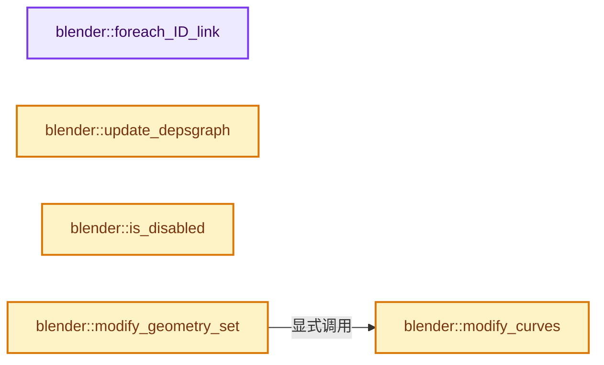
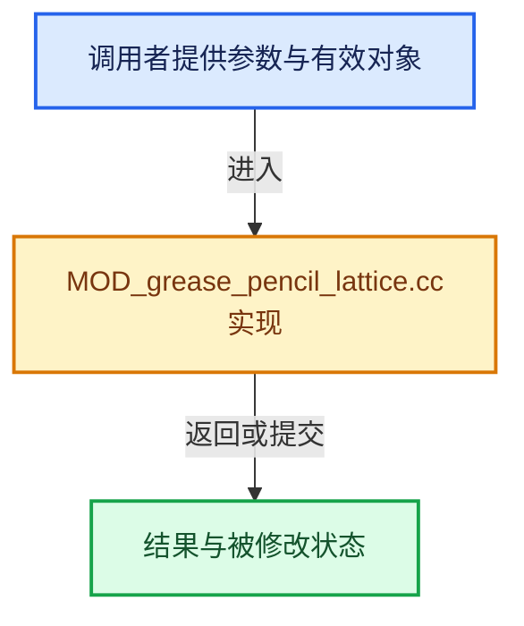

# 实现依赖专题：source/blender/modifiers/intern/MOD_grease_pencil_lattice.cc

[实现依赖导航](../../../README.md) · [符号索引](../../../../00-课程指南/02-源码与提交索引/符号依赖与实现索引.md)

本专题从正文实际调用进入，集中保存共享实现。函数有稳定锚点，可从调用处直接跳到对应完整函数；递归与互相调用通过回链组织。

## 本文件的实现关系






## 完整成员与函数实现

<a id="f-91bc010628f6b5a4"></a>

### `blender::foreach_ID_link`

实现位置：[source/blender/modifiers/intern/MOD_grease_pencil_lattice.cc](../../../../../../../../source/blender/modifiers/intern/MOD_grease_pencil_lattice.cc) · L62—L68。

接口参数：

- `ModifierData *md`
- `Object *ob`
- `IDWalkFunc walk`
- `void *user_data`

**教学注释版**

<!-- annotated:bb467585a0fce2 -->

```cpp
static void foreach_ID_link(ModifierData *md, Object *ob, IDWalkFunc walk, void *user_data)
{
  auto *lmd = reinterpret_cast<GreasePencilLatticeModifierData *>(md);
  modifier::greasepencil::foreach_influence_ID_link(&lmd->influence, ob, walk, user_data);

  walk(user_data, ob, reinterpret_cast<ID **>(&lmd->object), IDWALK_CB_NOP);
}
```

<details>
<summary>核对原始源码：source/blender/modifiers/intern/MOD_grease_pencil_lattice.cc · L62—L68</summary>

<!-- original:bb467585a0fce2:source/blender/modifiers/intern/MOD_grease_pencil_lattice.cc:62:68 -->

```cpp
static void foreach_ID_link(ModifierData *md, Object *ob, IDWalkFunc walk, void *user_data)
{
  auto *lmd = reinterpret_cast<GreasePencilLatticeModifierData *>(md);
  modifier::greasepencil::foreach_influence_ID_link(&lmd->influence, ob, walk, user_data);

  walk(user_data, ob, reinterpret_cast<ID **>(&lmd->object), IDWALK_CB_NOP);
}
```

</details>

**继续追踪实现**

- `modifier::greasepencil::foreach_influence_ID_link` → [blender::modifier::greasepencil::foreach_influence_ID_link · L69](MOD_grease_pencil_util.cc.md#f-247ba56fa4c4e56f)。
- `walk` → [调用协议](../../../../00-课程指南/01-路线与规范/模板宏与动态分派协议.md)：局部可调用对象，须结合其初始化与捕获环境。调用位置L67。

<a id="f-1f28afa06d864afc"></a>

### `blender::update_depsgraph`

实现位置：[source/blender/modifiers/intern/MOD_grease_pencil_lattice.cc](../../../../../../../../source/blender/modifiers/intern/MOD_grease_pencil_lattice.cc) · L70—L80。

接口参数：

- `ModifierData *md`
- `const ModifierUpdateDepsgraphContext *ctx`

**教学注释版**

<!-- annotated:e72cc591e260cf -->

```cpp
static void update_depsgraph(ModifierData *md, const ModifierUpdateDepsgraphContext *ctx)
{
  auto *lmd = reinterpret_cast<GreasePencilLatticeModifierData *>(md);
  if (lmd->object != nullptr) {
    DEG_add_object_relation(
        ctx->node, lmd->object, DEG_OB_COMP_TRANSFORM, "Grease Pencil Lattice Modifier");
    DEG_add_object_relation(
        ctx->node, lmd->object, DEG_OB_COMP_GEOMETRY, "Grease Pencil Lattice Modifier");
  }
  DEG_add_depends_on_transform_relation(ctx->node, "Grease Pencil Lattice Modifier");
}
```

<details>
<summary>核对原始源码：source/blender/modifiers/intern/MOD_grease_pencil_lattice.cc · L70—L80</summary>

<!-- original:e72cc591e260cf:source/blender/modifiers/intern/MOD_grease_pencil_lattice.cc:70:80 -->

```cpp
static void update_depsgraph(ModifierData *md, const ModifierUpdateDepsgraphContext *ctx)
{
  auto *lmd = reinterpret_cast<GreasePencilLatticeModifierData *>(md);
  if (lmd->object != nullptr) {
    DEG_add_object_relation(
        ctx->node, lmd->object, DEG_OB_COMP_TRANSFORM, "Grease Pencil Lattice Modifier");
    DEG_add_object_relation(
        ctx->node, lmd->object, DEG_OB_COMP_GEOMETRY, "Grease Pencil Lattice Modifier");
  }
  DEG_add_depends_on_transform_relation(ctx->node, "Grease Pencil Lattice Modifier");
}
```

</details>

**继续追踪实现**

- `DEG_add_object_relation` → [blender::DEG_add_object_relation · L123](../../../06-Depsgraph依赖图/intern/depsgraph_build.cc.md#f-f570cffae97e273c)。
- `DEG_add_depends_on_transform_relation` → [blender::DEG_add_depends_on_transform_relation · L240](../../../06-Depsgraph依赖图/intern/depsgraph_build.cc.md#f-47c32a354defa20d)。

<a id="f-642a1871ed7f5d16"></a>

### `blender::is_disabled`

实现位置：[source/blender/modifiers/intern/MOD_grease_pencil_lattice.cc](../../../../../../../../source/blender/modifiers/intern/MOD_grease_pencil_lattice.cc) · L82—L92。

接口参数：

- `const Scene *`
- `ModifierData *md`
- `bool`

**教学注释版**

<!-- annotated:c060f8cef00997 -->

```cpp
static bool is_disabled(const Scene * /*scene*/, ModifierData *md, bool /*use_render_params*/)
{
  auto *lmd = reinterpret_cast<GreasePencilLatticeModifierData *>(md);

  /* The object type check is only needed here in case we have a placeholder
   * object assigned (because the library containing the lattice is missing).
   *
   * In other cases it should be impossible to have a type mismatch.
   */
  return lmd->object == nullptr || lmd->object->type != OB_LATTICE;
}
```

<details>
<summary>核对原始源码：source/blender/modifiers/intern/MOD_grease_pencil_lattice.cc · L82—L92</summary>

<!-- original:c060f8cef00997:source/blender/modifiers/intern/MOD_grease_pencil_lattice.cc:82:92 -->

```cpp
static bool is_disabled(const Scene * /*scene*/, ModifierData *md, bool /*use_render_params*/)
{
  auto *lmd = reinterpret_cast<GreasePencilLatticeModifierData *>(md);

  /* The object type check is only needed here in case we have a placeholder
   * object assigned (because the library containing the lattice is missing).
   *
   * In other cases it should be impossible to have a type mismatch.
   */
  return lmd->object == nullptr || lmd->object->type != OB_LATTICE;
}
```

</details>

**结果出口**

- `return lmd->object == nullptr || lmd->object->type != OB_LATTICE;`

**继续追踪实现**

本实现没有需要继续展开的显式调用；检查返回表达式、对象转换和调用者前置条件。

<a id="f-aacb80abe183dbae"></a>

### `blender::modify_curves`

实现位置：[source/blender/modifiers/intern/MOD_grease_pencil_lattice.cc](../../../../../../../../source/blender/modifiers/intern/MOD_grease_pencil_lattice.cc) · L94—L125。

接口参数：

- `ModifierData *md`
- `const ModifierEvalContext *ctx`
- `const LatticeDeformData &cache_data`
- `Drawing &drawing`

**教学注释版**

<!-- annotated:0b1c420bf2adc6 -->

```cpp
static void modify_curves(ModifierData *md,
                          const ModifierEvalContext *ctx,
                          const LatticeDeformData &cache_data,
                          Drawing &drawing)
{
  const auto *lmd = reinterpret_cast<GreasePencilLatticeModifierData *>(md);
  modifier::greasepencil::ensure_no_bezier_curves(drawing);
  bke::CurvesGeometry &curves = drawing.strokes_for_write();

  IndexMaskMemory mask_memory;
  const IndexMask curves_mask = modifier::greasepencil::get_filtered_stroke_mask(
      ctx->object, curves, lmd->influence, mask_memory);

  const OffsetIndices<int> points_by_curve = curves.points_by_curve();
  MutableSpan<float3> positions = curves.positions_for_write();
  const VArray<float> vgroup_weights = modifier::greasepencil::get_influence_vertex_weights(
      curves, lmd->influence);

  curves_mask.foreach_index(
      [&](const int64_t curve_i) {
        const IndexRange points = points_by_curve[curve_i];
        for (const int64_t point_i : points) {
          const float weight = vgroup_weights[point_i];
          BKE_lattice_deform_data_eval_co(const_cast<LatticeDeformData *>(&cache_data),
                                          positions[point_i],
                                          lmd->strength * weight);
        }
      },
      exec_mode::grain_size(512));

  drawing.tag_positions_changed();
}
```

<details>
<summary>核对原始源码：source/blender/modifiers/intern/MOD_grease_pencil_lattice.cc · L94—L125</summary>

<!-- original:0b1c420bf2adc6:source/blender/modifiers/intern/MOD_grease_pencil_lattice.cc:94:125 -->

```cpp
static void modify_curves(ModifierData *md,
                          const ModifierEvalContext *ctx,
                          const LatticeDeformData &cache_data,
                          Drawing &drawing)
{
  const auto *lmd = reinterpret_cast<GreasePencilLatticeModifierData *>(md);
  modifier::greasepencil::ensure_no_bezier_curves(drawing);
  bke::CurvesGeometry &curves = drawing.strokes_for_write();

  IndexMaskMemory mask_memory;
  const IndexMask curves_mask = modifier::greasepencil::get_filtered_stroke_mask(
      ctx->object, curves, lmd->influence, mask_memory);

  const OffsetIndices<int> points_by_curve = curves.points_by_curve();
  MutableSpan<float3> positions = curves.positions_for_write();
  const VArray<float> vgroup_weights = modifier::greasepencil::get_influence_vertex_weights(
      curves, lmd->influence);

  curves_mask.foreach_index(
      [&](const int64_t curve_i) {
        const IndexRange points = points_by_curve[curve_i];
        for (const int64_t point_i : points) {
          const float weight = vgroup_weights[point_i];
          BKE_lattice_deform_data_eval_co(const_cast<LatticeDeformData *>(&cache_data),
                                          positions[point_i],
                                          lmd->strength * weight);
        }
      },
      exec_mode::grain_size(512));

  drawing.tag_positions_changed();
}
```

</details>

**继续追踪实现**

- `modifier::greasepencil::ensure_no_bezier_curves` → [blender::modifier::greasepencil::ensure_no_bezier_curves · L432](MOD_grease_pencil_util.cc.md#f-1fde6483ac30d59b)。
- `drawing.strokes_for_write` → [blender::bke::greasepencil::Drawing::strokes_for_write · L1012](../../../02-BKE几何与数据/intern/grease_pencil.cc.md#f-0649333785d0aa95)。
- `modifier::greasepencil::get_filtered_stroke_mask` → [blender::modifier::greasepencil::get_filtered_stroke_mask · L285](MOD_grease_pencil_util.cc.md#f-30c219d04de7dec3)；[blender::modifier::greasepencil::get_filtered_stroke_mask · L326](MOD_grease_pencil_util.cc.md#f-970c3bc880e4f350)。同名重载需按实参类型选择。
- `curves.points_by_curve` → [blender::bke::CurvesGeometry::points_by_curve · L1058](../../../../05-几何存储与拓扑映射/04-CurvesGeometry存储.md#f-a0416697e10ec205)。
- `curves.positions_for_write` → [blender::bke::CurvesGeometry::positions_for_write · L328](../../../02-BKE几何与数据/intern/curves_geometry.cc.md#f-30e013e651e830c3)。
- `modifier::greasepencil::get_influence_vertex_weights` → [blender::modifier::greasepencil::get_influence_vertex_weights · L343](MOD_grease_pencil_util.cc.md#f-6f4fdb5693985db9)。
- `curves_mask.foreach_index` → [blender::index_mask::IndexMask::foreach_index · L855](../../../../04-虚拟数组与索引选择/09-分段存储与遍历.md#f-cd6cd317e2e2812c)。
- `BKE_lattice_deform_data_eval_co` → [blender::BKE_lattice_deform_data_eval_co · L167](../../../02-BKE几何与数据/intern/lattice_deform.cc.md#f-9e3b9b7cdfecb125)。
- `exec_mode::grain_size` → [blender::exec_mode::grain_size · L79](../../../01-BLI基础库/BLI_execution_mode.hh.md#f-0b4fc2f9fa6e66e7)。
- `drawing.tag_positions_changed` → [blender::bke::greasepencil::Drawing::tag_positions_changed · L1095](../../../02-BKE几何与数据/intern/grease_pencil.cc.md#f-cc348dc1ca18c109)；[blender::bke::greasepencil::Drawing::tag_positions_changed · L1229](../../../02-BKE几何与数据/intern/grease_pencil.cc.md#f-36aaac52033b03bf)。同名重载需按实参类型选择。

<a id="f-08d3356602673303"></a>

### `blender::modify_geometry_set`

实现位置：[source/blender/modifiers/intern/MOD_grease_pencil_lattice.cc](../../../../../../../../source/blender/modifiers/intern/MOD_grease_pencil_lattice.cc) · L127—L150。

接口参数：

- `ModifierData *md`
- `const ModifierEvalContext *ctx`
- `bke::GeometrySet *geometry_set`

**教学注释版**

<!-- annotated:5b21e7bccc4784 -->

```cpp
static void modify_geometry_set(ModifierData *md,
                                const ModifierEvalContext *ctx,
                                bke::GeometrySet *geometry_set)
{
  const auto *lmd = reinterpret_cast<GreasePencilLatticeModifierData *>(md);
  BLI_assert(lmd->object != nullptr && lmd->object->type == OB_LATTICE);
  LatticeDeformData *cache_data = BKE_lattice_deform_data_create(lmd->object, ctx->object);

  if (!geometry_set->has_grease_pencil()) {
    return;
  }
  GreasePencil &grease_pencil = *geometry_set->get_grease_pencil_for_write();

  IndexMaskMemory mask_memory;
  const IndexMask layer_mask = modifier::greasepencil::get_filtered_layer_mask(
      grease_pencil, lmd->influence, mask_memory);
  const int frame = grease_pencil.runtime->eval_frame;
  const Vector<Drawing *> drawings = modifier::greasepencil::get_drawings_for_write(
      grease_pencil, layer_mask, frame);
  threading::parallel_for_each(
      drawings, [&](Drawing *drawing) { modify_curves(md, ctx, *cache_data, *drawing); });

  BKE_lattice_deform_data_destroy(cache_data);
}
```

<details>
<summary>核对原始源码：source/blender/modifiers/intern/MOD_grease_pencil_lattice.cc · L127—L150</summary>

<!-- original:5b21e7bccc4784:source/blender/modifiers/intern/MOD_grease_pencil_lattice.cc:127:150 -->

```cpp
static void modify_geometry_set(ModifierData *md,
                                const ModifierEvalContext *ctx,
                                bke::GeometrySet *geometry_set)
{
  const auto *lmd = reinterpret_cast<GreasePencilLatticeModifierData *>(md);
  BLI_assert(lmd->object != nullptr && lmd->object->type == OB_LATTICE);
  LatticeDeformData *cache_data = BKE_lattice_deform_data_create(lmd->object, ctx->object);

  if (!geometry_set->has_grease_pencil()) {
    return;
  }
  GreasePencil &grease_pencil = *geometry_set->get_grease_pencil_for_write();

  IndexMaskMemory mask_memory;
  const IndexMask layer_mask = modifier::greasepencil::get_filtered_layer_mask(
      grease_pencil, lmd->influence, mask_memory);
  const int frame = grease_pencil.runtime->eval_frame;
  const Vector<Drawing *> drawings = modifier::greasepencil::get_drawings_for_write(
      grease_pencil, layer_mask, frame);
  threading::parallel_for_each(
      drawings, [&](Drawing *drawing) { modify_curves(md, ctx, *cache_data, *drawing); });

  BKE_lattice_deform_data_destroy(cache_data);
}
```

</details>

**继续追踪实现**

- `BLI_assert` → [BLI_assert · L48](../../../01-BLI基础库/BLI_assert.hh.md#m-57a88495704d)；[BLI_assert · L63](../../../01-BLI基础库/BLI_assert.hh.md#m-d07050020cb5)。宏定义由构建条件选择。
- `BKE_lattice_deform_data_create` → [blender::BKE_lattice_deform_data_create · L59](../../../02-BKE几何与数据/intern/lattice_deform.cc.md#f-931964727c2c33b2)。
- `geometry_set->has_grease_pencil` → [blender::bke::GeometrySet::has_grease_pencil · L415](../../../../06-隐式共享与缓存系统/05-GeometrySet读写与复制.md#f-357bcb62da7a8afd)。
- `geometry_set->get_grease_pencil_for_write` → [blender::bke::GeometrySet::get_grease_pencil_for_write · L622](../../../../06-隐式共享与缓存系统/05-GeometrySet读写与复制.md#f-bfc5e891a352651b)。
- `modifier::greasepencil::get_filtered_layer_mask` → [blender::modifier::greasepencil::get_filtered_layer_mask · L213](MOD_grease_pencil_util.cc.md#f-6438bea51141f9db)；[blender::modifier::greasepencil::get_filtered_layer_mask · L268](MOD_grease_pencil_util.cc.md#f-e3d0f9748ecdf34b)。同名重载需按实参类型选择。
- `modifier::greasepencil::get_drawings_for_write` → [blender::modifier::greasepencil::get_drawings_for_write · L368](MOD_grease_pencil_util.cc.md#f-cef3871c31259376)。
- `threading::parallel_for_each` → [blender::threading::parallel_for_each · L30](../../../../11-Depsgraph与并行任务系统/07-任务池与TBB接入.md#f-d5604027445ef0f5)。
- `modify_curves` → [blender::modify_curves · L94](MOD_grease_pencil_lattice.cc.md#f-aacb80abe183dbae)。
- `BKE_lattice_deform_data_destroy` → [blender::BKE_lattice_deform_data_destroy · L279](../../../02-BKE几何与数据/intern/lattice_deform.cc.md#f-099172e0b236fb3c)。
