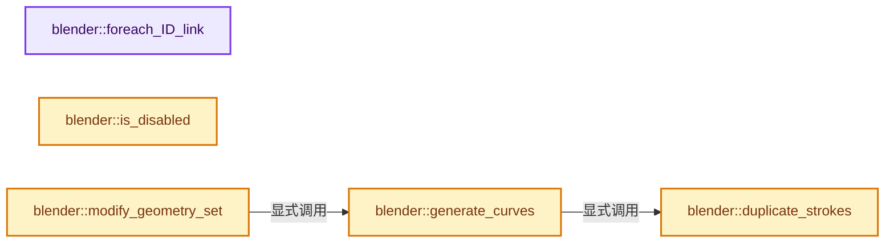
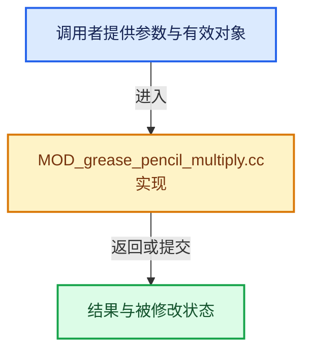

# 实现依赖专题：source/blender/modifiers/intern/MOD_grease_pencil_multiply.cc

[实现依赖导航](../../../README.md) · [符号索引](../../../../00-课程指南/02-源码与提交索引/符号依赖与实现索引.md)

本专题从正文实际调用进入，集中保存共享实现。函数有稳定锚点，可从调用处直接跳到对应完整函数；递归与互相调用通过回链组织。

## 本文件的实现关系






## 完整成员与函数实现

<a id="f-784727fdac316c73"></a>

### `blender::foreach_ID_link`

实现位置：[source/blender/modifiers/intern/MOD_grease_pencil_multiply.cc](../../../../../../../../source/blender/modifiers/intern/MOD_grease_pencil_multiply.cc) · L69—L73。

接口参数：

- `ModifierData *md`
- `Object *ob`
- `IDWalkFunc walk`
- `void *user_data`

**教学注释版**

<!-- annotated:7e0d4f2b3ded94 -->

```cpp
static void foreach_ID_link(ModifierData *md, Object *ob, IDWalkFunc walk, void *user_data)
{
  auto *mmd = reinterpret_cast<GreasePencilMultiModifierData *>(md);
  modifier::greasepencil::foreach_influence_ID_link(&mmd->influence, ob, walk, user_data);
}
```

<details>
<summary>核对原始源码：source/blender/modifiers/intern/MOD_grease_pencil_multiply.cc · L69—L73</summary>

<!-- original:7e0d4f2b3ded94:source/blender/modifiers/intern/MOD_grease_pencil_multiply.cc:69:73 -->

```cpp
static void foreach_ID_link(ModifierData *md, Object *ob, IDWalkFunc walk, void *user_data)
{
  auto *mmd = reinterpret_cast<GreasePencilMultiModifierData *>(md);
  modifier::greasepencil::foreach_influence_ID_link(&mmd->influence, ob, walk, user_data);
}
```

</details>

**继续追踪实现**

- `modifier::greasepencil::foreach_influence_ID_link` → [blender::modifier::greasepencil::foreach_influence_ID_link · L69](MOD_grease_pencil_util.cc.md#f-247ba56fa4c4e56f)。

<a id="f-21f6342c5bcd23a5"></a>

### `blender::is_disabled`

实现位置：[source/blender/modifiers/intern/MOD_grease_pencil_multiply.cc](../../../../../../../../source/blender/modifiers/intern/MOD_grease_pencil_multiply.cc) · L75—L82。

接口参数：

- `const Scene *`
- `ModifierData *md`
- `bool`

**教学注释版**

<!-- annotated:624bf7a6bda46c -->

```cpp
static bool is_disabled(const Scene * /*scene*/, ModifierData *md, bool /*use_render_params*/)
{
  auto *mmd = reinterpret_cast<GreasePencilMultiModifierData *>(md);
  if (mmd->duplications <= 1) {
    return true;
  }
  return false;
}
```

<details>
<summary>核对原始源码：source/blender/modifiers/intern/MOD_grease_pencil_multiply.cc · L75—L82</summary>

<!-- original:624bf7a6bda46c:source/blender/modifiers/intern/MOD_grease_pencil_multiply.cc:75:82 -->

```cpp
static bool is_disabled(const Scene * /*scene*/, ModifierData *md, bool /*use_render_params*/)
{
  auto *mmd = reinterpret_cast<GreasePencilMultiModifierData *>(md);
  if (mmd->duplications <= 1) {
    return true;
  }
  return false;
}
```

</details>

**结果出口**

- `return true;`
- `return false;`

**继续追踪实现**

本实现没有需要继续展开的显式调用；检查返回表达式、对象转换和调用者前置条件。

<a id="f-7f389706f68940c3"></a>

### `blender::duplicate_strokes`

实现位置：[source/blender/modifiers/intern/MOD_grease_pencil_multiply.cc](../../../../../../../../source/blender/modifiers/intern/MOD_grease_pencil_multiply.cc) · L84—L123。

接口参数：

- `const bke::CurvesGeometry &curves`
- `const IndexMask curves_mask`
- `const IndexMask unselected_mask`
- `const int count`
- `int &r_original_point_count`
- `int &r_original_curve_count`

**教学注释版**

<!-- annotated:4fca20c8d2e4c4 -->

```cpp
static bke::CurvesGeometry duplicate_strokes(const bke::CurvesGeometry &curves,
                                             const IndexMask curves_mask,
                                             const IndexMask unselected_mask,
                                             const int count,
                                             int &r_original_point_count,
                                             int &r_original_curve_count)
{
  bke::CurvesGeometry masked_curves = bke::curves_copy_curve_selection(curves, curves_mask, {});
  bke::CurvesGeometry unselected_curves = bke::curves_copy_curve_selection(
      curves, unselected_mask, {});

  r_original_point_count = masked_curves.points_num();
  r_original_curve_count = masked_curves.curves_num();

  Curves *masked_curves_id = bke::curves_new_nomain(masked_curves);
  Curves *unselected_curves_id = bke::curves_new_nomain(unselected_curves);

  bke::GeometrySet masked_geo = bke::GeometrySet::from_curves(masked_curves_id);
  bke::GeometrySet unselected_geo = bke::GeometrySet::from_curves(unselected_curves_id);

  // [讲解] std::make_unique<bke::Instances>：创建独占拥有的对象，拥有关系可移动，get返回的借用指针不自动延长寿命。
  auto instances = std::make_unique<bke::Instances>(count + 1);
  const int masked_handle = instances->add_reference(bke::InstanceReference{masked_geo});
  const int unselected_handle = instances->add_reference(bke::InstanceReference{unselected_geo});
  MutableSpan<int> handles = instances->reference_handles_for_write();
  instances->transforms_for_write().fill(float4x4::identity());

  for ([[maybe_unused]] const int i : IndexRange(count)) {
    handles[i] = masked_handle;
  }
  handles[count] = unselected_handle;

  geometry::RealizeInstancesOptions options;
  options.keep_original_ids = true;
  options.realize_instance_attributes = true;
  bke::GeometrySet result_geo = geometry::realize_instances(
                                    // [讲解] std::move：把表达式转换成可供移动重载选择的值类别；不保证真的移动，不结束源对象寿命，对const值可能选择复制。
                                    bke::GeometrySet::from_instances(std::move(instances)),
                                    options)
                                    .geometry;
  return std::move(result_geo.get_curves_for_write()->geometry.wrap());
}
```

<details>
<summary>核对原始源码：source/blender/modifiers/intern/MOD_grease_pencil_multiply.cc · L84—L123</summary>

<!-- original:4fca20c8d2e4c4:source/blender/modifiers/intern/MOD_grease_pencil_multiply.cc:84:123 -->

```cpp
static bke::CurvesGeometry duplicate_strokes(const bke::CurvesGeometry &curves,
                                             const IndexMask curves_mask,
                                             const IndexMask unselected_mask,
                                             const int count,
                                             int &r_original_point_count,
                                             int &r_original_curve_count)
{
  bke::CurvesGeometry masked_curves = bke::curves_copy_curve_selection(curves, curves_mask, {});
  bke::CurvesGeometry unselected_curves = bke::curves_copy_curve_selection(
      curves, unselected_mask, {});

  r_original_point_count = masked_curves.points_num();
  r_original_curve_count = masked_curves.curves_num();

  Curves *masked_curves_id = bke::curves_new_nomain(masked_curves);
  Curves *unselected_curves_id = bke::curves_new_nomain(unselected_curves);

  bke::GeometrySet masked_geo = bke::GeometrySet::from_curves(masked_curves_id);
  bke::GeometrySet unselected_geo = bke::GeometrySet::from_curves(unselected_curves_id);

  auto instances = std::make_unique<bke::Instances>(count + 1);
  const int masked_handle = instances->add_reference(bke::InstanceReference{masked_geo});
  const int unselected_handle = instances->add_reference(bke::InstanceReference{unselected_geo});
  MutableSpan<int> handles = instances->reference_handles_for_write();
  instances->transforms_for_write().fill(float4x4::identity());

  for ([[maybe_unused]] const int i : IndexRange(count)) {
    handles[i] = masked_handle;
  }
  handles[count] = unselected_handle;

  geometry::RealizeInstancesOptions options;
  options.keep_original_ids = true;
  options.realize_instance_attributes = true;
  bke::GeometrySet result_geo = geometry::realize_instances(
                                    bke::GeometrySet::from_instances(std::move(instances)),
                                    options)
                                    .geometry;
  return std::move(result_geo.get_curves_for_write()->geometry.wrap());
}
```

</details>

**沿实际写入检查状态**

- `r_original_point_count = masked_curves.points_num();`
- `r_original_curve_count = masked_curves.curves_num();`
- `handles[i] = masked_handle;`
- `handles[count] = unselected_handle;`
- `options.keep_original_ids = true;`
- `options.realize_instance_attributes = true;`

**结果出口**

- `return std::move(result_geo.get_curves_for_write()->geometry.wrap());`

**继续追踪实现**

- `bke::curves_copy_curve_selection` → [blender::bke::curves_copy_curve_selection · L1595](../../../02-BKE几何与数据/intern/curves_geometry.cc.md#f-20ed952a2282520e)。
- `masked_curves.points_num` → [blender::bke::CurvesGeometry::points_num · L1001](../../../../05-几何存储与拓扑映射/04-CurvesGeometry存储.md#f-049421b1f643c700)。
- `masked_curves.curves_num` → [blender::bke::CurvesGeometry::curves_num · L1005](../../../../05-几何存储与拓扑映射/04-CurvesGeometry存储.md#f-eabb3f0e5d3c57be)。
- `bke::curves_new_nomain` → [blender::bke::curves_new_nomain · L293](../../../02-BKE几何与数据/intern/curves.cc.md#f-702debf916bbedac)；[blender::bke::curves_new_nomain · L312](../../../02-BKE几何与数据/intern/curves.cc.md#f-ba10c7025cf69460)。同名重载需按实参类型选择。
- `bke::GeometrySet::from_curves` → [blender::bke::GeometrySet::from_curves · L448](../../../../06-隐式共享与缓存系统/05-GeometrySet读写与复制.md#f-4a638adc47cc3b9f)。
- `std::make_unique<bke::Instances>` → [外部契约](https://eel.is/c++draft/unique.ptr.create)：创建独占拥有的对象，拥有关系可移动，get返回的借用指针不自动延长寿命。
- `instances->add_reference` → [调用协议](../../../../00-课程指南/01-路线与规范/模板宏与动态分派协议.md)：接收对象类型依赖auto、返回值或模板实例；不按同名猜测目标。调用位置L105。
- `instances->reference_handles_for_write` → [调用协议](../../../../00-课程指南/01-路线与规范/模板宏与动态分派协议.md)：接收对象类型依赖auto、返回值或模板实例；不按同名猜测目标。调用位置L107。
- `instances->transforms_for_write().fill` → [调用协议](../../../../00-课程指南/01-路线与规范/模板宏与动态分派协议.md)：接收对象类型依赖auto、返回值或模板实例；不按同名猜测目标。调用位置L108。
- `instances->transforms_for_write` → [调用协议](../../../../00-课程指南/01-路线与规范/模板宏与动态分派协议.md)：接收对象类型依赖auto、返回值或模板实例；不按同名猜测目标。调用位置L108。
- `float4x4::identity` → [调用协议](../../../../00-课程指南/01-路线与规范/模板宏与动态分派协议.md)：函数指针、局部可调用对象或未展开的宏；必须结合调用者环境。调用位置L108。
- `IndexRange` → [blender::IndexRange](../../../01-BLI基础库/BLI_index_range.hh.md#t-caa3466d6776)；[blender::gpu::shader::parser::IndexRange](../../gpu/shader_tool/utils.hh.md#t-82d2bd4ea71c)；[blender::IndexRange](../../makesdna/DNA_node_types.h.md#t-0448cc889d39)。
- `geometry::realize_instances` → [blender::geometry::realize_instances · L2925](../../../05-Geometry几何算法/intern/realize_instances.cc.md#f-1bab21a4d5d19aba)；[blender::geometry::realize_instances · L2939](../../../05-Geometry几何算法/intern/realize_instances.cc.md#f-7004abf3ef784a6a)。同名重载需按实参类型选择。
- `bke::GeometrySet::from_instances` → [blender::bke::GeometrySet::from_instances · L455](../../../../06-隐式共享与缓存系统/05-GeometrySet读写与复制.md#f-0c23a168248fb2cb)；[blender::bke::GeometrySet::from_instances · L462](../../../../06-隐式共享与缓存系统/05-GeometrySet读写与复制.md#f-447a100ea7cfda47)。同名重载需按实参类型选择。
- `std::move` → [外部契约](https://eel.is/c++draft/utility.forward)：把表达式转换成可供移动重载选择的值类别；不保证真的移动，不结束源对象寿命，对const值可能选择复制。
- `result_geo.get_curves_for_write()->geometry.wrap` → [调用协议](../../../../00-课程指南/01-路线与规范/模板宏与动态分派协议.md)：接收对象类型依赖auto、返回值或模板实例；不按同名猜测目标。调用位置L122。
- `result_geo.get_curves_for_write` → [blender::bke::GeometrySet::get_curves_for_write · L580](../../../../06-隐式共享与缓存系统/05-GeometrySet读写与复制.md#f-95199063db32b8f7)。

<a id="f-5f8261439d24d391"></a>

### `blender::generate_curves`

实现位置：[source/blender/modifiers/intern/MOD_grease_pencil_multiply.cc](../../../../../../../../source/blender/modifiers/intern/MOD_grease_pencil_multiply.cc) · L125—L216。

接口参数：

- `GreasePencilMultiModifierData &mmd`
- `const ModifierEvalContext &ctx`
- `Drawing &drawing`

**教学注释版**

<!-- annotated:28f2988a2fe75c -->

```cpp
static void generate_curves(GreasePencilMultiModifierData &mmd,
                            const ModifierEvalContext &ctx,
                            Drawing &drawing)
{
  bke::CurvesGeometry &curves = drawing.strokes_for_write();

  IndexMaskMemory mask_memory;
  const IndexMask curves_mask = modifier::greasepencil::get_filtered_stroke_mask(
      ctx.object, curves, mmd.influence, mask_memory);

  if (curves_mask.is_empty()) {
    return;
  }

  const IndexMask unselected_mask = curves_mask.complement(curves.curves_range(), mask_memory);

  int src_point_count, src_curve_count;
  curves = duplicate_strokes(
      curves, curves_mask, unselected_mask, mmd.duplications, src_point_count, src_curve_count);

  const float offset = math::length(math::to_scale(ctx.object->object_to_world())) * mmd.offset;
  const float distance = mmd.distance;
  const bool use_fading = (mmd.flag & MOD_GREASE_PENCIL_MULTIPLY_ENABLE_FADING) != 0;
  const float fading_thickness = mmd.fading_thickness;
  const float fading_opacity = mmd.fading_opacity;
  const float fading_center = mmd.fading_center;

  MutableSpan<float3> positions = curves.positions_for_write();
  const Span<float3> tangents = curves.evaluated_tangents();
  const Span<float3> normals = drawing.curve_plane_normals();

  bke::MutableAttributeAccessor attributes = curves.attributes_for_write();
  bke::SpanAttributeWriter<float> opacities = attributes.lookup_or_add_for_write_span<float>(
      "opacity", bke::AttrDomain::Point);
  bke::SpanAttributeWriter<float> radii = attributes.lookup_or_add_for_write_span<float>(
      "radius", bke::AttrDomain::Point);

  const OffsetIndices<int> points_by_curve = curves.points_by_curve();

  Array<float3> pos_l(src_point_count);
  Array<float3> pos_r(src_point_count);

  int src_point_i = 0;
  for (const int src_curve_i : IndexRange(src_curve_count)) {
    for (const int point : points_by_curve[src_curve_i]) {
      const float3 miter = math::cross(normals[src_curve_i], tangents[point]) * distance;
      pos_l[src_point_i] = positions[point] + miter;
      pos_r[src_point_i] = positions[point] - miter;
      src_point_i++;
    }
  }

  // [讲解] pos_l.as_span：提供数组的借用访问入口。
  const Span<float3> stroke_pos_l = pos_l.as_span();
  const Span<float3> stroke_pos_r = pos_r.as_span();

  for (const int i : IndexRange(mmd.duplications)) {
    using bke::attribute_math::mix2;
    const IndexRange stroke = IndexRange(src_point_count * i, src_point_count);
    // [讲解] positions.slice：建立原连续范围的子视图。
    MutableSpan<float3> instance_positions = positions.slice(stroke);
    MutableSpan<float> instance_radii = radii.span.slice(stroke);
    const float offset_fac = (mmd.duplications == 1) ?
                                 0.5f :
                                 (1.0f - (float(i) / float(mmd.duplications - 1)));
    const float fading_fac = fabsf(offset_fac - fading_center);
    const float thickness_factor = use_fading ? mix2(fading_fac, 1.0f, 1.0f - fading_thickness) :
                                                1.0f;
    // [讲解] instance_positions.index_range：查询视图长度或生成对应有效索引区间。
    threading::parallel_for(instance_positions.index_range(), 512, [&](const IndexRange range) {
      for (const int point : range) {
        const float fac = mix2(float(i) / float(mmd.duplications - 1), 1 + offset, offset);
        const int old_point = point % src_point_count;
        instance_positions[point] = mix2(fac, stroke_pos_l[old_point], stroke_pos_r[old_point]);
        instance_radii[point] *= thickness_factor;
      }
    });

    if (opacities) {
      MutableSpan<float> instance_opacity = opacities.span.slice(stroke);
      const float opacity_factor = use_fading ? mix2(fading_fac, 1.0f, 1.0f - fading_opacity) :
                                                1.0f;
      threading::parallel_for(instance_positions.index_range(), 512, [&](const IndexRange range) {
        for (const int point : range) {
          instance_opacity[point] *= opacity_factor;
        }
      });
    }
  }

  radii.finish();
  opacities.finish();

  drawing.tag_topology_changed();
}
```

<details>
<summary>核对原始源码：source/blender/modifiers/intern/MOD_grease_pencil_multiply.cc · L125—L216</summary>

<!-- original:28f2988a2fe75c:source/blender/modifiers/intern/MOD_grease_pencil_multiply.cc:125:216 -->

```cpp
static void generate_curves(GreasePencilMultiModifierData &mmd,
                            const ModifierEvalContext &ctx,
                            Drawing &drawing)
{
  bke::CurvesGeometry &curves = drawing.strokes_for_write();

  IndexMaskMemory mask_memory;
  const IndexMask curves_mask = modifier::greasepencil::get_filtered_stroke_mask(
      ctx.object, curves, mmd.influence, mask_memory);

  if (curves_mask.is_empty()) {
    return;
  }

  const IndexMask unselected_mask = curves_mask.complement(curves.curves_range(), mask_memory);

  int src_point_count, src_curve_count;
  curves = duplicate_strokes(
      curves, curves_mask, unselected_mask, mmd.duplications, src_point_count, src_curve_count);

  const float offset = math::length(math::to_scale(ctx.object->object_to_world())) * mmd.offset;
  const float distance = mmd.distance;
  const bool use_fading = (mmd.flag & MOD_GREASE_PENCIL_MULTIPLY_ENABLE_FADING) != 0;
  const float fading_thickness = mmd.fading_thickness;
  const float fading_opacity = mmd.fading_opacity;
  const float fading_center = mmd.fading_center;

  MutableSpan<float3> positions = curves.positions_for_write();
  const Span<float3> tangents = curves.evaluated_tangents();
  const Span<float3> normals = drawing.curve_plane_normals();

  bke::MutableAttributeAccessor attributes = curves.attributes_for_write();
  bke::SpanAttributeWriter<float> opacities = attributes.lookup_or_add_for_write_span<float>(
      "opacity", bke::AttrDomain::Point);
  bke::SpanAttributeWriter<float> radii = attributes.lookup_or_add_for_write_span<float>(
      "radius", bke::AttrDomain::Point);

  const OffsetIndices<int> points_by_curve = curves.points_by_curve();

  Array<float3> pos_l(src_point_count);
  Array<float3> pos_r(src_point_count);

  int src_point_i = 0;
  for (const int src_curve_i : IndexRange(src_curve_count)) {
    for (const int point : points_by_curve[src_curve_i]) {
      const float3 miter = math::cross(normals[src_curve_i], tangents[point]) * distance;
      pos_l[src_point_i] = positions[point] + miter;
      pos_r[src_point_i] = positions[point] - miter;
      src_point_i++;
    }
  }

  const Span<float3> stroke_pos_l = pos_l.as_span();
  const Span<float3> stroke_pos_r = pos_r.as_span();

  for (const int i : IndexRange(mmd.duplications)) {
    using bke::attribute_math::mix2;
    const IndexRange stroke = IndexRange(src_point_count * i, src_point_count);
    MutableSpan<float3> instance_positions = positions.slice(stroke);
    MutableSpan<float> instance_radii = radii.span.slice(stroke);
    const float offset_fac = (mmd.duplications == 1) ?
                                 0.5f :
                                 (1.0f - (float(i) / float(mmd.duplications - 1)));
    const float fading_fac = fabsf(offset_fac - fading_center);
    const float thickness_factor = use_fading ? mix2(fading_fac, 1.0f, 1.0f - fading_thickness) :
                                                1.0f;
    threading::parallel_for(instance_positions.index_range(), 512, [&](const IndexRange range) {
      for (const int point : range) {
        const float fac = mix2(float(i) / float(mmd.duplications - 1), 1 + offset, offset);
        const int old_point = point % src_point_count;
        instance_positions[point] = mix2(fac, stroke_pos_l[old_point], stroke_pos_r[old_point]);
        instance_radii[point] *= thickness_factor;
      }
    });

    if (opacities) {
      MutableSpan<float> instance_opacity = opacities.span.slice(stroke);
      const float opacity_factor = use_fading ? mix2(fading_fac, 1.0f, 1.0f - fading_opacity) :
                                                1.0f;
      threading::parallel_for(instance_positions.index_range(), 512, [&](const IndexRange range) {
        for (const int point : range) {
          instance_opacity[point] *= opacity_factor;
        }
      });
    }
  }

  radii.finish();
  opacities.finish();

  drawing.tag_topology_changed();
}
```

</details>

**沿实际写入检查状态**

- `curves = duplicate_strokes(`
- `pos_l[src_point_i] = positions[point] + miter;`
- `pos_r[src_point_i] = positions[point] - miter;`
- `instance_positions[point] = mix2(fac, stroke_pos_l[old_point], stroke_pos_r[old_point]);`
- `instance_radii[point] *= thickness_factor;`
- `instance_opacity[point] *= opacity_factor;`

**继续追踪实现**

- `drawing.strokes_for_write` → [blender::bke::greasepencil::Drawing::strokes_for_write · L1012](../../../02-BKE几何与数据/intern/grease_pencil.cc.md#f-0649333785d0aa95)。
- `modifier::greasepencil::get_filtered_stroke_mask` → [blender::modifier::greasepencil::get_filtered_stroke_mask · L285](MOD_grease_pencil_util.cc.md#f-30c219d04de7dec3)；[blender::modifier::greasepencil::get_filtered_stroke_mask · L326](MOD_grease_pencil_util.cc.md#f-970c3bc880e4f350)。同名重载需按实参类型选择。
- `curves_mask.is_empty` → [blender::index_mask::IndexMask::is_empty · L748](../../../../04-虚拟数组与索引选择/09-分段存储与遍历.md#f-190ac996386064f4)。
- `curves_mask.complement` → [blender::index_mask::IndexMask::complement · L407](../../../../04-虚拟数组与索引选择/10-IndexMask构建与并行.md#f-1e9932d5baa6f719)。
- `curves.curves_range` → [blender::bke::CurvesGeometry::curves_range · L1023](../../../../05-几何存储与拓扑映射/04-CurvesGeometry存储.md#f-9aedfb1afc5ebcfb)。
- `duplicate_strokes` → [blender::duplicate_strokes · L84](MOD_grease_pencil_multiply.cc.md#f-7f389706f68940c3)。
- `math::length` → [blender::math::length · L40](../../../01-BLI基础库/BLI_math_vector_mpq_types.hh.md#f-16c31b0e3391026f)；[blender::math::length · L49](../../../01-BLI基础库/BLI_math_vector_mpq_types.hh.md#f-82d5aa193c621065)；[blender::math::length · L457](../../../01-BLI基础库/BLI_math_vector.hh.md#f-2c7dceafa898907c)。同名重载需按实参类型选择。
- `math::to_scale` → [调用协议](../../../../00-课程指南/01-路线与规范/模板宏与动态分派协议.md)：函数指针、局部可调用对象或未展开的宏；必须结合调用者环境。调用位置L145。
- `ctx.object->object_to_world` → [调用协议](../../../../00-课程指南/01-路线与规范/模板宏与动态分派协议.md)：接收对象类型依赖auto、返回值或模板实例；不按同名猜测目标。调用位置L145。
- `curves.positions_for_write` → [blender::bke::CurvesGeometry::positions_for_write · L328](../../../02-BKE几何与数据/intern/curves_geometry.cc.md#f-30e013e651e830c3)。
- `curves.evaluated_tangents` → [blender::bke::CurvesGeometry::evaluated_tangents · L918](../../../02-BKE几何与数据/intern/curves_geometry.cc.md#f-74049677258830a0)。
- `drawing.curve_plane_normals` → [blender::bke::greasepencil::Drawing::curve_plane_normals · L788](../../../02-BKE几何与数据/intern/grease_pencil.cc.md#f-84a868266ab1f8ed)。
- `curves.attributes_for_write` → [blender::bke::CurvesGeometry::attributes_for_write · L1913](../../../02-BKE几何与数据/intern/curves_geometry.cc.md#f-4930091b34fa9663)。
- `attributes.lookup_or_add_for_write_span<float>` → [blender::bke::MutableAttributeAccessor::lookup_or_add_for_write_span · L533](../../../02-BKE几何与数据/intern/attribute_access.cc.md#f-c533eff1b9a4973e)；[blender::bke::MutableAttributeAccessor::lookup_or_add_for_write_span · L861](../../../../05-几何存储与拓扑映射/08-AttributeAccessor接口.md#f-aa4c0d5a61437381)。同名重载需按实参类型选择。
- `curves.points_by_curve` → [blender::bke::CurvesGeometry::points_by_curve · L1058](../../../../05-几何存储与拓扑映射/04-CurvesGeometry存储.md#f-a0416697e10ec205)。
- `IndexRange` → [blender::IndexRange](../../../01-BLI基础库/BLI_index_range.hh.md#t-caa3466d6776)；[blender::gpu::shader::parser::IndexRange](../../gpu/shader_tool/utils.hh.md#t-82d2bd4ea71c)；[blender::IndexRange](../../makesdna/DNA_node_types.h.md#t-0448cc889d39)。
- `math::cross` → [blender::math::cross · L549](../../../01-BLI基础库/BLI_math_vector.hh.md#f-cb1b14dc107aa107)；[blender::math::cross · L562](../../../01-BLI基础库/BLI_math_vector.hh.md#f-8dcac1cc63a3672a)；[blender::math::cross · L217](../../../01-BLI基础库/BLI_math_basis_types.hh.md#f-0cb9fb63f068f85e)。同名重载需按实参类型选择。
- `pos_l.as_span` → [blender::Array::as_span · L254](../../../../01-基础容器与现代CPP/08-Array复制移动与销毁.md#f-05fc77056a242032)。
- `pos_r.as_span` → [blender::Array::as_span · L254](../../../../01-基础容器与现代CPP/08-Array复制移动与销毁.md#f-05fc77056a242032)。
- `positions.slice` → [blender::MutableSpan::slice · L579](../../../../01-基础容器与现代CPP/06-MutableSpan可写视图.md#f-6808b4aefbf58808)；[blender::MutableSpan::slice · L587](../../../../01-基础容器与现代CPP/06-MutableSpan可写视图.md#f-c05b010821861e4f)。同名重载需按实参类型选择。
- `radii.span.slice` → [调用协议](../../../../00-课程指南/01-路线与规范/模板宏与动态分派协议.md)：接收对象类型依赖auto、返回值或模板实例；不按同名猜测目标。调用位置L184。
- `fabsf` → [fabsf · L21](../../../07-Intern运行时与平台/cycles/kernel/svm/radial_tiling_shared.h.md#m-02cc4c69cfb3)；[fabsf · L43](../../../07-Intern运行时与平台/cycles/kernel/svm/radial_tiling_shared.h.md#m-04effe61803b)；[fabsf · L74](../../../07-Intern运行时与平台/cycles/kernel/svm/radial_tiling_shared.h.md#m-927dd4eba7dc)；[fabsf · L25](../../../01-BLI基础库/intern/radial_tiling_shared.hh.md#m-8348d6b3d08f)；[fabsf · L47](../../../01-BLI基础库/intern/radial_tiling_shared.hh.md#m-13b7e0b6d84f)；[fabsf · L78](../../../01-BLI基础库/intern/radial_tiling_shared.hh.md#m-326c83464a0d)；[fabsf · L21](../../../07-Intern运行时与平台/cycles/kernel/osl/shaders/node_radial_tiling_shared.h.md#m-7c3ee12fc119)；[fabsf · L43](../../../07-Intern运行时与平台/cycles/kernel/osl/shaders/node_radial_tiling_shared.h.md#m-9112db0e2dd1)；[fabsf · L74](../../../07-Intern运行时与平台/cycles/kernel/osl/shaders/node_radial_tiling_shared.h.md#m-ee4e61908a6f)；[fabsf · L167](../../../07-Intern运行时与平台/cycles/kernel/device/oneapi/compat.h.md#m-b039ee6c1601)；[fabsf · L265](../../../07-Intern运行时与平台/cycles/kernel/device/metal/compat.h.md#m-6b21869e9f3f)。宏定义由构建条件选择。
- `mix2` → [blender::bke::attribute_math::mix2 · L22](../../../02-BKE几何与数据/intern/attribute_math.cc.md#f-c2b7b4b88dd0f972)；[blender::bke::attribute_math::mix2 · L49](../../../02-BKE几何与数据/intern/attribute_math.cc.md#f-14302ad73c537ec9)；[blender::bke::attribute_math::mix2 · L66](../../../02-BKE几何与数据/BKE_attribute_math.hh.md#f-8b99af960eb48e28)；[blender::bke::attribute_math::mix2 · L71](../../../02-BKE几何与数据/BKE_attribute_math.hh.md#f-9ef790651fef779c)；[blender::bke::attribute_math::mix2 · L76](../../../02-BKE几何与数据/BKE_attribute_math.hh.md#f-cff51a3353ed28a9)；[blender::bke::attribute_math::mix2 · L81](../../../02-BKE几何与数据/BKE_attribute_math.hh.md#f-222deb3f0b06c022)；[blender::bke::attribute_math::mix2 · L86](../../../02-BKE几何与数据/BKE_attribute_math.hh.md#f-842669f14eaf15e9)；[blender::bke::attribute_math::mix2 · L91](../../../02-BKE几何与数据/BKE_attribute_math.hh.md#f-f0253aed0458d320)；[blender::bke::attribute_math::mix2 · L96](../../../02-BKE几何与数据/BKE_attribute_math.hh.md#f-fd2eb7495a3d5ca0)；[blender::bke::attribute_math::mix2 · L101](../../../02-BKE几何与数据/BKE_attribute_math.hh.md#f-c9dbb4763cfd2cf9)；[blender::bke::attribute_math::mix2 · L106](../../../02-BKE几何与数据/BKE_attribute_math.hh.md#f-455bd7e9fa141103)；[blender::bke::attribute_math::mix2 · L111](../../../02-BKE几何与数据/BKE_attribute_math.hh.md#f-7246e4b5a45d9f1b)；[blender::bke::attribute_math::mix2 · L117](../../../02-BKE几何与数据/BKE_attribute_math.hh.md#f-1088551b894e068a)。同名重载需按实参类型选择。
- `threading::parallel_for` → [blender::threading::parallel_for · L68](../../../../11-Depsgraph与并行任务系统/07-任务池与TBB接入.md#f-838294754c24426c)。
- `instance_positions.index_range` → [blender::MutableSpan::index_range · L676](../../../../01-基础容器与现代CPP/06-MutableSpan可写视图.md#f-f9a9d59a69ca64b5)。
- `opacities.span.slice` → [调用协议](../../../../00-课程指南/01-路线与规范/模板宏与动态分派协议.md)：接收对象类型依赖auto、返回值或模板实例；不按同名猜测目标。调用位置L201。
- `radii.finish` → [blender::bke::SpanAttributeWriter::finish · L279](../../../../05-几何存储与拓扑映射/08-AttributeAccessor接口.md#f-585970a3b1bd4da4)。
- `opacities.finish` → [blender::bke::SpanAttributeWriter::finish · L279](../../../../05-几何存储与拓扑映射/08-AttributeAccessor接口.md#f-585970a3b1bd4da4)。
- `drawing.tag_topology_changed` → [blender::bke::greasepencil::Drawing::tag_topology_changed · L1304](../../../02-BKE几何与数据/intern/grease_pencil.cc.md#f-6eefbf46d05d944b)；[blender::bke::greasepencil::Drawing::tag_topology_changed · L1311](../../../02-BKE几何与数据/intern/grease_pencil.cc.md#f-dbd37d071b845a58)。同名重载需按实参类型选择。

<a id="f-20b39fa517056ba3"></a>

### `blender::modify_geometry_set`

实现位置：[source/blender/modifiers/intern/MOD_grease_pencil_multiply.cc](../../../../../../../../source/blender/modifiers/intern/MOD_grease_pencil_multiply.cc) · L218—L237。

接口参数：

- `ModifierData *md`
- `const ModifierEvalContext *ctx`
- `bke::GeometrySet *geometry_set`

**教学注释版**

<!-- annotated:0f3bed543a8a4b -->

```cpp
static void modify_geometry_set(ModifierData *md,
                                const ModifierEvalContext *ctx,
                                bke::GeometrySet *geometry_set)
{
  auto *mmd = reinterpret_cast<GreasePencilMultiModifierData *>(md);

  if (!geometry_set->has_grease_pencil()) {
    return;
  }
  GreasePencil &grease_pencil = *geometry_set->get_grease_pencil_for_write();
  const int frame = grease_pencil.runtime->eval_frame;

  IndexMaskMemory memory;
  const IndexMask layer_mask = modifier::greasepencil::get_filtered_layer_mask(
      grease_pencil, mmd->influence, memory);
  const Vector<Drawing *> drawings = modifier::greasepencil::get_drawings_for_write(
      grease_pencil, layer_mask, frame);
  threading::parallel_for_each(drawings,
                               [&](Drawing *drawing) { generate_curves(*mmd, *ctx, *drawing); });
}
```

<details>
<summary>核对原始源码：source/blender/modifiers/intern/MOD_grease_pencil_multiply.cc · L218—L237</summary>

<!-- original:0f3bed543a8a4b:source/blender/modifiers/intern/MOD_grease_pencil_multiply.cc:218:237 -->

```cpp
static void modify_geometry_set(ModifierData *md,
                                const ModifierEvalContext *ctx,
                                bke::GeometrySet *geometry_set)
{
  auto *mmd = reinterpret_cast<GreasePencilMultiModifierData *>(md);

  if (!geometry_set->has_grease_pencil()) {
    return;
  }
  GreasePencil &grease_pencil = *geometry_set->get_grease_pencil_for_write();
  const int frame = grease_pencil.runtime->eval_frame;

  IndexMaskMemory memory;
  const IndexMask layer_mask = modifier::greasepencil::get_filtered_layer_mask(
      grease_pencil, mmd->influence, memory);
  const Vector<Drawing *> drawings = modifier::greasepencil::get_drawings_for_write(
      grease_pencil, layer_mask, frame);
  threading::parallel_for_each(drawings,
                               [&](Drawing *drawing) { generate_curves(*mmd, *ctx, *drawing); });
}
```

</details>

**继续追踪实现**

- `geometry_set->has_grease_pencil` → [blender::bke::GeometrySet::has_grease_pencil · L415](../../../../06-隐式共享与缓存系统/05-GeometrySet读写与复制.md#f-357bcb62da7a8afd)。
- `geometry_set->get_grease_pencil_for_write` → [blender::bke::GeometrySet::get_grease_pencil_for_write · L622](../../../../06-隐式共享与缓存系统/05-GeometrySet读写与复制.md#f-bfc5e891a352651b)。
- `modifier::greasepencil::get_filtered_layer_mask` → [blender::modifier::greasepencil::get_filtered_layer_mask · L213](MOD_grease_pencil_util.cc.md#f-6438bea51141f9db)；[blender::modifier::greasepencil::get_filtered_layer_mask · L268](MOD_grease_pencil_util.cc.md#f-e3d0f9748ecdf34b)。同名重载需按实参类型选择。
- `modifier::greasepencil::get_drawings_for_write` → [blender::modifier::greasepencil::get_drawings_for_write · L368](MOD_grease_pencil_util.cc.md#f-cef3871c31259376)。
- `threading::parallel_for_each` → [blender::threading::parallel_for_each · L30](../../../../11-Depsgraph与并行任务系统/07-任务池与TBB接入.md#f-d5604027445ef0f5)。
- `generate_curves` → [blender::generate_curves · L125](MOD_grease_pencil_multiply.cc.md#f-5f8261439d24d391)。
