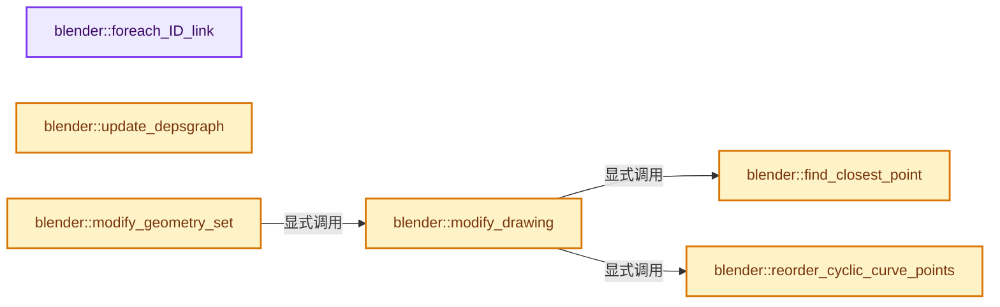
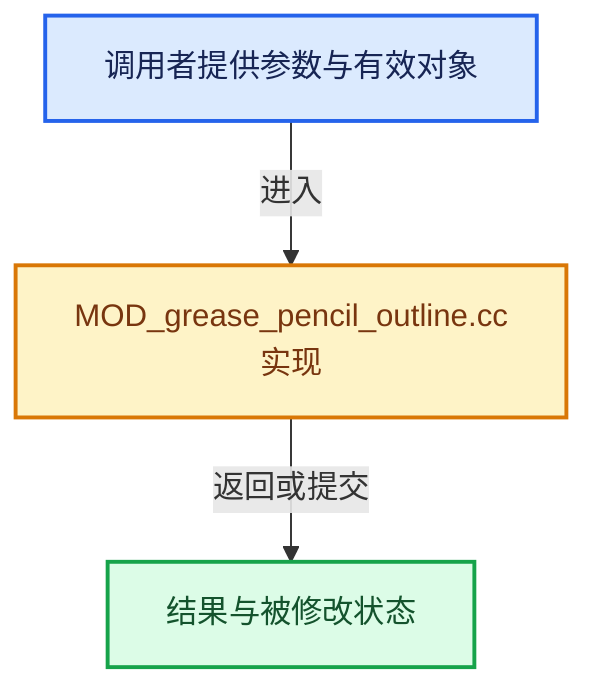

# 实现依赖专题：source/blender/modifiers/intern/MOD_grease_pencil_outline.cc

[实现依赖导航](../../../README.md) · [符号索引](../../../../00-课程指南/02-源码与提交索引/符号依赖与实现索引.md)

本专题从正文实际调用进入，集中保存共享实现。函数有稳定锚点，可从调用处直接跳到对应完整函数；递归与互相调用通过回链组织。

## 本文件的实现关系






## 完整成员与函数实现

<a id="f-6ac666b46d601dd4"></a>

### `blender::foreach_ID_link`

实现位置：[source/blender/modifiers/intern/MOD_grease_pencil_outline.cc](../../../../../../../../source/blender/modifiers/intern/MOD_grease_pencil_outline.cc) · L78—L84。

接口参数：

- `ModifierData *md`
- `Object *ob`
- `IDWalkFunc walk`
- `void *user_data`

**教学注释版**

<!-- annotated:79d25bb5a68b9b -->

```cpp
static void foreach_ID_link(ModifierData *md, Object *ob, IDWalkFunc walk, void *user_data)
{
  auto *omd = reinterpret_cast<GreasePencilOutlineModifierData *>(md);
  modifier::greasepencil::foreach_influence_ID_link(&omd->influence, ob, walk, user_data);
  walk(user_data, ob, reinterpret_cast<ID **>(&omd->outline_material), IDWALK_CB_USER);
  walk(user_data, ob, reinterpret_cast<ID **>(&omd->object), IDWALK_CB_NOP);
}
```

<details>
<summary>核对原始源码：source/blender/modifiers/intern/MOD_grease_pencil_outline.cc · L78—L84</summary>

<!-- original:79d25bb5a68b9b:source/blender/modifiers/intern/MOD_grease_pencil_outline.cc:78:84 -->

```cpp
static void foreach_ID_link(ModifierData *md, Object *ob, IDWalkFunc walk, void *user_data)
{
  auto *omd = reinterpret_cast<GreasePencilOutlineModifierData *>(md);
  modifier::greasepencil::foreach_influence_ID_link(&omd->influence, ob, walk, user_data);
  walk(user_data, ob, reinterpret_cast<ID **>(&omd->outline_material), IDWALK_CB_USER);
  walk(user_data, ob, reinterpret_cast<ID **>(&omd->object), IDWALK_CB_NOP);
}
```

</details>

**继续追踪实现**

- `modifier::greasepencil::foreach_influence_ID_link` → [blender::modifier::greasepencil::foreach_influence_ID_link · L69](MOD_grease_pencil_util.cc.md#f-247ba56fa4c4e56f)。
- `walk` → [调用协议](../../../../00-课程指南/01-路线与规范/模板宏与动态分派协议.md)：局部可调用对象，须结合其初始化与捕获环境。调用位置L82。

<a id="f-59da2459868ef259"></a>

### `blender::update_depsgraph`

实现位置：[source/blender/modifiers/intern/MOD_grease_pencil_outline.cc](../../../../../../../../source/blender/modifiers/intern/MOD_grease_pencil_outline.cc) · L86—L101。

接口参数：

- `ModifierData *md`
- `const ModifierUpdateDepsgraphContext *ctx`

**教学注释版**

<!-- annotated:eca06b4a373483 -->

```cpp
static void update_depsgraph(ModifierData *md, const ModifierUpdateDepsgraphContext *ctx)
{
  auto *omd = reinterpret_cast<GreasePencilOutlineModifierData *>(md);
  if (ctx->scene->camera) {
    DEG_add_object_relation(
        ctx->node, ctx->scene->camera, DEG_OB_COMP_TRANSFORM, "Grease Pencil Outline Modifier");
    DEG_add_object_relation(
        ctx->node, ctx->scene->camera, DEG_OB_COMP_PARAMETERS, "Grease Pencil Outline Modifier");
  }
  if (omd->object != nullptr) {
    DEG_add_object_relation(
        ctx->node, omd->object, DEG_OB_COMP_TRANSFORM, "Grease Pencil Outline Modifier");
  }
  DEG_add_object_relation(
      ctx->node, ctx->object, DEG_OB_COMP_TRANSFORM, "Grease Pencil Outline Modifier");
}
```

<details>
<summary>核对原始源码：source/blender/modifiers/intern/MOD_grease_pencil_outline.cc · L86—L101</summary>

<!-- original:eca06b4a373483:source/blender/modifiers/intern/MOD_grease_pencil_outline.cc:86:101 -->

```cpp
static void update_depsgraph(ModifierData *md, const ModifierUpdateDepsgraphContext *ctx)
{
  auto *omd = reinterpret_cast<GreasePencilOutlineModifierData *>(md);
  if (ctx->scene->camera) {
    DEG_add_object_relation(
        ctx->node, ctx->scene->camera, DEG_OB_COMP_TRANSFORM, "Grease Pencil Outline Modifier");
    DEG_add_object_relation(
        ctx->node, ctx->scene->camera, DEG_OB_COMP_PARAMETERS, "Grease Pencil Outline Modifier");
  }
  if (omd->object != nullptr) {
    DEG_add_object_relation(
        ctx->node, omd->object, DEG_OB_COMP_TRANSFORM, "Grease Pencil Outline Modifier");
  }
  DEG_add_object_relation(
      ctx->node, ctx->object, DEG_OB_COMP_TRANSFORM, "Grease Pencil Outline Modifier");
}
```

</details>

**继续追踪实现**

- `DEG_add_object_relation` → [blender::DEG_add_object_relation · L123](../../../06-Depsgraph依赖图/intern/depsgraph_build.cc.md#f-f570cffae97e273c)。

<a id="f-df56a6cfbc3aaccd"></a>

### `blender::reorder_cyclic_curve_points`

实现位置：[source/blender/modifiers/intern/MOD_grease_pencil_outline.cc](../../../../../../../../source/blender/modifiers/intern/MOD_grease_pencil_outline.cc) · L108—L153。

接口参数：

- `const bke::CurvesGeometry &src_curves`
- `const IndexMask &curve_selection`
- `const Span<int> curve_offsets`

**教学注释版**

<!-- annotated:9cefc65eb81bae -->

```cpp
static bke::CurvesGeometry reorder_cyclic_curve_points(const bke::CurvesGeometry &src_curves,
                                                       const IndexMask &curve_selection,
                                                       const Span<int> curve_offsets)
{
  // [讲解] curve_offsets.size：查询视图长度或生成对应有效索引区间。
  BLI_assert(curve_offsets.size() == src_curves.curves_num());

  OffsetIndices<int> src_offsets = src_curves.points_by_curve();
  bke::AttributeAccessor src_attributes = src_curves.attributes();

  Array<int> indices(src_curves.points_num());
  curve_selection.foreach_index(
      [&](const int64_t curve_i) {
        const IndexRange points = src_offsets[curve_i];
        const int point_num = points.size();
        // [讲解] points.start：读取连续区间或分组的边界信息。
        const int point_start = points.start();
        // [讲解] indices.as_mutable_span：提供数组的借用访问入口。
        MutableSpan<int> point_indices = indices.as_mutable_span().slice(points);
        if (points.size() < 2) {
          array_utils::fill_index_range(point_indices, point_start);
          return;
        }
        /* Offset can be negative or larger than the buffer. Use modulo to get an
         * equivalent offset within buffer size to simplify copying. */
        const int offset_raw = curve_offsets[curve_i];
        const int offset = offset_raw >= 0 ? offset_raw % points.size() :
                                             points.size() - ((-offset_raw) % points.size());
        BLI_assert(0 <= offset && offset < points.size());
        if (offset == 0) {
          array_utils::fill_index_range(point_indices, point_start);
          return;
        }

        const int point_middle = point_start + offset;
        // [讲解] point_indices.take_front：从两端裁去或选取一定数量元素形成新视图。
        array_utils::fill_index_range(point_indices.take_front(point_num - offset), point_middle);
        // [讲解] point_indices.take_back：从两端裁去或选取一定数量元素形成新视图。
        array_utils::fill_index_range(point_indices.take_back(offset), point_start);
      },
      exec_mode::grain_size(512));

  /* Have to make a copy of the input geometry, gather_attributes does not work in-place when the
   * source indices are not ordered. */
  bke::CurvesGeometry dst_curves(src_curves);
  bke::MutableAttributeAccessor dst_attributes = dst_curves.attributes_for_write();
  bke::gather_attributes(
      src_attributes, bke::AttrDomain::Point, bke::AttrDomain::Point, {}, indices, dst_attributes);

  return dst_curves;
}
```

<details>
<summary>核对原始源码：source/blender/modifiers/intern/MOD_grease_pencil_outline.cc · L108—L153</summary>

<!-- original:9cefc65eb81bae:source/blender/modifiers/intern/MOD_grease_pencil_outline.cc:108:153 -->

```cpp
static bke::CurvesGeometry reorder_cyclic_curve_points(const bke::CurvesGeometry &src_curves,
                                                       const IndexMask &curve_selection,
                                                       const Span<int> curve_offsets)
{
  BLI_assert(curve_offsets.size() == src_curves.curves_num());

  OffsetIndices<int> src_offsets = src_curves.points_by_curve();
  bke::AttributeAccessor src_attributes = src_curves.attributes();

  Array<int> indices(src_curves.points_num());
  curve_selection.foreach_index(
      [&](const int64_t curve_i) {
        const IndexRange points = src_offsets[curve_i];
        const int point_num = points.size();
        const int point_start = points.start();
        MutableSpan<int> point_indices = indices.as_mutable_span().slice(points);
        if (points.size() < 2) {
          array_utils::fill_index_range(point_indices, point_start);
          return;
        }
        /* Offset can be negative or larger than the buffer. Use modulo to get an
         * equivalent offset within buffer size to simplify copying. */
        const int offset_raw = curve_offsets[curve_i];
        const int offset = offset_raw >= 0 ? offset_raw % points.size() :
                                             points.size() - ((-offset_raw) % points.size());
        BLI_assert(0 <= offset && offset < points.size());
        if (offset == 0) {
          array_utils::fill_index_range(point_indices, point_start);
          return;
        }

        const int point_middle = point_start + offset;
        array_utils::fill_index_range(point_indices.take_front(point_num - offset), point_middle);
        array_utils::fill_index_range(point_indices.take_back(offset), point_start);
      },
      exec_mode::grain_size(512));

  /* Have to make a copy of the input geometry, gather_attributes does not work in-place when the
   * source indices are not ordered. */
  bke::CurvesGeometry dst_curves(src_curves);
  bke::MutableAttributeAccessor dst_attributes = dst_curves.attributes_for_write();
  bke::gather_attributes(
      src_attributes, bke::AttrDomain::Point, bke::AttrDomain::Point, {}, indices, dst_attributes);

  return dst_curves;
}
```

</details>

**结果出口**

- `return dst_curves;`

**继续追踪实现**

- `BLI_assert` → [BLI_assert · L48](../../../01-BLI基础库/BLI_assert.hh.md#m-57a88495704d)；[BLI_assert · L63](../../../01-BLI基础库/BLI_assert.hh.md#m-d07050020cb5)。宏定义由构建条件选择。
- `curve_offsets.size` → [blender::Span::size · L256](../../../../01-基础容器与现代CPP/05-Span只读连续视图.md#f-5f80fa006089c998)。
- `src_curves.curves_num` → [blender::bke::CurvesGeometry::curves_num · L1005](../../../../05-几何存储与拓扑映射/04-CurvesGeometry存储.md#f-eabb3f0e5d3c57be)。
- `src_curves.points_by_curve` → [blender::bke::CurvesGeometry::points_by_curve · L1058](../../../../05-几何存储与拓扑映射/04-CurvesGeometry存储.md#f-a0416697e10ec205)。
- `src_curves.attributes` → [blender::bke::CurvesGeometry::attributes · L1908](../../../02-BKE几何与数据/intern/curves_geometry.cc.md#f-8e24fbf758862a22)。
- `src_curves.points_num` → [blender::bke::CurvesGeometry::points_num · L1001](../../../../05-几何存储与拓扑映射/04-CurvesGeometry存储.md#f-049421b1f643c700)。
- `curve_selection.foreach_index` → [blender::index_mask::IndexMask::foreach_index · L855](../../../../04-虚拟数组与索引选择/09-分段存储与遍历.md#f-cd6cd317e2e2812c)。
- `points.size` → [blender::IndexRange::size · L156](../../../../01-基础容器与现代CPP/04-IndexRange连续整数区间.md#f-05f66c3ebb2fdfec)。
- `points.start` → [blender::IndexRange::start · L243](../../../../01-基础容器与现代CPP/04-IndexRange连续整数区间.md#f-99d2195bd9cfd1f0)。
- `indices.as_mutable_span().slice` → [调用协议](../../../../00-课程指南/01-路线与规范/模板宏与动态分派协议.md)：接收对象类型依赖auto、返回值或模板实例；不按同名猜测目标。调用位置L123。
- `indices.as_mutable_span` → [blender::Array::as_mutable_span · L259](../../../../01-基础容器与现代CPP/08-Array复制移动与销毁.md#f-4e91de9f1337c144)。
- `array_utils::fill_index_range` → [blender::array_utils::fill_index_range · L434](../../../../05-几何存储与拓扑映射/07-分组访问与反向索引.md#f-f8128b104d76df0f)；[blender::array_utils::fill_index_range · L439](../../../../05-几何存储与拓扑映射/07-分组访问与反向索引.md#f-95ca84458bfc7e7e)；[blender::array_utils::fill_index_range · L445](../../../../05-几何存储与拓扑映射/07-分组访问与反向索引.md#f-c11b114c213cd61a)。同名重载需按实参类型选择。
- `point_indices.take_front` → [blender::MutableSpan::take_front · L635](../../../../01-基础容器与现代CPP/06-MutableSpan可写视图.md#f-0a0235d84ddc265d)。
- `point_indices.take_back` → [blender::MutableSpan::take_back · L646](../../../../01-基础容器与现代CPP/06-MutableSpan可写视图.md#f-3fce5fbbe328c130)。
- `exec_mode::grain_size` → [blender::exec_mode::grain_size · L79](../../../01-BLI基础库/BLI_execution_mode.hh.md#f-0b4fc2f9fa6e66e7)。
- `dst_curves.attributes_for_write` → [blender::bke::CurvesGeometry::attributes_for_write · L1913](../../../02-BKE几何与数据/intern/curves_geometry.cc.md#f-4930091b34fa9663)。
- `bke::gather_attributes` → [blender::bke::gather_attributes · L443](../../../02-BKE几何与数据/intern/mesh_remesh_voxel.cc.md#f-eccc321412f0e74a)；[blender::bke::gather_attributes · L708](../../../02-BKE几何与数据/intern/attribute_access.cc.md#f-309a1e4720f70b4a)；[blender::bke::gather_attributes · L749](../../../02-BKE几何与数据/intern/attribute_access.cc.md#f-79f80f052936884d)。同名重载需按实参类型选择。

<a id="f-17b16381448a48d6"></a>

### `blender::find_closest_point`

实现位置：[source/blender/modifiers/intern/MOD_grease_pencil_outline.cc](../../../../../../../../source/blender/modifiers/intern/MOD_grease_pencil_outline.cc) · L155—L171。

接口参数：

- `const Span<float3> positions`
- `const float3 &target`

**教学注释版**

<!-- annotated:28f7896095d600 -->

```cpp
static int find_closest_point(const Span<float3> positions, const float3 &target)
{
  // [讲解] positions.is_empty：查询视图长度或生成对应有效索引区间。
  if (positions.is_empty()) {
    return 0;
  }

  int closest_i = 0;
  // [讲解] positions.first：按视图边界访问元素。
  float min_dist_squared = math::distance_squared(positions.first(), target);
  // [讲解] positions.index_range：查询视图长度或生成对应有效索引区间。
  for (const int i : positions.index_range().drop_front(1)) {
    const float dist_squared = math::distance_squared(positions[i], target);
    if (dist_squared < min_dist_squared) {
      closest_i = i;
      min_dist_squared = dist_squared;
    }
  }
  return closest_i;
}
```

<details>
<summary>核对原始源码：source/blender/modifiers/intern/MOD_grease_pencil_outline.cc · L155—L171</summary>

<!-- original:28f7896095d600:source/blender/modifiers/intern/MOD_grease_pencil_outline.cc:155:171 -->

```cpp
static int find_closest_point(const Span<float3> positions, const float3 &target)
{
  if (positions.is_empty()) {
    return 0;
  }

  int closest_i = 0;
  float min_dist_squared = math::distance_squared(positions.first(), target);
  for (const int i : positions.index_range().drop_front(1)) {
    const float dist_squared = math::distance_squared(positions[i], target);
    if (dist_squared < min_dist_squared) {
      closest_i = i;
      min_dist_squared = dist_squared;
    }
  }
  return closest_i;
}
```

</details>

**沿实际写入检查状态**

- `closest_i = i;`
- `min_dist_squared = dist_squared;`

**结果出口**

- `return 0;`
- `return closest_i;`

**继续追踪实现**

- `positions.is_empty` → [blender::Span::is_empty · L264](../../../../01-基础容器与现代CPP/05-Span只读连续视图.md#f-8cc1d7ba8feb50e6)。
- `math::distance_squared` → [blender::math::distance_squared · L479](../../../01-BLI基础库/BLI_math_vector.hh.md#f-b39a28ba63f85e71)。
- `positions.first` → [blender::Span::first · L319](../../../../01-基础容器与现代CPP/05-Span只读连续视图.md#f-d8c9bcc3e9757248)。
- `positions.index_range().drop_front` → [调用协议](../../../../00-课程指南/01-路线与规范/模板宏与动态分派协议.md)：接收对象类型依赖auto、返回值或模板实例；不按同名猜测目标。调用位置L163。
- `positions.index_range` → [blender::Span::index_range · L405](../../../../01-基础容器与现代CPP/05-Span只读连续视图.md#f-caaa9b06e13e53e0)。

<a id="f-b44d5dcf570db94f"></a>

### `blender::modify_drawing`

实现位置：[source/blender/modifiers/intern/MOD_grease_pencil_outline.cc](../../../../../../../../source/blender/modifiers/intern/MOD_grease_pencil_outline.cc) · L173—L229。

接口参数：

- `const GreasePencilOutlineModifierData &omd`
- `const ModifierEvalContext &ctx`
- `bke::greasepencil::Drawing &drawing`
- `const float4x4 &viewmat`

**教学注释版**

<!-- annotated:113342e5bc3d9f -->

```cpp
static void modify_drawing(const GreasePencilOutlineModifierData &omd,
                           const ModifierEvalContext &ctx,
                           bke::greasepencil::Drawing &drawing,
                           const float4x4 &viewmat)
{
  modifier::greasepencil::ensure_no_bezier_curves(drawing);

  if (drawing.strokes().curve_num == 0) {
    return;
  }

  /* Selected source curves. */
  IndexMaskMemory curve_mask_memory;
  const IndexMask curves_mask = modifier::greasepencil::get_filtered_stroke_mask(
      ctx.object, drawing.strokes(), omd.influence, curve_mask_memory);

  /* Unit object scale is applied to the stroke radius. */
  const float object_scale = math::length(
      math::transform_direction(ctx.object->object_to_world(), float3(M_SQRT1_3)));
  /* Legacy thickness setting is diameter in pixels, divide by 2000 to get radius. */
  const float radius = math::max(omd.thickness * object_scale, 1.0f) *
                       bke::greasepencil::LEGACY_RADIUS_CONVERSION_FACTOR;
  /* Offset the strokes by the radius so the outside aligns with the input stroke. */
  const float outline_offset = (omd.flag & MOD_GREASE_PENCIL_OUTLINE_KEEP_SHAPE) != 0 ? -radius :
                                                                                        0.0f;
  const int mat_nr = (omd.outline_material ?
                          BKE_object_material_index_get(ctx.object, omd.outline_material) :
                          -1);

  bke::CurvesGeometry curves = ed::greasepencil::create_curves_outline(
      drawing, curves_mask, viewmat, omd.subdiv, radius, outline_offset, mat_nr);

  /* Cyclic curve reordering feature. */
  if (omd.object) {
    const OffsetIndices points_by_curve = curves.points_by_curve();

    /* Computes the offset of the closest point to the object from the curve start. */
    Array<int> offset_by_curve(curves.curves_num());
    for (const int i : curves.curves_range()) {
      const IndexRange points = points_by_curve[i];
      /* Closest point index is already relative to the point range and can be used as offset. */
      offset_by_curve[i] = find_closest_point(curves.positions().slice(points), omd.object->loc);
    }

    curves = reorder_cyclic_curve_points(curves, curves.curves_range(), offset_by_curve);
  }

  /* Resampling feature. */
  if (omd.sample_length > 0.0f) {
    VArray<float> sample_lengths = VArray<float>::from_single(omd.sample_length,
                                                              curves.curves_num());
    curves = geometry::resample_to_length(curves, curves.curves_range(), sample_lengths);
  }

  // [讲解] std::move：把表达式转换成可供移动重载选择的值类别；不保证真的移动，不结束源对象寿命，对const值可能选择复制。
  drawing.strokes_for_write() = std::move(curves);
  drawing.tag_topology_changed();
}
```

<details>
<summary>核对原始源码：source/blender/modifiers/intern/MOD_grease_pencil_outline.cc · L173—L229</summary>

<!-- original:113342e5bc3d9f:source/blender/modifiers/intern/MOD_grease_pencil_outline.cc:173:229 -->

```cpp
static void modify_drawing(const GreasePencilOutlineModifierData &omd,
                           const ModifierEvalContext &ctx,
                           bke::greasepencil::Drawing &drawing,
                           const float4x4 &viewmat)
{
  modifier::greasepencil::ensure_no_bezier_curves(drawing);

  if (drawing.strokes().curve_num == 0) {
    return;
  }

  /* Selected source curves. */
  IndexMaskMemory curve_mask_memory;
  const IndexMask curves_mask = modifier::greasepencil::get_filtered_stroke_mask(
      ctx.object, drawing.strokes(), omd.influence, curve_mask_memory);

  /* Unit object scale is applied to the stroke radius. */
  const float object_scale = math::length(
      math::transform_direction(ctx.object->object_to_world(), float3(M_SQRT1_3)));
  /* Legacy thickness setting is diameter in pixels, divide by 2000 to get radius. */
  const float radius = math::max(omd.thickness * object_scale, 1.0f) *
                       bke::greasepencil::LEGACY_RADIUS_CONVERSION_FACTOR;
  /* Offset the strokes by the radius so the outside aligns with the input stroke. */
  const float outline_offset = (omd.flag & MOD_GREASE_PENCIL_OUTLINE_KEEP_SHAPE) != 0 ? -radius :
                                                                                        0.0f;
  const int mat_nr = (omd.outline_material ?
                          BKE_object_material_index_get(ctx.object, omd.outline_material) :
                          -1);

  bke::CurvesGeometry curves = ed::greasepencil::create_curves_outline(
      drawing, curves_mask, viewmat, omd.subdiv, radius, outline_offset, mat_nr);

  /* Cyclic curve reordering feature. */
  if (omd.object) {
    const OffsetIndices points_by_curve = curves.points_by_curve();

    /* Computes the offset of the closest point to the object from the curve start. */
    Array<int> offset_by_curve(curves.curves_num());
    for (const int i : curves.curves_range()) {
      const IndexRange points = points_by_curve[i];
      /* Closest point index is already relative to the point range and can be used as offset. */
      offset_by_curve[i] = find_closest_point(curves.positions().slice(points), omd.object->loc);
    }

    curves = reorder_cyclic_curve_points(curves, curves.curves_range(), offset_by_curve);
  }

  /* Resampling feature. */
  if (omd.sample_length > 0.0f) {
    VArray<float> sample_lengths = VArray<float>::from_single(omd.sample_length,
                                                              curves.curves_num());
    curves = geometry::resample_to_length(curves, curves.curves_range(), sample_lengths);
  }

  drawing.strokes_for_write() = std::move(curves);
  drawing.tag_topology_changed();
}
```

</details>

**沿实际写入检查状态**

- `offset_by_curve[i] = find_closest_point(curves.positions().slice(points), omd.object->loc);`
- `curves = reorder_cyclic_curve_points(curves, curves.curves_range(), offset_by_curve);`
- `curves = geometry::resample_to_length(curves, curves.curves_range(), sample_lengths);`

**继续追踪实现**

- `modifier::greasepencil::ensure_no_bezier_curves` → [blender::modifier::greasepencil::ensure_no_bezier_curves · L432](MOD_grease_pencil_util.cc.md#f-1fde6483ac30d59b)。
- `drawing.strokes` → [blender::bke::greasepencil::Drawing::strokes · L1007](../../../02-BKE几何与数据/intern/grease_pencil.cc.md#f-59e6522a8e8ac409)。
- `modifier::greasepencil::get_filtered_stroke_mask` → [blender::modifier::greasepencil::get_filtered_stroke_mask · L285](MOD_grease_pencil_util.cc.md#f-30c219d04de7dec3)；[blender::modifier::greasepencil::get_filtered_stroke_mask · L326](MOD_grease_pencil_util.cc.md#f-970c3bc880e4f350)。同名重载需按实参类型选择。
- `math::length` → [blender::math::length · L40](../../../01-BLI基础库/BLI_math_vector_mpq_types.hh.md#f-16c31b0e3391026f)；[blender::math::length · L49](../../../01-BLI基础库/BLI_math_vector_mpq_types.hh.md#f-82d5aa193c621065)；[blender::math::length · L457](../../../01-BLI基础库/BLI_math_vector.hh.md#f-2c7dceafa898907c)。同名重载需按实参类型选择。
- `math::transform_direction` → [调用协议](../../../../00-课程指南/01-路线与规范/模板宏与动态分派协议.md)：函数指针、局部可调用对象或未展开的宏；必须结合调用者环境。调用位置L191。
- `ctx.object->object_to_world` → [调用协议](../../../../00-课程指南/01-路线与规范/模板宏与动态分派协议.md)：接收对象类型依赖auto、返回值或模板实例；不按同名猜测目标。调用位置L191。
- `float3` → [float3 · L641](../../compositor/algorithms/intern/smaa.cc.md#m-0ea8254cfdb4)。宏定义由构建条件选择。
- `math::max` → [blender::math::max · L87](../../../01-BLI基础库/BLI_math_vector.hh.md#f-9be564a293777d6b)；[blender::math::max · L96](../../../01-BLI基础库/BLI_math_vector.hh.md#f-ce32dff37d0af3bc)；[blender::math::max · L112](../../../01-BLI基础库/BLI_math_vector.hh.md#f-668eb1fcf1fa8292)；[blender::math::max · L49](../../../01-BLI基础库/BLI_math_base.hh.md#f-a6991ca3d12937e1)。同名重载需按实参类型选择。
- `BKE_object_material_index_get` → [blender::BKE_object_material_index_get · L941](../../../02-BKE几何与数据/intern/material.cc.md#f-7ab53a5a12f32d0c)。
- `ed::greasepencil::create_curves_outline` → [blender::ed::greasepencil::create_curves_outline · L753](../../editors/grease_pencil/intern/grease_pencil_geom.cc.md#f-5c79508bdbfd437d)。
- `curves.points_by_curve` → [blender::bke::CurvesGeometry::points_by_curve · L1058](../../../../05-几何存储与拓扑映射/04-CurvesGeometry存储.md#f-a0416697e10ec205)。
- `curves.curves_num` → [blender::bke::CurvesGeometry::curves_num · L1005](../../../../05-几何存储与拓扑映射/04-CurvesGeometry存储.md#f-eabb3f0e5d3c57be)。
- `curves.curves_range` → [blender::bke::CurvesGeometry::curves_range · L1023](../../../../05-几何存储与拓扑映射/04-CurvesGeometry存储.md#f-9aedfb1afc5ebcfb)。
- `find_closest_point` → [blender::find_closest_point · L155](MOD_grease_pencil_outline.cc.md#f-17b16381448a48d6)。
- `curves.positions().slice` → [调用协议](../../../../00-课程指南/01-路线与规范/模板宏与动态分派协议.md)：接收对象类型依赖auto、返回值或模板实例；不按同名猜测目标。调用位置L214。
- `curves.positions` → [blender::bke::CurvesGeometry::positions · L323](../../../02-BKE几何与数据/intern/curves_geometry.cc.md#f-42ba586557e8ff18)。
- `reorder_cyclic_curve_points` → [blender::reorder_cyclic_curve_points · L108](MOD_grease_pencil_outline.cc.md#f-df56a6cfbc3aaccd)。
- `VArray<float>::from_single` → [blender::GVArray::from_single · L880](../../../../04-虚拟数组与索引选择/05-GVArray运行时类型.md#f-1c85e09520e47c5a)。
- `geometry::resample_to_length` → [blender::geometry::resample_to_length · L511](../../../05-Geometry几何算法/intern/resample_curves.cc.md#f-4a41667dd029e751)；[blender::geometry::resample_to_length · L552](../../../05-Geometry几何算法/intern/resample_curves.cc.md#f-52f007501b0fcb38)。同名重载需按实参类型选择。
- `drawing.strokes_for_write` → [blender::bke::greasepencil::Drawing::strokes_for_write · L1012](../../../02-BKE几何与数据/intern/grease_pencil.cc.md#f-0649333785d0aa95)。
- `std::move` → [外部契约](https://eel.is/c++draft/utility.forward)：把表达式转换成可供移动重载选择的值类别；不保证真的移动，不结束源对象寿命，对const值可能选择复制。
- `drawing.tag_topology_changed` → [blender::bke::greasepencil::Drawing::tag_topology_changed · L1304](../../../02-BKE几何与数据/intern/grease_pencil.cc.md#f-6eefbf46d05d944b)；[blender::bke::greasepencil::Drawing::tag_topology_changed · L1311](../../../02-BKE几何与数据/intern/grease_pencil.cc.md#f-dbd37d071b845a58)。同名重载需按实参类型选择。

<a id="f-fa4d9a8d843e52d6"></a>

### `blender::modify_geometry_set`

实现位置：[source/blender/modifiers/intern/MOD_grease_pencil_outline.cc](../../../../../../../../source/blender/modifiers/intern/MOD_grease_pencil_outline.cc) · L231—L264。

接口参数：

- `ModifierData *md`
- `const ModifierEvalContext *ctx`
- `bke::GeometrySet *geometry_set`

**教学注释版**

<!-- annotated:3074712589aa00 -->

```cpp
static void modify_geometry_set(ModifierData *md,
                                const ModifierEvalContext *ctx,
                                bke::GeometrySet *geometry_set)
{
  using bke::greasepencil::Drawing;
  using bke::greasepencil::Layer;
  using modifier::greasepencil::LayerDrawingInfo;

  const auto &omd = *reinterpret_cast<const GreasePencilOutlineModifierData *>(md);

  const Scene *scene = DEG_get_evaluated_scene(ctx->depsgraph);
  if (!scene->camera) {
    return;
  }
  const float4x4 viewinv = scene->camera->world_to_object();

  if (!geometry_set->has_grease_pencil()) {
    return;
  }
  GreasePencil &grease_pencil = *geometry_set->get_grease_pencil_for_write();
  const int frame = grease_pencil.runtime->eval_frame;

  IndexMaskMemory mask_memory;
  const IndexMask layer_mask = modifier::greasepencil::get_filtered_layer_mask(
      grease_pencil, omd.influence, mask_memory);

  const Vector<LayerDrawingInfo> drawings = modifier::greasepencil::get_drawing_infos_by_layer(
      grease_pencil, layer_mask, frame);
  threading::parallel_for_each(drawings, [&](const LayerDrawingInfo &info) {
    const Layer &layer = grease_pencil.layer(info.layer_index);
    const float4x4 viewmat = viewinv * layer.to_world_space(*ctx->object);
    modify_drawing(omd, *ctx, *info.drawing, viewmat);
  });
}
```

<details>
<summary>核对原始源码：source/blender/modifiers/intern/MOD_grease_pencil_outline.cc · L231—L264</summary>

<!-- original:3074712589aa00:source/blender/modifiers/intern/MOD_grease_pencil_outline.cc:231:264 -->

```cpp
static void modify_geometry_set(ModifierData *md,
                                const ModifierEvalContext *ctx,
                                bke::GeometrySet *geometry_set)
{
  using bke::greasepencil::Drawing;
  using bke::greasepencil::Layer;
  using modifier::greasepencil::LayerDrawingInfo;

  const auto &omd = *reinterpret_cast<const GreasePencilOutlineModifierData *>(md);

  const Scene *scene = DEG_get_evaluated_scene(ctx->depsgraph);
  if (!scene->camera) {
    return;
  }
  const float4x4 viewinv = scene->camera->world_to_object();

  if (!geometry_set->has_grease_pencil()) {
    return;
  }
  GreasePencil &grease_pencil = *geometry_set->get_grease_pencil_for_write();
  const int frame = grease_pencil.runtime->eval_frame;

  IndexMaskMemory mask_memory;
  const IndexMask layer_mask = modifier::greasepencil::get_filtered_layer_mask(
      grease_pencil, omd.influence, mask_memory);

  const Vector<LayerDrawingInfo> drawings = modifier::greasepencil::get_drawing_infos_by_layer(
      grease_pencil, layer_mask, frame);
  threading::parallel_for_each(drawings, [&](const LayerDrawingInfo &info) {
    const Layer &layer = grease_pencil.layer(info.layer_index);
    const float4x4 viewmat = viewinv * layer.to_world_space(*ctx->object);
    modify_drawing(omd, *ctx, *info.drawing, viewmat);
  });
}
```

</details>

**继续追踪实现**

- `DEG_get_evaluated_scene` → [blender::DEG_get_evaluated_scene · L212](../../../06-Depsgraph依赖图/intern/depsgraph_query.cc.md#f-be7729d26a71d3fd)。
- `scene->camera->world_to_object` → [调用协议](../../../../00-课程指南/01-路线与规范/模板宏与动态分派协议.md)：接收对象类型依赖auto、返回值或模板实例；不按同名猜测目标。调用位置L245。
- `geometry_set->has_grease_pencil` → [blender::bke::GeometrySet::has_grease_pencil · L415](../../../../06-隐式共享与缓存系统/05-GeometrySet读写与复制.md#f-357bcb62da7a8afd)。
- `geometry_set->get_grease_pencil_for_write` → [blender::bke::GeometrySet::get_grease_pencil_for_write · L622](../../../../06-隐式共享与缓存系统/05-GeometrySet读写与复制.md#f-bfc5e891a352651b)。
- `modifier::greasepencil::get_filtered_layer_mask` → [blender::modifier::greasepencil::get_filtered_layer_mask · L213](MOD_grease_pencil_util.cc.md#f-6438bea51141f9db)；[blender::modifier::greasepencil::get_filtered_layer_mask · L268](MOD_grease_pencil_util.cc.md#f-e3d0f9748ecdf34b)。同名重载需按实参类型选择。
- `modifier::greasepencil::get_drawing_infos_by_layer` → [blender::modifier::greasepencil::get_drawing_infos_by_layer · L384](MOD_grease_pencil_util.cc.md#f-ec5c582e82a4d4fb)。
- `threading::parallel_for_each` → [blender::threading::parallel_for_each · L30](../../../../11-Depsgraph与并行任务系统/07-任务池与TBB接入.md#f-d5604027445ef0f5)。
- `grease_pencil.layer` → [blender::GreasePencil::layer · L1144](../../../02-BKE几何与数据/BKE_grease_pencil.hh.md#f-7196ac6431650af5)；[blender::GreasePencil::layer · L1148](../../../02-BKE几何与数据/BKE_grease_pencil.hh.md#f-82f7eddc62fb11fe)。同名重载需按实参类型选择。
- `layer.to_world_space` → [blender::bke::greasepencil::Layer::to_world_space · L1929](../../../02-BKE几何与数据/intern/grease_pencil.cc.md#f-f1c87ab414249004)。
- `modify_drawing` → [blender::modify_drawing · L173](MOD_grease_pencil_outline.cc.md#f-b44d5dcf570db94f)。
