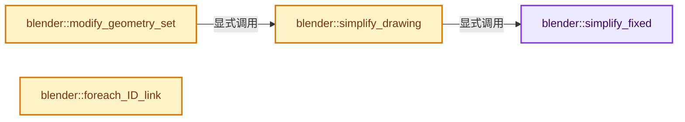
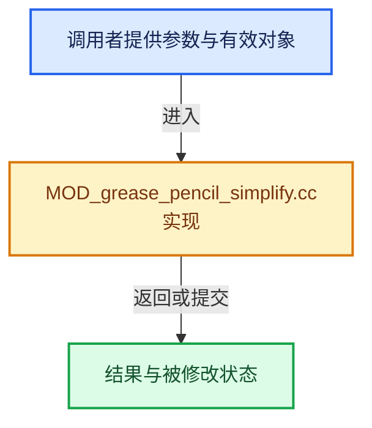

# 实现依赖专题：source/blender/modifiers/intern/MOD_grease_pencil_simplify.cc

[实现依赖导航](../../../README.md) · [符号索引](../../../../00-课程指南/02-源码与提交索引/符号依赖与实现索引.md)

本专题从正文实际调用进入，集中保存共享实现。函数有稳定锚点，可从调用处直接跳到对应完整函数；递归与互相调用通过回链组织。

## 本文件的实现关系






## 完整成员与函数实现

<a id="f-6f811750a8269826"></a>

### `blender::simplify_fixed`

实现位置：[source/blender/modifiers/intern/MOD_grease_pencil_simplify.cc](../../../../../../../../source/blender/modifiers/intern/MOD_grease_pencil_simplify.cc) · L77—L92。

接口参数：

- `const bke::CurvesGeometry &curves`
- `const int step`
- `IndexMaskMemory &memory`

**教学注释版**

<!-- annotated:3eb103ea9a6201 -->

```cpp
static IndexMask simplify_fixed(const bke::CurvesGeometry &curves,
                                const int step,
                                IndexMaskMemory &memory)
{
  const OffsetIndices points_by_curve = curves.points_by_curve();
  const Array<int> point_to_curve_map = curves.point_to_curve_map();
  return IndexMask::from_predicate(curves.points_range(), memory, [&](const int64_t i) {
    const int curve_i = point_to_curve_map[i];
    const IndexRange points = points_by_curve[curve_i];
    // [讲解] points.size：读取连续区间或分组的边界信息。
    if (points.size() <= 2) {
      return true;
    }
    // [讲解] points.start：读取连续区间或分组的边界信息。
    const int local_i = i - points.start();
    // [讲解] points.last：读取范围两端的有效索引或值。
    return (local_i % int(math::pow(2.0f, float(step))) == 0) || points.last() == i;
  });
}
```

<details>
<summary>核对原始源码：source/blender/modifiers/intern/MOD_grease_pencil_simplify.cc · L77—L92</summary>

<!-- original:3eb103ea9a6201:source/blender/modifiers/intern/MOD_grease_pencil_simplify.cc:77:92 -->

```cpp
static IndexMask simplify_fixed(const bke::CurvesGeometry &curves,
                                const int step,
                                IndexMaskMemory &memory)
{
  const OffsetIndices points_by_curve = curves.points_by_curve();
  const Array<int> point_to_curve_map = curves.point_to_curve_map();
  return IndexMask::from_predicate(curves.points_range(), memory, [&](const int64_t i) {
    const int curve_i = point_to_curve_map[i];
    const IndexRange points = points_by_curve[curve_i];
    if (points.size() <= 2) {
      return true;
    }
    const int local_i = i - points.start();
    return (local_i % int(math::pow(2.0f, float(step))) == 0) || points.last() == i;
  });
}
```

</details>

**结果出口**

- `return IndexMask::from_predicate(curves.points_range(), memory, [&](const int64_t i) {`
- `return true;`
- `return (local_i % int(math::pow(2.0f, float(step))) == 0) || points.last() == i;`

**继续追踪实现**

- `curves.points_by_curve` → [blender::bke::CurvesGeometry::points_by_curve · L1058](../../../../05-几何存储与拓扑映射/04-CurvesGeometry存储.md#f-a0416697e10ec205)。
- `curves.point_to_curve_map` → [blender::bke::CurvesGeometry::point_to_curve_map · L757](../../../02-BKE几何与数据/intern/curves_geometry.cc.md#f-8637a80af5f7af80)。
- `IndexMask::from_predicate` → [blender::index_mask::IndexMask::from_predicate · L1073](../../../../04-虚拟数组与索引选择/12-重构历史与基准练习.md#f-3864daa059098df8)。
- `curves.points_range` → [blender::bke::CurvesGeometry::points_range · L1019](../../../../05-几何存储与拓扑映射/04-CurvesGeometry存储.md#f-4559390918002dfa)。
- `points.size` → [blender::IndexRange::size · L156](../../../../01-基础容器与现代CPP/04-IndexRange连续整数区间.md#f-05f66c3ebb2fdfec)。
- `points.start` → [blender::IndexRange::start · L243](../../../../01-基础容器与现代CPP/04-IndexRange连续整数区间.md#f-99d2195bd9cfd1f0)。
- `math::pow` → [外部契约](https://eel.is/c++draft/)：这个边界按实际表达式及所属类型核对参数、返回值、寿命与失败行为。这里提供接口入口，不声称已解释该第三方版本的内部实现。
- `points.last` → [blender::IndexRange::last · L214](../../../../01-基础容器与现代CPP/04-IndexRange连续整数区间.md#f-66896c6351a40de1)；[blender::gpu::shader::parser::IndexRange::last · L62](../../gpu/shader_tool/utils.hh.md#f-373501206569c3b3)。同名重载需按实参类型选择。

<a id="f-7ce68b94aebdb07b"></a>

### `blender::simplify_drawing`

实现位置：[source/blender/modifiers/intern/MOD_grease_pencil_simplify.cc](../../../../../../../../source/blender/modifiers/intern/MOD_grease_pencil_simplify.cc) · L94—L159。

接口参数：

- `const GreasePencilSimplifyModifierData &mmd`
- `const Object &ob`
- `bke::greasepencil::Drawing &drawing`

**教学注释版**

<!-- annotated:447b8f765ab88a -->

```cpp
static void simplify_drawing(const GreasePencilSimplifyModifierData &mmd,
                             const Object &ob,
                             bke::greasepencil::Drawing &drawing)
{
  modifier::greasepencil::ensure_no_bezier_curves(drawing);
  const bke::CurvesGeometry &curves = drawing.strokes();

  IndexMaskMemory memory;
  const IndexMask strokes = modifier::greasepencil::get_filtered_stroke_mask(
      &ob, curves, mmd.influence, memory);
  if (strokes.is_empty()) {
    return;
  }

  switch (mmd.mode) {
    case MOD_GREASE_PENCIL_SIMPLIFY_FIXED: {
      const IndexMask points_to_keep = simplify_fixed(curves, mmd.step, memory);
      if (points_to_keep.is_empty()) {
        drawing.strokes_for_write() = {};
        break;
      }
      if (points_to_keep.size() == curves.points_num()) {
        break;
      }
      drawing.strokes_for_write() = bke::curves_copy_point_selection(curves, points_to_keep, {});
      break;
    }
    case MOD_GREASE_PENCIL_SIMPLIFY_ADAPTIVE: {
      const IndexMask points_to_delete = geometry::simplify_curve_attribute(
          curves.positions(),
          strokes,
          curves.points_by_curve(),
          curves.cyclic(),
          mmd.factor,
          curves.positions(),
          memory);
      drawing.strokes_for_write().remove_points(points_to_delete, {});
      break;
    }
    case MOD_GREASE_PENCIL_SIMPLIFY_SAMPLE: {
      drawing.strokes_for_write() = geometry::resample_to_length(
          curves, strokes, VArray<float>::from_single(mmd.length, curves.curves_num()), {});
      break;
    }
    case MOD_GREASE_PENCIL_SIMPLIFY_MERGE: {
      const OffsetIndices points_by_curve = curves.points_by_curve();
      const Array<int> point_to_curve_map = curves.point_to_curve_map();
      const IndexMask points = IndexMask::from_predicate(
          curves.points_range(), memory, [&](const int64_t i) {
            const int curve_i = point_to_curve_map[i];
            const IndexRange points = points_by_curve[curve_i];
            if (points.drop_front(1).drop_back(1).contains(i)) {
              return true;
            }
            return false;
          });
      drawing.strokes_for_write() = ed::greasepencil::curves_merge_by_distance(
          curves, mmd.distance, points, {});
      break;
    }
    default:
      break;
  }

  drawing.tag_topology_changed();
}
```

<details>
<summary>核对原始源码：source/blender/modifiers/intern/MOD_grease_pencil_simplify.cc · L94—L159</summary>

<!-- original:447b8f765ab88a:source/blender/modifiers/intern/MOD_grease_pencil_simplify.cc:94:159 -->

```cpp
static void simplify_drawing(const GreasePencilSimplifyModifierData &mmd,
                             const Object &ob,
                             bke::greasepencil::Drawing &drawing)
{
  modifier::greasepencil::ensure_no_bezier_curves(drawing);
  const bke::CurvesGeometry &curves = drawing.strokes();

  IndexMaskMemory memory;
  const IndexMask strokes = modifier::greasepencil::get_filtered_stroke_mask(
      &ob, curves, mmd.influence, memory);
  if (strokes.is_empty()) {
    return;
  }

  switch (mmd.mode) {
    case MOD_GREASE_PENCIL_SIMPLIFY_FIXED: {
      const IndexMask points_to_keep = simplify_fixed(curves, mmd.step, memory);
      if (points_to_keep.is_empty()) {
        drawing.strokes_for_write() = {};
        break;
      }
      if (points_to_keep.size() == curves.points_num()) {
        break;
      }
      drawing.strokes_for_write() = bke::curves_copy_point_selection(curves, points_to_keep, {});
      break;
    }
    case MOD_GREASE_PENCIL_SIMPLIFY_ADAPTIVE: {
      const IndexMask points_to_delete = geometry::simplify_curve_attribute(
          curves.positions(),
          strokes,
          curves.points_by_curve(),
          curves.cyclic(),
          mmd.factor,
          curves.positions(),
          memory);
      drawing.strokes_for_write().remove_points(points_to_delete, {});
      break;
    }
    case MOD_GREASE_PENCIL_SIMPLIFY_SAMPLE: {
      drawing.strokes_for_write() = geometry::resample_to_length(
          curves, strokes, VArray<float>::from_single(mmd.length, curves.curves_num()), {});
      break;
    }
    case MOD_GREASE_PENCIL_SIMPLIFY_MERGE: {
      const OffsetIndices points_by_curve = curves.points_by_curve();
      const Array<int> point_to_curve_map = curves.point_to_curve_map();
      const IndexMask points = IndexMask::from_predicate(
          curves.points_range(), memory, [&](const int64_t i) {
            const int curve_i = point_to_curve_map[i];
            const IndexRange points = points_by_curve[curve_i];
            if (points.drop_front(1).drop_back(1).contains(i)) {
              return true;
            }
            return false;
          });
      drawing.strokes_for_write() = ed::greasepencil::curves_merge_by_distance(
          curves, mmd.distance, points, {});
      break;
    }
    default:
      break;
  }

  drawing.tag_topology_changed();
}
```

</details>

**结果出口**

- `return true;`
- `return false;`

**继续追踪实现**

- `modifier::greasepencil::ensure_no_bezier_curves` → [blender::modifier::greasepencil::ensure_no_bezier_curves · L432](MOD_grease_pencil_util.cc.md#f-1fde6483ac30d59b)。
- `drawing.strokes` → [blender::bke::greasepencil::Drawing::strokes · L1007](../../../02-BKE几何与数据/intern/grease_pencil.cc.md#f-59e6522a8e8ac409)。
- `modifier::greasepencil::get_filtered_stroke_mask` → [blender::modifier::greasepencil::get_filtered_stroke_mask · L285](MOD_grease_pencil_util.cc.md#f-30c219d04de7dec3)；[blender::modifier::greasepencil::get_filtered_stroke_mask · L326](MOD_grease_pencil_util.cc.md#f-970c3bc880e4f350)。同名重载需按实参类型选择。
- `strokes.is_empty` → [blender::index_mask::IndexMask::is_empty · L748](../../../../04-虚拟数组与索引选择/09-分段存储与遍历.md#f-190ac996386064f4)。
- `simplify_fixed` → [blender::simplify_fixed · L77](MOD_grease_pencil_simplify.cc.md#f-6f811750a8269826)。
- `points_to_keep.is_empty` → [blender::index_mask::IndexMask::is_empty · L748](../../../../04-虚拟数组与索引选择/09-分段存储与遍历.md#f-190ac996386064f4)。
- `drawing.strokes_for_write` → [blender::bke::greasepencil::Drawing::strokes_for_write · L1012](../../../02-BKE几何与数据/intern/grease_pencil.cc.md#f-0649333785d0aa95)。
- `points_to_keep.size` → [blender::index_mask::IndexMask::size · L743](../../../../04-虚拟数组与索引选择/09-分段存储与遍历.md#f-0163b32abc9a0d9c)。
- `curves.points_num` → [blender::bke::CurvesGeometry::points_num · L1001](../../../../05-几何存储与拓扑映射/04-CurvesGeometry存储.md#f-049421b1f643c700)。
- `bke::curves_copy_point_selection` → [blender::bke::curves_copy_point_selection · L1498](../../../02-BKE几何与数据/intern/curves_geometry.cc.md#f-a5fee076fc4e16d5)。
- `geometry::simplify_curve_attribute` → [blender::geometry::simplify_curve_attribute · L136](../../../05-Geometry几何算法/intern/simplify_curves.cc.md#f-278e2959cce2ce42)。
- `curves.positions` → [blender::bke::CurvesGeometry::positions · L323](../../../02-BKE几何与数据/intern/curves_geometry.cc.md#f-42ba586557e8ff18)。
- `curves.points_by_curve` → [blender::bke::CurvesGeometry::points_by_curve · L1058](../../../../05-几何存储与拓扑映射/04-CurvesGeometry存储.md#f-a0416697e10ec205)。
- `curves.cyclic` → [blender::bke::CurvesGeometry::cyclic · L362](../../../02-BKE几何与数据/intern/curves_geometry.cc.md#f-ec08c2a1d6f3bfea)。
- `drawing.strokes_for_write().remove_points` → [调用协议](../../../../00-课程指南/01-路线与规范/模板宏与动态分派协议.md)：接收对象类型依赖auto、返回值或模板实例；不按同名猜测目标。调用位置L130。
- `geometry::resample_to_length` → [blender::geometry::resample_to_length · L511](../../../05-Geometry几何算法/intern/resample_curves.cc.md#f-4a41667dd029e751)；[blender::geometry::resample_to_length · L552](../../../05-Geometry几何算法/intern/resample_curves.cc.md#f-52f007501b0fcb38)。同名重载需按实参类型选择。
- `VArray<float>::from_single` → [blender::GVArray::from_single · L880](../../../../04-虚拟数组与索引选择/05-GVArray运行时类型.md#f-1c85e09520e47c5a)。
- `curves.curves_num` → [blender::bke::CurvesGeometry::curves_num · L1005](../../../../05-几何存储与拓扑映射/04-CurvesGeometry存储.md#f-eabb3f0e5d3c57be)。
- `curves.point_to_curve_map` → [blender::bke::CurvesGeometry::point_to_curve_map · L757](../../../02-BKE几何与数据/intern/curves_geometry.cc.md#f-8637a80af5f7af80)。
- `IndexMask::from_predicate` → [blender::index_mask::IndexMask::from_predicate · L1073](../../../../04-虚拟数组与索引选择/12-重构历史与基准练习.md#f-3864daa059098df8)。
- `curves.points_range` → [blender::bke::CurvesGeometry::points_range · L1019](../../../../05-几何存储与拓扑映射/04-CurvesGeometry存储.md#f-4559390918002dfa)。
- `points.drop_front(1).drop_back(1).contains` → [调用协议](../../../../00-课程指南/01-路线与规范/模板宏与动态分派协议.md)：接收对象类型依赖auto、返回值或模板实例；不按同名猜测目标。调用位置L145。
- `points.drop_front(1).drop_back` → [调用协议](../../../../00-课程指南/01-路线与规范/模板宏与动态分派协议.md)：接收对象类型依赖auto、返回值或模板实例；不按同名猜测目标。调用位置L145。
- `points.drop_front` → [blender::IndexRange::drop_front · L306](../../../../01-基础容器与现代CPP/04-IndexRange连续整数区间.md#f-ef3101407d982c90)。
- `ed::greasepencil::curves_merge_by_distance` → [blender::ed::greasepencil::curves_merge_by_distance · L213](../../editors/grease_pencil/intern/grease_pencil_geom.cc.md#f-58afb70f4d9af36c)。
- `drawing.tag_topology_changed` → [blender::bke::greasepencil::Drawing::tag_topology_changed · L1304](../../../02-BKE几何与数据/intern/grease_pencil.cc.md#f-6eefbf46d05d944b)；[blender::bke::greasepencil::Drawing::tag_topology_changed · L1311](../../../02-BKE几何与数据/intern/grease_pencil.cc.md#f-dbd37d071b845a58)。同名重载需按实参类型选择。

<a id="f-43ffd26310c793e0"></a>

### `blender::modify_geometry_set`

实现位置：[source/blender/modifiers/intern/MOD_grease_pencil_simplify.cc](../../../../../../../../source/blender/modifiers/intern/MOD_grease_pencil_simplify.cc) · L161—L183。

接口参数：

- `ModifierData *md`
- `const ModifierEvalContext *ctx`
- `bke::GeometrySet *geometry_set`

**教学注释版**

<!-- annotated:beb1cfad45da06 -->

```cpp
static void modify_geometry_set(ModifierData *md,
                                const ModifierEvalContext *ctx,
                                bke::GeometrySet *geometry_set)
{
  const auto *mmd = reinterpret_cast<GreasePencilSimplifyModifierData *>(md);

  if (!geometry_set->has_grease_pencil()) {
    return;
  }

  GreasePencil &grease_pencil = *geometry_set->get_grease_pencil_for_write();
  const int current_frame = grease_pencil.runtime->eval_frame;

  IndexMaskMemory mask_memory;
  const IndexMask layer_mask = modifier::greasepencil::get_filtered_layer_mask(
      grease_pencil, mmd->influence, mask_memory);
  const Vector<bke::greasepencil::Drawing *> drawings =
      modifier::greasepencil::get_drawings_for_write(grease_pencil, layer_mask, current_frame);

  threading::parallel_for_each(drawings, [&](bke::greasepencil::Drawing *drawing) {
    simplify_drawing(*mmd, *ctx->object, *drawing);
  });
}
```

<details>
<summary>核对原始源码：source/blender/modifiers/intern/MOD_grease_pencil_simplify.cc · L161—L183</summary>

<!-- original:beb1cfad45da06:source/blender/modifiers/intern/MOD_grease_pencil_simplify.cc:161:183 -->

```cpp
static void modify_geometry_set(ModifierData *md,
                                const ModifierEvalContext *ctx,
                                bke::GeometrySet *geometry_set)
{
  const auto *mmd = reinterpret_cast<GreasePencilSimplifyModifierData *>(md);

  if (!geometry_set->has_grease_pencil()) {
    return;
  }

  GreasePencil &grease_pencil = *geometry_set->get_grease_pencil_for_write();
  const int current_frame = grease_pencil.runtime->eval_frame;

  IndexMaskMemory mask_memory;
  const IndexMask layer_mask = modifier::greasepencil::get_filtered_layer_mask(
      grease_pencil, mmd->influence, mask_memory);
  const Vector<bke::greasepencil::Drawing *> drawings =
      modifier::greasepencil::get_drawings_for_write(grease_pencil, layer_mask, current_frame);

  threading::parallel_for_each(drawings, [&](bke::greasepencil::Drawing *drawing) {
    simplify_drawing(*mmd, *ctx->object, *drawing);
  });
}
```

</details>

**继续追踪实现**

- `geometry_set->has_grease_pencil` → [blender::bke::GeometrySet::has_grease_pencil · L415](../../../../06-隐式共享与缓存系统/05-GeometrySet读写与复制.md#f-357bcb62da7a8afd)。
- `geometry_set->get_grease_pencil_for_write` → [blender::bke::GeometrySet::get_grease_pencil_for_write · L622](../../../../06-隐式共享与缓存系统/05-GeometrySet读写与复制.md#f-bfc5e891a352651b)。
- `modifier::greasepencil::get_filtered_layer_mask` → [blender::modifier::greasepencil::get_filtered_layer_mask · L213](MOD_grease_pencil_util.cc.md#f-6438bea51141f9db)；[blender::modifier::greasepencil::get_filtered_layer_mask · L268](MOD_grease_pencil_util.cc.md#f-e3d0f9748ecdf34b)。同名重载需按实参类型选择。
- `modifier::greasepencil::get_drawings_for_write` → [blender::modifier::greasepencil::get_drawings_for_write · L368](MOD_grease_pencil_util.cc.md#f-cef3871c31259376)。
- `threading::parallel_for_each` → [blender::threading::parallel_for_each · L30](../../../../11-Depsgraph与并行任务系统/07-任务池与TBB接入.md#f-d5604027445ef0f5)。
- `simplify_drawing` → [blender::simplify_drawing · L94](MOD_grease_pencil_simplify.cc.md#f-7ce68b94aebdb07b)。

<a id="f-a5395502b7274b0c"></a>

### `blender::foreach_ID_link`

实现位置：[source/blender/modifiers/intern/MOD_grease_pencil_simplify.cc](../../../../../../../../source/blender/modifiers/intern/MOD_grease_pencil_simplify.cc) · L185—L190。

接口参数：

- `ModifierData *md`
- `Object *ob`
- `IDWalkFunc walk`
- `void *user_data`

**教学注释版**

<!-- annotated:e3ebc79d7d53a9 -->

```cpp
static void foreach_ID_link(ModifierData *md, Object *ob, IDWalkFunc walk, void *user_data)
{
  auto *mmd = reinterpret_cast<GreasePencilSimplifyModifierData *>(md);

  modifier::greasepencil::foreach_influence_ID_link(&mmd->influence, ob, walk, user_data);
}
```

<details>
<summary>核对原始源码：source/blender/modifiers/intern/MOD_grease_pencil_simplify.cc · L185—L190</summary>

<!-- original:e3ebc79d7d53a9:source/blender/modifiers/intern/MOD_grease_pencil_simplify.cc:185:190 -->

```cpp
static void foreach_ID_link(ModifierData *md, Object *ob, IDWalkFunc walk, void *user_data)
{
  auto *mmd = reinterpret_cast<GreasePencilSimplifyModifierData *>(md);

  modifier::greasepencil::foreach_influence_ID_link(&mmd->influence, ob, walk, user_data);
}
```

</details>

**继续追踪实现**

- `modifier::greasepencil::foreach_influence_ID_link` → [blender::modifier::greasepencil::foreach_influence_ID_link · L69](MOD_grease_pencil_util.cc.md#f-247ba56fa4c4e56f)。
