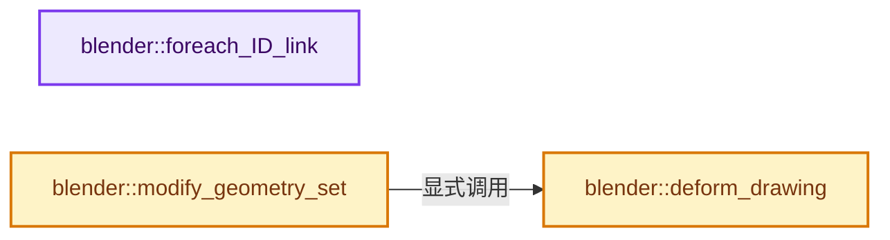
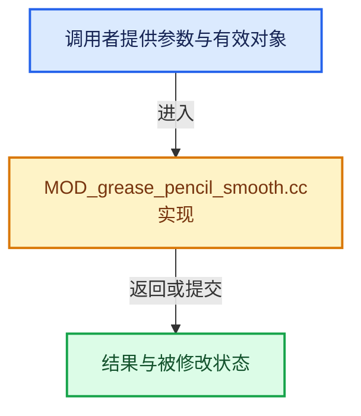

# 实现依赖专题：source/blender/modifiers/intern/MOD_grease_pencil_smooth.cc

[实现依赖导航](../../../README.md) · [符号索引](../../../../00-课程指南/02-源码与提交索引/符号依赖与实现索引.md)

本专题从正文实际调用进入，集中保存共享实现。函数有稳定锚点，可从调用处直接跳到对应完整函数；递归与互相调用通过回链组织。

## 本文件的实现关系






## 完整成员与函数实现

<a id="f-a52ea3a2a870d0e3"></a>

### `blender::foreach_ID_link`

实现位置：[source/blender/modifiers/intern/MOD_grease_pencil_smooth.cc](../../../../../../../../source/blender/modifiers/intern/MOD_grease_pencil_smooth.cc) · L62—L67。

接口参数：

- `ModifierData *md`
- `Object *ob`
- `IDWalkFunc walk`
- `void *user_data`

**教学注释版**

<!-- annotated:fce1abd8190b23 -->

```cpp
static void foreach_ID_link(ModifierData *md, Object *ob, IDWalkFunc walk, void *user_data)
{
  GreasePencilSmoothModifierData *mmd = reinterpret_cast<GreasePencilSmoothModifierData *>(md);

  modifier::greasepencil::foreach_influence_ID_link(&mmd->influence, ob, walk, user_data);
}
```

<details>
<summary>核对原始源码：source/blender/modifiers/intern/MOD_grease_pencil_smooth.cc · L62—L67</summary>

<!-- original:fce1abd8190b23:source/blender/modifiers/intern/MOD_grease_pencil_smooth.cc:62:67 -->

```cpp
static void foreach_ID_link(ModifierData *md, Object *ob, IDWalkFunc walk, void *user_data)
{
  GreasePencilSmoothModifierData *mmd = reinterpret_cast<GreasePencilSmoothModifierData *>(md);

  modifier::greasepencil::foreach_influence_ID_link(&mmd->influence, ob, walk, user_data);
}
```

</details>

**继续追踪实现**

- `modifier::greasepencil::foreach_influence_ID_link` → [blender::modifier::greasepencil::foreach_influence_ID_link · L69](MOD_grease_pencil_util.cc.md#f-247ba56fa4c4e56f)。

<a id="f-5e95baf70d8f1f46"></a>

### `blender::deform_drawing`

实现位置：[source/blender/modifiers/intern/MOD_grease_pencil_smooth.cc](../../../../../../../../source/blender/modifiers/intern/MOD_grease_pencil_smooth.cc) · L84—L200。

接口参数：

- `const ModifierData &md`
- `const Object &ob`
- `bke::greasepencil::Drawing &drawing`

**教学注释版**

<!-- annotated:7e12721ffc7bd6 -->

```cpp
static void deform_drawing(const ModifierData &md,
                           const Object &ob,
                           bke::greasepencil::Drawing &drawing)
{
  const auto &mmd = reinterpret_cast<const GreasePencilSmoothModifierData &>(md);

  const int iterations = mmd.step;
  const float influence = mmd.factor;
  const bool keep_shape = (mmd.flag & MOD_GREASE_PENCIL_SMOOTH_KEEP_SHAPE);
  const bool smooth_ends = (mmd.flag & MOD_GREASE_PENCIL_SMOOTH_SMOOTH_ENDS);

  const bool smooth_position = (mmd.flag & MOD_GREASE_PENCIL_SMOOTH_MOD_LOCATION);
  const bool smooth_radius = (mmd.flag & MOD_GREASE_PENCIL_SMOOTH_MOD_THICKNESS);
  const bool smooth_opacity = (mmd.flag & MOD_GREASE_PENCIL_SMOOTH_MOD_STRENGTH);
  const bool smooth_uv = (mmd.flag & MOD_GREASE_PENCIL_SMOOTH_MOD_UV);

  if (iterations <= 0 || influence <= 0.0f) {
    return;
  }

  if (!(smooth_position || smooth_radius || smooth_opacity || smooth_uv)) {
    return;
  }

  modifier::greasepencil::ensure_no_bezier_curves(drawing);
  bke::CurvesGeometry &curves = drawing.strokes_for_write();
  if (curves.is_empty()) {
    return;
  }

  IndexMaskMemory memory;
  const IndexMask strokes = modifier::greasepencil::get_filtered_stroke_mask(
      &ob, curves, mmd.influence, memory);

  if (strokes.is_empty()) {
    return;
  }

  bke::MutableAttributeAccessor attributes = curves.attributes_for_write();
  const OffsetIndices points_by_curve = curves.points_by_curve();
  const VArray<bool> cyclic = curves.cyclic();
  const VArray<bool> point_selection = VArray<bool>::from_single(true, curves.points_num());

  VArray<float> influences;
  const bool use_influence_vertex_group = mmd.influence.vertex_group_name[0] != '\0';
  if (use_influence_vertex_group) {
    const VArray<float> vgroup_weights = modifier::greasepencil::get_influence_vertex_weights(
        curves, mmd.influence);
    Array<float> vgroup_weights_factored(vgroup_weights.size());
    threading::parallel_for(
        // [讲解] vgroup_weights_factored.index_range：查询固定有效长度及其索引范围。
        vgroup_weights_factored.index_range(), 4096, [&](const IndexRange range) {
          for (const int i : range) {
            vgroup_weights_factored[i] = vgroup_weights[i] * influence;
          }
        });
    influences = VArray<float>::from_container(vgroup_weights_factored);
  }
  else {
    influences = VArray<float>::from_single(influence, curves.points_num());
  }

  if (smooth_position) {
    bke::GSpanAttributeWriter positions = attributes.lookup_for_write_span("position");
    geometry::smooth_curve_attribute(strokes,
                                     points_by_curve,
                                     point_selection,
                                     cyclic,
                                     iterations,
                                     influences,
                                     smooth_ends,
                                     keep_shape,
                                     positions.span);
    positions.finish();
    drawing.tag_positions_changed();
  }
  if (smooth_opacity && drawing.opacities().is_span()) {
    bke::GSpanAttributeWriter opacities = attributes.lookup_for_write_span("opacity");
    geometry::smooth_curve_attribute(strokes,
                                     points_by_curve,
                                     point_selection,
                                     cyclic,
                                     iterations,
                                     influences,
                                     smooth_ends,
                                     false,
                                     opacities.span);
    opacities.finish();
  }
  if (smooth_radius && drawing.radii().is_span()) {
    bke::GSpanAttributeWriter radii = attributes.lookup_for_write_span("radius");
    geometry::smooth_curve_attribute(strokes,
                                     points_by_curve,
                                     point_selection,
                                     cyclic,
                                     iterations,
                                     influences,
                                     smooth_ends,
                                     false,
                                     radii.span);
    radii.finish();
  }
  if (smooth_uv) {
    bke::SpanAttributeWriter<float> rotation = attributes.lookup_for_write_span<float>("rotation");
    if (rotation) {
      geometry::smooth_curve_attribute(strokes,
                                       points_by_curve,
                                       point_selection,
                                       cyclic,
                                       iterations,
                                       influences,
                                       smooth_ends,
                                       false,
                                       rotation.span);
    }
    rotation.finish();
  }
}
```

<details>
<summary>核对原始源码：source/blender/modifiers/intern/MOD_grease_pencil_smooth.cc · L84—L200</summary>

<!-- original:7e12721ffc7bd6:source/blender/modifiers/intern/MOD_grease_pencil_smooth.cc:84:200 -->

```cpp
static void deform_drawing(const ModifierData &md,
                           const Object &ob,
                           bke::greasepencil::Drawing &drawing)
{
  const auto &mmd = reinterpret_cast<const GreasePencilSmoothModifierData &>(md);

  const int iterations = mmd.step;
  const float influence = mmd.factor;
  const bool keep_shape = (mmd.flag & MOD_GREASE_PENCIL_SMOOTH_KEEP_SHAPE);
  const bool smooth_ends = (mmd.flag & MOD_GREASE_PENCIL_SMOOTH_SMOOTH_ENDS);

  const bool smooth_position = (mmd.flag & MOD_GREASE_PENCIL_SMOOTH_MOD_LOCATION);
  const bool smooth_radius = (mmd.flag & MOD_GREASE_PENCIL_SMOOTH_MOD_THICKNESS);
  const bool smooth_opacity = (mmd.flag & MOD_GREASE_PENCIL_SMOOTH_MOD_STRENGTH);
  const bool smooth_uv = (mmd.flag & MOD_GREASE_PENCIL_SMOOTH_MOD_UV);

  if (iterations <= 0 || influence <= 0.0f) {
    return;
  }

  if (!(smooth_position || smooth_radius || smooth_opacity || smooth_uv)) {
    return;
  }

  modifier::greasepencil::ensure_no_bezier_curves(drawing);
  bke::CurvesGeometry &curves = drawing.strokes_for_write();
  if (curves.is_empty()) {
    return;
  }

  IndexMaskMemory memory;
  const IndexMask strokes = modifier::greasepencil::get_filtered_stroke_mask(
      &ob, curves, mmd.influence, memory);

  if (strokes.is_empty()) {
    return;
  }

  bke::MutableAttributeAccessor attributes = curves.attributes_for_write();
  const OffsetIndices points_by_curve = curves.points_by_curve();
  const VArray<bool> cyclic = curves.cyclic();
  const VArray<bool> point_selection = VArray<bool>::from_single(true, curves.points_num());

  VArray<float> influences;
  const bool use_influence_vertex_group = mmd.influence.vertex_group_name[0] != '\0';
  if (use_influence_vertex_group) {
    const VArray<float> vgroup_weights = modifier::greasepencil::get_influence_vertex_weights(
        curves, mmd.influence);
    Array<float> vgroup_weights_factored(vgroup_weights.size());
    threading::parallel_for(
        vgroup_weights_factored.index_range(), 4096, [&](const IndexRange range) {
          for (const int i : range) {
            vgroup_weights_factored[i] = vgroup_weights[i] * influence;
          }
        });
    influences = VArray<float>::from_container(vgroup_weights_factored);
  }
  else {
    influences = VArray<float>::from_single(influence, curves.points_num());
  }

  if (smooth_position) {
    bke::GSpanAttributeWriter positions = attributes.lookup_for_write_span("position");
    geometry::smooth_curve_attribute(strokes,
                                     points_by_curve,
                                     point_selection,
                                     cyclic,
                                     iterations,
                                     influences,
                                     smooth_ends,
                                     keep_shape,
                                     positions.span);
    positions.finish();
    drawing.tag_positions_changed();
  }
  if (smooth_opacity && drawing.opacities().is_span()) {
    bke::GSpanAttributeWriter opacities = attributes.lookup_for_write_span("opacity");
    geometry::smooth_curve_attribute(strokes,
                                     points_by_curve,
                                     point_selection,
                                     cyclic,
                                     iterations,
                                     influences,
                                     smooth_ends,
                                     false,
                                     opacities.span);
    opacities.finish();
  }
  if (smooth_radius && drawing.radii().is_span()) {
    bke::GSpanAttributeWriter radii = attributes.lookup_for_write_span("radius");
    geometry::smooth_curve_attribute(strokes,
                                     points_by_curve,
                                     point_selection,
                                     cyclic,
                                     iterations,
                                     influences,
                                     smooth_ends,
                                     false,
                                     radii.span);
    radii.finish();
  }
  if (smooth_uv) {
    bke::SpanAttributeWriter<float> rotation = attributes.lookup_for_write_span<float>("rotation");
    if (rotation) {
      geometry::smooth_curve_attribute(strokes,
                                       points_by_curve,
                                       point_selection,
                                       cyclic,
                                       iterations,
                                       influences,
                                       smooth_ends,
                                       false,
                                       rotation.span);
    }
    rotation.finish();
  }
}
```

</details>

**沿实际写入检查状态**

- `vgroup_weights_factored[i] = vgroup_weights[i] * influence;`
- `influences = VArray<float>::from_container(vgroup_weights_factored);`
- `influences = VArray<float>::from_single(influence, curves.points_num());`

**继续追踪实现**

- `modifier::greasepencil::ensure_no_bezier_curves` → [blender::modifier::greasepencil::ensure_no_bezier_curves · L432](MOD_grease_pencil_util.cc.md#f-1fde6483ac30d59b)。
- `drawing.strokes_for_write` → [blender::bke::greasepencil::Drawing::strokes_for_write · L1012](../../../02-BKE几何与数据/intern/grease_pencil.cc.md#f-0649333785d0aa95)。
- `curves.is_empty` → [blender::bke::CurvesGeometry::is_empty · L1013](../../../../05-几何存储与拓扑映射/04-CurvesGeometry存储.md#f-4c323ef62c4b64ab)。
- `modifier::greasepencil::get_filtered_stroke_mask` → [blender::modifier::greasepencil::get_filtered_stroke_mask · L285](MOD_grease_pencil_util.cc.md#f-30c219d04de7dec3)；[blender::modifier::greasepencil::get_filtered_stroke_mask · L326](MOD_grease_pencil_util.cc.md#f-970c3bc880e4f350)。同名重载需按实参类型选择。
- `strokes.is_empty` → [blender::index_mask::IndexMask::is_empty · L748](../../../../04-虚拟数组与索引选择/09-分段存储与遍历.md#f-190ac996386064f4)。
- `curves.attributes_for_write` → [blender::bke::CurvesGeometry::attributes_for_write · L1913](../../../02-BKE几何与数据/intern/curves_geometry.cc.md#f-4930091b34fa9663)。
- `curves.points_by_curve` → [blender::bke::CurvesGeometry::points_by_curve · L1058](../../../../05-几何存储与拓扑映射/04-CurvesGeometry存储.md#f-a0416697e10ec205)。
- `curves.cyclic` → [blender::bke::CurvesGeometry::cyclic · L362](../../../02-BKE几何与数据/intern/curves_geometry.cc.md#f-ec08c2a1d6f3bfea)。
- `VArray<bool>::from_single` → [blender::GVArray::from_single · L880](../../../../04-虚拟数组与索引选择/05-GVArray运行时类型.md#f-1c85e09520e47c5a)。
- `curves.points_num` → [blender::bke::CurvesGeometry::points_num · L1001](../../../../05-几何存储与拓扑映射/04-CurvesGeometry存储.md#f-049421b1f643c700)。
- `modifier::greasepencil::get_influence_vertex_weights` → [blender::modifier::greasepencil::get_influence_vertex_weights · L343](MOD_grease_pencil_util.cc.md#f-6f4fdb5693985db9)。
- `vgroup_weights.size` → [blender::Bounds<T>::size · L543](../../../../12-空间数据结构与几何算法/07-Bounds与BVH对比.md#f-fcce88c0824fcd97)；[blender::GVArrayImpl::size · L651](../../../../04-虚拟数组与索引选择/05-GVArray运行时类型.md#f-f23d3d1f3b110f1e)；[blender::GVArrayCommon::size · L759](../../../../04-虚拟数组与索引选择/05-GVArray运行时类型.md#f-0856784f4e4fd3c9)；[blender::StringRefBase::size · L196](../../../../01-基础容器与现代CPP/15-StringRef字符串视图.md#f-60d4631c74931d2e)；[blender::KDTreeNew<T>::size · L493](../../../../12-空间数据结构与几何算法/05-K近邻与范围查询.md#f-233c05ce6d5c8d39)；[blender::MainAllIDsIterator::size · L1291](../../../02-BKE几何与数据/intern/main.cc.md#f-520d1311c646452f)；[blender::GLSourcesBaked::size · L1541](../../gpu/opengl/gl_shader.cc.md#f-5b5b539d533c6792)。同名重载需按实参类型选择。
- `threading::parallel_for` → [blender::threading::parallel_for · L68](../../../../11-Depsgraph与并行任务系统/07-任务池与TBB接入.md#f-838294754c24426c)。
- `vgroup_weights_factored.index_range` → [blender::Array::index_range · L371](../../../../01-基础容器与现代CPP/08-Array复制移动与销毁.md#f-50a09e14742887a0)。
- `VArray<float>::from_container` → [blender::VArray::from_container · L809](../../../../04-虚拟数组与索引选择/03-单值与Span表示.md#f-0e0990c28b1aac89)。
- `VArray<float>::from_single` → [blender::GVArray::from_single · L880](../../../../04-虚拟数组与索引选择/05-GVArray运行时类型.md#f-1c85e09520e47c5a)。
- `attributes.lookup_for_write_span` → [blender::bke::MutableAttributeAccessor::lookup_for_write_span · L505](../../../02-BKE几何与数据/intern/attribute_access.cc.md#f-eac5b5d8814ff900)；[blender::bke::MutableAttributeAccessor::lookup_for_write_span · L744](../../../../05-几何存储与拓扑映射/08-AttributeAccessor接口.md#f-4ace458d74222bb4)。同名重载需按实参类型选择。
- `geometry::smooth_curve_attribute` → [blender::geometry::smooth_curve_attribute · L177](../../../05-Geometry几何算法/intern/smooth_curves.cc.md#f-501455310c3a0583)；[blender::geometry::smooth_curve_attribute · L230](../../../05-Geometry几何算法/intern/smooth_curves.cc.md#f-12e5671d56fad9b7)。同名重载需按实参类型选择。
- `positions.finish` → [blender::bke::GSpanAttributeWriter::finish · L372](../../../../05-几何存储与拓扑映射/08-AttributeAccessor接口.md#f-6e58c9c72c82f592)。
- `drawing.tag_positions_changed` → [blender::bke::greasepencil::Drawing::tag_positions_changed · L1095](../../../02-BKE几何与数据/intern/grease_pencil.cc.md#f-cc348dc1ca18c109)；[blender::bke::greasepencil::Drawing::tag_positions_changed · L1229](../../../02-BKE几何与数据/intern/grease_pencil.cc.md#f-36aaac52033b03bf)。同名重载需按实参类型选择。
- `drawing.opacities().is_span` → [调用协议](../../../../00-课程指南/01-路线与规范/模板宏与动态分派协议.md)：接收对象类型依赖auto、返回值或模板实例；不按同名猜测目标。调用位置L159。
- `drawing.opacities` → [blender::bke::greasepencil::Drawing::opacities · L1032](../../../02-BKE几何与数据/intern/grease_pencil.cc.md#f-de72f0daf0c0041f)。
- `opacities.finish` → [blender::bke::GSpanAttributeWriter::finish · L372](../../../../05-几何存储与拓扑映射/08-AttributeAccessor接口.md#f-6e58c9c72c82f592)。
- `drawing.radii().is_span` → [调用协议](../../../../00-课程指南/01-路线与规范/模板宏与动态分派协议.md)：接收对象类型依赖auto、返回值或模板实例；不按同名猜测目标。调用位置L172。
- `drawing.radii` → [blender::bke::greasepencil::Drawing::radii · L1017](../../../02-BKE几何与数据/intern/grease_pencil.cc.md#f-ca404e4336ddab39)。
- `radii.finish` → [blender::bke::GSpanAttributeWriter::finish · L372](../../../../05-几何存储与拓扑映射/08-AttributeAccessor接口.md#f-6e58c9c72c82f592)。
- `attributes.lookup_for_write_span<float>` → [blender::bke::MutableAttributeAccessor::lookup_for_write_span · L505](../../../02-BKE几何与数据/intern/attribute_access.cc.md#f-eac5b5d8814ff900)；[blender::bke::MutableAttributeAccessor::lookup_for_write_span · L744](../../../../05-几何存储与拓扑映射/08-AttributeAccessor接口.md#f-4ace458d74222bb4)。同名重载需按实参类型选择。
- `rotation.finish` → [blender::bke::SpanAttributeWriter::finish · L279](../../../../05-几何存储与拓扑映射/08-AttributeAccessor接口.md#f-585970a3b1bd4da4)。

<a id="f-b3cfc63152b3b8cf"></a>

### `blender::modify_geometry_set`

实现位置：[source/blender/modifiers/intern/MOD_grease_pencil_smooth.cc](../../../../../../../../source/blender/modifiers/intern/MOD_grease_pencil_smooth.cc) · L202—L223。

接口参数：

- `ModifierData *md`
- `const ModifierEvalContext *ctx`
- `bke::GeometrySet *geometry_set`

**教学注释版**

<!-- annotated:66d6fccd5213a0 -->

```cpp
static void modify_geometry_set(ModifierData *md,
                                const ModifierEvalContext *ctx,
                                bke::GeometrySet *geometry_set)
{
  GreasePencilSmoothModifierData *mmd = reinterpret_cast<GreasePencilSmoothModifierData *>(md);

  if (!geometry_set->has_grease_pencil()) {
    return;
  }
  GreasePencil &grease_pencil = *geometry_set->get_grease_pencil_for_write();
  const int current_frame = grease_pencil.runtime->eval_frame;

  IndexMaskMemory mask_memory;
  const IndexMask layer_mask = modifier::greasepencil::get_filtered_layer_mask(
      grease_pencil, mmd->influence, mask_memory);
  const Vector<bke::greasepencil::Drawing *> drawings =
      modifier::greasepencil::get_drawings_for_write(grease_pencil, layer_mask, current_frame);

  threading::parallel_for_each(drawings, [&](bke::greasepencil::Drawing *drawing) {
    deform_drawing(*md, *ctx->object, *drawing);
  });
}
```

<details>
<summary>核对原始源码：source/blender/modifiers/intern/MOD_grease_pencil_smooth.cc · L202—L223</summary>

<!-- original:66d6fccd5213a0:source/blender/modifiers/intern/MOD_grease_pencil_smooth.cc:202:223 -->

```cpp
static void modify_geometry_set(ModifierData *md,
                                const ModifierEvalContext *ctx,
                                bke::GeometrySet *geometry_set)
{
  GreasePencilSmoothModifierData *mmd = reinterpret_cast<GreasePencilSmoothModifierData *>(md);

  if (!geometry_set->has_grease_pencil()) {
    return;
  }
  GreasePencil &grease_pencil = *geometry_set->get_grease_pencil_for_write();
  const int current_frame = grease_pencil.runtime->eval_frame;

  IndexMaskMemory mask_memory;
  const IndexMask layer_mask = modifier::greasepencil::get_filtered_layer_mask(
      grease_pencil, mmd->influence, mask_memory);
  const Vector<bke::greasepencil::Drawing *> drawings =
      modifier::greasepencil::get_drawings_for_write(grease_pencil, layer_mask, current_frame);

  threading::parallel_for_each(drawings, [&](bke::greasepencil::Drawing *drawing) {
    deform_drawing(*md, *ctx->object, *drawing);
  });
}
```

</details>

**继续追踪实现**

- `geometry_set->has_grease_pencil` → [blender::bke::GeometrySet::has_grease_pencil · L415](../../../../06-隐式共享与缓存系统/05-GeometrySet读写与复制.md#f-357bcb62da7a8afd)。
- `geometry_set->get_grease_pencil_for_write` → [blender::bke::GeometrySet::get_grease_pencil_for_write · L622](../../../../06-隐式共享与缓存系统/05-GeometrySet读写与复制.md#f-bfc5e891a352651b)。
- `modifier::greasepencil::get_filtered_layer_mask` → [blender::modifier::greasepencil::get_filtered_layer_mask · L213](MOD_grease_pencil_util.cc.md#f-6438bea51141f9db)；[blender::modifier::greasepencil::get_filtered_layer_mask · L268](MOD_grease_pencil_util.cc.md#f-e3d0f9748ecdf34b)。同名重载需按实参类型选择。
- `modifier::greasepencil::get_drawings_for_write` → [blender::modifier::greasepencil::get_drawings_for_write · L368](MOD_grease_pencil_util.cc.md#f-cef3871c31259376)。
- `threading::parallel_for_each` → [blender::threading::parallel_for_each · L30](../../../../11-Depsgraph与并行任务系统/07-任务池与TBB接入.md#f-d5604027445ef0f5)。
- `deform_drawing` → [blender::deform_drawing · L84](MOD_grease_pencil_smooth.cc.md#f-5e95baf70d8f1f46)。
