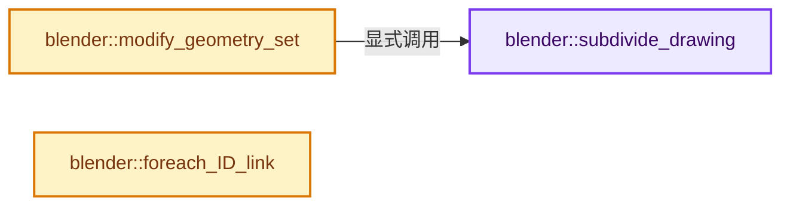
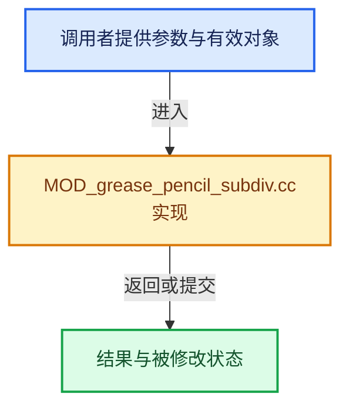

# 实现依赖专题：source/blender/modifiers/intern/MOD_grease_pencil_subdiv.cc

[实现依赖导航](../../../README.md) · [符号索引](../../../../00-课程指南/02-源码与提交索引/符号依赖与实现索引.md)

本专题从正文实际调用进入，集中保存共享实现。函数有稳定锚点，可从调用处直接跳到对应完整函数；递归与互相调用通过回链组织。

## 本文件的实现关系






## 完整成员与函数实现

<a id="f-a07c90c47735f724"></a>

### `blender::subdivide_drawing`

实现位置：[source/blender/modifiers/intern/MOD_grease_pencil_subdiv.cc](../../../../../../../../source/blender/modifiers/intern/MOD_grease_pencil_subdiv.cc) · L75—L128。

接口参数：

- `ModifierData &md`
- `Object &ob`
- `bke::greasepencil::Drawing &drawing`

**教学注释版**

<!-- annotated:cad4d14b680e7d -->

```cpp
static void subdivide_drawing(ModifierData &md, Object &ob, bke::greasepencil::Drawing &drawing)
{
  GreasePencilSubdivModifierData &mmd = reinterpret_cast<GreasePencilSubdivModifierData &>(md);
  const bool use_catmull_clark = mmd.type == MOD_GREASE_PENCIL_SUBDIV_CATMULL;

  IndexMaskMemory memory;
  const IndexMask strokes = modifier::greasepencil::get_filtered_stroke_mask(
      &ob, drawing.strokes_for_write(), mmd.influence, memory);

  if (use_catmull_clark) {
    modifier::greasepencil::ensure_no_bezier_curves(drawing);
    bke::CurvesGeometry subdivided_curves = drawing.strokes();
    const VArray<bool> cyclic = subdivided_curves.cyclic();
    for ([[maybe_unused]] const int level_i : IndexRange(mmd.level)) {
      VArray<int> one_cut = VArray<int>::from_single(1, subdivided_curves.points_num());
      subdivided_curves = geometry::subdivide_curves(
          // [讲解] std::move：把表达式转换成可供移动重载选择的值类别；不保证真的移动，不结束源对象寿命，对const值可能选择复制。
          subdivided_curves, strokes, std::move(one_cut), {});

      offset_indices::OffsetIndices<int> points_by_curve = subdivided_curves.points_by_curve();
      const Array<float3> src_positions = subdivided_curves.positions();
      MutableSpan<float3> dst_positions = subdivided_curves.positions_for_write();
      threading::parallel_for(subdivided_curves.curves_range(), 1024, [&](const IndexRange range) {
        for (const int curve_i : range) {
          const IndexRange points = points_by_curve[curve_i];
          for (const int point_i : points.drop_front(1).drop_back(1)) {
            dst_positions[point_i] = math::interpolate(
                src_positions[point_i],
                math::interpolate(src_positions[point_i - 1], src_positions[point_i + 1], 0.5f),
                0.5f);
          }

          // [讲解] points.size：读取连续区间或分组的边界信息。
          if (cyclic[curve_i] && points.size() > 1) {
            // [讲解] points.first：读取范围两端的有效索引或值。
            const float3 &first_pos = src_positions[points.first()];
            // [讲解] points.last：读取范围两端的有效索引或值。
            const float3 &last_pos = src_positions[points.last()];
            const float3 &after_first_pos = src_positions[points.first() + 1];
            const float3 &before_last_pos = src_positions[points.last() - 1];
            dst_positions[points.first()] = math::interpolate(
                first_pos, math::interpolate(last_pos, after_first_pos, 0.5f), 0.5f);
            dst_positions[points.last()] = math::interpolate(
                last_pos, math::interpolate(before_last_pos, first_pos, 0.5f), 0.5f);
          }
        }
      });
    }
    drawing.strokes_for_write() = subdivided_curves;
  }
  else {
    VArray<int> cuts = VArray<int>::from_single(math::pow(mmd.level, 2),
                                                drawing.strokes().points_num());
    drawing.strokes_for_write() = geometry::subdivide_curves(drawing.strokes(), strokes, cuts, {});
  }

  drawing.tag_topology_changed();
}
```

<details>
<summary>核对原始源码：source/blender/modifiers/intern/MOD_grease_pencil_subdiv.cc · L75—L128</summary>

<!-- original:cad4d14b680e7d:source/blender/modifiers/intern/MOD_grease_pencil_subdiv.cc:75:128 -->

```cpp
static void subdivide_drawing(ModifierData &md, Object &ob, bke::greasepencil::Drawing &drawing)
{
  GreasePencilSubdivModifierData &mmd = reinterpret_cast<GreasePencilSubdivModifierData &>(md);
  const bool use_catmull_clark = mmd.type == MOD_GREASE_PENCIL_SUBDIV_CATMULL;

  IndexMaskMemory memory;
  const IndexMask strokes = modifier::greasepencil::get_filtered_stroke_mask(
      &ob, drawing.strokes_for_write(), mmd.influence, memory);

  if (use_catmull_clark) {
    modifier::greasepencil::ensure_no_bezier_curves(drawing);
    bke::CurvesGeometry subdivided_curves = drawing.strokes();
    const VArray<bool> cyclic = subdivided_curves.cyclic();
    for ([[maybe_unused]] const int level_i : IndexRange(mmd.level)) {
      VArray<int> one_cut = VArray<int>::from_single(1, subdivided_curves.points_num());
      subdivided_curves = geometry::subdivide_curves(
          subdivided_curves, strokes, std::move(one_cut), {});

      offset_indices::OffsetIndices<int> points_by_curve = subdivided_curves.points_by_curve();
      const Array<float3> src_positions = subdivided_curves.positions();
      MutableSpan<float3> dst_positions = subdivided_curves.positions_for_write();
      threading::parallel_for(subdivided_curves.curves_range(), 1024, [&](const IndexRange range) {
        for (const int curve_i : range) {
          const IndexRange points = points_by_curve[curve_i];
          for (const int point_i : points.drop_front(1).drop_back(1)) {
            dst_positions[point_i] = math::interpolate(
                src_positions[point_i],
                math::interpolate(src_positions[point_i - 1], src_positions[point_i + 1], 0.5f),
                0.5f);
          }

          if (cyclic[curve_i] && points.size() > 1) {
            const float3 &first_pos = src_positions[points.first()];
            const float3 &last_pos = src_positions[points.last()];
            const float3 &after_first_pos = src_positions[points.first() + 1];
            const float3 &before_last_pos = src_positions[points.last() - 1];
            dst_positions[points.first()] = math::interpolate(
                first_pos, math::interpolate(last_pos, after_first_pos, 0.5f), 0.5f);
            dst_positions[points.last()] = math::interpolate(
                last_pos, math::interpolate(before_last_pos, first_pos, 0.5f), 0.5f);
          }
        }
      });
    }
    drawing.strokes_for_write() = subdivided_curves;
  }
  else {
    VArray<int> cuts = VArray<int>::from_single(math::pow(mmd.level, 2),
                                                drawing.strokes().points_num());
    drawing.strokes_for_write() = geometry::subdivide_curves(drawing.strokes(), strokes, cuts, {});
  }

  drawing.tag_topology_changed();
}
```

</details>

**沿实际写入检查状态**

- `subdivided_curves = geometry::subdivide_curves(`
- `dst_positions[point_i] = math::interpolate(`

**继续追踪实现**

- `modifier::greasepencil::get_filtered_stroke_mask` → [blender::modifier::greasepencil::get_filtered_stroke_mask · L285](MOD_grease_pencil_util.cc.md#f-30c219d04de7dec3)；[blender::modifier::greasepencil::get_filtered_stroke_mask · L326](MOD_grease_pencil_util.cc.md#f-970c3bc880e4f350)。同名重载需按实参类型选择。
- `drawing.strokes_for_write` → [blender::bke::greasepencil::Drawing::strokes_for_write · L1012](../../../02-BKE几何与数据/intern/grease_pencil.cc.md#f-0649333785d0aa95)。
- `modifier::greasepencil::ensure_no_bezier_curves` → [blender::modifier::greasepencil::ensure_no_bezier_curves · L432](MOD_grease_pencil_util.cc.md#f-1fde6483ac30d59b)。
- `drawing.strokes` → [blender::bke::greasepencil::Drawing::strokes · L1007](../../../02-BKE几何与数据/intern/grease_pencil.cc.md#f-59e6522a8e8ac409)。
- `subdivided_curves.cyclic` → [blender::bke::CurvesGeometry::cyclic · L362](../../../02-BKE几何与数据/intern/curves_geometry.cc.md#f-ec08c2a1d6f3bfea)。
- `IndexRange` → [blender::IndexRange](../../../01-BLI基础库/BLI_index_range.hh.md#t-caa3466d6776)；[blender::gpu::shader::parser::IndexRange](../../gpu/shader_tool/utils.hh.md#t-82d2bd4ea71c)；[blender::IndexRange](../../makesdna/DNA_node_types.h.md#t-0448cc889d39)。
- `VArray<int>::from_single` → [blender::GVArray::from_single · L880](../../../../04-虚拟数组与索引选择/05-GVArray运行时类型.md#f-1c85e09520e47c5a)。
- `subdivided_curves.points_num` → [blender::bke::CurvesGeometry::points_num · L1001](../../../../05-几何存储与拓扑映射/04-CurvesGeometry存储.md#f-049421b1f643c700)。
- `geometry::subdivide_curves` → [blender::geometry::subdivide_curves · L288](../../../05-Geometry几何算法/intern/subdivide_curves.cc.md#f-6a0571db82a84e3c)。
- `std::move` → [外部契约](https://eel.is/c++draft/utility.forward)：把表达式转换成可供移动重载选择的值类别；不保证真的移动，不结束源对象寿命，对const值可能选择复制。
- `subdivided_curves.points_by_curve` → [blender::bke::CurvesGeometry::points_by_curve · L1058](../../../../05-几何存储与拓扑映射/04-CurvesGeometry存储.md#f-a0416697e10ec205)。
- `subdivided_curves.positions` → [blender::bke::CurvesGeometry::positions · L323](../../../02-BKE几何与数据/intern/curves_geometry.cc.md#f-42ba586557e8ff18)。
- `subdivided_curves.positions_for_write` → [blender::bke::CurvesGeometry::positions_for_write · L328](../../../02-BKE几何与数据/intern/curves_geometry.cc.md#f-30e013e651e830c3)。
- `threading::parallel_for` → [blender::threading::parallel_for · L68](../../../../11-Depsgraph与并行任务系统/07-任务池与TBB接入.md#f-838294754c24426c)。
- `subdivided_curves.curves_range` → [blender::bke::CurvesGeometry::curves_range · L1023](../../../../05-几何存储与拓扑映射/04-CurvesGeometry存储.md#f-9aedfb1afc5ebcfb)。
- `points.drop_front(1).drop_back` → [调用协议](../../../../00-课程指南/01-路线与规范/模板宏与动态分派协议.md)：接收对象类型依赖auto、返回值或模板实例；不按同名猜测目标。调用位置L99。
- `points.drop_front` → [blender::IndexRange::drop_front · L306](../../../../01-基础容器与现代CPP/04-IndexRange连续整数区间.md#f-ef3101407d982c90)。
- `math::interpolate` → [blender::math::interpolate · L335](../../../01-BLI基础库/intern/math_matrix.cc.md#f-91e7f517ebd72fb5)；[blender::math::interpolate · L379](../../../01-BLI基础库/intern/math_matrix.cc.md#f-a1be14e86ce595c2)；[blender::math::interpolate · L636](../../../01-BLI基础库/BLI_math_vector.hh.md#f-d612b6d6ab1b6e7c)；[blender::math::interpolate · L303](../../../01-BLI基础库/BLI_math_quaternion.hh.md#f-48b9ace2a9c6185c)；[blender::math::interpolate · L17](../../../01-BLI基础库/BLI_math_color.hh.md#f-eb5ef92b0f8c0926)；[blender::math::interpolate · L28](../../../01-BLI基础库/BLI_math_color.hh.md#f-2a9e33ec55979ab6)；[blender::math::interpolate · L278](../../../01-BLI基础库/BLI_math_base.hh.md#f-2629b871528f6528)。同名重载需按实参类型选择。
- `points.size` → [blender::IndexRange::size · L156](../../../../01-基础容器与现代CPP/04-IndexRange连续整数区间.md#f-05f66c3ebb2fdfec)。
- `points.first` → [blender::IndexRange::first · L204](../../../../01-基础容器与现代CPP/04-IndexRange连续整数区间.md#f-ab443c94e531befa)。
- `points.last` → [blender::IndexRange::last · L214](../../../../01-基础容器与现代CPP/04-IndexRange连续整数区间.md#f-66896c6351a40de1)；[blender::gpu::shader::parser::IndexRange::last · L62](../../gpu/shader_tool/utils.hh.md#f-373501206569c3b3)。同名重载需按实参类型选择。
- `math::pow` → [外部契约](https://eel.is/c++draft/)：这个边界按实际表达式及所属类型核对参数、返回值、寿命与失败行为。这里提供接口入口，不声称已解释该第三方版本的内部实现。
- `drawing.strokes().points_num` → [调用协议](../../../../00-课程指南/01-路线与规范/模板宏与动态分派协议.md)：接收对象类型依赖auto、返回值或模板实例；不按同名猜测目标。调用位置L123。
- `drawing.tag_topology_changed` → [blender::bke::greasepencil::Drawing::tag_topology_changed · L1304](../../../02-BKE几何与数据/intern/grease_pencil.cc.md#f-6eefbf46d05d944b)；[blender::bke::greasepencil::Drawing::tag_topology_changed · L1311](../../../02-BKE几何与数据/intern/grease_pencil.cc.md#f-dbd37d071b845a58)。同名重载需按实参类型选择。

<a id="f-931890f60d4fecdf"></a>

### `blender::modify_geometry_set`

实现位置：[source/blender/modifiers/intern/MOD_grease_pencil_subdiv.cc](../../../../../../../../source/blender/modifiers/intern/MOD_grease_pencil_subdiv.cc) · L130—L152。

接口参数：

- `ModifierData *md`
- `const ModifierEvalContext *ctx`
- `bke::GeometrySet *geometry_set`

**教学注释版**

<!-- annotated:63579d42099dab -->

```cpp
static void modify_geometry_set(ModifierData *md,
                                const ModifierEvalContext *ctx,
                                bke::GeometrySet *geometry_set)
{
  GreasePencilSubdivModifierData *mmd = reinterpret_cast<GreasePencilSubdivModifierData *>(md);

  if (mmd->level < 1 || !geometry_set->has_grease_pencil()) {
    return;
  }

  GreasePencil &grease_pencil = *geometry_set->get_grease_pencil_for_write();
  const int current_frame = grease_pencil.runtime->eval_frame;

  IndexMaskMemory mask_memory;
  const IndexMask layer_mask = modifier::greasepencil::get_filtered_layer_mask(
      grease_pencil, mmd->influence, mask_memory);
  const Vector<bke::greasepencil::Drawing *> drawings =
      modifier::greasepencil::get_drawings_for_write(grease_pencil, layer_mask, current_frame);

  threading::parallel_for_each(drawings, [&](bke::greasepencil::Drawing *drawing) {
    subdivide_drawing(*md, *ctx->object, *drawing);
  });
}
```

<details>
<summary>核对原始源码：source/blender/modifiers/intern/MOD_grease_pencil_subdiv.cc · L130—L152</summary>

<!-- original:63579d42099dab:source/blender/modifiers/intern/MOD_grease_pencil_subdiv.cc:130:152 -->

```cpp
static void modify_geometry_set(ModifierData *md,
                                const ModifierEvalContext *ctx,
                                bke::GeometrySet *geometry_set)
{
  GreasePencilSubdivModifierData *mmd = reinterpret_cast<GreasePencilSubdivModifierData *>(md);

  if (mmd->level < 1 || !geometry_set->has_grease_pencil()) {
    return;
  }

  GreasePencil &grease_pencil = *geometry_set->get_grease_pencil_for_write();
  const int current_frame = grease_pencil.runtime->eval_frame;

  IndexMaskMemory mask_memory;
  const IndexMask layer_mask = modifier::greasepencil::get_filtered_layer_mask(
      grease_pencil, mmd->influence, mask_memory);
  const Vector<bke::greasepencil::Drawing *> drawings =
      modifier::greasepencil::get_drawings_for_write(grease_pencil, layer_mask, current_frame);

  threading::parallel_for_each(drawings, [&](bke::greasepencil::Drawing *drawing) {
    subdivide_drawing(*md, *ctx->object, *drawing);
  });
}
```

</details>

**继续追踪实现**

- `geometry_set->has_grease_pencil` → [blender::bke::GeometrySet::has_grease_pencil · L415](../../../../06-隐式共享与缓存系统/05-GeometrySet读写与复制.md#f-357bcb62da7a8afd)。
- `geometry_set->get_grease_pencil_for_write` → [blender::bke::GeometrySet::get_grease_pencil_for_write · L622](../../../../06-隐式共享与缓存系统/05-GeometrySet读写与复制.md#f-bfc5e891a352651b)。
- `modifier::greasepencil::get_filtered_layer_mask` → [blender::modifier::greasepencil::get_filtered_layer_mask · L213](MOD_grease_pencil_util.cc.md#f-6438bea51141f9db)；[blender::modifier::greasepencil::get_filtered_layer_mask · L268](MOD_grease_pencil_util.cc.md#f-e3d0f9748ecdf34b)。同名重载需按实参类型选择。
- `modifier::greasepencil::get_drawings_for_write` → [blender::modifier::greasepencil::get_drawings_for_write · L368](MOD_grease_pencil_util.cc.md#f-cef3871c31259376)。
- `threading::parallel_for_each` → [blender::threading::parallel_for_each · L30](../../../../11-Depsgraph与并行任务系统/07-任务池与TBB接入.md#f-d5604027445ef0f5)。
- `subdivide_drawing` → [blender::subdivide_drawing · L75](MOD_grease_pencil_subdiv.cc.md#f-a07c90c47735f724)。

<a id="f-132f19d5fe7d4063"></a>

### `blender::foreach_ID_link`

实现位置：[source/blender/modifiers/intern/MOD_grease_pencil_subdiv.cc](../../../../../../../../source/blender/modifiers/intern/MOD_grease_pencil_subdiv.cc) · L154—L159。

接口参数：

- `ModifierData *md`
- `Object *ob`
- `IDWalkFunc walk`
- `void *user_data`

**教学注释版**

<!-- annotated:3b07780cb0291f -->

```cpp
static void foreach_ID_link(ModifierData *md, Object *ob, IDWalkFunc walk, void *user_data)
{
  GreasePencilSubdivModifierData *mmd = reinterpret_cast<GreasePencilSubdivModifierData *>(md);

  modifier::greasepencil::foreach_influence_ID_link(&mmd->influence, ob, walk, user_data);
}
```

<details>
<summary>核对原始源码：source/blender/modifiers/intern/MOD_grease_pencil_subdiv.cc · L154—L159</summary>

<!-- original:3b07780cb0291f:source/blender/modifiers/intern/MOD_grease_pencil_subdiv.cc:154:159 -->

```cpp
static void foreach_ID_link(ModifierData *md, Object *ob, IDWalkFunc walk, void *user_data)
{
  GreasePencilSubdivModifierData *mmd = reinterpret_cast<GreasePencilSubdivModifierData *>(md);

  modifier::greasepencil::foreach_influence_ID_link(&mmd->influence, ob, walk, user_data);
}
```

</details>

**继续追踪实现**

- `modifier::greasepencil::foreach_influence_ID_link` → [blender::modifier::greasepencil::foreach_influence_ID_link · L69](MOD_grease_pencil_util.cc.md#f-247ba56fa4c4e56f)。
