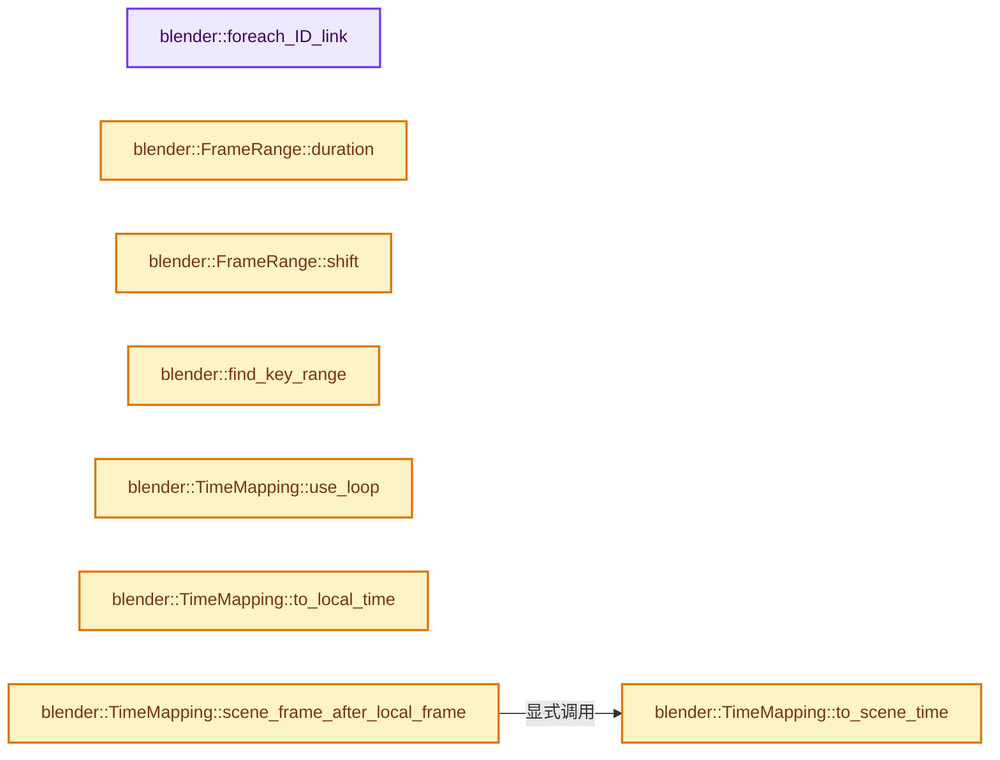
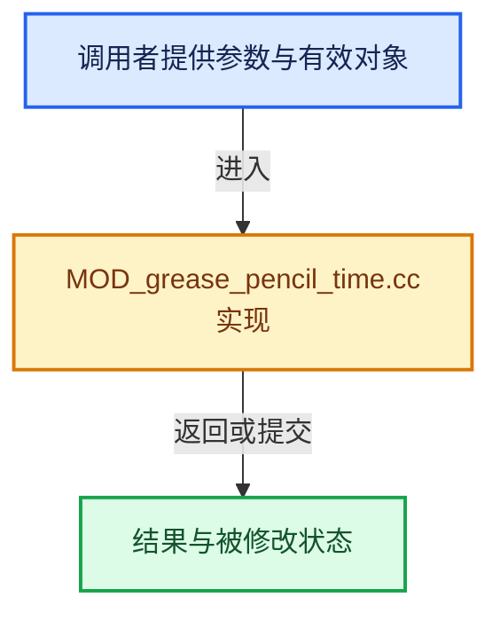

# 实现依赖专题：source/blender/modifiers/intern/MOD_grease_pencil_time.cc

[实现依赖导航](../../../README.md) · [符号索引](../../../../00-课程指南/02-源码与提交索引/符号依赖与实现索引.md)

本专题从正文实际调用进入，集中保存共享实现。函数有稳定锚点，可从调用处直接跳到对应完整函数；递归与互相调用通过回链组织。

## 本文件的实现关系






## 完整成员与函数实现

<a id="f-52431ba120508393"></a>

### `blender::foreach_ID_link`

实现位置：[source/blender/modifiers/intern/MOD_grease_pencil_time.cc](../../../../../../../../source/blender/modifiers/intern/MOD_grease_pencil_time.cc) · L81—L85。

接口参数：

- `ModifierData *md`
- `Object *ob`
- `IDWalkFunc walk`
- `void *user_data`

**教学注释版**

<!-- annotated:bbefb4add5c912 -->

```cpp
static void foreach_ID_link(ModifierData *md, Object *ob, IDWalkFunc walk, void *user_data)
{
  auto *tmd = reinterpret_cast<GreasePencilTimeModifierData *>(md);
  modifier::greasepencil::foreach_influence_ID_link(&tmd->influence, ob, walk, user_data);
}
```

<details>
<summary>核对原始源码：source/blender/modifiers/intern/MOD_grease_pencil_time.cc · L81—L85</summary>

<!-- original:bbefb4add5c912:source/blender/modifiers/intern/MOD_grease_pencil_time.cc:81:85 -->

```cpp
static void foreach_ID_link(ModifierData *md, Object *ob, IDWalkFunc walk, void *user_data)
{
  auto *tmd = reinterpret_cast<GreasePencilTimeModifierData *>(md);
  modifier::greasepencil::foreach_influence_ID_link(&tmd->influence, ob, walk, user_data);
}
```

</details>

**继续追踪实现**

- `modifier::greasepencil::foreach_influence_ID_link` → [blender::modifier::greasepencil::foreach_influence_ID_link · L69](MOD_grease_pencil_util.cc.md#f-247ba56fa4c4e56f)。

<a id="f-d0035cda51e9efa0"></a>

### `blender::FrameRange::duration`

实现位置：[source/blender/modifiers/intern/MOD_grease_pencil_time.cc](../../../../../../../../source/blender/modifiers/intern/MOD_grease_pencil_time.cc) · L103—L106。

**教学注释版**

<!-- annotated:580c6369f11f3a -->

```cpp
  int duration() const
  {
    // [讲解] std::max：按比较关系选取较大值。本讲解中的增长公式同时满足最低请求和几何增长；若保存返回引用，还需注意实参寿命。
    return std::max(efra + 1 - sfra, 0);
  }
```

<details>
<summary>核对原始源码：source/blender/modifiers/intern/MOD_grease_pencil_time.cc · L103—L106</summary>

<!-- original:580c6369f11f3a:source/blender/modifiers/intern/MOD_grease_pencil_time.cc:103:106 -->

```cpp
  int duration() const
  {
    return std::max(efra + 1 - sfra, 0);
  }
```

</details>

**结果出口**

- `return std::max(efra + 1 - sfra, 0);`

**继续追踪实现**

- `std::max` → [外部契约](https://eel.is/c++draft/alg.min.max)：按比较关系选取较大值。本讲解中的增长公式同时满足最低请求和几何增长；若保存返回引用，还需注意实参寿命。

<a id="f-471e3c3ca52460a4"></a>

### `blender::FrameRange::shift`

实现位置：[source/blender/modifiers/intern/MOD_grease_pencil_time.cc](../../../../../../../../source/blender/modifiers/intern/MOD_grease_pencil_time.cc) · L120—L123。

接口参数：

- `const int n`

**教学注释版**

<!-- annotated:3c2d60f7019f01 -->

```cpp
  FrameRange shift(const int n) const
  {
    return FrameRange{sfra + n, efra + n};
  }
```

<details>
<summary>核对原始源码：source/blender/modifiers/intern/MOD_grease_pencil_time.cc · L120—L123</summary>

<!-- original:3c2d60f7019f01:source/blender/modifiers/intern/MOD_grease_pencil_time.cc:120:123 -->

```cpp
  FrameRange shift(const int n) const
  {
    return FrameRange{sfra + n, efra + n};
  }
```

</details>

**结果出口**

- `return FrameRange{sfra + n, efra + n};`

**继续追踪实现**

本实现没有需要继续展开的显式调用；检查返回表达式、对象转换和调用者前置条件。

<a id="f-39cccfa5245a2d46"></a>

### `blender::find_key_range`

实现位置：[source/blender/modifiers/intern/MOD_grease_pencil_time.cc](../../../../../../../../source/blender/modifiers/intern/MOD_grease_pencil_time.cc) · L131—L150。

接口参数：

- `const Span<int> sorted_keys`
- `const FrameRange &frame_range`

**教学注释版**

<!-- annotated:3cd262a4fe396f -->

```cpp
static IndexRange find_key_range(const Span<int> sorted_keys, const FrameRange &frame_range)
{
  // [讲解] sorted_keys.index_range：查询视图长度或生成对应有效索引区间。
  IndexRange result = sorted_keys.index_range();
  for (const int i : result.index_range()) {
    // [讲解] result.size：读取连续区间或分组的边界信息。
    const int irev = result.size() - 1 - i;
    if (sorted_keys[result[irev]] <= frame_range.sfra) {
      /* Found first key affecting the frame range, drop any earlier keys. */
      result = result.drop_front(irev);
      break;
    }
  }
  for (const int i : result.index_range()) {
    if (sorted_keys[result[i]] > frame_range.efra) {
      /* Found first key outside the frame range, drop this and later keys. */
      result = result.take_front(i);
      break;
    }
  }
  return result;
}
```

<details>
<summary>核对原始源码：source/blender/modifiers/intern/MOD_grease_pencil_time.cc · L131—L150</summary>

<!-- original:3cd262a4fe396f:source/blender/modifiers/intern/MOD_grease_pencil_time.cc:131:150 -->

```cpp
static IndexRange find_key_range(const Span<int> sorted_keys, const FrameRange &frame_range)
{
  IndexRange result = sorted_keys.index_range();
  for (const int i : result.index_range()) {
    const int irev = result.size() - 1 - i;
    if (sorted_keys[result[irev]] <= frame_range.sfra) {
      /* Found first key affecting the frame range, drop any earlier keys. */
      result = result.drop_front(irev);
      break;
    }
  }
  for (const int i : result.index_range()) {
    if (sorted_keys[result[i]] > frame_range.efra) {
      /* Found first key outside the frame range, drop this and later keys. */
      result = result.take_front(i);
      break;
    }
  }
  return result;
}
```

</details>

**沿实际写入检查状态**

- `result = result.drop_front(irev);`
- `result = result.take_front(i);`

**结果出口**

- `return result;`

**继续追踪实现**

- `sorted_keys.index_range` → [blender::Span::index_range · L405](../../../../01-基础容器与现代CPP/05-Span只读连续视图.md#f-caaa9b06e13e53e0)。
- `result.index_range` → [blender::IndexRange::index_range · L161](../../../../01-基础容器与现代CPP/04-IndexRange连续整数区间.md#f-fd83072b4b81bce5)。
- `result.size` → [blender::IndexRange::size · L156](../../../../01-基础容器与现代CPP/04-IndexRange连续整数区间.md#f-05f66c3ebb2fdfec)。
- `result.drop_front` → [blender::IndexRange::drop_front · L306](../../../../01-基础容器与现代CPP/04-IndexRange连续整数区间.md#f-ef3101407d982c90)。
- `result.take_front` → [blender::IndexRange::take_front · L328](../../../../01-基础容器与现代CPP/04-IndexRange连续整数区间.md#f-63ad1817cc7169c5)。

<a id="f-b6c13bc2fa52906a"></a>

### `blender::TimeMapping::use_loop`

实现位置：[source/blender/modifiers/intern/MOD_grease_pencil_time.cc](../../../../../../../../source/blender/modifiers/intern/MOD_grease_pencil_time.cc) · L174—L177。

**教学注释版**

<!-- annotated:f920c8365505b2 -->

```cpp
  bool use_loop() const
  {
    return use_loop_;
  }
```

<details>
<summary>核对原始源码：source/blender/modifiers/intern/MOD_grease_pencil_time.cc · L174—L177</summary>

<!-- original:f920c8365505b2:source/blender/modifiers/intern/MOD_grease_pencil_time.cc:174:177 -->

```cpp
  bool use_loop() const
  {
    return use_loop_;
  }
```

</details>

**结果出口**

- `return use_loop_;`

**继续追踪实现**

本实现没有需要继续展开的显式调用；检查返回表达式、对象转换和调用者前置条件。

<a id="f-d30a86d83d366609"></a>

### `blender::TimeMapping::to_scene_time`

实现位置：[source/blender/modifiers/intern/MOD_grease_pencil_time.cc](../../../../../../../../source/blender/modifiers/intern/MOD_grease_pencil_time.cc) · L179—L182。

接口参数：

- `const float local_frame`

**教学注释版**

<!-- annotated:e97011b260f85d -->

```cpp
  float to_scene_time(const float local_frame) const
  {
    return float(local_frame - offset_) / scale_;
  }
```

<details>
<summary>核对原始源码：source/blender/modifiers/intern/MOD_grease_pencil_time.cc · L179—L182</summary>

<!-- original:e97011b260f85d:source/blender/modifiers/intern/MOD_grease_pencil_time.cc:179:182 -->

```cpp
  float to_scene_time(const float local_frame) const
  {
    return float(local_frame - offset_) / scale_;
  }
```

</details>

**结果出口**

- `return float(local_frame - offset_) / scale_;`

**继续追踪实现**

本实现没有需要继续展开的显式调用；检查返回表达式、对象转换和调用者前置条件。

<a id="f-37c1579b28bf0783"></a>

### `blender::TimeMapping::to_local_time`

实现位置：[source/blender/modifiers/intern/MOD_grease_pencil_time.cc](../../../../../../../../source/blender/modifiers/intern/MOD_grease_pencil_time.cc) · L183—L186。

接口参数：

- `const float scene_frame`

**教学注释版**

<!-- annotated:1b84035545ef1a -->

```cpp
  float to_local_time(const float scene_frame) const
  {
    return scene_frame * scale_ + offset_;
  }
```

<details>
<summary>核对原始源码：source/blender/modifiers/intern/MOD_grease_pencil_time.cc · L183—L186</summary>

<!-- original:1b84035545ef1a:source/blender/modifiers/intern/MOD_grease_pencil_time.cc:183:186 -->

```cpp
  float to_local_time(const float scene_frame) const
  {
    return scene_frame * scale_ + offset_;
  }
```

</details>

**结果出口**

- `return scene_frame * scale_ + offset_;`

**继续追踪实现**

本实现没有需要继续展开的显式调用；检查返回表达式、对象转换和调用者前置条件。

<a id="f-dba9eb35a748c6e3"></a>

### `blender::TimeMapping::scene_frame_after_local_frame`

实现位置：[source/blender/modifiers/intern/MOD_grease_pencil_time.cc](../../../../../../../../source/blender/modifiers/intern/MOD_grease_pencil_time.cc) · L194—L197。

接口参数：

- `const int local_frame`

**教学注释版**

<!-- annotated:b5a8b139c53fc9 -->

```cpp
  int scene_frame_after_local_frame(const int local_frame) const
  {
    return int(math::ceil(to_scene_time(local_frame)));
  }
```

<details>
<summary>核对原始源码：source/blender/modifiers/intern/MOD_grease_pencil_time.cc · L194—L197</summary>

<!-- original:b5a8b139c53fc9:source/blender/modifiers/intern/MOD_grease_pencil_time.cc:194:197 -->

```cpp
  int scene_frame_after_local_frame(const int local_frame) const
  {
    return int(math::ceil(to_scene_time(local_frame)));
  }
```

</details>

**结果出口**

- `return int(math::ceil(to_scene_time(local_frame)));`

**继续追踪实现**

- `math::ceil` → [外部契约](https://eel.is/c++draft/)：这个边界按实际表达式及所属类型核对参数、返回值、寿命与失败行为。这里提供接口入口，不声称已解释该第三方版本的内部实现。
- `to_scene_time` → [blender::TimeMapping::to_scene_time · L179](MOD_grease_pencil_time.cc.md#f-d30a86d83d366609)。

<a id="f-aec561811744fa5a"></a>

### `blender::TimeMapping::local_frame_before_scene_frame`

实现位置：[source/blender/modifiers/intern/MOD_grease_pencil_time.cc](../../../../../../../../source/blender/modifiers/intern/MOD_grease_pencil_time.cc) · L200—L203。

接口参数：

- `const int scene_frame`

**教学注释版**

<!-- annotated:53f755c954c4eb -->

```cpp
  int local_frame_before_scene_frame(const int scene_frame) const
  {
    return int(math::floor(to_local_time(scene_frame)));
  }
```

<details>
<summary>核对原始源码：source/blender/modifiers/intern/MOD_grease_pencil_time.cc · L200—L203</summary>

<!-- original:53f755c954c4eb:source/blender/modifiers/intern/MOD_grease_pencil_time.cc:200:203 -->

```cpp
  int local_frame_before_scene_frame(const int scene_frame) const
  {
    return int(math::floor(to_local_time(scene_frame)));
  }
```

</details>

**结果出口**

- `return int(math::floor(to_local_time(scene_frame)));`

**继续追踪实现**

- `math::floor` → [外部契约](https://eel.is/c++draft/)：这个边界按实际表达式及所属类型核对参数、返回值、寿命与失败行为。这里提供接口入口，不声称已解释该第三方版本的内部实现。
- `to_local_time` → [blender::TimeMapping::to_local_time · L183](MOD_grease_pencil_time.cc.md#f-37c1579b28bf0783)。

<a id="f-1d1beb641219d9e4"></a>

### `blender::TimeMapping::local_frame_after_scene_frame`

实现位置：[source/blender/modifiers/intern/MOD_grease_pencil_time.cc](../../../../../../../../source/blender/modifiers/intern/MOD_grease_pencil_time.cc) · L205—L208。

接口参数：

- `const int scene_frame`

**教学注释版**

<!-- annotated:7e380441a92ff1 -->

```cpp
  int local_frame_after_scene_frame(const int scene_frame) const
  {
    return int(math::ceil(to_local_time(scene_frame)));
  }
```

<details>
<summary>核对原始源码：source/blender/modifiers/intern/MOD_grease_pencil_time.cc · L205—L208</summary>

<!-- original:7e380441a92ff1:source/blender/modifiers/intern/MOD_grease_pencil_time.cc:205:208 -->

```cpp
  int local_frame_after_scene_frame(const int scene_frame) const
  {
    return int(math::ceil(to_local_time(scene_frame)));
  }
```

</details>

**结果出口**

- `return int(math::ceil(to_local_time(scene_frame)));`

**继续追踪实现**

- `math::ceil` → [外部契约](https://eel.is/c++draft/)：这个边界按实际表达式及所属类型核对参数、返回值、寿命与失败行为。这里提供接口入口，不声称已解释该第三方版本的内部实现。
- `to_local_time` → [blender::TimeMapping::to_local_time · L183](MOD_grease_pencil_time.cc.md#f-37c1579b28bf0783)。

<a id="f-8c626156d89000a1"></a>

### `blender::calculate_repetitions`

实现位置：[source/blender/modifiers/intern/MOD_grease_pencil_time.cc](../../../../../../../../source/blender/modifiers/intern/MOD_grease_pencil_time.cc) · L212—L233。

接口参数：

- `const TimeMapping &mapping`
- `const FrameRange &gp_src`
- `const FrameRange &scene_dst`
- `int &r_start`
- `int &r_count`

**教学注释版**

<!-- annotated:55356913211d6a -->

```cpp
static void calculate_repetitions(const TimeMapping &mapping,
                                  const FrameRange &gp_src,
                                  const FrameRange &scene_dst,
                                  int &r_start,
                                  int &r_count)
{
  if (!mapping.use_loop()) {
    r_start = 0;
    r_count = 1;
    return;
  }
  const int duration = gp_src.duration();
  if (duration <= 0) {
    r_start = 0;
    r_count = 0;
    return;
  }
  const FrameRange gp_dst = {mapping.local_frame_before_scene_frame(scene_dst.sfra),
                             mapping.local_frame_after_scene_frame(scene_dst.efra)};
  r_start = math::floor(float(gp_dst.sfra - gp_src.sfra) / float(duration));
  r_count = math::floor(float(gp_dst.efra - gp_src.sfra) / float(duration)) + 1 - r_start;
}
```

<details>
<summary>核对原始源码：source/blender/modifiers/intern/MOD_grease_pencil_time.cc · L212—L233</summary>

<!-- original:55356913211d6a:source/blender/modifiers/intern/MOD_grease_pencil_time.cc:212:233 -->

```cpp
static void calculate_repetitions(const TimeMapping &mapping,
                                  const FrameRange &gp_src,
                                  const FrameRange &scene_dst,
                                  int &r_start,
                                  int &r_count)
{
  if (!mapping.use_loop()) {
    r_start = 0;
    r_count = 1;
    return;
  }
  const int duration = gp_src.duration();
  if (duration <= 0) {
    r_start = 0;
    r_count = 0;
    return;
  }
  const FrameRange gp_dst = {mapping.local_frame_before_scene_frame(scene_dst.sfra),
                             mapping.local_frame_after_scene_frame(scene_dst.efra)};
  r_start = math::floor(float(gp_dst.sfra - gp_src.sfra) / float(duration));
  r_count = math::floor(float(gp_dst.efra - gp_src.sfra) / float(duration)) + 1 - r_start;
}
```

</details>

**沿实际写入检查状态**

- `r_start = 0;`
- `r_count = 1;`
- `r_count = 0;`
- `r_start = math::floor(float(gp_dst.sfra - gp_src.sfra) / float(duration));`
- `r_count = math::floor(float(gp_dst.efra - gp_src.sfra) / float(duration)) + 1 - r_start;`

**继续追踪实现**

- `mapping.use_loop` → [blender::TimeMapping::use_loop · L174](MOD_grease_pencil_time.cc.md#f-b6c13bc2fa52906a)。
- `gp_src.duration` → [blender::FrameRange::duration · L103](MOD_grease_pencil_time.cc.md#f-d0035cda51e9efa0)。
- `mapping.local_frame_before_scene_frame` → [blender::TimeMapping::local_frame_before_scene_frame · L200](MOD_grease_pencil_time.cc.md#f-aec561811744fa5a)。
- `mapping.local_frame_after_scene_frame` → [blender::TimeMapping::local_frame_after_scene_frame · L205](MOD_grease_pencil_time.cc.md#f-1d1beb641219d9e4)。
- `math::floor` → [外部契约](https://eel.is/c++draft/)：这个边界按实际表达式及所属类型核对参数、返回值、寿命与失败行为。这里提供接口入口，不声称已解释该第三方版本的内部实现。

<a id="f-d0bd5a6a707b9dc4"></a>

### `blender::insert_keys_forward`

实现位置：[source/blender/modifiers/intern/MOD_grease_pencil_time.cc](../../../../../../../../source/blender/modifiers/intern/MOD_grease_pencil_time.cc) · L235—L253。

接口参数：

- `const TimeMapping &mapping`
- `const Map<int, GreasePencilFrame> &frames`
- `const Span<int> sorted_keys`
- `const FrameRange gp_src_range`
- `const FrameRange gp_dst_range`
- `Map<int, GreasePencilFrame> &dst_frames`

**教学注释版**

<!-- annotated:ef6bc8f7de712b -->

```cpp
static void insert_keys_forward(const TimeMapping &mapping,
                                const Map<int, GreasePencilFrame> &frames,
                                const Span<int> sorted_keys,
                                const FrameRange gp_src_range,
                                const FrameRange gp_dst_range,
                                Map<int, GreasePencilFrame> &dst_frames)
{
  const int offset = gp_dst_range.sfra - gp_src_range.sfra;
  // [讲解] sorted_keys.index_range：查询视图长度或生成对应有效索引区间。
  for (const int i : sorted_keys.index_range()) {
    const int gp_key = sorted_keys[i];
    // [讲解] std::max：按比较关系选取较大值。本讲解中的增长公式同时满足最低请求和几何增长；若保存返回引用，还需注意实参寿命。
    const int gp_insert_key = std::max(gp_key, gp_src_range.sfra);
    if (gp_insert_key > gp_src_range.efra) {
      continue;
    }

    const int scene_key = mapping.scene_frame_after_local_frame(gp_insert_key + offset);
    // [讲解] frames.lookup：按键查找对应项。
    dst_frames.add_overwrite(scene_key, frames.lookup(gp_key));
  }
}
```

<details>
<summary>核对原始源码：source/blender/modifiers/intern/MOD_grease_pencil_time.cc · L235—L253</summary>

<!-- original:ef6bc8f7de712b:source/blender/modifiers/intern/MOD_grease_pencil_time.cc:235:253 -->

```cpp
static void insert_keys_forward(const TimeMapping &mapping,
                                const Map<int, GreasePencilFrame> &frames,
                                const Span<int> sorted_keys,
                                const FrameRange gp_src_range,
                                const FrameRange gp_dst_range,
                                Map<int, GreasePencilFrame> &dst_frames)
{
  const int offset = gp_dst_range.sfra - gp_src_range.sfra;
  for (const int i : sorted_keys.index_range()) {
    const int gp_key = sorted_keys[i];
    const int gp_insert_key = std::max(gp_key, gp_src_range.sfra);
    if (gp_insert_key > gp_src_range.efra) {
      continue;
    }

    const int scene_key = mapping.scene_frame_after_local_frame(gp_insert_key + offset);
    dst_frames.add_overwrite(scene_key, frames.lookup(gp_key));
  }
}
```

</details>

**继续追踪实现**

- `sorted_keys.index_range` → [blender::Span::index_range · L405](../../../../01-基础容器与现代CPP/05-Span只读连续视图.md#f-caaa9b06e13e53e0)。
- `std::max` → [外部契约](https://eel.is/c++draft/alg.min.max)：按比较关系选取较大值。本讲解中的增长公式同时满足最低请求和几何增长；若保存返回引用，还需注意实参寿命。
- `mapping.scene_frame_after_local_frame` → [blender::TimeMapping::scene_frame_after_local_frame · L194](MOD_grease_pencil_time.cc.md#f-dba9eb35a748c6e3)。
- `dst_frames.add_overwrite` → [blender::Map::add_overwrite · L325](../../../../02-哈希表与关联数据结构/04-Map查找与键访问.md#f-e340706c503570c8)；[blender::Map::add_overwrite · L329](../../../../02-哈希表与关联数据结构/04-Map查找与键访问.md#f-33b468b72fd66944)；[blender::Map::add_overwrite · L333](../../../../02-哈希表与关联数据结构/04-Map查找与键访问.md#f-d91cbf0ab4beeb7f)；[blender::Map::add_overwrite · L337](../../../../02-哈希表与关联数据结构/04-Map查找与键访问.md#f-7e2b93551ab3f253)。同名重载需按实参类型选择。
- `frames.lookup` → [blender::Map::lookup · L545](../../../../02-哈希表与关联数据结构/04-Map查找与键访问.md#f-f25ef95f1454656d)；[blender::Map::lookup · L549](../../../../02-哈希表与关联数据结构/04-Map查找与键访问.md#f-742f9454fa7ea4b9)。同名重载需按实参类型选择。

<a id="f-5ed700895b723c8f"></a>

### `blender::insert_keys_reverse`

实现位置：[source/blender/modifiers/intern/MOD_grease_pencil_time.cc](../../../../../../../../source/blender/modifiers/intern/MOD_grease_pencil_time.cc) · L256—L285。

接口参数：

- `const TimeMapping &mapping`
- `const Map<int, GreasePencilFrame> &frames`
- `const Span<int> sorted_keys`
- `const FrameRange gp_src_range`
- `const FrameRange gp_dst_range`
- `Map<int, GreasePencilFrame> &dst_frames`

**教学注释版**

<!-- annotated:e58f837aedddb5 -->

```cpp
static void insert_keys_reverse(const TimeMapping &mapping,
                                const Map<int, GreasePencilFrame> &frames,
                                const Span<int> sorted_keys,
                                const FrameRange gp_src_range,
                                const FrameRange gp_dst_range,
                                Map<int, GreasePencilFrame> &dst_frames)
{
  const int offset = gp_dst_range.sfra - gp_src_range.sfra;
  // [讲解] sorted_keys.index_range：查询视图长度或生成对应有效索引区间。
  for (const int i : sorted_keys.index_range()) {
    /* In reverse mode keys need to be inserted in reverse order to ensure "earlier" frames can
     * overwrite "later" frames. */
    // [讲解] sorted_keys.size：查询视图长度或生成对应有效索引区间。
    const int irev = sorted_keys.size() - 1 - i;
    /* This finds the correct scene frame starting at the end of the frame interval. */
    const int gp_key = sorted_keys[irev];
    /* The insertion scene time is the end of the keyframe interval instead of the start.
     * This is the frame after the end frame (efra) to cover the full extent of the end frame
     * interval. */
    const int gp_end_key = (irev < sorted_keys.size() - 1) ?
                               // [讲解] std::min：按比较关系选取较小值；截断范围时还需先满足非负和可表示范围，min本身不会证明边界安全。
                               std::min(sorted_keys[irev + 1], gp_src_range.efra + 1) :
                               gp_src_range.efra + 1;
    if (gp_end_key < gp_src_range.sfra) {
      return;
    }

    /* Reverse key frame inside the range. */
    const int gp_key_rev = gp_src_range.efra + 1 - (gp_end_key - gp_src_range.sfra);
    const int scene_key = mapping.scene_frame_after_local_frame(gp_key_rev + offset);
    // [讲解] frames.lookup：按键查找对应项。
    dst_frames.add_overwrite(scene_key, frames.lookup(gp_key));
  }
}
```

<details>
<summary>核对原始源码：source/blender/modifiers/intern/MOD_grease_pencil_time.cc · L256—L285</summary>

<!-- original:e58f837aedddb5:source/blender/modifiers/intern/MOD_grease_pencil_time.cc:256:285 -->

```cpp
static void insert_keys_reverse(const TimeMapping &mapping,
                                const Map<int, GreasePencilFrame> &frames,
                                const Span<int> sorted_keys,
                                const FrameRange gp_src_range,
                                const FrameRange gp_dst_range,
                                Map<int, GreasePencilFrame> &dst_frames)
{
  const int offset = gp_dst_range.sfra - gp_src_range.sfra;
  for (const int i : sorted_keys.index_range()) {
    /* In reverse mode keys need to be inserted in reverse order to ensure "earlier" frames can
     * overwrite "later" frames. */
    const int irev = sorted_keys.size() - 1 - i;
    /* This finds the correct scene frame starting at the end of the frame interval. */
    const int gp_key = sorted_keys[irev];
    /* The insertion scene time is the end of the keyframe interval instead of the start.
     * This is the frame after the end frame (efra) to cover the full extent of the end frame
     * interval. */
    const int gp_end_key = (irev < sorted_keys.size() - 1) ?
                               std::min(sorted_keys[irev + 1], gp_src_range.efra + 1) :
                               gp_src_range.efra + 1;
    if (gp_end_key < gp_src_range.sfra) {
      return;
    }

    /* Reverse key frame inside the range. */
    const int gp_key_rev = gp_src_range.efra + 1 - (gp_end_key - gp_src_range.sfra);
    const int scene_key = mapping.scene_frame_after_local_frame(gp_key_rev + offset);
    dst_frames.add_overwrite(scene_key, frames.lookup(gp_key));
  }
}
```

</details>

**继续追踪实现**

- `sorted_keys.index_range` → [blender::Span::index_range · L405](../../../../01-基础容器与现代CPP/05-Span只读连续视图.md#f-caaa9b06e13e53e0)。
- `sorted_keys.size` → [blender::Span::size · L256](../../../../01-基础容器与现代CPP/05-Span只读连续视图.md#f-5f80fa006089c998)。
- `std::min` → [外部契约](https://eel.is/c++draft/alg.min.max)：按比较关系选取较小值；截断范围时还需先满足非负和可表示范围，min本身不会证明边界安全。
- `mapping.scene_frame_after_local_frame` → [blender::TimeMapping::scene_frame_after_local_frame · L194](MOD_grease_pencil_time.cc.md#f-dba9eb35a748c6e3)。
- `dst_frames.add_overwrite` → [blender::Map::add_overwrite · L325](../../../../02-哈希表与关联数据结构/04-Map查找与键访问.md#f-e340706c503570c8)；[blender::Map::add_overwrite · L329](../../../../02-哈希表与关联数据结构/04-Map查找与键访问.md#f-33b468b72fd66944)；[blender::Map::add_overwrite · L333](../../../../02-哈希表与关联数据结构/04-Map查找与键访问.md#f-d91cbf0ab4beeb7f)；[blender::Map::add_overwrite · L337](../../../../02-哈希表与关联数据结构/04-Map查找与键访问.md#f-7e2b93551ab3f253)。同名重载需按实参类型选择。
- `frames.lookup` → [blender::Map::lookup · L545](../../../../02-哈希表与关联数据结构/04-Map查找与键访问.md#f-f25ef95f1454656d)；[blender::Map::lookup · L549](../../../../02-哈希表与关联数据结构/04-Map查找与键访问.md#f-742f9454fa7ea4b9)。同名重载需按实参类型选择。

<a id="f-48c8494c08d35162"></a>

### `blender::fill_scene_range_fixed`

实现位置：[source/blender/modifiers/intern/MOD_grease_pencil_time.cc](../../../../../../../../source/blender/modifiers/intern/MOD_grease_pencil_time.cc) · L287—L300。

接口参数：

- `const TimeMapping &mapping`
- `const Map<int, GreasePencilFrame> &frames`
- `const Span<int> sorted_keys`
- `const int gp_src_frame`
- `const FrameRange scene_dst_range`
- `Map<int, GreasePencilFrame> &dst_frames`

**教学注释版**

<!-- annotated:46a1bd3019218a -->

```cpp
static void fill_scene_range_fixed(const TimeMapping &mapping,
                                   const Map<int, GreasePencilFrame> &frames,
                                   const Span<int> sorted_keys,
                                   const int gp_src_frame,
                                   const FrameRange scene_dst_range,
                                   Map<int, GreasePencilFrame> &dst_frames)
{
  const FrameRange gp_src_range = {gp_src_frame, gp_src_frame};
  const FrameRange gp_dst_range = {mapping.local_frame_before_scene_frame(scene_dst_range.sfra),
                                   mapping.local_frame_after_scene_frame(scene_dst_range.efra)};

  // [讲解] sorted_keys.slice：建立原连续范围的子视图。
  const Span<int> src_keys = sorted_keys.slice(find_key_range(sorted_keys, gp_src_range));
  insert_keys_forward(mapping, frames, src_keys, gp_src_range, gp_dst_range, dst_frames);
}
```

<details>
<summary>核对原始源码：source/blender/modifiers/intern/MOD_grease_pencil_time.cc · L287—L300</summary>

<!-- original:46a1bd3019218a:source/blender/modifiers/intern/MOD_grease_pencil_time.cc:287:300 -->

```cpp
static void fill_scene_range_fixed(const TimeMapping &mapping,
                                   const Map<int, GreasePencilFrame> &frames,
                                   const Span<int> sorted_keys,
                                   const int gp_src_frame,
                                   const FrameRange scene_dst_range,
                                   Map<int, GreasePencilFrame> &dst_frames)
{
  const FrameRange gp_src_range = {gp_src_frame, gp_src_frame};
  const FrameRange gp_dst_range = {mapping.local_frame_before_scene_frame(scene_dst_range.sfra),
                                   mapping.local_frame_after_scene_frame(scene_dst_range.efra)};

  const Span<int> src_keys = sorted_keys.slice(find_key_range(sorted_keys, gp_src_range));
  insert_keys_forward(mapping, frames, src_keys, gp_src_range, gp_dst_range, dst_frames);
}
```

</details>

**继续追踪实现**

- `mapping.local_frame_before_scene_frame` → [blender::TimeMapping::local_frame_before_scene_frame · L200](MOD_grease_pencil_time.cc.md#f-aec561811744fa5a)。
- `mapping.local_frame_after_scene_frame` → [blender::TimeMapping::local_frame_after_scene_frame · L205](MOD_grease_pencil_time.cc.md#f-1d1beb641219d9e4)。
- `sorted_keys.slice` → [blender::Span::slice · L141](../../../../01-基础容器与现代CPP/05-Span只读连续视图.md#f-380a0e8fdcbd53cc)；[blender::Span::slice · L149](../../../../01-基础容器与现代CPP/05-Span只读连续视图.md#f-9b9c15e78dd54eec)。同名重载需按实参类型选择。
- `find_key_range` → [blender::find_key_range · L131](MOD_grease_pencil_time.cc.md#f-39cccfa5245a2d46)。
- `insert_keys_forward` → [blender::insert_keys_forward · L235](MOD_grease_pencil_time.cc.md#f-d0bd5a6a707b9dc4)。

<a id="f-19f460f723933381"></a>

### `blender::fill_scene_range_forward`

实现位置：[source/blender/modifiers/intern/MOD_grease_pencil_time.cc](../../../../../../../../source/blender/modifiers/intern/MOD_grease_pencil_time.cc) · L302—L318。

接口参数：

- `const TimeMapping &mapping`
- `const Map<int, GreasePencilFrame> &frames`
- `const Span<int> sorted_keys`
- `const FrameRange gp_src_range`
- `const FrameRange scene_dst_range`
- `Map<int, GreasePencilFrame> &dst_frames`

**教学注释版**

<!-- annotated:a194339f1dcfe3 -->

```cpp
static void fill_scene_range_forward(const TimeMapping &mapping,
                                     const Map<int, GreasePencilFrame> &frames,
                                     const Span<int> sorted_keys,
                                     const FrameRange gp_src_range,
                                     const FrameRange scene_dst_range,
                                     Map<int, GreasePencilFrame> &dst_frames)
{
  int repeat_start = 0, repeat_count = 1;
  calculate_repetitions(mapping, gp_src_range, scene_dst_range, repeat_start, repeat_count);

  // [讲解] sorted_keys.slice：建立原连续范围的子视图。
  const Span<int> src_keys = sorted_keys.slice(find_key_range(sorted_keys, gp_src_range));
  FrameRange gp_dst_range = gp_src_range.shift(repeat_start * gp_src_range.duration());
  for ([[maybe_unused]] const int repeat_i : IndexRange(repeat_count)) {
    insert_keys_forward(mapping, frames, src_keys, gp_src_range, gp_dst_range, dst_frames);
    gp_dst_range = gp_dst_range.shift(gp_src_range.duration());
  }
}
```

<details>
<summary>核对原始源码：source/blender/modifiers/intern/MOD_grease_pencil_time.cc · L302—L318</summary>

<!-- original:a194339f1dcfe3:source/blender/modifiers/intern/MOD_grease_pencil_time.cc:302:318 -->

```cpp
static void fill_scene_range_forward(const TimeMapping &mapping,
                                     const Map<int, GreasePencilFrame> &frames,
                                     const Span<int> sorted_keys,
                                     const FrameRange gp_src_range,
                                     const FrameRange scene_dst_range,
                                     Map<int, GreasePencilFrame> &dst_frames)
{
  int repeat_start = 0, repeat_count = 1;
  calculate_repetitions(mapping, gp_src_range, scene_dst_range, repeat_start, repeat_count);

  const Span<int> src_keys = sorted_keys.slice(find_key_range(sorted_keys, gp_src_range));
  FrameRange gp_dst_range = gp_src_range.shift(repeat_start * gp_src_range.duration());
  for ([[maybe_unused]] const int repeat_i : IndexRange(repeat_count)) {
    insert_keys_forward(mapping, frames, src_keys, gp_src_range, gp_dst_range, dst_frames);
    gp_dst_range = gp_dst_range.shift(gp_src_range.duration());
  }
}
```

</details>

**沿实际写入检查状态**

- `gp_dst_range = gp_dst_range.shift(gp_src_range.duration());`

**继续追踪实现**

- `calculate_repetitions` → [blender::calculate_repetitions · L212](MOD_grease_pencil_time.cc.md#f-8c626156d89000a1)。
- `sorted_keys.slice` → [blender::Span::slice · L141](../../../../01-基础容器与现代CPP/05-Span只读连续视图.md#f-380a0e8fdcbd53cc)；[blender::Span::slice · L149](../../../../01-基础容器与现代CPP/05-Span只读连续视图.md#f-9b9c15e78dd54eec)。同名重载需按实参类型选择。
- `find_key_range` → [blender::find_key_range · L131](MOD_grease_pencil_time.cc.md#f-39cccfa5245a2d46)。
- `gp_src_range.shift` → [blender::FrameRange::shift · L120](MOD_grease_pencil_time.cc.md#f-471e3c3ca52460a4)。
- `gp_src_range.duration` → [blender::FrameRange::duration · L103](MOD_grease_pencil_time.cc.md#f-d0035cda51e9efa0)。
- `IndexRange` → [blender::IndexRange](../../../01-BLI基础库/BLI_index_range.hh.md#t-caa3466d6776)；[blender::gpu::shader::parser::IndexRange](../../gpu/shader_tool/utils.hh.md#t-82d2bd4ea71c)；[blender::IndexRange](../../makesdna/DNA_node_types.h.md#t-0448cc889d39)。
- `insert_keys_forward` → [blender::insert_keys_forward · L235](MOD_grease_pencil_time.cc.md#f-d0bd5a6a707b9dc4)。
- `gp_dst_range.shift` → [blender::FrameRange::shift · L120](MOD_grease_pencil_time.cc.md#f-471e3c3ca52460a4)。

<a id="f-55ee30a41633c72b"></a>

### `blender::fill_scene_range_reverse`

实现位置：[source/blender/modifiers/intern/MOD_grease_pencil_time.cc](../../../../../../../../source/blender/modifiers/intern/MOD_grease_pencil_time.cc) · L320—L336。

接口参数：

- `const TimeMapping &mapping`
- `const Map<int, GreasePencilFrame> &frames`
- `const Span<int> sorted_keys`
- `const FrameRange gp_src_range`
- `const FrameRange scene_dst_range`
- `Map<int, GreasePencilFrame> &dst_frames`

**教学注释版**

<!-- annotated:80c8cec27ca2db -->

```cpp
static void fill_scene_range_reverse(const TimeMapping &mapping,
                                     const Map<int, GreasePencilFrame> &frames,
                                     const Span<int> sorted_keys,
                                     const FrameRange gp_src_range,
                                     const FrameRange scene_dst_range,
                                     Map<int, GreasePencilFrame> &dst_frames)
{
  int repeat_start = 0, repeat_count = 1;
  calculate_repetitions(mapping, gp_src_range, scene_dst_range, repeat_start, repeat_count);

  // [讲解] sorted_keys.slice：建立原连续范围的子视图。
  const Span<int> src_keys = sorted_keys.slice(find_key_range(sorted_keys, gp_src_range));
  FrameRange gp_dst_range = gp_src_range.shift(repeat_start * gp_src_range.duration());
  for ([[maybe_unused]] const int repeat_i : IndexRange(repeat_count)) {
    insert_keys_reverse(mapping, frames, src_keys, gp_src_range, gp_dst_range, dst_frames);
    gp_dst_range = gp_dst_range.shift(gp_src_range.duration());
  }
}
```

<details>
<summary>核对原始源码：source/blender/modifiers/intern/MOD_grease_pencil_time.cc · L320—L336</summary>

<!-- original:80c8cec27ca2db:source/blender/modifiers/intern/MOD_grease_pencil_time.cc:320:336 -->

```cpp
static void fill_scene_range_reverse(const TimeMapping &mapping,
                                     const Map<int, GreasePencilFrame> &frames,
                                     const Span<int> sorted_keys,
                                     const FrameRange gp_src_range,
                                     const FrameRange scene_dst_range,
                                     Map<int, GreasePencilFrame> &dst_frames)
{
  int repeat_start = 0, repeat_count = 1;
  calculate_repetitions(mapping, gp_src_range, scene_dst_range, repeat_start, repeat_count);

  const Span<int> src_keys = sorted_keys.slice(find_key_range(sorted_keys, gp_src_range));
  FrameRange gp_dst_range = gp_src_range.shift(repeat_start * gp_src_range.duration());
  for ([[maybe_unused]] const int repeat_i : IndexRange(repeat_count)) {
    insert_keys_reverse(mapping, frames, src_keys, gp_src_range, gp_dst_range, dst_frames);
    gp_dst_range = gp_dst_range.shift(gp_src_range.duration());
  }
}
```

</details>

**沿实际写入检查状态**

- `gp_dst_range = gp_dst_range.shift(gp_src_range.duration());`

**继续追踪实现**

- `calculate_repetitions` → [blender::calculate_repetitions · L212](MOD_grease_pencil_time.cc.md#f-8c626156d89000a1)。
- `sorted_keys.slice` → [blender::Span::slice · L141](../../../../01-基础容器与现代CPP/05-Span只读连续视图.md#f-380a0e8fdcbd53cc)；[blender::Span::slice · L149](../../../../01-基础容器与现代CPP/05-Span只读连续视图.md#f-9b9c15e78dd54eec)。同名重载需按实参类型选择。
- `find_key_range` → [blender::find_key_range · L131](MOD_grease_pencil_time.cc.md#f-39cccfa5245a2d46)。
- `gp_src_range.shift` → [blender::FrameRange::shift · L120](MOD_grease_pencil_time.cc.md#f-471e3c3ca52460a4)。
- `gp_src_range.duration` → [blender::FrameRange::duration · L103](MOD_grease_pencil_time.cc.md#f-d0035cda51e9efa0)。
- `IndexRange` → [blender::IndexRange](../../../01-BLI基础库/BLI_index_range.hh.md#t-caa3466d6776)；[blender::gpu::shader::parser::IndexRange](../../gpu/shader_tool/utils.hh.md#t-82d2bd4ea71c)；[blender::IndexRange](../../makesdna/DNA_node_types.h.md#t-0448cc889d39)。
- `insert_keys_reverse` → [blender::insert_keys_reverse · L256](MOD_grease_pencil_time.cc.md#f-5ed700895b723c8f)。
- `gp_dst_range.shift` → [blender::FrameRange::shift · L120](MOD_grease_pencil_time.cc.md#f-471e3c3ca52460a4)。

<a id="f-cde7006f767c00a7"></a>

### `blender::fill_scene_range_ping_pong`

实现位置：[source/blender/modifiers/intern/MOD_grease_pencil_time.cc](../../../../../../../../source/blender/modifiers/intern/MOD_grease_pencil_time.cc) · L338—L363。

接口参数：

- `const TimeMapping &mapping`
- `const Map<int, GreasePencilFrame> &frames`
- `const Span<int> sorted_keys`
- `const FrameRange gp_src_range`
- `const FrameRange scene_dst_range`
- `Map<int, GreasePencilFrame> &dst_frames`

**教学注释版**

<!-- annotated:1b4d96dfe69f81 -->

```cpp
static void fill_scene_range_ping_pong(const TimeMapping &mapping,
                                       const Map<int, GreasePencilFrame> &frames,
                                       const Span<int> sorted_keys,
                                       const FrameRange gp_src_range,
                                       const FrameRange scene_dst_range,
                                       Map<int, GreasePencilFrame> &dst_frames)
{
  /* Double interval for ping-pong mode, start and end frame only appear once. */
  const FrameRange gp_src_range_ping = {gp_src_range.sfra, gp_src_range.efra - 1};
  const FrameRange gp_src_range_pong = {gp_src_range.sfra + 1, gp_src_range.efra};
  const FrameRange gp_range_full = {gp_src_range.sfra,
                                    2 * gp_src_range.efra - gp_src_range.sfra - 1};
  int repeat_start = 0, repeat_count = 1;
  calculate_repetitions(mapping, gp_range_full, scene_dst_range, repeat_start, repeat_count);

  // [讲解] sorted_keys.slice：建立原连续范围的子视图。
  const Span<int> src_keys = sorted_keys.slice(find_key_range(sorted_keys, gp_src_range));
  FrameRange gp_dst_range = gp_src_range.shift(repeat_start * gp_range_full.duration());
  for ([[maybe_unused]] const int repeat_i : IndexRange(repeat_count)) {
    /* Ping. */
    insert_keys_forward(mapping, frames, src_keys, gp_src_range, gp_dst_range, dst_frames);
    gp_dst_range = gp_dst_range.shift(gp_src_range_ping.duration());
    /* Pong. */
    insert_keys_reverse(mapping, frames, src_keys, gp_src_range, gp_dst_range, dst_frames);
    gp_dst_range = gp_dst_range.shift(gp_src_range_pong.duration());
  }
}
```

<details>
<summary>核对原始源码：source/blender/modifiers/intern/MOD_grease_pencil_time.cc · L338—L363</summary>

<!-- original:1b4d96dfe69f81:source/blender/modifiers/intern/MOD_grease_pencil_time.cc:338:363 -->

```cpp
static void fill_scene_range_ping_pong(const TimeMapping &mapping,
                                       const Map<int, GreasePencilFrame> &frames,
                                       const Span<int> sorted_keys,
                                       const FrameRange gp_src_range,
                                       const FrameRange scene_dst_range,
                                       Map<int, GreasePencilFrame> &dst_frames)
{
  /* Double interval for ping-pong mode, start and end frame only appear once. */
  const FrameRange gp_src_range_ping = {gp_src_range.sfra, gp_src_range.efra - 1};
  const FrameRange gp_src_range_pong = {gp_src_range.sfra + 1, gp_src_range.efra};
  const FrameRange gp_range_full = {gp_src_range.sfra,
                                    2 * gp_src_range.efra - gp_src_range.sfra - 1};
  int repeat_start = 0, repeat_count = 1;
  calculate_repetitions(mapping, gp_range_full, scene_dst_range, repeat_start, repeat_count);

  const Span<int> src_keys = sorted_keys.slice(find_key_range(sorted_keys, gp_src_range));
  FrameRange gp_dst_range = gp_src_range.shift(repeat_start * gp_range_full.duration());
  for ([[maybe_unused]] const int repeat_i : IndexRange(repeat_count)) {
    /* Ping. */
    insert_keys_forward(mapping, frames, src_keys, gp_src_range, gp_dst_range, dst_frames);
    gp_dst_range = gp_dst_range.shift(gp_src_range_ping.duration());
    /* Pong. */
    insert_keys_reverse(mapping, frames, src_keys, gp_src_range, gp_dst_range, dst_frames);
    gp_dst_range = gp_dst_range.shift(gp_src_range_pong.duration());
  }
}
```

</details>

**沿实际写入检查状态**

- `gp_dst_range = gp_dst_range.shift(gp_src_range_ping.duration());`
- `gp_dst_range = gp_dst_range.shift(gp_src_range_pong.duration());`

**继续追踪实现**

- `calculate_repetitions` → [blender::calculate_repetitions · L212](MOD_grease_pencil_time.cc.md#f-8c626156d89000a1)。
- `sorted_keys.slice` → [blender::Span::slice · L141](../../../../01-基础容器与现代CPP/05-Span只读连续视图.md#f-380a0e8fdcbd53cc)；[blender::Span::slice · L149](../../../../01-基础容器与现代CPP/05-Span只读连续视图.md#f-9b9c15e78dd54eec)。同名重载需按实参类型选择。
- `find_key_range` → [blender::find_key_range · L131](MOD_grease_pencil_time.cc.md#f-39cccfa5245a2d46)。
- `gp_src_range.shift` → [blender::FrameRange::shift · L120](MOD_grease_pencil_time.cc.md#f-471e3c3ca52460a4)。
- `gp_range_full.duration` → [blender::FrameRange::duration · L103](MOD_grease_pencil_time.cc.md#f-d0035cda51e9efa0)。
- `IndexRange` → [blender::IndexRange](../../../01-BLI基础库/BLI_index_range.hh.md#t-caa3466d6776)；[blender::gpu::shader::parser::IndexRange](../../gpu/shader_tool/utils.hh.md#t-82d2bd4ea71c)；[blender::IndexRange](../../makesdna/DNA_node_types.h.md#t-0448cc889d39)。
- `insert_keys_forward` → [blender::insert_keys_forward · L235](MOD_grease_pencil_time.cc.md#f-d0bd5a6a707b9dc4)。
- `gp_dst_range.shift` → [blender::FrameRange::shift · L120](MOD_grease_pencil_time.cc.md#f-471e3c3ca52460a4)。
- `gp_src_range_ping.duration` → [blender::FrameRange::duration · L103](MOD_grease_pencil_time.cc.md#f-d0035cda51e9efa0)。
- `insert_keys_reverse` → [blender::insert_keys_reverse · L256](MOD_grease_pencil_time.cc.md#f-5ed700895b723c8f)。
- `gp_src_range_pong.duration` → [blender::FrameRange::duration · L103](MOD_grease_pencil_time.cc.md#f-d0035cda51e9efa0)。

<a id="f-cb66b96579d9da20"></a>

### `blender::fill_scene_range_chain`

实现位置：[source/blender/modifiers/intern/MOD_grease_pencil_time.cc](../../../../../../../../source/blender/modifiers/intern/MOD_grease_pencil_time.cc) · L365—L441。

接口参数：

- `const TimeMapping &mapping`
- `const Map<int, GreasePencilFrame> &frames`
- `const Span<int> sorted_keys`
- `const Span<GreasePencilTimeModifierSegment> segments`
- `const FrameRange gp_src_range`
- `const FrameRange scene_dst_range`
- `Map<int, GreasePencilFrame> &dst_frames`

**教学注释版**

<!-- annotated:ecc635f2546283 -->

```cpp
static void fill_scene_range_chain(const TimeMapping &mapping,
                                   const Map<int, GreasePencilFrame> &frames,
                                   const Span<int> sorted_keys,
                                   const Span<GreasePencilTimeModifierSegment> segments,
                                   const FrameRange gp_src_range,
                                   const FrameRange scene_dst_range,
                                   Map<int, GreasePencilFrame> &dst_frames)
{
  using Segment = GreasePencilTimeModifierSegment;

  // [讲解] segments.is_empty：查询视图长度或生成对应有效索引区间。
  if (segments.is_empty()) {
    return;
  }
  /* Segment settings tolerate start frame after end frame. */
  auto segment_base_range = [](const Segment &segment) {
    // [讲解] std::min：按比较关系选取较小值；截断范围时还需先满足非负和可表示范围，min本身不会证明边界安全。
    return FrameRange{std::min(segment.segment_start, segment.segment_end),
                      // [讲解] std::max：按比较关系选取较大值。本讲解中的增长公式同时满足最低请求和几何增长；若保存返回引用，还需注意实参寿命。
                      std::max(segment.segment_start, segment.segment_end)};
  };
  auto segment_full_range = [](const Segment &segment) {
    const FrameRange base_range = FrameRange{std::min(segment.segment_start, segment.segment_end),
                                             std::max(segment.segment_start, segment.segment_end)};
    const int base_duration = (segment.segment_mode == MOD_GREASE_PENCIL_TIME_SEG_MODE_PINGPONG ?
                                   base_range.duration() * 2 - 2 :
                                   base_range.duration());
    return FrameRange{base_range.sfra,
                      base_range.sfra + segment.segment_repeat * base_duration - 1};
  };
  /* Find src range by adding up all segments. */
  const FrameRange gp_range_full = [&]() {
    // [讲解] segments.first：按视图边界访问元素。
    int duration = segment_full_range(segments.first()).duration();
    // [讲解] segments.drop_front：从两端裁去或选取一定数量元素形成新视图。
    for (const Segment &segment : segments.drop_front(1)) {
      duration += segment_full_range(segment).duration();
    }
    /* Same start as the source range. */
    return FrameRange{gp_src_range.sfra, gp_src_range.sfra + duration - 1};
  }();
  int repeat_start = 0, repeat_count = 1;
  calculate_repetitions(mapping, gp_range_full, scene_dst_range, repeat_start, repeat_count);

  const Span<int> src_keys = sorted_keys;

  FrameRange gp_dst_range = gp_src_range.shift(repeat_start * gp_range_full.duration());
  for ([[maybe_unused]] const int repeat_i : IndexRange(repeat_count)) {
    for (const Segment &segment : segments) {
      const FrameRange segment_src_range = segment_base_range(segment);
      for ([[maybe_unused]] const int segment_repeat_i : IndexRange(segment.segment_repeat)) {
        switch (GreasePencilTimeModifierSegmentMode(segment.segment_mode)) {
          case MOD_GREASE_PENCIL_TIME_SEG_MODE_NORMAL:
            insert_keys_forward(
                mapping, frames, src_keys, segment_src_range, gp_dst_range, dst_frames);
            gp_dst_range = gp_dst_range.shift(segment_src_range.duration());
            break;
          case MOD_GREASE_PENCIL_TIME_SEG_MODE_REVERSE:
            insert_keys_reverse(
                mapping, frames, src_keys, segment_src_range, gp_dst_range, dst_frames);
            gp_dst_range = gp_dst_range.shift(segment_src_range.duration());
            break;
          case MOD_GREASE_PENCIL_TIME_SEG_MODE_PINGPONG: {
            /* Ping. */
            const FrameRange segment_src_range_ping = {segment_src_range.sfra,
                                                       segment_src_range.efra - 1};
            insert_keys_forward(
                mapping, frames, src_keys, segment_src_range_ping, gp_dst_range, dst_frames);
            gp_dst_range = gp_dst_range.shift(segment_src_range_ping.duration());
            /* Pong. */
            const FrameRange segment_src_range_pong = {segment_src_range.sfra + 1,
                                                       segment_src_range.efra};
            insert_keys_reverse(
                mapping, frames, src_keys, segment_src_range_pong, gp_dst_range, dst_frames);
            gp_dst_range = gp_dst_range.shift(segment_src_range_pong.duration());
            break;
          }
        }
      }
    }
  }
}
```

<details>
<summary>核对原始源码：source/blender/modifiers/intern/MOD_grease_pencil_time.cc · L365—L441</summary>

<!-- original:ecc635f2546283:source/blender/modifiers/intern/MOD_grease_pencil_time.cc:365:441 -->

```cpp
static void fill_scene_range_chain(const TimeMapping &mapping,
                                   const Map<int, GreasePencilFrame> &frames,
                                   const Span<int> sorted_keys,
                                   const Span<GreasePencilTimeModifierSegment> segments,
                                   const FrameRange gp_src_range,
                                   const FrameRange scene_dst_range,
                                   Map<int, GreasePencilFrame> &dst_frames)
{
  using Segment = GreasePencilTimeModifierSegment;

  if (segments.is_empty()) {
    return;
  }
  /* Segment settings tolerate start frame after end frame. */
  auto segment_base_range = [](const Segment &segment) {
    return FrameRange{std::min(segment.segment_start, segment.segment_end),
                      std::max(segment.segment_start, segment.segment_end)};
  };
  auto segment_full_range = [](const Segment &segment) {
    const FrameRange base_range = FrameRange{std::min(segment.segment_start, segment.segment_end),
                                             std::max(segment.segment_start, segment.segment_end)};
    const int base_duration = (segment.segment_mode == MOD_GREASE_PENCIL_TIME_SEG_MODE_PINGPONG ?
                                   base_range.duration() * 2 - 2 :
                                   base_range.duration());
    return FrameRange{base_range.sfra,
                      base_range.sfra + segment.segment_repeat * base_duration - 1};
  };
  /* Find src range by adding up all segments. */
  const FrameRange gp_range_full = [&]() {
    int duration = segment_full_range(segments.first()).duration();
    for (const Segment &segment : segments.drop_front(1)) {
      duration += segment_full_range(segment).duration();
    }
    /* Same start as the source range. */
    return FrameRange{gp_src_range.sfra, gp_src_range.sfra + duration - 1};
  }();
  int repeat_start = 0, repeat_count = 1;
  calculate_repetitions(mapping, gp_range_full, scene_dst_range, repeat_start, repeat_count);

  const Span<int> src_keys = sorted_keys;

  FrameRange gp_dst_range = gp_src_range.shift(repeat_start * gp_range_full.duration());
  for ([[maybe_unused]] const int repeat_i : IndexRange(repeat_count)) {
    for (const Segment &segment : segments) {
      const FrameRange segment_src_range = segment_base_range(segment);
      for ([[maybe_unused]] const int segment_repeat_i : IndexRange(segment.segment_repeat)) {
        switch (GreasePencilTimeModifierSegmentMode(segment.segment_mode)) {
          case MOD_GREASE_PENCIL_TIME_SEG_MODE_NORMAL:
            insert_keys_forward(
                mapping, frames, src_keys, segment_src_range, gp_dst_range, dst_frames);
            gp_dst_range = gp_dst_range.shift(segment_src_range.duration());
            break;
          case MOD_GREASE_PENCIL_TIME_SEG_MODE_REVERSE:
            insert_keys_reverse(
                mapping, frames, src_keys, segment_src_range, gp_dst_range, dst_frames);
            gp_dst_range = gp_dst_range.shift(segment_src_range.duration());
            break;
          case MOD_GREASE_PENCIL_TIME_SEG_MODE_PINGPONG: {
            /* Ping. */
            const FrameRange segment_src_range_ping = {segment_src_range.sfra,
                                                       segment_src_range.efra - 1};
            insert_keys_forward(
                mapping, frames, src_keys, segment_src_range_ping, gp_dst_range, dst_frames);
            gp_dst_range = gp_dst_range.shift(segment_src_range_ping.duration());
            /* Pong. */
            const FrameRange segment_src_range_pong = {segment_src_range.sfra + 1,
                                                       segment_src_range.efra};
            insert_keys_reverse(
                mapping, frames, src_keys, segment_src_range_pong, gp_dst_range, dst_frames);
            gp_dst_range = gp_dst_range.shift(segment_src_range_pong.duration());
            break;
          }
        }
      }
    }
  }
}
```

</details>

**沿实际写入检查状态**

- `duration += segment_full_range(segment).duration();`
- `gp_dst_range = gp_dst_range.shift(segment_src_range.duration());`
- `gp_dst_range = gp_dst_range.shift(segment_src_range_ping.duration());`
- `gp_dst_range = gp_dst_range.shift(segment_src_range_pong.duration());`

**结果出口**

- `return FrameRange{std::min(segment.segment_start, segment.segment_end),`
- `return FrameRange{base_range.sfra,`
- `return FrameRange{gp_src_range.sfra, gp_src_range.sfra + duration - 1};`

**继续追踪实现**

- `segments.is_empty` → [blender::Span::is_empty · L264](../../../../01-基础容器与现代CPP/05-Span只读连续视图.md#f-8cc1d7ba8feb50e6)。
- `std::min` → [外部契约](https://eel.is/c++draft/alg.min.max)：按比较关系选取较小值；截断范围时还需先满足非负和可表示范围，min本身不会证明边界安全。
- `std::max` → [外部契约](https://eel.is/c++draft/alg.min.max)：按比较关系选取较大值。本讲解中的增长公式同时满足最低请求和几何增长；若保存返回引用，还需注意实参寿命。
- `base_range.duration` → [blender::FrameRange::duration · L103](MOD_grease_pencil_time.cc.md#f-d0035cda51e9efa0)。
- `[&]() { int duration = segment_full_range(segments.first()).duration(); for (const Segment &segment : segments.drop_front(1)) { duration += segment_full_range(segment).duration();  …（完整表达式见本函数源码）` → [blender::() · L390](../../../01-BLI基础库/BLI_math_vector_types.hh.md#f-26f597afed18e002)。
- `segment_full_range(segments.first()).duration` → [调用协议](../../../../00-课程指南/01-路线与规范/模板宏与动态分派协议.md)：接收对象类型依赖auto、返回值或模板实例；不按同名猜测目标。调用位置L394。
- `segment_full_range` → [调用协议](../../../../00-课程指南/01-路线与规范/模板宏与动态分派协议.md)：局部可调用对象，须结合其初始化与捕获环境。调用位置L394。
- `segments.first` → [blender::Span::first · L319](../../../../01-基础容器与现代CPP/05-Span只读连续视图.md#f-d8c9bcc3e9757248)。
- `segments.drop_front` → [blender::Span::drop_front · L175](../../../../01-基础容器与现代CPP/05-Span只读连续视图.md#f-932897accbde3413)。
- `segment_full_range(segment).duration` → [调用协议](../../../../00-课程指南/01-路线与规范/模板宏与动态分派协议.md)：接收对象类型依赖auto、返回值或模板实例；不按同名猜测目标。调用位置L396。
- `calculate_repetitions` → [blender::calculate_repetitions · L212](MOD_grease_pencil_time.cc.md#f-8c626156d89000a1)。
- `gp_src_range.shift` → [blender::FrameRange::shift · L120](MOD_grease_pencil_time.cc.md#f-471e3c3ca52460a4)。
- `gp_range_full.duration` → [blender::FrameRange::duration · L103](MOD_grease_pencil_time.cc.md#f-d0035cda51e9efa0)。
- `IndexRange` → [blender::IndexRange](../../../01-BLI基础库/BLI_index_range.hh.md#t-caa3466d6776)；[blender::gpu::shader::parser::IndexRange](../../gpu/shader_tool/utils.hh.md#t-82d2bd4ea71c)；[blender::IndexRange](../../makesdna/DNA_node_types.h.md#t-0448cc889d39)。
- `segment_base_range` → [调用协议](../../../../00-课程指南/01-路线与规范/模板宏与动态分派协议.md)：局部可调用对象，须结合其初始化与捕获环境。调用位置L409。
- `GreasePencilTimeModifierSegmentMode` → [blender::GreasePencilTimeModifierSegmentMode](../../makesdna/DNA_modifier_types.h.md#t-96d14f7db807)。
- `insert_keys_forward` → [blender::insert_keys_forward · L235](MOD_grease_pencil_time.cc.md#f-d0bd5a6a707b9dc4)。
- `gp_dst_range.shift` → [blender::FrameRange::shift · L120](MOD_grease_pencil_time.cc.md#f-471e3c3ca52460a4)。
- `segment_src_range.duration` → [blender::FrameRange::duration · L103](MOD_grease_pencil_time.cc.md#f-d0035cda51e9efa0)。
- `insert_keys_reverse` → [blender::insert_keys_reverse · L256](MOD_grease_pencil_time.cc.md#f-5ed700895b723c8f)。
- `segment_src_range_ping.duration` → [blender::FrameRange::duration · L103](MOD_grease_pencil_time.cc.md#f-d0035cda51e9efa0)。
- `segment_src_range_pong.duration` → [blender::FrameRange::duration · L103](MOD_grease_pencil_time.cc.md#f-d0035cda51e9efa0)。

<a id="f-d72423fb2cfe4bbc"></a>

### `blender::fill_scene_timeline`

实现位置：[source/blender/modifiers/intern/MOD_grease_pencil_time.cc](../../../../../../../../source/blender/modifiers/intern/MOD_grease_pencil_time.cc) · L443—L478。

接口参数：

- `const GreasePencilTimeModifierData &tmd`
- `const Scene &eval_scene`
- `const Map<int, GreasePencilFrame> &frames`
- `const Span<int> sorted_keys`
- `const FrameRange scene_dst_range`
- `Map<int, GreasePencilFrame> &dst_frames`

**教学注释版**

<!-- annotated:204b5952de8778 -->

```cpp
static void fill_scene_timeline(const GreasePencilTimeModifierData &tmd,
                                const Scene &eval_scene,
                                const Map<int, GreasePencilFrame> &frames,
                                const Span<int> sorted_keys,
                                const FrameRange scene_dst_range,
                                Map<int, GreasePencilFrame> &dst_frames)
{
  const TimeMapping mapping(tmd);
  const auto mode = GreasePencilTimeModifierMode(tmd.mode);
  const bool use_custom_range = tmd.flag & MOD_GREASE_PENCIL_TIME_CUSTOM_RANGE;

  const FrameRange scene_range = FrameRange{eval_scene.r.sfra, eval_scene.r.efra};
  const FrameRange custom_range = use_custom_range ? FrameRange{tmd.sfra, tmd.efra} : scene_range;

  switch (mode) {
    case MOD_GREASE_PENCIL_TIME_MODE_NORMAL:
      fill_scene_range_forward(
          tmd, frames, sorted_keys, custom_range, scene_dst_range, dst_frames);
      break;
    case MOD_GREASE_PENCIL_TIME_MODE_REVERSE:
      fill_scene_range_reverse(
          tmd, frames, sorted_keys, custom_range, scene_dst_range, dst_frames);
      break;
    case MOD_GREASE_PENCIL_TIME_MODE_FIX:
      fill_scene_range_fixed(tmd, frames, sorted_keys, tmd.offset, scene_dst_range, dst_frames);
      break;
    case MOD_GREASE_PENCIL_TIME_MODE_PINGPONG:
      fill_scene_range_ping_pong(
          tmd, frames, sorted_keys, custom_range, scene_dst_range, dst_frames);
      break;
    case MOD_GREASE_PENCIL_TIME_MODE_CHAIN:
      fill_scene_range_chain(
          tmd, frames, sorted_keys, tmd.segments(), scene_range, scene_dst_range, dst_frames);
      break;
  }
}
```

<details>
<summary>核对原始源码：source/blender/modifiers/intern/MOD_grease_pencil_time.cc · L443—L478</summary>

<!-- original:204b5952de8778:source/blender/modifiers/intern/MOD_grease_pencil_time.cc:443:478 -->

```cpp
static void fill_scene_timeline(const GreasePencilTimeModifierData &tmd,
                                const Scene &eval_scene,
                                const Map<int, GreasePencilFrame> &frames,
                                const Span<int> sorted_keys,
                                const FrameRange scene_dst_range,
                                Map<int, GreasePencilFrame> &dst_frames)
{
  const TimeMapping mapping(tmd);
  const auto mode = GreasePencilTimeModifierMode(tmd.mode);
  const bool use_custom_range = tmd.flag & MOD_GREASE_PENCIL_TIME_CUSTOM_RANGE;

  const FrameRange scene_range = FrameRange{eval_scene.r.sfra, eval_scene.r.efra};
  const FrameRange custom_range = use_custom_range ? FrameRange{tmd.sfra, tmd.efra} : scene_range;

  switch (mode) {
    case MOD_GREASE_PENCIL_TIME_MODE_NORMAL:
      fill_scene_range_forward(
          tmd, frames, sorted_keys, custom_range, scene_dst_range, dst_frames);
      break;
    case MOD_GREASE_PENCIL_TIME_MODE_REVERSE:
      fill_scene_range_reverse(
          tmd, frames, sorted_keys, custom_range, scene_dst_range, dst_frames);
      break;
    case MOD_GREASE_PENCIL_TIME_MODE_FIX:
      fill_scene_range_fixed(tmd, frames, sorted_keys, tmd.offset, scene_dst_range, dst_frames);
      break;
    case MOD_GREASE_PENCIL_TIME_MODE_PINGPONG:
      fill_scene_range_ping_pong(
          tmd, frames, sorted_keys, custom_range, scene_dst_range, dst_frames);
      break;
    case MOD_GREASE_PENCIL_TIME_MODE_CHAIN:
      fill_scene_range_chain(
          tmd, frames, sorted_keys, tmd.segments(), scene_range, scene_dst_range, dst_frames);
      break;
  }
}
```

</details>

**继续追踪实现**

- `GreasePencilTimeModifierMode` → [blender::GreasePencilTimeModifierMode](../../makesdna/DNA_modifier_types.h.md#t-fdaa9685c4a8)。
- `fill_scene_range_forward` → [blender::fill_scene_range_forward · L302](MOD_grease_pencil_time.cc.md#f-19f460f723933381)。
- `fill_scene_range_reverse` → [blender::fill_scene_range_reverse · L320](MOD_grease_pencil_time.cc.md#f-55ee30a41633c72b)。
- `fill_scene_range_fixed` → [blender::fill_scene_range_fixed · L287](MOD_grease_pencil_time.cc.md#f-48c8494c08d35162)。
- `fill_scene_range_ping_pong` → [blender::fill_scene_range_ping_pong · L338](MOD_grease_pencil_time.cc.md#f-cde7006f767c00a7)。
- `fill_scene_range_chain` → [blender::fill_scene_range_chain · L365](MOD_grease_pencil_time.cc.md#f-cb66b96579d9da20)。
- `tmd.segments` → [blender::GreasePencilTimeModifierData::segments · L693](MOD_grease_pencil_time.cc.md#f-dc6459285e6ad112)；[blender::GreasePencilTimeModifierData::segments · L698](MOD_grease_pencil_time.cc.md#f-97aaaf10a3f55c47)。同名重载需按实参类型选择。

<a id="f-9ab3d6f606c2eab8"></a>

### `blender::modify_geometry_set`

实现位置：[source/blender/modifiers/intern/MOD_grease_pencil_time.cc](../../../../../../../../source/blender/modifiers/intern/MOD_grease_pencil_time.cc) · L480—L512。

接口参数：

- `ModifierData *md`
- `const ModifierEvalContext *ctx`
- `bke::GeometrySet *geometry_set`

**教学注释版**

<!-- annotated:ba4419ffbe0832 -->

```cpp
static void modify_geometry_set(ModifierData *md,
                                const ModifierEvalContext *ctx,
                                bke::GeometrySet *geometry_set)
{
  using bke::greasepencil::Drawing;
  using bke::greasepencil::Layer;

  auto *tmd = reinterpret_cast<GreasePencilTimeModifierData *>(md);
  const Scene *scene = DEG_get_evaluated_scene(ctx->depsgraph);
  /* Just include the current frame for now. The method can be applied to arbitrary ranges. */
  const FrameRange dst_keyframe_range = {scene->r.cfra, scene->r.cfra};

  if (!geometry_set->has_grease_pencil()) {
    return;
  }
  GreasePencil &grease_pencil = *geometry_set->get_grease_pencil_for_write();

  IndexMaskMemory mask_memory;
  const IndexMask layer_mask = modifier::greasepencil::get_filtered_layer_mask(
      grease_pencil, tmd->influence, mask_memory);

  const Span<Layer *> layers_for_write = grease_pencil.layers_for_write();
  layer_mask.foreach_index([&](const int64_t layer_i) {
    Layer &layer = *layers_for_write[layer_i];
    const Span<int> sorted_keys = layer.sorted_keys();
    const Map<int, GreasePencilFrame> &src_frames = layer.frames();

    Map<int, GreasePencilFrame> new_frames;
    fill_scene_timeline(*tmd, *scene, src_frames, sorted_keys, dst_keyframe_range, new_frames);
    // [讲解] std::move：把表达式转换成可供移动重载选择的值类别；不保证真的移动，不结束源对象寿命，对const值可能选择复制。
    layer.frames_for_write() = std::move(new_frames);
    layer.tag_frames_map_keys_changed();
  });
}
```

<details>
<summary>核对原始源码：source/blender/modifiers/intern/MOD_grease_pencil_time.cc · L480—L512</summary>

<!-- original:ba4419ffbe0832:source/blender/modifiers/intern/MOD_grease_pencil_time.cc:480:512 -->

```cpp
static void modify_geometry_set(ModifierData *md,
                                const ModifierEvalContext *ctx,
                                bke::GeometrySet *geometry_set)
{
  using bke::greasepencil::Drawing;
  using bke::greasepencil::Layer;

  auto *tmd = reinterpret_cast<GreasePencilTimeModifierData *>(md);
  const Scene *scene = DEG_get_evaluated_scene(ctx->depsgraph);
  /* Just include the current frame for now. The method can be applied to arbitrary ranges. */
  const FrameRange dst_keyframe_range = {scene->r.cfra, scene->r.cfra};

  if (!geometry_set->has_grease_pencil()) {
    return;
  }
  GreasePencil &grease_pencil = *geometry_set->get_grease_pencil_for_write();

  IndexMaskMemory mask_memory;
  const IndexMask layer_mask = modifier::greasepencil::get_filtered_layer_mask(
      grease_pencil, tmd->influence, mask_memory);

  const Span<Layer *> layers_for_write = grease_pencil.layers_for_write();
  layer_mask.foreach_index([&](const int64_t layer_i) {
    Layer &layer = *layers_for_write[layer_i];
    const Span<int> sorted_keys = layer.sorted_keys();
    const Map<int, GreasePencilFrame> &src_frames = layer.frames();

    Map<int, GreasePencilFrame> new_frames;
    fill_scene_timeline(*tmd, *scene, src_frames, sorted_keys, dst_keyframe_range, new_frames);
    layer.frames_for_write() = std::move(new_frames);
    layer.tag_frames_map_keys_changed();
  });
}
```

</details>

**继续追踪实现**

- `DEG_get_evaluated_scene` → [blender::DEG_get_evaluated_scene · L212](../../../06-Depsgraph依赖图/intern/depsgraph_query.cc.md#f-be7729d26a71d3fd)。
- `geometry_set->has_grease_pencil` → [blender::bke::GeometrySet::has_grease_pencil · L415](../../../../06-隐式共享与缓存系统/05-GeometrySet读写与复制.md#f-357bcb62da7a8afd)。
- `geometry_set->get_grease_pencil_for_write` → [blender::bke::GeometrySet::get_grease_pencil_for_write · L622](../../../../06-隐式共享与缓存系统/05-GeometrySet读写与复制.md#f-bfc5e891a352651b)。
- `modifier::greasepencil::get_filtered_layer_mask` → [blender::modifier::greasepencil::get_filtered_layer_mask · L213](MOD_grease_pencil_util.cc.md#f-6438bea51141f9db)；[blender::modifier::greasepencil::get_filtered_layer_mask · L268](MOD_grease_pencil_util.cc.md#f-e3d0f9748ecdf34b)。同名重载需按实参类型选择。
- `grease_pencil.layers_for_write` → [blender::GreasePencil::layers_for_write · L3989](../../../02-BKE几何与数据/intern/grease_pencil.cc.md#f-8d19d3f84ede61d5)。
- `layer_mask.foreach_index` → [blender::index_mask::IndexMask::foreach_index · L855](../../../../04-虚拟数组与索引选择/09-分段存储与遍历.md#f-cd6cd317e2e2812c)。
- `layer.sorted_keys` → [blender::bke::greasepencil::Layer::sorted_keys · L1741](../../../02-BKE几何与数据/intern/grease_pencil.cc.md#f-5e00c8774e32ca6c)。
- `layer.frames` → [blender::bke::greasepencil::Layer::frames · L1632](../../../02-BKE几何与数据/intern/grease_pencil.cc.md#f-b94ffd8cfd88ea17)。
- `fill_scene_timeline` → [blender::fill_scene_timeline · L443](MOD_grease_pencil_time.cc.md#f-d72423fb2cfe4bbc)。
- `layer.frames_for_write` → [blender::bke::greasepencil::Layer::frames_for_write · L1637](../../../02-BKE几何与数据/intern/grease_pencil.cc.md#f-78eb3377fc3cfac3)。
- `std::move` → [外部契约](https://eel.is/c++draft/utility.forward)：把表达式转换成可供移动重载选择的值类别；不保证真的移动，不结束源对象寿命，对const值可能选择复制。
- `layer.tag_frames_map_keys_changed` → [blender::bke::greasepencil::Layer::tag_frames_map_keys_changed · L1882](../../../02-BKE几何与数据/intern/grease_pencil.cc.md#f-ec86cae3d39be3f8)。

<a id="f-dc6459285e6ad112"></a>

### `blender::GreasePencilTimeModifierData::segments`

实现位置：[source/blender/modifiers/intern/MOD_grease_pencil_time.cc](../../../../../../../../source/blender/modifiers/intern/MOD_grease_pencil_time.cc) · L693—L696。

**教学注释版**

<!-- annotated:a71a848fe9d4c5 -->

```cpp
Span<GreasePencilTimeModifierSegment> GreasePencilTimeModifierData::segments() const
{
  return {this->segments_array, this->segments_num};
}
```

<details>
<summary>核对原始源码：source/blender/modifiers/intern/MOD_grease_pencil_time.cc · L693—L696</summary>

<!-- original:a71a848fe9d4c5:source/blender/modifiers/intern/MOD_grease_pencil_time.cc:693:696 -->

```cpp
Span<GreasePencilTimeModifierSegment> GreasePencilTimeModifierData::segments() const
{
  return {this->segments_array, this->segments_num};
}
```

</details>

**结果出口**

- `return {this->segments_array, this->segments_num};`

**继续追踪实现**

本实现没有需要继续展开的显式调用；检查返回表达式、对象转换和调用者前置条件。

<a id="f-97aaaf10a3f55c47"></a>

### `blender::GreasePencilTimeModifierData::segments`

实现位置：[source/blender/modifiers/intern/MOD_grease_pencil_time.cc](../../../../../../../../source/blender/modifiers/intern/MOD_grease_pencil_time.cc) · L698—L701。

**教学注释版**

<!-- annotated:8e82a80baca65c -->

```cpp
MutableSpan<GreasePencilTimeModifierSegment> GreasePencilTimeModifierData::segments()
{
  return {this->segments_array, this->segments_num};
}
```

<details>
<summary>核对原始源码：source/blender/modifiers/intern/MOD_grease_pencil_time.cc · L698—L701</summary>

<!-- original:8e82a80baca65c:source/blender/modifiers/intern/MOD_grease_pencil_time.cc:698:701 -->

```cpp
MutableSpan<GreasePencilTimeModifierSegment> GreasePencilTimeModifierData::segments()
{
  return {this->segments_array, this->segments_num};
}
```

</details>

**结果出口**

- `return {this->segments_array, this->segments_num};`

**继续追踪实现**

本实现没有需要继续展开的显式调用；检查返回表达式、对象转换和调用者前置条件。
