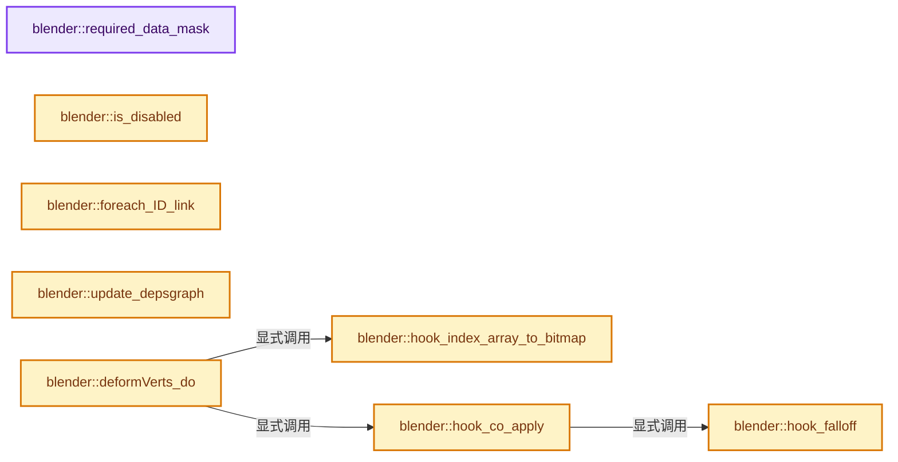
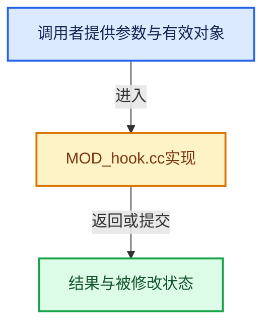

# 实现依赖专题：source/blender/modifiers/intern/MOD_hook.cc

[实现依赖导航](../../../README.md) · [符号索引](../../../../00-课程指南/02-源码与提交索引/符号依赖与实现索引.md)

本专题从正文实际调用进入，集中保存共享实现。函数有稳定锚点，可从调用处直接跳到对应完整函数；递归与互相调用通过回链组织。

## 本文件的实现关系






## 完整成员与函数实现

<a id="f-3e172b0909fc6b1f"></a>

### `blender::required_data_mask`

实现位置：[source/blender/modifiers/intern/MOD_hook.cc](../../../../../../../../source/blender/modifiers/intern/MOD_hook.cc) · L68—L82。

接口参数：

- `ModifierData *md`
- `CustomData_MeshMasks *r_cddata_masks`

**教学注释版**

<!-- annotated:2cc30259436db1 -->

```cpp
static void required_data_mask(ModifierData *md, CustomData_MeshMasks *r_cddata_masks)
{
  HookModifierData *hmd = reinterpret_cast<HookModifierData *>(md);

  /* Ask for vertex-groups if we need them. */
  if (hmd->name[0] != '\0') {
    r_cddata_masks->vmask |= CD_MASK_MDEFORMVERT;
  }
  if (hmd->indexar != nullptr) {
    /* TODO: check which origindex are actually needed? */
    r_cddata_masks->vmask |= CD_MASK_ORIGINDEX;
    r_cddata_masks->emask |= CD_MASK_ORIGINDEX;
    r_cddata_masks->pmask |= CD_MASK_ORIGINDEX;
  }
}
```

<details>
<summary>核对原始源码：source/blender/modifiers/intern/MOD_hook.cc · L68—L82</summary>

<!-- original:2cc30259436db1:source/blender/modifiers/intern/MOD_hook.cc:68:82 -->

```cpp
static void required_data_mask(ModifierData *md, CustomData_MeshMasks *r_cddata_masks)
{
  HookModifierData *hmd = reinterpret_cast<HookModifierData *>(md);

  /* Ask for vertex-groups if we need them. */
  if (hmd->name[0] != '\0') {
    r_cddata_masks->vmask |= CD_MASK_MDEFORMVERT;
  }
  if (hmd->indexar != nullptr) {
    /* TODO: check which origindex are actually needed? */
    r_cddata_masks->vmask |= CD_MASK_ORIGINDEX;
    r_cddata_masks->emask |= CD_MASK_ORIGINDEX;
    r_cddata_masks->pmask |= CD_MASK_ORIGINDEX;
  }
}
```

</details>

**沿实际写入检查状态**

- `r_cddata_masks->vmask |= CD_MASK_MDEFORMVERT;`
- `r_cddata_masks->vmask |= CD_MASK_ORIGINDEX;`
- `r_cddata_masks->emask |= CD_MASK_ORIGINDEX;`
- `r_cddata_masks->pmask |= CD_MASK_ORIGINDEX;`

**继续追踪实现**

本实现没有需要继续展开的显式调用；检查返回表达式、对象转换和调用者前置条件。

<a id="f-cba6a1c7b18865ae"></a>

### `blender::is_disabled`

实现位置：[source/blender/modifiers/intern/MOD_hook.cc](../../../../../../../../source/blender/modifiers/intern/MOD_hook.cc) · L93—L98。

接口参数：

- `const Scene *`
- `ModifierData *md`
- `bool`

**教学注释版**

<!-- annotated:9641bc6c6885b4 -->

```cpp
static bool is_disabled(const Scene * /*scene*/, ModifierData *md, bool /*use_render_params*/)
{
  HookModifierData *hmd = reinterpret_cast<HookModifierData *>(md);

  return !hmd->object;
}
```

<details>
<summary>核对原始源码：source/blender/modifiers/intern/MOD_hook.cc · L93—L98</summary>

<!-- original:9641bc6c6885b4:source/blender/modifiers/intern/MOD_hook.cc:93:98 -->

```cpp
static bool is_disabled(const Scene * /*scene*/, ModifierData *md, bool /*use_render_params*/)
{
  HookModifierData *hmd = reinterpret_cast<HookModifierData *>(md);

  return !hmd->object;
}
```

</details>

**结果出口**

- `return !hmd->object;`

**继续追踪实现**

本实现没有需要继续展开的显式调用；检查返回表达式、对象转换和调用者前置条件。

<a id="f-2a29f3a371afb5df"></a>

### `blender::foreach_ID_link`

实现位置：[source/blender/modifiers/intern/MOD_hook.cc](../../../../../../../../source/blender/modifiers/intern/MOD_hook.cc) · L100—L105。

接口参数：

- `ModifierData *md`
- `Object *ob`
- `IDWalkFunc walk`
- `void *user_data`

**教学注释版**

<!-- annotated:42981018aba461 -->

```cpp
static void foreach_ID_link(ModifierData *md, Object *ob, IDWalkFunc walk, void *user_data)
{
  HookModifierData *hmd = reinterpret_cast<HookModifierData *>(md);

  walk(user_data, ob, reinterpret_cast<ID **>(&hmd->object), IDWALK_CB_NOP);
}
```

<details>
<summary>核对原始源码：source/blender/modifiers/intern/MOD_hook.cc · L100—L105</summary>

<!-- original:42981018aba461:source/blender/modifiers/intern/MOD_hook.cc:100:105 -->

```cpp
static void foreach_ID_link(ModifierData *md, Object *ob, IDWalkFunc walk, void *user_data)
{
  HookModifierData *hmd = reinterpret_cast<HookModifierData *>(md);

  walk(user_data, ob, reinterpret_cast<ID **>(&hmd->object), IDWALK_CB_NOP);
}
```

</details>

**继续追踪实现**

- `walk` → [调用协议](../../../../00-课程指南/01-路线与规范/模板宏与动态分派协议.md)：局部可调用对象，须结合其初始化与捕获环境。调用位置L104。

<a id="f-280a1b6fda04e190"></a>

### `blender::update_depsgraph`

实现位置：[source/blender/modifiers/intern/MOD_hook.cc](../../../../../../../../source/blender/modifiers/intern/MOD_hook.cc) · L107—L119。

接口参数：

- `ModifierData *md`
- `const ModifierUpdateDepsgraphContext *ctx`

**教学注释版**

<!-- annotated:c8b70d6ba87c0e -->

```cpp
static void update_depsgraph(ModifierData *md, const ModifierUpdateDepsgraphContext *ctx)
{
  HookModifierData *hmd = reinterpret_cast<HookModifierData *>(md);
  if (hmd->object != nullptr) {
    if (hmd->subtarget[0]) {
      DEG_add_bone_relation(
          ctx->node, hmd->object, hmd->subtarget, DEG_OB_COMP_BONE, "Hook Modifier");
    }
    DEG_add_object_relation(ctx->node, hmd->object, DEG_OB_COMP_TRANSFORM, "Hook Modifier");
  }
  /* We need our own transformation as well. */
  DEG_add_depends_on_transform_relation(ctx->node, "Hook Modifier");
}
```

<details>
<summary>核对原始源码：source/blender/modifiers/intern/MOD_hook.cc · L107—L119</summary>

<!-- original:c8b70d6ba87c0e:source/blender/modifiers/intern/MOD_hook.cc:107:119 -->

```cpp
static void update_depsgraph(ModifierData *md, const ModifierUpdateDepsgraphContext *ctx)
{
  HookModifierData *hmd = reinterpret_cast<HookModifierData *>(md);
  if (hmd->object != nullptr) {
    if (hmd->subtarget[0]) {
      DEG_add_bone_relation(
          ctx->node, hmd->object, hmd->subtarget, DEG_OB_COMP_BONE, "Hook Modifier");
    }
    DEG_add_object_relation(ctx->node, hmd->object, DEG_OB_COMP_TRANSFORM, "Hook Modifier");
  }
  /* We need our own transformation as well. */
  DEG_add_depends_on_transform_relation(ctx->node, "Hook Modifier");
}
```

</details>

**继续追踪实现**

- `DEG_add_bone_relation` → [blender::DEG_add_bone_relation · L189](../../../06-Depsgraph依赖图/intern/depsgraph_build.cc.md#f-39e93b3cc8a9913c)。
- `DEG_add_object_relation` → [blender::DEG_add_object_relation · L123](../../../06-Depsgraph依赖图/intern/depsgraph_build.cc.md#f-f570cffae97e273c)。
- `DEG_add_depends_on_transform_relation` → [blender::DEG_add_depends_on_transform_relation · L240](../../../06-Depsgraph依赖图/intern/depsgraph_build.cc.md#f-47c32a354defa20d)。

<a id="f-95fc47bda9a3ffe1"></a>

### `blender::hook_index_array_to_bitmap`

实现位置：[source/blender/modifiers/intern/MOD_hook.cc](../../../../../../../../source/blender/modifiers/intern/MOD_hook.cc) · L148—L160。

接口参数：

- `HookModifierData *hmd`
- `const int verts_num`

**教学注释版**

<!-- annotated:29cea063a4b852 -->

```cpp
static BLI_bitmap *hook_index_array_to_bitmap(HookModifierData *hmd, const int verts_num)
{
  BLI_bitmap *indexar_used = BLI_BITMAP_NEW(verts_num, __func__);
  int i;
  int *index_pt;
  for (i = 0, index_pt = hmd->indexar; i < hmd->indexar_num; i++, index_pt++) {
    const int j = *index_pt;
    if (j < verts_num) {
      BLI_BITMAP_ENABLE(indexar_used, i);
    }
  }
  return indexar_used;
}
```

<details>
<summary>核对原始源码：source/blender/modifiers/intern/MOD_hook.cc · L148—L160</summary>

<!-- original:29cea063a4b852:source/blender/modifiers/intern/MOD_hook.cc:148:160 -->

```cpp
static BLI_bitmap *hook_index_array_to_bitmap(HookModifierData *hmd, const int verts_num)
{
  BLI_bitmap *indexar_used = BLI_BITMAP_NEW(verts_num, __func__);
  int i;
  int *index_pt;
  for (i = 0, index_pt = hmd->indexar; i < hmd->indexar_num; i++, index_pt++) {
    const int j = *index_pt;
    if (j < verts_num) {
      BLI_BITMAP_ENABLE(indexar_used, i);
    }
  }
  return indexar_used;
}
```

</details>

**结果出口**

- `return indexar_used;`

**继续追踪实现**

- `BLI_BITMAP_NEW` → [BLI_BITMAP_NEW · L39](../../../01-BLI基础库/BLI_bitmap.hh.md#m-77dce9cd8859)。宏定义由构建条件选择。
- `BLI_BITMAP_ENABLE` → [BLI_BITMAP_ENABLE · L80](../../../01-BLI基础库/BLI_bitmap.hh.md#m-6b0abc936749)。宏定义由构建条件选择。

<a id="f-82312c67373e14bd"></a>

### `blender::hook_falloff`

实现位置：[source/blender/modifiers/intern/MOD_hook.cc](../../../../../../../../source/blender/modifiers/intern/MOD_hook.cc) · L162—L226。

接口参数：

- `const HookData_cb *hd`
- `const float len_sq`

**教学注释版**

<!-- annotated:f8212ec992581e -->

```cpp
static float hook_falloff(const HookData_cb *hd, const float len_sq)
{
  BLI_assert(hd->falloff_sq);
  if (len_sq > hd->falloff_sq) {
    return 0.0f;
  }
  if (len_sq > 0.0f) {
    float fac;

    if (hd->falloff_type == eHook_Falloff_Const) {
      fac = 1.0f;
      goto finally;
    }
    else if (hd->falloff_type == eHook_Falloff_InvSquare) {
      /* Avoid `sqrt` below. */
      fac = 1.0f - (len_sq / hd->falloff_sq);
      goto finally;
    }

    fac = 1.0f - (sqrtf(len_sq) / hd->falloff);

    /* closely match PROP_SMOOTH and similar */
    switch (hd->falloff_type) {
#if 0
      case eHook_Falloff_None:
        fac = 1.0f;
        break;
#endif
      case eHook_Falloff_Curve:
        fac = BKE_curvemapping_evaluateF(hd->curfalloff, 0, fac);
        break;
      case eHook_Falloff_Sharp:
        fac = fac * fac;
        break;
      case eHook_Falloff_Smooth:
        fac = 3.0f * fac * fac - 2.0f * fac * fac * fac;
        break;
      case eHook_Falloff_Root:
        fac = sqrtf(fac);
        break;
      case eHook_Falloff_Linear:
        /* pass */
        break;
#if 0
      case eHook_Falloff_Const:
        fac = 1.0f;
        break;
#endif
      case eHook_Falloff_Sphere:
        fac = sqrtf(2 * fac - fac * fac);
        break;
#if 0
      case eHook_Falloff_InvSquare:
        fac = fac * (2.0f - fac);
        break;
#endif
    }

  finally:
    return fac * hd->fac_orig;
  }
  else {
    return hd->fac_orig;
  }
}
```

<details>
<summary>核对原始源码：source/blender/modifiers/intern/MOD_hook.cc · L162—L226</summary>

<!-- original:f8212ec992581e:source/blender/modifiers/intern/MOD_hook.cc:162:226 -->

```cpp
static float hook_falloff(const HookData_cb *hd, const float len_sq)
{
  BLI_assert(hd->falloff_sq);
  if (len_sq > hd->falloff_sq) {
    return 0.0f;
  }
  if (len_sq > 0.0f) {
    float fac;

    if (hd->falloff_type == eHook_Falloff_Const) {
      fac = 1.0f;
      goto finally;
    }
    else if (hd->falloff_type == eHook_Falloff_InvSquare) {
      /* Avoid `sqrt` below. */
      fac = 1.0f - (len_sq / hd->falloff_sq);
      goto finally;
    }

    fac = 1.0f - (sqrtf(len_sq) / hd->falloff);

    /* closely match PROP_SMOOTH and similar */
    switch (hd->falloff_type) {
#if 0
      case eHook_Falloff_None:
        fac = 1.0f;
        break;
#endif
      case eHook_Falloff_Curve:
        fac = BKE_curvemapping_evaluateF(hd->curfalloff, 0, fac);
        break;
      case eHook_Falloff_Sharp:
        fac = fac * fac;
        break;
      case eHook_Falloff_Smooth:
        fac = 3.0f * fac * fac - 2.0f * fac * fac * fac;
        break;
      case eHook_Falloff_Root:
        fac = sqrtf(fac);
        break;
      case eHook_Falloff_Linear:
        /* pass */
        break;
#if 0
      case eHook_Falloff_Const:
        fac = 1.0f;
        break;
#endif
      case eHook_Falloff_Sphere:
        fac = sqrtf(2 * fac - fac * fac);
        break;
#if 0
      case eHook_Falloff_InvSquare:
        fac = fac * (2.0f - fac);
        break;
#endif
    }

  finally:
    return fac * hd->fac_orig;
  }
  else {
    return hd->fac_orig;
  }
}
```

</details>

**沿实际写入检查状态**

- `fac = 1.0f;`
- `fac = 1.0f - (len_sq / hd->falloff_sq);`
- `fac = 1.0f - (sqrtf(len_sq) / hd->falloff);`
- `fac = BKE_curvemapping_evaluateF(hd->curfalloff, 0, fac);`
- `fac = fac * fac;`
- `fac = 3.0f * fac * fac - 2.0f * fac * fac * fac;`
- `fac = sqrtf(fac);`
- `fac = sqrtf(2 * fac - fac * fac);`
- `fac = fac * (2.0f - fac);`

**结果出口**

- `return 0.0f;`
- `return fac * hd->fac_orig;`
- `return hd->fac_orig;`

**继续追踪实现**

- `BLI_assert` → [BLI_assert · L48](../../../01-BLI基础库/BLI_assert.hh.md#m-57a88495704d)；[BLI_assert · L63](../../../01-BLI基础库/BLI_assert.hh.md#m-d07050020cb5)。宏定义由构建条件选择。
- `sqrtf` → [外部契约](https://eel.is/c++draft/)：这个边界按实际表达式及所属类型核对参数、返回值、寿命与失败行为。这里提供接口入口，不声称已解释该第三方版本的内部实现。
- `BKE_curvemapping_evaluateF` → [blender::BKE_curvemapping_evaluateF · L1177](../../../02-BKE几何与数据/intern/colortools.cc.md#f-014584e04eeb1392)。

<a id="f-a782f00b0f860934"></a>

### `blender::hook_co_apply`

实现位置：[source/blender/modifiers/intern/MOD_hook.cc](../../../../../../../../source/blender/modifiers/intern/MOD_hook.cc) · L228—L263。

接口参数：

- `HookData_cb *hd`
- `int j`
- `const MDeformVert *dv`

**教学注释版**

<!-- annotated:a1e5d77fa4138a -->

```cpp
static void hook_co_apply(HookData_cb *hd, int j, const MDeformVert *dv)
{
  float *co = hd->positions[j];
  float fac;

  if (hd->use_falloff) {
    float len_sq;

    if (hd->use_uniform) {
      float co_uniform[3];
      mul_v3_m3v3(co_uniform, hd->mat_uniform, co);
      len_sq = len_squared_v3v3(hd->cent, co_uniform);
    }
    else {
      len_sq = len_squared_v3v3(hd->cent, co);
    }

    fac = hook_falloff(hd, len_sq);
  }
  else {
    fac = hd->fac_orig;
  }

  if (fac) {
    if (dv != nullptr) {
      fac *= hd->invert_vgroup ? 1.0f - BKE_defvert_find_weight(dv, hd->defgrp_index) :
                                 BKE_defvert_find_weight(dv, hd->defgrp_index);
    }

    if (fac) {
      float co_tmp[3];
      mul_v3_m4v3(co_tmp, hd->mat, co);
      interp_v3_v3v3(co, co, co_tmp, fac);
    }
  }
}
```

<details>
<summary>核对原始源码：source/blender/modifiers/intern/MOD_hook.cc · L228—L263</summary>

<!-- original:a1e5d77fa4138a:source/blender/modifiers/intern/MOD_hook.cc:228:263 -->

```cpp
static void hook_co_apply(HookData_cb *hd, int j, const MDeformVert *dv)
{
  float *co = hd->positions[j];
  float fac;

  if (hd->use_falloff) {
    float len_sq;

    if (hd->use_uniform) {
      float co_uniform[3];
      mul_v3_m3v3(co_uniform, hd->mat_uniform, co);
      len_sq = len_squared_v3v3(hd->cent, co_uniform);
    }
    else {
      len_sq = len_squared_v3v3(hd->cent, co);
    }

    fac = hook_falloff(hd, len_sq);
  }
  else {
    fac = hd->fac_orig;
  }

  if (fac) {
    if (dv != nullptr) {
      fac *= hd->invert_vgroup ? 1.0f - BKE_defvert_find_weight(dv, hd->defgrp_index) :
                                 BKE_defvert_find_weight(dv, hd->defgrp_index);
    }

    if (fac) {
      float co_tmp[3];
      mul_v3_m4v3(co_tmp, hd->mat, co);
      interp_v3_v3v3(co, co, co_tmp, fac);
    }
  }
}
```

</details>

**沿实际写入检查状态**

- `len_sq = len_squared_v3v3(hd->cent, co_uniform);`
- `len_sq = len_squared_v3v3(hd->cent, co);`
- `fac = hook_falloff(hd, len_sq);`
- `fac = hd->fac_orig;`
- `fac *= hd->invert_vgroup ? 1.0f - BKE_defvert_find_weight(dv, hd->defgrp_index) :`

**继续追踪实现**

- `mul_v3_m3v3` → [blender::mul_v3_m3v3 · L824](../../../01-BLI基础库/intern/math_matrix_c.cc.md#f-4cc9cde9f14287de)。
- `len_squared_v3v3` → [blender::len_squared_v3v3 · L794](../../../01-BLI基础库/intern/math_vector_inline.cc.md#f-ae487ac3ef64aa87)。
- `hook_falloff` → [blender::hook_falloff · L162](MOD_hook.cc.md#f-82312c67373e14bd)。
- `BKE_defvert_find_weight` → [blender::BKE_defvert_find_weight · L779](../../../02-BKE几何与数据/intern/deform.cc.md#f-c117fcd05c4fd453)。
- `mul_v3_m4v3` → [blender::mul_v3_m4v3 · L687](../../../01-BLI基础库/intern/math_matrix_c.cc.md#f-31076c71c40783a8)。
- `interp_v3_v3v3` → [blender::interp_v3_v3v3 · L41](../../../01-BLI基础库/intern/math_vector.cc.md#f-18251c70c00824d7)。

<a id="f-01b87b192ebb1e56"></a>

### `blender::deformVerts_do`

实现位置：[source/blender/modifiers/intern/MOD_hook.cc](../../../../../../../../source/blender/modifiers/intern/MOD_hook.cc) · L265—L420。

接口参数：

- `HookModifierData *hmd`
- `const ModifierEvalContext *`
- `Object *ob`
- `Mesh *mesh`
- `const BMesh *bm`
- `MutableSpan<float3> positions`

**教学注释版**

<!-- annotated:01fca1847814cf -->

```cpp
static void deformVerts_do(HookModifierData *hmd,
                           const ModifierEvalContext * /*ctx*/,
                           Object *ob,
                           Mesh *mesh,
                           const BMesh *bm,
                           MutableSpan<float3> positions)
{
  Object *ob_target = hmd->object;
  bPoseChannel *pchan = BKE_pose_channel_find_name(ob_target->pose, hmd->subtarget);
  float dmat[4][4];
  int i, *index_pt;
  const MDeformVert *dvert;
  HookData_cb hd;
  const bool invert_vgroup = (hmd->flag & MOD_HOOK_INVERT_VGROUP) != 0;

  if (hmd->curfalloff == nullptr) {
    /* should never happen, but bad lib linking could cause it */
    hmd->curfalloff = BKE_curvemapping_add(1, 0.0f, 0.0f, 1.0f, 1.0f);
  }

  if (hmd->curfalloff) {
    BKE_curvemapping_init(hmd->curfalloff);
  }

  /* Generic data needed for applying per-vertex calculations (initialize all members) */
  hd.positions = positions;

  MOD_get_vgroup(ob, mesh, hmd->name, &dvert, &hd.defgrp_index);
  int cd_dvert_offset = -1;

  if (hd.defgrp_index != -1) {
    /* Edit-mesh. */
    if (bm != nullptr) {
      cd_dvert_offset = CustomData_get_offset(&bm->vdata, CD_MDEFORMVERT);
      if (cd_dvert_offset == -1) {
        hd.defgrp_index = -1;
      }
    }
    else {
      /* Regular mesh. */
      if (dvert == nullptr) {
        hd.defgrp_index = -1;
      }
    }
  }

  hd.curfalloff = hmd->curfalloff;

  hd.falloff_type = hmd->falloff_type;
  hd.falloff = (hmd->falloff_type == eHook_Falloff_None) ? 0.0f : hmd->falloff;
  hd.falloff_sq = square_f(hd.falloff);
  hd.fac_orig = hmd->force;

  hd.use_falloff = (hd.falloff_sq != 0.0f);
  hd.use_uniform = (hmd->flag & MOD_HOOK_UNIFORM_SPACE) != 0;

  hd.invert_vgroup = invert_vgroup;

  if (hd.use_uniform) {
    copy_m3_m4(hd.mat_uniform, hmd->parentinv);
    mul_v3_m3v3(hd.cent, hd.mat_uniform, hmd->cent);
  }
  else {
    unit_m3(hd.mat_uniform); /* unused */
    copy_v3_v3(hd.cent, hmd->cent);
  }

  /* get world-space matrix of target, corrected for the space the verts are in */
  if (hmd->subtarget[0] && pchan) {
    /* bone target if there's a matching pose-channel */
    mul_m4_m4m4(dmat, ob_target->object_to_world().ptr(), pchan->pose_mat);
  }
  else {
    /* just object target */
    copy_m4_m4(dmat, ob_target->object_to_world().ptr());
  }
  invert_m4_m4(ob->runtime->world_to_object.ptr(), ob->object_to_world().ptr());
  mul_m4_series(hd.mat, ob->world_to_object().ptr(), dmat, hmd->parentinv);
  /* --- done with 'hd' init --- */

  /* Regarding index range checking below.
   *
   * This should always be true and I don't generally like
   * "paranoid" style code like this, but old files can have
   * indices that are out of range because old blender did
   * not correct them on exit edit-mode. - zr
   */

  if (hmd->force == 0.0f) {
    /* do nothing, avoid annoying checks in the loop */
  }
  else if (hmd->indexar) { /* vertex indices? */
    const int *origindex_ar;
    /* if mesh is present and has original index data, use it */
    if (mesh && (origindex_ar = static_cast<const int *>(
                     CustomData_get_layer(&mesh->vert_data, CD_ORIGINDEX))))
    {
      // [讲解] positions.size：查询视图长度或生成对应有效索引区间。
      int verts_orig_num = positions.size();
      if (ob->type == OB_MESH) {
        const Mesh *me_orig = id_cast<const Mesh *>(ob->data);
        verts_orig_num = me_orig->verts_num;
      }
      BLI_bitmap *indexar_used = hook_index_array_to_bitmap(hmd, verts_orig_num);
      for (i = 0; i < positions.size(); i++) {
        int i_orig = origindex_ar[i];
        BLI_assert(i_orig < verts_orig_num);
        if (BLI_BITMAP_TEST(indexar_used, i_orig)) {
          hook_co_apply(&hd, i, dvert ? &dvert[i] : nullptr);
        }
      }
      MEM_delete(indexar_used);
    }
    else { /* missing mesh or ORIGINDEX */
      if ((bm != nullptr) && (hd.defgrp_index != -1)) {
        BLI_assert(bm->totvert == positions.size());
        BLI_bitmap *indexar_used = hook_index_array_to_bitmap(hmd, positions.size());
        BMIter iter;
        BMVert *v;
        BM_ITER_MESH_INDEX (v, &iter, const_cast<BMesh *>(bm), BM_VERTS_OF_MESH, i) {
          if (BLI_BITMAP_TEST(indexar_used, i)) {
            const MDeformVert *dv = static_cast<const MDeformVert *>(
                BM_ELEM_CD_GET_VOID_P(v, cd_dvert_offset));
            hook_co_apply(&hd, i, dv);
          }
        }
        MEM_delete(indexar_used);
      }
      else {
        for (i = 0, index_pt = hmd->indexar; i < hmd->indexar_num; i++, index_pt++) {
          const int j = *index_pt;
          if (j < positions.size()) {
            hook_co_apply(&hd, j, dvert ? &dvert[j] : nullptr);
          }
        }
      }
    }
  }
  else if (hd.defgrp_index != -1) { /* vertex group hook */
    if (bm != nullptr) {
      BLI_assert(bm->totvert == positions.size());
      BMIter iter;
      BMVert *v;
      BM_ITER_MESH_INDEX (v, &iter, const_cast<BMesh *>(bm), BM_VERTS_OF_MESH, i) {
        const MDeformVert *dv = static_cast<const MDeformVert *>(
            BM_ELEM_CD_GET_VOID_P(v, cd_dvert_offset));
        hook_co_apply(&hd, i, dv);
      }
    }
    else {
      BLI_assert(dvert != nullptr);
      for (i = 0; i < positions.size(); i++) {
        hook_co_apply(&hd, i, &dvert[i]);
      }
    }
  }
}
```

<details>
<summary>核对原始源码：source/blender/modifiers/intern/MOD_hook.cc · L265—L420</summary>

<!-- original:01fca1847814cf:source/blender/modifiers/intern/MOD_hook.cc:265:420 -->

```cpp
static void deformVerts_do(HookModifierData *hmd,
                           const ModifierEvalContext * /*ctx*/,
                           Object *ob,
                           Mesh *mesh,
                           const BMesh *bm,
                           MutableSpan<float3> positions)
{
  Object *ob_target = hmd->object;
  bPoseChannel *pchan = BKE_pose_channel_find_name(ob_target->pose, hmd->subtarget);
  float dmat[4][4];
  int i, *index_pt;
  const MDeformVert *dvert;
  HookData_cb hd;
  const bool invert_vgroup = (hmd->flag & MOD_HOOK_INVERT_VGROUP) != 0;

  if (hmd->curfalloff == nullptr) {
    /* should never happen, but bad lib linking could cause it */
    hmd->curfalloff = BKE_curvemapping_add(1, 0.0f, 0.0f, 1.0f, 1.0f);
  }

  if (hmd->curfalloff) {
    BKE_curvemapping_init(hmd->curfalloff);
  }

  /* Generic data needed for applying per-vertex calculations (initialize all members) */
  hd.positions = positions;

  MOD_get_vgroup(ob, mesh, hmd->name, &dvert, &hd.defgrp_index);
  int cd_dvert_offset = -1;

  if (hd.defgrp_index != -1) {
    /* Edit-mesh. */
    if (bm != nullptr) {
      cd_dvert_offset = CustomData_get_offset(&bm->vdata, CD_MDEFORMVERT);
      if (cd_dvert_offset == -1) {
        hd.defgrp_index = -1;
      }
    }
    else {
      /* Regular mesh. */
      if (dvert == nullptr) {
        hd.defgrp_index = -1;
      }
    }
  }

  hd.curfalloff = hmd->curfalloff;

  hd.falloff_type = hmd->falloff_type;
  hd.falloff = (hmd->falloff_type == eHook_Falloff_None) ? 0.0f : hmd->falloff;
  hd.falloff_sq = square_f(hd.falloff);
  hd.fac_orig = hmd->force;

  hd.use_falloff = (hd.falloff_sq != 0.0f);
  hd.use_uniform = (hmd->flag & MOD_HOOK_UNIFORM_SPACE) != 0;

  hd.invert_vgroup = invert_vgroup;

  if (hd.use_uniform) {
    copy_m3_m4(hd.mat_uniform, hmd->parentinv);
    mul_v3_m3v3(hd.cent, hd.mat_uniform, hmd->cent);
  }
  else {
    unit_m3(hd.mat_uniform); /* unused */
    copy_v3_v3(hd.cent, hmd->cent);
  }

  /* get world-space matrix of target, corrected for the space the verts are in */
  if (hmd->subtarget[0] && pchan) {
    /* bone target if there's a matching pose-channel */
    mul_m4_m4m4(dmat, ob_target->object_to_world().ptr(), pchan->pose_mat);
  }
  else {
    /* just object target */
    copy_m4_m4(dmat, ob_target->object_to_world().ptr());
  }
  invert_m4_m4(ob->runtime->world_to_object.ptr(), ob->object_to_world().ptr());
  mul_m4_series(hd.mat, ob->world_to_object().ptr(), dmat, hmd->parentinv);
  /* --- done with 'hd' init --- */

  /* Regarding index range checking below.
   *
   * This should always be true and I don't generally like
   * "paranoid" style code like this, but old files can have
   * indices that are out of range because old blender did
   * not correct them on exit edit-mode. - zr
   */

  if (hmd->force == 0.0f) {
    /* do nothing, avoid annoying checks in the loop */
  }
  else if (hmd->indexar) { /* vertex indices? */
    const int *origindex_ar;
    /* if mesh is present and has original index data, use it */
    if (mesh && (origindex_ar = static_cast<const int *>(
                     CustomData_get_layer(&mesh->vert_data, CD_ORIGINDEX))))
    {
      int verts_orig_num = positions.size();
      if (ob->type == OB_MESH) {
        const Mesh *me_orig = id_cast<const Mesh *>(ob->data);
        verts_orig_num = me_orig->verts_num;
      }
      BLI_bitmap *indexar_used = hook_index_array_to_bitmap(hmd, verts_orig_num);
      for (i = 0; i < positions.size(); i++) {
        int i_orig = origindex_ar[i];
        BLI_assert(i_orig < verts_orig_num);
        if (BLI_BITMAP_TEST(indexar_used, i_orig)) {
          hook_co_apply(&hd, i, dvert ? &dvert[i] : nullptr);
        }
      }
      MEM_delete(indexar_used);
    }
    else { /* missing mesh or ORIGINDEX */
      if ((bm != nullptr) && (hd.defgrp_index != -1)) {
        BLI_assert(bm->totvert == positions.size());
        BLI_bitmap *indexar_used = hook_index_array_to_bitmap(hmd, positions.size());
        BMIter iter;
        BMVert *v;
        BM_ITER_MESH_INDEX (v, &iter, const_cast<BMesh *>(bm), BM_VERTS_OF_MESH, i) {
          if (BLI_BITMAP_TEST(indexar_used, i)) {
            const MDeformVert *dv = static_cast<const MDeformVert *>(
                BM_ELEM_CD_GET_VOID_P(v, cd_dvert_offset));
            hook_co_apply(&hd, i, dv);
          }
        }
        MEM_delete(indexar_used);
      }
      else {
        for (i = 0, index_pt = hmd->indexar; i < hmd->indexar_num; i++, index_pt++) {
          const int j = *index_pt;
          if (j < positions.size()) {
            hook_co_apply(&hd, j, dvert ? &dvert[j] : nullptr);
          }
        }
      }
    }
  }
  else if (hd.defgrp_index != -1) { /* vertex group hook */
    if (bm != nullptr) {
      BLI_assert(bm->totvert == positions.size());
      BMIter iter;
      BMVert *v;
      BM_ITER_MESH_INDEX (v, &iter, const_cast<BMesh *>(bm), BM_VERTS_OF_MESH, i) {
        const MDeformVert *dv = static_cast<const MDeformVert *>(
            BM_ELEM_CD_GET_VOID_P(v, cd_dvert_offset));
        hook_co_apply(&hd, i, dv);
      }
    }
    else {
      BLI_assert(dvert != nullptr);
      for (i = 0; i < positions.size(); i++) {
        hook_co_apply(&hd, i, &dvert[i]);
      }
    }
  }
}
```

</details>

**沿实际写入检查状态**

- `hmd->curfalloff = BKE_curvemapping_add(1, 0.0f, 0.0f, 1.0f, 1.0f);`
- `hd.positions = positions;`
- `cd_dvert_offset = CustomData_get_offset(&bm->vdata, CD_MDEFORMVERT);`
- `hd.defgrp_index = -1;`
- `hd.curfalloff = hmd->curfalloff;`
- `hd.falloff_type = hmd->falloff_type;`
- `hd.falloff = (hmd->falloff_type == eHook_Falloff_None) ? 0.0f : hmd->falloff;`
- `hd.falloff_sq = square_f(hd.falloff);`
- `hd.fac_orig = hmd->force;`
- `hd.use_falloff = (hd.falloff_sq != 0.0f);`
- `hd.use_uniform = (hmd->flag & MOD_HOOK_UNIFORM_SPACE) != 0;`
- `hd.invert_vgroup = invert_vgroup;`
- `verts_orig_num = me_orig->verts_num;`

**继续追踪实现**

- `BKE_pose_channel_find_name` → [blender::BKE_pose_channel_find_name · L895](../../../02-BKE几何与数据/intern/action.cc.md#f-5997206551bfc9f9)。
- `BKE_curvemapping_add` → [blender::BKE_curvemapping_add · L99](../../../02-BKE几何与数据/intern/colortools.cc.md#f-5eb2107731235af2)。
- `BKE_curvemapping_init` → [blender::BKE_curvemapping_init · L1441](../../../02-BKE几何与数据/intern/colortools.cc.md#f-f7d75fd7ad2a5ee6)。
- `MOD_get_vgroup` → [blender::MOD_get_vgroup · L158](MOD_util.cc.md#f-f461611d86b94405)。
- `CustomData_get_offset` → [blender::CustomData_get_offset · L3379](../../../02-BKE几何与数据/intern/customdata.cc.md#f-e0e230c6120acc9a)。
- `square_f` → [blender::square_f · L302](../../../01-BLI基础库/intern/math_base_inline.cc.md#f-30f1dde493a37e0d)。
- `copy_m3_m4` → [blender::copy_m3_m4 · L94](../../../01-BLI基础库/intern/math_matrix_c.cc.md#f-1141cb3624c754b0)。
- `mul_v3_m3v3` → [blender::mul_v3_m3v3 · L824](../../../01-BLI基础库/intern/math_matrix_c.cc.md#f-4cc9cde9f14287de)。
- `unit_m3` → [blender::unit_m3 · L47](../../../01-BLI基础库/intern/math_matrix_c.cc.md#f-85e0073adca4ccff)。
- `copy_v3_v3` → [blender::copy_v3_v3 · L47](../../../01-BLI基础库/intern/math_vector_inline.cc.md#f-037a0d5fa5060bd6)。
- `mul_m4_m4m4` → [blender::mul_m4_m4m4 · L217](../../../01-BLI基础库/intern/math_matrix_c.cc.md#f-b5272136b543b73b)。
- `ob_target->object_to_world().ptr` → [调用协议](../../../../00-课程指南/01-路线与规范/模板宏与动态分派协议.md)：接收对象类型依赖auto、返回值或模板实例；不按同名猜测目标。调用位置L335。
- `ob_target->object_to_world` → [blender::Object::object_to_world · L5761](../../../02-BKE几何与数据/intern/object.cc.md#f-12fc20026327d50c)。
- `copy_m4_m4` → [blender::copy_m4_m4 · L84](../../../01-BLI基础库/intern/math_matrix_c.cc.md#f-b4390cf8c94710f5)。
- `invert_m4_m4` → [blender::invert_m4_m4 · L1150](../../../01-BLI基础库/intern/math_matrix_c.cc.md#f-c75789f10cdd5b92)。
- `ob->runtime->world_to_object.ptr` → [调用协议](../../../../00-课程指南/01-路线与规范/模板宏与动态分派协议.md)：接收对象类型依赖auto、返回值或模板实例；不按同名猜测目标。调用位置L341。
- `ob->object_to_world().ptr` → [调用协议](../../../../00-课程指南/01-路线与规范/模板宏与动态分派协议.md)：接收对象类型依赖auto、返回值或模板实例；不按同名猜测目标。调用位置L341。
- `ob->object_to_world` → [blender::Object::object_to_world · L5761](../../../02-BKE几何与数据/intern/object.cc.md#f-12fc20026327d50c)。
- `mul_m4_series` → [mul_m4_series · L175](../../../01-BLI基础库/BLI_math_matrix_c.hh.md#m-5c76fa91d8c7)。宏定义由构建条件选择。
- `ob->world_to_object().ptr` → [调用协议](../../../../00-课程指南/01-路线与规范/模板宏与动态分派协议.md)：接收对象类型依赖auto、返回值或模板实例；不按同名猜测目标。调用位置L342。
- `ob->world_to_object` → [blender::Object::world_to_object · L5766](../../../02-BKE几何与数据/intern/object.cc.md#f-dd4d8d55d6195233)。
- `CustomData_get_layer` → [blender::CustomData_get_layer · L3308](../../../02-BKE几何与数据/intern/customdata.cc.md#f-add1273f3ef3e57b)。
- `positions.size` → [blender::MutableSpan::size · L499](../../../../01-基础容器与现代CPP/06-MutableSpan可写视图.md#f-1de6a66839c304a8)；[blender::gpu::shader::parser::MutableSpan::size · L87](../../gpu/shader_tool/utils.hh.md#f-5e684af6ee7990e9)。同名重载需按实参类型选择。
- `id_cast<const Mesh *>` → [blender::id_cast · L1417](../../makesdna/DNA_ID.h.md#f-6c8ac6412850ac5a)。
- `hook_index_array_to_bitmap` → [blender::hook_index_array_to_bitmap · L148](MOD_hook.cc.md#f-95fc47bda9a3ffe1)。
- `BLI_assert` → [BLI_assert · L48](../../../01-BLI基础库/BLI_assert.hh.md#m-57a88495704d)；[BLI_assert · L63](../../../01-BLI基础库/BLI_assert.hh.md#m-d07050020cb5)。宏定义由构建条件选择。
- `BLI_BITMAP_TEST` → [BLI_BITMAP_TEST · L63](../../../01-BLI基础库/BLI_bitmap.hh.md#m-631c4702a77d)。宏定义由构建条件选择。
- `hook_co_apply` → [blender::hook_co_apply · L228](MOD_hook.cc.md#f-a782f00b0f860934)。
- `MEM_delete` → [MEM_delete · L400](../../../07-Intern运行时与平台/guardedalloc/MEM_guardedalloc.h.md#f-9049ffdd1682887c)。
- `BM_ITER_MESH_INDEX` → [BM_ITER_MESH_INDEX · L76](../../bmesh/intern/bmesh_iterators.hh.md#m-6a0cac4538f9)。宏定义由构建条件选择。
- `BM_ELEM_CD_GET_VOID_P` → [BM_ELEM_CD_GET_VOID_P · L610](../../bmesh/bmesh_class.hh.md#m-cdfe9f3023fa)；[BM_ELEM_CD_GET_VOID_P · L618](../../bmesh/bmesh_class.hh.md#m-126b1260772d)。宏定义由构建条件选择。

<a id="f-a8fb3eec0222e7e8"></a>

### `blender::deform_verts`

实现位置：[source/blender/modifiers/intern/MOD_hook.cc](../../../../../../../../source/blender/modifiers/intern/MOD_hook.cc) · L422—L429。

接口参数：

- `ModifierData *md`
- `const ModifierEvalContext *ctx`
- `Mesh *mesh`
- `MutableSpan<float3> positions`

**教学注释版**

<!-- annotated:bbcf1208d900ff -->

```cpp
static void deform_verts(ModifierData *md,
                         const ModifierEvalContext *ctx,
                         Mesh *mesh,
                         MutableSpan<float3> positions)
{
  HookModifierData *hmd = reinterpret_cast<HookModifierData *>(md);
  deformVerts_do(hmd, ctx, ctx->object, mesh, nullptr, positions);
}
```

<details>
<summary>核对原始源码：source/blender/modifiers/intern/MOD_hook.cc · L422—L429</summary>

<!-- original:bbcf1208d900ff:source/blender/modifiers/intern/MOD_hook.cc:422:429 -->

```cpp
static void deform_verts(ModifierData *md,
                         const ModifierEvalContext *ctx,
                         Mesh *mesh,
                         MutableSpan<float3> positions)
{
  HookModifierData *hmd = reinterpret_cast<HookModifierData *>(md);
  deformVerts_do(hmd, ctx, ctx->object, mesh, nullptr, positions);
}
```

</details>

**继续追踪实现**

- `deformVerts_do` → [blender::deformVerts_do · L265](MOD_hook.cc.md#f-01b87b192ebb1e56)。

<a id="f-b8ce3672786fba3f"></a>

### `blender::deform_verts_EM`

实现位置：[source/blender/modifiers/intern/MOD_hook.cc](../../../../../../../../source/blender/modifiers/intern/MOD_hook.cc) · L431—L447。

接口参数：

- `ModifierData *md`
- `const ModifierEvalContext *ctx`
- `const BMEditMesh *`
- `Mesh *mesh`
- `MutableSpan<float3> positions`

**教学注释版**

<!-- annotated:fe67ad36446a87 -->

```cpp
static void deform_verts_EM(ModifierData *md,
                            const ModifierEvalContext *ctx,
                            const BMEditMesh * /*em*/,
                            Mesh *mesh,
                            MutableSpan<float3> positions)
{
  HookModifierData *hmd = reinterpret_cast<HookModifierData *>(md);

  deformVerts_do(hmd,
                 ctx,
                 ctx->object,
                 mesh,
                 mesh->runtime->wrapper_type == ME_WRAPPER_TYPE_BMESH ?
                     BKE_editmesh_bmesh_get(mesh) :
                     nullptr,
                 positions);
}
```

<details>
<summary>核对原始源码：source/blender/modifiers/intern/MOD_hook.cc · L431—L447</summary>

<!-- original:fe67ad36446a87:source/blender/modifiers/intern/MOD_hook.cc:431:447 -->

```cpp
static void deform_verts_EM(ModifierData *md,
                            const ModifierEvalContext *ctx,
                            const BMEditMesh * /*em*/,
                            Mesh *mesh,
                            MutableSpan<float3> positions)
{
  HookModifierData *hmd = reinterpret_cast<HookModifierData *>(md);

  deformVerts_do(hmd,
                 ctx,
                 ctx->object,
                 mesh,
                 mesh->runtime->wrapper_type == ME_WRAPPER_TYPE_BMESH ?
                     BKE_editmesh_bmesh_get(mesh) :
                     nullptr,
                 positions);
}
```

</details>

**继续追踪实现**

- `deformVerts_do` → [blender::deformVerts_do · L265](MOD_hook.cc.md#f-01b87b192ebb1e56)。
- `BKE_editmesh_bmesh_get` → [blender::BKE_editmesh_bmesh_get · L65](../../../02-BKE几何与数据/intern/editmesh.cc.md#f-2afdd2773d3f0d88)；[blender::BKE_editmesh_bmesh_get · L71](../../../02-BKE几何与数据/intern/editmesh.cc.md#f-80631d704a7e9947)。同名重载需按实参类型选择。
