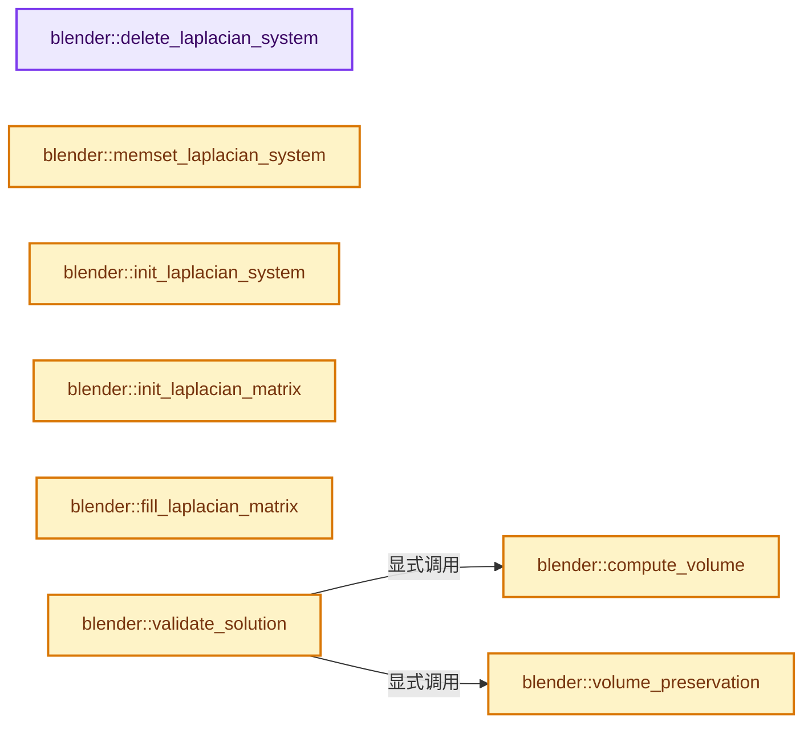
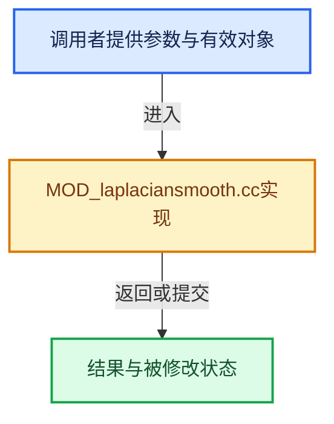

# 实现依赖专题：source/blender/modifiers/intern/MOD_laplaciansmooth.cc

[实现依赖导航](../../../README.md) · [符号索引](../../../../00-课程指南/02-源码与提交索引/符号依赖与实现索引.md)

本专题从正文实际调用进入，集中保存共享实现。函数有稳定锚点，可从调用处直接跳到对应完整函数；递归与互相调用通过回链组织。

## 本文件的实现关系






## 完整成员与函数实现

<a id="f-c99046f4aff0b0e2"></a>

### `blender::delete_laplacian_system`

实现位置：[source/blender/modifiers/intern/MOD_laplaciansmooth.cc](../../../../../../../../source/blender/modifiers/intern/MOD_laplaciansmooth.cc) · L63—L79。

接口参数：

- `LaplacianSystem *sys`

**教学注释版**

<!-- annotated:fc3079700d54d8 -->

```cpp
static void delete_laplacian_system(LaplacianSystem *sys)
{
  MEM_SAFE_DELETE(sys->eweights);
  MEM_SAFE_DELETE(sys->fweights);
  MEM_SAFE_DELETE(sys->ne_ed_num);
  MEM_SAFE_DELETE(sys->ne_fa_num);
  MEM_SAFE_DELETE(sys->ring_areas);
  MEM_SAFE_DELETE(sys->vlengths);
  MEM_SAFE_DELETE(sys->vweights);
  MEM_SAFE_DELETE(sys->zerola);

  if (sys->context) {
    EIG_linear_solver_delete(sys->context);
  }
  sys->vertexCos = nullptr;
  MEM_delete(sys);
}
```

<details>
<summary>核对原始源码：source/blender/modifiers/intern/MOD_laplaciansmooth.cc · L63—L79</summary>

<!-- original:fc3079700d54d8:source/blender/modifiers/intern/MOD_laplaciansmooth.cc:63:79 -->

```cpp
static void delete_laplacian_system(LaplacianSystem *sys)
{
  MEM_SAFE_DELETE(sys->eweights);
  MEM_SAFE_DELETE(sys->fweights);
  MEM_SAFE_DELETE(sys->ne_ed_num);
  MEM_SAFE_DELETE(sys->ne_fa_num);
  MEM_SAFE_DELETE(sys->ring_areas);
  MEM_SAFE_DELETE(sys->vlengths);
  MEM_SAFE_DELETE(sys->vweights);
  MEM_SAFE_DELETE(sys->zerola);

  if (sys->context) {
    EIG_linear_solver_delete(sys->context);
  }
  sys->vertexCos = nullptr;
  MEM_delete(sys);
}
```

</details>

**沿实际写入检查状态**

- `sys->vertexCos = nullptr;`

**继续追踪实现**

- `MEM_SAFE_DELETE` → [MEM_SAFE_DELETE · L436](../../../07-Intern运行时与平台/guardedalloc/MEM_guardedalloc.h.md#m-eadb3bc5b902)。宏定义由构建条件选择。
- `EIG_linear_solver_delete` → [EIG_linear_solver_delete · L114](../../../07-Intern运行时与平台/eigen/intern/linear_solver.cc.md#f-77ab65724c82635a)。
- `MEM_delete` → [MEM_delete · L400](../../../07-Intern运行时与平台/guardedalloc/MEM_guardedalloc.h.md#f-9049ffdd1682887c)。

<a id="f-e9309a02551316fa"></a>

### `blender::memset_laplacian_system`

实现位置：[source/blender/modifiers/intern/MOD_laplaciansmooth.cc](../../../../../../../../source/blender/modifiers/intern/MOD_laplaciansmooth.cc) · L81—L91。

接口参数：

- `LaplacianSystem *sys`
- `int val`

**教学注释版**

<!-- annotated:387aae3e88fa36 -->

```cpp
static void memset_laplacian_system(LaplacianSystem *sys, int val)
{
  // [讲解] memset：填充字节，不调用T构造函数，也不保证任意类型的全零表示是合法或期望值。
  memset(sys->eweights, val, sizeof(float) * sys->edges.size());
  memset(sys->fweights, val, sizeof(float[3]) * sys->corner_verts.size());
  memset(sys->ne_ed_num, val, sizeof(short) * sys->verts_num);
  memset(sys->ne_fa_num, val, sizeof(short) * sys->verts_num);
  memset(sys->ring_areas, val, sizeof(float) * sys->verts_num);
  memset(sys->vlengths, val, sizeof(float) * sys->verts_num);
  memset(sys->vweights, val, sizeof(float) * sys->verts_num);
  memset(sys->zerola, val, sizeof(bool) * sys->verts_num);
}
```

<details>
<summary>核对原始源码：source/blender/modifiers/intern/MOD_laplaciansmooth.cc · L81—L91</summary>

<!-- original:387aae3e88fa36:source/blender/modifiers/intern/MOD_laplaciansmooth.cc:81:91 -->

```cpp
static void memset_laplacian_system(LaplacianSystem *sys, int val)
{
  memset(sys->eweights, val, sizeof(float) * sys->edges.size());
  memset(sys->fweights, val, sizeof(float[3]) * sys->corner_verts.size());
  memset(sys->ne_ed_num, val, sizeof(short) * sys->verts_num);
  memset(sys->ne_fa_num, val, sizeof(short) * sys->verts_num);
  memset(sys->ring_areas, val, sizeof(float) * sys->verts_num);
  memset(sys->vlengths, val, sizeof(float) * sys->verts_num);
  memset(sys->vweights, val, sizeof(float) * sys->verts_num);
  memset(sys->zerola, val, sizeof(bool) * sys->verts_num);
}
```

</details>

**继续追踪实现**

- `memset` → [外部契约](https://eel.is/c++draft/cstring.syn)：填充字节，不调用T构造函数，也不保证任意类型的全零表示是合法或期望值。
- `sys->edges.size` → [调用协议](../../../../00-课程指南/01-路线与规范/模板宏与动态分派协议.md)：接收对象类型依赖auto、返回值或模板实例；不按同名猜测目标。调用位置L83。
- `sys->corner_verts.size` → [调用协议](../../../../00-课程指南/01-路线与规范/模板宏与动态分派协议.md)：接收对象类型依赖auto、返回值或模板实例；不按同名猜测目标。调用位置L84。

<a id="f-4f86b201b9650bb9"></a>

### `blender::init_laplacian_system`

实现位置：[source/blender/modifiers/intern/MOD_laplaciansmooth.cc](../../../../../../../../source/blender/modifiers/intern/MOD_laplaciansmooth.cc) · L93—L109。

接口参数：

- `int a_numEdges`
- `int a_numLoops`
- `int a_numVerts`

**教学注释版**

<!-- annotated:8e315b3d00f366 -->

```cpp
static LaplacianSystem *init_laplacian_system(int a_numEdges, int a_numLoops, int a_numVerts)
{
  LaplacianSystem *sys;
  sys = MEM_new<LaplacianSystem>(__func__);
  sys->verts_num = a_numVerts;

  sys->eweights = MEM_new_array_zeroed<float>(a_numEdges, __func__);
  sys->fweights = MEM_new_array_zeroed<float[3]>(a_numLoops, __func__);
  sys->ne_ed_num = MEM_new_array_zeroed<short>(sys->verts_num, __func__);
  sys->ne_fa_num = MEM_new_array_zeroed<short>(sys->verts_num, __func__);
  sys->ring_areas = MEM_new_array_zeroed<float>(sys->verts_num, __func__);
  sys->vlengths = MEM_new_array_zeroed<float>(sys->verts_num, __func__);
  sys->vweights = MEM_new_array_zeroed<float>(sys->verts_num, __func__);
  sys->zerola = MEM_new_array_zeroed<bool>(sys->verts_num, __func__);

  return sys;
}
```

<details>
<summary>核对原始源码：source/blender/modifiers/intern/MOD_laplaciansmooth.cc · L93—L109</summary>

<!-- original:8e315b3d00f366:source/blender/modifiers/intern/MOD_laplaciansmooth.cc:93:109 -->

```cpp
static LaplacianSystem *init_laplacian_system(int a_numEdges, int a_numLoops, int a_numVerts)
{
  LaplacianSystem *sys;
  sys = MEM_new<LaplacianSystem>(__func__);
  sys->verts_num = a_numVerts;

  sys->eweights = MEM_new_array_zeroed<float>(a_numEdges, __func__);
  sys->fweights = MEM_new_array_zeroed<float[3]>(a_numLoops, __func__);
  sys->ne_ed_num = MEM_new_array_zeroed<short>(sys->verts_num, __func__);
  sys->ne_fa_num = MEM_new_array_zeroed<short>(sys->verts_num, __func__);
  sys->ring_areas = MEM_new_array_zeroed<float>(sys->verts_num, __func__);
  sys->vlengths = MEM_new_array_zeroed<float>(sys->verts_num, __func__);
  sys->vweights = MEM_new_array_zeroed<float>(sys->verts_num, __func__);
  sys->zerola = MEM_new_array_zeroed<bool>(sys->verts_num, __func__);

  return sys;
}
```

</details>

**沿实际写入检查状态**

- `sys = MEM_new<LaplacianSystem>(__func__);`
- `sys->verts_num = a_numVerts;`
- `sys->eweights = MEM_new_array_zeroed<float>(a_numEdges, __func__);`
- `sys->fweights = MEM_new_array_zeroed<float[3]>(a_numLoops, __func__);`
- `sys->ne_ed_num = MEM_new_array_zeroed<short>(sys->verts_num, __func__);`
- `sys->ne_fa_num = MEM_new_array_zeroed<short>(sys->verts_num, __func__);`
- `sys->ring_areas = MEM_new_array_zeroed<float>(sys->verts_num, __func__);`
- `sys->vlengths = MEM_new_array_zeroed<float>(sys->verts_num, __func__);`
- `sys->vweights = MEM_new_array_zeroed<float>(sys->verts_num, __func__);`
- `sys->zerola = MEM_new_array_zeroed<bool>(sys->verts_num, __func__);`

**结果出口**

- `return sys;`

**继续追踪实现**

- `MEM_new<LaplacianSystem>` → [MEM_new · L351](../../../07-Intern运行时与平台/guardedalloc/MEM_guardedalloc.h.md#f-115f9b6784f89912)。
- `MEM_new_array_zeroed<float>` → [MEM_new_array_zeroed · L566](../../../07-Intern运行时与平台/guardedalloc/MEM_guardedalloc.h.md#f-3a0cf63fb5216500)；[MEM_new_array_zeroed · L119](../../../07-Intern运行时与平台/guardedalloc/intern/mallocn.cc.md#f-6825557da566fdbe)。同名重载需按实参类型选择。
- `MEM_new_array_zeroed<float[3]>` → [MEM_new_array_zeroed · L566](../../../07-Intern运行时与平台/guardedalloc/MEM_guardedalloc.h.md#f-3a0cf63fb5216500)；[MEM_new_array_zeroed · L119](../../../07-Intern运行时与平台/guardedalloc/intern/mallocn.cc.md#f-6825557da566fdbe)。同名重载需按实参类型选择。
- `MEM_new_array_zeroed<short>` → [MEM_new_array_zeroed · L566](../../../07-Intern运行时与平台/guardedalloc/MEM_guardedalloc.h.md#f-3a0cf63fb5216500)；[MEM_new_array_zeroed · L119](../../../07-Intern运行时与平台/guardedalloc/intern/mallocn.cc.md#f-6825557da566fdbe)。同名重载需按实参类型选择。
- `MEM_new_array_zeroed<bool>` → [MEM_new_array_zeroed · L566](../../../07-Intern运行时与平台/guardedalloc/MEM_guardedalloc.h.md#f-3a0cf63fb5216500)；[MEM_new_array_zeroed · L119](../../../07-Intern运行时与平台/guardedalloc/intern/mallocn.cc.md#f-6825557da566fdbe)。同名重载需按实参类型选择。

<a id="f-32e774908d324cca"></a>

### `blender::compute_volume`

实现位置：[source/blender/modifiers/intern/MOD_laplaciansmooth.cc](../../../../../../../../source/blender/modifiers/intern/MOD_laplaciansmooth.cc) · L111—L134。

接口参数：

- `const float center[3]`
- `float (*vertexCos)[3]`
- `const OffsetIndices<int> faces`
- `const Span<int> corner_verts`

**教学注释版**

<!-- annotated:eee1f2389367a6 -->

```cpp
static float compute_volume(const float center[3],
                            float (*vertexCos)[3],
                            const OffsetIndices<int> faces,
                            const Span<int> corner_verts)
{
  float vol = 0.0f;

  for (const int i : faces.index_range()) {
    const IndexRange face = faces[i];
    // [讲解] face.start：读取连续区间或分组的边界信息。
    int corner_first = face.start();
    int corner_prev = corner_first + 1;
    int corner_curr = corner_first + 2;
    // [讲解] face.size：读取连续区间或分组的边界信息。
    int corner_term = corner_first + face.size();

    for (; corner_curr != corner_term; corner_prev = corner_curr, corner_curr++) {
      vol += volume_tetrahedron_signed_v3(center,
                                          vertexCos[corner_verts[corner_first]],
                                          vertexCos[corner_verts[corner_prev]],
                                          vertexCos[corner_verts[corner_curr]]);
    }
  }

  return fabsf(vol);
}
```

<details>
<summary>核对原始源码：source/blender/modifiers/intern/MOD_laplaciansmooth.cc · L111—L134</summary>

<!-- original:eee1f2389367a6:source/blender/modifiers/intern/MOD_laplaciansmooth.cc:111:134 -->

```cpp
static float compute_volume(const float center[3],
                            float (*vertexCos)[3],
                            const OffsetIndices<int> faces,
                            const Span<int> corner_verts)
{
  float vol = 0.0f;

  for (const int i : faces.index_range()) {
    const IndexRange face = faces[i];
    int corner_first = face.start();
    int corner_prev = corner_first + 1;
    int corner_curr = corner_first + 2;
    int corner_term = corner_first + face.size();

    for (; corner_curr != corner_term; corner_prev = corner_curr, corner_curr++) {
      vol += volume_tetrahedron_signed_v3(center,
                                          vertexCos[corner_verts[corner_first]],
                                          vertexCos[corner_verts[corner_prev]],
                                          vertexCos[corner_verts[corner_curr]]);
    }
  }

  return fabsf(vol);
}
```

</details>

**沿实际写入检查状态**

- `vol += volume_tetrahedron_signed_v3(center,`

**结果出口**

- `return fabsf(vol);`

**继续追踪实现**

- `faces.index_range` → [blender::offset_indices::OffsetIndices::index_range · L77](../../../../05-几何存储与拓扑映射/02-OffsetIndices完整接口.md#f-19b5ca1456de007d)。
- `face.start` → [blender::IndexRange::start · L243](../../../../01-基础容器与现代CPP/04-IndexRange连续整数区间.md#f-99d2195bd9cfd1f0)。
- `face.size` → [blender::IndexRange::size · L156](../../../../01-基础容器与现代CPP/04-IndexRange连续整数区间.md#f-05f66c3ebb2fdfec)。
- `volume_tetrahedron_signed_v3` → [blender::volume_tetrahedron_signed_v3 · L263](../../../01-BLI基础库/intern/math_geom.cc.md#f-5a1dc4c818b121ca)。
- `fabsf` → [fabsf · L21](../../../07-Intern运行时与平台/cycles/kernel/svm/radial_tiling_shared.h.md#m-02cc4c69cfb3)；[fabsf · L43](../../../07-Intern运行时与平台/cycles/kernel/svm/radial_tiling_shared.h.md#m-04effe61803b)；[fabsf · L74](../../../07-Intern运行时与平台/cycles/kernel/svm/radial_tiling_shared.h.md#m-927dd4eba7dc)；[fabsf · L25](../../../01-BLI基础库/intern/radial_tiling_shared.hh.md#m-8348d6b3d08f)；[fabsf · L47](../../../01-BLI基础库/intern/radial_tiling_shared.hh.md#m-13b7e0b6d84f)；[fabsf · L78](../../../01-BLI基础库/intern/radial_tiling_shared.hh.md#m-326c83464a0d)；[fabsf · L21](../../../07-Intern运行时与平台/cycles/kernel/osl/shaders/node_radial_tiling_shared.h.md#m-7c3ee12fc119)；[fabsf · L43](../../../07-Intern运行时与平台/cycles/kernel/osl/shaders/node_radial_tiling_shared.h.md#m-9112db0e2dd1)；[fabsf · L74](../../../07-Intern运行时与平台/cycles/kernel/osl/shaders/node_radial_tiling_shared.h.md#m-ee4e61908a6f)；[fabsf · L167](../../../07-Intern运行时与平台/cycles/kernel/device/oneapi/compat.h.md#m-b039ee6c1601)；[fabsf · L265](../../../07-Intern运行时与平台/cycles/kernel/device/metal/compat.h.md#m-6b21869e9f3f)。宏定义由构建条件选择。

<a id="f-2109237bd0fb5b17"></a>

### `blender::volume_preservation`

实现位置：[source/blender/modifiers/intern/MOD_laplaciansmooth.cc](../../../../../../../../source/blender/modifiers/intern/MOD_laplaciansmooth.cc) · L136—L158。

接口参数：

- `LaplacianSystem *sys`
- `float vini`
- `float vend`
- `short flag`

**教学注释版**

<!-- annotated:44ffade0853e7a -->

```cpp
static void volume_preservation(LaplacianSystem *sys, float vini, float vend, short flag)
{
  float beta;
  int i;

  if (vend != 0.0f) {
    beta = pow(vini / vend, 1.0f / 3.0f);
    for (i = 0; i < sys->verts_num; i++) {
      if (flag & MOD_LAPLACIANSMOOTH_X) {
        sys->vertexCos[i][0] = (sys->vertexCos[i][0] - sys->vert_centroid[0]) * beta +
                               sys->vert_centroid[0];
      }
      if (flag & MOD_LAPLACIANSMOOTH_Y) {
        sys->vertexCos[i][1] = (sys->vertexCos[i][1] - sys->vert_centroid[1]) * beta +
                               sys->vert_centroid[1];
      }
      if (flag & MOD_LAPLACIANSMOOTH_Z) {
        sys->vertexCos[i][2] = (sys->vertexCos[i][2] - sys->vert_centroid[2]) * beta +
                               sys->vert_centroid[2];
      }
    }
  }
}
```

<details>
<summary>核对原始源码：source/blender/modifiers/intern/MOD_laplaciansmooth.cc · L136—L158</summary>

<!-- original:44ffade0853e7a:source/blender/modifiers/intern/MOD_laplaciansmooth.cc:136:158 -->

```cpp
static void volume_preservation(LaplacianSystem *sys, float vini, float vend, short flag)
{
  float beta;
  int i;

  if (vend != 0.0f) {
    beta = pow(vini / vend, 1.0f / 3.0f);
    for (i = 0; i < sys->verts_num; i++) {
      if (flag & MOD_LAPLACIANSMOOTH_X) {
        sys->vertexCos[i][0] = (sys->vertexCos[i][0] - sys->vert_centroid[0]) * beta +
                               sys->vert_centroid[0];
      }
      if (flag & MOD_LAPLACIANSMOOTH_Y) {
        sys->vertexCos[i][1] = (sys->vertexCos[i][1] - sys->vert_centroid[1]) * beta +
                               sys->vert_centroid[1];
      }
      if (flag & MOD_LAPLACIANSMOOTH_Z) {
        sys->vertexCos[i][2] = (sys->vertexCos[i][2] - sys->vert_centroid[2]) * beta +
                               sys->vert_centroid[2];
      }
    }
  }
}
```

</details>

**沿实际写入检查状态**

- `beta = pow(vini / vend, 1.0f / 3.0f);`
- `sys->vertexCos[i][0] = (sys->vertexCos[i][0] - sys->vert_centroid[0]) * beta +`
- `sys->vertexCos[i][1] = (sys->vertexCos[i][1] - sys->vert_centroid[1]) * beta +`
- `sys->vertexCos[i][2] = (sys->vertexCos[i][2] - sys->vert_centroid[2]) * beta +`

**继续追踪实现**

- `pow` → [外部契约](https://eel.is/c++draft/)：这个边界按实际表达式及所属类型核对参数、返回值、寿命与失败行为。这里提供接口入口，不声称已解释该第三方版本的内部实现。

<a id="f-8aeaaf8a485b8f0f"></a>

### `blender::init_laplacian_matrix`

实现位置：[source/blender/modifiers/intern/MOD_laplaciansmooth.cc](../../../../../../../../source/blender/modifiers/intern/MOD_laplaciansmooth.cc) · L160—L241。

接口参数：

- `LaplacianSystem *sys`

**教学注释版**

<!-- annotated:1b7a49aa8cf886 -->

```cpp
static void init_laplacian_matrix(LaplacianSystem *sys)
{
  float *v1, *v2;
  float w1, w2, w3;
  float areaf;
  int i;
  uint idv1, idv2;

  for (i = 0; i < sys->edges.size(); i++) {
    idv1 = sys->edges[i][0];
    idv2 = sys->edges[i][1];

    v1 = sys->vertexCos[idv1];
    v2 = sys->vertexCos[idv2];

    sys->ne_ed_num[idv1] = sys->ne_ed_num[idv1] + 1;
    sys->ne_ed_num[idv2] = sys->ne_ed_num[idv2] + 1;
    w1 = len_v3v3(v1, v2);
    if (w1 < sys->min_area) {
      sys->zerola[idv1] = true;
      sys->zerola[idv2] = true;
    }
    else {
      w1 = 1.0f / w1;
    }

    sys->eweights[i] = w1;
  }

  const Span<int> corner_verts = sys->corner_verts;

  for (const int i : sys->faces.index_range()) {
    const IndexRange face = sys->faces[i];
    // [讲解] face.start：读取连续区间或分组的边界信息。
    int corner_next = face.start();
    // [讲解] face.size：读取连续区间或分组的边界信息。
    int corner_term = corner_next + face.size();
    int corner_prev = corner_term - 2;
    int corner_curr = corner_term - 1;

    for (; corner_next != corner_term;
         corner_prev = corner_curr, corner_curr = corner_next, corner_next++)
    {
      const float *v_prev = sys->vertexCos[corner_verts[corner_prev]];
      const float *v_curr = sys->vertexCos[corner_verts[corner_curr]];
      const float *v_next = sys->vertexCos[corner_verts[corner_next]];

      sys->ne_fa_num[corner_verts[corner_curr]] += 1;

      areaf = area_tri_v3(v_prev, v_curr, v_next);

      if (areaf < sys->min_area) {
        sys->zerola[corner_verts[corner_curr]] = true;
      }

      sys->ring_areas[corner_verts[corner_prev]] += areaf;
      sys->ring_areas[corner_verts[corner_curr]] += areaf;
      sys->ring_areas[corner_verts[corner_next]] += areaf;

      w1 = cotangent_tri_weight_v3(v_curr, v_next, v_prev) / 2.0f;
      w2 = cotangent_tri_weight_v3(v_next, v_prev, v_curr) / 2.0f;
      w3 = cotangent_tri_weight_v3(v_prev, v_curr, v_next) / 2.0f;

      sys->fweights[corner_curr][0] += w1;
      sys->fweights[corner_curr][1] += w2;
      sys->fweights[corner_curr][2] += w3;

      sys->vweights[corner_verts[corner_curr]] += w2 + w3;
      sys->vweights[corner_verts[corner_next]] += w1 + w3;
      sys->vweights[corner_verts[corner_prev]] += w1 + w2;
    }
  }
  for (i = 0; i < sys->edges.size(); i++) {
    idv1 = sys->edges[i][0];
    idv2 = sys->edges[i][1];
    /* if is boundary, apply scale-dependent umbrella operator only with neighbors in boundary */
    if (sys->ne_ed_num[idv1] != sys->ne_fa_num[idv1] &&
        sys->ne_ed_num[idv2] != sys->ne_fa_num[idv2])
    {
      sys->vlengths[idv1] += sys->eweights[i];
      sys->vlengths[idv2] += sys->eweights[i];
    }
  }
}
```

<details>
<summary>核对原始源码：source/blender/modifiers/intern/MOD_laplaciansmooth.cc · L160—L241</summary>

<!-- original:1b7a49aa8cf886:source/blender/modifiers/intern/MOD_laplaciansmooth.cc:160:241 -->

```cpp
static void init_laplacian_matrix(LaplacianSystem *sys)
{
  float *v1, *v2;
  float w1, w2, w3;
  float areaf;
  int i;
  uint idv1, idv2;

  for (i = 0; i < sys->edges.size(); i++) {
    idv1 = sys->edges[i][0];
    idv2 = sys->edges[i][1];

    v1 = sys->vertexCos[idv1];
    v2 = sys->vertexCos[idv2];

    sys->ne_ed_num[idv1] = sys->ne_ed_num[idv1] + 1;
    sys->ne_ed_num[idv2] = sys->ne_ed_num[idv2] + 1;
    w1 = len_v3v3(v1, v2);
    if (w1 < sys->min_area) {
      sys->zerola[idv1] = true;
      sys->zerola[idv2] = true;
    }
    else {
      w1 = 1.0f / w1;
    }

    sys->eweights[i] = w1;
  }

  const Span<int> corner_verts = sys->corner_verts;

  for (const int i : sys->faces.index_range()) {
    const IndexRange face = sys->faces[i];
    int corner_next = face.start();
    int corner_term = corner_next + face.size();
    int corner_prev = corner_term - 2;
    int corner_curr = corner_term - 1;

    for (; corner_next != corner_term;
         corner_prev = corner_curr, corner_curr = corner_next, corner_next++)
    {
      const float *v_prev = sys->vertexCos[corner_verts[corner_prev]];
      const float *v_curr = sys->vertexCos[corner_verts[corner_curr]];
      const float *v_next = sys->vertexCos[corner_verts[corner_next]];

      sys->ne_fa_num[corner_verts[corner_curr]] += 1;

      areaf = area_tri_v3(v_prev, v_curr, v_next);

      if (areaf < sys->min_area) {
        sys->zerola[corner_verts[corner_curr]] = true;
      }

      sys->ring_areas[corner_verts[corner_prev]] += areaf;
      sys->ring_areas[corner_verts[corner_curr]] += areaf;
      sys->ring_areas[corner_verts[corner_next]] += areaf;

      w1 = cotangent_tri_weight_v3(v_curr, v_next, v_prev) / 2.0f;
      w2 = cotangent_tri_weight_v3(v_next, v_prev, v_curr) / 2.0f;
      w3 = cotangent_tri_weight_v3(v_prev, v_curr, v_next) / 2.0f;

      sys->fweights[corner_curr][0] += w1;
      sys->fweights[corner_curr][1] += w2;
      sys->fweights[corner_curr][2] += w3;

      sys->vweights[corner_verts[corner_curr]] += w2 + w3;
      sys->vweights[corner_verts[corner_next]] += w1 + w3;
      sys->vweights[corner_verts[corner_prev]] += w1 + w2;
    }
  }
  for (i = 0; i < sys->edges.size(); i++) {
    idv1 = sys->edges[i][0];
    idv2 = sys->edges[i][1];
    /* if is boundary, apply scale-dependent umbrella operator only with neighbors in boundary */
    if (sys->ne_ed_num[idv1] != sys->ne_fa_num[idv1] &&
        sys->ne_ed_num[idv2] != sys->ne_fa_num[idv2])
    {
      sys->vlengths[idv1] += sys->eweights[i];
      sys->vlengths[idv2] += sys->eweights[i];
    }
  }
}
```

</details>

**沿实际写入检查状态**

- `idv1 = sys->edges[i][0];`
- `idv2 = sys->edges[i][1];`
- `v1 = sys->vertexCos[idv1];`
- `v2 = sys->vertexCos[idv2];`
- `sys->ne_ed_num[idv1] = sys->ne_ed_num[idv1] + 1;`
- `sys->ne_ed_num[idv2] = sys->ne_ed_num[idv2] + 1;`
- `w1 = len_v3v3(v1, v2);`
- `sys->zerola[idv1] = true;`
- `sys->zerola[idv2] = true;`
- `w1 = 1.0f / w1;`
- `sys->eweights[i] = w1;`
- `corner_prev = corner_curr, corner_curr = corner_next, corner_next++)`
- `sys->ne_fa_num[corner_verts[corner_curr]] += 1;`
- `areaf = area_tri_v3(v_prev, v_curr, v_next);`
- `sys->zerola[corner_verts[corner_curr]] = true;`
- `sys->ring_areas[corner_verts[corner_prev]] += areaf;`
- `sys->ring_areas[corner_verts[corner_curr]] += areaf;`
- `sys->ring_areas[corner_verts[corner_next]] += areaf;`
- `w1 = cotangent_tri_weight_v3(v_curr, v_next, v_prev) / 2.0f;`
- `w2 = cotangent_tri_weight_v3(v_next, v_prev, v_curr) / 2.0f;`
- `w3 = cotangent_tri_weight_v3(v_prev, v_curr, v_next) / 2.0f;`
- `sys->fweights[corner_curr][0] += w1;`
- `sys->fweights[corner_curr][1] += w2;`
- `sys->fweights[corner_curr][2] += w3;`
- `sys->vweights[corner_verts[corner_curr]] += w2 + w3;`
- `sys->vweights[corner_verts[corner_next]] += w1 + w3;`
- `sys->vweights[corner_verts[corner_prev]] += w1 + w2;`
- `sys->vlengths[idv1] += sys->eweights[i];`
- `sys->vlengths[idv2] += sys->eweights[i];`

**继续追踪实现**

- `sys->edges.size` → [调用协议](../../../../00-课程指南/01-路线与规范/模板宏与动态分派协议.md)：接收对象类型依赖auto、返回值或模板实例；不按同名猜测目标。调用位置L168。
- `len_v3v3` → [blender::len_v3v3 · L826](../../../01-BLI基础库/intern/math_vector_inline.cc.md#f-c873370566848169)。
- `sys->faces.index_range` → [调用协议](../../../../00-课程指南/01-路线与规范/模板宏与动态分派协议.md)：接收对象类型依赖auto、返回值或模板实例；不按同名猜测目标。调用位置L191。
- `face.start` → [blender::IndexRange::start · L243](../../../../01-基础容器与现代CPP/04-IndexRange连续整数区间.md#f-99d2195bd9cfd1f0)。
- `face.size` → [blender::IndexRange::size · L156](../../../../01-基础容器与现代CPP/04-IndexRange连续整数区间.md#f-05f66c3ebb2fdfec)。
- `area_tri_v3` → [blender::area_tri_v3 · L104](../../../01-BLI基础库/intern/math_geom.cc.md#f-010c0a7f618cbedf)。
- `cotangent_tri_weight_v3` → [blender::cotangent_tri_weight_v3 · L202](../../../01-BLI基础库/intern/math_geom.cc.md#f-78c6e2c246a0cb10)。

<a id="f-f983db4f24bc1d4c"></a>

### `blender::fill_laplacian_matrix`

实现位置：[source/blender/modifiers/intern/MOD_laplaciansmooth.cc](../../../../../../../../source/blender/modifiers/intern/MOD_laplaciansmooth.cc) · L243—L321。

接口参数：

- `LaplacianSystem *sys`

**教学注释版**

<!-- annotated:a57d0a06f2b5a2 -->

```cpp
static void fill_laplacian_matrix(LaplacianSystem *sys)
{
  int i;
  uint idv1, idv2;

  const Span<int> corner_verts = sys->corner_verts;

  for (const int i : sys->faces.index_range()) {
    const IndexRange face = sys->faces[i];
    // [讲解] face.start：读取连续区间或分组的边界信息。
    int corner_next = face.start();
    // [讲解] face.size：读取连续区间或分组的边界信息。
    int corner_term = corner_next + face.size();
    int corner_prev = corner_term - 2;
    int corner_curr = corner_term - 1;

    for (; corner_next != corner_term;
         corner_prev = corner_curr, corner_curr = corner_next, corner_next++)
    {

      /* Is ring if number of faces == number of edges around vertex. */
      if (sys->ne_ed_num[corner_verts[corner_curr]] == sys->ne_fa_num[corner_verts[corner_curr]] &&
          sys->zerola[corner_verts[corner_curr]] == false)
      {
        EIG_linear_solver_matrix_add(sys->context,
                                     corner_verts[corner_curr],
                                     corner_verts[corner_next],
                                     sys->fweights[corner_curr][2] *
                                         sys->vweights[corner_verts[corner_curr]]);
        EIG_linear_solver_matrix_add(sys->context,
                                     corner_verts[corner_curr],
                                     corner_verts[corner_prev],
                                     sys->fweights[corner_curr][1] *
                                         sys->vweights[corner_verts[corner_curr]]);
      }
      if (sys->ne_ed_num[corner_verts[corner_next]] == sys->ne_fa_num[corner_verts[corner_next]] &&
          sys->zerola[corner_verts[corner_next]] == false)
      {
        EIG_linear_solver_matrix_add(sys->context,
                                     corner_verts[corner_next],
                                     corner_verts[corner_curr],
                                     sys->fweights[corner_curr][2] *
                                         sys->vweights[corner_verts[corner_next]]);
        EIG_linear_solver_matrix_add(sys->context,
                                     corner_verts[corner_next],
                                     corner_verts[corner_prev],
                                     sys->fweights[corner_curr][0] *
                                         sys->vweights[corner_verts[corner_next]]);
      }
      if (sys->ne_ed_num[corner_verts[corner_prev]] == sys->ne_fa_num[corner_verts[corner_prev]] &&
          sys->zerola[corner_verts[corner_prev]] == false)
      {
        EIG_linear_solver_matrix_add(sys->context,
                                     corner_verts[corner_prev],
                                     corner_verts[corner_curr],
                                     sys->fweights[corner_curr][1] *
                                         sys->vweights[corner_verts[corner_prev]]);
        EIG_linear_solver_matrix_add(sys->context,
                                     corner_verts[corner_prev],
                                     corner_verts[corner_next],
                                     sys->fweights[corner_curr][0] *
                                         sys->vweights[corner_verts[corner_prev]]);
      }
    }
  }

  for (i = 0; i < sys->edges.size(); i++) {
    idv1 = sys->edges[i][0];
    idv2 = sys->edges[i][1];
    /* Is boundary */
    if (sys->ne_ed_num[idv1] != sys->ne_fa_num[idv1] &&
        sys->ne_ed_num[idv2] != sys->ne_fa_num[idv2] && sys->zerola[idv1] == false &&
        sys->zerola[idv2] == false)
    {
      EIG_linear_solver_matrix_add(
          sys->context, idv1, idv2, sys->eweights[i] * sys->vlengths[idv1]);
      EIG_linear_solver_matrix_add(
          sys->context, idv2, idv1, sys->eweights[i] * sys->vlengths[idv2]);
    }
  }
}
```

<details>
<summary>核对原始源码：source/blender/modifiers/intern/MOD_laplaciansmooth.cc · L243—L321</summary>

<!-- original:a57d0a06f2b5a2:source/blender/modifiers/intern/MOD_laplaciansmooth.cc:243:321 -->

```cpp
static void fill_laplacian_matrix(LaplacianSystem *sys)
{
  int i;
  uint idv1, idv2;

  const Span<int> corner_verts = sys->corner_verts;

  for (const int i : sys->faces.index_range()) {
    const IndexRange face = sys->faces[i];
    int corner_next = face.start();
    int corner_term = corner_next + face.size();
    int corner_prev = corner_term - 2;
    int corner_curr = corner_term - 1;

    for (; corner_next != corner_term;
         corner_prev = corner_curr, corner_curr = corner_next, corner_next++)
    {

      /* Is ring if number of faces == number of edges around vertex. */
      if (sys->ne_ed_num[corner_verts[corner_curr]] == sys->ne_fa_num[corner_verts[corner_curr]] &&
          sys->zerola[corner_verts[corner_curr]] == false)
      {
        EIG_linear_solver_matrix_add(sys->context,
                                     corner_verts[corner_curr],
                                     corner_verts[corner_next],
                                     sys->fweights[corner_curr][2] *
                                         sys->vweights[corner_verts[corner_curr]]);
        EIG_linear_solver_matrix_add(sys->context,
                                     corner_verts[corner_curr],
                                     corner_verts[corner_prev],
                                     sys->fweights[corner_curr][1] *
                                         sys->vweights[corner_verts[corner_curr]]);
      }
      if (sys->ne_ed_num[corner_verts[corner_next]] == sys->ne_fa_num[corner_verts[corner_next]] &&
          sys->zerola[corner_verts[corner_next]] == false)
      {
        EIG_linear_solver_matrix_add(sys->context,
                                     corner_verts[corner_next],
                                     corner_verts[corner_curr],
                                     sys->fweights[corner_curr][2] *
                                         sys->vweights[corner_verts[corner_next]]);
        EIG_linear_solver_matrix_add(sys->context,
                                     corner_verts[corner_next],
                                     corner_verts[corner_prev],
                                     sys->fweights[corner_curr][0] *
                                         sys->vweights[corner_verts[corner_next]]);
      }
      if (sys->ne_ed_num[corner_verts[corner_prev]] == sys->ne_fa_num[corner_verts[corner_prev]] &&
          sys->zerola[corner_verts[corner_prev]] == false)
      {
        EIG_linear_solver_matrix_add(sys->context,
                                     corner_verts[corner_prev],
                                     corner_verts[corner_curr],
                                     sys->fweights[corner_curr][1] *
                                         sys->vweights[corner_verts[corner_prev]]);
        EIG_linear_solver_matrix_add(sys->context,
                                     corner_verts[corner_prev],
                                     corner_verts[corner_next],
                                     sys->fweights[corner_curr][0] *
                                         sys->vweights[corner_verts[corner_prev]]);
      }
    }
  }

  for (i = 0; i < sys->edges.size(); i++) {
    idv1 = sys->edges[i][0];
    idv2 = sys->edges[i][1];
    /* Is boundary */
    if (sys->ne_ed_num[idv1] != sys->ne_fa_num[idv1] &&
        sys->ne_ed_num[idv2] != sys->ne_fa_num[idv2] && sys->zerola[idv1] == false &&
        sys->zerola[idv2] == false)
    {
      EIG_linear_solver_matrix_add(
          sys->context, idv1, idv2, sys->eweights[i] * sys->vlengths[idv1]);
      EIG_linear_solver_matrix_add(
          sys->context, idv2, idv1, sys->eweights[i] * sys->vlengths[idv2]);
    }
  }
}
```

</details>

**沿实际写入检查状态**

- `corner_prev = corner_curr, corner_curr = corner_next, corner_next++)`
- `idv1 = sys->edges[i][0];`
- `idv2 = sys->edges[i][1];`

**继续追踪实现**

- `sys->faces.index_range` → [调用协议](../../../../00-课程指南/01-路线与规范/模板宏与动态分派协议.md)：接收对象类型依赖auto、返回值或模板实例；不按同名猜测目标。调用位置L250。
- `face.start` → [blender::IndexRange::start · L243](../../../../01-基础容器与现代CPP/04-IndexRange连续整数区间.md#f-99d2195bd9cfd1f0)。
- `face.size` → [blender::IndexRange::size · L156](../../../../01-基础容器与现代CPP/04-IndexRange连续整数区间.md#f-05f66c3ebb2fdfec)。
- `EIG_linear_solver_matrix_add` → [EIG_linear_solver_matrix_add · L217](../../../07-Intern运行时与平台/eigen/intern/linear_solver.cc.md#f-a7c671eec084f178)。
- `sys->edges.size` → [调用协议](../../../../00-课程指南/01-路线与规范/模板宏与动态分派协议.md)：接收对象类型依赖auto、返回值或模板实例；不按同名猜测目标。调用位置L307。

<a id="f-aae480501bb0b56d"></a>

### `blender::validate_solution`

实现位置：[source/blender/modifiers/intern/MOD_laplaciansmooth.cc](../../../../../../../../source/blender/modifiers/intern/MOD_laplaciansmooth.cc) · L323—L354。

接口参数：

- `LaplacianSystem *sys`
- `short flag`
- `float lambda`
- `float lambda_border`

**教学注释版**

<!-- annotated:24ae30bb89c9df -->

```cpp
static void validate_solution(LaplacianSystem *sys, short flag, float lambda, float lambda_border)
{
  int i;
  float lam;
  float vini = 0.0f, vend = 0.0f;

  if (flag & MOD_LAPLACIANSMOOTH_PRESERVE_VOLUME) {
    vini = compute_volume(sys->vert_centroid, sys->vertexCos, sys->faces, sys->corner_verts);
  }
  for (i = 0; i < sys->verts_num; i++) {
    if (sys->zerola[i] == false) {
      lam = sys->ne_ed_num[i] == sys->ne_fa_num[i] ? (lambda >= 0.0f ? 1.0f : -1.0f) :
                                                     (lambda_border >= 0.0f ? 1.0f : -1.0f);
      if (flag & MOD_LAPLACIANSMOOTH_X) {
        sys->vertexCos[i][0] += lam * (float(EIG_linear_solver_variable_get(sys->context, 0, i)) -
                                       sys->vertexCos[i][0]);
      }
      if (flag & MOD_LAPLACIANSMOOTH_Y) {
        sys->vertexCos[i][1] += lam * (float(EIG_linear_solver_variable_get(sys->context, 1, i)) -
                                       sys->vertexCos[i][1]);
      }
      if (flag & MOD_LAPLACIANSMOOTH_Z) {
        sys->vertexCos[i][2] += lam * (float(EIG_linear_solver_variable_get(sys->context, 2, i)) -
                                       sys->vertexCos[i][2]);
      }
    }
  }
  if (flag & MOD_LAPLACIANSMOOTH_PRESERVE_VOLUME) {
    vend = compute_volume(sys->vert_centroid, sys->vertexCos, sys->faces, sys->corner_verts);
    volume_preservation(sys, vini, vend, flag);
  }
}
```

<details>
<summary>核对原始源码：source/blender/modifiers/intern/MOD_laplaciansmooth.cc · L323—L354</summary>

<!-- original:24ae30bb89c9df:source/blender/modifiers/intern/MOD_laplaciansmooth.cc:323:354 -->

```cpp
static void validate_solution(LaplacianSystem *sys, short flag, float lambda, float lambda_border)
{
  int i;
  float lam;
  float vini = 0.0f, vend = 0.0f;

  if (flag & MOD_LAPLACIANSMOOTH_PRESERVE_VOLUME) {
    vini = compute_volume(sys->vert_centroid, sys->vertexCos, sys->faces, sys->corner_verts);
  }
  for (i = 0; i < sys->verts_num; i++) {
    if (sys->zerola[i] == false) {
      lam = sys->ne_ed_num[i] == sys->ne_fa_num[i] ? (lambda >= 0.0f ? 1.0f : -1.0f) :
                                                     (lambda_border >= 0.0f ? 1.0f : -1.0f);
      if (flag & MOD_LAPLACIANSMOOTH_X) {
        sys->vertexCos[i][0] += lam * (float(EIG_linear_solver_variable_get(sys->context, 0, i)) -
                                       sys->vertexCos[i][0]);
      }
      if (flag & MOD_LAPLACIANSMOOTH_Y) {
        sys->vertexCos[i][1] += lam * (float(EIG_linear_solver_variable_get(sys->context, 1, i)) -
                                       sys->vertexCos[i][1]);
      }
      if (flag & MOD_LAPLACIANSMOOTH_Z) {
        sys->vertexCos[i][2] += lam * (float(EIG_linear_solver_variable_get(sys->context, 2, i)) -
                                       sys->vertexCos[i][2]);
      }
    }
  }
  if (flag & MOD_LAPLACIANSMOOTH_PRESERVE_VOLUME) {
    vend = compute_volume(sys->vert_centroid, sys->vertexCos, sys->faces, sys->corner_verts);
    volume_preservation(sys, vini, vend, flag);
  }
}
```

</details>

**沿实际写入检查状态**

- `vini = compute_volume(sys->vert_centroid, sys->vertexCos, sys->faces, sys->corner_verts);`
- `lam = sys->ne_ed_num[i] == sys->ne_fa_num[i] ? (lambda >= 0.0f ? 1.0f : -1.0f) :`
- `sys->vertexCos[i][0] += lam * (float(EIG_linear_solver_variable_get(sys->context, 0, i)) -`
- `sys->vertexCos[i][1] += lam * (float(EIG_linear_solver_variable_get(sys->context, 1, i)) -`
- `sys->vertexCos[i][2] += lam * (float(EIG_linear_solver_variable_get(sys->context, 2, i)) -`
- `vend = compute_volume(sys->vert_centroid, sys->vertexCos, sys->faces, sys->corner_verts);`

**继续追踪实现**

- `compute_volume` → [blender::compute_volume · L111](MOD_laplaciansmooth.cc.md#f-32e774908d324cca)。
- `EIG_linear_solver_variable_get` → [EIG_linear_solver_variable_get · L126](../../../07-Intern运行时与平台/eigen/intern/linear_solver.cc.md#f-8d3d403e867904a7)。
- `volume_preservation` → [blender::volume_preservation · L136](MOD_laplaciansmooth.cc.md#f-2109237bd0fb5b17)。

<a id="f-c4fa2ae481a91201"></a>

### `blender::laplaciansmoothModifier_do`

实现位置：[source/blender/modifiers/intern/MOD_laplaciansmooth.cc](../../../../../../../../source/blender/modifiers/intern/MOD_laplaciansmooth.cc) · L356—L467。

接口参数：

- `LaplacianSmoothModifierData *smd`
- `Object *ob`
- `Mesh *mesh`
- `float (*vertexCos)[3]`
- `int verts_num`

**教学注释版**

<!-- annotated:1e6e0c4ec55281 -->

```cpp
static void laplaciansmoothModifier_do(
    LaplacianSmoothModifierData *smd, Object *ob, Mesh *mesh, float (*vertexCos)[3], int verts_num)
{
  LaplacianSystem *sys;
  const MDeformVert *dvert = nullptr;
  const MDeformVert *dv = nullptr;
  float w, wpaint;
  int i, iter;
  int defgrp_index;
  const bool invert_vgroup = (smd->flag & MOD_LAPLACIANSMOOTH_INVERT_VGROUP) != 0;

  sys = init_laplacian_system(mesh->edges_num, mesh->corners_num, verts_num);
  if (!sys) {
    return;
  }

  sys->edges = mesh->edges();
  sys->faces = mesh->faces();
  sys->corner_verts = mesh->corner_verts();
  sys->vertexCos = vertexCos;
  sys->min_area = 0.00001f;
  MOD_get_vgroup(ob, mesh, smd->defgrp_name, &dvert, &defgrp_index);

  sys->vert_centroid[0] = 0.0f;
  sys->vert_centroid[1] = 0.0f;
  sys->vert_centroid[2] = 0.0f;
  memset_laplacian_system(sys, 0);

  sys->context = EIG_linear_least_squares_solver_new(verts_num, verts_num, 3);

  init_laplacian_matrix(sys);

  for (iter = 0; iter < smd->repeat; iter++) {
    for (i = 0; i < verts_num; i++) {
      EIG_linear_solver_variable_set(sys->context, 0, i, vertexCos[i][0]);
      EIG_linear_solver_variable_set(sys->context, 1, i, vertexCos[i][1]);
      EIG_linear_solver_variable_set(sys->context, 2, i, vertexCos[i][2]);
      if (iter == 0) {
        add_v3_v3(sys->vert_centroid, vertexCos[i]);
      }
    }
    if (iter == 0 && verts_num > 0) {
      mul_v3_fl(sys->vert_centroid, 1.0f / float(verts_num));
    }

    dv = dvert;
    for (i = 0; i < verts_num; i++) {
      EIG_linear_solver_right_hand_side_add(sys->context, 0, i, vertexCos[i][0]);
      EIG_linear_solver_right_hand_side_add(sys->context, 1, i, vertexCos[i][1]);
      EIG_linear_solver_right_hand_side_add(sys->context, 2, i, vertexCos[i][2]);
      if (iter == 0) {
        if (dv) {
          wpaint = invert_vgroup ? 1.0f - BKE_defvert_find_weight(dv, defgrp_index) :
                                   BKE_defvert_find_weight(dv, defgrp_index);
          dv++;
        }
        else {
          wpaint = 1.0f;
        }

        if (sys->zerola[i] == false) {
          if (smd->flag & MOD_LAPLACIANSMOOTH_NORMALIZED) {
            w = sys->vweights[i];
            sys->vweights[i] = (w == 0.0f) ? 0.0f : -fabsf(smd->lambda) * wpaint / w;
            w = sys->vlengths[i];
            sys->vlengths[i] = (w == 0.0f) ? 0.0f : -fabsf(smd->lambda_border) * wpaint * 2.0f / w;
            if (sys->ne_ed_num[i] == sys->ne_fa_num[i]) {
              EIG_linear_solver_matrix_add(sys->context, i, i, 1.0f + fabsf(smd->lambda) * wpaint);
            }
            else {
              EIG_linear_solver_matrix_add(
                  sys->context, i, i, 1.0f + fabsf(smd->lambda_border) * wpaint * 2.0f);
            }
          }
          else {
            w = sys->vweights[i] * sys->ring_areas[i];
            sys->vweights[i] = (w == 0.0f) ? 0.0f : -fabsf(smd->lambda) * wpaint / (4.0f * w);
            w = sys->vlengths[i];
            sys->vlengths[i] = (w == 0.0f) ? 0.0f : -fabsf(smd->lambda_border) * wpaint * 2.0f / w;

            if (sys->ne_ed_num[i] == sys->ne_fa_num[i]) {
              EIG_linear_solver_matrix_add(sys->context,
                                           i,
                                           i,
                                           1.0f + fabsf(smd->lambda) * wpaint /
                                                      (4.0f * sys->ring_areas[i]));
            }
            else {
              EIG_linear_solver_matrix_add(
                  sys->context, i, i, 1.0f + fabsf(smd->lambda_border) * wpaint * 2.0f);
            }
          }
        }
        else {
          EIG_linear_solver_matrix_add(sys->context, i, i, 1.0f);
        }
      }
    }

    if (iter == 0) {
      fill_laplacian_matrix(sys);
    }

    if (EIG_linear_solver_solve(sys->context)) {
      validate_solution(sys, smd->flag, smd->lambda, smd->lambda_border);
    }
  }
  EIG_linear_solver_delete(sys->context);
  sys->context = nullptr;

  delete_laplacian_system(sys);
}
```

<details>
<summary>核对原始源码：source/blender/modifiers/intern/MOD_laplaciansmooth.cc · L356—L467</summary>

<!-- original:1e6e0c4ec55281:source/blender/modifiers/intern/MOD_laplaciansmooth.cc:356:467 -->

```cpp
static void laplaciansmoothModifier_do(
    LaplacianSmoothModifierData *smd, Object *ob, Mesh *mesh, float (*vertexCos)[3], int verts_num)
{
  LaplacianSystem *sys;
  const MDeformVert *dvert = nullptr;
  const MDeformVert *dv = nullptr;
  float w, wpaint;
  int i, iter;
  int defgrp_index;
  const bool invert_vgroup = (smd->flag & MOD_LAPLACIANSMOOTH_INVERT_VGROUP) != 0;

  sys = init_laplacian_system(mesh->edges_num, mesh->corners_num, verts_num);
  if (!sys) {
    return;
  }

  sys->edges = mesh->edges();
  sys->faces = mesh->faces();
  sys->corner_verts = mesh->corner_verts();
  sys->vertexCos = vertexCos;
  sys->min_area = 0.00001f;
  MOD_get_vgroup(ob, mesh, smd->defgrp_name, &dvert, &defgrp_index);

  sys->vert_centroid[0] = 0.0f;
  sys->vert_centroid[1] = 0.0f;
  sys->vert_centroid[2] = 0.0f;
  memset_laplacian_system(sys, 0);

  sys->context = EIG_linear_least_squares_solver_new(verts_num, verts_num, 3);

  init_laplacian_matrix(sys);

  for (iter = 0; iter < smd->repeat; iter++) {
    for (i = 0; i < verts_num; i++) {
      EIG_linear_solver_variable_set(sys->context, 0, i, vertexCos[i][0]);
      EIG_linear_solver_variable_set(sys->context, 1, i, vertexCos[i][1]);
      EIG_linear_solver_variable_set(sys->context, 2, i, vertexCos[i][2]);
      if (iter == 0) {
        add_v3_v3(sys->vert_centroid, vertexCos[i]);
      }
    }
    if (iter == 0 && verts_num > 0) {
      mul_v3_fl(sys->vert_centroid, 1.0f / float(verts_num));
    }

    dv = dvert;
    for (i = 0; i < verts_num; i++) {
      EIG_linear_solver_right_hand_side_add(sys->context, 0, i, vertexCos[i][0]);
      EIG_linear_solver_right_hand_side_add(sys->context, 1, i, vertexCos[i][1]);
      EIG_linear_solver_right_hand_side_add(sys->context, 2, i, vertexCos[i][2]);
      if (iter == 0) {
        if (dv) {
          wpaint = invert_vgroup ? 1.0f - BKE_defvert_find_weight(dv, defgrp_index) :
                                   BKE_defvert_find_weight(dv, defgrp_index);
          dv++;
        }
        else {
          wpaint = 1.0f;
        }

        if (sys->zerola[i] == false) {
          if (smd->flag & MOD_LAPLACIANSMOOTH_NORMALIZED) {
            w = sys->vweights[i];
            sys->vweights[i] = (w == 0.0f) ? 0.0f : -fabsf(smd->lambda) * wpaint / w;
            w = sys->vlengths[i];
            sys->vlengths[i] = (w == 0.0f) ? 0.0f : -fabsf(smd->lambda_border) * wpaint * 2.0f / w;
            if (sys->ne_ed_num[i] == sys->ne_fa_num[i]) {
              EIG_linear_solver_matrix_add(sys->context, i, i, 1.0f + fabsf(smd->lambda) * wpaint);
            }
            else {
              EIG_linear_solver_matrix_add(
                  sys->context, i, i, 1.0f + fabsf(smd->lambda_border) * wpaint * 2.0f);
            }
          }
          else {
            w = sys->vweights[i] * sys->ring_areas[i];
            sys->vweights[i] = (w == 0.0f) ? 0.0f : -fabsf(smd->lambda) * wpaint / (4.0f * w);
            w = sys->vlengths[i];
            sys->vlengths[i] = (w == 0.0f) ? 0.0f : -fabsf(smd->lambda_border) * wpaint * 2.0f / w;

            if (sys->ne_ed_num[i] == sys->ne_fa_num[i]) {
              EIG_linear_solver_matrix_add(sys->context,
                                           i,
                                           i,
                                           1.0f + fabsf(smd->lambda) * wpaint /
                                                      (4.0f * sys->ring_areas[i]));
            }
            else {
              EIG_linear_solver_matrix_add(
                  sys->context, i, i, 1.0f + fabsf(smd->lambda_border) * wpaint * 2.0f);
            }
          }
        }
        else {
          EIG_linear_solver_matrix_add(sys->context, i, i, 1.0f);
        }
      }
    }

    if (iter == 0) {
      fill_laplacian_matrix(sys);
    }

    if (EIG_linear_solver_solve(sys->context)) {
      validate_solution(sys, smd->flag, smd->lambda, smd->lambda_border);
    }
  }
  EIG_linear_solver_delete(sys->context);
  sys->context = nullptr;

  delete_laplacian_system(sys);
}
```

</details>

**沿实际写入检查状态**

- `sys = init_laplacian_system(mesh->edges_num, mesh->corners_num, verts_num);`
- `sys->edges = mesh->edges();`
- `sys->faces = mesh->faces();`
- `sys->corner_verts = mesh->corner_verts();`
- `sys->vertexCos = vertexCos;`
- `sys->min_area = 0.00001f;`
- `sys->vert_centroid[0] = 0.0f;`
- `sys->vert_centroid[1] = 0.0f;`
- `sys->vert_centroid[2] = 0.0f;`
- `sys->context = EIG_linear_least_squares_solver_new(verts_num, verts_num, 3);`
- `dv = dvert;`
- `wpaint = invert_vgroup ? 1.0f - BKE_defvert_find_weight(dv, defgrp_index) :`
- `wpaint = 1.0f;`
- `w = sys->vweights[i];`
- `sys->vweights[i] = (w == 0.0f) ? 0.0f : -fabsf(smd->lambda) * wpaint / w;`
- `w = sys->vlengths[i];`
- `sys->vlengths[i] = (w == 0.0f) ? 0.0f : -fabsf(smd->lambda_border) * wpaint * 2.0f / w;`
- `w = sys->vweights[i] * sys->ring_areas[i];`
- `sys->vweights[i] = (w == 0.0f) ? 0.0f : -fabsf(smd->lambda) * wpaint / (4.0f * w);`
- `sys->context = nullptr;`

**继续追踪实现**

- `init_laplacian_system` → [blender::init_laplacian_system · L93](MOD_laplaciansmooth.cc.md#f-4f86b201b9650bb9)。
- `mesh->edges` → [Mesh::edges · L1205](../../../../05-几何存储与拓扑映射/03-MPoly迁移与兼容.md#f-7232f6756b674d12)。
- `mesh->faces` → [Mesh::faces · L1217](../../../../05-几何存储与拓扑映射/03-MPoly迁移与兼容.md#f-ea444760154e17b2)。
- `mesh->corner_verts` → [Mesh::corner_verts · L1238](../../../../05-几何存储与拓扑映射/03-MPoly迁移与兼容.md#f-a59c61f583b64bc4)。
- `MOD_get_vgroup` → [blender::MOD_get_vgroup · L158](MOD_util.cc.md#f-f461611d86b94405)。
- `memset_laplacian_system` → [blender::memset_laplacian_system · L81](MOD_laplaciansmooth.cc.md#f-e9309a02551316fa)。
- `EIG_linear_least_squares_solver_new` → [EIG_linear_least_squares_solver_new · L107](../../../07-Intern运行时与平台/eigen/intern/linear_solver.cc.md#f-7e608b10aebe0fa4)。
- `init_laplacian_matrix` → [blender::init_laplacian_matrix · L160](MOD_laplaciansmooth.cc.md#f-8aeaaf8a485b8f0f)。
- `EIG_linear_solver_variable_set` → [EIG_linear_solver_variable_set · L121](../../../07-Intern运行时与平台/eigen/intern/linear_solver.cc.md#f-0dbaf94cbb0d8ce5)。
- `add_v3_v3` → [blender::add_v3_v3 · L286](../../../01-BLI基础库/intern/math_vector_inline.cc.md#f-e7930c6fdefe462c)。
- `mul_v3_fl` → [blender::mul_v3_fl · L414](../../../01-BLI基础库/intern/math_vector_inline.cc.md#f-00165156a06d1224)。
- `EIG_linear_solver_right_hand_side_add` → [EIG_linear_solver_right_hand_side_add · L252](../../../07-Intern运行时与平台/eigen/intern/linear_solver.cc.md#f-004dda847b593720)。
- `BKE_defvert_find_weight` → [blender::BKE_defvert_find_weight · L779](../../../02-BKE几何与数据/intern/deform.cc.md#f-c117fcd05c4fd453)。
- `fabsf` → [fabsf · L21](../../../07-Intern运行时与平台/cycles/kernel/svm/radial_tiling_shared.h.md#m-02cc4c69cfb3)；[fabsf · L43](../../../07-Intern运行时与平台/cycles/kernel/svm/radial_tiling_shared.h.md#m-04effe61803b)；[fabsf · L74](../../../07-Intern运行时与平台/cycles/kernel/svm/radial_tiling_shared.h.md#m-927dd4eba7dc)；[fabsf · L25](../../../01-BLI基础库/intern/radial_tiling_shared.hh.md#m-8348d6b3d08f)；[fabsf · L47](../../../01-BLI基础库/intern/radial_tiling_shared.hh.md#m-13b7e0b6d84f)；[fabsf · L78](../../../01-BLI基础库/intern/radial_tiling_shared.hh.md#m-326c83464a0d)；[fabsf · L21](../../../07-Intern运行时与平台/cycles/kernel/osl/shaders/node_radial_tiling_shared.h.md#m-7c3ee12fc119)；[fabsf · L43](../../../07-Intern运行时与平台/cycles/kernel/osl/shaders/node_radial_tiling_shared.h.md#m-9112db0e2dd1)；[fabsf · L74](../../../07-Intern运行时与平台/cycles/kernel/osl/shaders/node_radial_tiling_shared.h.md#m-ee4e61908a6f)；[fabsf · L167](../../../07-Intern运行时与平台/cycles/kernel/device/oneapi/compat.h.md#m-b039ee6c1601)；[fabsf · L265](../../../07-Intern运行时与平台/cycles/kernel/device/metal/compat.h.md#m-6b21869e9f3f)。宏定义由构建条件选择。
- `EIG_linear_solver_matrix_add` → [EIG_linear_solver_matrix_add · L217](../../../07-Intern运行时与平台/eigen/intern/linear_solver.cc.md#f-a7c671eec084f178)。
- `fill_laplacian_matrix` → [blender::fill_laplacian_matrix · L243](MOD_laplaciansmooth.cc.md#f-f983db4f24bc1d4c)。
- `EIG_linear_solver_solve` → [EIG_linear_solver_solve · L267](../../../07-Intern运行时与平台/eigen/intern/linear_solver.cc.md#f-f316a9f7923a6144)。
- `validate_solution` → [blender::validate_solution · L323](MOD_laplaciansmooth.cc.md#f-aae480501bb0b56d)。
- `EIG_linear_solver_delete` → [EIG_linear_solver_delete · L114](../../../07-Intern运行时与平台/eigen/intern/linear_solver.cc.md#f-77ab65724c82635a)。
- `delete_laplacian_system` → [blender::delete_laplacian_system · L63](MOD_laplaciansmooth.cc.md#f-c99046f4aff0b0e2)。

<a id="f-fdc4ea2f5636bce1"></a>

### `blender::is_disabled`

实现位置：[source/blender/modifiers/intern/MOD_laplaciansmooth.cc](../../../../../../../../source/blender/modifiers/intern/MOD_laplaciansmooth.cc) · L475—L488。

接口参数：

- `const Scene *`
- `ModifierData *md`
- `bool`

**教学注释版**

<!-- annotated:fdabe847fc9815 -->

```cpp
static bool is_disabled(const Scene * /*scene*/, ModifierData *md, bool /*use_render_params*/)
{
  LaplacianSmoothModifierData *smd = reinterpret_cast<LaplacianSmoothModifierData *>(md);
  short flag;

  flag = smd->flag & (MOD_LAPLACIANSMOOTH_X | MOD_LAPLACIANSMOOTH_Y | MOD_LAPLACIANSMOOTH_Z);

  /* disable if modifier is off for X, Y and Z or if factor is 0 */
  if (flag == 0) {
    return true;
  }

  return false;
}
```

<details>
<summary>核对原始源码：source/blender/modifiers/intern/MOD_laplaciansmooth.cc · L475—L488</summary>

<!-- original:fdabe847fc9815:source/blender/modifiers/intern/MOD_laplaciansmooth.cc:475:488 -->

```cpp
static bool is_disabled(const Scene * /*scene*/, ModifierData *md, bool /*use_render_params*/)
{
  LaplacianSmoothModifierData *smd = reinterpret_cast<LaplacianSmoothModifierData *>(md);
  short flag;

  flag = smd->flag & (MOD_LAPLACIANSMOOTH_X | MOD_LAPLACIANSMOOTH_Y | MOD_LAPLACIANSMOOTH_Z);

  /* disable if modifier is off for X, Y and Z or if factor is 0 */
  if (flag == 0) {
    return true;
  }

  return false;
}
```

</details>

**沿实际写入检查状态**

- `flag = smd->flag & (MOD_LAPLACIANSMOOTH_X | MOD_LAPLACIANSMOOTH_Y | MOD_LAPLACIANSMOOTH_Z);`

**结果出口**

- `return true;`
- `return false;`

**继续追踪实现**

本实现没有需要继续展开的显式调用；检查返回表达式、对象转换和调用者前置条件。

<a id="f-250c2b7762cf4194"></a>

### `blender::required_data_mask`

实现位置：[source/blender/modifiers/intern/MOD_laplaciansmooth.cc](../../../../../../../../source/blender/modifiers/intern/MOD_laplaciansmooth.cc) · L490—L498。

接口参数：

- `ModifierData *md`
- `CustomData_MeshMasks *r_cddata_masks`

**教学注释版**

<!-- annotated:2dfe8d6933c3ed -->

```cpp
static void required_data_mask(ModifierData *md, CustomData_MeshMasks *r_cddata_masks)
{
  LaplacianSmoothModifierData *smd = reinterpret_cast<LaplacianSmoothModifierData *>(md);

  /* Ask for vertex-groups if we need them. */
  if (smd->defgrp_name[0] != '\0') {
    r_cddata_masks->vmask |= CD_MASK_MDEFORMVERT;
  }
}
```

<details>
<summary>核对原始源码：source/blender/modifiers/intern/MOD_laplaciansmooth.cc · L490—L498</summary>

<!-- original:2dfe8d6933c3ed:source/blender/modifiers/intern/MOD_laplaciansmooth.cc:490:498 -->

```cpp
static void required_data_mask(ModifierData *md, CustomData_MeshMasks *r_cddata_masks)
{
  LaplacianSmoothModifierData *smd = reinterpret_cast<LaplacianSmoothModifierData *>(md);

  /* Ask for vertex-groups if we need them. */
  if (smd->defgrp_name[0] != '\0') {
    r_cddata_masks->vmask |= CD_MASK_MDEFORMVERT;
  }
}
```

</details>

**沿实际写入检查状态**

- `r_cddata_masks->vmask |= CD_MASK_MDEFORMVERT;`

**继续追踪实现**

本实现没有需要继续展开的显式调用；检查返回表达式、对象转换和调用者前置条件。

<a id="f-1f652ed905148aa6"></a>

### `blender::deform_verts`

实现位置：[source/blender/modifiers/intern/MOD_laplaciansmooth.cc](../../../../../../../../source/blender/modifiers/intern/MOD_laplaciansmooth.cc) · L500—L514。

接口参数：

- `ModifierData *md`
- `const ModifierEvalContext *ctx`
- `Mesh *mesh`
- `MutableSpan<float3> positions`

**教学注释版**

<!-- annotated:4bfa0c1f42f038 -->

```cpp
static void deform_verts(ModifierData *md,
                         const ModifierEvalContext *ctx,
                         Mesh *mesh,
                         MutableSpan<float3> positions)
{
  // [讲解] positions.is_empty：查询视图长度或生成对应有效索引区间。
  if (positions.is_empty()) {
    return;
  }

  laplaciansmoothModifier_do(reinterpret_cast<LaplacianSmoothModifierData *>(md),
                             ctx->object,
                             mesh,
                             // [讲解] positions.data：返回借用范围的地址。
                             reinterpret_cast<float (*)[3]>(positions.data()),
                             // [讲解] positions.size：查询视图长度或生成对应有效索引区间。
                             positions.size());
}
```

<details>
<summary>核对原始源码：source/blender/modifiers/intern/MOD_laplaciansmooth.cc · L500—L514</summary>

<!-- original:4bfa0c1f42f038:source/blender/modifiers/intern/MOD_laplaciansmooth.cc:500:514 -->

```cpp
static void deform_verts(ModifierData *md,
                         const ModifierEvalContext *ctx,
                         Mesh *mesh,
                         MutableSpan<float3> positions)
{
  if (positions.is_empty()) {
    return;
  }

  laplaciansmoothModifier_do(reinterpret_cast<LaplacianSmoothModifierData *>(md),
                             ctx->object,
                             mesh,
                             reinterpret_cast<float (*)[3]>(positions.data()),
                             positions.size());
}
```

</details>

**继续追踪实现**

- `positions.is_empty` → [blender::MutableSpan::is_empty · L515](../../../../01-基础容器与现代CPP/06-MutableSpan可写视图.md#f-be88df1422757437)。
- `laplaciansmoothModifier_do` → [blender::laplaciansmoothModifier_do · L356](MOD_laplaciansmooth.cc.md#f-c4fa2ae481a91201)。
- `positions.data` → [blender::MutableSpan::data · L545](../../../../01-基础容器与现代CPP/06-MutableSpan可写视图.md#f-eb45a6e4d8211efd)；[blender::gpu::shader::parser::MutableSpan::data · L82](../../gpu/shader_tool/utils.hh.md#f-ad0a09cec9741c65)。同名重载需按实参类型选择。
- `positions.size` → [blender::MutableSpan::size · L499](../../../../01-基础容器与现代CPP/06-MutableSpan可写视图.md#f-1de6a66839c304a8)；[blender::gpu::shader::parser::MutableSpan::size · L87](../../gpu/shader_tool/utils.hh.md#f-5e684af6ee7990e9)。同名重载需按实参类型选择。
