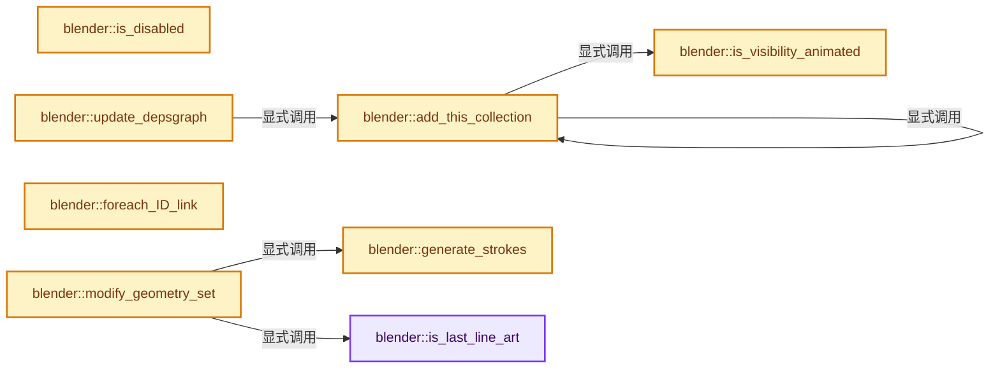
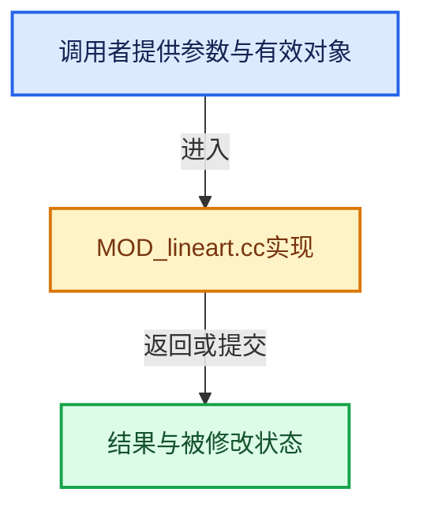

# 实现依赖专题：source/blender/modifiers/intern/MOD_lineart.cc

[实现依赖导航](../../../README.md) · [符号索引](../../../../00-课程指南/02-源码与提交索引/符号依赖与实现索引.md)

本专题从正文实际调用进入，集中保存共享实现。函数有稳定锚点，可从调用处直接跳到对应完整函数；递归与互相调用通过回链组织。

## 本文件的实现关系






## 完整成员与函数实现

<a id="f-4f135ffb4d83cd77"></a>

### `blender::is_last_line_art`

实现位置：[source/blender/modifiers/intern/MOD_lineart.cc](../../../../../../../../source/blender/modifiers/intern/MOD_lineart.cc) · L61—L79。

接口参数：

- `const GreasePencilLineartModifierData &md`
- `const bool use_render`

**教学注释版**

<!-- annotated:93c4f5d7c542a6 -->

```cpp
static bool is_last_line_art(const GreasePencilLineartModifierData &md, const bool use_render)
{
  if (md.modifier.type != eModifierType_GreasePencilLineart) {
    return false;
  }
  ModifierData *imd = md.modifier.next;
  while (imd != nullptr) {
    if (imd->type == eModifierType_GreasePencilLineart) {
      if (use_render && (imd->mode & eModifierMode_Render)) {
        return false;
      }
      if ((!use_render) && (imd->mode & eModifierMode_Realtime)) {
        return false;
      }
    }
    imd = imd->next;
  }
  return true;
}
```

<details>
<summary>核对原始源码：source/blender/modifiers/intern/MOD_lineart.cc · L61—L79</summary>

<!-- original:93c4f5d7c542a6:source/blender/modifiers/intern/MOD_lineart.cc:61:79 -->

```cpp
static bool is_last_line_art(const GreasePencilLineartModifierData &md, const bool use_render)
{
  if (md.modifier.type != eModifierType_GreasePencilLineart) {
    return false;
  }
  ModifierData *imd = md.modifier.next;
  while (imd != nullptr) {
    if (imd->type == eModifierType_GreasePencilLineart) {
      if (use_render && (imd->mode & eModifierMode_Render)) {
        return false;
      }
      if ((!use_render) && (imd->mode & eModifierMode_Realtime)) {
        return false;
      }
    }
    imd = imd->next;
  }
  return true;
}
```

</details>

**沿实际写入检查状态**

- `imd = imd->next;`

**结果出口**

- `return false;`
- `return true;`

**继续追踪实现**

本实现没有需要继续展开的显式调用；检查返回表达式、对象转换和调用者前置条件。

<a id="f-86cef0e0fda42510"></a>

### `blender::is_disabled`

实现位置：[source/blender/modifiers/intern/MOD_lineart.cc](../../../../../../../../source/blender/modifiers/intern/MOD_lineart.cc) · L114—L133。

接口参数：

- `const Scene *`
- `ModifierData *md`
- `bool`

**教学注释版**

<!-- annotated:70516ae8a0c925 -->

```cpp
static bool is_disabled(const Scene * /*scene*/, ModifierData *md, bool /*use_render_params*/)
{
  GreasePencilLineartModifierData *lmd = reinterpret_cast<GreasePencilLineartModifierData *>(md);

  if (lmd->target_layer[0] == '\0' || !lmd->target_material) {
    return true;
  }
  if (lmd->source_type == LINEART_SOURCE_OBJECT && !lmd->source_object) {
    return true;
  }
  if (lmd->source_type == LINEART_SOURCE_COLLECTION && !lmd->source_collection) {
    return true;
  }
  /* Preventing calculation in depsgraph when baking frames. */
  if (int(lmd->flags) & int(MOD_LINEART_IS_BAKED)) {
    return true;
  }

  return false;
}
```

<details>
<summary>核对原始源码：source/blender/modifiers/intern/MOD_lineart.cc · L114—L133</summary>

<!-- original:70516ae8a0c925:source/blender/modifiers/intern/MOD_lineart.cc:114:133 -->

```cpp
static bool is_disabled(const Scene * /*scene*/, ModifierData *md, bool /*use_render_params*/)
{
  GreasePencilLineartModifierData *lmd = reinterpret_cast<GreasePencilLineartModifierData *>(md);

  if (lmd->target_layer[0] == '\0' || !lmd->target_material) {
    return true;
  }
  if (lmd->source_type == LINEART_SOURCE_OBJECT && !lmd->source_object) {
    return true;
  }
  if (lmd->source_type == LINEART_SOURCE_COLLECTION && !lmd->source_collection) {
    return true;
  }
  /* Preventing calculation in depsgraph when baking frames. */
  if (int(lmd->flags) & int(MOD_LINEART_IS_BAKED)) {
    return true;
  }

  return false;
}
```

</details>

**结果出口**

- `return true;`
- `return false;`

**继续追踪实现**

本实现没有需要继续展开的显式调用；检查返回表达式、对象转换和调用者前置条件。

<a id="f-d301d3a56f8da6de"></a>

### `blender::is_visibility_animated`

实现位置：[source/blender/modifiers/intern/MOD_lineart.cc](../../../../../../../../source/blender/modifiers/intern/MOD_lineart.cc) · L140—L150。

接口参数：

- `LineartVisibilityProps &visibility_props`
- `Object *ob`

**教学注释版**

<!-- annotated:aead2b1b8a59bf -->

```cpp
static bool is_visibility_animated(LineartVisibilityProps &visibility_props, Object *ob)
{
  auto is_prop_animated = [ob](PropertyRNA *prop) {
    PointerRNA ptr = RNA_pointer_create_discrete(&ob->id, RNA_Object, ob);
    std::optional<std::string> path = RNA_path_from_ID_to_property(&ptr, prop);
    return bke::animdata::prop_is_animated(ob->adt, path->c_str(), 0);
  };

  return is_prop_animated(visibility_props.prop_hide_viewport) ||
         is_prop_animated(visibility_props.prop_hide_render);
}
```

<details>
<summary>核对原始源码：source/blender/modifiers/intern/MOD_lineart.cc · L140—L150</summary>

<!-- original:aead2b1b8a59bf:source/blender/modifiers/intern/MOD_lineart.cc:140:150 -->

```cpp
static bool is_visibility_animated(LineartVisibilityProps &visibility_props, Object *ob)
{
  auto is_prop_animated = [ob](PropertyRNA *prop) {
    PointerRNA ptr = RNA_pointer_create_discrete(&ob->id, RNA_Object, ob);
    std::optional<std::string> path = RNA_path_from_ID_to_property(&ptr, prop);
    return bke::animdata::prop_is_animated(ob->adt, path->c_str(), 0);
  };

  return is_prop_animated(visibility_props.prop_hide_viewport) ||
         is_prop_animated(visibility_props.prop_hide_render);
}
```

</details>

**结果出口**

- `return bke::animdata::prop_is_animated(ob->adt, path->c_str(), 0);`
- `return is_prop_animated(visibility_props.prop_hide_viewport) ||`

**继续追踪实现**

- `RNA_pointer_create_discrete` → [blender::RNA_pointer_create_discrete · L181](../../makesrna/intern/rna_access.cc.md#f-592a276e869c6d94)。
- `RNA_path_from_ID_to_property` → [blender::RNA_path_from_ID_to_property · L1234](../../makesrna/intern/rna_path.cc.md#f-ef329046496e4c69)。
- `bke::animdata::prop_is_animated` → [blender::bke::animdata::prop_is_animated · L1360](../../../02-BKE几何与数据/intern/anim_data.cc.md#f-a0a76c49cf1e4d56)。
- `path->c_str` → [外部契约](https://eel.is/c++draft/)：这个边界按实际表达式及所属类型核对参数、返回值、寿命与失败行为。这里提供接口入口，不声称已解释该第三方版本的内部实现。
- `is_prop_animated` → [调用协议](../../../../00-课程指南/01-路线与规范/模板宏与动态分派协议.md)：局部可调用对象，须结合其初始化与捕获环境。调用位置L148。

<a id="f-2166e8c0beeb1fe5"></a>

### `blender::add_this_collection`

实现位置：[source/blender/modifiers/intern/MOD_lineart.cc](../../../../../../../../source/blender/modifiers/intern/MOD_lineart.cc) · L152—L197。

接口参数：

- `Collection &collection`
- `const ModifierUpdateDepsgraphContext *ctx`
- `const int mode`
- `Set<const Object *> &object_dependencies`
- `LineartVisibilityProps &visibility_props`

**教学注释版**

<!-- annotated:478d7701a61be3 -->

```cpp
static void add_this_collection(Collection &collection,
                                const ModifierUpdateDepsgraphContext *ctx,
                                const int mode,
                                Set<const Object *> &object_dependencies,
                                LineartVisibilityProps &visibility_props)
{
  bool default_add = true;
  /* Do not do nested collection usage check, this is consistent with lineart calculation, because
   * collection usage doesn't have a INHERIT mode. This might initially be derived from the fact
   * that an object can be inside multiple collections, but might be irrelevant now with the way
   * objects are iterated. Keep this logic for now. */
  if (collection.lineart_usage & COLLECTION_LRT_EXCLUDE) {
    default_add = false;
  }

  int object_visibility_flag = (mode == DAG_EVAL_VIEWPORT) ? OB_HIDE_VIEWPORT : OB_HIDE_RENDER;
  FOREACH_COLLECTION_OBJECT_RECURSIVE_BEGIN (&collection, ob) {
    if (ob->visibility_flag & object_visibility_flag) {
      /* If an object is hidden, we check if they have animated visibility flag so it can be
       * visible some point later, that way the object will still be taken into account when
       * calculating lines without re-building dependencies with the modifier. */
      if (!is_visibility_animated(visibility_props, ob)) {
        continue;
      }
    }

    if (ELEM(ob->type, OB_MESH, OB_MBALL, OB_CURVES_LEGACY, OB_SURF, OB_FONT, OB_CURVES)) {
      if ((ob->lineart.usage == OBJECT_LRT_INHERIT && default_add) ||
          ob->lineart.usage != OBJECT_LRT_EXCLUDE)
      {
        DEG_add_object_relation(ctx->node, ob, DEG_OB_COMP_GEOMETRY, "Line Art Modifier");
        DEG_add_object_relation(ctx->node, ob, DEG_OB_COMP_TRANSFORM, "Line Art Modifier");
        // [讲解] object_dependencies.add：按哈希与相等关系加入键或键值。
        object_dependencies.add(ob);
      }
    }
    if (ob->type == OB_EMPTY && (ob->transflag & OB_DUPLICOLLECTION)) {
      if (!ob->instance_collection) {
        continue;
      }
      add_this_collection(
          *ob->instance_collection, ctx, mode, object_dependencies, visibility_props);
      object_dependencies.add(ob);
    }
  }
  FOREACH_COLLECTION_OBJECT_RECURSIVE_END;
}
```

<details>
<summary>核对原始源码：source/blender/modifiers/intern/MOD_lineart.cc · L152—L197</summary>

<!-- original:478d7701a61be3:source/blender/modifiers/intern/MOD_lineart.cc:152:197 -->

```cpp
static void add_this_collection(Collection &collection,
                                const ModifierUpdateDepsgraphContext *ctx,
                                const int mode,
                                Set<const Object *> &object_dependencies,
                                LineartVisibilityProps &visibility_props)
{
  bool default_add = true;
  /* Do not do nested collection usage check, this is consistent with lineart calculation, because
   * collection usage doesn't have a INHERIT mode. This might initially be derived from the fact
   * that an object can be inside multiple collections, but might be irrelevant now with the way
   * objects are iterated. Keep this logic for now. */
  if (collection.lineart_usage & COLLECTION_LRT_EXCLUDE) {
    default_add = false;
  }

  int object_visibility_flag = (mode == DAG_EVAL_VIEWPORT) ? OB_HIDE_VIEWPORT : OB_HIDE_RENDER;
  FOREACH_COLLECTION_OBJECT_RECURSIVE_BEGIN (&collection, ob) {
    if (ob->visibility_flag & object_visibility_flag) {
      /* If an object is hidden, we check if they have animated visibility flag so it can be
       * visible some point later, that way the object will still be taken into account when
       * calculating lines without re-building dependencies with the modifier. */
      if (!is_visibility_animated(visibility_props, ob)) {
        continue;
      }
    }

    if (ELEM(ob->type, OB_MESH, OB_MBALL, OB_CURVES_LEGACY, OB_SURF, OB_FONT, OB_CURVES)) {
      if ((ob->lineart.usage == OBJECT_LRT_INHERIT && default_add) ||
          ob->lineart.usage != OBJECT_LRT_EXCLUDE)
      {
        DEG_add_object_relation(ctx->node, ob, DEG_OB_COMP_GEOMETRY, "Line Art Modifier");
        DEG_add_object_relation(ctx->node, ob, DEG_OB_COMP_TRANSFORM, "Line Art Modifier");
        object_dependencies.add(ob);
      }
    }
    if (ob->type == OB_EMPTY && (ob->transflag & OB_DUPLICOLLECTION)) {
      if (!ob->instance_collection) {
        continue;
      }
      add_this_collection(
          *ob->instance_collection, ctx, mode, object_dependencies, visibility_props);
      object_dependencies.add(ob);
    }
  }
  FOREACH_COLLECTION_OBJECT_RECURSIVE_END;
}
```

</details>

**沿实际写入检查状态**

- `default_add = false;`

**继续追踪实现**

- `FOREACH_COLLECTION_OBJECT_RECURSIVE_BEGIN` → [FOREACH_COLLECTION_OBJECT_RECURSIVE_BEGIN · L485](../../../02-BKE几何与数据/BKE_collection.hh.md#m-056dd72ee5fb)。宏定义由构建条件选择。
- `is_visibility_animated` → [blender::is_visibility_animated · L140](MOD_lineart.cc.md#f-d301d3a56f8da6de)。
- `ELEM` → [ELEM · L88](../../../07-Intern运行时与平台/ghost/intern/GHOST_utildefines.hh.md#m-d28724a15928)；[ELEM · L135](../../../01-BLI基础库/BLI_utildefines.hh.md#m-d6572de7cae0)。宏定义由构建条件选择。
- `DEG_add_object_relation` → [blender::DEG_add_object_relation · L123](../../../06-Depsgraph依赖图/intern/depsgraph_build.cc.md#f-f570cffae97e273c)。
- `object_dependencies.add` → [blender::Set::add · L248](../../../../02-哈希表与关联数据结构/08-Set与集合语义.md#f-c7498809c2327fba)；[blender::Set::add · L252](../../../../02-哈希表与关联数据结构/08-Set与集合语义.md#f-e3ac8d1c52c03c2b)。同名重载需按实参类型选择。
- `add_this_collection` → [blender::add_this_collection · L152](MOD_lineart.cc.md#f-2166e8c0beeb1fe5)。

<a id="f-59eff399dac4f691"></a>

### `blender::update_depsgraph`

实现位置：[source/blender/modifiers/intern/MOD_lineart.cc](../../../../../../../../source/blender/modifiers/intern/MOD_lineart.cc) · L199—L248。

接口参数：

- `ModifierData *md`
- `const ModifierUpdateDepsgraphContext *ctx`

**教学注释版**

<!-- annotated:c10ea9805af8cf -->

```cpp
static void update_depsgraph(ModifierData *md, const ModifierUpdateDepsgraphContext *ctx)
{
  DEG_add_object_relation(ctx->node, ctx->object, DEG_OB_COMP_TRANSFORM, "Line Art Modifier");

  GreasePencilLineartModifierData *lmd = reinterpret_cast<GreasePencilLineartModifierData *>(md);

  /* Always add whole master collection because line art will need the whole scene for
   * visibility computation. Line art exclusion is handled inside #add_this_collection. */

  /* Do we need to distinguish DAG_EVAL_VIEWPORT or DAG_EVAL_RENDER here? */

  LineartModifierRuntime *runtime = reinterpret_cast<LineartModifierRuntime *>(lmd->runtime);
  if (!runtime) {
    runtime = MEM_new<LineartModifierRuntime>(__func__);
    lmd->runtime = runtime;
  }
  Set<const Object *> &object_dependencies = runtime->object_dependencies;
  // [讲解] object_dependencies.clear：移除全部活项，并按接口决定是否归还存储。
  object_dependencies.clear();

  LineartVisibilityProps visibility_props;

  visibility_props.prop_hide_viewport = RNA_struct_type_find_property(RNA_Object, "hide_viewport");
  visibility_props.prop_hide_render = RNA_struct_type_find_property(RNA_Object, "hide_render");

  add_this_collection(*ctx->scene->master_collection,
                      ctx,
                      DAG_EVAL_VIEWPORT,
                      object_dependencies,
                      visibility_props);

  /* No need to add any non-geometry objects into `lmd->object_dependencies` because we won't be
   * loading... */
  if (lmd->calculation_flags & MOD_LINEART_USE_CUSTOM_CAMERA && lmd->source_camera) {
    DEG_add_object_relation(
        ctx->node, lmd->source_camera, DEG_OB_COMP_TRANSFORM, "Line Art Modifier");
    DEG_add_object_relation(
        ctx->node, lmd->source_camera, DEG_OB_COMP_PARAMETERS, "Line Art Modifier");
  }
  else if (ctx->scene->camera) {
    DEG_add_object_relation(
        ctx->node, ctx->scene->camera, DEG_OB_COMP_TRANSFORM, "Line Art Modifier");
    DEG_add_object_relation(
        ctx->node, ctx->scene->camera, DEG_OB_COMP_PARAMETERS, "Line Art Modifier");
    DEG_add_scene_relation(ctx->node, ctx->scene, DEG_SCENE_COMP_PARAMETERS, "Line Art Modifier");
  }
  if (lmd->light_contour_object) {
    DEG_add_object_relation(
        ctx->node, lmd->light_contour_object, DEG_OB_COMP_TRANSFORM, "Line Art Modifier");
  }
}
```

<details>
<summary>核对原始源码：source/blender/modifiers/intern/MOD_lineart.cc · L199—L248</summary>

<!-- original:c10ea9805af8cf:source/blender/modifiers/intern/MOD_lineart.cc:199:248 -->

```cpp
static void update_depsgraph(ModifierData *md, const ModifierUpdateDepsgraphContext *ctx)
{
  DEG_add_object_relation(ctx->node, ctx->object, DEG_OB_COMP_TRANSFORM, "Line Art Modifier");

  GreasePencilLineartModifierData *lmd = reinterpret_cast<GreasePencilLineartModifierData *>(md);

  /* Always add whole master collection because line art will need the whole scene for
   * visibility computation. Line art exclusion is handled inside #add_this_collection. */

  /* Do we need to distinguish DAG_EVAL_VIEWPORT or DAG_EVAL_RENDER here? */

  LineartModifierRuntime *runtime = reinterpret_cast<LineartModifierRuntime *>(lmd->runtime);
  if (!runtime) {
    runtime = MEM_new<LineartModifierRuntime>(__func__);
    lmd->runtime = runtime;
  }
  Set<const Object *> &object_dependencies = runtime->object_dependencies;
  object_dependencies.clear();

  LineartVisibilityProps visibility_props;

  visibility_props.prop_hide_viewport = RNA_struct_type_find_property(RNA_Object, "hide_viewport");
  visibility_props.prop_hide_render = RNA_struct_type_find_property(RNA_Object, "hide_render");

  add_this_collection(*ctx->scene->master_collection,
                      ctx,
                      DAG_EVAL_VIEWPORT,
                      object_dependencies,
                      visibility_props);

  /* No need to add any non-geometry objects into `lmd->object_dependencies` because we won't be
   * loading... */
  if (lmd->calculation_flags & MOD_LINEART_USE_CUSTOM_CAMERA && lmd->source_camera) {
    DEG_add_object_relation(
        ctx->node, lmd->source_camera, DEG_OB_COMP_TRANSFORM, "Line Art Modifier");
    DEG_add_object_relation(
        ctx->node, lmd->source_camera, DEG_OB_COMP_PARAMETERS, "Line Art Modifier");
  }
  else if (ctx->scene->camera) {
    DEG_add_object_relation(
        ctx->node, ctx->scene->camera, DEG_OB_COMP_TRANSFORM, "Line Art Modifier");
    DEG_add_object_relation(
        ctx->node, ctx->scene->camera, DEG_OB_COMP_PARAMETERS, "Line Art Modifier");
    DEG_add_scene_relation(ctx->node, ctx->scene, DEG_SCENE_COMP_PARAMETERS, "Line Art Modifier");
  }
  if (lmd->light_contour_object) {
    DEG_add_object_relation(
        ctx->node, lmd->light_contour_object, DEG_OB_COMP_TRANSFORM, "Line Art Modifier");
  }
}
```

</details>

**沿实际写入检查状态**

- `runtime = MEM_new<LineartModifierRuntime>(__func__);`
- `lmd->runtime = runtime;`
- `visibility_props.prop_hide_viewport = RNA_struct_type_find_property(RNA_Object, "hide_viewport");`
- `visibility_props.prop_hide_render = RNA_struct_type_find_property(RNA_Object, "hide_render");`

**继续追踪实现**

- `DEG_add_object_relation` → [blender::DEG_add_object_relation · L123](../../../06-Depsgraph依赖图/intern/depsgraph_build.cc.md#f-f570cffae97e273c)。
- `MEM_new<LineartModifierRuntime>` → [MEM_new · L351](../../../07-Intern运行时与平台/guardedalloc/MEM_guardedalloc.h.md#f-115f9b6784f89912)。
- `object_dependencies.clear` → [blender::Set::clear · L570](../../../../02-哈希表与关联数据结构/08-Set与集合语义.md#f-ca1071f7960a58f0)。
- `RNA_struct_type_find_property` → [blender::RNA_struct_type_find_property · L1061](../../makesrna/intern/rna_access.cc.md#f-ca7d4a9ceba67784)。
- `add_this_collection` → [blender::add_this_collection · L152](MOD_lineart.cc.md#f-2166e8c0beeb1fe5)。
- `DEG_add_scene_relation` → [blender::DEG_add_scene_relation · L77](../../../06-Depsgraph依赖图/intern/depsgraph_build.cc.md#f-7f2ffb7e38b49509)。

<a id="f-918d7b92a8dd5870"></a>

### `blender::foreach_ID_link`

实现位置：[source/blender/modifiers/intern/MOD_lineart.cc](../../../../../../../../source/blender/modifiers/intern/MOD_lineart.cc) · L250—L260。

接口参数：

- `ModifierData *md`
- `Object *ob`
- `IDWalkFunc walk`
- `void *user_data`

**教学注释版**

<!-- annotated:c9ebb4e163a3c9 -->

```cpp
static void foreach_ID_link(ModifierData *md, Object *ob, IDWalkFunc walk, void *user_data)
{
  GreasePencilLineartModifierData *lmd = reinterpret_cast<GreasePencilLineartModifierData *>(md);

  walk(user_data, ob, reinterpret_cast<ID **>(&lmd->target_material), IDWALK_CB_USER);
  walk(user_data, ob, reinterpret_cast<ID **>(&lmd->source_collection), IDWALK_CB_NOP);

  walk(user_data, ob, reinterpret_cast<ID **>(&lmd->source_object), IDWALK_CB_NOP);
  walk(user_data, ob, reinterpret_cast<ID **>(&lmd->source_camera), IDWALK_CB_NOP);
  walk(user_data, ob, reinterpret_cast<ID **>(&lmd->light_contour_object), IDWALK_CB_NOP);
}
```

<details>
<summary>核对原始源码：source/blender/modifiers/intern/MOD_lineart.cc · L250—L260</summary>

<!-- original:c9ebb4e163a3c9:source/blender/modifiers/intern/MOD_lineart.cc:250:260 -->

```cpp
static void foreach_ID_link(ModifierData *md, Object *ob, IDWalkFunc walk, void *user_data)
{
  GreasePencilLineartModifierData *lmd = reinterpret_cast<GreasePencilLineartModifierData *>(md);

  walk(user_data, ob, reinterpret_cast<ID **>(&lmd->target_material), IDWALK_CB_USER);
  walk(user_data, ob, reinterpret_cast<ID **>(&lmd->source_collection), IDWALK_CB_NOP);

  walk(user_data, ob, reinterpret_cast<ID **>(&lmd->source_object), IDWALK_CB_NOP);
  walk(user_data, ob, reinterpret_cast<ID **>(&lmd->source_camera), IDWALK_CB_NOP);
  walk(user_data, ob, reinterpret_cast<ID **>(&lmd->light_contour_object), IDWALK_CB_NOP);
}
```

</details>

**继续追踪实现**

- `walk` → [调用协议](../../../../00-课程指南/01-路线与规范/模板宏与动态分派协议.md)：局部可调用对象，须结合其初始化与捕获环境。调用位置L254。

<a id="f-3377cfa6d9d70850"></a>

### `blender::generate_strokes`

实现位置：[source/blender/modifiers/intern/MOD_lineart.cc](../../../../../../../../source/blender/modifiers/intern/MOD_lineart.cc) · L785—L871。

接口参数：

- `ModifierData &md`
- `const ModifierEvalContext &ctx`
- `GreasePencil &grease_pencil`
- `GreasePencilLineartModifierData &first_lineart`
- `const bool force_compute`

**教学注释版**

<!-- annotated:bfca856439e518 -->

```cpp
static void generate_strokes(ModifierData &md,
                             const ModifierEvalContext &ctx,
                             GreasePencil &grease_pencil,
                             GreasePencilLineartModifierData &first_lineart,
                             const bool force_compute)
{
  using namespace bke::greasepencil;
  auto &lmd = reinterpret_cast<GreasePencilLineartModifierData &>(md);

  TreeNode *node = grease_pencil.find_node_by_name(lmd.target_layer);
  if (!node || !node->is_layer()) {
    return;
  }

  const bool is_first_lineart = (&first_lineart == &lmd);
  const bool use_cache = (int(lmd.flags) & int(MOD_LINEART_USE_CACHE));
  LineartCache *local_lc = (is_first_lineart || use_cache) ? first_lineart.shared_cache : nullptr;

  /* Only calculate strokes in these three conditions:
   * 1. It's the very first line art modifier in the stack.
   * 2. This line art modifier doesn't want to use globally cached data.
   * 3. This modifier is not the first line art in stack, but it's the first that's visible (so we
   *    need to do a `force_compute`). */
  if (is_first_lineart || (!use_cache) || force_compute) {
    MOD_lineart_compute_feature_lines_v3(
        ctx.depsgraph, lmd, &local_lc, !(ctx.object->dtx & OB_DRAW_IN_FRONT));
    MOD_lineart_destroy_render_data_v3(&lmd);
  }
  MOD_lineart_chain_clear_picked_flag(local_lc);
  lmd.cache = local_lc;

  const int current_frame = grease_pencil.runtime->eval_frame;

  /* Ensure we have a frame in the selected layer to put line art result in. */
  Layer &layer = node->as_layer();

  const float4x4 &mat = ctx.object->world_to_object();

  /* `drawing` can be nullptr if current frame is before any of the key frames, in which case no
   * strokes are generated. We still allow cache operations to run at the end of this function
   * because there might be other line art modifiers in the same stack. */
  Drawing *drawing = [&]() -> Drawing * {
    if (Drawing *drawing = grease_pencil.get_drawing_at(layer, current_frame)) {
      return drawing;
    }
    return grease_pencil.insert_frame(layer, current_frame);
  }();

  if (drawing) {
    BKE_defgroup_copy_list(&drawing->wrap().geometry.vertex_group_names,
                           &grease_pencil.vertex_group_names);

    MOD_lineart_gpencil_generate_v3(
        lmd.cache,
        mat,
        ctx.depsgraph,
        *drawing,
        lmd.source_type,
        lmd.source_object,
        lmd.source_collection,
        lmd.level_start,
        lmd.use_multiple_levels ? lmd.level_end : lmd.level_start,
        lmd.target_material ? BKE_object_material_index_get(ctx.object, lmd.target_material) : 0,
        lmd.edge_types,
        lmd.mask_switches,
        lmd.material_mask_bits,
        lmd.intersection_mask,
        lmd.radius,
        lmd.opacity,
        lmd.fill_strokes,
        lmd.shadow_selection,
        lmd.silhouette_selection,
        lmd.source_vertex_group,
        lmd.vgname,
        lmd.flags,
        lmd.calculation_flags);
  }

  if ((!is_first_lineart) && (!use_cache)) {
    /* We only clear local cache, not global cache from the first line art modifier. */
    BLI_assert(local_lc != first_lineart.shared_cache);
    MOD_lineart_clear_cache(&local_lc);
    /* Restore the original cache pointer so the modifiers below still have access to the "global"
     * cache. */
    lmd.cache = first_lineart.shared_cache;
  }
}
```

<details>
<summary>核对原始源码：source/blender/modifiers/intern/MOD_lineart.cc · L785—L871</summary>

<!-- original:bfca856439e518:source/blender/modifiers/intern/MOD_lineart.cc:785:871 -->

```cpp
static void generate_strokes(ModifierData &md,
                             const ModifierEvalContext &ctx,
                             GreasePencil &grease_pencil,
                             GreasePencilLineartModifierData &first_lineart,
                             const bool force_compute)
{
  using namespace bke::greasepencil;
  auto &lmd = reinterpret_cast<GreasePencilLineartModifierData &>(md);

  TreeNode *node = grease_pencil.find_node_by_name(lmd.target_layer);
  if (!node || !node->is_layer()) {
    return;
  }

  const bool is_first_lineart = (&first_lineart == &lmd);
  const bool use_cache = (int(lmd.flags) & int(MOD_LINEART_USE_CACHE));
  LineartCache *local_lc = (is_first_lineart || use_cache) ? first_lineart.shared_cache : nullptr;

  /* Only calculate strokes in these three conditions:
   * 1. It's the very first line art modifier in the stack.
   * 2. This line art modifier doesn't want to use globally cached data.
   * 3. This modifier is not the first line art in stack, but it's the first that's visible (so we
   *    need to do a `force_compute`). */
  if (is_first_lineart || (!use_cache) || force_compute) {
    MOD_lineart_compute_feature_lines_v3(
        ctx.depsgraph, lmd, &local_lc, !(ctx.object->dtx & OB_DRAW_IN_FRONT));
    MOD_lineart_destroy_render_data_v3(&lmd);
  }
  MOD_lineart_chain_clear_picked_flag(local_lc);
  lmd.cache = local_lc;

  const int current_frame = grease_pencil.runtime->eval_frame;

  /* Ensure we have a frame in the selected layer to put line art result in. */
  Layer &layer = node->as_layer();

  const float4x4 &mat = ctx.object->world_to_object();

  /* `drawing` can be nullptr if current frame is before any of the key frames, in which case no
   * strokes are generated. We still allow cache operations to run at the end of this function
   * because there might be other line art modifiers in the same stack. */
  Drawing *drawing = [&]() -> Drawing * {
    if (Drawing *drawing = grease_pencil.get_drawing_at(layer, current_frame)) {
      return drawing;
    }
    return grease_pencil.insert_frame(layer, current_frame);
  }();

  if (drawing) {
    BKE_defgroup_copy_list(&drawing->wrap().geometry.vertex_group_names,
                           &grease_pencil.vertex_group_names);

    MOD_lineart_gpencil_generate_v3(
        lmd.cache,
        mat,
        ctx.depsgraph,
        *drawing,
        lmd.source_type,
        lmd.source_object,
        lmd.source_collection,
        lmd.level_start,
        lmd.use_multiple_levels ? lmd.level_end : lmd.level_start,
        lmd.target_material ? BKE_object_material_index_get(ctx.object, lmd.target_material) : 0,
        lmd.edge_types,
        lmd.mask_switches,
        lmd.material_mask_bits,
        lmd.intersection_mask,
        lmd.radius,
        lmd.opacity,
        lmd.fill_strokes,
        lmd.shadow_selection,
        lmd.silhouette_selection,
        lmd.source_vertex_group,
        lmd.vgname,
        lmd.flags,
        lmd.calculation_flags);
  }

  if ((!is_first_lineart) && (!use_cache)) {
    /* We only clear local cache, not global cache from the first line art modifier. */
    BLI_assert(local_lc != first_lineart.shared_cache);
    MOD_lineart_clear_cache(&local_lc);
    /* Restore the original cache pointer so the modifiers below still have access to the "global"
     * cache. */
    lmd.cache = first_lineart.shared_cache;
  }
}
```

</details>

**沿实际写入检查状态**

- `lmd.cache = local_lc;`
- `lmd.cache = first_lineart.shared_cache;`

**结果出口**

- `return drawing;`
- `return grease_pencil.insert_frame(layer, current_frame);`

**继续追踪实现**

- `grease_pencil.find_node_by_name` → [blender::GreasePencil::find_node_by_name · L4410](../../../02-BKE几何与数据/intern/grease_pencil.cc.md#f-be403192e14f50a4)；[blender::GreasePencil::find_node_by_name · L4415](../../../02-BKE几何与数据/intern/grease_pencil.cc.md#f-0f28b82377e57ff5)。同名重载需按实参类型选择。
- `node->is_layer` → [blender::bke::greasepencil::TreeNode::is_layer · L883](../../../02-BKE几何与数据/BKE_grease_pencil.hh.md#f-64d6a765be215846)。
- `MOD_lineart_compute_feature_lines_v3` → [MOD_lineart_compute_feature_lines_v3 · L5026](lineart/lineart_cpu.cc.md#f-74f7567c683a432b)。
- `MOD_lineart_destroy_render_data_v3` → [MOD_lineart_destroy_render_data_v3 · L3569](lineart/lineart_cpu.cc.md#f-8f13be4b4048c384)。
- `MOD_lineart_chain_clear_picked_flag` → [MOD_lineart_chain_clear_picked_flag · L1070](lineart/lineart_chain.cc.md#f-a40eabb7cd2bf871)。
- `node->as_layer` → [blender::bke::greasepencil::TreeNode::as_layer · L1473](../../../02-BKE几何与数据/intern/grease_pencil.cc.md#f-49791c9dada26f0e)；[blender::bke::greasepencil::TreeNode::as_layer · L1483](../../../02-BKE几何与数据/intern/grease_pencil.cc.md#f-8c7e5294572067b4)。同名重载需按实参类型选择。
- `ctx.object->world_to_object` → [调用协议](../../../../00-课程指南/01-路线与规范/模板宏与动态分派协议.md)：接收对象类型依赖auto、返回值或模板实例；不按同名猜测目标。调用位置L821。
- `[&]() -> Drawing * { if (Drawing *drawing = grease_pencil.get_drawing_at(layer, current_frame)) { return drawing; } return grease_pencil.insert_frame(layer, current_frame); }` → [调用协议](../../../../00-课程指南/01-路线与规范/模板宏与动态分派协议.md)：函数指针、局部可调用对象或未展开的宏；必须结合调用者环境。调用位置L826。
- `grease_pencil.get_drawing_at` → [blender::GreasePencil::get_drawing_at · L3814](../../../02-BKE几何与数据/intern/grease_pencil.cc.md#f-c38643507419f9ee)；[blender::GreasePencil::get_drawing_at · L3834](../../../02-BKE几何与数据/intern/grease_pencil.cc.md#f-42398964c13c6abb)。同名重载需按实参类型选择。
- `grease_pencil.insert_frame` → [blender::GreasePencil::insert_frame · L3416](../../../02-BKE几何与数据/intern/grease_pencil.cc.md#f-b821db9f3d7be980)。
- `BKE_defgroup_copy_list` → [blender::BKE_defgroup_copy_list · L75](../../../02-BKE几何与数据/intern/deform.cc.md#f-abb39694bedcca18)。
- `drawing->wrap` → [blender::bActionGroup::wrap · L1920](../../animrig/ANIM_action.hh.md#f-9a08743218798134)；[blender::bActionGroup::wrap · L1924](../../animrig/ANIM_action.hh.md#f-8c9475f8d3f02347)；[blender::bAction::wrap · L1929](../../animrig/ANIM_action.hh.md#f-f049614274fd7a45)；[blender::bAction::wrap · L1933](../../animrig/ANIM_action.hh.md#f-2d697d1983fd282f)；[blender::ActionLayer::wrap · L1938](../../animrig/ANIM_action.hh.md#f-29caef4c2f0f968e)；[blender::ActionLayer::wrap · L1942](../../animrig/ANIM_action.hh.md#f-c2a34899dde2a503)；[blender::ActionSlot::wrap · L1947](../../animrig/ANIM_action.hh.md#f-37d3bb556e72b85a)；[blender::ActionSlot::wrap · L1951](../../animrig/ANIM_action.hh.md#f-2b5d71bb53ce3f94)；[blender::ActionStrip::wrap · L1956](../../animrig/ANIM_action.hh.md#f-8ab5476ff9994c92)；[blender::ActionStrip::wrap · L1960](../../animrig/ANIM_action.hh.md#f-3b3377bf36559cb9)；[blender::ActionStripKeyframeData::wrap · L1965](../../animrig/ANIM_action.hh.md#f-5146ed493695bae6)；[blender::ActionStripKeyframeData::wrap · L1969](../../animrig/ANIM_action.hh.md#f-9ef7a2672fa9e473)；[blender::ActionChannelbag::wrap · L1974](../../animrig/ANIM_action.hh.md#f-58a68748e6602695)；[blender::ActionChannelbag::wrap · L1978](../../animrig/ANIM_action.hh.md#f-7cec1324025e7802)；[blender::GreasePencilDrawing::wrap · L1059](../../../02-BKE几何与数据/BKE_grease_pencil.hh.md#f-566c8db236585685)；[blender::GreasePencilDrawing::wrap · L1063](../../../02-BKE几何与数据/BKE_grease_pencil.hh.md#f-696df207288f4617)；[blender::GreasePencilDrawingReference::wrap · L1068](../../../02-BKE几何与数据/BKE_grease_pencil.hh.md#f-9823f89ae1b58dd3)；[blender::GreasePencilDrawingReference::wrap · L1072](../../../02-BKE几何与数据/BKE_grease_pencil.hh.md#f-5d0d58c43410ce9f)；[blender::GreasePencilLayerTreeNode::wrap · L1097](../../../02-BKE几何与数据/BKE_grease_pencil.hh.md#f-49979aa55e7e3c10)；[blender::GreasePencilLayerTreeNode::wrap · L1101](../../../02-BKE几何与数据/BKE_grease_pencil.hh.md#f-e97064e011b8609b)；[blender::GreasePencilLayer::wrap · L1106](../../../02-BKE几何与数据/BKE_grease_pencil.hh.md#f-0a784c2f36fd3dec)；[blender::GreasePencilLayer::wrap · L1110](../../../02-BKE几何与数据/BKE_grease_pencil.hh.md#f-8948e20a0da0410b)；[blender::GreasePencilLayerMask::wrap · L1115](../../../02-BKE几何与数据/BKE_grease_pencil.hh.md#f-57e9b35f67172c94)；[blender::GreasePencilLayerMask::wrap · L1119](../../../02-BKE几何与数据/BKE_grease_pencil.hh.md#f-c31fbb831a031422)；[blender::GreasePencilLayerTreeGroup::wrap · L1124](../../../02-BKE几何与数据/BKE_grease_pencil.hh.md#f-062b7dbfa198df20)；[blender::GreasePencilLayerTreeGroup::wrap · L1128](../../../02-BKE几何与数据/BKE_grease_pencil.hh.md#f-0262511e00afeedd)；[blender::CurvesGeometry::wrap · L1190](../../../../05-几何存储与拓扑映射/04-CurvesGeometry存储.md#f-a7765d40348cc475)；[blender::CurvesGeometry::wrap · L1194](../../../../05-几何存储与拓扑映射/04-CurvesGeometry存储.md#f-0a1accc9d07df888)；[blender::AttributeStorage::wrap · L343](../../../../05-几何存储与拓扑映射/10-布局兼容与几何实战.md#f-dcd2d04d6f92ca8c)；[blender::AttributeStorage::wrap · L347](../../../../05-几何存储与拓扑映射/10-布局兼容与几何实战.md#f-9ad0fac9bae8a380)；[blender::BoneColor::wrap · L595](../../makesdna/DNA_armature_types.h.md#f-50a6b39a0b2c6a80)；[blender::BoneColor::wrap · L599](../../makesdna/DNA_armature_types.h.md#f-2034fba332a3a41b)。同名重载需按实参类型选择。
- `MOD_lineart_gpencil_generate_v3` → [MOD_lineart_gpencil_generate_v3 · L5238](lineart/lineart_cpu.cc.md#f-5324fc664cf753ef)。
- `BKE_object_material_index_get` → [blender::BKE_object_material_index_get · L941](../../../02-BKE几何与数据/intern/material.cc.md#f-7ab53a5a12f32d0c)。
- `BLI_assert` → [BLI_assert · L48](../../../01-BLI基础库/BLI_assert.hh.md#m-57a88495704d)；[BLI_assert · L63](../../../01-BLI基础库/BLI_assert.hh.md#m-d07050020cb5)。宏定义由构建条件选择。
- `MOD_lineart_clear_cache` → [MOD_lineart_clear_cache · L3591](lineart/lineart_cpu.cc.md#f-308b8bd3625a1fa4)。

<a id="f-5f731799aa2bb8f9"></a>

### `blender::modify_geometry_set`

实现位置：[source/blender/modifiers/intern/MOD_lineart.cc](../../../../../../../../source/blender/modifiers/intern/MOD_lineart.cc) · L873—L907。

接口参数：

- `ModifierData *md`
- `const ModifierEvalContext *ctx`
- `bke::GeometrySet *geometry_set`

**教学注释版**

<!-- annotated:41392d4842d7ba -->

```cpp
static void modify_geometry_set(ModifierData *md,
                                const ModifierEvalContext *ctx,
                                bke::GeometrySet *geometry_set)
{
  if (!geometry_set->has_grease_pencil()) {
    return;
  }
  GreasePencil &grease_pencil = *geometry_set->get_grease_pencil_for_write();
  auto *mmd = reinterpret_cast<GreasePencilLineartModifierData *>(md);

  GreasePencilLineartModifierData *first_lineart = ed::greasepencil::get_first_lineart_modifier(
      *ctx->object);
  BLI_assert(first_lineart);

  /* Since settings for line art cached data are always in the first line art modifier, we need to
   * get and set overall calculation limits on the first modifier regardless of its visibility
   * state. If line art cache doesn't exist, it means line art hasn't done any calculation. */
  const bool cache_ready = (first_lineart->shared_cache != nullptr);
  if (!cache_ready) {
    first_lineart->shared_cache = MOD_lineart_init_cache();
    ed::greasepencil::get_lineart_modifier_limits(*ctx->object,
                                                  first_lineart->shared_cache->LimitInfo);
  }
  ed::greasepencil::set_lineart_modifier_limits(
      *mmd, first_lineart->shared_cache->LimitInfo, cache_ready);

  generate_strokes(*md, *ctx, grease_pencil, *first_lineart, (!cache_ready));

  const bool use_render_params = (ctx->flag & MOD_APPLY_RENDER);
  if (is_last_line_art(*mmd, use_render_params)) {
    MOD_lineart_clear_cache(&first_lineart->shared_cache);
  }

  DEG_id_tag_update(&grease_pencil.id, ID_RECALC_GEOMETRY);
}
```

<details>
<summary>核对原始源码：source/blender/modifiers/intern/MOD_lineart.cc · L873—L907</summary>

<!-- original:41392d4842d7ba:source/blender/modifiers/intern/MOD_lineart.cc:873:907 -->

```cpp
static void modify_geometry_set(ModifierData *md,
                                const ModifierEvalContext *ctx,
                                bke::GeometrySet *geometry_set)
{
  if (!geometry_set->has_grease_pencil()) {
    return;
  }
  GreasePencil &grease_pencil = *geometry_set->get_grease_pencil_for_write();
  auto *mmd = reinterpret_cast<GreasePencilLineartModifierData *>(md);

  GreasePencilLineartModifierData *first_lineart = ed::greasepencil::get_first_lineart_modifier(
      *ctx->object);
  BLI_assert(first_lineart);

  /* Since settings for line art cached data are always in the first line art modifier, we need to
   * get and set overall calculation limits on the first modifier regardless of its visibility
   * state. If line art cache doesn't exist, it means line art hasn't done any calculation. */
  const bool cache_ready = (first_lineart->shared_cache != nullptr);
  if (!cache_ready) {
    first_lineart->shared_cache = MOD_lineart_init_cache();
    ed::greasepencil::get_lineart_modifier_limits(*ctx->object,
                                                  first_lineart->shared_cache->LimitInfo);
  }
  ed::greasepencil::set_lineart_modifier_limits(
      *mmd, first_lineart->shared_cache->LimitInfo, cache_ready);

  generate_strokes(*md, *ctx, grease_pencil, *first_lineart, (!cache_ready));

  const bool use_render_params = (ctx->flag & MOD_APPLY_RENDER);
  if (is_last_line_art(*mmd, use_render_params)) {
    MOD_lineart_clear_cache(&first_lineart->shared_cache);
  }

  DEG_id_tag_update(&grease_pencil.id, ID_RECALC_GEOMETRY);
}
```

</details>

**沿实际写入检查状态**

- `first_lineart->shared_cache = MOD_lineart_init_cache();`

**继续追踪实现**

- `geometry_set->has_grease_pencil` → [blender::bke::GeometrySet::has_grease_pencil · L415](../../../../06-隐式共享与缓存系统/05-GeometrySet读写与复制.md#f-357bcb62da7a8afd)。
- `geometry_set->get_grease_pencil_for_write` → [blender::bke::GeometrySet::get_grease_pencil_for_write · L622](../../../../06-隐式共享与缓存系统/05-GeometrySet读写与复制.md#f-bfc5e891a352651b)。
- `ed::greasepencil::get_first_lineart_modifier` → [blender::ed::greasepencil::get_first_lineart_modifier · L83](../../editors/grease_pencil/intern/grease_pencil_lineart.cc.md#f-e217835d3c032a27)。
- `BLI_assert` → [BLI_assert · L48](../../../01-BLI基础库/BLI_assert.hh.md#m-57a88495704d)；[BLI_assert · L63](../../../01-BLI基础库/BLI_assert.hh.md#m-d07050020cb5)。宏定义由构建条件选择。
- `MOD_lineart_init_cache` → [MOD_lineart_init_cache · L3585](lineart/lineart_cpu.cc.md#f-99d241e61c5d881a)。
- `ed::greasepencil::get_lineart_modifier_limits` → [blender::ed::greasepencil::get_lineart_modifier_limits · L43](../../editors/grease_pencil/intern/grease_pencil_lineart.cc.md#f-062c3691e6a12c7e)。
- `ed::greasepencil::set_lineart_modifier_limits` → [blender::ed::greasepencil::set_lineart_modifier_limits · L62](../../editors/grease_pencil/intern/grease_pencil_lineart.cc.md#f-9d99bea9dbdcdd95)。
- `generate_strokes` → [blender::generate_strokes · L785](MOD_lineart.cc.md#f-3377cfa6d9d70850)。
- `is_last_line_art` → [blender::is_last_line_art · L61](MOD_lineart.cc.md#f-4f135ffb4d83cd77)。
- `MOD_lineart_clear_cache` → [MOD_lineart_clear_cache · L3591](lineart/lineart_cpu.cc.md#f-308b8bd3625a1fa4)。
- `DEG_id_tag_update` → [blender::DEG_id_tag_update · L844](../../../06-Depsgraph依赖图/intern/depsgraph_tag.cc.md#f-62d2949dd168bb81)。
