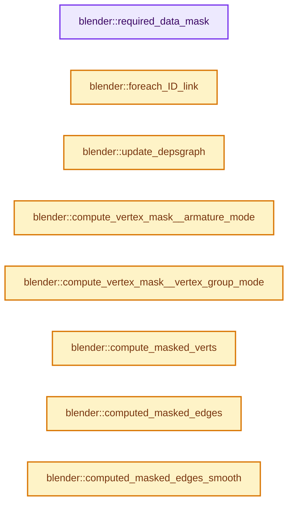
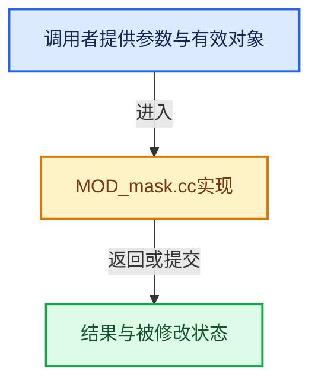

# 实现依赖专题：source/blender/modifiers/intern/MOD_mask.cc

[实现依赖导航](../../../README.md) · [符号索引](../../../../00-课程指南/02-源码与提交索引/符号依赖与实现索引.md)

本专题从正文实际调用进入，集中保存共享实现。函数有稳定锚点，可从调用处直接跳到对应完整函数；递归与互相调用通过回链组织。

## 本文件的实现关系






## 完整成员与函数实现

<a id="f-c0bee974f42b2f98"></a>

### `blender::required_data_mask`

实现位置：[source/blender/modifiers/intern/MOD_mask.cc](../../../../../../../../source/blender/modifiers/intern/MOD_mask.cc) · L53—L56。

接口参数：

- `ModifierData *`
- `CustomData_MeshMasks *r_cddata_masks`

**教学注释版**

<!-- annotated:e04af300f077a0 -->

```cpp
static void required_data_mask(ModifierData * /*md*/, CustomData_MeshMasks *r_cddata_masks)
{
  r_cddata_masks->vmask |= CD_MASK_MDEFORMVERT;
}
```

<details>
<summary>核对原始源码：source/blender/modifiers/intern/MOD_mask.cc · L53—L56</summary>

<!-- original:e04af300f077a0:source/blender/modifiers/intern/MOD_mask.cc:53:56 -->

```cpp
static void required_data_mask(ModifierData * /*md*/, CustomData_MeshMasks *r_cddata_masks)
{
  r_cddata_masks->vmask |= CD_MASK_MDEFORMVERT;
}
```

</details>

**沿实际写入检查状态**

- `r_cddata_masks->vmask |= CD_MASK_MDEFORMVERT;`

**继续追踪实现**

本实现没有需要继续展开的显式调用；检查返回表达式、对象转换和调用者前置条件。

<a id="f-6e3eab0cee511ce7"></a>

### `blender::foreach_ID_link`

实现位置：[source/blender/modifiers/intern/MOD_mask.cc](../../../../../../../../source/blender/modifiers/intern/MOD_mask.cc) · L58—L62。

接口参数：

- `ModifierData *md`
- `Object *ob`
- `IDWalkFunc walk`
- `void *user_data`

**教学注释版**

<!-- annotated:843866457a7e98 -->

```cpp
static void foreach_ID_link(ModifierData *md, Object *ob, IDWalkFunc walk, void *user_data)
{
  MaskModifierData *mmd = reinterpret_cast<MaskModifierData *>(md);
  walk(user_data, ob, reinterpret_cast<ID **>(&mmd->ob_arm), IDWALK_CB_NOP);
}
```

<details>
<summary>核对原始源码：source/blender/modifiers/intern/MOD_mask.cc · L58—L62</summary>

<!-- original:843866457a7e98:source/blender/modifiers/intern/MOD_mask.cc:58:62 -->

```cpp
static void foreach_ID_link(ModifierData *md, Object *ob, IDWalkFunc walk, void *user_data)
{
  MaskModifierData *mmd = reinterpret_cast<MaskModifierData *>(md);
  walk(user_data, ob, reinterpret_cast<ID **>(&mmd->ob_arm), IDWALK_CB_NOP);
}
```

</details>

**继续追踪实现**

- `walk` → [调用协议](../../../../00-课程指南/01-路线与规范/模板宏与动态分派协议.md)：局部可调用对象，须结合其初始化与捕获环境。调用位置L61。

<a id="f-3db1dac34312e68b"></a>

### `blender::update_depsgraph`

实现位置：[source/blender/modifiers/intern/MOD_mask.cc](../../../../../../../../source/blender/modifiers/intern/MOD_mask.cc) · L64—L75。

接口参数：

- `ModifierData *md`
- `const ModifierUpdateDepsgraphContext *ctx`

**教学注释版**

<!-- annotated:b10af8c238c728 -->

```cpp
static void update_depsgraph(ModifierData *md, const ModifierUpdateDepsgraphContext *ctx)
{
  MaskModifierData *mmd = reinterpret_cast<MaskModifierData *>(md);
  if (mmd->ob_arm) {
    bArmature *arm = id_cast<bArmature *>(mmd->ob_arm->data);
    /* Tag relationship in depsgraph, but also on the armature. */
    /* TODO(sergey): Is it a proper relation here? */
    DEG_add_object_relation(ctx->node, mmd->ob_arm, DEG_OB_COMP_TRANSFORM, "Mask Modifier");
    arm->flag |= ARM_HAS_VIZ_DEPS;
    DEG_add_depends_on_transform_relation(ctx->node, "Mask Modifier");
  }
}
```

<details>
<summary>核对原始源码：source/blender/modifiers/intern/MOD_mask.cc · L64—L75</summary>

<!-- original:b10af8c238c728:source/blender/modifiers/intern/MOD_mask.cc:64:75 -->

```cpp
static void update_depsgraph(ModifierData *md, const ModifierUpdateDepsgraphContext *ctx)
{
  MaskModifierData *mmd = reinterpret_cast<MaskModifierData *>(md);
  if (mmd->ob_arm) {
    bArmature *arm = id_cast<bArmature *>(mmd->ob_arm->data);
    /* Tag relationship in depsgraph, but also on the armature. */
    /* TODO(sergey): Is it a proper relation here? */
    DEG_add_object_relation(ctx->node, mmd->ob_arm, DEG_OB_COMP_TRANSFORM, "Mask Modifier");
    arm->flag |= ARM_HAS_VIZ_DEPS;
    DEG_add_depends_on_transform_relation(ctx->node, "Mask Modifier");
  }
}
```

</details>

**沿实际写入检查状态**

- `arm->flag |= ARM_HAS_VIZ_DEPS;`

**继续追踪实现**

- `id_cast<bArmature *>` → [blender::id_cast · L1417](../../makesdna/DNA_ID.h.md#f-6c8ac6412850ac5a)。
- `DEG_add_object_relation` → [blender::DEG_add_object_relation · L123](../../../06-Depsgraph依赖图/intern/depsgraph_build.cc.md#f-f570cffae97e273c)。
- `DEG_add_depends_on_transform_relation` → [blender::DEG_add_depends_on_transform_relation · L240](../../../06-Depsgraph依赖图/intern/depsgraph_build.cc.md#f-47c32a354defa20d)。

<a id="f-06904812596a8337"></a>

### `blender::compute_vertex_mask__armature_mode`

实现位置：[source/blender/modifiers/intern/MOD_mask.cc](../../../../../../../../source/blender/modifiers/intern/MOD_mask.cc) · L78—L112。

接口参数：

- `const MDeformVert *dvert`
- `Mesh *mesh`
- `Object *armature_ob`
- `float threshold`
- `MutableSpan<bool> r_vertex_mask`

**教学注释版**

<!-- annotated:043b89ffb5f099 -->

```cpp
static void compute_vertex_mask__armature_mode(const MDeformVert *dvert,
                                               Mesh *mesh,
                                               Object *armature_ob,
                                               float threshold,
                                               MutableSpan<bool> r_vertex_mask)
{
  /* Element i is true if there is a selected bone that uses vertex group i. */
  Vector<bool> selected_bone_uses_group;

  for (bDeformGroup &def : mesh->vertex_group_names) {
    bPoseChannel *pchan = BKE_pose_channel_find_name(armature_ob->pose, def.name);
    const bool bone_for_group_exists = pchan && pchan->bone_get(*armature_ob) &&
                                       (pchan->flag & POSE_SELECTED);
    // [讲解] selected_bone_uses_group.append：在尾部建立新元素，必要时先扩大存储。
    selected_bone_uses_group.append(bone_for_group_exists);
  }
  // [讲解] selected_bone_uses_group.size：用end_减begin_得到活元素数量。
  const int64_t total_size = selected_bone_uses_group.size();

  // [讲解] r_vertex_mask.index_range：查询视图长度或生成对应有效索引区间。
  for (int i : r_vertex_mask.index_range()) {
    Span<MDeformWeight> weights(dvert[i].dw, dvert[i].totweight);
    r_vertex_mask[i] = false;

    /* check the groups that vertex is assigned to, and see if it was any use */
    for (const MDeformWeight &dw : weights) {
      if (dw.def_nr >= total_size) {
        continue;
      }
      if (selected_bone_uses_group[dw.def_nr]) {
        if (dw.weight > threshold) {
          r_vertex_mask[i] = true;
          break;
        }
      }
    }
  }
}
```

<details>
<summary>核对原始源码：source/blender/modifiers/intern/MOD_mask.cc · L78—L112</summary>

<!-- original:043b89ffb5f099:source/blender/modifiers/intern/MOD_mask.cc:78:112 -->

```cpp
static void compute_vertex_mask__armature_mode(const MDeformVert *dvert,
                                               Mesh *mesh,
                                               Object *armature_ob,
                                               float threshold,
                                               MutableSpan<bool> r_vertex_mask)
{
  /* Element i is true if there is a selected bone that uses vertex group i. */
  Vector<bool> selected_bone_uses_group;

  for (bDeformGroup &def : mesh->vertex_group_names) {
    bPoseChannel *pchan = BKE_pose_channel_find_name(armature_ob->pose, def.name);
    const bool bone_for_group_exists = pchan && pchan->bone_get(*armature_ob) &&
                                       (pchan->flag & POSE_SELECTED);
    selected_bone_uses_group.append(bone_for_group_exists);
  }
  const int64_t total_size = selected_bone_uses_group.size();

  for (int i : r_vertex_mask.index_range()) {
    Span<MDeformWeight> weights(dvert[i].dw, dvert[i].totweight);
    r_vertex_mask[i] = false;

    /* check the groups that vertex is assigned to, and see if it was any use */
    for (const MDeformWeight &dw : weights) {
      if (dw.def_nr >= total_size) {
        continue;
      }
      if (selected_bone_uses_group[dw.def_nr]) {
        if (dw.weight > threshold) {
          r_vertex_mask[i] = true;
          break;
        }
      }
    }
  }
}
```

</details>

**沿实际写入检查状态**

- `r_vertex_mask[i] = false;`
- `r_vertex_mask[i] = true;`

**继续追踪实现**

- `BKE_pose_channel_find_name` → [blender::BKE_pose_channel_find_name · L895](../../../02-BKE几何与数据/intern/action.cc.md#f-5997206551bfc9f9)。
- `pchan->bone_get` → [blender::bPoseChannel::bone_get · L847](../../../02-BKE几何与数据/intern/action.cc.md#f-0eb8bfcf060715cf)；[blender::bPoseChannel::bone_get · L862](../../../02-BKE几何与数据/intern/action.cc.md#f-ccec81f60dc65040)；[blender::bPoseChannel::bone_get · L875](../../../02-BKE几何与数据/intern/action.cc.md#f-b7d34ff46210a1f3)；[blender::bPoseChannel::bone_get · L881](../../../02-BKE几何与数据/intern/action.cc.md#f-0bf83e1e4d68c624)。同名重载需按实参类型选择。
- `selected_bone_uses_group.append` → [blender::Vector::append · L498](../../../../01-基础容器与现代CPP/11-Vector插入删除与重排.md#f-5bde268a69e443ec)；[blender::Vector::append · L502](../../../../01-基础容器与现代CPP/11-Vector插入删除与重排.md#f-591e0b15e6308532)。同名重载需按实参类型选择。
- `selected_bone_uses_group.size` → [blender::Vector::size · L780](../../../../01-基础容器与现代CPP/11-Vector插入删除与重排.md#f-714773731767349c)。
- `r_vertex_mask.index_range` → [blender::MutableSpan::index_range · L676](../../../../01-基础容器与现代CPP/06-MutableSpan可写视图.md#f-f9a9d59a69ca64b5)。

<a id="f-70c5b6fde8224480"></a>

### `blender::compute_vertex_mask__vertex_group_mode`

实现位置：[source/blender/modifiers/intern/MOD_mask.cc](../../../../../../../../source/blender/modifiers/intern/MOD_mask.cc) · L115—L124。

接口参数：

- `const MDeformVert *dvert`
- `int defgrp_index`
- `float threshold`
- `MutableSpan<bool> r_vertex_mask`

**教学注释版**

<!-- annotated:cdc70a30edbc49 -->

```cpp
static void compute_vertex_mask__vertex_group_mode(const MDeformVert *dvert,
                                                   int defgrp_index,
                                                   float threshold,
                                                   MutableSpan<bool> r_vertex_mask)
{
  // [讲解] r_vertex_mask.index_range：查询视图长度或生成对应有效索引区间。
  for (int i : r_vertex_mask.index_range()) {
    const bool found = BKE_defvert_find_weight(&dvert[i], defgrp_index) > threshold;
    r_vertex_mask[i] = found;
  }
}
```

<details>
<summary>核对原始源码：source/blender/modifiers/intern/MOD_mask.cc · L115—L124</summary>

<!-- original:cdc70a30edbc49:source/blender/modifiers/intern/MOD_mask.cc:115:124 -->

```cpp
static void compute_vertex_mask__vertex_group_mode(const MDeformVert *dvert,
                                                   int defgrp_index,
                                                   float threshold,
                                                   MutableSpan<bool> r_vertex_mask)
{
  for (int i : r_vertex_mask.index_range()) {
    const bool found = BKE_defvert_find_weight(&dvert[i], defgrp_index) > threshold;
    r_vertex_mask[i] = found;
  }
}
```

</details>

**沿实际写入检查状态**

- `r_vertex_mask[i] = found;`

**继续追踪实现**

- `r_vertex_mask.index_range` → [blender::MutableSpan::index_range · L676](../../../../01-基础容器与现代CPP/06-MutableSpan可写视图.md#f-f9a9d59a69ca64b5)。
- `BKE_defvert_find_weight` → [blender::BKE_defvert_find_weight · L779](../../../02-BKE几何与数据/intern/deform.cc.md#f-c117fcd05c4fd453)。

<a id="f-7426956d910aaf02"></a>

### `blender::compute_masked_verts`

实现位置：[source/blender/modifiers/intern/MOD_mask.cc](../../../../../../../../source/blender/modifiers/intern/MOD_mask.cc) · L126—L144。

接口参数：

- `Span<bool> vertex_mask`
- `MutableSpan<int> r_vertex_map`
- `uint *r_verts_masked_num`

**教学注释版**

<!-- annotated:f1f5afca89f7a8 -->

```cpp
static void compute_masked_verts(Span<bool> vertex_mask,
                                 MutableSpan<int> r_vertex_map,
                                 uint *r_verts_masked_num)
{
  // [讲解] vertex_mask.size：查询视图长度或生成对应有效索引区间。
  BLI_assert(vertex_mask.size() == r_vertex_map.size());

  uint verts_masked_num = 0;
  // [讲解] r_vertex_map.index_range：查询视图长度或生成对应有效索引区间。
  for (uint i_src : r_vertex_map.index_range()) {
    if (vertex_mask[i_src]) {
      r_vertex_map[i_src] = verts_masked_num;
      verts_masked_num++;
    }
    else {
      r_vertex_map[i_src] = -1;
    }
  }

  *r_verts_masked_num = verts_masked_num;
}
```

<details>
<summary>核对原始源码：source/blender/modifiers/intern/MOD_mask.cc · L126—L144</summary>

<!-- original:f1f5afca89f7a8:source/blender/modifiers/intern/MOD_mask.cc:126:144 -->

```cpp
static void compute_masked_verts(Span<bool> vertex_mask,
                                 MutableSpan<int> r_vertex_map,
                                 uint *r_verts_masked_num)
{
  BLI_assert(vertex_mask.size() == r_vertex_map.size());

  uint verts_masked_num = 0;
  for (uint i_src : r_vertex_map.index_range()) {
    if (vertex_mask[i_src]) {
      r_vertex_map[i_src] = verts_masked_num;
      verts_masked_num++;
    }
    else {
      r_vertex_map[i_src] = -1;
    }
  }

  *r_verts_masked_num = verts_masked_num;
}
```

</details>

**沿实际写入检查状态**

- `r_vertex_map[i_src] = verts_masked_num;`
- `r_vertex_map[i_src] = -1;`

**继续追踪实现**

- `BLI_assert` → [BLI_assert · L48](../../../01-BLI基础库/BLI_assert.hh.md#m-57a88495704d)；[BLI_assert · L63](../../../01-BLI基础库/BLI_assert.hh.md#m-d07050020cb5)。宏定义由构建条件选择。
- `vertex_mask.size` → [blender::Span::size · L256](../../../../01-基础容器与现代CPP/05-Span只读连续视图.md#f-5f80fa006089c998)。
- `r_vertex_map.size` → [blender::MutableSpan::size · L499](../../../../01-基础容器与现代CPP/06-MutableSpan可写视图.md#f-1de6a66839c304a8)；[blender::gpu::shader::parser::MutableSpan::size · L87](../../gpu/shader_tool/utils.hh.md#f-5e684af6ee7990e9)。同名重载需按实参类型选择。
- `r_vertex_map.index_range` → [blender::MutableSpan::index_range · L676](../../../../01-基础容器与现代CPP/06-MutableSpan可写视图.md#f-f9a9d59a69ca64b5)。

<a id="f-37395afe74821df2"></a>

### `blender::computed_masked_edges`

实现位置：[source/blender/modifiers/intern/MOD_mask.cc](../../../../../../../../source/blender/modifiers/intern/MOD_mask.cc) · L146—L169。

接口参数：

- `const Mesh *mesh`
- `Span<bool> vertex_mask`
- `MutableSpan<int> r_edge_map`
- `uint *r_edges_masked_num`

**教学注释版**

<!-- annotated:e0cfa2c3773756 -->

```cpp
static void computed_masked_edges(const Mesh *mesh,
                                  Span<bool> vertex_mask,
                                  MutableSpan<int> r_edge_map,
                                  uint *r_edges_masked_num)
{
  // [讲解] r_edge_map.size：查询视图长度或生成对应有效索引区间。
  BLI_assert(mesh->edges_num == r_edge_map.size());
  const Span<int2> edges = mesh->edges();

  uint edges_masked_num = 0;
  for (int i : IndexRange(mesh->edges_num)) {
    const int2 &edge = edges[i];

    /* only add if both verts will be in new mesh */
    if (vertex_mask[edge[0]] && vertex_mask[edge[1]]) {
      r_edge_map[i] = edges_masked_num;
      edges_masked_num++;
    }
    else {
      r_edge_map[i] = -1;
    }
  }

  *r_edges_masked_num = edges_masked_num;
}
```

<details>
<summary>核对原始源码：source/blender/modifiers/intern/MOD_mask.cc · L146—L169</summary>

<!-- original:e0cfa2c3773756:source/blender/modifiers/intern/MOD_mask.cc:146:169 -->

```cpp
static void computed_masked_edges(const Mesh *mesh,
                                  Span<bool> vertex_mask,
                                  MutableSpan<int> r_edge_map,
                                  uint *r_edges_masked_num)
{
  BLI_assert(mesh->edges_num == r_edge_map.size());
  const Span<int2> edges = mesh->edges();

  uint edges_masked_num = 0;
  for (int i : IndexRange(mesh->edges_num)) {
    const int2 &edge = edges[i];

    /* only add if both verts will be in new mesh */
    if (vertex_mask[edge[0]] && vertex_mask[edge[1]]) {
      r_edge_map[i] = edges_masked_num;
      edges_masked_num++;
    }
    else {
      r_edge_map[i] = -1;
    }
  }

  *r_edges_masked_num = edges_masked_num;
}
```

</details>

**沿实际写入检查状态**

- `r_edge_map[i] = edges_masked_num;`
- `r_edge_map[i] = -1;`

**继续追踪实现**

- `BLI_assert` → [BLI_assert · L48](../../../01-BLI基础库/BLI_assert.hh.md#m-57a88495704d)；[BLI_assert · L63](../../../01-BLI基础库/BLI_assert.hh.md#m-d07050020cb5)。宏定义由构建条件选择。
- `r_edge_map.size` → [blender::MutableSpan::size · L499](../../../../01-基础容器与现代CPP/06-MutableSpan可写视图.md#f-1de6a66839c304a8)；[blender::gpu::shader::parser::MutableSpan::size · L87](../../gpu/shader_tool/utils.hh.md#f-5e684af6ee7990e9)。同名重载需按实参类型选择。
- `mesh->edges` → [Mesh::edges · L1205](../../../../05-几何存储与拓扑映射/03-MPoly迁移与兼容.md#f-7232f6756b674d12)。
- `IndexRange` → [blender::IndexRange](../../../01-BLI基础库/BLI_index_range.hh.md#t-caa3466d6776)；[blender::gpu::shader::parser::IndexRange](../../gpu/shader_tool/utils.hh.md#t-82d2bd4ea71c)；[blender::IndexRange](../../makesdna/DNA_node_types.h.md#t-0448cc889d39)。

<a id="f-0024abb269081b02"></a>

### `blender::computed_masked_edges_smooth`

实现位置：[source/blender/modifiers/intern/MOD_mask.cc](../../../../../../../../source/blender/modifiers/intern/MOD_mask.cc) · L171—L204。

接口参数：

- `const Mesh *mesh`
- `Span<bool> vertex_mask`
- `MutableSpan<int> r_edge_map`
- `uint *r_edges_masked_num`
- `uint *r_verts_add_num`

**教学注释版**

<!-- annotated:80dfbe60ec4aa2 -->

```cpp
static void computed_masked_edges_smooth(const Mesh *mesh,
                                         Span<bool> vertex_mask,
                                         MutableSpan<int> r_edge_map,
                                         uint *r_edges_masked_num,
                                         uint *r_verts_add_num)
{
  // [讲解] r_edge_map.size：查询视图长度或生成对应有效索引区间。
  BLI_assert(mesh->edges_num == r_edge_map.size());
  const Span<int2> edges = mesh->edges();

  uint edges_masked_num = 0;
  uint verts_add_num = 0;
  for (int i : IndexRange(mesh->edges_num)) {
    const int2 &edge = edges[i];

    /* only add if both verts will be in new mesh */
    bool v1 = vertex_mask[edge[0]];
    bool v2 = vertex_mask[edge[1]];
    if (v1 && v2) {
      r_edge_map[i] = edges_masked_num;
      edges_masked_num++;
    }
    else if (v1 != v2) {
      r_edge_map[i] = -2;
      verts_add_num++;
    }
    else {
      r_edge_map[i] = -1;
    }
  }

  edges_masked_num += verts_add_num;
  *r_edges_masked_num = edges_masked_num;
  *r_verts_add_num = verts_add_num;
}
```

<details>
<summary>核对原始源码：source/blender/modifiers/intern/MOD_mask.cc · L171—L204</summary>

<!-- original:80dfbe60ec4aa2:source/blender/modifiers/intern/MOD_mask.cc:171:204 -->

```cpp
static void computed_masked_edges_smooth(const Mesh *mesh,
                                         Span<bool> vertex_mask,
                                         MutableSpan<int> r_edge_map,
                                         uint *r_edges_masked_num,
                                         uint *r_verts_add_num)
{
  BLI_assert(mesh->edges_num == r_edge_map.size());
  const Span<int2> edges = mesh->edges();

  uint edges_masked_num = 0;
  uint verts_add_num = 0;
  for (int i : IndexRange(mesh->edges_num)) {
    const int2 &edge = edges[i];

    /* only add if both verts will be in new mesh */
    bool v1 = vertex_mask[edge[0]];
    bool v2 = vertex_mask[edge[1]];
    if (v1 && v2) {
      r_edge_map[i] = edges_masked_num;
      edges_masked_num++;
    }
    else if (v1 != v2) {
      r_edge_map[i] = -2;
      verts_add_num++;
    }
    else {
      r_edge_map[i] = -1;
    }
  }

  edges_masked_num += verts_add_num;
  *r_edges_masked_num = edges_masked_num;
  *r_verts_add_num = verts_add_num;
}
```

</details>

**沿实际写入检查状态**

- `r_edge_map[i] = edges_masked_num;`
- `r_edge_map[i] = -2;`
- `r_edge_map[i] = -1;`
- `edges_masked_num += verts_add_num;`

**继续追踪实现**

- `BLI_assert` → [BLI_assert · L48](../../../01-BLI基础库/BLI_assert.hh.md#m-57a88495704d)；[BLI_assert · L63](../../../01-BLI基础库/BLI_assert.hh.md#m-d07050020cb5)。宏定义由构建条件选择。
- `r_edge_map.size` → [blender::MutableSpan::size · L499](../../../../01-基础容器与现代CPP/06-MutableSpan可写视图.md#f-1de6a66839c304a8)；[blender::gpu::shader::parser::MutableSpan::size · L87](../../gpu/shader_tool/utils.hh.md#f-5e684af6ee7990e9)。同名重载需按实参类型选择。
- `mesh->edges` → [Mesh::edges · L1205](../../../../05-几何存储与拓扑映射/03-MPoly迁移与兼容.md#f-7232f6756b674d12)。
- `IndexRange` → [blender::IndexRange](../../../01-BLI基础库/BLI_index_range.hh.md#t-caa3466d6776)；[blender::gpu::shader::parser::IndexRange](../../gpu/shader_tool/utils.hh.md#t-82d2bd4ea71c)；[blender::IndexRange](../../makesdna/DNA_node_types.h.md#t-0448cc889d39)。

<a id="f-265ed08ddfac49a4"></a>

### `blender::computed_masked_faces`

实现位置：[source/blender/modifiers/intern/MOD_mask.cc](../../../../../../../../source/blender/modifiers/intern/MOD_mask.cc) · L206—L241。

接口参数：

- `const Mesh *mesh`
- `Span<bool> vertex_mask`
- `Vector<int> &r_masked_face_indices`
- `Vector<int> &r_loop_starts`
- `uint *r_faces_masked_num`
- `uint *r_loops_masked_num`

**教学注释版**

<!-- annotated:9f84e74bbf3716 -->

```cpp
static void computed_masked_faces(const Mesh *mesh,
                                  Span<bool> vertex_mask,
                                  Vector<int> &r_masked_face_indices,
                                  Vector<int> &r_loop_starts,
                                  uint *r_faces_masked_num,
                                  uint *r_loops_masked_num)
{
  // [讲解] vertex_mask.size：查询视图长度或生成对应有效索引区间。
  BLI_assert(mesh->verts_num == vertex_mask.size());
  const OffsetIndices faces = mesh->faces();
  const Span<int> corner_verts = mesh->corner_verts();

  // [讲解] r_masked_face_indices.reserve：确保可容纳至少min_capacity个元素；当前size和已有元素值不因容量请求本身而增加。
  r_masked_face_indices.reserve(mesh->faces_num);
  r_loop_starts.reserve(mesh->faces_num);

  uint loops_masked_num = 0;
  for (int i : IndexRange(mesh->faces_num)) {
    const IndexRange face = faces[i];

    bool all_verts_in_mask = true;
    // [讲解] corner_verts.slice：建立原连续范围的子视图。
    for (const int vert_i : corner_verts.slice(face)) {
      if (!vertex_mask[vert_i]) {
        all_verts_in_mask = false;
        break;
      }
    }

    if (all_verts_in_mask) {
      // [讲解] r_masked_face_indices.append_unchecked：在调用者已保证容量足够的条件下扩展尾部。
      r_masked_face_indices.append_unchecked(i);
      r_loop_starts.append_unchecked(loops_masked_num);
      loops_masked_num += face.size();
    }
  }

  *r_faces_masked_num = r_masked_face_indices.size();
  *r_loops_masked_num = loops_masked_num;
}
```

<details>
<summary>核对原始源码：source/blender/modifiers/intern/MOD_mask.cc · L206—L241</summary>

<!-- original:9f84e74bbf3716:source/blender/modifiers/intern/MOD_mask.cc:206:241 -->

```cpp
static void computed_masked_faces(const Mesh *mesh,
                                  Span<bool> vertex_mask,
                                  Vector<int> &r_masked_face_indices,
                                  Vector<int> &r_loop_starts,
                                  uint *r_faces_masked_num,
                                  uint *r_loops_masked_num)
{
  BLI_assert(mesh->verts_num == vertex_mask.size());
  const OffsetIndices faces = mesh->faces();
  const Span<int> corner_verts = mesh->corner_verts();

  r_masked_face_indices.reserve(mesh->faces_num);
  r_loop_starts.reserve(mesh->faces_num);

  uint loops_masked_num = 0;
  for (int i : IndexRange(mesh->faces_num)) {
    const IndexRange face = faces[i];

    bool all_verts_in_mask = true;
    for (const int vert_i : corner_verts.slice(face)) {
      if (!vertex_mask[vert_i]) {
        all_verts_in_mask = false;
        break;
      }
    }

    if (all_verts_in_mask) {
      r_masked_face_indices.append_unchecked(i);
      r_loop_starts.append_unchecked(loops_masked_num);
      loops_masked_num += face.size();
    }
  }

  *r_faces_masked_num = r_masked_face_indices.size();
  *r_loops_masked_num = loops_masked_num;
}
```

</details>

**沿实际写入检查状态**

- `all_verts_in_mask = false;`
- `loops_masked_num += face.size();`

**继续追踪实现**

- `BLI_assert` → [BLI_assert · L48](../../../01-BLI基础库/BLI_assert.hh.md#m-57a88495704d)；[BLI_assert · L63](../../../01-BLI基础库/BLI_assert.hh.md#m-d07050020cb5)。宏定义由构建条件选择。
- `vertex_mask.size` → [blender::Span::size · L256](../../../../01-基础容器与现代CPP/05-Span只读连续视图.md#f-5f80fa006089c998)。
- `mesh->faces` → [Mesh::faces · L1217](../../../../05-几何存储与拓扑映射/03-MPoly迁移与兼容.md#f-ea444760154e17b2)。
- `mesh->corner_verts` → [Mesh::corner_verts · L1238](../../../../05-几何存储与拓扑映射/03-MPoly迁移与兼容.md#f-a59c61f583b64bc4)。
- `r_masked_face_indices.reserve` → [blender::Vector::reserve · L405](../../../../01-基础容器与现代CPP/10-Vector扩容与增长.md#f-4cf9c0f00e01102e)。
- `r_loop_starts.reserve` → [blender::Vector::reserve · L405](../../../../01-基础容器与现代CPP/10-Vector扩容与增长.md#f-4cf9c0f00e01102e)。
- `IndexRange` → [blender::IndexRange](../../../01-BLI基础库/BLI_index_range.hh.md#t-caa3466d6776)；[blender::gpu::shader::parser::IndexRange](../../gpu/shader_tool/utils.hh.md#t-82d2bd4ea71c)；[blender::IndexRange](../../makesdna/DNA_node_types.h.md#t-0448cc889d39)。
- `corner_verts.slice` → [blender::Span::slice · L141](../../../../01-基础容器与现代CPP/05-Span只读连续视图.md#f-380a0e8fdcbd53cc)；[blender::Span::slice · L149](../../../../01-基础容器与现代CPP/05-Span只读连续视图.md#f-9b9c15e78dd54eec)。同名重载需按实参类型选择。
- `r_masked_face_indices.append_unchecked` → [blender::Vector::append_unchecked · L549](../../../../01-基础容器与现代CPP/11-Vector插入删除与重排.md#f-b24d60bc615a7ccd)；[blender::Vector::append_unchecked · L553](../../../../01-基础容器与现代CPP/11-Vector插入删除与重排.md#f-415919ea0bfd674a)。同名重载需按实参类型选择。
- `r_loop_starts.append_unchecked` → [blender::Vector::append_unchecked · L549](../../../../01-基础容器与现代CPP/11-Vector插入删除与重排.md#f-b24d60bc615a7ccd)；[blender::Vector::append_unchecked · L553](../../../../01-基础容器与现代CPP/11-Vector插入删除与重排.md#f-415919ea0bfd674a)。同名重载需按实参类型选择。
- `face.size` → [blender::IndexRange::size · L156](../../../../01-基础容器与现代CPP/04-IndexRange连续整数区间.md#f-05f66c3ebb2fdfec)。
- `r_masked_face_indices.size` → [blender::Vector::size · L780](../../../../01-基础容器与现代CPP/11-Vector插入删除与重排.md#f-714773731767349c)。

<a id="f-8ba273c5ceb41f6e"></a>

### `blender::compute_interpolated_faces`

实现位置：[source/blender/modifiers/intern/MOD_mask.cc](../../../../../../../../source/blender/modifiers/intern/MOD_mask.cc) · L243—L313。

接口参数：

- `const Mesh *mesh`
- `Span<bool> vertex_mask`
- `uint verts_add_num`
- `uint loops_masked_num`
- `Vector<int> &r_masked_face_indices`
- `Vector<int> &r_loop_starts`
- `uint *r_edges_add_num`
- `uint *r_faces_add_num`
- `uint *r_loops_add_num`

**教学注释版**

<!-- annotated:860280079e8b99 -->

```cpp
static void compute_interpolated_faces(const Mesh *mesh,
                                       Span<bool> vertex_mask,
                                       uint verts_add_num,
                                       uint loops_masked_num,
                                       Vector<int> &r_masked_face_indices,
                                       Vector<int> &r_loop_starts,
                                       uint *r_edges_add_num,
                                       uint *r_faces_add_num,
                                       uint *r_loops_add_num)
{
  // [讲解] vertex_mask.size：查询视图长度或生成对应有效索引区间。
  BLI_assert(mesh->verts_num == vertex_mask.size());

  /* Can't really know ahead of time how much space to use exactly. Estimate limit instead. */
  /* NOTE: this reserve can only lift the capacity if there are ngons, which get split. */
  // [讲解] r_masked_face_indices.reserve：确保可容纳至少min_capacity个元素；当前size和已有元素值不因容量请求本身而增加。
  r_masked_face_indices.reserve(r_masked_face_indices.size() + verts_add_num);
  r_loop_starts.reserve(r_loop_starts.size() + verts_add_num);
  const OffsetIndices faces = mesh->faces();
  const Span<int> corner_verts = mesh->corner_verts();

  uint edges_add_num = 0;
  uint faces_add_num = 0;
  uint loops_add_num = 0;
  for (int i : IndexRange(mesh->faces_num)) {
    const IndexRange face_src = faces[i];

    int in_count = 0;
    int start = -1;
    int dst_totloop = -1;
    // [讲解] corner_verts.slice：建立原连续范围的子视图。
    const Span<int> face_verts_src = corner_verts.slice(face_src);
    // [讲解] face_verts_src.index_range：查询视图长度或生成对应有效索引区间。
    for (const int j : face_verts_src.index_range()) {
      const int vert_i = face_verts_src[j];
      if (vertex_mask[vert_i]) {
        in_count++;
      }
      else if (start == -1) {
        start = j;
      }
    }
    if (0 < in_count && in_count < face_src.size()) {
      /* Ring search starting at a vertex which is not included in the mask. */
      int last_corner_vert = face_verts_src[start];
      bool v_loop_in_mask_last = vertex_mask[last_corner_vert];
      for (const int j : face_verts_src.index_range()) {
        const int corner_vert = face_verts_src[(start + 1 + j) % face_src.size()];
        const bool v_loop_in_mask = vertex_mask[corner_vert];
        if (v_loop_in_mask && !v_loop_in_mask_last) {
          dst_totloop = 3;
        }
        else if (!v_loop_in_mask && v_loop_in_mask_last) {
          BLI_assert(dst_totloop > 2);
          // [讲解] r_masked_face_indices.append：在尾部建立新元素，必要时先扩大存储。
          r_masked_face_indices.append(i);
          r_loop_starts.append(loops_masked_num + loops_add_num);
          loops_add_num += dst_totloop;
          faces_add_num++;
          edges_add_num++;
          dst_totloop = -1;
        }
        else if (v_loop_in_mask && v_loop_in_mask_last) {
          BLI_assert(dst_totloop > 2);
          dst_totloop++;
        }
        last_corner_vert = corner_vert;
        v_loop_in_mask_last = v_loop_in_mask;
      }
    }
  }

  *r_edges_add_num = edges_add_num;
  *r_faces_add_num = faces_add_num;
  *r_loops_add_num = loops_add_num;
}
```

<details>
<summary>核对原始源码：source/blender/modifiers/intern/MOD_mask.cc · L243—L313</summary>

<!-- original:860280079e8b99:source/blender/modifiers/intern/MOD_mask.cc:243:313 -->

```cpp
static void compute_interpolated_faces(const Mesh *mesh,
                                       Span<bool> vertex_mask,
                                       uint verts_add_num,
                                       uint loops_masked_num,
                                       Vector<int> &r_masked_face_indices,
                                       Vector<int> &r_loop_starts,
                                       uint *r_edges_add_num,
                                       uint *r_faces_add_num,
                                       uint *r_loops_add_num)
{
  BLI_assert(mesh->verts_num == vertex_mask.size());

  /* Can't really know ahead of time how much space to use exactly. Estimate limit instead. */
  /* NOTE: this reserve can only lift the capacity if there are ngons, which get split. */
  r_masked_face_indices.reserve(r_masked_face_indices.size() + verts_add_num);
  r_loop_starts.reserve(r_loop_starts.size() + verts_add_num);
  const OffsetIndices faces = mesh->faces();
  const Span<int> corner_verts = mesh->corner_verts();

  uint edges_add_num = 0;
  uint faces_add_num = 0;
  uint loops_add_num = 0;
  for (int i : IndexRange(mesh->faces_num)) {
    const IndexRange face_src = faces[i];

    int in_count = 0;
    int start = -1;
    int dst_totloop = -1;
    const Span<int> face_verts_src = corner_verts.slice(face_src);
    for (const int j : face_verts_src.index_range()) {
      const int vert_i = face_verts_src[j];
      if (vertex_mask[vert_i]) {
        in_count++;
      }
      else if (start == -1) {
        start = j;
      }
    }
    if (0 < in_count && in_count < face_src.size()) {
      /* Ring search starting at a vertex which is not included in the mask. */
      int last_corner_vert = face_verts_src[start];
      bool v_loop_in_mask_last = vertex_mask[last_corner_vert];
      for (const int j : face_verts_src.index_range()) {
        const int corner_vert = face_verts_src[(start + 1 + j) % face_src.size()];
        const bool v_loop_in_mask = vertex_mask[corner_vert];
        if (v_loop_in_mask && !v_loop_in_mask_last) {
          dst_totloop = 3;
        }
        else if (!v_loop_in_mask && v_loop_in_mask_last) {
          BLI_assert(dst_totloop > 2);
          r_masked_face_indices.append(i);
          r_loop_starts.append(loops_masked_num + loops_add_num);
          loops_add_num += dst_totloop;
          faces_add_num++;
          edges_add_num++;
          dst_totloop = -1;
        }
        else if (v_loop_in_mask && v_loop_in_mask_last) {
          BLI_assert(dst_totloop > 2);
          dst_totloop++;
        }
        last_corner_vert = corner_vert;
        v_loop_in_mask_last = v_loop_in_mask;
      }
    }
  }

  *r_edges_add_num = edges_add_num;
  *r_faces_add_num = faces_add_num;
  *r_loops_add_num = loops_add_num;
}
```

</details>

**沿实际写入检查状态**

- `start = j;`
- `dst_totloop = 3;`
- `loops_add_num += dst_totloop;`
- `dst_totloop = -1;`
- `last_corner_vert = corner_vert;`
- `v_loop_in_mask_last = v_loop_in_mask;`

**继续追踪实现**

- `BLI_assert` → [BLI_assert · L48](../../../01-BLI基础库/BLI_assert.hh.md#m-57a88495704d)；[BLI_assert · L63](../../../01-BLI基础库/BLI_assert.hh.md#m-d07050020cb5)。宏定义由构建条件选择。
- `vertex_mask.size` → [blender::Span::size · L256](../../../../01-基础容器与现代CPP/05-Span只读连续视图.md#f-5f80fa006089c998)。
- `r_masked_face_indices.reserve` → [blender::Vector::reserve · L405](../../../../01-基础容器与现代CPP/10-Vector扩容与增长.md#f-4cf9c0f00e01102e)。
- `r_masked_face_indices.size` → [blender::Vector::size · L780](../../../../01-基础容器与现代CPP/11-Vector插入删除与重排.md#f-714773731767349c)。
- `r_loop_starts.reserve` → [blender::Vector::reserve · L405](../../../../01-基础容器与现代CPP/10-Vector扩容与增长.md#f-4cf9c0f00e01102e)。
- `r_loop_starts.size` → [blender::Vector::size · L780](../../../../01-基础容器与现代CPP/11-Vector插入删除与重排.md#f-714773731767349c)。
- `mesh->faces` → [Mesh::faces · L1217](../../../../05-几何存储与拓扑映射/03-MPoly迁移与兼容.md#f-ea444760154e17b2)。
- `mesh->corner_verts` → [Mesh::corner_verts · L1238](../../../../05-几何存储与拓扑映射/03-MPoly迁移与兼容.md#f-a59c61f583b64bc4)。
- `IndexRange` → [blender::IndexRange](../../../01-BLI基础库/BLI_index_range.hh.md#t-caa3466d6776)；[blender::gpu::shader::parser::IndexRange](../../gpu/shader_tool/utils.hh.md#t-82d2bd4ea71c)；[blender::IndexRange](../../makesdna/DNA_node_types.h.md#t-0448cc889d39)。
- `corner_verts.slice` → [blender::Span::slice · L141](../../../../01-基础容器与现代CPP/05-Span只读连续视图.md#f-380a0e8fdcbd53cc)；[blender::Span::slice · L149](../../../../01-基础容器与现代CPP/05-Span只读连续视图.md#f-9b9c15e78dd54eec)。同名重载需按实参类型选择。
- `face_verts_src.index_range` → [blender::Span::index_range · L405](../../../../01-基础容器与现代CPP/05-Span只读连续视图.md#f-caaa9b06e13e53e0)。
- `face_src.size` → [blender::IndexRange::size · L156](../../../../01-基础容器与现代CPP/04-IndexRange连续整数区间.md#f-05f66c3ebb2fdfec)。
- `r_masked_face_indices.append` → [blender::Vector::append · L498](../../../../01-基础容器与现代CPP/11-Vector插入删除与重排.md#f-5bde268a69e443ec)；[blender::Vector::append · L502](../../../../01-基础容器与现代CPP/11-Vector插入删除与重排.md#f-591e0b15e6308532)。同名重载需按实参类型选择。
- `r_loop_starts.append` → [blender::Vector::append · L498](../../../../01-基础容器与现代CPP/11-Vector插入删除与重排.md#f-5bde268a69e443ec)；[blender::Vector::append · L502](../../../../01-基础容器与现代CPP/11-Vector插入删除与重排.md#f-591e0b15e6308532)。同名重载需按实参类型选择。

<a id="f-6b00de99d34b342a"></a>

### `blender::copy_masked_verts_to_new_mesh`

实现位置：[source/blender/modifiers/intern/MOD_mask.cc](../../../../../../../../source/blender/modifiers/intern/MOD_mask.cc) · L315—L329。

接口参数：

- `const Mesh &src_mesh`
- `Mesh &dst_mesh`
- `Span<int> vertex_map`

**教学注释版**

<!-- annotated:2a626398249204 -->

```cpp
static void copy_masked_verts_to_new_mesh(const Mesh &src_mesh,
                                          Mesh &dst_mesh,
                                          Span<int> vertex_map)
{
  bke::LegacyMeshInterpolator vert_interp(src_mesh, dst_mesh, bke::AttrDomain::Point);
  // [讲解] vertex_map.size：查询视图长度或生成对应有效索引区间。
  BLI_assert(src_mesh.verts_num == vertex_map.size());
  // [讲解] vertex_map.index_range：查询视图长度或生成对应有效索引区间。
  for (const int i_src : vertex_map.index_range()) {
    const int i_dst = vertex_map[i_src];
    if (i_dst == -1) {
      continue;
    }

    vert_interp.copy(i_src, i_dst, 1);
  }
}
```

<details>
<summary>核对原始源码：source/blender/modifiers/intern/MOD_mask.cc · L315—L329</summary>

<!-- original:2a626398249204:source/blender/modifiers/intern/MOD_mask.cc:315:329 -->

```cpp
static void copy_masked_verts_to_new_mesh(const Mesh &src_mesh,
                                          Mesh &dst_mesh,
                                          Span<int> vertex_map)
{
  bke::LegacyMeshInterpolator vert_interp(src_mesh, dst_mesh, bke::AttrDomain::Point);
  BLI_assert(src_mesh.verts_num == vertex_map.size());
  for (const int i_src : vertex_map.index_range()) {
    const int i_dst = vertex_map[i_src];
    if (i_dst == -1) {
      continue;
    }

    vert_interp.copy(i_src, i_dst, 1);
  }
}
```

</details>

**继续追踪实现**

- `BLI_assert` → [BLI_assert · L48](../../../01-BLI基础库/BLI_assert.hh.md#m-57a88495704d)；[BLI_assert · L63](../../../01-BLI基础库/BLI_assert.hh.md#m-d07050020cb5)。宏定义由构建条件选择。
- `vertex_map.size` → [blender::Span::size · L256](../../../../01-基础容器与现代CPP/05-Span只读连续视图.md#f-5f80fa006089c998)。
- `vertex_map.index_range` → [blender::Span::index_range · L405](../../../../01-基础容器与现代CPP/05-Span只读连续视图.md#f-caaa9b06e13e53e0)。
- `vert_interp.copy` → [blender::bke::LegacyMeshInterpolator::copy · L348](../../../02-BKE几何与数据/intern/attribute_legacy_convert.cc.md#f-4e462b4a9febc9f7)。

<a id="f-d7cc6bc423cf1d52"></a>

### `blender::get_interp_factor_from_vgroup`

实现位置：[source/blender/modifiers/intern/MOD_mask.cc](../../../../../../../../source/blender/modifiers/intern/MOD_mask.cc) · L331—L339。

接口参数：

- `const MDeformVert *dvert`
- `int defgrp_index`
- `float threshold`
- `uint v1`
- `uint v2`

**教学注释版**

<!-- annotated:7a8fe83a6702de -->

```cpp
static float get_interp_factor_from_vgroup(
    const MDeformVert *dvert, int defgrp_index, float threshold, uint v1, uint v2)
{
  /* NOTE: this calculation is done twice for every vertex,
   * instead of storing it the first time and then reusing it. */
  float value1 = BKE_defvert_find_weight(&dvert[v1], defgrp_index);
  float value2 = BKE_defvert_find_weight(&dvert[v2], defgrp_index);
  return (threshold - value1) / (value2 - value1);
}
```

<details>
<summary>核对原始源码：source/blender/modifiers/intern/MOD_mask.cc · L331—L339</summary>

<!-- original:7a8fe83a6702de:source/blender/modifiers/intern/MOD_mask.cc:331:339 -->

```cpp
static float get_interp_factor_from_vgroup(
    const MDeformVert *dvert, int defgrp_index, float threshold, uint v1, uint v2)
{
  /* NOTE: this calculation is done twice for every vertex,
   * instead of storing it the first time and then reusing it. */
  float value1 = BKE_defvert_find_weight(&dvert[v1], defgrp_index);
  float value2 = BKE_defvert_find_weight(&dvert[v2], defgrp_index);
  return (threshold - value1) / (value2 - value1);
}
```

</details>

**结果出口**

- `return (threshold - value1) / (value2 - value1);`

**继续追踪实现**

- `BKE_defvert_find_weight` → [blender::BKE_defvert_find_weight · L779](../../../02-BKE几何与数据/intern/deform.cc.md#f-c117fcd05c4fd453)。

<a id="f-ecb6f5afa5e59dab"></a>

### `blender::add_interp_verts_copy_edges_to_new_mesh`

实现位置：[source/blender/modifiers/intern/MOD_mask.cc](../../../../../../../../source/blender/modifiers/intern/MOD_mask.cc) · L341—L400。

接口参数：

- `const Mesh &src_mesh`
- `Mesh &dst_mesh`
- `Span<bool> vertex_mask`
- `Span<int> vertex_map`
- `const MDeformVert *dvert`
- `int defgrp_index`
- `float threshold`
- `uint edges_masked_num`
- `uint verts_add_num`
- `MutableSpan<int> r_edge_map`

**教学注释版**

<!-- annotated:d7b07e65af7fa1 -->

```cpp
static void add_interp_verts_copy_edges_to_new_mesh(const Mesh &src_mesh,
                                                    Mesh &dst_mesh,
                                                    Span<bool> vertex_mask,
                                                    Span<int> vertex_map,
                                                    const MDeformVert *dvert,
                                                    int defgrp_index,
                                                    float threshold,
                                                    uint edges_masked_num,
                                                    uint verts_add_num,
                                                    MutableSpan<int> r_edge_map)
{
  // [讲解] vertex_mask.size：查询视图长度或生成对应有效索引区间。
  BLI_assert(src_mesh.verts_num == vertex_mask.size());
  BLI_assert(src_mesh.edges_num == r_edge_map.size());
  const Span<int2> src_edges = src_mesh.edges();
  MutableSpan<int2> dst_edges = dst_mesh.edges_for_write();

  bke::LegacyMeshInterpolator vert_interp(src_mesh, dst_mesh, bke::AttrDomain::Point);
  bke::LegacyMeshInterpolator edge_interp(src_mesh, dst_mesh, bke::AttrDomain::Edge);

  uint vert_index = dst_mesh.verts_num - verts_add_num;
  uint edge_index = edges_masked_num - verts_add_num;
  for (int i_src : IndexRange(src_mesh.edges_num)) {
    if (r_edge_map[i_src] != -1) {
      int i_dst = r_edge_map[i_src];
      if (i_dst == -2) {
        i_dst = edge_index;
      }
      const int2 &e_src = src_edges[i_src];
      int2 &e_dst = dst_edges[i_dst];

      edge_interp.copy(i_src, i_dst, 1);
      e_dst = e_src;
      e_dst[0] = vertex_map[e_src[0]];
      e_dst[1] = vertex_map[e_src[1]];
    }
    if (r_edge_map[i_src] == -2) {
      const int i_dst = edge_index++;
      r_edge_map[i_src] = i_dst;
      const int2 &e_src = src_edges[i_src];
      /* Cut destination edge and make v1 the new vertex. */
      int2 &e_dst = dst_edges[i_dst];
      if (!vertex_mask[e_src[0]]) {
        e_dst[0] = vert_index;
      }
      else {
        BLI_assert(!vertex_mask[e_src[1]]);
        e_dst[1] = e_dst[0];
        e_dst[0] = vert_index;
      }
      /* Create the new vertex. */
      float fac = get_interp_factor_from_vgroup(
          dvert, defgrp_index, threshold, e_src[0], e_src[1]);

      vert_interp.mix({e_src[0], e_src[1]}, Span{1.0f - fac, fac}, vert_index);
      vert_index++;
    }
  }
  BLI_assert(vert_index == dst_mesh.verts_num);
  BLI_assert(edge_index == edges_masked_num);
}
```

<details>
<summary>核对原始源码：source/blender/modifiers/intern/MOD_mask.cc · L341—L400</summary>

<!-- original:d7b07e65af7fa1:source/blender/modifiers/intern/MOD_mask.cc:341:400 -->

```cpp
static void add_interp_verts_copy_edges_to_new_mesh(const Mesh &src_mesh,
                                                    Mesh &dst_mesh,
                                                    Span<bool> vertex_mask,
                                                    Span<int> vertex_map,
                                                    const MDeformVert *dvert,
                                                    int defgrp_index,
                                                    float threshold,
                                                    uint edges_masked_num,
                                                    uint verts_add_num,
                                                    MutableSpan<int> r_edge_map)
{
  BLI_assert(src_mesh.verts_num == vertex_mask.size());
  BLI_assert(src_mesh.edges_num == r_edge_map.size());
  const Span<int2> src_edges = src_mesh.edges();
  MutableSpan<int2> dst_edges = dst_mesh.edges_for_write();

  bke::LegacyMeshInterpolator vert_interp(src_mesh, dst_mesh, bke::AttrDomain::Point);
  bke::LegacyMeshInterpolator edge_interp(src_mesh, dst_mesh, bke::AttrDomain::Edge);

  uint vert_index = dst_mesh.verts_num - verts_add_num;
  uint edge_index = edges_masked_num - verts_add_num;
  for (int i_src : IndexRange(src_mesh.edges_num)) {
    if (r_edge_map[i_src] != -1) {
      int i_dst = r_edge_map[i_src];
      if (i_dst == -2) {
        i_dst = edge_index;
      }
      const int2 &e_src = src_edges[i_src];
      int2 &e_dst = dst_edges[i_dst];

      edge_interp.copy(i_src, i_dst, 1);
      e_dst = e_src;
      e_dst[0] = vertex_map[e_src[0]];
      e_dst[1] = vertex_map[e_src[1]];
    }
    if (r_edge_map[i_src] == -2) {
      const int i_dst = edge_index++;
      r_edge_map[i_src] = i_dst;
      const int2 &e_src = src_edges[i_src];
      /* Cut destination edge and make v1 the new vertex. */
      int2 &e_dst = dst_edges[i_dst];
      if (!vertex_mask[e_src[0]]) {
        e_dst[0] = vert_index;
      }
      else {
        BLI_assert(!vertex_mask[e_src[1]]);
        e_dst[1] = e_dst[0];
        e_dst[0] = vert_index;
      }
      /* Create the new vertex. */
      float fac = get_interp_factor_from_vgroup(
          dvert, defgrp_index, threshold, e_src[0], e_src[1]);

      vert_interp.mix({e_src[0], e_src[1]}, Span{1.0f - fac, fac}, vert_index);
      vert_index++;
    }
  }
  BLI_assert(vert_index == dst_mesh.verts_num);
  BLI_assert(edge_index == edges_masked_num);
}
```

</details>

**沿实际写入检查状态**

- `i_dst = edge_index;`
- `e_dst = e_src;`
- `e_dst[0] = vertex_map[e_src[0]];`
- `e_dst[1] = vertex_map[e_src[1]];`
- `r_edge_map[i_src] = i_dst;`
- `e_dst[0] = vert_index;`
- `e_dst[1] = e_dst[0];`

**继续追踪实现**

- `BLI_assert` → [BLI_assert · L48](../../../01-BLI基础库/BLI_assert.hh.md#m-57a88495704d)；[BLI_assert · L63](../../../01-BLI基础库/BLI_assert.hh.md#m-d07050020cb5)。宏定义由构建条件选择。
- `vertex_mask.size` → [blender::Span::size · L256](../../../../01-基础容器与现代CPP/05-Span只读连续视图.md#f-5f80fa006089c998)。
- `r_edge_map.size` → [blender::MutableSpan::size · L499](../../../../01-基础容器与现代CPP/06-MutableSpan可写视图.md#f-1de6a66839c304a8)；[blender::gpu::shader::parser::MutableSpan::size · L87](../../gpu/shader_tool/utils.hh.md#f-5e684af6ee7990e9)。同名重载需按实参类型选择。
- `src_mesh.edges` → [Mesh::edges · L1205](../../../../05-几何存储与拓扑映射/03-MPoly迁移与兼容.md#f-7232f6756b674d12)。
- `dst_mesh.edges_for_write` → [Mesh::edges_for_write · L1211](../../../../05-几何存储与拓扑映射/03-MPoly迁移与兼容.md#f-a4c919c44eeede7c)。
- `IndexRange` → [blender::IndexRange](../../../01-BLI基础库/BLI_index_range.hh.md#t-caa3466d6776)；[blender::gpu::shader::parser::IndexRange](../../gpu/shader_tool/utils.hh.md#t-82d2bd4ea71c)；[blender::IndexRange](../../makesdna/DNA_node_types.h.md#t-0448cc889d39)。
- `edge_interp.copy` → [blender::bke::LegacyMeshInterpolator::copy · L348](../../../02-BKE几何与数据/intern/attribute_legacy_convert.cc.md#f-4e462b4a9febc9f7)。
- `get_interp_factor_from_vgroup` → [blender::get_interp_factor_from_vgroup · L331](MOD_mask.cc.md#f-d7cc6bc423cf1d52)。
- `vert_interp.mix` → [blender::bke::LegacyMeshInterpolator::mix · L361](../../../02-BKE几何与数据/intern/attribute_legacy_convert.cc.md#f-59ea8c9036b7e7f8)。

<a id="f-b16df3883089637f"></a>

### `blender::copy_masked_edges_to_new_mesh`

实现位置：[source/blender/modifiers/intern/MOD_mask.cc](../../../../../../../../source/blender/modifiers/intern/MOD_mask.cc) · L402—L423。

接口参数：

- `const Mesh &src_mesh`
- `Mesh &dst_mesh`
- `Span<int> vertex_map`
- `Span<int> edge_map`

**教学注释版**

<!-- annotated:b5225dd37ba208 -->

```cpp
static void copy_masked_edges_to_new_mesh(const Mesh &src_mesh,
                                          Mesh &dst_mesh,
                                          Span<int> vertex_map,
                                          Span<int> edge_map)
{
  const Span<int2> src_edges = src_mesh.edges();
  MutableSpan<int2> dst_edges = dst_mesh.edges_for_write();
  bke::LegacyMeshInterpolator edge_interp(src_mesh, dst_mesh, bke::AttrDomain::Edge);

  // [讲解] vertex_map.size：查询视图长度或生成对应有效索引区间。
  BLI_assert(src_mesh.verts_num == vertex_map.size());
  BLI_assert(src_mesh.edges_num == edge_map.size());
  for (const int i_src : IndexRange(src_mesh.edges_num)) {
    const int i_dst = edge_map[i_src];
    if (ELEM(i_dst, -1, -2)) {
      continue;
    }

    edge_interp.copy(i_src, i_dst, 1);
    dst_edges[i_dst][0] = vertex_map[src_edges[i_src][0]];
    dst_edges[i_dst][1] = vertex_map[src_edges[i_src][1]];
  }
}
```

<details>
<summary>核对原始源码：source/blender/modifiers/intern/MOD_mask.cc · L402—L423</summary>

<!-- original:b5225dd37ba208:source/blender/modifiers/intern/MOD_mask.cc:402:423 -->

```cpp
static void copy_masked_edges_to_new_mesh(const Mesh &src_mesh,
                                          Mesh &dst_mesh,
                                          Span<int> vertex_map,
                                          Span<int> edge_map)
{
  const Span<int2> src_edges = src_mesh.edges();
  MutableSpan<int2> dst_edges = dst_mesh.edges_for_write();
  bke::LegacyMeshInterpolator edge_interp(src_mesh, dst_mesh, bke::AttrDomain::Edge);

  BLI_assert(src_mesh.verts_num == vertex_map.size());
  BLI_assert(src_mesh.edges_num == edge_map.size());
  for (const int i_src : IndexRange(src_mesh.edges_num)) {
    const int i_dst = edge_map[i_src];
    if (ELEM(i_dst, -1, -2)) {
      continue;
    }

    edge_interp.copy(i_src, i_dst, 1);
    dst_edges[i_dst][0] = vertex_map[src_edges[i_src][0]];
    dst_edges[i_dst][1] = vertex_map[src_edges[i_src][1]];
  }
}
```

</details>

**沿实际写入检查状态**

- `dst_edges[i_dst][0] = vertex_map[src_edges[i_src][0]];`
- `dst_edges[i_dst][1] = vertex_map[src_edges[i_src][1]];`

**继续追踪实现**

- `src_mesh.edges` → [Mesh::edges · L1205](../../../../05-几何存储与拓扑映射/03-MPoly迁移与兼容.md#f-7232f6756b674d12)。
- `dst_mesh.edges_for_write` → [Mesh::edges_for_write · L1211](../../../../05-几何存储与拓扑映射/03-MPoly迁移与兼容.md#f-a4c919c44eeede7c)。
- `BLI_assert` → [BLI_assert · L48](../../../01-BLI基础库/BLI_assert.hh.md#m-57a88495704d)；[BLI_assert · L63](../../../01-BLI基础库/BLI_assert.hh.md#m-d07050020cb5)。宏定义由构建条件选择。
- `vertex_map.size` → [blender::Span::size · L256](../../../../01-基础容器与现代CPP/05-Span只读连续视图.md#f-5f80fa006089c998)。
- `edge_map.size` → [blender::Span::size · L256](../../../../01-基础容器与现代CPP/05-Span只读连续视图.md#f-5f80fa006089c998)。
- `IndexRange` → [blender::IndexRange](../../../01-BLI基础库/BLI_index_range.hh.md#t-caa3466d6776)；[blender::gpu::shader::parser::IndexRange](../../gpu/shader_tool/utils.hh.md#t-82d2bd4ea71c)；[blender::IndexRange](../../makesdna/DNA_node_types.h.md#t-0448cc889d39)。
- `ELEM` → [ELEM · L88](../../../07-Intern运行时与平台/ghost/intern/GHOST_utildefines.hh.md#m-d28724a15928)；[ELEM · L135](../../../01-BLI基础库/BLI_utildefines.hh.md#m-d6572de7cae0)。宏定义由构建条件选择。
- `edge_interp.copy` → [blender::bke::LegacyMeshInterpolator::copy · L348](../../../02-BKE几何与数据/intern/attribute_legacy_convert.cc.md#f-4e462b4a9febc9f7)。

<a id="f-fc01cf5a26d1715e"></a>

### `blender::copy_masked_faces_to_new_mesh`

实现位置：[source/blender/modifiers/intern/MOD_mask.cc](../../../../../../../../source/blender/modifiers/intern/MOD_mask.cc) · L425—L457。

接口参数：

- `const Mesh &src_mesh`
- `Mesh &dst_mesh`
- `Span<int> vertex_map`
- `Span<int> edge_map`
- `Span<int> masked_face_indices`
- `Span<int> new_loop_starts`
- `int faces_masked_num`

**教学注释版**

<!-- annotated:048706079369f9 -->

```cpp
static void copy_masked_faces_to_new_mesh(const Mesh &src_mesh,
                                          Mesh &dst_mesh,
                                          Span<int> vertex_map,
                                          Span<int> edge_map,
                                          Span<int> masked_face_indices,
                                          Span<int> new_loop_starts,
                                          int faces_masked_num)
{
  const OffsetIndices src_faces = src_mesh.faces();
  MutableSpan<int> dst_face_offsets = dst_mesh.face_offsets_for_write();
  const Span<int> src_corner_verts = src_mesh.corner_verts();
  const Span<int> src_corner_edges = src_mesh.corner_edges();
  MutableSpan<int> dst_corner_verts = dst_mesh.corner_verts_for_write();
  MutableSpan<int> dst_corner_edges = dst_mesh.corner_edges_for_write();

  bke::LegacyMeshInterpolator face_interp(src_mesh, dst_mesh, bke::AttrDomain::Face);
  bke::LegacyMeshInterpolator corner_interp(src_mesh, dst_mesh, bke::AttrDomain::Corner);

  for (const int i_dst : IndexRange(faces_masked_num)) {
    const int i_src = masked_face_indices[i_dst];
    const IndexRange src_face = src_faces[i_src];

    dst_face_offsets[i_dst] = new_loop_starts[i_dst];

    face_interp.copy(i_src, i_dst, 1);
    // [讲解] src_face.start：读取连续区间或分组的边界信息。
    corner_interp.copy(src_face.start(), dst_face_offsets[i_dst], src_face.size());

    // [讲解] src_face.size：读取连续区间或分组的边界信息。
    for (int i : IndexRange(src_face.size())) {
      dst_corner_verts[new_loop_starts[i_dst] + i] = vertex_map[src_corner_verts[src_face[i]]];
      dst_corner_edges[new_loop_starts[i_dst] + i] = edge_map[src_corner_edges[src_face[i]]];
    }
  }
}
```

<details>
<summary>核对原始源码：source/blender/modifiers/intern/MOD_mask.cc · L425—L457</summary>

<!-- original:048706079369f9:source/blender/modifiers/intern/MOD_mask.cc:425:457 -->

```cpp
static void copy_masked_faces_to_new_mesh(const Mesh &src_mesh,
                                          Mesh &dst_mesh,
                                          Span<int> vertex_map,
                                          Span<int> edge_map,
                                          Span<int> masked_face_indices,
                                          Span<int> new_loop_starts,
                                          int faces_masked_num)
{
  const OffsetIndices src_faces = src_mesh.faces();
  MutableSpan<int> dst_face_offsets = dst_mesh.face_offsets_for_write();
  const Span<int> src_corner_verts = src_mesh.corner_verts();
  const Span<int> src_corner_edges = src_mesh.corner_edges();
  MutableSpan<int> dst_corner_verts = dst_mesh.corner_verts_for_write();
  MutableSpan<int> dst_corner_edges = dst_mesh.corner_edges_for_write();

  bke::LegacyMeshInterpolator face_interp(src_mesh, dst_mesh, bke::AttrDomain::Face);
  bke::LegacyMeshInterpolator corner_interp(src_mesh, dst_mesh, bke::AttrDomain::Corner);

  for (const int i_dst : IndexRange(faces_masked_num)) {
    const int i_src = masked_face_indices[i_dst];
    const IndexRange src_face = src_faces[i_src];

    dst_face_offsets[i_dst] = new_loop_starts[i_dst];

    face_interp.copy(i_src, i_dst, 1);
    corner_interp.copy(src_face.start(), dst_face_offsets[i_dst], src_face.size());

    for (int i : IndexRange(src_face.size())) {
      dst_corner_verts[new_loop_starts[i_dst] + i] = vertex_map[src_corner_verts[src_face[i]]];
      dst_corner_edges[new_loop_starts[i_dst] + i] = edge_map[src_corner_edges[src_face[i]]];
    }
  }
}
```

</details>

**沿实际写入检查状态**

- `dst_face_offsets[i_dst] = new_loop_starts[i_dst];`

**继续追踪实现**

- `src_mesh.faces` → [Mesh::faces · L1217](../../../../05-几何存储与拓扑映射/03-MPoly迁移与兼容.md#f-ea444760154e17b2)。
- `dst_mesh.face_offsets_for_write` → [Mesh::face_offsets_for_write · L1228](../../../../05-几何存储与拓扑映射/03-MPoly迁移与兼容.md#f-483f42747ab436a2)。
- `src_mesh.corner_verts` → [Mesh::corner_verts · L1238](../../../../05-几何存储与拓扑映射/03-MPoly迁移与兼容.md#f-a59c61f583b64bc4)。
- `src_mesh.corner_edges` → [Mesh::corner_edges · L1252](../../../../05-几何存储与拓扑映射/03-MPoly迁移与兼容.md#f-687b790868e7f257)。
- `dst_mesh.corner_verts_for_write` → [Mesh::corner_verts_for_write · L1246](../../../../05-几何存储与拓扑映射/03-MPoly迁移与兼容.md#f-6dfaf316a81ba215)。
- `dst_mesh.corner_edges_for_write` → [Mesh::corner_edges_for_write · L1260](../../../../05-几何存储与拓扑映射/03-MPoly迁移与兼容.md#f-51e939a4353adb83)。
- `IndexRange` → [blender::IndexRange](../../../01-BLI基础库/BLI_index_range.hh.md#t-caa3466d6776)；[blender::gpu::shader::parser::IndexRange](../../gpu/shader_tool/utils.hh.md#t-82d2bd4ea71c)；[blender::IndexRange](../../makesdna/DNA_node_types.h.md#t-0448cc889d39)。
- `face_interp.copy` → [blender::bke::LegacyMeshInterpolator::copy · L348](../../../02-BKE几何与数据/intern/attribute_legacy_convert.cc.md#f-4e462b4a9febc9f7)。
- `corner_interp.copy` → [blender::bke::LegacyMeshInterpolator::copy · L348](../../../02-BKE几何与数据/intern/attribute_legacy_convert.cc.md#f-4e462b4a9febc9f7)。
- `src_face.start` → [blender::IndexRange::start · L243](../../../../01-基础容器与现代CPP/04-IndexRange连续整数区间.md#f-99d2195bd9cfd1f0)。
- `src_face.size` → [blender::IndexRange::size · L156](../../../../01-基础容器与现代CPP/04-IndexRange连续整数区间.md#f-05f66c3ebb2fdfec)。

<a id="f-da466f3453be2104"></a>

### `blender::add_interpolated_faces_to_new_mesh`

实现位置：[source/blender/modifiers/intern/MOD_mask.cc](../../../../../../../../source/blender/modifiers/intern/MOD_mask.cc) · L459—L583。

接口参数：

- `const Mesh &src_mesh`
- `Mesh &dst_mesh`
- `Span<bool> vertex_mask`
- `Span<int> vertex_map`
- `Span<int> edge_map`
- `const MDeformVert *dvert`
- `int defgrp_index`
- `float threshold`
- `Span<int> masked_face_indices`
- `Span<int> new_loop_starts`
- `int faces_masked_num`
- `int edges_add_num`

**教学注释版**

<!-- annotated:6b616a0b7cb571 -->

```cpp
static void add_interpolated_faces_to_new_mesh(const Mesh &src_mesh,
                                               Mesh &dst_mesh,
                                               Span<bool> vertex_mask,
                                               Span<int> vertex_map,
                                               Span<int> edge_map,
                                               const MDeformVert *dvert,
                                               int defgrp_index,
                                               float threshold,
                                               Span<int> masked_face_indices,
                                               Span<int> new_loop_starts,
                                               int faces_masked_num,
                                               int edges_add_num)
{
  const OffsetIndices src_faces = src_mesh.faces();
  MutableSpan<int> dst_face_offsets = dst_mesh.face_offsets_for_write();
  MutableSpan<int2> dst_edges = dst_mesh.edges_for_write();
  const Span<int> src_corner_verts = src_mesh.corner_verts();
  const Span<int> src_corner_edges = src_mesh.corner_edges();
  MutableSpan<int> dst_corner_verts = dst_mesh.corner_verts_for_write();
  MutableSpan<int> dst_corner_edges = dst_mesh.corner_edges_for_write();

  bke::LegacyMeshInterpolator face_interp(src_mesh, dst_mesh, bke::AttrDomain::Face);
  bke::LegacyMeshInterpolator corner_interp(src_mesh, dst_mesh, bke::AttrDomain::Corner);

  int edge_index = dst_mesh.edges_num - edges_add_num;
  int sub_face_index = 0;
  int last_i_src = -1;
  for (const int i_dst :
       // [讲解] masked_face_indices.size：查询视图长度或生成对应有效索引区间。
       IndexRange(faces_masked_num, masked_face_indices.size() - faces_masked_num))
  {
    const int i_src = masked_face_indices[i_dst];
    if (i_src == last_i_src) {
      sub_face_index++;
    }
    else {
      sub_face_index = 0;
      last_i_src = i_src;
    }

    const IndexRange src_face = src_faces[i_src];
    // [讲解] src_face.start：读取连续区间或分组的边界信息。
    const int i_ml_src = src_face.start();
    int i_ml_dst = new_loop_starts[i_dst];
    face_interp.copy(i_src, i_dst, 1);

    dst_face_offsets[i_dst] = i_ml_dst;

    /* Ring search starting at a vertex which is not included in the mask. */
    int start = -sub_face_index - 1;
    bool skip = false;
    // [讲解] src_corner_verts.slice：建立原连续范围的子视图。
    const Span<int> face_verts_src = src_corner_verts.slice(src_face);
    const Span<int> face_edges_src = src_corner_edges.slice(src_face);
    // [讲解] face_verts_src.index_range：查询视图长度或生成对应有效索引区间。
    for (const int j : face_verts_src.index_range()) {
      if (!vertex_mask[face_verts_src[j]]) {
        if (start == -1) {
          start = j;
          break;
        }
        if (!skip) {
          skip = true;
        }
      }
      else if (skip) {
        skip = false;
        start++;
      }
    }

    BLI_assert(start >= 0);
    BLI_assert(edge_index < dst_mesh.edges_num);

    int last_index = start;
    bool v_loop_in_mask_last = vertex_mask[face_verts_src[last_index]];
    for (const int j : face_verts_src.index_range()) {
      const int index = (start + 1 + j) % src_face.size();
      const bool v_loop_in_mask = vertex_mask[face_verts_src[index]];
      if (v_loop_in_mask && !v_loop_in_mask_last) {
        /* Start new cut. */
        float fac = get_interp_factor_from_vgroup(
            dvert, defgrp_index, threshold, face_verts_src[last_index], face_verts_src[index]);
        corner_interp.mix(
            {i_ml_src + last_index, i_ml_src + index}, Span{1.0f - fac, fac}, i_ml_dst);
        dst_corner_edges[i_ml_dst] = edge_map[face_edges_src[last_index]];
        dst_corner_verts[i_ml_dst] = dst_edges[dst_corner_edges[i_ml_dst]][0];
        i_ml_dst++;

        corner_interp.copy(i_ml_src + index, i_ml_dst, 1);
        dst_corner_verts[i_ml_dst] = vertex_map[face_verts_src[index]];
        dst_corner_edges[i_ml_dst] = edge_map[face_edges_src[index]];
        i_ml_dst++;
      }
      else if (!v_loop_in_mask && v_loop_in_mask_last) {
        BLI_assert(i_ml_dst != dst_face_offsets[i_dst]);
        /* End active cut. */
        float fac = get_interp_factor_from_vgroup(
            dvert, defgrp_index, threshold, face_verts_src[last_index], face_verts_src[index]);
        corner_interp.mix(
            {i_ml_src + last_index, i_ml_src + index}, Span{1.0f - fac, fac}, i_ml_dst);
        dst_corner_edges[i_ml_dst] = edge_index;
        dst_corner_verts[i_ml_dst] = dst_edges[edge_map[face_edges_src[last_index]]][0];

        /* Create closing edge. */
        int2 &cut_edge = dst_edges[edge_index];
        cut_edge[0] = dst_corner_verts[dst_face_offsets[i_dst]];
        cut_edge[1] = dst_corner_verts[i_ml_dst];
        BLI_assert(cut_edge[0] != cut_edge[1]);
        edge_index++;
        i_ml_dst++;

        /* Only handle one of the cuts per iteration. */
        break;
      }
      else if (v_loop_in_mask && v_loop_in_mask_last) {
        BLI_assert(i_ml_dst != dst_face_offsets[i_dst]);
        /* Extend active face. */
        corner_interp.copy(i_ml_src + index, i_ml_dst, 1);
        dst_corner_verts[i_ml_dst] = vertex_map[face_verts_src[index]];
        dst_corner_edges[i_ml_dst] = edge_map[face_edges_src[index]];
        i_ml_dst++;
      }
      last_index = index;
      v_loop_in_mask_last = v_loop_in_mask;
    }
  }
  BLI_assert(edge_index == dst_mesh.edges_num);
}
```

<details>
<summary>核对原始源码：source/blender/modifiers/intern/MOD_mask.cc · L459—L583</summary>

<!-- original:6b616a0b7cb571:source/blender/modifiers/intern/MOD_mask.cc:459:583 -->

```cpp
static void add_interpolated_faces_to_new_mesh(const Mesh &src_mesh,
                                               Mesh &dst_mesh,
                                               Span<bool> vertex_mask,
                                               Span<int> vertex_map,
                                               Span<int> edge_map,
                                               const MDeformVert *dvert,
                                               int defgrp_index,
                                               float threshold,
                                               Span<int> masked_face_indices,
                                               Span<int> new_loop_starts,
                                               int faces_masked_num,
                                               int edges_add_num)
{
  const OffsetIndices src_faces = src_mesh.faces();
  MutableSpan<int> dst_face_offsets = dst_mesh.face_offsets_for_write();
  MutableSpan<int2> dst_edges = dst_mesh.edges_for_write();
  const Span<int> src_corner_verts = src_mesh.corner_verts();
  const Span<int> src_corner_edges = src_mesh.corner_edges();
  MutableSpan<int> dst_corner_verts = dst_mesh.corner_verts_for_write();
  MutableSpan<int> dst_corner_edges = dst_mesh.corner_edges_for_write();

  bke::LegacyMeshInterpolator face_interp(src_mesh, dst_mesh, bke::AttrDomain::Face);
  bke::LegacyMeshInterpolator corner_interp(src_mesh, dst_mesh, bke::AttrDomain::Corner);

  int edge_index = dst_mesh.edges_num - edges_add_num;
  int sub_face_index = 0;
  int last_i_src = -1;
  for (const int i_dst :
       IndexRange(faces_masked_num, masked_face_indices.size() - faces_masked_num))
  {
    const int i_src = masked_face_indices[i_dst];
    if (i_src == last_i_src) {
      sub_face_index++;
    }
    else {
      sub_face_index = 0;
      last_i_src = i_src;
    }

    const IndexRange src_face = src_faces[i_src];
    const int i_ml_src = src_face.start();
    int i_ml_dst = new_loop_starts[i_dst];
    face_interp.copy(i_src, i_dst, 1);

    dst_face_offsets[i_dst] = i_ml_dst;

    /* Ring search starting at a vertex which is not included in the mask. */
    int start = -sub_face_index - 1;
    bool skip = false;
    const Span<int> face_verts_src = src_corner_verts.slice(src_face);
    const Span<int> face_edges_src = src_corner_edges.slice(src_face);
    for (const int j : face_verts_src.index_range()) {
      if (!vertex_mask[face_verts_src[j]]) {
        if (start == -1) {
          start = j;
          break;
        }
        if (!skip) {
          skip = true;
        }
      }
      else if (skip) {
        skip = false;
        start++;
      }
    }

    BLI_assert(start >= 0);
    BLI_assert(edge_index < dst_mesh.edges_num);

    int last_index = start;
    bool v_loop_in_mask_last = vertex_mask[face_verts_src[last_index]];
    for (const int j : face_verts_src.index_range()) {
      const int index = (start + 1 + j) % src_face.size();
      const bool v_loop_in_mask = vertex_mask[face_verts_src[index]];
      if (v_loop_in_mask && !v_loop_in_mask_last) {
        /* Start new cut. */
        float fac = get_interp_factor_from_vgroup(
            dvert, defgrp_index, threshold, face_verts_src[last_index], face_verts_src[index]);
        corner_interp.mix(
            {i_ml_src + last_index, i_ml_src + index}, Span{1.0f - fac, fac}, i_ml_dst);
        dst_corner_edges[i_ml_dst] = edge_map[face_edges_src[last_index]];
        dst_corner_verts[i_ml_dst] = dst_edges[dst_corner_edges[i_ml_dst]][0];
        i_ml_dst++;

        corner_interp.copy(i_ml_src + index, i_ml_dst, 1);
        dst_corner_verts[i_ml_dst] = vertex_map[face_verts_src[index]];
        dst_corner_edges[i_ml_dst] = edge_map[face_edges_src[index]];
        i_ml_dst++;
      }
      else if (!v_loop_in_mask && v_loop_in_mask_last) {
        BLI_assert(i_ml_dst != dst_face_offsets[i_dst]);
        /* End active cut. */
        float fac = get_interp_factor_from_vgroup(
            dvert, defgrp_index, threshold, face_verts_src[last_index], face_verts_src[index]);
        corner_interp.mix(
            {i_ml_src + last_index, i_ml_src + index}, Span{1.0f - fac, fac}, i_ml_dst);
        dst_corner_edges[i_ml_dst] = edge_index;
        dst_corner_verts[i_ml_dst] = dst_edges[edge_map[face_edges_src[last_index]]][0];

        /* Create closing edge. */
        int2 &cut_edge = dst_edges[edge_index];
        cut_edge[0] = dst_corner_verts[dst_face_offsets[i_dst]];
        cut_edge[1] = dst_corner_verts[i_ml_dst];
        BLI_assert(cut_edge[0] != cut_edge[1]);
        edge_index++;
        i_ml_dst++;

        /* Only handle one of the cuts per iteration. */
        break;
      }
      else if (v_loop_in_mask && v_loop_in_mask_last) {
        BLI_assert(i_ml_dst != dst_face_offsets[i_dst]);
        /* Extend active face. */
        corner_interp.copy(i_ml_src + index, i_ml_dst, 1);
        dst_corner_verts[i_ml_dst] = vertex_map[face_verts_src[index]];
        dst_corner_edges[i_ml_dst] = edge_map[face_edges_src[index]];
        i_ml_dst++;
      }
      last_index = index;
      v_loop_in_mask_last = v_loop_in_mask;
    }
  }
  BLI_assert(edge_index == dst_mesh.edges_num);
}
```

</details>

**沿实际写入检查状态**

- `sub_face_index = 0;`
- `last_i_src = i_src;`
- `dst_face_offsets[i_dst] = i_ml_dst;`
- `start = j;`
- `skip = true;`
- `skip = false;`
- `dst_corner_edges[i_ml_dst] = edge_map[face_edges_src[last_index]];`
- `dst_corner_verts[i_ml_dst] = dst_edges[dst_corner_edges[i_ml_dst]][0];`
- `dst_corner_verts[i_ml_dst] = vertex_map[face_verts_src[index]];`
- `dst_corner_edges[i_ml_dst] = edge_map[face_edges_src[index]];`
- `dst_corner_edges[i_ml_dst] = edge_index;`
- `dst_corner_verts[i_ml_dst] = dst_edges[edge_map[face_edges_src[last_index]]][0];`
- `cut_edge[0] = dst_corner_verts[dst_face_offsets[i_dst]];`
- `cut_edge[1] = dst_corner_verts[i_ml_dst];`
- `last_index = index;`
- `v_loop_in_mask_last = v_loop_in_mask;`

**继续追踪实现**

- `src_mesh.faces` → [Mesh::faces · L1217](../../../../05-几何存储与拓扑映射/03-MPoly迁移与兼容.md#f-ea444760154e17b2)。
- `dst_mesh.face_offsets_for_write` → [Mesh::face_offsets_for_write · L1228](../../../../05-几何存储与拓扑映射/03-MPoly迁移与兼容.md#f-483f42747ab436a2)。
- `dst_mesh.edges_for_write` → [Mesh::edges_for_write · L1211](../../../../05-几何存储与拓扑映射/03-MPoly迁移与兼容.md#f-a4c919c44eeede7c)。
- `src_mesh.corner_verts` → [Mesh::corner_verts · L1238](../../../../05-几何存储与拓扑映射/03-MPoly迁移与兼容.md#f-a59c61f583b64bc4)。
- `src_mesh.corner_edges` → [Mesh::corner_edges · L1252](../../../../05-几何存储与拓扑映射/03-MPoly迁移与兼容.md#f-687b790868e7f257)。
- `dst_mesh.corner_verts_for_write` → [Mesh::corner_verts_for_write · L1246](../../../../05-几何存储与拓扑映射/03-MPoly迁移与兼容.md#f-6dfaf316a81ba215)。
- `dst_mesh.corner_edges_for_write` → [Mesh::corner_edges_for_write · L1260](../../../../05-几何存储与拓扑映射/03-MPoly迁移与兼容.md#f-51e939a4353adb83)。
- `IndexRange` → [blender::IndexRange](../../../01-BLI基础库/BLI_index_range.hh.md#t-caa3466d6776)；[blender::gpu::shader::parser::IndexRange](../../gpu/shader_tool/utils.hh.md#t-82d2bd4ea71c)；[blender::IndexRange](../../makesdna/DNA_node_types.h.md#t-0448cc889d39)。
- `masked_face_indices.size` → [blender::Span::size · L256](../../../../01-基础容器与现代CPP/05-Span只读连续视图.md#f-5f80fa006089c998)。
- `src_face.start` → [blender::IndexRange::start · L243](../../../../01-基础容器与现代CPP/04-IndexRange连续整数区间.md#f-99d2195bd9cfd1f0)。
- `face_interp.copy` → [blender::bke::LegacyMeshInterpolator::copy · L348](../../../02-BKE几何与数据/intern/attribute_legacy_convert.cc.md#f-4e462b4a9febc9f7)。
- `src_corner_verts.slice` → [blender::Span::slice · L141](../../../../01-基础容器与现代CPP/05-Span只读连续视图.md#f-380a0e8fdcbd53cc)；[blender::Span::slice · L149](../../../../01-基础容器与现代CPP/05-Span只读连续视图.md#f-9b9c15e78dd54eec)。同名重载需按实参类型选择。
- `src_corner_edges.slice` → [blender::Span::slice · L141](../../../../01-基础容器与现代CPP/05-Span只读连续视图.md#f-380a0e8fdcbd53cc)；[blender::Span::slice · L149](../../../../01-基础容器与现代CPP/05-Span只读连续视图.md#f-9b9c15e78dd54eec)。同名重载需按实参类型选择。
- `face_verts_src.index_range` → [blender::Span::index_range · L405](../../../../01-基础容器与现代CPP/05-Span只读连续视图.md#f-caaa9b06e13e53e0)。
- `BLI_assert` → [BLI_assert · L48](../../../01-BLI基础库/BLI_assert.hh.md#m-57a88495704d)；[BLI_assert · L63](../../../01-BLI基础库/BLI_assert.hh.md#m-d07050020cb5)。宏定义由构建条件选择。
- `src_face.size` → [blender::IndexRange::size · L156](../../../../01-基础容器与现代CPP/04-IndexRange连续整数区间.md#f-05f66c3ebb2fdfec)。
- `get_interp_factor_from_vgroup` → [blender::get_interp_factor_from_vgroup · L331](MOD_mask.cc.md#f-d7cc6bc423cf1d52)。
- `corner_interp.mix` → [blender::bke::LegacyMeshInterpolator::mix · L361](../../../02-BKE几何与数据/intern/attribute_legacy_convert.cc.md#f-59ea8c9036b7e7f8)。
- `corner_interp.copy` → [blender::bke::LegacyMeshInterpolator::copy · L348](../../../02-BKE几何与数据/intern/attribute_legacy_convert.cc.md#f-4e462b4a9febc9f7)。

<a id="f-238fa80e5d6ebaf8"></a>

### `blender::modify_mesh`

实现位置：[source/blender/modifiers/intern/MOD_mask.cc](../../../../../../../../source/blender/modifiers/intern/MOD_mask.cc) · L590—L729。

接口参数：

- `ModifierData *md`
- `const ModifierEvalContext *`
- `Mesh *mesh`

**教学注释版**

<!-- annotated:c3aa5884a357bb -->

```cpp
static Mesh *modify_mesh(ModifierData *md, const ModifierEvalContext * /*ctx*/, Mesh *mesh)
{
  MaskModifierData *mmd = reinterpret_cast<MaskModifierData *>(md);
  const bool invert_mask = mmd->flag & MOD_MASK_INV;
  const bool use_interpolation = mmd->mode == MOD_MASK_MODE_VGROUP &&
                                 (mmd->flag & MOD_MASK_SMOOTH);

  /* Return empty or input mesh when there are no vertex groups. */
  const Span<MDeformVert> dverts = mesh->deform_verts();
  // [讲解] dverts.is_empty：查询视图长度或生成对应有效索引区间。
  if (dverts.is_empty()) {
    return invert_mask ? mesh : BKE_mesh_new_nomain_from_template(mesh, 0, 0, 0, 0);
  }

  /* Quick test to see if we can return early. */
  if (!ELEM(mmd->mode, MOD_MASK_MODE_ARM, MOD_MASK_MODE_VGROUP) || (mesh->verts_num == 0) ||
      mesh->vertex_group_names.is_empty())
  {
    return mesh;
  }

  int defgrp_index = -1;

  Array<bool> vertex_mask;
  if (mmd->mode == MOD_MASK_MODE_ARM) {
    Object *armature_ob = mmd->ob_arm;

    /* Return input mesh if there is no armature with bones. */
    if (ELEM(nullptr, armature_ob, armature_ob->pose)) {
      return mesh;
    }

    vertex_mask = Array<bool>(mesh->verts_num);
    compute_vertex_mask__armature_mode(
        // [讲解] dverts.data：返回借用范围的地址。
        dverts.data(), mesh, armature_ob, mmd->threshold, vertex_mask);
  }
  else {
    BLI_assert(mmd->mode == MOD_MASK_MODE_VGROUP);
    defgrp_index = BKE_id_defgroup_name_index(&mesh->id, mmd->vgroup);

    /* Return input mesh if the vertex group does not exist. */
    if (defgrp_index == -1) {
      return mesh;
    }

    vertex_mask = Array<bool>(mesh->verts_num);
    compute_vertex_mask__vertex_group_mode(
        dverts.data(), defgrp_index, mmd->threshold, vertex_mask);
  }

  if (invert_mask) {
    array_utils::invert_booleans(vertex_mask);
  }

  Array<int> vertex_map(mesh->verts_num);
  uint verts_masked_num;
  compute_masked_verts(vertex_mask, vertex_map, &verts_masked_num);

  Array<int> edge_map(mesh->edges_num);
  uint edges_masked_num;
  uint verts_add_num;
  if (use_interpolation) {
    computed_masked_edges_smooth(mesh, vertex_mask, edge_map, &edges_masked_num, &verts_add_num);
  }
  else {
    computed_masked_edges(mesh, vertex_mask, edge_map, &edges_masked_num);
    verts_add_num = 0;
  }

  Vector<int> masked_face_indices;
  Vector<int> new_loop_starts;
  uint faces_masked_num;
  uint loops_masked_num;
  computed_masked_faces(mesh,
                        vertex_mask,
                        masked_face_indices,
                        new_loop_starts,
                        &faces_masked_num,
                        &loops_masked_num);

  uint edges_add_num = 0;
  uint faces_add_num = 0;
  uint loops_add_num = 0;
  if (use_interpolation) {
    compute_interpolated_faces(mesh,
                               vertex_mask,
                               verts_add_num,
                               loops_masked_num,
                               masked_face_indices,
                               new_loop_starts,
                               &edges_add_num,
                               &faces_add_num,
                               &loops_add_num);
  }

  Mesh *result = BKE_mesh_new_nomain_from_template(mesh,
                                                   verts_masked_num + verts_add_num,
                                                   edges_masked_num + edges_add_num,
                                                   faces_masked_num + faces_add_num,
                                                   loops_masked_num + loops_add_num);

  copy_masked_verts_to_new_mesh(*mesh, *result, vertex_map);
  if (use_interpolation) {
    add_interp_verts_copy_edges_to_new_mesh(*mesh,
                                            *result,
                                            vertex_mask,
                                            vertex_map,
                                            dverts.data(),
                                            defgrp_index,
                                            mmd->threshold,
                                            edges_masked_num,
                                            verts_add_num,
                                            edge_map);
  }
  else {
    copy_masked_edges_to_new_mesh(*mesh, *result, vertex_map, edge_map);
  }
  copy_masked_faces_to_new_mesh(*mesh,
                                *result,
                                vertex_map,
                                edge_map,
                                masked_face_indices,
                                new_loop_starts,
                                faces_masked_num);
  if (use_interpolation) {
    add_interpolated_faces_to_new_mesh(*mesh,
                                       *result,
                                       vertex_mask,
                                       vertex_map,
                                       edge_map,
                                       dverts.data(),
                                       defgrp_index,
                                       mmd->threshold,
                                       masked_face_indices,
                                       new_loop_starts,
                                       faces_masked_num,
                                       edges_add_num);
  }

  return result;
}
```

<details>
<summary>核对原始源码：source/blender/modifiers/intern/MOD_mask.cc · L590—L729</summary>

<!-- original:c3aa5884a357bb:source/blender/modifiers/intern/MOD_mask.cc:590:729 -->

```cpp
static Mesh *modify_mesh(ModifierData *md, const ModifierEvalContext * /*ctx*/, Mesh *mesh)
{
  MaskModifierData *mmd = reinterpret_cast<MaskModifierData *>(md);
  const bool invert_mask = mmd->flag & MOD_MASK_INV;
  const bool use_interpolation = mmd->mode == MOD_MASK_MODE_VGROUP &&
                                 (mmd->flag & MOD_MASK_SMOOTH);

  /* Return empty or input mesh when there are no vertex groups. */
  const Span<MDeformVert> dverts = mesh->deform_verts();
  if (dverts.is_empty()) {
    return invert_mask ? mesh : BKE_mesh_new_nomain_from_template(mesh, 0, 0, 0, 0);
  }

  /* Quick test to see if we can return early. */
  if (!ELEM(mmd->mode, MOD_MASK_MODE_ARM, MOD_MASK_MODE_VGROUP) || (mesh->verts_num == 0) ||
      mesh->vertex_group_names.is_empty())
  {
    return mesh;
  }

  int defgrp_index = -1;

  Array<bool> vertex_mask;
  if (mmd->mode == MOD_MASK_MODE_ARM) {
    Object *armature_ob = mmd->ob_arm;

    /* Return input mesh if there is no armature with bones. */
    if (ELEM(nullptr, armature_ob, armature_ob->pose)) {
      return mesh;
    }

    vertex_mask = Array<bool>(mesh->verts_num);
    compute_vertex_mask__armature_mode(
        dverts.data(), mesh, armature_ob, mmd->threshold, vertex_mask);
  }
  else {
    BLI_assert(mmd->mode == MOD_MASK_MODE_VGROUP);
    defgrp_index = BKE_id_defgroup_name_index(&mesh->id, mmd->vgroup);

    /* Return input mesh if the vertex group does not exist. */
    if (defgrp_index == -1) {
      return mesh;
    }

    vertex_mask = Array<bool>(mesh->verts_num);
    compute_vertex_mask__vertex_group_mode(
        dverts.data(), defgrp_index, mmd->threshold, vertex_mask);
  }

  if (invert_mask) {
    array_utils::invert_booleans(vertex_mask);
  }

  Array<int> vertex_map(mesh->verts_num);
  uint verts_masked_num;
  compute_masked_verts(vertex_mask, vertex_map, &verts_masked_num);

  Array<int> edge_map(mesh->edges_num);
  uint edges_masked_num;
  uint verts_add_num;
  if (use_interpolation) {
    computed_masked_edges_smooth(mesh, vertex_mask, edge_map, &edges_masked_num, &verts_add_num);
  }
  else {
    computed_masked_edges(mesh, vertex_mask, edge_map, &edges_masked_num);
    verts_add_num = 0;
  }

  Vector<int> masked_face_indices;
  Vector<int> new_loop_starts;
  uint faces_masked_num;
  uint loops_masked_num;
  computed_masked_faces(mesh,
                        vertex_mask,
                        masked_face_indices,
                        new_loop_starts,
                        &faces_masked_num,
                        &loops_masked_num);

  uint edges_add_num = 0;
  uint faces_add_num = 0;
  uint loops_add_num = 0;
  if (use_interpolation) {
    compute_interpolated_faces(mesh,
                               vertex_mask,
                               verts_add_num,
                               loops_masked_num,
                               masked_face_indices,
                               new_loop_starts,
                               &edges_add_num,
                               &faces_add_num,
                               &loops_add_num);
  }

  Mesh *result = BKE_mesh_new_nomain_from_template(mesh,
                                                   verts_masked_num + verts_add_num,
                                                   edges_masked_num + edges_add_num,
                                                   faces_masked_num + faces_add_num,
                                                   loops_masked_num + loops_add_num);

  copy_masked_verts_to_new_mesh(*mesh, *result, vertex_map);
  if (use_interpolation) {
    add_interp_verts_copy_edges_to_new_mesh(*mesh,
                                            *result,
                                            vertex_mask,
                                            vertex_map,
                                            dverts.data(),
                                            defgrp_index,
                                            mmd->threshold,
                                            edges_masked_num,
                                            verts_add_num,
                                            edge_map);
  }
  else {
    copy_masked_edges_to_new_mesh(*mesh, *result, vertex_map, edge_map);
  }
  copy_masked_faces_to_new_mesh(*mesh,
                                *result,
                                vertex_map,
                                edge_map,
                                masked_face_indices,
                                new_loop_starts,
                                faces_masked_num);
  if (use_interpolation) {
    add_interpolated_faces_to_new_mesh(*mesh,
                                       *result,
                                       vertex_mask,
                                       vertex_map,
                                       edge_map,
                                       dverts.data(),
                                       defgrp_index,
                                       mmd->threshold,
                                       masked_face_indices,
                                       new_loop_starts,
                                       faces_masked_num,
                                       edges_add_num);
  }

  return result;
}
```

</details>

**沿实际写入检查状态**

- `vertex_mask = Array<bool>(mesh->verts_num);`
- `defgrp_index = BKE_id_defgroup_name_index(&mesh->id, mmd->vgroup);`
- `verts_add_num = 0;`

**结果出口**

- `return invert_mask ? mesh : BKE_mesh_new_nomain_from_template(mesh, 0, 0, 0, 0);`
- `return mesh;`
- `return result;`

**继续追踪实现**

- `mesh->deform_verts` → [Mesh::deform_verts · L1266](../../../../05-几何存储与拓扑映射/03-MPoly迁移与兼容.md#f-4c0433aad24aa301)。
- `dverts.is_empty` → [blender::Span::is_empty · L264](../../../../01-基础容器与现代CPP/05-Span只读连续视图.md#f-8cc1d7ba8feb50e6)。
- `BKE_mesh_new_nomain_from_template` → [BKE_mesh_new_nomain_from_template · L1567](../../../../05-几何存储与拓扑映射/03-MPoly迁移与兼容.md#f-ec9d18994432323b)。
- `ELEM` → [ELEM · L88](../../../07-Intern运行时与平台/ghost/intern/GHOST_utildefines.hh.md#m-d28724a15928)；[ELEM · L135](../../../01-BLI基础库/BLI_utildefines.hh.md#m-d6572de7cae0)。宏定义由构建条件选择。
- `mesh->vertex_group_names.is_empty` → [调用协议](../../../../00-课程指南/01-路线与规范/模板宏与动态分派协议.md)：接收对象类型依赖auto、返回值或模板实例；不按同名猜测目标。调用位置L605。
- `Array<bool>` → [blender::Array::Array · L78](../../../../01-基础容器与现代CPP/07-Array构造与存储.md#f-001fd5eb3c658238)；[blender::Array::Array · L84](../../../../01-基础容器与现代CPP/07-Array构造与存储.md#f-674e2f10361a462b)；[blender::Array::Array · L89](../../../../01-基础容器与现代CPP/07-Array构造与存储.md#f-aa1e5908a9b67557)；[blender::Array::Array · L103](../../../../01-基础容器与现代CPP/07-Array构造与存储.md#f-b141be39084346f3)；[blender::Array::Array · L110](../../../../01-基础容器与现代CPP/07-Array构造与存储.md#f-452e276f39e81a2a)；[blender::Array::Array · L123](../../../../01-基础容器与现代CPP/07-Array构造与存储.md#f-646aa58152ec44f6)；[blender::Array::Array · L135](../../../../01-基础容器与现代CPP/07-Array构造与存储.md#f-0a9de4a549125f99)；[blender::Array::Array · L168](../../../../01-基础容器与现代CPP/07-Array构造与存储.md#f-31f001eb92069e9d)；[blender::Array::Array · L176](../../../../01-基础容器与现代CPP/07-Array构造与存储.md#f-cf8148f06fc6747a)；[blender::Array::Array · L178](../../../../01-基础容器与现代CPP/07-Array构造与存储.md#f-2ddca2fb9dd964b3)。同名重载需按实参类型选择。
- `compute_vertex_mask__armature_mode` → [blender::compute_vertex_mask__armature_mode · L78](MOD_mask.cc.md#f-06904812596a8337)。
- `dverts.data` → [blender::Span::data · L219](../../../../01-基础容器与现代CPP/05-Span只读连续视图.md#f-10c5889198935800)。
- `BLI_assert` → [BLI_assert · L48](../../../01-BLI基础库/BLI_assert.hh.md#m-57a88495704d)；[BLI_assert · L63](../../../01-BLI基础库/BLI_assert.hh.md#m-d07050020cb5)。宏定义由构建条件选择。
- `BKE_id_defgroup_name_index` → [blender::BKE_id_defgroup_name_index · L557](../../../02-BKE几何与数据/intern/deform.cc.md#f-886667bbd10fa710)。
- `compute_vertex_mask__vertex_group_mode` → [blender::compute_vertex_mask__vertex_group_mode · L115](MOD_mask.cc.md#f-70c5b6fde8224480)。
- `array_utils::invert_booleans` → [blender::array_utils::invert_booleans · L269](../../../01-BLI基础库/intern/array_utils.cc.md#f-52faca2f00acbc1e)；[blender::array_utils::invert_booleans · L279](../../../01-BLI基础库/intern/array_utils.cc.md#f-ada99a66bae36780)。同名重载需按实参类型选择。
- `compute_masked_verts` → [blender::compute_masked_verts · L126](MOD_mask.cc.md#f-7426956d910aaf02)。
- `computed_masked_edges_smooth` → [blender::computed_masked_edges_smooth · L171](MOD_mask.cc.md#f-0024abb269081b02)。
- `computed_masked_edges` → [blender::computed_masked_edges · L146](MOD_mask.cc.md#f-37395afe74821df2)。
- `computed_masked_faces` → [blender::computed_masked_faces · L206](MOD_mask.cc.md#f-265ed08ddfac49a4)。
- `compute_interpolated_faces` → [blender::compute_interpolated_faces · L243](MOD_mask.cc.md#f-8ba273c5ceb41f6e)。
- `copy_masked_verts_to_new_mesh` → [blender::copy_masked_verts_to_new_mesh · L315](MOD_mask.cc.md#f-6b00de99d34b342a)。
- `add_interp_verts_copy_edges_to_new_mesh` → [blender::add_interp_verts_copy_edges_to_new_mesh · L341](MOD_mask.cc.md#f-ecb6f5afa5e59dab)。
- `copy_masked_edges_to_new_mesh` → [blender::copy_masked_edges_to_new_mesh · L402](MOD_mask.cc.md#f-b16df3883089637f)。
- `copy_masked_faces_to_new_mesh` → [blender::copy_masked_faces_to_new_mesh · L425](MOD_mask.cc.md#f-fc01cf5a26d1715e)。
- `add_interpolated_faces_to_new_mesh` → [blender::add_interpolated_faces_to_new_mesh · L459](MOD_mask.cc.md#f-da466f3453be2104)。

<a id="f-3fa59a8a6aecbf58"></a>

### `blender::is_disabled`

实现位置：[source/blender/modifiers/intern/MOD_mask.cc](../../../../../../../../source/blender/modifiers/intern/MOD_mask.cc) · L731—L741。

接口参数：

- `const Scene *`
- `ModifierData *md`
- `bool`

**教学注释版**

<!-- annotated:3786b98834c7d3 -->

```cpp
static bool is_disabled(const Scene * /*scene*/, ModifierData *md, bool /*use_render_params*/)
{
  MaskModifierData *mmd = reinterpret_cast<MaskModifierData *>(md);

  /* The object type check is only needed here in case we have a placeholder
   * object assigned (because the library containing the armature is missing).
   *
   * In other cases it should be impossible to have a type mismatch.
   */
  return mmd->ob_arm && mmd->ob_arm->type != OB_ARMATURE;
}
```

<details>
<summary>核对原始源码：source/blender/modifiers/intern/MOD_mask.cc · L731—L741</summary>

<!-- original:3786b98834c7d3:source/blender/modifiers/intern/MOD_mask.cc:731:741 -->

```cpp
static bool is_disabled(const Scene * /*scene*/, ModifierData *md, bool /*use_render_params*/)
{
  MaskModifierData *mmd = reinterpret_cast<MaskModifierData *>(md);

  /* The object type check is only needed here in case we have a placeholder
   * object assigned (because the library containing the armature is missing).
   *
   * In other cases it should be impossible to have a type mismatch.
   */
  return mmd->ob_arm && mmd->ob_arm->type != OB_ARMATURE;
}
```

</details>

**结果出口**

- `return mmd->ob_arm && mmd->ob_arm->type != OB_ARMATURE;`

**继续追踪实现**

本实现没有需要继续展开的显式调用；检查返回表达式、对象转换和调用者前置条件。
