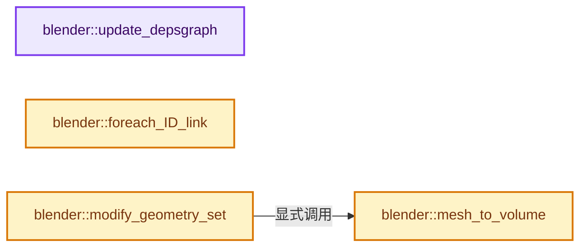
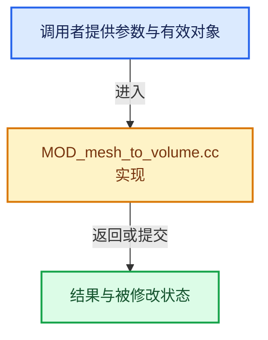

# 实现依赖专题：source/blender/modifiers/intern/MOD_mesh_to_volume.cc

[实现依赖导航](../../../README.md) · [符号索引](../../../../00-课程指南/02-源码与提交索引/符号依赖与实现索引.md)

本专题从正文实际调用进入，集中保存共享实现。函数有稳定锚点，可从调用处直接跳到对应完整函数；递归与互相调用通过回链组织。

## 本文件的实现关系






## 完整成员与函数实现

<a id="f-0131d65544cf326d"></a>

### `blender::update_depsgraph`

实现位置：[source/blender/modifiers/intern/MOD_mesh_to_volume.cc](../../../../../../../../source/blender/modifiers/intern/MOD_mesh_to_volume.cc) · L50—L60。

接口参数：

- `ModifierData *md`
- `const ModifierUpdateDepsgraphContext *ctx`

**教学注释版**

<!-- annotated:8e9ea6254ce66d -->

```cpp
static void update_depsgraph(ModifierData *md, const ModifierUpdateDepsgraphContext *ctx)
{
  MeshToVolumeModifierData *mvmd = reinterpret_cast<MeshToVolumeModifierData *>(md);
  DEG_add_depends_on_transform_relation(ctx->node, "Mesh to Volume Modifier");
  if (mvmd->object) {
    DEG_add_object_relation(
        ctx->node, mvmd->object, DEG_OB_COMP_GEOMETRY, "Mesh to Volume Modifier");
    DEG_add_object_relation(
        ctx->node, mvmd->object, DEG_OB_COMP_TRANSFORM, "Mesh to Volume Modifier");
  }
}
```

<details>
<summary>核对原始源码：source/blender/modifiers/intern/MOD_mesh_to_volume.cc · L50—L60</summary>

<!-- original:8e9ea6254ce66d:source/blender/modifiers/intern/MOD_mesh_to_volume.cc:50:60 -->

```cpp
static void update_depsgraph(ModifierData *md, const ModifierUpdateDepsgraphContext *ctx)
{
  MeshToVolumeModifierData *mvmd = reinterpret_cast<MeshToVolumeModifierData *>(md);
  DEG_add_depends_on_transform_relation(ctx->node, "Mesh to Volume Modifier");
  if (mvmd->object) {
    DEG_add_object_relation(
        ctx->node, mvmd->object, DEG_OB_COMP_GEOMETRY, "Mesh to Volume Modifier");
    DEG_add_object_relation(
        ctx->node, mvmd->object, DEG_OB_COMP_TRANSFORM, "Mesh to Volume Modifier");
  }
}
```

</details>

**继续追踪实现**

- `DEG_add_depends_on_transform_relation` → [blender::DEG_add_depends_on_transform_relation · L240](../../../06-Depsgraph依赖图/intern/depsgraph_build.cc.md#f-47c32a354defa20d)。
- `DEG_add_object_relation` → [blender::DEG_add_object_relation · L123](../../../06-Depsgraph依赖图/intern/depsgraph_build.cc.md#f-f570cffae97e273c)。

<a id="f-441e947bc69d54bb"></a>

### `blender::foreach_ID_link`

实现位置：[source/blender/modifiers/intern/MOD_mesh_to_volume.cc](../../../../../../../../source/blender/modifiers/intern/MOD_mesh_to_volume.cc) · L62—L66。

接口参数：

- `ModifierData *md`
- `Object *ob`
- `IDWalkFunc walk`
- `void *user_data`

**教学注释版**

<!-- annotated:6bf9857eed6bf3 -->

```cpp
static void foreach_ID_link(ModifierData *md, Object *ob, IDWalkFunc walk, void *user_data)
{
  MeshToVolumeModifierData *mvmd = reinterpret_cast<MeshToVolumeModifierData *>(md);
  walk(user_data, ob, reinterpret_cast<ID **>(&mvmd->object), IDWALK_CB_NOP);
}
```

<details>
<summary>核对原始源码：source/blender/modifiers/intern/MOD_mesh_to_volume.cc · L62—L66</summary>

<!-- original:6bf9857eed6bf3:source/blender/modifiers/intern/MOD_mesh_to_volume.cc:62:66 -->

```cpp
static void foreach_ID_link(ModifierData *md, Object *ob, IDWalkFunc walk, void *user_data)
{
  MeshToVolumeModifierData *mvmd = reinterpret_cast<MeshToVolumeModifierData *>(md);
  walk(user_data, ob, reinterpret_cast<ID **>(&mvmd->object), IDWALK_CB_NOP);
}
```

</details>

**继续追踪实现**

- `walk` → [调用协议](../../../../00-课程指南/01-路线与规范/模板宏与动态分派协议.md)：局部可调用对象，须结合其初始化与捕获环境。调用位置L65。

<a id="f-a212f9de8b308ee3"></a>

### `blender::mesh_to_volume`

实现位置：[source/blender/modifiers/intern/MOD_mesh_to_volume.cc](../../../../../../../../source/blender/modifiers/intern/MOD_mesh_to_volume.cc) · L103—L174。

接口参数：

- `ModifierData *md`
- `const ModifierEvalContext *ctx`
- `Volume *input_volume`

**教学注释版**

<!-- annotated:c420d32c98247c -->

```cpp
static Volume *mesh_to_volume(ModifierData *md,
                              const ModifierEvalContext *ctx,
                              Volume *input_volume)
{
#ifdef WITH_OPENVDB
  MeshToVolumeModifierData *mvmd = reinterpret_cast<MeshToVolumeModifierData *>(md);
  Object *object_to_convert = mvmd->object;

  if (object_to_convert == nullptr) {
    return input_volume;
  }
  Mesh *mesh = BKE_modifier_get_evaluated_mesh_from_evaluated_object(object_to_convert);
  if (mesh == nullptr) {
    return input_volume;
  }
  BKE_mesh_wrapper_ensure_mdata(mesh);
  if (mesh->verts_num == 0) {
    return input_volume;
  }

  const float4x4 mesh_to_own_object_space_transform = ctx->object->world_to_object() *
                                                      object_to_convert->object_to_world();
  geometry::MeshToVolumeResolution resolution;
  resolution.mode = (MeshToVolumeModifierResolutionMode)mvmd->resolution_mode;
  if (resolution.mode == MESH_TO_VOLUME_RESOLUTION_MODE_VOXEL_AMOUNT) {
    resolution.settings.voxel_amount = mvmd->voxel_amount;
    if (resolution.settings.voxel_amount < 1.0f) {
      return input_volume;
    }
  }
  else if (resolution.mode == MESH_TO_VOLUME_RESOLUTION_MODE_VOXEL_SIZE) {
    resolution.settings.voxel_size = mvmd->voxel_size;
    if (resolution.settings.voxel_size < 1e-5f) {
      return input_volume;
    }
  }

  const float voxel_size = geometry::volume_compute_voxel_size(
      ctx->depsgraph,
      [&]() { return *mesh->bounds_min_max(); },
      resolution,
      0.0f,
      mesh_to_own_object_space_transform);

  /* Create a new volume. */
  Volume *volume;
  if (input_volume == nullptr) {
    volume = BKE_id_new_nomain<Volume>("Volume");
  }
  else {
    volume = BKE_volume_new_for_eval(input_volume);
  }

  /* Convert mesh to grid and add to volume. */
  geometry::fog_volume_grid_add_from_mesh(volume,
                                          "density",
                                          mesh->vert_positions(),
                                          mesh->corner_verts(),
                                          mesh->corner_tris(),
                                          mesh_to_own_object_space_transform,
                                          voxel_size,
                                          mvmd->interior_band_width,
                                          mvmd->density);

  return volume;

#else
  UNUSED_VARS(md);
  BKE_modifier_set_error(ctx->object, md, "Compiled without OpenVDB");
  return input_volume;
#endif
}
```

<details>
<summary>核对原始源码：source/blender/modifiers/intern/MOD_mesh_to_volume.cc · L103—L174</summary>

<!-- original:c420d32c98247c:source/blender/modifiers/intern/MOD_mesh_to_volume.cc:103:174 -->

```cpp
static Volume *mesh_to_volume(ModifierData *md,
                              const ModifierEvalContext *ctx,
                              Volume *input_volume)
{
#ifdef WITH_OPENVDB
  MeshToVolumeModifierData *mvmd = reinterpret_cast<MeshToVolumeModifierData *>(md);
  Object *object_to_convert = mvmd->object;

  if (object_to_convert == nullptr) {
    return input_volume;
  }
  Mesh *mesh = BKE_modifier_get_evaluated_mesh_from_evaluated_object(object_to_convert);
  if (mesh == nullptr) {
    return input_volume;
  }
  BKE_mesh_wrapper_ensure_mdata(mesh);
  if (mesh->verts_num == 0) {
    return input_volume;
  }

  const float4x4 mesh_to_own_object_space_transform = ctx->object->world_to_object() *
                                                      object_to_convert->object_to_world();
  geometry::MeshToVolumeResolution resolution;
  resolution.mode = (MeshToVolumeModifierResolutionMode)mvmd->resolution_mode;
  if (resolution.mode == MESH_TO_VOLUME_RESOLUTION_MODE_VOXEL_AMOUNT) {
    resolution.settings.voxel_amount = mvmd->voxel_amount;
    if (resolution.settings.voxel_amount < 1.0f) {
      return input_volume;
    }
  }
  else if (resolution.mode == MESH_TO_VOLUME_RESOLUTION_MODE_VOXEL_SIZE) {
    resolution.settings.voxel_size = mvmd->voxel_size;
    if (resolution.settings.voxel_size < 1e-5f) {
      return input_volume;
    }
  }

  const float voxel_size = geometry::volume_compute_voxel_size(
      ctx->depsgraph,
      [&]() { return *mesh->bounds_min_max(); },
      resolution,
      0.0f,
      mesh_to_own_object_space_transform);

  /* Create a new volume. */
  Volume *volume;
  if (input_volume == nullptr) {
    volume = BKE_id_new_nomain<Volume>("Volume");
  }
  else {
    volume = BKE_volume_new_for_eval(input_volume);
  }

  /* Convert mesh to grid and add to volume. */
  geometry::fog_volume_grid_add_from_mesh(volume,
                                          "density",
                                          mesh->vert_positions(),
                                          mesh->corner_verts(),
                                          mesh->corner_tris(),
                                          mesh_to_own_object_space_transform,
                                          voxel_size,
                                          mvmd->interior_band_width,
                                          mvmd->density);

  return volume;

#else
  UNUSED_VARS(md);
  BKE_modifier_set_error(ctx->object, md, "Compiled without OpenVDB");
  return input_volume;
#endif
}
```

</details>

**沿实际写入检查状态**

- `resolution.mode = (MeshToVolumeModifierResolutionMode)mvmd->resolution_mode;`
- `resolution.settings.voxel_amount = mvmd->voxel_amount;`
- `resolution.settings.voxel_size = mvmd->voxel_size;`
- `volume = BKE_id_new_nomain<Volume>("Volume");`
- `volume = BKE_volume_new_for_eval(input_volume);`

**结果出口**

- `return input_volume;`
- `return volume;`

**继续追踪实现**

- `BKE_modifier_get_evaluated_mesh_from_evaluated_object` → [blender::BKE_modifier_get_evaluated_mesh_from_evaluated_object · L1041](../../../02-BKE几何与数据/intern/modifier.cc.md#f-75729c35b147b115)。
- `BKE_mesh_wrapper_ensure_mdata` → [blender::BKE_mesh_wrapper_ensure_mdata · L79](../../../02-BKE几何与数据/intern/mesh_wrapper.cc.md#f-391cdba59bba6a12)。
- `ctx->object->world_to_object` → [调用协议](../../../../00-课程指南/01-路线与规范/模板宏与动态分派协议.md)：接收对象类型依赖auto、返回值或模板实例；不按同名猜测目标。调用位置L123。
- `object_to_convert->object_to_world` → [blender::Object::object_to_world · L5761](../../../02-BKE几何与数据/intern/object.cc.md#f-12fc20026327d50c)。
- `geometry::volume_compute_voxel_size` → [blender::geometry::volume_compute_voxel_size · L83](../../../05-Geometry几何算法/intern/mesh_to_volume.cc.md#f-d3c021e4614da208)。
- `mesh->bounds_min_max` → [Mesh::bounds_min_max · L1942](../../../../05-几何存储与拓扑映射/03-MPoly迁移与兼容.md#f-1a7c466d855d52a6)。
- `BKE_id_new_nomain<Volume>` → [blender::BKE_id_new_nomain · L1617](../../../02-BKE几何与数据/intern/lib_id.cc.md#f-b72d7abbfd8aeae3)；[blender::BKE_id_new_nomain · L221](../../../02-BKE几何与数据/BKE_lib_id.hh.md#f-36ad361e833dd065)。同名重载需按实参类型选择。
- `BKE_volume_new_for_eval` → [blender::BKE_volume_new_for_eval · L959](../../../02-BKE几何与数据/intern/volume.cc.md#f-e2a0f7910cca0892)。
- `geometry::fog_volume_grid_add_from_mesh` → [blender::geometry::fog_volume_grid_add_from_mesh · L209](../../../05-Geometry几何算法/intern/mesh_to_volume.cc.md#f-7cbc8945793f2718)。
- `mesh->vert_positions` → [Mesh::vert_positions · L1193](../../../../05-几何存储与拓扑映射/03-MPoly迁移与兼容.md#f-ae4177e5c5f2b371)。
- `mesh->corner_verts` → [Mesh::corner_verts · L1238](../../../../05-几何存储与拓扑映射/03-MPoly迁移与兼容.md#f-a59c61f583b64bc4)。
- `mesh->corner_tris` → [blender::Mesh::corner_tris · L264](../../../../06-隐式共享与缓存系统/10-局部更新与失效修复.md#f-9bb421790000fc20)。
- `UNUSED_VARS` → [UNUSED_VARS · L522](../../../01-BLI基础库/BLI_utildefines.hh.md#m-013582537634)；[UNUSED_VARS · L41](../../gpu/GPU_shader_shared_utils.hh.md#m-05d9d7a33da0)；[UNUSED_VARS · L62](../../gpu/GPU_shader_shared_utils.hh.md#m-e12c683a4aca)。宏定义由构建条件选择。
- `BKE_modifier_set_error` → [blender::BKE_modifier_set_error · L416](../../../02-BKE几何与数据/intern/modifier.cc.md#f-6241829f21c08456)。

<a id="f-d3eb652ca6ad569c"></a>

### `blender::modify_geometry_set`

实现位置：[source/blender/modifiers/intern/MOD_mesh_to_volume.cc](../../../../../../../../source/blender/modifiers/intern/MOD_mesh_to_volume.cc) · L176—L185。

接口参数：

- `ModifierData *md`
- `const ModifierEvalContext *ctx`
- `bke::GeometrySet *geometry_set`

**教学注释版**

<!-- annotated:5c8587dfd3a92c -->

```cpp
static void modify_geometry_set(ModifierData *md,
                                const ModifierEvalContext *ctx,
                                bke::GeometrySet *geometry_set)
{
  Volume *input_volume = geometry_set->get_volume_for_write();
  Volume *result_volume = mesh_to_volume(md, ctx, input_volume);
  if (result_volume != input_volume) {
    geometry_set->replace_volume(result_volume);
  }
}
```

<details>
<summary>核对原始源码：source/blender/modifiers/intern/MOD_mesh_to_volume.cc · L176—L185</summary>

<!-- original:5c8587dfd3a92c:source/blender/modifiers/intern/MOD_mesh_to_volume.cc:176:185 -->

```cpp
static void modify_geometry_set(ModifierData *md,
                                const ModifierEvalContext *ctx,
                                bke::GeometrySet *geometry_set)
{
  Volume *input_volume = geometry_set->get_volume_for_write();
  Volume *result_volume = mesh_to_volume(md, ctx, input_volume);
  if (result_volume != input_volume) {
    geometry_set->replace_volume(result_volume);
  }
}
```

</details>

**继续追踪实现**

- `geometry_set->get_volume_for_write` → [blender::bke::GeometrySet::get_volume_for_write · L574](../../../../06-隐式共享与缓存系统/05-GeometrySet读写与复制.md#f-9a13760c4934e3d8)。
- `mesh_to_volume` → [blender::mesh_to_volume · L103](MOD_mesh_to_volume.cc.md#f-a212f9de8b308ee3)。
- `geometry_set->replace_volume` → [blender::bke::GeometrySet::replace_volume · L533](../../../../06-隐式共享与缓存系统/05-GeometrySet读写与复制.md#f-9abc34c3f65e4d7c)。
