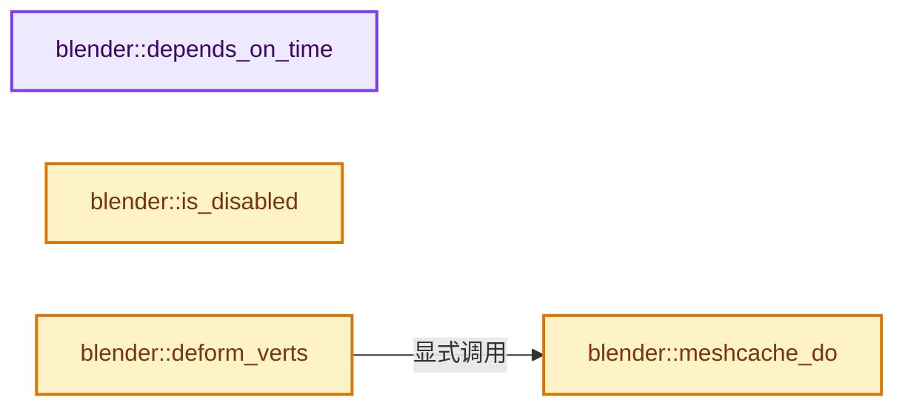
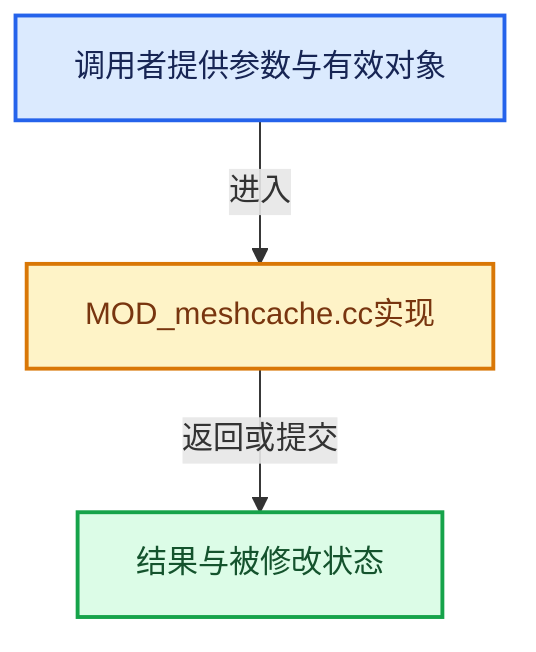

# 实现依赖专题：source/blender/modifiers/intern/MOD_meshcache.cc

[实现依赖导航](../../../README.md) · [符号索引](../../../../00-课程指南/02-源码与提交索引/符号依赖与实现索引.md)

本专题从正文实际调用进入，集中保存共享实现。函数有稳定锚点，可从调用处直接跳到对应完整函数；递归与互相调用通过回链组织。

## 本文件的实现关系






## 完整成员与函数实现

<a id="f-386e66c10ebefa17"></a>

### `blender::depends_on_time`

实现位置：[source/blender/modifiers/intern/MOD_meshcache.cc](../../../../../../../../source/blender/modifiers/intern/MOD_meshcache.cc) · L54—L58。

接口参数：

- `Scene *`
- `ModifierData *md`

**教学注释版**

<!-- annotated:af86ca6810920b -->

```cpp
static bool depends_on_time(Scene * /*scene*/, ModifierData *md)
{
  MeshCacheModifierData *mcmd = reinterpret_cast<MeshCacheModifierData *>(md);
  return (mcmd->play_mode == MOD_MESHCACHE_PLAY_CFEA);
}
```

<details>
<summary>核对原始源码：source/blender/modifiers/intern/MOD_meshcache.cc · L54—L58</summary>

<!-- original:af86ca6810920b:source/blender/modifiers/intern/MOD_meshcache.cc:54:58 -->

```cpp
static bool depends_on_time(Scene * /*scene*/, ModifierData *md)
{
  MeshCacheModifierData *mcmd = reinterpret_cast<MeshCacheModifierData *>(md);
  return (mcmd->play_mode == MOD_MESHCACHE_PLAY_CFEA);
}
```

</details>

**结果出口**

- `return (mcmd->play_mode == MOD_MESHCACHE_PLAY_CFEA);`

**继续追踪实现**

本实现没有需要继续展开的显式调用；检查返回表达式、对象转换和调用者前置条件。

<a id="f-2bd1fc07b3633983"></a>

### `blender::is_disabled`

实现位置：[source/blender/modifiers/intern/MOD_meshcache.cc](../../../../../../../../source/blender/modifiers/intern/MOD_meshcache.cc) · L60—L66。

接口参数：

- `const Scene *`
- `ModifierData *md`
- `bool`

**教学注释版**

<!-- annotated:7769c2114d92f4 -->

```cpp
static bool is_disabled(const Scene * /*scene*/, ModifierData *md, bool /*use_render_params*/)
{
  MeshCacheModifierData *mcmd = reinterpret_cast<MeshCacheModifierData *>(md);

  /* leave it up to the modifier to check the file is valid on calculation */
  return (mcmd->factor <= 0.0f) || (mcmd->filepath[0] == '\0');
}
```

<details>
<summary>核对原始源码：source/blender/modifiers/intern/MOD_meshcache.cc · L60—L66</summary>

<!-- original:7769c2114d92f4:source/blender/modifiers/intern/MOD_meshcache.cc:60:66 -->

```cpp
static bool is_disabled(const Scene * /*scene*/, ModifierData *md, bool /*use_render_params*/)
{
  MeshCacheModifierData *mcmd = reinterpret_cast<MeshCacheModifierData *>(md);

  /* leave it up to the modifier to check the file is valid on calculation */
  return (mcmd->factor <= 0.0f) || (mcmd->filepath[0] == '\0');
}
```

</details>

**结果出口**

- `return (mcmd->factor <= 0.0f) || (mcmd->filepath[0] == '\0');`

**继续追踪实现**

本实现没有需要继续展开的显式调用；检查返回表达式、对象转换和调用者前置条件。

<a id="f-5476046fbcd336e6"></a>

### `blender::meshcache_do`

实现位置：[source/blender/modifiers/intern/MOD_meshcache.cc](../../../../../../../../source/blender/modifiers/intern/MOD_meshcache.cc) · L68—L271。

接口参数：

- `MeshCacheModifierData *mcmd`
- `Scene *scene`
- `Object *ob`
- `Mesh *mesh`
- `float (*vertexCos_Real)[3]`
- `int verts_num`

**教学注释版**

<!-- annotated:3f4c43fbb3056c -->

```cpp
static void meshcache_do(MeshCacheModifierData *mcmd,
                         Scene *scene,
                         Object *ob,
                         Mesh *mesh,
                         float (*vertexCos_Real)[3],
                         int verts_num)
{
  const bool use_factor = mcmd->factor < 1.0f;
  int influence_group_index;
  const MDeformVert *dvert;
  MOD_get_vgroup(ob, mesh, mcmd->defgrp_name, &dvert, &influence_group_index);

  float (*vertexCos_Store)[3] = (use_factor || influence_group_index != -1 ||
                                 (mcmd->deform_mode == MOD_MESHCACHE_DEFORM_INTEGRATE)) ?
                                    MEM_new_array_uninitialized<float[3]>(size_t(verts_num),
                                                                          __func__) :
                                    nullptr;
  float (*vertexCos)[3] = vertexCos_Store ? vertexCos_Store : vertexCos_Real;

  const float fps = scene->frames_per_second();

  char filepath[FILE_MAX];
  const char *err_str = nullptr;
  bool ok;

  float time;

  /* -------------------------------------------------------------------- */
  /* Interpret Time (the reading functions also do some of this). */
  if (mcmd->play_mode == MOD_MESHCACHE_PLAY_CFEA) {
    const float ctime = BKE_scene_ctime_get(scene);

    switch (mcmd->time_mode) {
      case MOD_MESHCACHE_TIME_FRAME: {
        time = ctime;
        break;
      }
      case MOD_MESHCACHE_TIME_SECONDS: {
        time = ctime / fps;
        break;
      }
      case MOD_MESHCACHE_TIME_FACTOR:
      default: {
        time = ctime / fps;
        break;
      }
    }

    /* apply offset and scale */
    time = (mcmd->frame_scale * time) - mcmd->frame_start;
  }
  else { /* `if (mcmd->play_mode == MOD_MESHCACHE_PLAY_EVAL) {`. */
    switch (mcmd->time_mode) {
      case MOD_MESHCACHE_TIME_FRAME: {
        time = mcmd->eval_frame;
        break;
      }
      case MOD_MESHCACHE_TIME_SECONDS: {
        time = mcmd->eval_time;
        break;
      }
      case MOD_MESHCACHE_TIME_FACTOR:
      default: {
        time = mcmd->eval_factor;
        break;
      }
    }
  }

  /* -------------------------------------------------------------------- */
  /* Read the File (or error out when the file is bad) */

  /* would be nice if we could avoid doing this _every_ frame */
  STRNCPY(filepath, mcmd->filepath);
  BLI_path_abs(filepath, ID_BLEND_PATH_FROM_GLOBAL((ID *)ob));

  switch (mcmd->type) {
    case MOD_MESHCACHE_TYPE_MDD:
      ok = MOD_meshcache_read_mdd_times(
          filepath, vertexCos, verts_num, mcmd->interp, time, fps, mcmd->time_mode, &err_str);
      break;
    case MOD_MESHCACHE_TYPE_PC2:
      ok = MOD_meshcache_read_pc2_times(
          filepath, vertexCos, verts_num, mcmd->interp, time, fps, mcmd->time_mode, &err_str);
      break;
    default:
      ok = false;
      break;
  }

  /* -------------------------------------------------------------------- */
  /* tricky shape key integration (slow!) */
  if (mcmd->deform_mode == MOD_MESHCACHE_DEFORM_INTEGRATE) {
    Mesh *mesh = id_cast<Mesh *>(ob->data);

    /* we could support any object type */
    if (ob->type != OB_MESH) [[unlikely]] {
      BKE_modifier_set_error(ob, &mcmd->modifier, "'Integrate' only valid for Mesh objects");
    }
    else if (mesh->verts_num != verts_num) [[unlikely]] {
      BKE_modifier_set_error(ob, &mcmd->modifier, "'Integrate' original mesh vertex mismatch");
    }
    else if (mesh->faces_num == 0) [[unlikely]] {
      BKE_modifier_set_error(ob, &mcmd->modifier, "'Integrate' requires faces");
    }
    else {
      float (*vertexCos_New)[3] = MEM_new_array_uninitialized<float[3]>(size_t(verts_num),
                                                                        __func__);

      BKE_mesh_calc_relative_deform(
          mesh->face_offsets().data(),
          mesh->faces_num,
          mesh->corner_verts().data(),
          mesh->verts_num,
          /* From the original Mesh. */
          reinterpret_cast<const float (*)[3]>(mesh->vert_positions().data()),
          /* the input we've been given (shape keys!) */
          const_cast<const float (*)[3]>(vertexCos_Real),
          /* The result of this modifier. */
          const_cast<const float (*)[3]>(vertexCos),
          /* The result of this function. */
          vertexCos_New);

      /* write the corrected locations back into the result */
      // [讲解] memcpy：复制字节，源与目标不应重叠。类型生命周期、对齐和可复制表示须由调用者证明，不是任意对象的复制构造。
      memcpy(vertexCos, vertexCos_New, sizeof(*vertexCos) * verts_num);

      MEM_delete(vertexCos_New);
    }
  }

  /* -------------------------------------------------------------------- */
  /* Apply the transformation matrix (if needed) */
  if (err_str) [[unlikely]] {
    BKE_modifier_set_error(ob, &mcmd->modifier, "%s", err_str);
  }
  else if (ok) {
    bool use_matrix = false;
    float mat[3][3];
    unit_m3(mat);

    if (mat3_from_axis_conversion(mcmd->forward_axis, mcmd->up_axis, 1, 2, mat)) {
      use_matrix = true;
    }

    if (mcmd->flip_axis) {
      float tmat[3][3];
      unit_m3(tmat);
      if (mcmd->flip_axis & MOD_MESHCACHE_FLIP_AXIS_X) {
        tmat[0][0] = -1.0f;
      }
      if (mcmd->flip_axis & MOD_MESHCACHE_FLIP_AXIS_Y) {
        tmat[1][1] = -1.0f;
      }
      if (mcmd->flip_axis & MOD_MESHCACHE_FLIP_AXIS_Z) {
        tmat[2][2] = -1.0f;
      }
      mul_m3_m3m3(mat, tmat, mat);

      use_matrix = true;
    }

    if (use_matrix) {
      int i;
      for (i = 0; i < verts_num; i++) {
        mul_m3_v3(mat, vertexCos[i]);
      }
    }
  }

  if (vertexCos_Store) {
    if (ok) {
      if (influence_group_index != -1) {
        const float global_factor = (mcmd->flag & MOD_MESHCACHE_INVERT_VERTEX_GROUP) ?
                                        -mcmd->factor :
                                        mcmd->factor;
        const float global_offset = (mcmd->flag & MOD_MESHCACHE_INVERT_VERTEX_GROUP) ?
                                        mcmd->factor :
                                        0.0f;
        if (!mesh->deform_verts().is_empty()) {
          for (int i = 0; i < verts_num; i++) {
            /* For each vertex, compute its blending factor between the mesh cache (for `fac = 0`)
             * and the former position of the vertex (for `fac = 1`). */
            const MDeformVert *currentIndexDVert = dvert + i;
            const float local_vertex_fac = global_offset +
                                           BKE_defvert_find_weight(currentIndexDVert,
                                                                   influence_group_index) *
                                               global_factor;
            interp_v3_v3v3(
                vertexCos_Real[i], vertexCos_Real[i], vertexCos_Store[i], local_vertex_fac);
          }
        }
      }
      else if (use_factor) {
        /* Influence_group_index is -1. */
        interp_vn_vn(*vertexCos_Real, *vertexCos_Store, mcmd->factor, verts_num * 3);
      }
      else {
        memcpy(vertexCos_Real, vertexCos_Store, sizeof(*vertexCos_Store) * verts_num);
      }
    }

    MEM_delete(vertexCos_Store);
  }
}
```

<details>
<summary>核对原始源码：source/blender/modifiers/intern/MOD_meshcache.cc · L68—L271</summary>

<!-- original:3f4c43fbb3056c:source/blender/modifiers/intern/MOD_meshcache.cc:68:271 -->

```cpp
static void meshcache_do(MeshCacheModifierData *mcmd,
                         Scene *scene,
                         Object *ob,
                         Mesh *mesh,
                         float (*vertexCos_Real)[3],
                         int verts_num)
{
  const bool use_factor = mcmd->factor < 1.0f;
  int influence_group_index;
  const MDeformVert *dvert;
  MOD_get_vgroup(ob, mesh, mcmd->defgrp_name, &dvert, &influence_group_index);

  float (*vertexCos_Store)[3] = (use_factor || influence_group_index != -1 ||
                                 (mcmd->deform_mode == MOD_MESHCACHE_DEFORM_INTEGRATE)) ?
                                    MEM_new_array_uninitialized<float[3]>(size_t(verts_num),
                                                                          __func__) :
                                    nullptr;
  float (*vertexCos)[3] = vertexCos_Store ? vertexCos_Store : vertexCos_Real;

  const float fps = scene->frames_per_second();

  char filepath[FILE_MAX];
  const char *err_str = nullptr;
  bool ok;

  float time;

  /* -------------------------------------------------------------------- */
  /* Interpret Time (the reading functions also do some of this). */
  if (mcmd->play_mode == MOD_MESHCACHE_PLAY_CFEA) {
    const float ctime = BKE_scene_ctime_get(scene);

    switch (mcmd->time_mode) {
      case MOD_MESHCACHE_TIME_FRAME: {
        time = ctime;
        break;
      }
      case MOD_MESHCACHE_TIME_SECONDS: {
        time = ctime / fps;
        break;
      }
      case MOD_MESHCACHE_TIME_FACTOR:
      default: {
        time = ctime / fps;
        break;
      }
    }

    /* apply offset and scale */
    time = (mcmd->frame_scale * time) - mcmd->frame_start;
  }
  else { /* `if (mcmd->play_mode == MOD_MESHCACHE_PLAY_EVAL) {`. */
    switch (mcmd->time_mode) {
      case MOD_MESHCACHE_TIME_FRAME: {
        time = mcmd->eval_frame;
        break;
      }
      case MOD_MESHCACHE_TIME_SECONDS: {
        time = mcmd->eval_time;
        break;
      }
      case MOD_MESHCACHE_TIME_FACTOR:
      default: {
        time = mcmd->eval_factor;
        break;
      }
    }
  }

  /* -------------------------------------------------------------------- */
  /* Read the File (or error out when the file is bad) */

  /* would be nice if we could avoid doing this _every_ frame */
  STRNCPY(filepath, mcmd->filepath);
  BLI_path_abs(filepath, ID_BLEND_PATH_FROM_GLOBAL((ID *)ob));

  switch (mcmd->type) {
    case MOD_MESHCACHE_TYPE_MDD:
      ok = MOD_meshcache_read_mdd_times(
          filepath, vertexCos, verts_num, mcmd->interp, time, fps, mcmd->time_mode, &err_str);
      break;
    case MOD_MESHCACHE_TYPE_PC2:
      ok = MOD_meshcache_read_pc2_times(
          filepath, vertexCos, verts_num, mcmd->interp, time, fps, mcmd->time_mode, &err_str);
      break;
    default:
      ok = false;
      break;
  }

  /* -------------------------------------------------------------------- */
  /* tricky shape key integration (slow!) */
  if (mcmd->deform_mode == MOD_MESHCACHE_DEFORM_INTEGRATE) {
    Mesh *mesh = id_cast<Mesh *>(ob->data);

    /* we could support any object type */
    if (ob->type != OB_MESH) [[unlikely]] {
      BKE_modifier_set_error(ob, &mcmd->modifier, "'Integrate' only valid for Mesh objects");
    }
    else if (mesh->verts_num != verts_num) [[unlikely]] {
      BKE_modifier_set_error(ob, &mcmd->modifier, "'Integrate' original mesh vertex mismatch");
    }
    else if (mesh->faces_num == 0) [[unlikely]] {
      BKE_modifier_set_error(ob, &mcmd->modifier, "'Integrate' requires faces");
    }
    else {
      float (*vertexCos_New)[3] = MEM_new_array_uninitialized<float[3]>(size_t(verts_num),
                                                                        __func__);

      BKE_mesh_calc_relative_deform(
          mesh->face_offsets().data(),
          mesh->faces_num,
          mesh->corner_verts().data(),
          mesh->verts_num,
          /* From the original Mesh. */
          reinterpret_cast<const float (*)[3]>(mesh->vert_positions().data()),
          /* the input we've been given (shape keys!) */
          const_cast<const float (*)[3]>(vertexCos_Real),
          /* The result of this modifier. */
          const_cast<const float (*)[3]>(vertexCos),
          /* The result of this function. */
          vertexCos_New);

      /* write the corrected locations back into the result */
      memcpy(vertexCos, vertexCos_New, sizeof(*vertexCos) * verts_num);

      MEM_delete(vertexCos_New);
    }
  }

  /* -------------------------------------------------------------------- */
  /* Apply the transformation matrix (if needed) */
  if (err_str) [[unlikely]] {
    BKE_modifier_set_error(ob, &mcmd->modifier, "%s", err_str);
  }
  else if (ok) {
    bool use_matrix = false;
    float mat[3][3];
    unit_m3(mat);

    if (mat3_from_axis_conversion(mcmd->forward_axis, mcmd->up_axis, 1, 2, mat)) {
      use_matrix = true;
    }

    if (mcmd->flip_axis) {
      float tmat[3][3];
      unit_m3(tmat);
      if (mcmd->flip_axis & MOD_MESHCACHE_FLIP_AXIS_X) {
        tmat[0][0] = -1.0f;
      }
      if (mcmd->flip_axis & MOD_MESHCACHE_FLIP_AXIS_Y) {
        tmat[1][1] = -1.0f;
      }
      if (mcmd->flip_axis & MOD_MESHCACHE_FLIP_AXIS_Z) {
        tmat[2][2] = -1.0f;
      }
      mul_m3_m3m3(mat, tmat, mat);

      use_matrix = true;
    }

    if (use_matrix) {
      int i;
      for (i = 0; i < verts_num; i++) {
        mul_m3_v3(mat, vertexCos[i]);
      }
    }
  }

  if (vertexCos_Store) {
    if (ok) {
      if (influence_group_index != -1) {
        const float global_factor = (mcmd->flag & MOD_MESHCACHE_INVERT_VERTEX_GROUP) ?
                                        -mcmd->factor :
                                        mcmd->factor;
        const float global_offset = (mcmd->flag & MOD_MESHCACHE_INVERT_VERTEX_GROUP) ?
                                        mcmd->factor :
                                        0.0f;
        if (!mesh->deform_verts().is_empty()) {
          for (int i = 0; i < verts_num; i++) {
            /* For each vertex, compute its blending factor between the mesh cache (for `fac = 0`)
             * and the former position of the vertex (for `fac = 1`). */
            const MDeformVert *currentIndexDVert = dvert + i;
            const float local_vertex_fac = global_offset +
                                           BKE_defvert_find_weight(currentIndexDVert,
                                                                   influence_group_index) *
                                               global_factor;
            interp_v3_v3v3(
                vertexCos_Real[i], vertexCos_Real[i], vertexCos_Store[i], local_vertex_fac);
          }
        }
      }
      else if (use_factor) {
        /* Influence_group_index is -1. */
        interp_vn_vn(*vertexCos_Real, *vertexCos_Store, mcmd->factor, verts_num * 3);
      }
      else {
        memcpy(vertexCos_Real, vertexCos_Store, sizeof(*vertexCos_Store) * verts_num);
      }
    }

    MEM_delete(vertexCos_Store);
  }
}
```

</details>

**沿实际写入检查状态**

- `time = ctime;`
- `time = ctime / fps;`
- `time = (mcmd->frame_scale * time) - mcmd->frame_start;`
- `time = mcmd->eval_frame;`
- `time = mcmd->eval_time;`
- `time = mcmd->eval_factor;`
- `ok = MOD_meshcache_read_mdd_times(`
- `ok = MOD_meshcache_read_pc2_times(`
- `ok = false;`
- `use_matrix = true;`
- `tmat[0][0] = -1.0f;`
- `tmat[1][1] = -1.0f;`
- `tmat[2][2] = -1.0f;`

**继续追踪实现**

- `MOD_get_vgroup` → [blender::MOD_get_vgroup · L158](MOD_util.cc.md#f-f461611d86b94405)。
- `MEM_new_array_uninitialized<float[3]>` → [MEM_new_array_uninitialized · L608](../../../07-Intern运行时与平台/guardedalloc/MEM_guardedalloc.h.md#f-b7103eae8eb57b05)；[MEM_new_array_uninitialized · L129](../../../07-Intern运行时与平台/guardedalloc/intern/mallocn.cc.md#f-bf6ef4ddcfb6e5df)。同名重载需按实参类型选择。
- `scene->frames_per_second` → [blender::Scene::frames_per_second · L1704](../../../02-BKE几何与数据/intern/scene.cc.md#f-76be2374a615ddd5)。
- `BKE_scene_ctime_get` → [blender::BKE_scene_ctime_get · L2591](../../../02-BKE几何与数据/intern/scene.cc.md#f-5e28483f19a62bf5)。
- `STRNCPY` → [blender::STRNCPY · L690](../../../01-BLI基础库/BLI_string.hh.md#f-6b2d861724026be6)。
- `BLI_path_abs` → [BLI_path_abs · L1164](../../../01-BLI基础库/intern/path_utils.cc.md#f-002380948c1caeb6)。
- `ID_BLEND_PATH_FROM_GLOBAL` → [ID_BLEND_PATH_FROM_GLOBAL · L691](../../makesdna/DNA_ID.h.md#m-2b76f08bf41b)。宏定义由构建条件选择。
- `MOD_meshcache_read_mdd_times` → [blender::MOD_meshcache_read_mdd_times · L262](MOD_meshcache_mdd.cc.md#f-09fbd6eae70b300d)。
- `MOD_meshcache_read_pc2_times` → [blender::MOD_meshcache_read_pc2_times · L224](MOD_meshcache_pc2.cc.md#f-6281d8d224e2f9b3)。
- `id_cast<Mesh *>` → [blender::id_cast · L1417](../../makesdna/DNA_ID.h.md#f-6c8ac6412850ac5a)。
- `BKE_modifier_set_error` → [blender::BKE_modifier_set_error · L416](../../../02-BKE几何与数据/intern/modifier.cc.md#f-6241829f21c08456)。
- `BKE_mesh_calc_relative_deform` → [blender::BKE_mesh_calc_relative_deform · L721](../../../02-BKE几何与数据/intern/mesh_evaluate.cc.md#f-2ea80233b007ee56)。
- `mesh->face_offsets().data` → [调用协议](../../../../00-课程指南/01-路线与规范/模板宏与动态分派协议.md)：接收对象类型依赖auto、返回值或模板实例；不按同名猜测目标。调用位置L178。
- `mesh->face_offsets` → [Mesh::face_offsets · L1221](../../../../05-几何存储与拓扑映射/03-MPoly迁移与兼容.md#f-49a5e24b1b5e8989)。
- `mesh->corner_verts().data` → [调用协议](../../../../00-课程指南/01-路线与规范/模板宏与动态分派协议.md)：接收对象类型依赖auto、返回值或模板实例；不按同名猜测目标。调用位置L180。
- `mesh->corner_verts` → [Mesh::corner_verts · L1238](../../../../05-几何存储与拓扑映射/03-MPoly迁移与兼容.md#f-a59c61f583b64bc4)。
- `mesh->vert_positions().data` → [调用协议](../../../../00-课程指南/01-路线与规范/模板宏与动态分派协议.md)：接收对象类型依赖auto、返回值或模板实例；不按同名猜测目标。调用位置L183。
- `mesh->vert_positions` → [Mesh::vert_positions · L1193](../../../../05-几何存储与拓扑映射/03-MPoly迁移与兼容.md#f-ae4177e5c5f2b371)。
- `memcpy` → [外部契约](https://eel.is/c++draft/cstring.syn)：复制字节，源与目标不应重叠。类型生命周期、对齐和可复制表示须由调用者证明，不是任意对象的复制构造。
- `MEM_delete` → [MEM_delete · L400](../../../07-Intern运行时与平台/guardedalloc/MEM_guardedalloc.h.md#f-9049ffdd1682887c)。
- `unit_m3` → [blender::unit_m3 · L47](../../../01-BLI基础库/intern/math_matrix_c.cc.md#f-85e0073adca4ccff)。
- `mat3_from_axis_conversion` → [blender::mat3_from_axis_conversion · L2450](../../../01-BLI基础库/intern/math_rotation_c.cc.md#f-6b72083bfc902fe6)。
- `mul_m3_m3m3` → [blender::mul_m3_m3m3 · L319](../../../01-BLI基础库/intern/math_matrix_c.cc.md#f-a94832ebc0ebc84d)。
- `mul_m3_v3` → [blender::mul_m3_v3 · L853](../../../01-BLI基础库/intern/math_matrix_c.cc.md#f-8dbb02b9a9a2d195)。
- `mesh->deform_verts().is_empty` → [调用协议](../../../../00-课程指南/01-路线与规范/模板宏与动态分派协议.md)：接收对象类型依赖auto、返回值或模板实例；不按同名猜测目标。调用位置L246。
- `mesh->deform_verts` → [Mesh::deform_verts · L1266](../../../../05-几何存储与拓扑映射/03-MPoly迁移与兼容.md#f-4c0433aad24aa301)。
- `BKE_defvert_find_weight` → [blender::BKE_defvert_find_weight · L779](../../../02-BKE几何与数据/intern/deform.cc.md#f-c117fcd05c4fd453)。
- `interp_v3_v3v3` → [blender::interp_v3_v3v3 · L41](../../../01-BLI基础库/intern/math_vector.cc.md#f-18251c70c00824d7)。
- `interp_vn_vn` → [blender::interp_vn_vn · L963](../../../01-BLI基础库/intern/math_vector.cc.md#f-7226efdc8be343a6)。

<a id="f-9705a04062fd0b35"></a>

### `blender::deform_verts`

实现位置：[source/blender/modifiers/intern/MOD_meshcache.cc](../../../../../../../../source/blender/modifiers/intern/MOD_meshcache.cc) · L273—L287。

接口参数：

- `ModifierData *md`
- `const ModifierEvalContext *ctx`
- `Mesh *mesh`
- `MutableSpan<float3> positions`

**教学注释版**

<!-- annotated:92b1b66b54a02d -->

```cpp
static void deform_verts(ModifierData *md,
                         const ModifierEvalContext *ctx,
                         Mesh *mesh,
                         MutableSpan<float3> positions)
{
  MeshCacheModifierData *mcmd = reinterpret_cast<MeshCacheModifierData *>(md);
  Scene *scene = DEG_get_evaluated_scene(ctx->depsgraph);

  meshcache_do(mcmd,
               scene,
               ctx->object,
               mesh,
               // [讲解] positions.data：返回借用范围的地址。
               reinterpret_cast<float (*)[3]>(positions.data()),
               // [讲解] positions.size：查询视图长度或生成对应有效索引区间。
               positions.size());
}
```

<details>
<summary>核对原始源码：source/blender/modifiers/intern/MOD_meshcache.cc · L273—L287</summary>

<!-- original:92b1b66b54a02d:source/blender/modifiers/intern/MOD_meshcache.cc:273:287 -->

```cpp
static void deform_verts(ModifierData *md,
                         const ModifierEvalContext *ctx,
                         Mesh *mesh,
                         MutableSpan<float3> positions)
{
  MeshCacheModifierData *mcmd = reinterpret_cast<MeshCacheModifierData *>(md);
  Scene *scene = DEG_get_evaluated_scene(ctx->depsgraph);

  meshcache_do(mcmd,
               scene,
               ctx->object,
               mesh,
               reinterpret_cast<float (*)[3]>(positions.data()),
               positions.size());
}
```

</details>

**继续追踪实现**

- `DEG_get_evaluated_scene` → [blender::DEG_get_evaluated_scene · L212](../../../06-Depsgraph依赖图/intern/depsgraph_query.cc.md#f-be7729d26a71d3fd)。
- `meshcache_do` → [blender::meshcache_do · L68](MOD_meshcache.cc.md#f-5476046fbcd336e6)。
- `positions.data` → [blender::MutableSpan::data · L545](../../../../01-基础容器与现代CPP/06-MutableSpan可写视图.md#f-eb45a6e4d8211efd)；[blender::gpu::shader::parser::MutableSpan::data · L82](../../gpu/shader_tool/utils.hh.md#f-ad0a09cec9741c65)。同名重载需按实参类型选择。
- `positions.size` → [blender::MutableSpan::size · L499](../../../../01-基础容器与现代CPP/06-MutableSpan可写视图.md#f-1de6a66839c304a8)；[blender::gpu::shader::parser::MutableSpan::size · L87](../../gpu/shader_tool/utils.hh.md#f-5e684af6ee7990e9)。同名重载需按实参类型选择。
