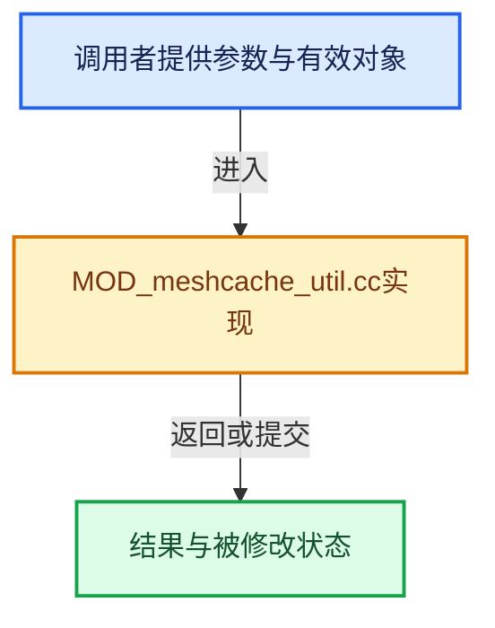

# 实现依赖专题：source/blender/modifiers/intern/MOD_meshcache_util.cc

[实现依赖导航](../../../README.md) · [符号索引](../../../../00-课程指南/02-源码与提交索引/符号依赖与实现索引.md)

本专题从正文实际调用进入，集中保存共享实现。函数有稳定锚点，可从调用处直接跳到对应完整函数；递归与互相调用通过回链组织。

## 本文件的实现关系





## 完整成员与函数实现

<a id="f-293a4803d3c64fd4"></a>

### `blender::MOD_meshcache_calc_range`

实现位置：[source/blender/modifiers/intern/MOD_meshcache_util.cc](../../../../../../../../source/blender/modifiers/intern/MOD_meshcache_util.cc) · L17—L52。

接口参数：

- `const float frame`
- `const char interp`
- `const int frame_tot`
- `int r_index_range[2]`
- `float *r_factor`

**教学注释版**

<!-- annotated:10bdbcdbf28425 -->

```cpp
void MOD_meshcache_calc_range(const float frame,
                              const char interp,
                              const int frame_tot,
                              int r_index_range[2],
                              float *r_factor)
{
  if (interp == MOD_MESHCACHE_INTERP_NONE) {
    r_index_range[0] = r_index_range[1] = max_ii(0, min_ii(frame_tot - 1, round_fl_to_int(frame)));
    *r_factor = 1.0f; /* dummy */
  }
  else {
    const float tframe = floorf(frame);
    const float range = frame - tframe;
    r_index_range[0] = int(tframe);
    if (range <= FRAME_SNAP_EPS) {
      /* we're close enough not to need blending */
      r_index_range[1] = r_index_range[0];
      *r_factor = 1.0f; /* dummy */
    }
    else {
      /* blend between 2 frames */
      r_index_range[1] = r_index_range[0] + 1;
      *r_factor = range;
    }

    /* clamp */
    if ((r_index_range[0] >= frame_tot) || (r_index_range[1] >= frame_tot)) {
      r_index_range[0] = r_index_range[1] = frame_tot - 1;
      *r_factor = 1.0f; /* dummy */
    }
    else if ((r_index_range[0] < 0) || (r_index_range[1] < 0)) {
      r_index_range[0] = r_index_range[1] = 0;
      *r_factor = 1.0f; /* dummy */
    }
  }
}
```

<details>
<summary>核对原始源码：source/blender/modifiers/intern/MOD_meshcache_util.cc · L17—L52</summary>

<!-- original:10bdbcdbf28425:source/blender/modifiers/intern/MOD_meshcache_util.cc:17:52 -->

```cpp
void MOD_meshcache_calc_range(const float frame,
                              const char interp,
                              const int frame_tot,
                              int r_index_range[2],
                              float *r_factor)
{
  if (interp == MOD_MESHCACHE_INTERP_NONE) {
    r_index_range[0] = r_index_range[1] = max_ii(0, min_ii(frame_tot - 1, round_fl_to_int(frame)));
    *r_factor = 1.0f; /* dummy */
  }
  else {
    const float tframe = floorf(frame);
    const float range = frame - tframe;
    r_index_range[0] = int(tframe);
    if (range <= FRAME_SNAP_EPS) {
      /* we're close enough not to need blending */
      r_index_range[1] = r_index_range[0];
      *r_factor = 1.0f; /* dummy */
    }
    else {
      /* blend between 2 frames */
      r_index_range[1] = r_index_range[0] + 1;
      *r_factor = range;
    }

    /* clamp */
    if ((r_index_range[0] >= frame_tot) || (r_index_range[1] >= frame_tot)) {
      r_index_range[0] = r_index_range[1] = frame_tot - 1;
      *r_factor = 1.0f; /* dummy */
    }
    else if ((r_index_range[0] < 0) || (r_index_range[1] < 0)) {
      r_index_range[0] = r_index_range[1] = 0;
      *r_factor = 1.0f; /* dummy */
    }
  }
}
```

</details>

**沿实际写入检查状态**

- `r_index_range[0] = r_index_range[1] = max_ii(0, min_ii(frame_tot - 1, round_fl_to_int(frame)));`
- `r_index_range[0] = int(tframe);`
- `r_index_range[1] = r_index_range[0];`
- `r_index_range[1] = r_index_range[0] + 1;`
- `r_index_range[0] = r_index_range[1] = frame_tot - 1;`
- `r_index_range[0] = r_index_range[1] = 0;`

**继续追踪实现**

- `max_ii` → [blender::max_ii · L368](../../../01-BLI基础库/intern/math_base_inline.cc.md#f-c45aa7b373adb94c)。
- `min_ii` → [blender::min_ii · L364](../../../01-BLI基础库/intern/math_base_inline.cc.md#f-30336db35b2810b8)。
- `round_fl_to_int` → [blender::round_fl_to_int · L193](../../../01-BLI基础库/intern/math_base_inline.cc.md#f-ce88de51b67ea3e6)。
- `floorf` → [floorf · L22](../../../07-Intern运行时与平台/cycles/kernel/svm/radial_tiling_shared.h.md#m-fb64dda1b0f0)；[floorf · L44](../../../07-Intern运行时与平台/cycles/kernel/svm/radial_tiling_shared.h.md#m-25e4a157b53d)；[floorf · L75](../../../07-Intern运行时与平台/cycles/kernel/svm/radial_tiling_shared.h.md#m-e128f662cbe8)；[floorf · L26](../../../01-BLI基础库/intern/radial_tiling_shared.hh.md#m-ebadf845d492)；[floorf · L48](../../../01-BLI基础库/intern/radial_tiling_shared.hh.md#m-efe0b148573a)；[floorf · L79](../../../01-BLI基础库/intern/radial_tiling_shared.hh.md#m-9df2f26758e8)；[floorf · L22](../../../07-Intern运行时与平台/cycles/kernel/osl/shaders/node_radial_tiling_shared.h.md#m-6b2e29ad4b19)；[floorf · L44](../../../07-Intern运行时与平台/cycles/kernel/osl/shaders/node_radial_tiling_shared.h.md#m-f90222d9b445)；[floorf · L75](../../../07-Intern运行时与平台/cycles/kernel/osl/shaders/node_radial_tiling_shared.h.md#m-938380992bb5)；[floorf · L172](../../../07-Intern运行时与平台/cycles/kernel/device/oneapi/compat.h.md#m-176475a253a6)；[floorf · L270](../../../07-Intern运行时与平台/cycles/kernel/device/metal/compat.h.md#m-fb37dbc77698)；[floorf · L49](../../gpu/GPU_shader_shared_utils.hh.md#m-e7115fdd7560)；[floorf · L70](../../gpu/GPU_shader_shared_utils.hh.md#m-aee5f6a438e4)。宏定义由构建条件选择。
