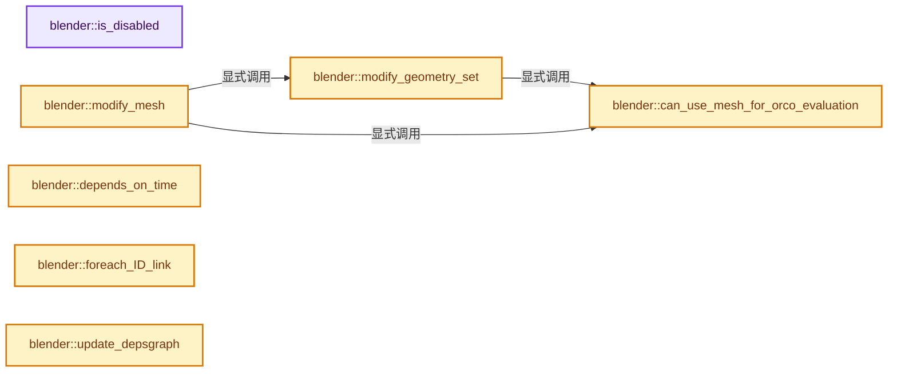
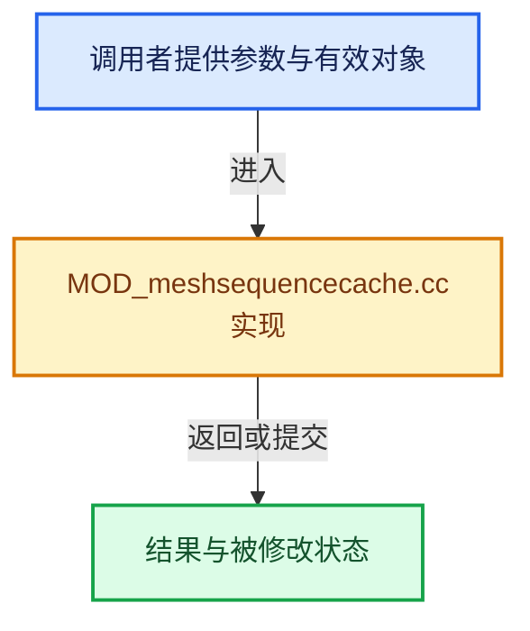

# 实现依赖专题：source/blender/modifiers/intern/MOD_meshsequencecache.cc

[实现依赖导航](../../../README.md) · [符号索引](../../../../00-课程指南/02-源码与提交索引/符号依赖与实现索引.md)

本专题从正文实际调用进入，集中保存共享实现。函数有稳定锚点，可从调用处直接跳到对应完整函数；递归与互相调用通过回链组织。

## 本文件的实现关系






## 完整成员与函数实现

<a id="f-1a635d0bc724e354"></a>

### `blender::is_disabled`

实现位置：[source/blender/modifiers/intern/MOD_meshsequencecache.cc](../../../../../../../../source/blender/modifiers/intern/MOD_meshsequencecache.cc) · L91—L97。

接口参数：

- `const Scene *`
- `ModifierData *md`
- `bool`

**教学注释版**

<!-- annotated:949baa9cb1c2e9 -->

```cpp
static bool is_disabled(const Scene * /*scene*/, ModifierData *md, bool /*use_render_params*/)
{
  MeshSeqCacheModifierData *mcmd = reinterpret_cast<MeshSeqCacheModifierData *>(md);

  /* leave it up to the modifier to check the file is valid on calculation */
  return (mcmd->cache_file == nullptr) || (mcmd->object_path[0] == '\0');
}
```

<details>
<summary>核对原始源码：source/blender/modifiers/intern/MOD_meshsequencecache.cc · L91—L97</summary>

<!-- original:949baa9cb1c2e9:source/blender/modifiers/intern/MOD_meshsequencecache.cc:91:97 -->

```cpp
static bool is_disabled(const Scene * /*scene*/, ModifierData *md, bool /*use_render_params*/)
{
  MeshSeqCacheModifierData *mcmd = reinterpret_cast<MeshSeqCacheModifierData *>(md);

  /* leave it up to the modifier to check the file is valid on calculation */
  return (mcmd->cache_file == nullptr) || (mcmd->object_path[0] == '\0');
}
```

</details>

**结果出口**

- `return (mcmd->cache_file == nullptr) || (mcmd->object_path[0] == '\0');`

**继续追踪实现**

本实现没有需要继续展开的显式调用；检查返回表达式、对象转换和调用者前置条件。

<a id="f-c3e9c17ba8ba19da"></a>

### `blender::can_use_mesh_for_orco_evaluation`

实现位置：[source/blender/modifiers/intern/MOD_meshsequencecache.cc](../../../../../../../../source/blender/modifiers/intern/MOD_meshsequencecache.cc) · L104—L143。

接口参数：

- `MeshSeqCacheModifierData *mcmd`
- `const ModifierEvalContext *ctx`
- `const Mesh *mesh`
- `const double frame_offset`
- `const double time_offset`
- `const char **r_err_str`

**教学注释版**

<!-- annotated:5b8b985bb2c157 -->

```cpp
static bool can_use_mesh_for_orco_evaluation(MeshSeqCacheModifierData *mcmd,
                                             const ModifierEvalContext *ctx,
                                             const Mesh *mesh,
                                             const double frame_offset,
                                             const double time_offset,
                                             const char **r_err_str)
{
  if ((ctx->flag & MOD_APPLY_ORCO) == 0) {
    return false;
  }

  CacheFile *cache_file = mcmd->cache_file;

  switch (cache_file->type) {
    case CACHEFILE_TYPE_ALEMBIC:
#  ifdef WITH_ALEMBIC
      if (!ABC_mesh_topology_changed(mcmd->reader, ctx->object, mesh, time_offset, r_err_str)) {
        return true;
      }
#  else
      UNUSED_VARS(time_offset);
#  endif
      break;
    case CACHEFILE_TYPE_USD:
#  ifdef WITH_USD
      if (!io::usd::USD_mesh_topology_changed(
              mcmd->reader, ctx->object, mesh, frame_offset, r_err_str))
      {
        return true;
      }
#  else
      UNUSED_VARS(frame_offset);
#  endif
      break;
    case CACHE_FILE_TYPE_INVALID:
      break;
  }

  return false;
}
```

<details>
<summary>核对原始源码：source/blender/modifiers/intern/MOD_meshsequencecache.cc · L104—L143</summary>

<!-- original:5b8b985bb2c157:source/blender/modifiers/intern/MOD_meshsequencecache.cc:104:143 -->

```cpp
static bool can_use_mesh_for_orco_evaluation(MeshSeqCacheModifierData *mcmd,
                                             const ModifierEvalContext *ctx,
                                             const Mesh *mesh,
                                             const double frame_offset,
                                             const double time_offset,
                                             const char **r_err_str)
{
  if ((ctx->flag & MOD_APPLY_ORCO) == 0) {
    return false;
  }

  CacheFile *cache_file = mcmd->cache_file;

  switch (cache_file->type) {
    case CACHEFILE_TYPE_ALEMBIC:
#  ifdef WITH_ALEMBIC
      if (!ABC_mesh_topology_changed(mcmd->reader, ctx->object, mesh, time_offset, r_err_str)) {
        return true;
      }
#  else
      UNUSED_VARS(time_offset);
#  endif
      break;
    case CACHEFILE_TYPE_USD:
#  ifdef WITH_USD
      if (!io::usd::USD_mesh_topology_changed(
              mcmd->reader, ctx->object, mesh, frame_offset, r_err_str))
      {
        return true;
      }
#  else
      UNUSED_VARS(frame_offset);
#  endif
      break;
    case CACHE_FILE_TYPE_INVALID:
      break;
  }

  return false;
}
```

</details>

**结果出口**

- `return false;`
- `return true;`

**继续追踪实现**

- `ABC_mesh_topology_changed` → [blender::ABC_mesh_topology_changed · L925](../../io/alembic/intern/alembic_capi.cc.md#f-19ab3d009d455876)。
- `UNUSED_VARS` → [UNUSED_VARS · L522](../../../01-BLI基础库/BLI_utildefines.hh.md#m-013582537634)；[UNUSED_VARS · L41](../../gpu/GPU_shader_shared_utils.hh.md#m-05d9d7a33da0)；[UNUSED_VARS · L62](../../gpu/GPU_shader_shared_utils.hh.md#m-e12c683a4aca)。宏定义由构建条件选择。
- `io::usd::USD_mesh_topology_changed` → [blender::io::usd::USD_mesh_topology_changed · L545](../../io/usd/intern/usd_capi_import.cc.md#f-2a7a87b4aa39654b)。

<a id="f-293a594730db07db"></a>

### `blender::modify_geometry_set`

实现位置：[source/blender/modifiers/intern/MOD_meshsequencecache.cc](../../../../../../../../source/blender/modifiers/intern/MOD_meshsequencecache.cc) · L146—L219。

接口参数：

- `ModifierData *md`
- `const ModifierEvalContext *ctx`
- `bke::GeometrySet *geometry_set`

**教学注释版**

<!-- annotated:a4e5e5734ae543 -->

```cpp
static void modify_geometry_set(ModifierData *md,
                                const ModifierEvalContext *ctx,
                                bke::GeometrySet *geometry_set)
{
#if defined(WITH_USD) || defined(WITH_ALEMBIC)
  MeshSeqCacheModifierData *mcmd = reinterpret_cast<MeshSeqCacheModifierData *>(md);

  Scene *scene = DEG_get_evaluated_scene(ctx->depsgraph);
  CacheFile *cache_file = mcmd->cache_file;
  const double frame = double(DEG_get_ctime(ctx->depsgraph));
  const double frame_offset = BKE_cachefile_frame_offset(cache_file, frame);
  const double time_offset = BKE_cachefile_time_offset(
      cache_file, frame, scene->frames_per_second());
  const char *err_str = nullptr;

  if (!mcmd->reader || !STREQ(mcmd->reader_object_path, mcmd->object_path)) {
    STRNCPY(mcmd->reader_object_path, mcmd->object_path);
    BKE_cachefile_reader_open(cache_file, &mcmd->reader, ctx->object, mcmd->object_path);
    if (!mcmd->reader) {
      BKE_modifier_set_error(
          ctx->object, md, "Could not create cache reader for file %s", cache_file->filepath);
      return;
    }
  }

  if (geometry_set->has_mesh()) {
    const Mesh *mesh = geometry_set->get_mesh();
    if (can_use_mesh_for_orco_evaluation(mcmd, ctx, mesh, frame_offset, time_offset, &err_str)) {
      return;
    }
  }

  /* Time (in frames or seconds) between two velocity samples. Automatically computed to
   * scale the velocity vectors at render time for generating proper motion blur data. */
#  ifdef WITH_ALEMBIC
  float velocity_scale = mcmd->velocity_scale;
  if (mcmd->cache_file->velocity_unit == CACHEFILE_VELOCITY_UNIT_FRAME) {
    velocity_scale *= scene->frames_per_second();
  }
#  endif

  switch (cache_file->type) {
    case CACHEFILE_TYPE_ALEMBIC: {
#  ifdef WITH_ALEMBIC
      ABCReadParams params;
      params.time = time_offset;
      params.read_flags = mcmd->read_flag;
      params.velocity_name = mcmd->cache_file->velocity_name;
      params.velocity_scale = velocity_scale;
      ABC_read_geometry(mcmd->reader, ctx->object, *geometry_set, &params, &err_str);
#  endif
      break;
    }
    case CACHEFILE_TYPE_USD: {
#  ifdef WITH_USD
      const io::usd::USDMeshReadParams params = io::usd::create_mesh_read_params(frame_offset,
                                                                                 mcmd->read_flag);
      io::usd::USD_read_geometry(mcmd->reader, ctx->object, *geometry_set, params, &err_str);
#  endif
      break;
    }
    case CACHE_FILE_TYPE_INVALID:
      break;
  }

  if (err_str) {
    BKE_modifier_set_error(ctx->object, md, "%s", err_str);
  }

#else
  UNUSED_VARS(ctx, md, geometry_set);
  return;
#endif
}
```

<details>
<summary>核对原始源码：source/blender/modifiers/intern/MOD_meshsequencecache.cc · L146—L219</summary>

<!-- original:a4e5e5734ae543:source/blender/modifiers/intern/MOD_meshsequencecache.cc:146:219 -->

```cpp
static void modify_geometry_set(ModifierData *md,
                                const ModifierEvalContext *ctx,
                                bke::GeometrySet *geometry_set)
{
#if defined(WITH_USD) || defined(WITH_ALEMBIC)
  MeshSeqCacheModifierData *mcmd = reinterpret_cast<MeshSeqCacheModifierData *>(md);

  Scene *scene = DEG_get_evaluated_scene(ctx->depsgraph);
  CacheFile *cache_file = mcmd->cache_file;
  const double frame = double(DEG_get_ctime(ctx->depsgraph));
  const double frame_offset = BKE_cachefile_frame_offset(cache_file, frame);
  const double time_offset = BKE_cachefile_time_offset(
      cache_file, frame, scene->frames_per_second());
  const char *err_str = nullptr;

  if (!mcmd->reader || !STREQ(mcmd->reader_object_path, mcmd->object_path)) {
    STRNCPY(mcmd->reader_object_path, mcmd->object_path);
    BKE_cachefile_reader_open(cache_file, &mcmd->reader, ctx->object, mcmd->object_path);
    if (!mcmd->reader) {
      BKE_modifier_set_error(
          ctx->object, md, "Could not create cache reader for file %s", cache_file->filepath);
      return;
    }
  }

  if (geometry_set->has_mesh()) {
    const Mesh *mesh = geometry_set->get_mesh();
    if (can_use_mesh_for_orco_evaluation(mcmd, ctx, mesh, frame_offset, time_offset, &err_str)) {
      return;
    }
  }

  /* Time (in frames or seconds) between two velocity samples. Automatically computed to
   * scale the velocity vectors at render time for generating proper motion blur data. */
#  ifdef WITH_ALEMBIC
  float velocity_scale = mcmd->velocity_scale;
  if (mcmd->cache_file->velocity_unit == CACHEFILE_VELOCITY_UNIT_FRAME) {
    velocity_scale *= scene->frames_per_second();
  }
#  endif

  switch (cache_file->type) {
    case CACHEFILE_TYPE_ALEMBIC: {
#  ifdef WITH_ALEMBIC
      ABCReadParams params;
      params.time = time_offset;
      params.read_flags = mcmd->read_flag;
      params.velocity_name = mcmd->cache_file->velocity_name;
      params.velocity_scale = velocity_scale;
      ABC_read_geometry(mcmd->reader, ctx->object, *geometry_set, &params, &err_str);
#  endif
      break;
    }
    case CACHEFILE_TYPE_USD: {
#  ifdef WITH_USD
      const io::usd::USDMeshReadParams params = io::usd::create_mesh_read_params(frame_offset,
                                                                                 mcmd->read_flag);
      io::usd::USD_read_geometry(mcmd->reader, ctx->object, *geometry_set, params, &err_str);
#  endif
      break;
    }
    case CACHE_FILE_TYPE_INVALID:
      break;
  }

  if (err_str) {
    BKE_modifier_set_error(ctx->object, md, "%s", err_str);
  }

#else
  UNUSED_VARS(ctx, md, geometry_set);
  return;
#endif
}
```

</details>

**沿实际写入检查状态**

- `velocity_scale *= scene->frames_per_second();`
- `params.time = time_offset;`
- `params.read_flags = mcmd->read_flag;`
- `params.velocity_name = mcmd->cache_file->velocity_name;`
- `params.velocity_scale = velocity_scale;`

**继续追踪实现**

- `DEG_get_evaluated_scene` → [blender::DEG_get_evaluated_scene · L212](../../../06-Depsgraph依赖图/intern/depsgraph_query.cc.md#f-be7729d26a71d3fd)。
- `DEG_get_ctime` → [blender::DEG_get_ctime · L105](../../../06-Depsgraph依赖图/intern/depsgraph_query.cc.md#f-156dee0918a22f2f)。
- `BKE_cachefile_frame_offset` → [blender::BKE_cachefile_frame_offset · L406](../../../02-BKE几何与数据/intern/cachefile.cc.md#f-0272712dda09c300)。
- `BKE_cachefile_time_offset` → [blender::BKE_cachefile_time_offset · L399](../../../02-BKE几何与数据/intern/cachefile.cc.md#f-979c509e93ed0f10)。
- `scene->frames_per_second` → [blender::Scene::frames_per_second · L1704](../../../02-BKE几何与数据/intern/scene.cc.md#f-76be2374a615ddd5)。
- `STREQ` → [STREQ · L112](../../../07-Intern运行时与平台/ghost/intern/GHOST_utildefines.hh.md#m-9549fb6aafd2)；[STREQ · L451](../../../01-BLI基础库/BLI_utildefines.hh.md#m-c7b745bcfad2)；[STREQ · L55](../../../07-Intern运行时与平台/clog/clog.cc.md#m-96e78f386894)。宏定义由构建条件选择。
- `STRNCPY` → [blender::STRNCPY · L690](../../../01-BLI基础库/BLI_string.hh.md#f-6b2d861724026be6)。
- `BKE_cachefile_reader_open` → [blender::BKE_cachefile_reader_open · L161](../../../02-BKE几何与数据/intern/cachefile.cc.md#f-7bce03a86b4bbd1b)。
- `BKE_modifier_set_error` → [blender::BKE_modifier_set_error · L416](../../../02-BKE几何与数据/intern/modifier.cc.md#f-6241829f21c08456)。
- `geometry_set->has_mesh` → [blender::bke::GeometrySet::has_mesh · L321](../../../../06-隐式共享与缓存系统/05-GeometrySet读写与复制.md#f-8d9a6e8a3a3c9006)。
- `geometry_set->get_mesh` → [blender::bke::GeometrySet::get_mesh · L315](../../../../06-隐式共享与缓存系统/05-GeometrySet读写与复制.md#f-25151145065d998b)。
- `can_use_mesh_for_orco_evaluation` → [blender::can_use_mesh_for_orco_evaluation · L104](MOD_meshsequencecache.cc.md#f-c3e9c17ba8ba19da)。
- `ABC_read_geometry` → [blender::ABC_read_geometry · L906](../../io/alembic/intern/alembic_capi.cc.md#f-85491e20ad319175)。
- `io::usd::create_mesh_read_params` → [blender::io::usd::create_mesh_read_params · L522](../../io/usd/intern/usd_capi_import.cc.md#f-3b4801d5b5e697dd)。
- `io::usd::USD_read_geometry` → [blender::io::usd::USD_read_geometry · L530](../../io/usd/intern/usd_capi_import.cc.md#f-c64ce20f87a2d8c6)。
- `UNUSED_VARS` → [UNUSED_VARS · L522](../../../01-BLI基础库/BLI_utildefines.hh.md#m-013582537634)；[UNUSED_VARS · L41](../../gpu/GPU_shader_shared_utils.hh.md#m-05d9d7a33da0)；[UNUSED_VARS · L62](../../gpu/GPU_shader_shared_utils.hh.md#m-e12c683a4aca)。宏定义由构建条件选择。

<a id="f-4f105893c7a0629b"></a>

### `blender::modify_mesh`

实现位置：[source/blender/modifiers/intern/MOD_meshsequencecache.cc](../../../../../../../../source/blender/modifiers/intern/MOD_meshsequencecache.cc) · L221—L294。

接口参数：

- `ModifierData *md`
- `const ModifierEvalContext *ctx`
- `Mesh *mesh`

**教学注释版**

<!-- annotated:27ee080ae3beec -->

```cpp
static Mesh *modify_mesh(ModifierData *md, const ModifierEvalContext *ctx, Mesh *mesh)
{
#if defined(WITH_USD) || defined(WITH_ALEMBIC)
  MeshSeqCacheModifierData *mcmd = reinterpret_cast<MeshSeqCacheModifierData *>(md);

  /* Only used to check whether we are operating on org data or not... */
  Mesh *object_mesh = (ctx->object->type == OB_MESH) ? id_cast<Mesh *>(ctx->object->data) :
                                                       nullptr;
  Mesh *org_mesh = mesh;

  Scene *scene = DEG_get_evaluated_scene(ctx->depsgraph);
  CacheFile *cache_file = mcmd->cache_file;
  const double frame = double(DEG_get_ctime(ctx->depsgraph));
  const double frame_offset = BKE_cachefile_frame_offset(cache_file, frame);
  const double time_offset = BKE_cachefile_time_offset(
      cache_file, frame, scene->frames_per_second());
  const char *err_str = nullptr;

  if (!mcmd->reader || !STREQ(mcmd->reader_object_path, mcmd->object_path)) {
    STRNCPY(mcmd->reader_object_path, mcmd->object_path);
    BKE_cachefile_reader_open(cache_file, &mcmd->reader, ctx->object, mcmd->object_path);
    if (!mcmd->reader) {
      BKE_modifier_set_error(
          ctx->object, md, "Could not create reader for file %s", cache_file->filepath);
      return mesh;
    }
  }

  /* If this invocation is for the ORCO mesh, and the mesh hasn't changed topology, we
   * must return the mesh as-is instead of deforming it. */
  if (can_use_mesh_for_orco_evaluation(mcmd, ctx, mesh, frame_offset, time_offset, &err_str)) {
    return mesh;
  }

  if (object_mesh != nullptr) {
    const Span<float3> mesh_positions = mesh->vert_positions();
    const Span<int2> mesh_edges = mesh->edges();
    const OffsetIndices mesh_faces = mesh->faces();
    const Span<float3> me_positions = object_mesh->vert_positions();
    const Span<int2> me_edges = object_mesh->edges();
    const OffsetIndices me_faces = object_mesh->faces();

    /* TODO(sybren+bastien): possibly check relevant custom data layers (UV/color depending on
     * flags) and duplicate those too.
     * XXX(Hans): This probably isn't true anymore with various copy-on-eval improvements, etc. */
    // [讲解] me_positions.data：返回借用范围的地址。
    if ((me_positions.data() == mesh_positions.data()) || (me_edges.data() == mesh_edges.data()) ||
        (me_faces.data() == mesh_faces.data()))
    {
      /* We need to duplicate data here, otherwise we'll modify org mesh, see #51701. */
      mesh = reinterpret_cast<Mesh *>(
          BKE_id_copy_ex(nullptr,
                         &mesh->id,
                         nullptr,
                         LIB_ID_CREATE_NO_MAIN | LIB_ID_CREATE_NO_USER_REFCOUNT |
                             LIB_ID_CREATE_NO_DEG_TAG | LIB_ID_COPY_NO_PREVIEW));
    }
  }

  bke::GeometrySet geometry_set = bke::GeometrySet::from_mesh(
      mesh, bke::GeometryOwnershipType::Editable);
  modify_geometry_set(md, ctx, &geometry_set);
  Mesh *result = geometry_set.get_component_for_write<bke::MeshComponent>().release();

  if (!ELEM(result, nullptr, mesh) && (mesh != org_mesh)) {
    BKE_id_free(nullptr, mesh);
    mesh = org_mesh;
  }

  return result ? result : mesh;
#else
  UNUSED_VARS(ctx, md);
  return mesh;
#endif
}
```

<details>
<summary>核对原始源码：source/blender/modifiers/intern/MOD_meshsequencecache.cc · L221—L294</summary>

<!-- original:27ee080ae3beec:source/blender/modifiers/intern/MOD_meshsequencecache.cc:221:294 -->

```cpp
static Mesh *modify_mesh(ModifierData *md, const ModifierEvalContext *ctx, Mesh *mesh)
{
#if defined(WITH_USD) || defined(WITH_ALEMBIC)
  MeshSeqCacheModifierData *mcmd = reinterpret_cast<MeshSeqCacheModifierData *>(md);

  /* Only used to check whether we are operating on org data or not... */
  Mesh *object_mesh = (ctx->object->type == OB_MESH) ? id_cast<Mesh *>(ctx->object->data) :
                                                       nullptr;
  Mesh *org_mesh = mesh;

  Scene *scene = DEG_get_evaluated_scene(ctx->depsgraph);
  CacheFile *cache_file = mcmd->cache_file;
  const double frame = double(DEG_get_ctime(ctx->depsgraph));
  const double frame_offset = BKE_cachefile_frame_offset(cache_file, frame);
  const double time_offset = BKE_cachefile_time_offset(
      cache_file, frame, scene->frames_per_second());
  const char *err_str = nullptr;

  if (!mcmd->reader || !STREQ(mcmd->reader_object_path, mcmd->object_path)) {
    STRNCPY(mcmd->reader_object_path, mcmd->object_path);
    BKE_cachefile_reader_open(cache_file, &mcmd->reader, ctx->object, mcmd->object_path);
    if (!mcmd->reader) {
      BKE_modifier_set_error(
          ctx->object, md, "Could not create reader for file %s", cache_file->filepath);
      return mesh;
    }
  }

  /* If this invocation is for the ORCO mesh, and the mesh hasn't changed topology, we
   * must return the mesh as-is instead of deforming it. */
  if (can_use_mesh_for_orco_evaluation(mcmd, ctx, mesh, frame_offset, time_offset, &err_str)) {
    return mesh;
  }

  if (object_mesh != nullptr) {
    const Span<float3> mesh_positions = mesh->vert_positions();
    const Span<int2> mesh_edges = mesh->edges();
    const OffsetIndices mesh_faces = mesh->faces();
    const Span<float3> me_positions = object_mesh->vert_positions();
    const Span<int2> me_edges = object_mesh->edges();
    const OffsetIndices me_faces = object_mesh->faces();

    /* TODO(sybren+bastien): possibly check relevant custom data layers (UV/color depending on
     * flags) and duplicate those too.
     * XXX(Hans): This probably isn't true anymore with various copy-on-eval improvements, etc. */
    if ((me_positions.data() == mesh_positions.data()) || (me_edges.data() == mesh_edges.data()) ||
        (me_faces.data() == mesh_faces.data()))
    {
      /* We need to duplicate data here, otherwise we'll modify org mesh, see #51701. */
      mesh = reinterpret_cast<Mesh *>(
          BKE_id_copy_ex(nullptr,
                         &mesh->id,
                         nullptr,
                         LIB_ID_CREATE_NO_MAIN | LIB_ID_CREATE_NO_USER_REFCOUNT |
                             LIB_ID_CREATE_NO_DEG_TAG | LIB_ID_COPY_NO_PREVIEW));
    }
  }

  bke::GeometrySet geometry_set = bke::GeometrySet::from_mesh(
      mesh, bke::GeometryOwnershipType::Editable);
  modify_geometry_set(md, ctx, &geometry_set);
  Mesh *result = geometry_set.get_component_for_write<bke::MeshComponent>().release();

  if (!ELEM(result, nullptr, mesh) && (mesh != org_mesh)) {
    BKE_id_free(nullptr, mesh);
    mesh = org_mesh;
  }

  return result ? result : mesh;
#else
  UNUSED_VARS(ctx, md);
  return mesh;
#endif
}
```

</details>

**沿实际写入检查状态**

- `mesh = reinterpret_cast<Mesh *>(`
- `mesh = org_mesh;`

**结果出口**

- `return mesh;`
- `return result ? result : mesh;`

**继续追踪实现**

- `id_cast<Mesh *>` → [blender::id_cast · L1417](../../makesdna/DNA_ID.h.md#f-6c8ac6412850ac5a)。
- `DEG_get_evaluated_scene` → [blender::DEG_get_evaluated_scene · L212](../../../06-Depsgraph依赖图/intern/depsgraph_query.cc.md#f-be7729d26a71d3fd)。
- `DEG_get_ctime` → [blender::DEG_get_ctime · L105](../../../06-Depsgraph依赖图/intern/depsgraph_query.cc.md#f-156dee0918a22f2f)。
- `BKE_cachefile_frame_offset` → [blender::BKE_cachefile_frame_offset · L406](../../../02-BKE几何与数据/intern/cachefile.cc.md#f-0272712dda09c300)。
- `BKE_cachefile_time_offset` → [blender::BKE_cachefile_time_offset · L399](../../../02-BKE几何与数据/intern/cachefile.cc.md#f-979c509e93ed0f10)。
- `scene->frames_per_second` → [blender::Scene::frames_per_second · L1704](../../../02-BKE几何与数据/intern/scene.cc.md#f-76be2374a615ddd5)。
- `STREQ` → [STREQ · L112](../../../07-Intern运行时与平台/ghost/intern/GHOST_utildefines.hh.md#m-9549fb6aafd2)；[STREQ · L451](../../../01-BLI基础库/BLI_utildefines.hh.md#m-c7b745bcfad2)；[STREQ · L55](../../../07-Intern运行时与平台/clog/clog.cc.md#m-96e78f386894)。宏定义由构建条件选择。
- `STRNCPY` → [blender::STRNCPY · L690](../../../01-BLI基础库/BLI_string.hh.md#f-6b2d861724026be6)。
- `BKE_cachefile_reader_open` → [blender::BKE_cachefile_reader_open · L161](../../../02-BKE几何与数据/intern/cachefile.cc.md#f-7bce03a86b4bbd1b)。
- `BKE_modifier_set_error` → [blender::BKE_modifier_set_error · L416](../../../02-BKE几何与数据/intern/modifier.cc.md#f-6241829f21c08456)。
- `can_use_mesh_for_orco_evaluation` → [blender::can_use_mesh_for_orco_evaluation · L104](MOD_meshsequencecache.cc.md#f-c3e9c17ba8ba19da)。
- `mesh->vert_positions` → [Mesh::vert_positions · L1193](../../../../05-几何存储与拓扑映射/03-MPoly迁移与兼容.md#f-ae4177e5c5f2b371)。
- `mesh->edges` → [Mesh::edges · L1205](../../../../05-几何存储与拓扑映射/03-MPoly迁移与兼容.md#f-7232f6756b674d12)。
- `mesh->faces` → [Mesh::faces · L1217](../../../../05-几何存储与拓扑映射/03-MPoly迁移与兼容.md#f-ea444760154e17b2)。
- `object_mesh->vert_positions` → [Mesh::vert_positions · L1193](../../../../05-几何存储与拓扑映射/03-MPoly迁移与兼容.md#f-ae4177e5c5f2b371)。
- `object_mesh->edges` → [Mesh::edges · L1205](../../../../05-几何存储与拓扑映射/03-MPoly迁移与兼容.md#f-7232f6756b674d12)。
- `object_mesh->faces` → [Mesh::faces · L1217](../../../../05-几何存储与拓扑映射/03-MPoly迁移与兼容.md#f-ea444760154e17b2)。
- `me_positions.data` → [blender::Span::data · L219](../../../../01-基础容器与现代CPP/05-Span只读连续视图.md#f-10c5889198935800)。
- `mesh_positions.data` → [blender::Span::data · L219](../../../../01-基础容器与现代CPP/05-Span只读连续视图.md#f-10c5889198935800)。
- `me_edges.data` → [blender::Span::data · L219](../../../../01-基础容器与现代CPP/05-Span只读连续视图.md#f-10c5889198935800)。
- `mesh_edges.data` → [blender::Span::data · L219](../../../../01-基础容器与现代CPP/05-Span只读连续视图.md#f-10c5889198935800)。
- `me_faces.data` → [blender::offset_indices::OffsetIndices::data · L109](../../../../05-几何存储与拓扑映射/02-OffsetIndices完整接口.md#f-aab71e7e2c02fc06)。
- `mesh_faces.data` → [blender::offset_indices::OffsetIndices::data · L109](../../../../05-几何存储与拓扑映射/02-OffsetIndices完整接口.md#f-aab71e7e2c02fc06)。
- `BKE_id_copy_ex` → [blender::BKE_id_copy_ex · L851](../../../02-BKE几何与数据/intern/lib_id.cc.md#f-24272170c95f49fb)。
- `bke::GeometrySet::from_mesh` → [blender::bke::GeometrySet::from_mesh · L427](../../../../06-隐式共享与缓存系统/05-GeometrySet读写与复制.md#f-2a5e9b771a337510)。
- `modify_geometry_set` → [blender::modify_geometry_set · L146](MOD_meshsequencecache.cc.md#f-293a594730db07db)。
- `geometry_set.get_component_for_write<bke::MeshComponent>().release` → [调用协议](../../../../00-课程指南/01-路线与规范/模板宏与动态分派协议.md)：接收对象类型依赖auto、返回值或模板实例；不按同名猜测目标。调用位置L282。
- `geometry_set.get_component_for_write<bke::MeshComponent>` → [blender::bke::GeometrySet::get_component_for_write · L119](../../../../06-隐式共享与缓存系统/05-GeometrySet读写与复制.md#f-21eccb196f5b9a78)；[blender::bke::GeometrySet::get_component_for_write · L180](../../../../06-隐式共享与缓存系统/04-GeometryComponent共享.md#f-496855aef114a782)。同名重载需按实参类型选择。
- `ELEM` → [ELEM · L88](../../../07-Intern运行时与平台/ghost/intern/GHOST_utildefines.hh.md#m-d28724a15928)；[ELEM · L135](../../../01-BLI基础库/BLI_utildefines.hh.md#m-d6572de7cae0)。宏定义由构建条件选择。
- `BKE_id_free` → [blender::BKE_id_free · L224](../../../02-BKE几何与数据/intern/lib_id_delete.cc.md#f-28ed02c41d0f2d5b)。
- `UNUSED_VARS` → [UNUSED_VARS · L522](../../../01-BLI基础库/BLI_utildefines.hh.md#m-013582537634)；[UNUSED_VARS · L41](../../gpu/GPU_shader_shared_utils.hh.md#m-05d9d7a33da0)；[UNUSED_VARS · L62](../../gpu/GPU_shader_shared_utils.hh.md#m-e12c683a4aca)。宏定义由构建条件选择。

<a id="f-e2da1a2d5646fa01"></a>

### `blender::depends_on_time`

实现位置：[source/blender/modifiers/intern/MOD_meshsequencecache.cc](../../../../../../../../source/blender/modifiers/intern/MOD_meshsequencecache.cc) · L296—L305。

接口参数：

- `Scene *`
- `ModifierData *md`

**教学注释版**

<!-- annotated:c891fa606bedc6 -->

```cpp
static bool depends_on_time(Scene * /*scene*/, ModifierData *md)
{
#if defined(WITH_USD) || defined(WITH_ALEMBIC)
  MeshSeqCacheModifierData *mcmd = reinterpret_cast<MeshSeqCacheModifierData *>(md);
  return (mcmd->cache_file != nullptr);
#else
  UNUSED_VARS(md);
  return false;
#endif
}
```

<details>
<summary>核对原始源码：source/blender/modifiers/intern/MOD_meshsequencecache.cc · L296—L305</summary>

<!-- original:c891fa606bedc6:source/blender/modifiers/intern/MOD_meshsequencecache.cc:296:305 -->

```cpp
static bool depends_on_time(Scene * /*scene*/, ModifierData *md)
{
#if defined(WITH_USD) || defined(WITH_ALEMBIC)
  MeshSeqCacheModifierData *mcmd = reinterpret_cast<MeshSeqCacheModifierData *>(md);
  return (mcmd->cache_file != nullptr);
#else
  UNUSED_VARS(md);
  return false;
#endif
}
```

</details>

**结果出口**

- `return (mcmd->cache_file != nullptr);`
- `return false;`

**继续追踪实现**

- `UNUSED_VARS` → [UNUSED_VARS · L522](../../../01-BLI基础库/BLI_utildefines.hh.md#m-013582537634)；[UNUSED_VARS · L41](../../gpu/GPU_shader_shared_utils.hh.md#m-05d9d7a33da0)；[UNUSED_VARS · L62](../../gpu/GPU_shader_shared_utils.hh.md#m-e12c683a4aca)。宏定义由构建条件选择。

<a id="f-5bc9d968f42fdad3"></a>

### `blender::foreach_ID_link`

实现位置：[source/blender/modifiers/intern/MOD_meshsequencecache.cc](../../../../../../../../source/blender/modifiers/intern/MOD_meshsequencecache.cc) · L307—L312。

接口参数：

- `ModifierData *md`
- `Object *ob`
- `IDWalkFunc walk`
- `void *user_data`

**教学注释版**

<!-- annotated:e16a5733334921 -->

```cpp
static void foreach_ID_link(ModifierData *md, Object *ob, IDWalkFunc walk, void *user_data)
{
  MeshSeqCacheModifierData *mcmd = reinterpret_cast<MeshSeqCacheModifierData *>(md);

  walk(user_data, ob, reinterpret_cast<ID **>(&mcmd->cache_file), IDWALK_CB_USER);
}
```

<details>
<summary>核对原始源码：source/blender/modifiers/intern/MOD_meshsequencecache.cc · L307—L312</summary>

<!-- original:e16a5733334921:source/blender/modifiers/intern/MOD_meshsequencecache.cc:307:312 -->

```cpp
static void foreach_ID_link(ModifierData *md, Object *ob, IDWalkFunc walk, void *user_data)
{
  MeshSeqCacheModifierData *mcmd = reinterpret_cast<MeshSeqCacheModifierData *>(md);

  walk(user_data, ob, reinterpret_cast<ID **>(&mcmd->cache_file), IDWALK_CB_USER);
}
```

</details>

**继续追踪实现**

- `walk` → [调用协议](../../../../00-课程指南/01-路线与规范/模板宏与动态分派协议.md)：局部可调用对象，须结合其初始化与捕获环境。调用位置L311。

<a id="f-56bc180c5b2578d7"></a>

### `blender::update_depsgraph`

实现位置：[source/blender/modifiers/intern/MOD_meshsequencecache.cc](../../../../../../../../source/blender/modifiers/intern/MOD_meshsequencecache.cc) · L314—L322。

接口参数：

- `ModifierData *md`
- `const ModifierUpdateDepsgraphContext *ctx`

**教学注释版**

<!-- annotated:543befc3054ec9 -->

```cpp
static void update_depsgraph(ModifierData *md, const ModifierUpdateDepsgraphContext *ctx)
{
  MeshSeqCacheModifierData *mcmd = reinterpret_cast<MeshSeqCacheModifierData *>(md);

  if (mcmd->cache_file != nullptr) {
    DEG_add_object_cache_relation(
        ctx->node, mcmd->cache_file, DEG_OB_COMP_CACHE, "Mesh Cache File");
  }
}
```

<details>
<summary>核对原始源码：source/blender/modifiers/intern/MOD_meshsequencecache.cc · L314—L322</summary>

<!-- original:543befc3054ec9:source/blender/modifiers/intern/MOD_meshsequencecache.cc:314:322 -->

```cpp
static void update_depsgraph(ModifierData *md, const ModifierUpdateDepsgraphContext *ctx)
{
  MeshSeqCacheModifierData *mcmd = reinterpret_cast<MeshSeqCacheModifierData *>(md);

  if (mcmd->cache_file != nullptr) {
    DEG_add_object_cache_relation(
        ctx->node, mcmd->cache_file, DEG_OB_COMP_CACHE, "Mesh Cache File");
  }
}
```

</details>

**继续追踪实现**

- `DEG_add_object_cache_relation` → [blender::DEG_add_object_cache_relation · L178](../../../06-Depsgraph依赖图/intern/depsgraph_build.cc.md#f-de7937773c563216)。
