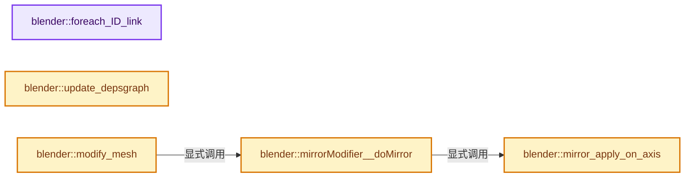
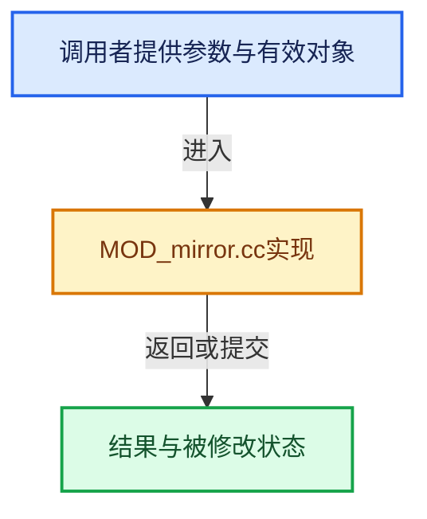

# 实现依赖专题：source/blender/modifiers/intern/MOD_mirror.cc

[实现依赖导航](../../../README.md) · [符号索引](../../../../00-课程指南/02-源码与提交索引/符号依赖与实现索引.md)

本专题从正文实际调用进入，集中保存共享实现。函数有稳定锚点，可从调用处直接跳到对应完整函数；递归与互相调用通过回链组织。

## 本文件的实现关系






## 完整成员与函数实现

<a id="f-0f60683acb48c332"></a>

### `blender::foreach_ID_link`

实现位置：[source/blender/modifiers/intern/MOD_mirror.cc](../../../../../../../../source/blender/modifiers/intern/MOD_mirror.cc) · L43—L48。

接口参数：

- `ModifierData *md`
- `Object *ob`
- `IDWalkFunc walk`
- `void *user_data`

**教学注释版**

<!-- annotated:36ae4299690ce6 -->

```cpp
static void foreach_ID_link(ModifierData *md, Object *ob, IDWalkFunc walk, void *user_data)
{
  MirrorModifierData *mmd = reinterpret_cast<MirrorModifierData *>(md);

  walk(user_data, ob, reinterpret_cast<ID **>(&mmd->mirror_ob), IDWALK_CB_NOP);
}
```

<details>
<summary>核对原始源码：source/blender/modifiers/intern/MOD_mirror.cc · L43—L48</summary>

<!-- original:36ae4299690ce6:source/blender/modifiers/intern/MOD_mirror.cc:43:48 -->

```cpp
static void foreach_ID_link(ModifierData *md, Object *ob, IDWalkFunc walk, void *user_data)
{
  MirrorModifierData *mmd = reinterpret_cast<MirrorModifierData *>(md);

  walk(user_data, ob, reinterpret_cast<ID **>(&mmd->mirror_ob), IDWALK_CB_NOP);
}
```

</details>

**继续追踪实现**

- `walk` → [调用协议](../../../../00-课程指南/01-路线与规范/模板宏与动态分派协议.md)：局部可调用对象，须结合其初始化与捕获环境。调用位置L47。

<a id="f-2d4761aa6e168d0a"></a>

### `blender::update_depsgraph`

实现位置：[source/blender/modifiers/intern/MOD_mirror.cc](../../../../../../../../source/blender/modifiers/intern/MOD_mirror.cc) · L50—L57。

接口参数：

- `ModifierData *md`
- `const ModifierUpdateDepsgraphContext *ctx`

**教学注释版**

<!-- annotated:77439394f3fda2 -->

```cpp
static void update_depsgraph(ModifierData *md, const ModifierUpdateDepsgraphContext *ctx)
{
  MirrorModifierData *mmd = reinterpret_cast<MirrorModifierData *>(md);
  if (mmd->mirror_ob != nullptr) {
    DEG_add_object_relation(ctx->node, mmd->mirror_ob, DEG_OB_COMP_TRANSFORM, "Mirror Modifier");
    DEG_add_depends_on_transform_relation(ctx->node, "Mirror Modifier");
  }
}
```

<details>
<summary>核对原始源码：source/blender/modifiers/intern/MOD_mirror.cc · L50—L57</summary>

<!-- original:77439394f3fda2:source/blender/modifiers/intern/MOD_mirror.cc:50:57 -->

```cpp
static void update_depsgraph(ModifierData *md, const ModifierUpdateDepsgraphContext *ctx)
{
  MirrorModifierData *mmd = reinterpret_cast<MirrorModifierData *>(md);
  if (mmd->mirror_ob != nullptr) {
    DEG_add_object_relation(ctx->node, mmd->mirror_ob, DEG_OB_COMP_TRANSFORM, "Mirror Modifier");
    DEG_add_depends_on_transform_relation(ctx->node, "Mirror Modifier");
  }
}
```

</details>

**继续追踪实现**

- `DEG_add_object_relation` → [blender::DEG_add_object_relation · L123](../../../06-Depsgraph依赖图/intern/depsgraph_build.cc.md#f-f570cffae97e273c)。
- `DEG_add_depends_on_transform_relation` → [blender::DEG_add_depends_on_transform_relation · L240](../../../06-Depsgraph依赖图/intern/depsgraph_build.cc.md#f-47c32a354defa20d)。

<a id="f-0991be013f0e0745"></a>

### `blender::mirror_apply_on_axis`

实现位置：[source/blender/modifiers/intern/MOD_mirror.cc](../../../../../../../../source/blender/modifiers/intern/MOD_mirror.cc) · L59—L87。

接口参数：

- `MirrorModifierData *mmd`
- `Object *ob`
- `Mesh *mesh`
- `const int axis`
- `const bool use_correct_order_on_merge`

**教学注释版**

<!-- annotated:5815e92daf8ac3 -->

```cpp
static Mesh *mirror_apply_on_axis(MirrorModifierData *mmd,
                                  Object *ob,
                                  Mesh *mesh,
                                  const int axis,
                                  const bool use_correct_order_on_merge)
{
  int *vert_merge_map = nullptr;
  int vert_merge_map_len;
  Mesh *result = mesh;
  result = BKE_mesh_mirror_apply_mirror_on_axis_for_modifier(
      mmd, ob, result, axis, use_correct_order_on_merge, &vert_merge_map, &vert_merge_map_len);

  if (vert_merge_map) {
    /* Slow - so only call if one or more merge verts are found,
     * users may leave this on and not realize there is nothing to merge - campbell */

    /* TODO(mano-wii): Polygons with all vertices merged are the ones that form duplicates.
     * Therefore the duplicate face test can be skipped. */
    if (vert_merge_map_len) {
      Mesh *tmp = result;
      result = geometry::mesh_merge_verts(
          *tmp, Span<int>{vert_merge_map, result->verts_num}, vert_merge_map_len, false);
      BKE_id_free(nullptr, tmp);
    }
    MEM_delete(vert_merge_map);
  }

  return result;
}
```

<details>
<summary>核对原始源码：source/blender/modifiers/intern/MOD_mirror.cc · L59—L87</summary>

<!-- original:5815e92daf8ac3:source/blender/modifiers/intern/MOD_mirror.cc:59:87 -->

```cpp
static Mesh *mirror_apply_on_axis(MirrorModifierData *mmd,
                                  Object *ob,
                                  Mesh *mesh,
                                  const int axis,
                                  const bool use_correct_order_on_merge)
{
  int *vert_merge_map = nullptr;
  int vert_merge_map_len;
  Mesh *result = mesh;
  result = BKE_mesh_mirror_apply_mirror_on_axis_for_modifier(
      mmd, ob, result, axis, use_correct_order_on_merge, &vert_merge_map, &vert_merge_map_len);

  if (vert_merge_map) {
    /* Slow - so only call if one or more merge verts are found,
     * users may leave this on and not realize there is nothing to merge - campbell */

    /* TODO(mano-wii): Polygons with all vertices merged are the ones that form duplicates.
     * Therefore the duplicate face test can be skipped. */
    if (vert_merge_map_len) {
      Mesh *tmp = result;
      result = geometry::mesh_merge_verts(
          *tmp, Span<int>{vert_merge_map, result->verts_num}, vert_merge_map_len, false);
      BKE_id_free(nullptr, tmp);
    }
    MEM_delete(vert_merge_map);
  }

  return result;
}
```

</details>

**沿实际写入检查状态**

- `result = BKE_mesh_mirror_apply_mirror_on_axis_for_modifier(`
- `result = geometry::mesh_merge_verts(`

**结果出口**

- `return result;`

**继续追踪实现**

- `BKE_mesh_mirror_apply_mirror_on_axis_for_modifier` → [blender::BKE_mesh_mirror_apply_mirror_on_axis_for_modifier · L118](../../../02-BKE几何与数据/intern/mesh_mirror.cc.md#f-4c6e6b5a681aa438)。
- `geometry::mesh_merge_verts` → [blender::geometry::mesh_merge_verts · L1398](../../../05-Geometry几何算法/intern/mesh_merge_verts.cc.md#f-cd3db9879af9f268)；[blender::geometry::mesh_merge_verts · L1413](../../../05-Geometry几何算法/intern/mesh_merge_verts.cc.md#f-445656c1402c090c)。同名重载需按实参类型选择。
- `BKE_id_free` → [blender::BKE_id_free · L224](../../../02-BKE几何与数据/intern/lib_id_delete.cc.md#f-28ed02c41d0f2d5b)。
- `MEM_delete` → [MEM_delete · L400](../../../07-Intern运行时与平台/guardedalloc/MEM_guardedalloc.h.md#f-9049ffdd1682887c)。

<a id="f-bddc4a213ed85e15"></a>

### `blender::mirrorModifier__doMirror`

实现位置：[source/blender/modifiers/intern/MOD_mirror.cc](../../../../../../../../source/blender/modifiers/intern/MOD_mirror.cc) · L89—L116。

接口参数：

- `MirrorModifierData *mmd`
- `Object *ob`
- `Mesh *mesh`

**教学注释版**

<!-- annotated:31e5b6b4f3ff51 -->

```cpp
static Mesh *mirrorModifier__doMirror(MirrorModifierData *mmd, Object *ob, Mesh *mesh)
{
  Mesh *result = mesh;
  const bool use_correct_order_on_merge = mmd->use_correct_order_on_merge;

  /* check which axes have been toggled and mirror accordingly */
  if (mmd->flag & MOD_MIR_AXIS_X) {
    result = mirror_apply_on_axis(mmd, ob, result, 0, use_correct_order_on_merge);
  }
  if (mmd->flag & MOD_MIR_AXIS_Y) {
    Mesh *tmp = result;
    result = mirror_apply_on_axis(mmd, ob, result, 1, use_correct_order_on_merge);
    if (tmp != mesh) {
      /* free intermediate results */
      BKE_id_free(nullptr, tmp);
    }
  }
  if (mmd->flag & MOD_MIR_AXIS_Z) {
    Mesh *tmp = result;
    result = mirror_apply_on_axis(mmd, ob, result, 2, use_correct_order_on_merge);
    if (tmp != mesh) {
      /* free intermediate results */
      BKE_id_free(nullptr, tmp);
    }
  }

  return result;
}
```

<details>
<summary>核对原始源码：source/blender/modifiers/intern/MOD_mirror.cc · L89—L116</summary>

<!-- original:31e5b6b4f3ff51:source/blender/modifiers/intern/MOD_mirror.cc:89:116 -->

```cpp
static Mesh *mirrorModifier__doMirror(MirrorModifierData *mmd, Object *ob, Mesh *mesh)
{
  Mesh *result = mesh;
  const bool use_correct_order_on_merge = mmd->use_correct_order_on_merge;

  /* check which axes have been toggled and mirror accordingly */
  if (mmd->flag & MOD_MIR_AXIS_X) {
    result = mirror_apply_on_axis(mmd, ob, result, 0, use_correct_order_on_merge);
  }
  if (mmd->flag & MOD_MIR_AXIS_Y) {
    Mesh *tmp = result;
    result = mirror_apply_on_axis(mmd, ob, result, 1, use_correct_order_on_merge);
    if (tmp != mesh) {
      /* free intermediate results */
      BKE_id_free(nullptr, tmp);
    }
  }
  if (mmd->flag & MOD_MIR_AXIS_Z) {
    Mesh *tmp = result;
    result = mirror_apply_on_axis(mmd, ob, result, 2, use_correct_order_on_merge);
    if (tmp != mesh) {
      /* free intermediate results */
      BKE_id_free(nullptr, tmp);
    }
  }

  return result;
}
```

</details>

**沿实际写入检查状态**

- `result = mirror_apply_on_axis(mmd, ob, result, 0, use_correct_order_on_merge);`
- `result = mirror_apply_on_axis(mmd, ob, result, 1, use_correct_order_on_merge);`
- `result = mirror_apply_on_axis(mmd, ob, result, 2, use_correct_order_on_merge);`

**结果出口**

- `return result;`

**继续追踪实现**

- `mirror_apply_on_axis` → [blender::mirror_apply_on_axis · L59](MOD_mirror.cc.md#f-0991be013f0e0745)。
- `BKE_id_free` → [blender::BKE_id_free · L224](../../../02-BKE几何与数据/intern/lib_id_delete.cc.md#f-28ed02c41d0f2d5b)。

<a id="f-adb02f7a41373a80"></a>

### `blender::modify_mesh`

实现位置：[source/blender/modifiers/intern/MOD_mirror.cc](../../../../../../../../source/blender/modifiers/intern/MOD_mirror.cc) · L118—L126。

接口参数：

- `ModifierData *md`
- `const ModifierEvalContext *ctx`
- `Mesh *mesh`

**教学注释版**

<!-- annotated:cb053939936128 -->

```cpp
static Mesh *modify_mesh(ModifierData *md, const ModifierEvalContext *ctx, Mesh *mesh)
{
  Mesh *result;
  MirrorModifierData *mmd = reinterpret_cast<MirrorModifierData *>(md);

  result = mirrorModifier__doMirror(mmd, ctx->object, mesh);

  return result;
}
```

<details>
<summary>核对原始源码：source/blender/modifiers/intern/MOD_mirror.cc · L118—L126</summary>

<!-- original:cb053939936128:source/blender/modifiers/intern/MOD_mirror.cc:118:126 -->

```cpp
static Mesh *modify_mesh(ModifierData *md, const ModifierEvalContext *ctx, Mesh *mesh)
{
  Mesh *result;
  MirrorModifierData *mmd = reinterpret_cast<MirrorModifierData *>(md);

  result = mirrorModifier__doMirror(mmd, ctx->object, mesh);

  return result;
}
```

</details>

**沿实际写入检查状态**

- `result = mirrorModifier__doMirror(mmd, ctx->object, mesh);`

**结果出口**

- `return result;`

**继续追踪实现**

- `mirrorModifier__doMirror` → [blender::mirrorModifier__doMirror · L89](MOD_mirror.cc.md#f-bddc4a213ed85e15)。
