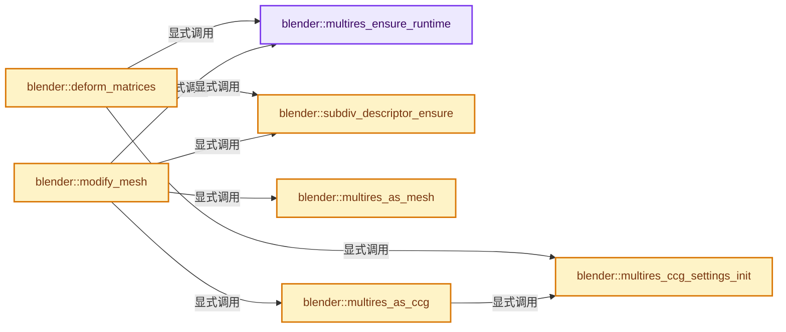
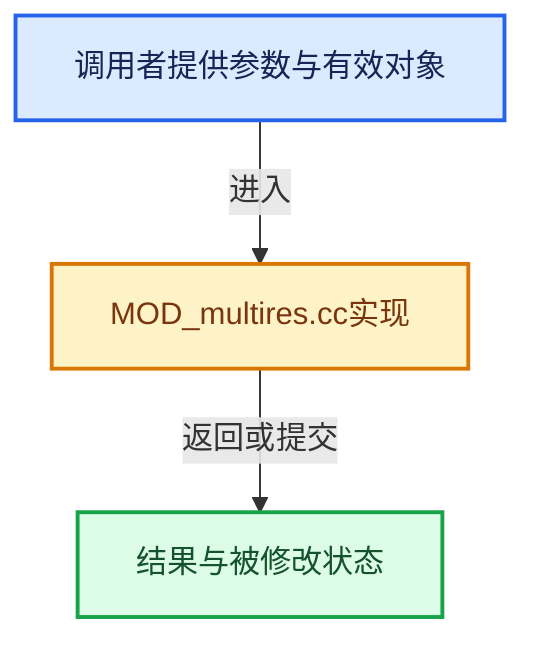

# 实现依赖专题：source/blender/modifiers/intern/MOD_multires.cc

[实现依赖导航](../../../README.md) · [符号索引](../../../../00-课程指南/02-源码与提交索引/符号依赖与实现索引.md)

本专题从正文实际调用进入，集中保存共享实现。函数有稳定锚点，可从调用处直接跳到对应完整函数；递归与互相调用通过回链组织。

## 本文件的实现关系






## 完整成员与函数实现

<a id="f-70734b95fcc176ad"></a>

### `blender::multires_ensure_runtime`

实现位置：[source/blender/modifiers/intern/MOD_multires.cc](../../../../../../../../source/blender/modifiers/intern/MOD_multires.cc) · L84—L92。

接口参数：

- `MultiresModifierData *mmd`

**教学注释版**

<!-- annotated:9fb15e4b0cda24 -->

```cpp
static MultiresRuntimeData *multires_ensure_runtime(MultiresModifierData *mmd)
{
  MultiresRuntimeData *runtime_data = static_cast<MultiresRuntimeData *>(mmd->modifier.runtime);
  if (runtime_data == nullptr) {
    runtime_data = MEM_new_zeroed<MultiresRuntimeData>(__func__);
    mmd->modifier.runtime = runtime_data;
  }
  return runtime_data;
}
```

<details>
<summary>核对原始源码：source/blender/modifiers/intern/MOD_multires.cc · L84—L92</summary>

<!-- original:9fb15e4b0cda24:source/blender/modifiers/intern/MOD_multires.cc:84:92 -->

```cpp
static MultiresRuntimeData *multires_ensure_runtime(MultiresModifierData *mmd)
{
  MultiresRuntimeData *runtime_data = static_cast<MultiresRuntimeData *>(mmd->modifier.runtime);
  if (runtime_data == nullptr) {
    runtime_data = MEM_new_zeroed<MultiresRuntimeData>(__func__);
    mmd->modifier.runtime = runtime_data;
  }
  return runtime_data;
}
```

</details>

**沿实际写入检查状态**

- `runtime_data = MEM_new_zeroed<MultiresRuntimeData>(__func__);`
- `mmd->modifier.runtime = runtime_data;`

**结果出口**

- `return runtime_data;`

**继续追踪实现**

- `MEM_new_zeroed<MultiresRuntimeData>` → [MEM_new_zeroed · L550](../../../07-Intern运行时与平台/guardedalloc/MEM_guardedalloc.h.md#f-eeb1e2a7f57dd231)；[MEM_new_zeroed · L114](../../../07-Intern运行时与平台/guardedalloc/intern/mallocn.cc.md#f-e04cf01c64c8b180)。同名重载需按实参类型选择。

<a id="f-6364c5f0989a79fd"></a>

### `blender::subdiv_descriptor_ensure`

实现位置：[source/blender/modifiers/intern/MOD_multires.cc](../../../../../../../../source/blender/modifiers/intern/MOD_multires.cc) · L96—L105。

接口参数：

- `MultiresModifierData *mmd`
- `const bke::subdiv::Settings *subdiv_settings`
- `const Mesh *mesh`

**教学注释版**

<!-- annotated:09f7f2a56aec3e -->

```cpp
static bke::subdiv::Subdiv *subdiv_descriptor_ensure(MultiresModifierData *mmd,
                                                     const bke::subdiv::Settings *subdiv_settings,
                                                     const Mesh *mesh)
{
  MultiresRuntimeData *runtime_data = static_cast<MultiresRuntimeData *>(mmd->modifier.runtime);
  bke::subdiv::Subdiv *subdiv = bke::subdiv::update_from_mesh(
      runtime_data->subdiv, subdiv_settings, mesh);
  runtime_data->subdiv = subdiv;
  return subdiv;
}
```

<details>
<summary>核对原始源码：source/blender/modifiers/intern/MOD_multires.cc · L96—L105</summary>

<!-- original:09f7f2a56aec3e:source/blender/modifiers/intern/MOD_multires.cc:96:105 -->

```cpp
static bke::subdiv::Subdiv *subdiv_descriptor_ensure(MultiresModifierData *mmd,
                                                     const bke::subdiv::Settings *subdiv_settings,
                                                     const Mesh *mesh)
{
  MultiresRuntimeData *runtime_data = static_cast<MultiresRuntimeData *>(mmd->modifier.runtime);
  bke::subdiv::Subdiv *subdiv = bke::subdiv::update_from_mesh(
      runtime_data->subdiv, subdiv_settings, mesh);
  runtime_data->subdiv = subdiv;
  return subdiv;
}
```

</details>

**沿实际写入检查状态**

- `runtime_data->subdiv = subdiv;`

**结果出口**

- `return subdiv;`

**继续追踪实现**

- `bke::subdiv::update_from_mesh` → [blender::bke::subdiv::update_from_mesh · L181](../../../02-BKE几何与数据/intern/subdiv.cc.md#f-a1de41130c6ac9c9)。

<a id="f-5638ec13bf4f1fcf"></a>

### `blender::multires_as_mesh`

实现位置：[source/blender/modifiers/intern/MOD_multires.cc](../../../../../../../../source/blender/modifiers/intern/MOD_multires.cc) · L109—L134。

接口参数：

- `const MultiresModifierData *mmd`
- `const ModifierEvalContext *ctx`
- `Mesh *mesh`
- `bke::subdiv::Subdiv *subdiv`

**教学注释版**

<!-- annotated:922142f7339dbb -->

```cpp
static Mesh *multires_as_mesh(const MultiresModifierData *mmd,
                              const ModifierEvalContext *ctx,
                              Mesh *mesh,
                              bke::subdiv::Subdiv *subdiv)
{
  Mesh *result = mesh;
  const bool use_render_params = (ctx->flag & MOD_APPLY_RENDER);
  const bool ignore_simplify = (ctx->flag & MOD_APPLY_IGNORE_SIMPLIFY);
  const bool ignore_control_edges = (ctx->flag & MOD_APPLY_TO_ORIGINAL);
  const Scene *scene = DEG_get_evaluated_scene(ctx->depsgraph);
  Object *object = ctx->object;
  bke::subdiv::ToMeshSettings mesh_settings;
  BKE_multires_subdiv_mesh_settings_init(&mesh_settings,
                                         scene,
                                         object,
                                         mmd,
                                         use_render_params,
                                         ignore_simplify,
                                         ignore_control_edges);
  if (mesh_settings.resolution < 3) {
    return result;
  }
  bke::subdiv::displacement_attach_from_multires(subdiv, mesh, mmd);
  result = bke::subdiv::subdiv_to_mesh(subdiv, &mesh_settings, mesh);
  return result;
}
```

<details>
<summary>核对原始源码：source/blender/modifiers/intern/MOD_multires.cc · L109—L134</summary>

<!-- original:922142f7339dbb:source/blender/modifiers/intern/MOD_multires.cc:109:134 -->

```cpp
static Mesh *multires_as_mesh(const MultiresModifierData *mmd,
                              const ModifierEvalContext *ctx,
                              Mesh *mesh,
                              bke::subdiv::Subdiv *subdiv)
{
  Mesh *result = mesh;
  const bool use_render_params = (ctx->flag & MOD_APPLY_RENDER);
  const bool ignore_simplify = (ctx->flag & MOD_APPLY_IGNORE_SIMPLIFY);
  const bool ignore_control_edges = (ctx->flag & MOD_APPLY_TO_ORIGINAL);
  const Scene *scene = DEG_get_evaluated_scene(ctx->depsgraph);
  Object *object = ctx->object;
  bke::subdiv::ToMeshSettings mesh_settings;
  BKE_multires_subdiv_mesh_settings_init(&mesh_settings,
                                         scene,
                                         object,
                                         mmd,
                                         use_render_params,
                                         ignore_simplify,
                                         ignore_control_edges);
  if (mesh_settings.resolution < 3) {
    return result;
  }
  bke::subdiv::displacement_attach_from_multires(subdiv, mesh, mmd);
  result = bke::subdiv::subdiv_to_mesh(subdiv, &mesh_settings, mesh);
  return result;
}
```

</details>

**沿实际写入检查状态**

- `result = bke::subdiv::subdiv_to_mesh(subdiv, &mesh_settings, mesh);`

**结果出口**

- `return result;`

**继续追踪实现**

- `DEG_get_evaluated_scene` → [blender::DEG_get_evaluated_scene · L212](../../../06-Depsgraph依赖图/intern/depsgraph_query.cc.md#f-be7729d26a71d3fd)。
- `BKE_multires_subdiv_mesh_settings_init` → [blender::BKE_multires_subdiv_mesh_settings_init · L29](../../../02-BKE几何与数据/intern/multires_subdiv.cc.md#f-a2a91c018e742a96)。
- `bke::subdiv::displacement_attach_from_multires` → [blender::bke::subdiv::displacement_attach_from_multires · L432](../../../02-BKE几何与数据/intern/subdiv_displacement_multires.cc.md#f-567a024f86cf74b1)。
- `bke::subdiv::subdiv_to_mesh` → [blender::bke::subdiv::subdiv_to_mesh · L1458](../../../02-BKE几何与数据/intern/subdiv_mesh.cc.md#f-fb2d00a1de7732e7)。

<a id="f-2f7cd0f52f2e6c85"></a>

### `blender::multires_ccg_settings_init`

实现位置：[source/blender/modifiers/intern/MOD_multires.cc](../../../../../../../../source/blender/modifiers/intern/MOD_multires.cc) · L138—L152。

接口参数：

- `SubdivToCCGSettings *settings`
- `const MultiresModifierData *mmd`
- `const ModifierEvalContext *ctx`
- `const Mesh *mesh`

**教学注释版**

<!-- annotated:78ba5538153bd2 -->

```cpp
static void multires_ccg_settings_init(SubdivToCCGSettings *settings,
                                       const MultiresModifierData *mmd,
                                       const ModifierEvalContext *ctx,
                                       const Mesh *mesh)
{
  const bool has_mask = CustomData_has_layer(&mesh->corner_data, CD_GRID_PAINT_MASK);
  const bool use_render_params = (ctx->flag & MOD_APPLY_RENDER);
  const bool ignore_simplify = (ctx->flag & MOD_APPLY_IGNORE_SIMPLIFY);
  const Scene *scene = DEG_get_evaluated_scene(ctx->depsgraph);
  Object *object = ctx->object;
  const int level = multires_get_level(scene, object, mmd, use_render_params, ignore_simplify);
  settings->resolution = (1 << level) + 1;
  settings->need_normal = true;
  settings->need_mask = has_mask;
}
```

<details>
<summary>核对原始源码：source/blender/modifiers/intern/MOD_multires.cc · L138—L152</summary>

<!-- original:78ba5538153bd2:source/blender/modifiers/intern/MOD_multires.cc:138:152 -->

```cpp
static void multires_ccg_settings_init(SubdivToCCGSettings *settings,
                                       const MultiresModifierData *mmd,
                                       const ModifierEvalContext *ctx,
                                       const Mesh *mesh)
{
  const bool has_mask = CustomData_has_layer(&mesh->corner_data, CD_GRID_PAINT_MASK);
  const bool use_render_params = (ctx->flag & MOD_APPLY_RENDER);
  const bool ignore_simplify = (ctx->flag & MOD_APPLY_IGNORE_SIMPLIFY);
  const Scene *scene = DEG_get_evaluated_scene(ctx->depsgraph);
  Object *object = ctx->object;
  const int level = multires_get_level(scene, object, mmd, use_render_params, ignore_simplify);
  settings->resolution = (1 << level) + 1;
  settings->need_normal = true;
  settings->need_mask = has_mask;
}
```

</details>

**沿实际写入检查状态**

- `settings->resolution = (1 << level) + 1;`
- `settings->need_normal = true;`
- `settings->need_mask = has_mask;`

**继续追踪实现**

- `CustomData_has_layer` → [blender::CustomData_has_layer · L3005](../../../02-BKE几何与数据/intern/customdata.cc.md#f-7333340531d48ea3)。
- `DEG_get_evaluated_scene` → [blender::DEG_get_evaluated_scene · L212](../../../06-Depsgraph依赖图/intern/depsgraph_query.cc.md#f-be7729d26a71d3fd)。
- `multires_get_level` → [blender::multires_get_level · L212](../../../02-BKE几何与数据/intern/multires.cc.md#f-8f4d947b77878017)。

<a id="f-80e097d08332eb4a"></a>

### `blender::multires_as_ccg`

实现位置：[source/blender/modifiers/intern/MOD_multires.cc](../../../../../../../../source/blender/modifiers/intern/MOD_multires.cc) · L154—L175。

接口参数：

- `MultiresModifierData *mmd`
- `const ModifierEvalContext *ctx`
- `Mesh *mesh`
- `bke::subdiv::Subdiv *subdiv`

**教学注释版**

<!-- annotated:fbb2862f80c3a9 -->

```cpp
static Mesh *multires_as_ccg(MultiresModifierData *mmd,
                             const ModifierEvalContext *ctx,
                             Mesh *mesh,
                             bke::subdiv::Subdiv *subdiv)
{
  Mesh *result = mesh;
  SubdivToCCGSettings ccg_settings;
  multires_ccg_settings_init(&ccg_settings, mmd, ctx, mesh);
  if (ccg_settings.resolution < 3) {
    return result;
  }
  bke::subdiv::displacement_attach_from_multires(subdiv, mesh, mmd);
  result = BKE_subdiv_to_ccg_mesh(*subdiv, ccg_settings, *mesh);

  /* NOTE: CCG becomes an owner of Subdiv descriptor, so can not share
   * this pointer. Not sure if it's needed, but might have a second look
   * on the ownership model here. */
  MultiresRuntimeData *runtime_data = static_cast<MultiresRuntimeData *>(mmd->modifier.runtime);
  runtime_data->subdiv = nullptr;

  return result;
}
```

<details>
<summary>核对原始源码：source/blender/modifiers/intern/MOD_multires.cc · L154—L175</summary>

<!-- original:fbb2862f80c3a9:source/blender/modifiers/intern/MOD_multires.cc:154:175 -->

```cpp
static Mesh *multires_as_ccg(MultiresModifierData *mmd,
                             const ModifierEvalContext *ctx,
                             Mesh *mesh,
                             bke::subdiv::Subdiv *subdiv)
{
  Mesh *result = mesh;
  SubdivToCCGSettings ccg_settings;
  multires_ccg_settings_init(&ccg_settings, mmd, ctx, mesh);
  if (ccg_settings.resolution < 3) {
    return result;
  }
  bke::subdiv::displacement_attach_from_multires(subdiv, mesh, mmd);
  result = BKE_subdiv_to_ccg_mesh(*subdiv, ccg_settings, *mesh);

  /* NOTE: CCG becomes an owner of Subdiv descriptor, so can not share
   * this pointer. Not sure if it's needed, but might have a second look
   * on the ownership model here. */
  MultiresRuntimeData *runtime_data = static_cast<MultiresRuntimeData *>(mmd->modifier.runtime);
  runtime_data->subdiv = nullptr;

  return result;
}
```

</details>

**沿实际写入检查状态**

- `result = BKE_subdiv_to_ccg_mesh(*subdiv, ccg_settings, *mesh);`
- `runtime_data->subdiv = nullptr;`

**结果出口**

- `return result;`

**继续追踪实现**

- `multires_ccg_settings_init` → [blender::multires_ccg_settings_init · L138](MOD_multires.cc.md#f-2f7cd0f52f2e6c85)。
- `bke::subdiv::displacement_attach_from_multires` → [blender::bke::subdiv::displacement_attach_from_multires · L432](../../../02-BKE几何与数据/intern/subdiv_displacement_multires.cc.md#f-567a024f86cf74b1)。
- `BKE_subdiv_to_ccg_mesh` → [blender::BKE_subdiv_to_ccg_mesh · L408](../../../02-BKE几何与数据/intern/subdiv_ccg.cc.md#f-64f42dce16f5df3f)。

<a id="f-0e8f5da31f8b1dea"></a>

### `blender::modify_mesh`

实现位置：[source/blender/modifiers/intern/MOD_multires.cc](../../../../../../../../source/blender/modifiers/intern/MOD_multires.cc) · L177—L246。

接口参数：

- `ModifierData *md`
- `const ModifierEvalContext *ctx`
- `Mesh *mesh`

**教学注释版**

<!-- annotated:e05c402f6bbbec -->

```cpp
static Mesh *modify_mesh(ModifierData *md, const ModifierEvalContext *ctx, Mesh *mesh)
{
  Mesh *result = mesh;
#if !defined(WITH_OPENSUBDIV)
  BKE_modifier_set_error(ctx->object, md, "Disabled, built without OpenSubdiv");
  return result;
#endif
  MultiresModifierData *mmd = reinterpret_cast<MultiresModifierData *>(md);
  bke::subdiv::Settings subdiv_settings;
  BKE_multires_subdiv_settings_init(&subdiv_settings, mmd);
  if (subdiv_settings.level == 0) {
    return result;
  }
  MultiresRuntimeData *runtime_data = multires_ensure_runtime(mmd);
  bke::subdiv::Subdiv *subdiv = subdiv_descriptor_ensure(mmd, &subdiv_settings, mesh);
  if (subdiv == nullptr) {
    /* Happens on bad topology, also on empty input mesh. */
    return result;
  }
  const bool use_clnors = mmd->flags & eMultiresModifierFlag_UseCustomNormals &&
                          mesh->normals_domain() == bke::MeshNormalDomain::Corner;
  /* NOTE: Orco needs final coordinates on CPU side, which are expected to be
   * accessible via mesh vertices. For this reason we do not evaluate multires to
   * grids when orco is requested. */
  const bool for_orco = (ctx->flag & MOD_APPLY_ORCO) != 0;
  /* Needed when rendering or baking will in sculpt mode. */
  const bool for_render = (ctx->flag & MOD_APPLY_RENDER) != 0;

  const bool sculpt_base_mesh = mmd->flags & eMultiresModifierFlag_UseSculptBaseMesh;

  if ((ctx->object->mode & OB_MODE_SCULPT) && !for_orco && !for_render && !sculpt_base_mesh) {
    /* NOTE: CCG takes ownership over Subdiv. */
    result = multires_as_ccg(mmd, ctx, mesh, subdiv);
    result->runtime->subdiv_ccg_tot_level = mmd->totlvl;
    /* TODO(sergey): Usually it is sculpt stroke's update variants which
     * takes care of this, but is possible that we need this before the
     * stroke: i.e. when exiting blender right after stroke is done.
     * Annoying and not so much black-boxed as far as sculpting goes, and
     * surely there is a better way of solving this. */
    if (ctx->object->runtime->sculpt_session != nullptr) {
      SculptSession *sculpt_session = ctx->object->runtime->sculpt_session;
      sculpt_session->subdiv_ccg = result->runtime->subdiv_ccg.get();
      sculpt_session->multires_modifier = mmd;
    }
    // bke::subdiv::stats_print(&subdiv->stats);
  }
  else {
    if (use_clnors) {
      void *data = CustomData_add_layer(
          &mesh->corner_data, CD_NORMAL, CD_CONSTRUCT, mesh->corners_num);
      // [讲解] memcpy：复制字节，源与目标不应重叠。类型生命周期、对齐和可复制表示须由调用者证明，不是任意对象的复制构造。
      memcpy(data, mesh->corner_normals().data(), mesh->corner_normals().size_in_bytes());
    }

    result = multires_as_mesh(mmd, ctx, mesh, subdiv);

    if (use_clnors) {
      bke::mesh_set_custom_normals_normalized(
          *result,
          {static_cast<float3 *>(CustomData_get_layer_for_write(
               &result->corner_data, CD_NORMAL, result->corners_num)),
           result->corners_num});
      CustomData_free_layers(&result->corner_data, CD_NORMAL);
    }
    // bke::subdiv::stats_print(&subdiv->stats);
    if (subdiv != runtime_data->subdiv) {
      // [讲解] bke::subdiv::free：归还相匹配的C分配存储，不自动执行C++析构；不可用于Windows的_aligned_malloc结果。
      bke::subdiv::free(subdiv);
    }
  }
  return result;
}
```

<details>
<summary>核对原始源码：source/blender/modifiers/intern/MOD_multires.cc · L177—L246</summary>

<!-- original:e05c402f6bbbec:source/blender/modifiers/intern/MOD_multires.cc:177:246 -->

```cpp
static Mesh *modify_mesh(ModifierData *md, const ModifierEvalContext *ctx, Mesh *mesh)
{
  Mesh *result = mesh;
#if !defined(WITH_OPENSUBDIV)
  BKE_modifier_set_error(ctx->object, md, "Disabled, built without OpenSubdiv");
  return result;
#endif
  MultiresModifierData *mmd = reinterpret_cast<MultiresModifierData *>(md);
  bke::subdiv::Settings subdiv_settings;
  BKE_multires_subdiv_settings_init(&subdiv_settings, mmd);
  if (subdiv_settings.level == 0) {
    return result;
  }
  MultiresRuntimeData *runtime_data = multires_ensure_runtime(mmd);
  bke::subdiv::Subdiv *subdiv = subdiv_descriptor_ensure(mmd, &subdiv_settings, mesh);
  if (subdiv == nullptr) {
    /* Happens on bad topology, also on empty input mesh. */
    return result;
  }
  const bool use_clnors = mmd->flags & eMultiresModifierFlag_UseCustomNormals &&
                          mesh->normals_domain() == bke::MeshNormalDomain::Corner;
  /* NOTE: Orco needs final coordinates on CPU side, which are expected to be
   * accessible via mesh vertices. For this reason we do not evaluate multires to
   * grids when orco is requested. */
  const bool for_orco = (ctx->flag & MOD_APPLY_ORCO) != 0;
  /* Needed when rendering or baking will in sculpt mode. */
  const bool for_render = (ctx->flag & MOD_APPLY_RENDER) != 0;

  const bool sculpt_base_mesh = mmd->flags & eMultiresModifierFlag_UseSculptBaseMesh;

  if ((ctx->object->mode & OB_MODE_SCULPT) && !for_orco && !for_render && !sculpt_base_mesh) {
    /* NOTE: CCG takes ownership over Subdiv. */
    result = multires_as_ccg(mmd, ctx, mesh, subdiv);
    result->runtime->subdiv_ccg_tot_level = mmd->totlvl;
    /* TODO(sergey): Usually it is sculpt stroke's update variants which
     * takes care of this, but is possible that we need this before the
     * stroke: i.e. when exiting blender right after stroke is done.
     * Annoying and not so much black-boxed as far as sculpting goes, and
     * surely there is a better way of solving this. */
    if (ctx->object->runtime->sculpt_session != nullptr) {
      SculptSession *sculpt_session = ctx->object->runtime->sculpt_session;
      sculpt_session->subdiv_ccg = result->runtime->subdiv_ccg.get();
      sculpt_session->multires_modifier = mmd;
    }
    // bke::subdiv::stats_print(&subdiv->stats);
  }
  else {
    if (use_clnors) {
      void *data = CustomData_add_layer(
          &mesh->corner_data, CD_NORMAL, CD_CONSTRUCT, mesh->corners_num);
      memcpy(data, mesh->corner_normals().data(), mesh->corner_normals().size_in_bytes());
    }

    result = multires_as_mesh(mmd, ctx, mesh, subdiv);

    if (use_clnors) {
      bke::mesh_set_custom_normals_normalized(
          *result,
          {static_cast<float3 *>(CustomData_get_layer_for_write(
               &result->corner_data, CD_NORMAL, result->corners_num)),
           result->corners_num});
      CustomData_free_layers(&result->corner_data, CD_NORMAL);
    }
    // bke::subdiv::stats_print(&subdiv->stats);
    if (subdiv != runtime_data->subdiv) {
      bke::subdiv::free(subdiv);
    }
  }
  return result;
}
```

</details>

**沿实际写入检查状态**

- `result = multires_as_ccg(mmd, ctx, mesh, subdiv);`
- `result->runtime->subdiv_ccg_tot_level = mmd->totlvl;`
- `sculpt_session->subdiv_ccg = result->runtime->subdiv_ccg.get();`
- `sculpt_session->multires_modifier = mmd;`
- `result = multires_as_mesh(mmd, ctx, mesh, subdiv);`

**结果出口**

- `return result;`

**继续追踪实现**

- `BKE_modifier_set_error` → [blender::BKE_modifier_set_error · L416](../../../02-BKE几何与数据/intern/modifier.cc.md#f-6241829f21c08456)。
- `BKE_multires_subdiv_settings_init` → [blender::BKE_multires_subdiv_settings_init · L16](../../../02-BKE几何与数据/intern/multires_subdiv.cc.md#f-a313efd66d1384ce)。
- `multires_ensure_runtime` → [blender::multires_ensure_runtime · L84](MOD_multires.cc.md#f-70734b95fcc176ad)。
- `subdiv_descriptor_ensure` → [blender::subdiv_descriptor_ensure · L96](MOD_multires.cc.md#f-6364c5f0989a79fd)。
- `mesh->normals_domain` → [blender::Mesh::normals_domain · L301](../../../../06-隐式共享与缓存系统/08-法线缓存的真实依赖.md#f-303a2beb01515e4a)。
- `multires_as_ccg` → [blender::multires_as_ccg · L154](MOD_multires.cc.md#f-80e097d08332eb4a)。
- `result->runtime->subdiv_ccg.get` → [调用协议](../../../../00-课程指南/01-路线与规范/模板宏与动态分派协议.md)：接收对象类型依赖auto、返回值或模板实例；不按同名猜测目标。调用位置L218。
- `CustomData_add_layer` → [blender::CustomData_add_layer · L2851](../../../02-BKE几何与数据/intern/customdata.cc.md#f-4c7988e825541059)。
- `memcpy` → [外部契约](https://eel.is/c++draft/cstring.syn)：复制字节，源与目标不应重叠。类型生命周期、对齐和可复制表示须由调用者证明，不是任意对象的复制构造。
- `mesh->corner_normals().data` → [调用协议](../../../../00-课程指南/01-路线与规范/模板宏与动态分派协议.md)：接收对象类型依赖auto、返回值或模板实例；不按同名猜测目标。调用位置L227。
- `mesh->corner_normals` → [blender::Mesh::corner_normals · L468](../../../../06-隐式共享与缓存系统/08-法线缓存的真实依赖.md#f-91d46c2a581e44bc)。
- `mesh->corner_normals().size_in_bytes` → [调用协议](../../../../00-课程指南/01-路线与规范/模板宏与动态分派协议.md)：接收对象类型依赖auto、返回值或模板实例；不按同名猜测目标。调用位置L227。
- `multires_as_mesh` → [blender::multires_as_mesh · L109](MOD_multires.cc.md#f-5638ec13bf4f1fcf)。
- `bke::mesh_set_custom_normals_normalized` → [blender::bke::mesh_set_custom_normals_normalized · L1700](../../../../06-隐式共享与缓存系统/08-法线缓存的真实依赖.md#f-96e05ccd6d9a9c03)。
- `CustomData_get_layer_for_write` → [blender::CustomData_get_layer_for_write · L3318](../../../02-BKE几何与数据/intern/customdata.cc.md#f-6af158905e2c1274)。
- `CustomData_free_layers` → [blender::CustomData_free_layers · L2988](../../../02-BKE几何与数据/intern/customdata.cc.md#f-13fed7d5cd3b8b69)。
- `bke::subdiv::free` → [外部契约](https://eel.is/c++draft/c.malloc)：归还相匹配的C分配存储，不自动执行C++析构；不可用于Windows的_aligned_malloc结果。

<a id="f-fd407e5e0c373f99"></a>

### `blender::deform_matrices`

实现位置：[source/blender/modifiers/intern/MOD_multires.cc](../../../../../../../../source/blender/modifiers/intern/MOD_multires.cc) · L248—L285。

接口参数：

- `ModifierData *md`
- `const ModifierEvalContext *ctx`
- `Mesh *mesh`
- `MutableSpan<float3> positions`
- `MutableSpan<float3x3>`

**教学注释版**

<!-- annotated:5ebb981b4917b7 -->

```cpp
static void deform_matrices(ModifierData *md,
                            const ModifierEvalContext *ctx,
                            Mesh *mesh,
                            MutableSpan<float3> positions,
                            MutableSpan<float3x3> /*matrices*/)

{
#if !defined(WITH_OPENSUBDIV)
  BKE_modifier_set_error(ctx->object, md, "Disabled, built without OpenSubdiv");
  return;
#endif

  MultiresModifierData *mmd = reinterpret_cast<MultiresModifierData *>(md);

  bke::subdiv::Settings subdiv_settings;
  BKE_multires_subdiv_settings_init(&subdiv_settings, mmd);
  if (subdiv_settings.level == 0) {
    return;
  }

  SubdivToCCGSettings ccg_settings;
  multires_ccg_settings_init(&ccg_settings, mmd, ctx, mesh);
  if (ccg_settings.resolution < 3) {
    return;
  }

  MultiresRuntimeData *runtime_data = multires_ensure_runtime(mmd);
  bke::subdiv::Subdiv *subdiv = subdiv_descriptor_ensure(mmd, &subdiv_settings, mesh);
  if (subdiv == nullptr) {
    /* Happens on bad topology, also on empty input mesh. */
    return;
  }
  bke::subdiv::displacement_attach_from_multires(subdiv, mesh, mmd);
  bke::subdiv::deform_coarse_vertices(subdiv, mesh, positions);
  if (subdiv != runtime_data->subdiv) {
    // [讲解] bke::subdiv::free：归还相匹配的C分配存储，不自动执行C++析构；不可用于Windows的_aligned_malloc结果。
    bke::subdiv::free(subdiv);
  }
}
```

<details>
<summary>核对原始源码：source/blender/modifiers/intern/MOD_multires.cc · L248—L285</summary>

<!-- original:5ebb981b4917b7:source/blender/modifiers/intern/MOD_multires.cc:248:285 -->

```cpp
static void deform_matrices(ModifierData *md,
                            const ModifierEvalContext *ctx,
                            Mesh *mesh,
                            MutableSpan<float3> positions,
                            MutableSpan<float3x3> /*matrices*/)

{
#if !defined(WITH_OPENSUBDIV)
  BKE_modifier_set_error(ctx->object, md, "Disabled, built without OpenSubdiv");
  return;
#endif

  MultiresModifierData *mmd = reinterpret_cast<MultiresModifierData *>(md);

  bke::subdiv::Settings subdiv_settings;
  BKE_multires_subdiv_settings_init(&subdiv_settings, mmd);
  if (subdiv_settings.level == 0) {
    return;
  }

  SubdivToCCGSettings ccg_settings;
  multires_ccg_settings_init(&ccg_settings, mmd, ctx, mesh);
  if (ccg_settings.resolution < 3) {
    return;
  }

  MultiresRuntimeData *runtime_data = multires_ensure_runtime(mmd);
  bke::subdiv::Subdiv *subdiv = subdiv_descriptor_ensure(mmd, &subdiv_settings, mesh);
  if (subdiv == nullptr) {
    /* Happens on bad topology, also on empty input mesh. */
    return;
  }
  bke::subdiv::displacement_attach_from_multires(subdiv, mesh, mmd);
  bke::subdiv::deform_coarse_vertices(subdiv, mesh, positions);
  if (subdiv != runtime_data->subdiv) {
    bke::subdiv::free(subdiv);
  }
}
```

</details>

**继续追踪实现**

- `BKE_modifier_set_error` → [blender::BKE_modifier_set_error · L416](../../../02-BKE几何与数据/intern/modifier.cc.md#f-6241829f21c08456)。
- `BKE_multires_subdiv_settings_init` → [blender::BKE_multires_subdiv_settings_init · L16](../../../02-BKE几何与数据/intern/multires_subdiv.cc.md#f-a313efd66d1384ce)。
- `multires_ccg_settings_init` → [blender::multires_ccg_settings_init · L138](MOD_multires.cc.md#f-2f7cd0f52f2e6c85)。
- `multires_ensure_runtime` → [blender::multires_ensure_runtime · L84](MOD_multires.cc.md#f-70734b95fcc176ad)。
- `subdiv_descriptor_ensure` → [blender::subdiv_descriptor_ensure · L96](MOD_multires.cc.md#f-6364c5f0989a79fd)。
- `bke::subdiv::displacement_attach_from_multires` → [blender::bke::subdiv::displacement_attach_from_multires · L432](../../../02-BKE几何与数据/intern/subdiv_displacement_multires.cc.md#f-567a024f86cf74b1)。
- `bke::subdiv::deform_coarse_vertices` → [blender::bke::subdiv::deform_coarse_vertices · L182](../../../02-BKE几何与数据/intern/subdiv_deform.cc.md#f-5bab0e29c9adc4d5)。
- `bke::subdiv::free` → [外部契约](https://eel.is/c++draft/c.malloc)：归还相匹配的C分配存储，不自动执行C++析构；不可用于Windows的_aligned_malloc结果。
