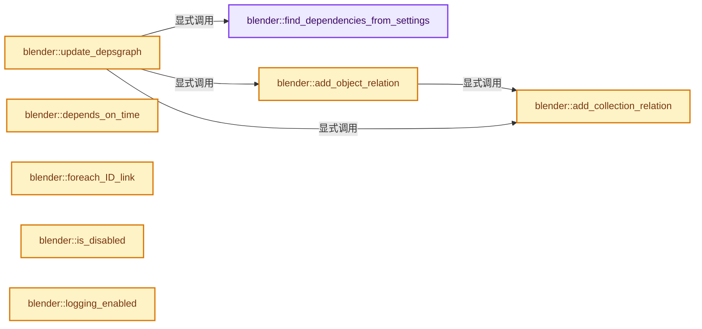
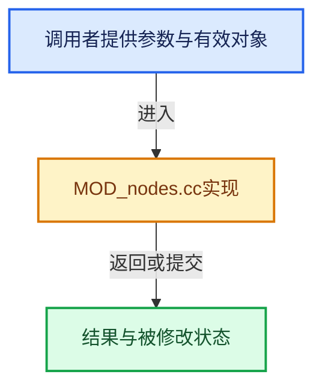

# 实现依赖专题：source/blender/modifiers/intern/MOD_nodes.cc

[实现依赖导航](../../../README.md) · [符号索引](../../../../00-课程指南/02-源码与提交索引/符号依赖与实现索引.md)

本专题从正文实际调用进入，集中保存共享实现。函数有稳定锚点，可从调用处直接跳到对应完整函数；递归与互相调用通过回链组织。

## 本文件的实现关系






## 完整成员与函数实现

<a id="f-6973bf2d7beb8d87"></a>

### `blender::find_dependencies_from_settings`

实现位置：[source/blender/modifiers/intern/MOD_nodes.cc](../../../../../../../../source/blender/modifiers/intern/MOD_nodes.cc) · L112—L121。

接口参数：

- `const NodesModifierData &nmd`
- `nodes::EvalDependencies &deps`

**教学注释版**

<!-- annotated:f862d53935d7ab -->

```cpp
static void find_dependencies_from_settings(const NodesModifierData &nmd,
                                            nodes::EvalDependencies &deps)
{
  IDP_foreach_property(
      nmd.modifier.system_properties, IDP_TYPE_FILTER_ID, [&](IDProperty *property) {
        if (ID *id = IDP_ID_get(property)) {
          deps.add_generic_id_full(id);
        }
      });
}
```

<details>
<summary>核对原始源码：source/blender/modifiers/intern/MOD_nodes.cc · L112—L121</summary>

<!-- original:f862d53935d7ab:source/blender/modifiers/intern/MOD_nodes.cc:112:121 -->

```cpp
static void find_dependencies_from_settings(const NodesModifierData &nmd,
                                            nodes::EvalDependencies &deps)
{
  IDP_foreach_property(
      nmd.modifier.system_properties, IDP_TYPE_FILTER_ID, [&](IDProperty *property) {
        if (ID *id = IDP_ID_get(property)) {
          deps.add_generic_id_full(id);
        }
      });
}
```

</details>

**继续追踪实现**

- `IDP_foreach_property` → [blender::IDP_foreach_property · L1469](../../../02-BKE几何与数据/intern/idprop.cc.md#f-63095cdb2dc834a9)。
- `IDP_ID_get` → [IDP_ID_get · L377](../../../02-BKE几何与数据/BKE_idprop.hh.md#m-e3b1c0302622)。宏定义由构建条件选择。
- `deps.add_generic_id_full` → [blender::nodes::EvalDependencies::add_generic_id_full · L32](../../../04-Nodes节点系统/intern/dependencies.cc.md#f-7491c4b7fe0af39c)。

<a id="f-e081c5a1f3d59c0a"></a>

### `blender::add_collection_relation`

实现位置：[source/blender/modifiers/intern/MOD_nodes.cc](../../../../../../../../source/blender/modifiers/intern/MOD_nodes.cc) · L130—L135。

接口参数：

- `const ModifierUpdateDepsgraphContext *ctx`
- `Collection &collection`

**教学注释版**

<!-- annotated:85b380e9a8672d -->

```cpp
static void add_collection_relation(const ModifierUpdateDepsgraphContext *ctx,
                                    Collection &collection)
{
  DEG_add_collection_geometry_relation(ctx->node, &collection, "Nodes Modifier");
  DEG_add_collection_geometry_customdata_mask(ctx->node, &collection, &dependency_data_mask);
}
```

<details>
<summary>核对原始源码：source/blender/modifiers/intern/MOD_nodes.cc · L130—L135</summary>

<!-- original:85b380e9a8672d:source/blender/modifiers/intern/MOD_nodes.cc:130:135 -->

```cpp
static void add_collection_relation(const ModifierUpdateDepsgraphContext *ctx,
                                    Collection &collection)
{
  DEG_add_collection_geometry_relation(ctx->node, &collection, "Nodes Modifier");
  DEG_add_collection_geometry_customdata_mask(ctx->node, &collection, &dependency_data_mask);
}
```

</details>

**继续追踪实现**

- `DEG_add_collection_geometry_relation` → [blender::DEG_add_collection_geometry_relation · L139](../../../06-Depsgraph依赖图/intern/depsgraph_build.cc.md#f-df8183be0167db8e)。
- `DEG_add_collection_geometry_customdata_mask` → [blender::DEG_add_collection_geometry_customdata_mask · L149](../../../06-Depsgraph依赖图/intern/depsgraph_build.cc.md#f-11a9f62d2d5e1229)。

<a id="f-d9e367250a060990"></a>

### `blender::add_object_relation`

实现位置：[source/blender/modifiers/intern/MOD_nodes.cc](../../../../../../../../source/blender/modifiers/intern/MOD_nodes.cc) · L137—L169。

接口参数：

- `const ModifierUpdateDepsgraphContext *ctx`
- `Object &object`
- `const nodes::EvalDependencies::ObjectDependencyInfo &info`

**教学注释版**

<!-- annotated:17008d52379bcc -->

```cpp
static void add_object_relation(const ModifierUpdateDepsgraphContext *ctx,
                                Object &object,
                                const nodes::EvalDependencies::ObjectDependencyInfo &info)
{
  if (info.transform) {
    DEG_add_object_relation(ctx->node, &object, DEG_OB_COMP_TRANSFORM, "Nodes Modifier");
  }
  if (&object == ctx->object) {
    return;
  }
  if (info.geometry) {
    const bool is_just_collection_instance = object.type == OB_EMPTY &&
                                             object.instance_collection != nullptr &&
                                             object.modifiers.is_empty();
    if (is_just_collection_instance) {
      add_collection_relation(ctx, *object.instance_collection);
    }
    else if (DEG_object_has_geometry_component(&object)) {
      DEG_add_object_relation(ctx->node, &object, DEG_OB_COMP_GEOMETRY, "Nodes Modifier");
      DEG_add_customdata_mask(ctx->node, &object, &dependency_data_mask);
    }
  }
  if (object.type == OB_CAMERA) {
    if (info.camera_parameters) {
      DEG_add_object_relation(ctx->node, &object, DEG_OB_COMP_PARAMETERS, "Nodes Modifier");
    }
  }
  if (object.type == OB_ARMATURE) {
    if (info.pose) {
      DEG_add_object_relation(ctx->node, &object, DEG_OB_COMP_EVAL_POSE, "Nodes Modifier");
    }
  }
}
```

<details>
<summary>核对原始源码：source/blender/modifiers/intern/MOD_nodes.cc · L137—L169</summary>

<!-- original:17008d52379bcc:source/blender/modifiers/intern/MOD_nodes.cc:137:169 -->

```cpp
static void add_object_relation(const ModifierUpdateDepsgraphContext *ctx,
                                Object &object,
                                const nodes::EvalDependencies::ObjectDependencyInfo &info)
{
  if (info.transform) {
    DEG_add_object_relation(ctx->node, &object, DEG_OB_COMP_TRANSFORM, "Nodes Modifier");
  }
  if (&object == ctx->object) {
    return;
  }
  if (info.geometry) {
    const bool is_just_collection_instance = object.type == OB_EMPTY &&
                                             object.instance_collection != nullptr &&
                                             object.modifiers.is_empty();
    if (is_just_collection_instance) {
      add_collection_relation(ctx, *object.instance_collection);
    }
    else if (DEG_object_has_geometry_component(&object)) {
      DEG_add_object_relation(ctx->node, &object, DEG_OB_COMP_GEOMETRY, "Nodes Modifier");
      DEG_add_customdata_mask(ctx->node, &object, &dependency_data_mask);
    }
  }
  if (object.type == OB_CAMERA) {
    if (info.camera_parameters) {
      DEG_add_object_relation(ctx->node, &object, DEG_OB_COMP_PARAMETERS, "Nodes Modifier");
    }
  }
  if (object.type == OB_ARMATURE) {
    if (info.pose) {
      DEG_add_object_relation(ctx->node, &object, DEG_OB_COMP_EVAL_POSE, "Nodes Modifier");
    }
  }
}
```

</details>

**继续追踪实现**

- `DEG_add_object_relation` → [blender::DEG_add_object_relation · L123](../../../06-Depsgraph依赖图/intern/depsgraph_build.cc.md#f-f570cffae97e273c)。
- `object.modifiers.is_empty` → [调用协议](../../../../00-课程指南/01-路线与规范/模板宏与动态分派协议.md)：接收对象类型依赖auto、返回值或模板实例；不按同名猜测目标。调用位置L150。
- `add_collection_relation` → [blender::add_collection_relation · L130](MOD_nodes.cc.md#f-e081c5a1f3d59c0a)。
- `DEG_object_has_geometry_component` → [blender::DEG_object_has_geometry_component · L134](../../../06-Depsgraph依赖图/intern/depsgraph_build.cc.md#f-90c525c04e91dcf7)。
- `DEG_add_customdata_mask` → [blender::DEG_add_customdata_mask · L259](../../../06-Depsgraph依赖图/intern/depsgraph_build.cc.md#f-7ae1eb4c4326d38d)。

<a id="f-43e2b37162dda3b3"></a>

### `blender::update_depsgraph`

实现位置：[source/blender/modifiers/intern/MOD_nodes.cc](../../../../../../../../source/blender/modifiers/intern/MOD_nodes.cc) · L171—L240。

接口参数：

- `ModifierData *md`
- `const ModifierUpdateDepsgraphContext *ctx`

**教学注释版**

<!-- annotated:c95a0947182aa8 -->

```cpp
static void update_depsgraph(ModifierData *md, const ModifierUpdateDepsgraphContext *ctx)
{
  NodesModifierData *nmd = reinterpret_cast<NodesModifierData *>(md);
  if (nmd->node_group == nullptr) {
    return;
  }
  if (ID_MISSING(nmd->node_group)) {
    return;
  }

  DEG_add_node_tree_output_relation(ctx->node, nmd->node_group, "Nodes Modifier");

  nodes::EvalDependencies eval_deps = nodes::gather_eval_dependencies_recursive(*nmd->node_group);

  /* Create dependencies to data-blocks referenced by the settings in the modifier. */
  find_dependencies_from_settings(*nmd, eval_deps);

  for (const NodesModifierBake &bake : Span(nmd->bakes, nmd->bakes_num)) {
    for (const NodesModifierDataBlock &data_block : Span(bake.data_blocks, bake.data_blocks_num)) {
      if (data_block.id) {
        eval_deps.add_generic_id_full(data_block.id);
      }
    }
  }

  for (ID *id : eval_deps.ids.values()) {
    switch (ID_Type(GS(id->name))) {
      case ID_OB: {
        Object *object = reinterpret_cast<Object *>(id);
        add_object_relation(
            ctx, *object, eval_deps.objects_info.lookup_default(object->id.session_uid, {}));
        break;
      }
      case ID_GR: {
        Collection *collection = reinterpret_cast<Collection *>(id);
        add_collection_relation(ctx, *collection);
        break;
      }
      case ID_IM:
      case ID_TE: {
        DEG_add_generic_id_relation(ctx->node, id, "Nodes Modifier");
        break;
      }
      case ID_VF: {
        DEG_add_vfont_relation(ctx->node, reinterpret_cast<VFont *>(id), "Nodes Modifier");
        break;
      }
      case ID_MA: {
        /* Purposefully don't add relations for materials. While there are material sockets,
         * the pointers are only passed around as handles rather than dereferenced. */
        break;
      }
      default: {
        /* Other types don't need depsgraph dependencies currently. */
        break;
      }
    }
  }

  if (eval_deps.needs_own_transform) {
    DEG_add_depends_on_transform_relation(ctx->node, "Nodes Modifier");
  }
  if (eval_deps.needs_active_camera) {
    DEG_add_scene_camera_relation(ctx->node, ctx->scene, DEG_OB_COMP_TRANSFORM, "Nodes Modifier");
  }
  /* Active camera is a scene parameter that can change, so we need a relation for that, too. */
  if (eval_deps.needs_active_camera || eval_deps.needs_scene_render_params) {
    DEG_add_scene_relation(ctx->node, ctx->scene, DEG_SCENE_COMP_PARAMETERS, "Nodes Modifier");
  }
}
```

<details>
<summary>核对原始源码：source/blender/modifiers/intern/MOD_nodes.cc · L171—L240</summary>

<!-- original:c95a0947182aa8:source/blender/modifiers/intern/MOD_nodes.cc:171:240 -->

```cpp
static void update_depsgraph(ModifierData *md, const ModifierUpdateDepsgraphContext *ctx)
{
  NodesModifierData *nmd = reinterpret_cast<NodesModifierData *>(md);
  if (nmd->node_group == nullptr) {
    return;
  }
  if (ID_MISSING(nmd->node_group)) {
    return;
  }

  DEG_add_node_tree_output_relation(ctx->node, nmd->node_group, "Nodes Modifier");

  nodes::EvalDependencies eval_deps = nodes::gather_eval_dependencies_recursive(*nmd->node_group);

  /* Create dependencies to data-blocks referenced by the settings in the modifier. */
  find_dependencies_from_settings(*nmd, eval_deps);

  for (const NodesModifierBake &bake : Span(nmd->bakes, nmd->bakes_num)) {
    for (const NodesModifierDataBlock &data_block : Span(bake.data_blocks, bake.data_blocks_num)) {
      if (data_block.id) {
        eval_deps.add_generic_id_full(data_block.id);
      }
    }
  }

  for (ID *id : eval_deps.ids.values()) {
    switch (ID_Type(GS(id->name))) {
      case ID_OB: {
        Object *object = reinterpret_cast<Object *>(id);
        add_object_relation(
            ctx, *object, eval_deps.objects_info.lookup_default(object->id.session_uid, {}));
        break;
      }
      case ID_GR: {
        Collection *collection = reinterpret_cast<Collection *>(id);
        add_collection_relation(ctx, *collection);
        break;
      }
      case ID_IM:
      case ID_TE: {
        DEG_add_generic_id_relation(ctx->node, id, "Nodes Modifier");
        break;
      }
      case ID_VF: {
        DEG_add_vfont_relation(ctx->node, reinterpret_cast<VFont *>(id), "Nodes Modifier");
        break;
      }
      case ID_MA: {
        /* Purposefully don't add relations for materials. While there are material sockets,
         * the pointers are only passed around as handles rather than dereferenced. */
        break;
      }
      default: {
        /* Other types don't need depsgraph dependencies currently. */
        break;
      }
    }
  }

  if (eval_deps.needs_own_transform) {
    DEG_add_depends_on_transform_relation(ctx->node, "Nodes Modifier");
  }
  if (eval_deps.needs_active_camera) {
    DEG_add_scene_camera_relation(ctx->node, ctx->scene, DEG_OB_COMP_TRANSFORM, "Nodes Modifier");
  }
  /* Active camera is a scene parameter that can change, so we need a relation for that, too. */
  if (eval_deps.needs_active_camera || eval_deps.needs_scene_render_params) {
    DEG_add_scene_relation(ctx->node, ctx->scene, DEG_SCENE_COMP_PARAMETERS, "Nodes Modifier");
  }
}
```

</details>

**继续追踪实现**

- `ID_MISSING` → [ID_MISSING · L695](../../makesdna/DNA_ID.h.md#m-ab9a2a270fb3)。宏定义由构建条件选择。
- `DEG_add_node_tree_output_relation` → [blender::DEG_add_node_tree_output_relation · L162](../../../06-Depsgraph依赖图/intern/depsgraph_build.cc.md#f-fb1caa918d5228d7)。
- `nodes::gather_eval_dependencies_recursive` → [blender::nodes::gather_eval_dependencies_recursive · L323](../../../04-Nodes节点系统/intern/dependencies.cc.md#f-927e31fd411adb01)。
- `find_dependencies_from_settings` → [blender::find_dependencies_from_settings · L112](MOD_nodes.cc.md#f-6973bf2d7beb8d87)。
- `Span` → [blender::Span · L214](../../../../01-基础容器与现代CPP/15-StringRef字符串视图.md#f-eea723436ab634ed)。
- `eval_deps.add_generic_id_full` → [blender::nodes::EvalDependencies::add_generic_id_full · L32](../../../04-Nodes节点系统/intern/dependencies.cc.md#f-7491c4b7fe0af39c)。
- `eval_deps.ids.values` → [调用协议](../../../../00-课程指南/01-路线与规范/模板宏与动态分派协议.md)：接收对象类型依赖auto、返回值或模板实例；不按同名猜测目标。调用位置L196。
- `ID_Type` → [blender::ID_Type](../../windowmanager/WM_api.hh.md#t-a58f1911df5c)；[blender::ID_Type](../../makesdna/DNA_ID_enums.h.md#t-4fa202c1cee5)。
- `GS` → [blender::GS · L410](../../makesdna/DNA_ID.h.md#f-c3ff509f79f21b05)。
- `add_object_relation` → [blender::add_object_relation · L137](MOD_nodes.cc.md#f-d9e367250a060990)。
- `eval_deps.objects_info.lookup_default` → [调用协议](../../../../00-课程指南/01-路线与规范/模板宏与动态分派协议.md)：接收对象类型依赖auto、返回值或模板实例；不按同名猜测目标。调用位置L201。
- `add_collection_relation` → [blender::add_collection_relation · L130](MOD_nodes.cc.md#f-e081c5a1f3d59c0a)。
- `DEG_add_generic_id_relation` → [blender::DEG_add_generic_id_relation · L232](../../../06-Depsgraph依赖图/intern/depsgraph_build.cc.md#f-43ef8aa495db0d98)。
- `DEG_add_vfont_relation` → [blender::DEG_add_vfont_relation · L201](../../../06-Depsgraph依赖图/intern/depsgraph_build.cc.md#f-2811f560a962bf95)。
- `DEG_add_depends_on_transform_relation` → [blender::DEG_add_depends_on_transform_relation · L240](../../../06-Depsgraph依赖图/intern/depsgraph_build.cc.md#f-47c32a354defa20d)。
- `DEG_add_scene_camera_relation` → [blender::DEG_add_scene_camera_relation · L97](../../../06-Depsgraph依赖图/intern/depsgraph_build.cc.md#f-bb41a91b31e0c1cb)。
- `DEG_add_scene_relation` → [blender::DEG_add_scene_relation · L77](../../../06-Depsgraph依赖图/intern/depsgraph_build.cc.md#f-7f2ffb7e38b49509)。

<a id="f-bc6514f62da0dede"></a>

### `blender::depends_on_time`

实现位置：[source/blender/modifiers/intern/MOD_nodes.cc](../../../../../../../../source/blender/modifiers/intern/MOD_nodes.cc) · L242—L259。

接口参数：

- `Scene *`
- `ModifierData *md`

**教学注释版**

<!-- annotated:56e4ffff26d231 -->

```cpp
static bool depends_on_time(Scene * /*scene*/, ModifierData *md)
{
  const NodesModifierData *nmd = reinterpret_cast<NodesModifierData *>(md);
  const bNodeTree *tree = nmd->node_group;
  if (tree == nullptr) {
    return false;
  }
  if (ID_MISSING(tree)) {
    return false;
  }
  for (const NodesModifierBake &bake : Span(nmd->bakes, nmd->bakes_num)) {
    if (bake.bake_mode == NODES_MODIFIER_BAKE_MODE_ANIMATION) {
      return true;
    }
  }
  nodes::EvalDependencies eval_deps = nodes::gather_eval_dependencies_recursive(*nmd->node_group);
  return eval_deps.time_dependent;
}
```

<details>
<summary>核对原始源码：source/blender/modifiers/intern/MOD_nodes.cc · L242—L259</summary>

<!-- original:56e4ffff26d231:source/blender/modifiers/intern/MOD_nodes.cc:242:259 -->

```cpp
static bool depends_on_time(Scene * /*scene*/, ModifierData *md)
{
  const NodesModifierData *nmd = reinterpret_cast<NodesModifierData *>(md);
  const bNodeTree *tree = nmd->node_group;
  if (tree == nullptr) {
    return false;
  }
  if (ID_MISSING(tree)) {
    return false;
  }
  for (const NodesModifierBake &bake : Span(nmd->bakes, nmd->bakes_num)) {
    if (bake.bake_mode == NODES_MODIFIER_BAKE_MODE_ANIMATION) {
      return true;
    }
  }
  nodes::EvalDependencies eval_deps = nodes::gather_eval_dependencies_recursive(*nmd->node_group);
  return eval_deps.time_dependent;
}
```

</details>

**结果出口**

- `return false;`
- `return true;`
- `return eval_deps.time_dependent;`

**继续追踪实现**

- `ID_MISSING` → [ID_MISSING · L695](../../makesdna/DNA_ID.h.md#m-ab9a2a270fb3)。宏定义由构建条件选择。
- `Span` → [blender::Span · L214](../../../../01-基础容器与现代CPP/15-StringRef字符串视图.md#f-eea723436ab634ed)。
- `nodes::gather_eval_dependencies_recursive` → [blender::nodes::gather_eval_dependencies_recursive · L323](../../../04-Nodes节点系统/intern/dependencies.cc.md#f-927e31fd411adb01)。

<a id="f-f2ded6cff5dae987"></a>

### `blender::foreach_ID_link`

实现位置：[source/blender/modifiers/intern/MOD_nodes.cc](../../../../../../../../source/blender/modifiers/intern/MOD_nodes.cc) · L261—L281。

接口参数：

- `ModifierData *md`
- `Object *ob`
- `IDWalkFunc walk`
- `void *user_data`

**教学注释版**

<!-- annotated:e3fbc8162395a2 -->

```cpp
static void foreach_ID_link(ModifierData *md, Object *ob, IDWalkFunc walk, void *user_data)
{
  NodesModifierData *nmd = reinterpret_cast<NodesModifierData *>(md);
  walk(user_data, ob, reinterpret_cast<ID **>(&nmd->node_group), IDWALK_CB_USER);

  if (nmd->settings_legacy.properties) {
    /* Also walk legacy properties because they are still used at runtime before post linking
     * versioning. */
    IDP_foreach_property(
        nmd->settings_legacy.properties, IDP_TYPE_FILTER_ID, [&](IDProperty *id_prop) {
          walk(user_data, ob, reinterpret_cast<ID **>(&id_prop->data.pointer), IDWALK_CB_USER);
        });
  }

  for (NodesModifierBake &bake : MutableSpan(nmd->bakes, nmd->bakes_num)) {
    for (NodesModifierDataBlock &data_block : MutableSpan(bake.data_blocks, bake.data_blocks_num))
    {
      walk(user_data, ob, &data_block.id, IDWALK_CB_USER);
    }
  }
}
```

<details>
<summary>核对原始源码：source/blender/modifiers/intern/MOD_nodes.cc · L261—L281</summary>

<!-- original:e3fbc8162395a2:source/blender/modifiers/intern/MOD_nodes.cc:261:281 -->

```cpp
static void foreach_ID_link(ModifierData *md, Object *ob, IDWalkFunc walk, void *user_data)
{
  NodesModifierData *nmd = reinterpret_cast<NodesModifierData *>(md);
  walk(user_data, ob, reinterpret_cast<ID **>(&nmd->node_group), IDWALK_CB_USER);

  if (nmd->settings_legacy.properties) {
    /* Also walk legacy properties because they are still used at runtime before post linking
     * versioning. */
    IDP_foreach_property(
        nmd->settings_legacy.properties, IDP_TYPE_FILTER_ID, [&](IDProperty *id_prop) {
          walk(user_data, ob, reinterpret_cast<ID **>(&id_prop->data.pointer), IDWALK_CB_USER);
        });
  }

  for (NodesModifierBake &bake : MutableSpan(nmd->bakes, nmd->bakes_num)) {
    for (NodesModifierDataBlock &data_block : MutableSpan(bake.data_blocks, bake.data_blocks_num))
    {
      walk(user_data, ob, &data_block.id, IDWALK_CB_USER);
    }
  }
}
```

</details>

**继续追踪实现**

- `walk` → [调用协议](../../../../00-课程指南/01-路线与规范/模板宏与动态分派协议.md)：局部可调用对象，须结合其初始化与捕获环境。调用位置L264。
- `IDP_foreach_property` → [blender::IDP_foreach_property · L1469](../../../02-BKE几何与数据/intern/idprop.cc.md#f-63095cdb2dc834a9)。
- `MutableSpan` → [blender::MutableSpan::MutableSpan · L462](../../../../01-基础容器与现代CPP/06-MutableSpan可写视图.md#f-0f07034aaffc3384)；[blender::MutableSpan::MutableSpan · L464](../../../../01-基础容器与现代CPP/06-MutableSpan可写视图.md#f-39977234ad0ce192)；[blender::MutableSpan::MutableSpan · L466](../../../../01-基础容器与现代CPP/06-MutableSpan可写视图.md#f-ee249b5042dd38aa)；[blender::MutableSpan::MutableSpan · L468](../../../../01-基础容器与现代CPP/06-MutableSpan可写视图.md#f-479c5f85921e531f)；[blender::MutableSpan::MutableSpan · L477](../../../../01-基础容器与现代CPP/06-MutableSpan可写视图.md#f-afcce5325e6f19e0)。同名重载需按实参类型选择。

<a id="f-f3ed5c7d6f189dc6"></a>

### `blender::is_disabled`

实现位置：[source/blender/modifiers/intern/MOD_nodes.cc](../../../../../../../../source/blender/modifiers/intern/MOD_nodes.cc) · L290—L299。

接口参数：

- `const Scene *`
- `ModifierData *md`
- `bool`

**教学注释版**

<!-- annotated:8d99b8a25d32da -->

```cpp
static bool is_disabled(const Scene * /*scene*/, ModifierData *md, bool /*use_render_params*/)
{
  NodesModifierData *nmd = reinterpret_cast<NodesModifierData *>(md);

  if (nmd->node_group == nullptr) {
    return true;
  }

  return false;
}
```

<details>
<summary>核对原始源码：source/blender/modifiers/intern/MOD_nodes.cc · L290—L299</summary>

<!-- original:8d99b8a25d32da:source/blender/modifiers/intern/MOD_nodes.cc:290:299 -->

```cpp
static bool is_disabled(const Scene * /*scene*/, ModifierData *md, bool /*use_render_params*/)
{
  NodesModifierData *nmd = reinterpret_cast<NodesModifierData *>(md);

  if (nmd->node_group == nullptr) {
    return true;
  }

  return false;
}
```

</details>

**结果出口**

- `return true;`
- `return false;`

**继续追踪实现**

本实现没有需要继续展开的显式调用；检查返回表达式、对象转换和调用者前置条件。

<a id="f-bc7427bfb1402e53"></a>

### `blender::logging_enabled`

实现位置：[source/blender/modifiers/intern/MOD_nodes.cc](../../../../../../../../source/blender/modifiers/intern/MOD_nodes.cc) · L301—L310。

接口参数：

- `const ModifierEvalContext *ctx`

**教学注释版**

<!-- annotated:6fbd95553aa6e7 -->

```cpp
static bool logging_enabled(const ModifierEvalContext *ctx)
{
  if (!DEG_is_active(ctx->depsgraph)) {
    return false;
  }
  if ((ctx->flag & MOD_APPLY_ORCO) != 0) {
    return false;
  }
  return true;
}
```

<details>
<summary>核对原始源码：source/blender/modifiers/intern/MOD_nodes.cc · L301—L310</summary>

<!-- original:6fbd95553aa6e7:source/blender/modifiers/intern/MOD_nodes.cc:301:310 -->

```cpp
static bool logging_enabled(const ModifierEvalContext *ctx)
{
  if (!DEG_is_active(ctx->depsgraph)) {
    return false;
  }
  if ((ctx->flag & MOD_APPLY_ORCO) != 0) {
    return false;
  }
  return true;
}
```

</details>

**结果出口**

- `return false;`
- `return true;`

**继续追踪实现**

- `DEG_is_active` → [blender::DEG_is_active · L324](../../../06-Depsgraph依赖图/intern/depsgraph.cc.md#f-d561ff15ce03c64a)。

<a id="f-52486af2df781d0f"></a>

### `blender::remove_outdated_bake_caches`

实现位置：[source/blender/modifiers/intern/MOD_nodes.cc](../../../../../../../../source/blender/modifiers/intern/MOD_nodes.cc) · L312—L332。

接口参数：

- `NodesModifierData &nmd`

**教学注释版**

<!-- annotated:1affc7c1f59de4 -->

```cpp
static void remove_outdated_bake_caches(NodesModifierData &nmd)
{
  if (!nmd.runtime->cache) {
    if (nmd.bakes_num == 0) {
      return;
    }
    // [讲解] std::make_shared<bake::ModifierCache>：构造由共享控制块管理的对象；共享寿命不自动使被指对象读写线程安全，强引用环需单独处理。
    nmd.runtime->cache = std::make_shared<bake::ModifierCache>();
  }
  bake::ModifierCache &modifier_cache = *nmd.runtime->cache;
  std::lock_guard lock{modifier_cache.mutex};

  Set<int> existing_bake_ids;
  for (const NodesModifierBake &bake : Span{nmd.bakes, nmd.bakes_num}) {
    // [讲解] existing_bake_ids.add：按哈希与相等关系加入键或键值。
    existing_bake_ids.add(bake.id);
  }

  // [讲解] existing_bake_ids.contains：查询活项数量或键是否存在。
  auto remove_predicate = [&](auto item) { return !existing_bake_ids.contains(item.key); };

  modifier_cache.bake_cache_by_id.remove_if(remove_predicate);
  modifier_cache.simulation_cache_by_id.remove_if(remove_predicate);
}
```

<details>
<summary>核对原始源码：source/blender/modifiers/intern/MOD_nodes.cc · L312—L332</summary>

<!-- original:1affc7c1f59de4:source/blender/modifiers/intern/MOD_nodes.cc:312:332 -->

```cpp
static void remove_outdated_bake_caches(NodesModifierData &nmd)
{
  if (!nmd.runtime->cache) {
    if (nmd.bakes_num == 0) {
      return;
    }
    nmd.runtime->cache = std::make_shared<bake::ModifierCache>();
  }
  bake::ModifierCache &modifier_cache = *nmd.runtime->cache;
  std::lock_guard lock{modifier_cache.mutex};

  Set<int> existing_bake_ids;
  for (const NodesModifierBake &bake : Span{nmd.bakes, nmd.bakes_num}) {
    existing_bake_ids.add(bake.id);
  }

  auto remove_predicate = [&](auto item) { return !existing_bake_ids.contains(item.key); };

  modifier_cache.bake_cache_by_id.remove_if(remove_predicate);
  modifier_cache.simulation_cache_by_id.remove_if(remove_predicate);
}
```

</details>

**沿实际写入检查状态**

- `nmd.runtime->cache = std::make_shared<bake::ModifierCache>();`

**继续追踪实现**

- `std::make_shared<bake::ModifierCache>` → [外部契约](https://eel.is/c++draft/util.smartptr.shared.create)：构造由共享控制块管理的对象；共享寿命不自动使被指对象读写线程安全，强引用环需单独处理。
- `existing_bake_ids.add` → [blender::Set::add · L248](../../../../02-哈希表与关联数据结构/08-Set与集合语义.md#f-c7498809c2327fba)；[blender::Set::add · L252](../../../../02-哈希表与关联数据结构/08-Set与集合语义.md#f-e3ac8d1c52c03c2b)。同名重载需按实参类型选择。
- `existing_bake_ids.contains` → [blender::Set::contains · L310](../../../../02-哈希表与关联数据结构/08-Set与集合语义.md#f-af7099799494350e)。
- `modifier_cache.bake_cache_by_id.remove_if` → [调用协议](../../../../00-课程指南/01-路线与规范/模板宏与动态分派协议.md)：接收对象类型依赖auto、返回值或模板实例；不按同名猜测目标。调用位置L330。
- `modifier_cache.simulation_cache_by_id.remove_if` → [调用协议](../../../../00-课程指南/01-路线与规范/模板宏与动态分派协议.md)：接收对象类型依赖auto、返回值或模板实例；不按同名猜测目标。调用位置L331。

<a id="f-628de03d01d23993"></a>

### `blender::update_bakes_from_node_group`

实现位置：[source/blender/modifiers/intern/MOD_nodes.cc](../../../../../../../../source/blender/modifiers/intern/MOD_nodes.cc) · L334—L389。

接口参数：

- `NodesModifierData &nmd`

**教学注释版**

<!-- annotated:fb155096982bf7 -->

```cpp
static void update_bakes_from_node_group(NodesModifierData &nmd)
{
  Map<int, NodesModifierBake *> old_bake_by_id;
  for (NodesModifierBake &bake : MutableSpan(nmd.bakes, nmd.bakes_num)) {
    // [讲解] old_bake_by_id.add：按哈希与相等关系加入键或键值。
    old_bake_by_id.add(bake.id, &bake);
  }

  Vector<int> new_bake_ids;
  if (nmd.node_group && !ID_MISSING(nmd.node_group)) {
    for (const bNestedNodeRef &ref : nmd.node_group->nested_node_refs_span()) {
      const bNode *node = nmd.node_group->find_nested_node(ref.id);
      if (node) {
        if (ELEM(node->type_legacy, GEO_NODE_SIMULATION_OUTPUT, GEO_NODE_BAKE)) {
          // [讲解] new_bake_ids.append：在尾部建立新元素，必要时先扩大存储。
          new_bake_ids.append(ref.id);
        }
      }
      // [讲解] old_bake_by_id.contains：查询活项数量或键是否存在。
      else if (old_bake_by_id.contains(ref.id)) {
        /* Keep baked data in case linked data is missing so that it still exists when the linked
         * data has been found. */
        new_bake_ids.append(ref.id);
      }
    }
  }

  // [讲解] new_bake_ids.size：用end_减begin_得到活元素数量。
  NodesModifierBake *new_bake_data = MEM_new_array<NodesModifierBake>(new_bake_ids.size(),
                                                                      __func__);
  for (const int i : new_bake_ids.index_range()) {
    const int id = new_bake_ids[i];
    // [讲解] old_bake_by_id.lookup_default：按键查找对应项。
    NodesModifierBake *old_bake = old_bake_by_id.lookup_default(id, nullptr);
    NodesModifierBake &new_bake = new_bake_data[i];
    if (old_bake) {
      new_bake = *old_bake;
      /* The ownership of this data was moved to `new_bake`. */
      old_bake->directory = nullptr;
      old_bake->data_blocks = nullptr;
      old_bake->data_blocks_num = 0;
      old_bake->packed = nullptr;
    }
    else {
      new_bake.id = id;
      new_bake.frame_start = 1;
      new_bake.frame_end = 100;
      new_bake.bake_mode = NODES_MODIFIER_BAKE_MODE_STILL;
    }
  }

  for (NodesModifierBake &old_bake : MutableSpan(nmd.bakes, nmd.bakes_num)) {
    nodes_modifier_bake_destruct(&old_bake, true);
  }
  MEM_SAFE_DELETE(nmd.bakes);

  nmd.bakes = new_bake_data;
  nmd.bakes_num = new_bake_ids.size();

  remove_outdated_bake_caches(nmd);
}
```

<details>
<summary>核对原始源码：source/blender/modifiers/intern/MOD_nodes.cc · L334—L389</summary>

<!-- original:fb155096982bf7:source/blender/modifiers/intern/MOD_nodes.cc:334:389 -->

```cpp
static void update_bakes_from_node_group(NodesModifierData &nmd)
{
  Map<int, NodesModifierBake *> old_bake_by_id;
  for (NodesModifierBake &bake : MutableSpan(nmd.bakes, nmd.bakes_num)) {
    old_bake_by_id.add(bake.id, &bake);
  }

  Vector<int> new_bake_ids;
  if (nmd.node_group && !ID_MISSING(nmd.node_group)) {
    for (const bNestedNodeRef &ref : nmd.node_group->nested_node_refs_span()) {
      const bNode *node = nmd.node_group->find_nested_node(ref.id);
      if (node) {
        if (ELEM(node->type_legacy, GEO_NODE_SIMULATION_OUTPUT, GEO_NODE_BAKE)) {
          new_bake_ids.append(ref.id);
        }
      }
      else if (old_bake_by_id.contains(ref.id)) {
        /* Keep baked data in case linked data is missing so that it still exists when the linked
         * data has been found. */
        new_bake_ids.append(ref.id);
      }
    }
  }

  NodesModifierBake *new_bake_data = MEM_new_array<NodesModifierBake>(new_bake_ids.size(),
                                                                      __func__);
  for (const int i : new_bake_ids.index_range()) {
    const int id = new_bake_ids[i];
    NodesModifierBake *old_bake = old_bake_by_id.lookup_default(id, nullptr);
    NodesModifierBake &new_bake = new_bake_data[i];
    if (old_bake) {
      new_bake = *old_bake;
      /* The ownership of this data was moved to `new_bake`. */
      old_bake->directory = nullptr;
      old_bake->data_blocks = nullptr;
      old_bake->data_blocks_num = 0;
      old_bake->packed = nullptr;
    }
    else {
      new_bake.id = id;
      new_bake.frame_start = 1;
      new_bake.frame_end = 100;
      new_bake.bake_mode = NODES_MODIFIER_BAKE_MODE_STILL;
    }
  }

  for (NodesModifierBake &old_bake : MutableSpan(nmd.bakes, nmd.bakes_num)) {
    nodes_modifier_bake_destruct(&old_bake, true);
  }
  MEM_SAFE_DELETE(nmd.bakes);

  nmd.bakes = new_bake_data;
  nmd.bakes_num = new_bake_ids.size();

  remove_outdated_bake_caches(nmd);
}
```

</details>

**沿实际写入检查状态**

- `new_bake = *old_bake;`
- `old_bake->directory = nullptr;`
- `old_bake->data_blocks = nullptr;`
- `old_bake->data_blocks_num = 0;`
- `old_bake->packed = nullptr;`
- `new_bake.id = id;`
- `new_bake.frame_start = 1;`
- `new_bake.frame_end = 100;`
- `new_bake.bake_mode = NODES_MODIFIER_BAKE_MODE_STILL;`
- `nmd.bakes = new_bake_data;`
- `nmd.bakes_num = new_bake_ids.size();`

**继续追踪实现**

- `MutableSpan` → [blender::MutableSpan::MutableSpan · L462](../../../../01-基础容器与现代CPP/06-MutableSpan可写视图.md#f-0f07034aaffc3384)；[blender::MutableSpan::MutableSpan · L464](../../../../01-基础容器与现代CPP/06-MutableSpan可写视图.md#f-39977234ad0ce192)；[blender::MutableSpan::MutableSpan · L466](../../../../01-基础容器与现代CPP/06-MutableSpan可写视图.md#f-ee249b5042dd38aa)；[blender::MutableSpan::MutableSpan · L468](../../../../01-基础容器与现代CPP/06-MutableSpan可写视图.md#f-479c5f85921e531f)；[blender::MutableSpan::MutableSpan · L477](../../../../01-基础容器与现代CPP/06-MutableSpan可写视图.md#f-afcce5325e6f19e0)。同名重载需按实参类型选择。
- `old_bake_by_id.add` → [blender::Map::add · L295](../../../../02-哈希表与关联数据结构/04-Map查找与键访问.md#f-8d38101abf162f88)；[blender::Map::add · L299](../../../../02-哈希表与关联数据结构/04-Map查找与键访问.md#f-1f59510cdfbd9f87)；[blender::Map::add · L303](../../../../02-哈希表与关联数据结构/04-Map查找与键访问.md#f-645e0522347aa018)；[blender::Map::add · L307](../../../../02-哈希表与关联数据结构/04-Map查找与键访问.md#f-03405db0730cedc0)。同名重载需按实参类型选择。
- `ID_MISSING` → [ID_MISSING · L695](../../makesdna/DNA_ID.h.md#m-ab9a2a270fb3)。宏定义由构建条件选择。
- `nmd.node_group->nested_node_refs_span` → [调用协议](../../../../00-课程指南/01-路线与规范/模板宏与动态分派协议.md)：接收对象类型依赖auto、返回值或模板实例；不按同名猜测目标。调用位置L343。
- `nmd.node_group->find_nested_node` → [调用协议](../../../../00-课程指南/01-路线与规范/模板宏与动态分派协议.md)：接收对象类型依赖auto、返回值或模板实例；不按同名猜测目标。调用位置L344。
- `ELEM` → [ELEM · L88](../../../07-Intern运行时与平台/ghost/intern/GHOST_utildefines.hh.md#m-d28724a15928)；[ELEM · L135](../../../01-BLI基础库/BLI_utildefines.hh.md#m-d6572de7cae0)。宏定义由构建条件选择。
- `new_bake_ids.append` → [blender::Vector::append · L498](../../../../01-基础容器与现代CPP/11-Vector插入删除与重排.md#f-5bde268a69e443ec)；[blender::Vector::append · L502](../../../../01-基础容器与现代CPP/11-Vector插入删除与重排.md#f-591e0b15e6308532)。同名重载需按实参类型选择。
- `old_bake_by_id.contains` → [blender::Map::contains · L353](../../../../02-哈希表与关联数据结构/04-Map查找与键访问.md#f-70237c86261ee04d)。
- `MEM_new_array<NodesModifierBake>` → [MEM_new_array · L372](../../../07-Intern运行时与平台/guardedalloc/MEM_guardedalloc.h.md#f-56b8fe3d391af460)。
- `new_bake_ids.size` → [blender::Vector::size · L780](../../../../01-基础容器与现代CPP/11-Vector插入删除与重排.md#f-714773731767349c)。
- `new_bake_ids.index_range` → [blender::Vector::index_range · L1026](../../../../01-基础容器与现代CPP/12-Vector异常安全与边界.md#f-ac29cf36ef185ab9)。
- `old_bake_by_id.lookup_default` → [blender::Map::lookup_default · L570](../../../../02-哈希表与关联数据结构/05-Map插入与回调.md#f-40294aaf345f6a8b)。
- `nodes_modifier_bake_destruct` → [blender::nodes_modifier_bake_destruct · L2136](MOD_nodes.cc.md#f-2a61472032e0b03c)。
- `MEM_SAFE_DELETE` → [MEM_SAFE_DELETE · L436](../../../07-Intern运行时与平台/guardedalloc/MEM_guardedalloc.h.md#m-eadb3bc5b902)。宏定义由构建条件选择。
- `remove_outdated_bake_caches` → [blender::remove_outdated_bake_caches · L312](MOD_nodes.cc.md#f-52486af2df781d0f)。

<a id="f-8f46336de96f2929"></a>

### `blender::update_system_properties`

实现位置：[source/blender/modifiers/intern/MOD_nodes.cc](../../../../../../../../source/blender/modifiers/intern/MOD_nodes.cc) · L391—L403。

接口参数：

- `Main &bmain`
- `Object &object`
- `NodesModifierData &nmd`

**教学注释版**

<!-- annotated:90f2708108820b -->

```cpp
static void update_system_properties(Main &bmain, Object &object, NodesModifierData &nmd)
{
  if (!nmd.modifier.system_properties) {
    nmd.modifier.system_properties =
        bke::idprop::create_group("NodesModifierProperties").release();
  }
  if (!nmd.node_group || ID_MISSING(nmd.node_group)) {
    return;
  }
  PointerRNA properties_ptr = RNA_pointer_create_discrete(
      &object.id, RNA_NodesModifierProperties, &nmd);
  RNA_ensure_and_sync_system_properties(bmain, properties_ptr, *nmd.modifier.system_properties);
}
```

<details>
<summary>核对原始源码：source/blender/modifiers/intern/MOD_nodes.cc · L391—L403</summary>

<!-- original:90f2708108820b:source/blender/modifiers/intern/MOD_nodes.cc:391:403 -->

```cpp
static void update_system_properties(Main &bmain, Object &object, NodesModifierData &nmd)
{
  if (!nmd.modifier.system_properties) {
    nmd.modifier.system_properties =
        bke::idprop::create_group("NodesModifierProperties").release();
  }
  if (!nmd.node_group || ID_MISSING(nmd.node_group)) {
    return;
  }
  PointerRNA properties_ptr = RNA_pointer_create_discrete(
      &object.id, RNA_NodesModifierProperties, &nmd);
  RNA_ensure_and_sync_system_properties(bmain, properties_ptr, *nmd.modifier.system_properties);
}
```

</details>

**沿实际写入检查状态**

- `nmd.modifier.system_properties =`

**继续追踪实现**

- `bke::idprop::create_group("NodesModifierProperties").release` → [调用协议](../../../../00-课程指南/01-路线与规范/模板宏与动态分派协议.md)：接收对象类型依赖auto、返回值或模板实例；不按同名猜测目标。调用位置L395。
- `bke::idprop::create_group` → [blender::bke::idprop::create_group · L155](../../../02-BKE几何与数据/intern/idprop_create.cc.md#f-b1e2d8bfd5654bc2)。
- `ID_MISSING` → [ID_MISSING · L695](../../makesdna/DNA_ID.h.md#m-ab9a2a270fb3)。宏定义由构建条件选择。
- `RNA_pointer_create_discrete` → [blender::RNA_pointer_create_discrete · L181](../../makesrna/intern/rna_access.cc.md#f-592a276e869c6d94)。
- `RNA_ensure_and_sync_system_properties` → [blender::RNA_ensure_and_sync_system_properties · L6568](../../makesrna/intern/rna_access.cc.md#f-3787705e085177e6)。

<a id="f-3f30eb793f373e5d"></a>

### `blender::MOD_nodes_update_interface`

实现位置：[source/blender/modifiers/intern/MOD_nodes.cc](../../../../../../../../source/blender/modifiers/intern/MOD_nodes.cc) · L405—L412。

接口参数：

- `Main &bmain`
- `Object *object`
- `NodesModifierData *nmd`

**教学注释版**

<!-- annotated:d765e5ebe22c63 -->

```cpp
void MOD_nodes_update_interface(Main &bmain, Object *object, NodesModifierData *nmd)
{
  update_system_properties(bmain, *object, *nmd);
  update_bakes_from_node_group(*nmd);
  nmd->runtime->usage_cache.reset();

  DEG_id_tag_update(&object->id, ID_RECALC_GEOMETRY);
}
```

<details>
<summary>核对原始源码：source/blender/modifiers/intern/MOD_nodes.cc · L405—L412</summary>

<!-- original:d765e5ebe22c63:source/blender/modifiers/intern/MOD_nodes.cc:405:412 -->

```cpp
void MOD_nodes_update_interface(Main &bmain, Object *object, NodesModifierData *nmd)
{
  update_system_properties(bmain, *object, *nmd);
  update_bakes_from_node_group(*nmd);
  nmd->runtime->usage_cache.reset();

  DEG_id_tag_update(&object->id, ID_RECALC_GEOMETRY);
}
```

</details>

**继续追踪实现**

- `update_system_properties` → [blender::update_system_properties · L391](MOD_nodes.cc.md#f-8f46336de96f2929)。
- `update_bakes_from_node_group` → [blender::update_bakes_from_node_group · L334](MOD_nodes.cc.md#f-628de03d01d23993)。
- `nmd->runtime->usage_cache.reset` → [调用协议](../../../../00-课程指南/01-路线与规范/模板宏与动态分派协议.md)：接收对象类型依赖auto、返回值或模板实例；不按同名猜测目标。调用位置L409。
- `DEG_id_tag_update` → [blender::DEG_id_tag_update · L844](../../../06-Depsgraph依赖图/intern/depsgraph_tag.cc.md#f-62d2949dd168bb81)。

<a id="f-40650c64a694e760"></a>

### `blender::NodesModifierData::find_bake`

实现位置：[source/blender/modifiers/intern/MOD_nodes.cc](../../../../../../../../source/blender/modifiers/intern/MOD_nodes.cc) · L414—L417。

接口参数：

- `const int id`

**教学注释版**

<!-- annotated:73b31ef0a096d7 -->

```cpp
NodesModifierBake *NodesModifierData::find_bake(const int id)
{
  return const_cast<NodesModifierBake *>(std::as_const(*this).find_bake(id));
}
```

<details>
<summary>核对原始源码：source/blender/modifiers/intern/MOD_nodes.cc · L414—L417</summary>

<!-- original:73b31ef0a096d7:source/blender/modifiers/intern/MOD_nodes.cc:414:417 -->

```cpp
NodesModifierBake *NodesModifierData::find_bake(const int id)
{
  return const_cast<NodesModifierBake *>(std::as_const(*this).find_bake(id));
}
```

</details>

**结果出口**

- `return const_cast<NodesModifierBake *>(std::as_const(*this).find_bake(id));`

**继续追踪实现**

- `std::as_const(*this).find_bake` → [外部契约](https://eel.is/c++draft/)：这个边界按实际表达式及所属类型核对参数、返回值、寿命与失败行为。这里提供接口入口，不声称已解释该第三方版本的内部实现。
- `std::as_const` → [外部契约](https://eel.is/c++draft/)：这个边界按实际表达式及所属类型核对参数、返回值、寿命与失败行为。这里提供接口入口，不声称已解释该第三方版本的内部实现。

<a id="f-c3fa9bc06785daba"></a>

### `blender::NodesModifierData::find_bake`

实现位置：[source/blender/modifiers/intern/MOD_nodes.cc](../../../../../../../../source/blender/modifiers/intern/MOD_nodes.cc) · L419—L427。

接口参数：

- `const int id`

**教学注释版**

<!-- annotated:aa5ac518dc2cab -->

```cpp
const NodesModifierBake *NodesModifierData::find_bake(const int id) const
{
  for (const NodesModifierBake &bake : Span{this->bakes, this->bakes_num}) {
    if (bake.id == id) {
      return &bake;
    }
  }
  return nullptr;
}
```

<details>
<summary>核对原始源码：source/blender/modifiers/intern/MOD_nodes.cc · L419—L427</summary>

<!-- original:aa5ac518dc2cab:source/blender/modifiers/intern/MOD_nodes.cc:419:427 -->

```cpp
const NodesModifierBake *NodesModifierData::find_bake(const int id) const
{
  for (const NodesModifierBake &bake : Span{this->bakes, this->bakes_num}) {
    if (bake.id == id) {
      return &bake;
    }
  }
  return nullptr;
}
```

</details>

**结果出口**

- `return &bake;`
- `return nullptr;`

**继续追踪实现**

本实现没有需要继续展开的显式调用；检查返回表达式、对象转换和调用者前置条件。

<a id="f-471ee9c83040d44e"></a>

### `blender::try_add_side_effect_node`

实现位置：[source/blender/modifiers/intern/MOD_nodes.cc](../../../../../../../../source/blender/modifiers/intern/MOD_nodes.cc) · L434—L656。

接口参数：

- `const ModifierEvalContext &ctx`
- `const ComputeContext &final_compute_context`
- `const int final_node_id`
- `const NodesModifierData &nmd`
- `nodes::GeoNodesSideEffectNodes &r_side_effect_nodes`

**教学注释版**

<!-- annotated:481237fc64ab74 -->

```cpp
static void try_add_side_effect_node(const ModifierEvalContext &ctx,
                                     const ComputeContext &final_compute_context,
                                     const int final_node_id,
                                     const NodesModifierData &nmd,
                                     nodes::GeoNodesSideEffectNodes &r_side_effect_nodes)
{
  if (nmd.node_group == nullptr || ID_MISSING(nmd.node_group)) {
    return;
  }

  Vector<const ComputeContext *> compute_context_vec;
  for (const ComputeContext *c = &final_compute_context; c; c = c->parent()) {
    // [讲解] compute_context_vec.append：在尾部建立新元素，必要时先扩大存储。
    compute_context_vec.append(c);
  }
  // [讲解] compute_context_vec.begin：提供当前存储或有效范围的地址。
  std::reverse(compute_context_vec.begin(), compute_context_vec.end());

  const auto *modifier_compute_context =
      dynamic_cast<const bke::GeometryNodesModifierComputeContext *>(compute_context_vec[1]);
  if (modifier_compute_context == nullptr) {
    return;
  }
  if (modifier_compute_context->modifier_uid() != nmd.modifier.persistent_uid) {
    return;
  }

  const bNodeTree *current_tree = nmd.node_group;
  const bke::bNodeTreeZone *current_zone = nullptr;

  /* Write side effect nodes to a new map and only if everything succeeds, move the nodes to the
   * caller. This is easier than changing r_side_effect_nodes directly and then undoing changes in
   * case of errors. */
  nodes::GeoNodesSideEffectNodes local_side_effect_nodes;
  // [讲解] compute_context_vec.as_span：构造对当前有效元素区间的借用视图。
  for (const ComputeContext *compute_context_generic : compute_context_vec.as_span().drop_front(2))
  {
    const bke::bNodeTreeZones *current_zones = current_tree->zones();
    if (current_zones == nullptr) {
      return;
    }
    const nodes::GeometryNodesLazyFunctionGraphInfo *lf_graph_info =
        nodes::ensure_geometry_nodes_lazy_function_graph(*current_tree).get();
    if (lf_graph_info == nullptr) {
      return;
    }
    const ComputeContextHash &parent_compute_context_hash =
        compute_context_generic->parent()->hash();
    if (const auto *compute_context = dynamic_cast<const bke::SimulationZoneComputeContext *>(
            compute_context_generic))
    {
      const bke::bNodeTreeZone *simulation_zone = current_zones->get_zone_by_node(
          compute_context->output_node_id());
      if (simulation_zone == nullptr) {
        return;
      }
      if (simulation_zone->parent_zone != current_zone) {
        return;
      }
      const lf::FunctionNode *lf_zone_node = lf_graph_info->mapping.zone_node_map.lookup_default(
          *simulation_zone->output_node_id, nullptr);
      if (lf_zone_node == nullptr) {
        return;
      }
      const lf::FunctionNode *lf_simulation_output_node =
          lf_graph_info->mapping.possible_side_effect_node_map.lookup_default(
              *simulation_zone->output_node_id, nullptr);
      if (lf_simulation_output_node == nullptr) {
        return;
      }
      local_side_effect_nodes.nodes_by_context.add(parent_compute_context_hash, lf_zone_node);
      /* By making the simulation output node a side-effect-node, we can ensure that the simulation
       * runs when it contains an active viewer. */
      local_side_effect_nodes.nodes_by_context.add(compute_context_generic->hash(),
                                                   lf_simulation_output_node);

      current_zone = simulation_zone;
    }
    else if (const auto *compute_context = dynamic_cast<const bke::RepeatZoneComputeContext *>(
                 compute_context_generic))
    {
      const bke::bNodeTreeZone *repeat_zone = current_zones->get_zone_by_node(
          compute_context->output_node_id());
      if (repeat_zone == nullptr) {
        return;
      }
      if (repeat_zone->parent_zone != current_zone) {
        return;
      }
      const lf::FunctionNode *lf_zone_node = lf_graph_info->mapping.zone_node_map.lookup_default(
          *repeat_zone->output_node_id, nullptr);
      if (lf_zone_node == nullptr) {
        return;
      }
      local_side_effect_nodes.nodes_by_context.add(parent_compute_context_hash, lf_zone_node);
      local_side_effect_nodes.iterations_by_iteration_zone.add(
          {parent_compute_context_hash, compute_context->output_node_id()},
          compute_context->iteration());
      current_zone = repeat_zone;
    }
    else if (const auto *compute_context =
                 dynamic_cast<const bke::ForeachGeometryElementZoneComputeContext *>(
                     compute_context_generic))
    {
      const bke::bNodeTreeZone *foreach_zone = current_zones->get_zone_by_node(
          compute_context->output_node_id());
      if (foreach_zone == nullptr) {
        return;
      }
      if (foreach_zone->parent_zone != current_zone) {
        return;
      }
      const lf::FunctionNode *lf_zone_node = lf_graph_info->mapping.zone_node_map.lookup_default(
          *foreach_zone->output_node_id, nullptr);
      if (lf_zone_node == nullptr) {
        return;
      }
      local_side_effect_nodes.nodes_by_context.add(parent_compute_context_hash, lf_zone_node);
      local_side_effect_nodes.iterations_by_iteration_zone.add(
          {parent_compute_context_hash, compute_context->output_node_id()},
          compute_context->index());
      current_zone = foreach_zone;
    }
    else if (const auto *compute_context = dynamic_cast<const bke::GroupNodeComputeContext *>(
                 compute_context_generic))
    {
      const bNode *group_node = current_tree->node_by_id(compute_context->node_id());
      if (group_node == nullptr) {
        return;
      }
      if (group_node->id == nullptr) {
        return;
      }
      if (group_node->is_muted()) {
        return;
      }
      if (current_zone != current_zones->get_zone_by_node(group_node->identifier)) {
        return;
      }
      const lf::FunctionNode *lf_group_node = lf_graph_info->mapping.group_node_map.lookup_default(
          group_node->identifier, nullptr);
      if (lf_group_node == nullptr) {
        return;
      }
      local_side_effect_nodes.nodes_by_context.add(parent_compute_context_hash, lf_group_node);
      current_tree = reinterpret_cast<const bNodeTree *>(group_node->id);
      current_zone = nullptr;
    }
    else if (const auto *compute_context =
                 dynamic_cast<const bke::EvaluateClosureComputeContext *>(compute_context_generic))
    {
      const bNode *evaluate_node = current_tree->node_by_id(compute_context->node_id());
      if (!evaluate_node) {
        return;
      }
      if (evaluate_node->is_muted()) {
        return;
      }
      if (current_zone != current_zones->get_zone_by_node(evaluate_node->identifier)) {
        return;
      }
      const std::optional<nodes::ClosureSourceLocation> &source_location =
          compute_context->closure_source_location();
      if (!source_location) {
        return;
      }
      if (!source_location->tree->zones()) {
        return;
      }
      const lf::FunctionNode *lf_evaluate_node =
          lf_graph_info->mapping.possible_side_effect_node_map.lookup_default(
              evaluate_node->identifier, nullptr);
      if (!lf_evaluate_node) {
        return;
      }
      /* The tree may sometimes be original and sometimes evaluated, depending on the source of the
       * compute context. */
      const bNodeTree *eval_closure_tree = DEG_is_evaluated(source_location->tree) ?
                                               source_location->tree :
                                               reinterpret_cast<const bNodeTree *>(
                                                   DEG_get_evaluated_id(
                                                       ctx.depsgraph, &source_location->tree->id));
      const bNode *closure_output_node = eval_closure_tree->node_by_id(
          source_location->closure_output_node_id);
      if (!closure_output_node) {
        return;
      }
      local_side_effect_nodes.nodes_by_context.add(parent_compute_context_hash, lf_evaluate_node);
      current_tree = eval_closure_tree;
      current_zone = eval_closure_tree->zones()->get_zone_by_node(closure_output_node->identifier);
    }
    else {
      return;
    }
  }
  const bNode *final_node = current_tree->node_by_id(final_node_id);
  if (final_node == nullptr) {
    return;
  }
  const nodes::GeometryNodesLazyFunctionGraphInfo *lf_graph_info =
      nodes::ensure_geometry_nodes_lazy_function_graph(*current_tree).get();
  if (lf_graph_info == nullptr) {
    return;
  }
  const bke::bNodeTreeZones *tree_zones = current_tree->zones();
  if (tree_zones == nullptr) {
    return;
  }
  if (tree_zones->get_zone_by_node(final_node_id) != current_zone) {
    return;
  }
  const lf::FunctionNode *lf_node =
      lf_graph_info->mapping.possible_side_effect_node_map.lookup_default(final_node_id, nullptr);
  if (lf_node == nullptr) {
    return;
  }
  local_side_effect_nodes.nodes_by_context.add(final_compute_context.hash(), lf_node);

  /* Successfully found all side effect nodes for the viewer path. */
  for (const auto item : local_side_effect_nodes.nodes_by_context.items()) {
    r_side_effect_nodes.nodes_by_context.add_multiple(item.key, item.value);
  }
  for (const auto item : local_side_effect_nodes.iterations_by_iteration_zone.items()) {
    r_side_effect_nodes.iterations_by_iteration_zone.add_multiple(item.key, item.value);
  }
}
```

<details>
<summary>核对原始源码：source/blender/modifiers/intern/MOD_nodes.cc · L434—L656</summary>

<!-- original:481237fc64ab74:source/blender/modifiers/intern/MOD_nodes.cc:434:656 -->

```cpp
static void try_add_side_effect_node(const ModifierEvalContext &ctx,
                                     const ComputeContext &final_compute_context,
                                     const int final_node_id,
                                     const NodesModifierData &nmd,
                                     nodes::GeoNodesSideEffectNodes &r_side_effect_nodes)
{
  if (nmd.node_group == nullptr || ID_MISSING(nmd.node_group)) {
    return;
  }

  Vector<const ComputeContext *> compute_context_vec;
  for (const ComputeContext *c = &final_compute_context; c; c = c->parent()) {
    compute_context_vec.append(c);
  }
  std::reverse(compute_context_vec.begin(), compute_context_vec.end());

  const auto *modifier_compute_context =
      dynamic_cast<const bke::GeometryNodesModifierComputeContext *>(compute_context_vec[1]);
  if (modifier_compute_context == nullptr) {
    return;
  }
  if (modifier_compute_context->modifier_uid() != nmd.modifier.persistent_uid) {
    return;
  }

  const bNodeTree *current_tree = nmd.node_group;
  const bke::bNodeTreeZone *current_zone = nullptr;

  /* Write side effect nodes to a new map and only if everything succeeds, move the nodes to the
   * caller. This is easier than changing r_side_effect_nodes directly and then undoing changes in
   * case of errors. */
  nodes::GeoNodesSideEffectNodes local_side_effect_nodes;
  for (const ComputeContext *compute_context_generic : compute_context_vec.as_span().drop_front(2))
  {
    const bke::bNodeTreeZones *current_zones = current_tree->zones();
    if (current_zones == nullptr) {
      return;
    }
    const nodes::GeometryNodesLazyFunctionGraphInfo *lf_graph_info =
        nodes::ensure_geometry_nodes_lazy_function_graph(*current_tree).get();
    if (lf_graph_info == nullptr) {
      return;
    }
    const ComputeContextHash &parent_compute_context_hash =
        compute_context_generic->parent()->hash();
    if (const auto *compute_context = dynamic_cast<const bke::SimulationZoneComputeContext *>(
            compute_context_generic))
    {
      const bke::bNodeTreeZone *simulation_zone = current_zones->get_zone_by_node(
          compute_context->output_node_id());
      if (simulation_zone == nullptr) {
        return;
      }
      if (simulation_zone->parent_zone != current_zone) {
        return;
      }
      const lf::FunctionNode *lf_zone_node = lf_graph_info->mapping.zone_node_map.lookup_default(
          *simulation_zone->output_node_id, nullptr);
      if (lf_zone_node == nullptr) {
        return;
      }
      const lf::FunctionNode *lf_simulation_output_node =
          lf_graph_info->mapping.possible_side_effect_node_map.lookup_default(
              *simulation_zone->output_node_id, nullptr);
      if (lf_simulation_output_node == nullptr) {
        return;
      }
      local_side_effect_nodes.nodes_by_context.add(parent_compute_context_hash, lf_zone_node);
      /* By making the simulation output node a side-effect-node, we can ensure that the simulation
       * runs when it contains an active viewer. */
      local_side_effect_nodes.nodes_by_context.add(compute_context_generic->hash(),
                                                   lf_simulation_output_node);

      current_zone = simulation_zone;
    }
    else if (const auto *compute_context = dynamic_cast<const bke::RepeatZoneComputeContext *>(
                 compute_context_generic))
    {
      const bke::bNodeTreeZone *repeat_zone = current_zones->get_zone_by_node(
          compute_context->output_node_id());
      if (repeat_zone == nullptr) {
        return;
      }
      if (repeat_zone->parent_zone != current_zone) {
        return;
      }
      const lf::FunctionNode *lf_zone_node = lf_graph_info->mapping.zone_node_map.lookup_default(
          *repeat_zone->output_node_id, nullptr);
      if (lf_zone_node == nullptr) {
        return;
      }
      local_side_effect_nodes.nodes_by_context.add(parent_compute_context_hash, lf_zone_node);
      local_side_effect_nodes.iterations_by_iteration_zone.add(
          {parent_compute_context_hash, compute_context->output_node_id()},
          compute_context->iteration());
      current_zone = repeat_zone;
    }
    else if (const auto *compute_context =
                 dynamic_cast<const bke::ForeachGeometryElementZoneComputeContext *>(
                     compute_context_generic))
    {
      const bke::bNodeTreeZone *foreach_zone = current_zones->get_zone_by_node(
          compute_context->output_node_id());
      if (foreach_zone == nullptr) {
        return;
      }
      if (foreach_zone->parent_zone != current_zone) {
        return;
      }
      const lf::FunctionNode *lf_zone_node = lf_graph_info->mapping.zone_node_map.lookup_default(
          *foreach_zone->output_node_id, nullptr);
      if (lf_zone_node == nullptr) {
        return;
      }
      local_side_effect_nodes.nodes_by_context.add(parent_compute_context_hash, lf_zone_node);
      local_side_effect_nodes.iterations_by_iteration_zone.add(
          {parent_compute_context_hash, compute_context->output_node_id()},
          compute_context->index());
      current_zone = foreach_zone;
    }
    else if (const auto *compute_context = dynamic_cast<const bke::GroupNodeComputeContext *>(
                 compute_context_generic))
    {
      const bNode *group_node = current_tree->node_by_id(compute_context->node_id());
      if (group_node == nullptr) {
        return;
      }
      if (group_node->id == nullptr) {
        return;
      }
      if (group_node->is_muted()) {
        return;
      }
      if (current_zone != current_zones->get_zone_by_node(group_node->identifier)) {
        return;
      }
      const lf::FunctionNode *lf_group_node = lf_graph_info->mapping.group_node_map.lookup_default(
          group_node->identifier, nullptr);
      if (lf_group_node == nullptr) {
        return;
      }
      local_side_effect_nodes.nodes_by_context.add(parent_compute_context_hash, lf_group_node);
      current_tree = reinterpret_cast<const bNodeTree *>(group_node->id);
      current_zone = nullptr;
    }
    else if (const auto *compute_context =
                 dynamic_cast<const bke::EvaluateClosureComputeContext *>(compute_context_generic))
    {
      const bNode *evaluate_node = current_tree->node_by_id(compute_context->node_id());
      if (!evaluate_node) {
        return;
      }
      if (evaluate_node->is_muted()) {
        return;
      }
      if (current_zone != current_zones->get_zone_by_node(evaluate_node->identifier)) {
        return;
      }
      const std::optional<nodes::ClosureSourceLocation> &source_location =
          compute_context->closure_source_location();
      if (!source_location) {
        return;
      }
      if (!source_location->tree->zones()) {
        return;
      }
      const lf::FunctionNode *lf_evaluate_node =
          lf_graph_info->mapping.possible_side_effect_node_map.lookup_default(
              evaluate_node->identifier, nullptr);
      if (!lf_evaluate_node) {
        return;
      }
      /* The tree may sometimes be original and sometimes evaluated, depending on the source of the
       * compute context. */
      const bNodeTree *eval_closure_tree = DEG_is_evaluated(source_location->tree) ?
                                               source_location->tree :
                                               reinterpret_cast<const bNodeTree *>(
                                                   DEG_get_evaluated_id(
                                                       ctx.depsgraph, &source_location->tree->id));
      const bNode *closure_output_node = eval_closure_tree->node_by_id(
          source_location->closure_output_node_id);
      if (!closure_output_node) {
        return;
      }
      local_side_effect_nodes.nodes_by_context.add(parent_compute_context_hash, lf_evaluate_node);
      current_tree = eval_closure_tree;
      current_zone = eval_closure_tree->zones()->get_zone_by_node(closure_output_node->identifier);
    }
    else {
      return;
    }
  }
  const bNode *final_node = current_tree->node_by_id(final_node_id);
  if (final_node == nullptr) {
    return;
  }
  const nodes::GeometryNodesLazyFunctionGraphInfo *lf_graph_info =
      nodes::ensure_geometry_nodes_lazy_function_graph(*current_tree).get();
  if (lf_graph_info == nullptr) {
    return;
  }
  const bke::bNodeTreeZones *tree_zones = current_tree->zones();
  if (tree_zones == nullptr) {
    return;
  }
  if (tree_zones->get_zone_by_node(final_node_id) != current_zone) {
    return;
  }
  const lf::FunctionNode *lf_node =
      lf_graph_info->mapping.possible_side_effect_node_map.lookup_default(final_node_id, nullptr);
  if (lf_node == nullptr) {
    return;
  }
  local_side_effect_nodes.nodes_by_context.add(final_compute_context.hash(), lf_node);

  /* Successfully found all side effect nodes for the viewer path. */
  for (const auto item : local_side_effect_nodes.nodes_by_context.items()) {
    r_side_effect_nodes.nodes_by_context.add_multiple(item.key, item.value);
  }
  for (const auto item : local_side_effect_nodes.iterations_by_iteration_zone.items()) {
    r_side_effect_nodes.iterations_by_iteration_zone.add_multiple(item.key, item.value);
  }
}
```

</details>

**沿实际写入检查状态**

- `current_zone = simulation_zone;`
- `current_zone = repeat_zone;`
- `current_zone = foreach_zone;`
- `current_tree = reinterpret_cast<const bNodeTree *>(group_node->id);`
- `current_zone = nullptr;`
- `current_tree = eval_closure_tree;`
- `current_zone = eval_closure_tree->zones()->get_zone_by_node(closure_output_node->identifier);`

**继续追踪实现**

- `ID_MISSING` → [ID_MISSING · L695](../../makesdna/DNA_ID.h.md#m-ab9a2a270fb3)。宏定义由构建条件选择。
- `c->parent` → [blender::ComputeContext::parent · L117](../../../01-BLI基础库/BLI_compute_context.hh.md#f-6c97ea64470f3be0)。
- `compute_context_vec.append` → [blender::Vector::append · L498](../../../../01-基础容器与现代CPP/11-Vector插入删除与重排.md#f-5bde268a69e443ec)；[blender::Vector::append · L502](../../../../01-基础容器与现代CPP/11-Vector插入删除与重排.md#f-591e0b15e6308532)。同名重载需按实参类型选择。
- `std::reverse` → [外部契约](https://eel.is/c++draft/)：这个边界按实际表达式及所属类型核对参数、返回值、寿命与失败行为。这里提供接口入口，不声称已解释该第三方版本的内部实现。
- `compute_context_vec.begin` → [blender::Vector::begin · L967](../../../../01-基础容器与现代CPP/12-Vector异常安全与边界.md#f-64fb75a6663b953c)；[blender::Vector::begin · L976](../../../../01-基础容器与现代CPP/12-Vector异常安全与边界.md#f-7c6486a8b8e8f13f)。同名重载需按实参类型选择。
- `compute_context_vec.end` → [blender::Vector::end · L971](../../../../01-基础容器与现代CPP/12-Vector异常安全与边界.md#f-8a6033745be8f712)；[blender::Vector::end · L980](../../../../01-基础容器与现代CPP/12-Vector异常安全与边界.md#f-ebb3ada259887677)。同名重载需按实参类型选择。
- `modifier_compute_context->modifier_uid` → [调用协议](../../../../00-课程指南/01-路线与规范/模板宏与动态分派协议.md)：接收对象类型依赖auto、返回值或模板实例；不按同名猜测目标。调用位置L455。
- `compute_context_vec.as_span().drop_front` → [调用协议](../../../../00-课程指南/01-路线与规范/模板宏与动态分派协议.md)：接收对象类型依赖auto、返回值或模板实例；不按同名猜测目标。调用位置L466。
- `compute_context_vec.as_span` → [blender::Vector::as_span · L390](../../../../01-基础容器与现代CPP/10-Vector扩容与增长.md#f-e2eed03cefcdd2ff)。
- `current_tree->zones` → [blender::bNodeTree::zones · L117](../../../02-BKE几何与数据/BKE_node_tree_zones.hh.md#f-892779c41416b689)。
- `nodes::ensure_geometry_nodes_lazy_function_graph(*current_tree).get` → [调用协议](../../../../00-课程指南/01-路线与规范/模板宏与动态分派协议.md)：接收对象类型依赖auto、返回值或模板实例；不按同名猜测目标。调用位置L473。
- `nodes::ensure_geometry_nodes_lazy_function_graph` → [blender::nodes::ensure_geometry_nodes_lazy_function_graph · L4334](../../../../09-LazyFunction与节点执行架构/12-嵌套图副作用日志与测试.md#f-52501f045c159f79)。
- `compute_context_generic->parent()->hash` → [调用协议](../../../../00-课程指南/01-路线与规范/模板宏与动态分派协议.md)：接收对象类型依赖auto、返回值或模板实例；不按同名猜测目标。调用位置L478。
- `compute_context_generic->parent` → [调用协议](../../../../00-课程指南/01-路线与规范/模板宏与动态分派协议.md)：接收对象类型依赖auto、返回值或模板实例；不按同名猜测目标。调用位置L478。
- `current_zones->get_zone_by_node` → [blender::bke::bNodeTreeZones::get_zone_by_node · L437](../../../02-BKE几何与数据/intern/node_tree_zones.cc.md#f-dcc4746d65b4807a)。
- `compute_context->output_node_id` → [调用协议](../../../../00-课程指南/01-路线与规范/模板宏与动态分派协议.md)：接收对象类型依赖auto、返回值或模板实例；不按同名猜测目标。调用位置L483。
- `lf_graph_info->mapping.zone_node_map.lookup_default` → [调用协议](../../../../00-课程指南/01-路线与规范/模板宏与动态分派协议.md)：接收对象类型依赖auto、返回值或模板实例；不按同名猜测目标。调用位置L490。
- `lf_graph_info->mapping.possible_side_effect_node_map.lookup_default` → [调用协议](../../../../00-课程指南/01-路线与规范/模板宏与动态分派协议.md)：接收对象类型依赖auto、返回值或模板实例；不按同名猜测目标。调用位置L496。
- `local_side_effect_nodes.nodes_by_context.add` → [调用协议](../../../../00-课程指南/01-路线与规范/模板宏与动态分派协议.md)：接收对象类型依赖auto、返回值或模板实例；不按同名猜测目标。调用位置L501。
- `compute_context_generic->hash` → [调用协议](../../../../00-课程指南/01-路线与规范/模板宏与动态分派协议.md)：接收对象类型依赖auto、返回值或模板实例；不按同名猜测目标。调用位置L504。
- `local_side_effect_nodes.iterations_by_iteration_zone.add` → [调用协议](../../../../00-课程指南/01-路线与规范/模板宏与动态分派协议.md)：接收对象类型依赖auto、返回值或模板实例；不按同名猜测目标。调用位置L526。
- `compute_context->iteration` → [调用协议](../../../../00-课程指南/01-路线与规范/模板宏与动态分派协议.md)：接收对象类型依赖auto、返回值或模板实例；不按同名猜测目标。调用位置L528。
- `compute_context->index` → [调用协议](../../../../00-课程指南/01-路线与规范/模板宏与动态分派协议.md)：接收对象类型依赖auto、返回值或模板实例；不按同名猜测目标。调用位置L551。
- `current_tree->node_by_id` → [blender::bNodeTree::node_by_id · L510](../../../02-BKE几何与数据/BKE_node_runtime.hh.md#f-9ad10482fbea31d4)；[blender::bNodeTree::node_by_id · L517](../../../02-BKE几何与数据/BKE_node_runtime.hh.md#f-d25cdfa86a7c2cb1)。同名重载需按实参类型选择。
- `compute_context->node_id` → [调用协议](../../../../00-课程指南/01-路线与规范/模板宏与动态分派协议.md)：接收对象类型依赖auto、返回值或模板实例；不按同名猜测目标。调用位置L557。
- `group_node->is_muted` → [blender::bNode::is_muted · L886](../../../02-BKE几何与数据/BKE_node_runtime.hh.md#f-4d91efc4cc87d00d)。
- `lf_graph_info->mapping.group_node_map.lookup_default` → [调用协议](../../../../00-课程指南/01-路线与规范/模板宏与动态分派协议.md)：接收对象类型依赖auto、返回值或模板实例；不按同名猜测目标。调用位置L570。
- `evaluate_node->is_muted` → [blender::bNode::is_muted · L886](../../../02-BKE几何与数据/BKE_node_runtime.hh.md#f-4d91efc4cc87d00d)。
- `compute_context->closure_source_location` → [调用协议](../../../../00-课程指南/01-路线与规范/模板宏与动态分派协议.md)：接收对象类型依赖auto、返回值或模板实例；不按同名猜测目标。调用位置L593。
- `source_location->tree->zones` → [调用协议](../../../../00-课程指南/01-路线与规范/模板宏与动态分派协议.md)：接收对象类型依赖auto、返回值或模板实例；不按同名猜测目标。调用位置L597。
- `DEG_is_evaluated` → [blender::DEG_is_evaluated · L170](../../../06-Depsgraph依赖图/DEG_depsgraph_query.hh.md#f-23a1423b8d446719)。
- `DEG_get_evaluated_id` → [blender::DEG_get_evaluated_id · L238](../../../06-Depsgraph依赖图/intern/depsgraph_query.cc.md#f-914145e79742c345)；[blender::DEG_get_evaluated_id · L243](../../../06-Depsgraph依赖图/intern/depsgraph_query.cc.md#f-73d3a2c567b88a8b)。同名重载需按实参类型选择。
- `eval_closure_tree->node_by_id` → [blender::bNodeTree::node_by_id · L510](../../../02-BKE几何与数据/BKE_node_runtime.hh.md#f-9ad10482fbea31d4)；[blender::bNodeTree::node_by_id · L517](../../../02-BKE几何与数据/BKE_node_runtime.hh.md#f-d25cdfa86a7c2cb1)。同名重载需按实参类型选择。
- `eval_closure_tree->zones()->get_zone_by_node` → [调用协议](../../../../00-课程指南/01-路线与规范/模板宏与动态分派协议.md)：接收对象类型依赖auto、返回值或模板实例；不按同名猜测目标。调用位置L620。
- `eval_closure_tree->zones` → [blender::bNodeTree::zones · L117](../../../02-BKE几何与数据/BKE_node_tree_zones.hh.md#f-892779c41416b689)。
- `tree_zones->get_zone_by_node` → [blender::bke::bNodeTreeZones::get_zone_by_node · L437](../../../02-BKE几何与数据/intern/node_tree_zones.cc.md#f-dcc4746d65b4807a)。
- `final_compute_context.hash` → [blender::ComputeContext::hash · L111](../../../01-BLI基础库/BLI_compute_context.hh.md#f-12bb4fe289dd6f55)。
- `local_side_effect_nodes.nodes_by_context.items` → [调用协议](../../../../00-课程指南/01-路线与规范/模板宏与动态分派协议.md)：接收对象类型依赖auto、返回值或模板实例；不按同名猜测目标。调用位置L650。
- `r_side_effect_nodes.nodes_by_context.add_multiple` → [调用协议](../../../../00-课程指南/01-路线与规范/模板宏与动态分派协议.md)：接收对象类型依赖auto、返回值或模板实例；不按同名猜测目标。调用位置L651。
- `local_side_effect_nodes.iterations_by_iteration_zone.items` → [调用协议](../../../../00-课程指南/01-路线与规范/模板宏与动态分派协议.md)：接收对象类型依赖auto、返回值或模板实例；不按同名猜测目标。调用位置L653。
- `r_side_effect_nodes.iterations_by_iteration_zone.add_multiple` → [调用协议](../../../../00-课程指南/01-路线与规范/模板宏与动态分派协议.md)：接收对象类型依赖auto、返回值或模板实例；不按同名猜测目标。调用位置L654。

<a id="f-9478d94626b12114"></a>

### `blender::find_side_effect_nodes_for_viewer_path`

实现位置：[source/blender/modifiers/intern/MOD_nodes.cc](../../../../../../../../source/blender/modifiers/intern/MOD_nodes.cc) · L658—L690。

接口参数：

- `const ViewerPath &viewer_path`
- `const NodesModifierData &nmd`
- `const ModifierEvalContext &ctx`
- `nodes::GeoNodesSideEffectNodes &r_side_effect_nodes`

**教学注释版**

<!-- annotated:25de3d4eeb9240 -->

```cpp
static void find_side_effect_nodes_for_viewer_path(
    const ViewerPath &viewer_path,
    const NodesModifierData &nmd,
    const ModifierEvalContext &ctx,
    nodes::GeoNodesSideEffectNodes &r_side_effect_nodes)
{
  const std::optional<ed::viewer_path::ViewerPathForGeometryNodesViewer> parsed_path =
      ed::viewer_path::parse_geometry_nodes_viewer(viewer_path);
  if (!parsed_path.has_value()) {
    return;
  }
  if (parsed_path->object != DEG_get_original(ctx.object)) {
    return;
  }
  if (parsed_path->modifier_uid != nmd.modifier.persistent_uid) {
    return;
  }

  bke::ComputeContextCache compute_context_cache;
  const ComputeContext *object_context = &compute_context_cache.for_data_block(
      nullptr, parsed_path->object->id);
  const ComputeContext *current = &compute_context_cache.for_geometry_nodes_modifier(
      object_context, nmd);
  for (const ViewerPathElem *elem : parsed_path->node_path) {
    current = ed::viewer_path::compute_context_for_viewer_path_elem(
        *elem, compute_context_cache, current);
    if (!current) {
      return;
    }
  }

  try_add_side_effect_node(ctx, *current, parsed_path->viewer_node_id, nmd, r_side_effect_nodes);
}
```

<details>
<summary>核对原始源码：source/blender/modifiers/intern/MOD_nodes.cc · L658—L690</summary>

<!-- original:25de3d4eeb9240:source/blender/modifiers/intern/MOD_nodes.cc:658:690 -->

```cpp
static void find_side_effect_nodes_for_viewer_path(
    const ViewerPath &viewer_path,
    const NodesModifierData &nmd,
    const ModifierEvalContext &ctx,
    nodes::GeoNodesSideEffectNodes &r_side_effect_nodes)
{
  const std::optional<ed::viewer_path::ViewerPathForGeometryNodesViewer> parsed_path =
      ed::viewer_path::parse_geometry_nodes_viewer(viewer_path);
  if (!parsed_path.has_value()) {
    return;
  }
  if (parsed_path->object != DEG_get_original(ctx.object)) {
    return;
  }
  if (parsed_path->modifier_uid != nmd.modifier.persistent_uid) {
    return;
  }

  bke::ComputeContextCache compute_context_cache;
  const ComputeContext *object_context = &compute_context_cache.for_data_block(
      nullptr, parsed_path->object->id);
  const ComputeContext *current = &compute_context_cache.for_geometry_nodes_modifier(
      object_context, nmd);
  for (const ViewerPathElem *elem : parsed_path->node_path) {
    current = ed::viewer_path::compute_context_for_viewer_path_elem(
        *elem, compute_context_cache, current);
    if (!current) {
      return;
    }
  }

  try_add_side_effect_node(ctx, *current, parsed_path->viewer_node_id, nmd, r_side_effect_nodes);
}
```

</details>

**沿实际写入检查状态**

- `current = ed::viewer_path::compute_context_for_viewer_path_elem(`

**继续追踪实现**

- `ed::viewer_path::parse_geometry_nodes_viewer` → [blender::ed::viewer_path::parse_geometry_nodes_viewer · L227](../../editors/util/ed_viewer_path.cc.md#f-5350c0559a2e6690)。
- `parsed_path.has_value` → [外部契约](https://eel.is/c++draft/)：这个边界按实际表达式及所属类型核对参数、返回值、寿命与失败行为。这里提供接口入口，不声称已解释该第三方版本的内部实现。
- `DEG_get_original` → [blender::DEG_get_original · L128](../../../06-Depsgraph依赖图/DEG_depsgraph_query.hh.md#f-79782eab82a92d86)；[blender::DEG_get_original · L134](../../../06-Depsgraph依赖图/DEG_depsgraph_query.hh.md#f-c032f06e9ef8f0cb)。同名重载需按实参类型选择。
- `compute_context_cache.for_data_block` → [blender::bke::ComputeContextCache::for_data_block · L292](../../../02-BKE几何与数据/intern/compute_contexts.cc.md#f-e018edb6791310c0)；[blender::bke::ComputeContextCache::for_data_block · L301](../../../02-BKE几何与数据/intern/compute_contexts.cc.md#f-f443c09ac8446ed0)。同名重载需按实参类型选择。
- `compute_context_cache.for_geometry_nodes_modifier` → [blender::bke::ComputeContextCache::for_geometry_nodes_modifier · L314](../../../02-BKE几何与数据/intern/compute_contexts.cc.md#f-0611ac92ae7cd3e8)；[blender::bke::ComputeContextCache::for_geometry_nodes_modifier · L322](../../../02-BKE几何与数据/intern/compute_contexts.cc.md#f-9a6e3ad85b57e5b9)。同名重载需按实参类型选择。
- `ed::viewer_path::compute_context_for_viewer_path_elem` → [blender::ed::viewer_path::compute_context_for_viewer_path_elem · L522](../../editors/util/ed_viewer_path.cc.md#f-45f0afd937ff2004)。
- `try_add_side_effect_node` → [blender::try_add_side_effect_node · L434](MOD_nodes.cc.md#f-471ee9c83040d44e)。

<a id="f-d21cb71735c2ae96"></a>

### `blender::find_side_effect_nodes_for_nested_node`

实现位置：[source/blender/modifiers/intern/MOD_nodes.cc](../../../../../../../../source/blender/modifiers/intern/MOD_nodes.cc) · L692—L737。

接口参数：

- `const ModifierEvalContext &ctx`
- `const NodesModifierData &nmd`
- `const int root_nested_node_id`
- `nodes::GeoNodesSideEffectNodes &r_side_effect_nodes`

**教学注释版**

<!-- annotated:f4f57be5d82519 -->

```cpp
static void find_side_effect_nodes_for_nested_node(
    const ModifierEvalContext &ctx,
    const NodesModifierData &nmd,
    const int root_nested_node_id,
    nodes::GeoNodesSideEffectNodes &r_side_effect_nodes)
{
  bke::ComputeContextCache compute_context_cache;
  const ComputeContext *object_context = &compute_context_cache.for_data_block(nullptr,
                                                                               ctx.object->id);
  const ComputeContext *compute_context = &compute_context_cache.for_geometry_nodes_modifier(
      object_context, nmd);

  int nested_node_id = root_nested_node_id;
  const bNodeTree *tree = nmd.node_group;
  while (true) {
    const bNestedNodeRef *ref = tree->find_nested_node_ref(nested_node_id);
    if (!ref) {
      return;
    }
    const bNode *node = tree->node_by_id(ref->path.node_id);
    if (!node) {
      return;
    }
    const bke::bNodeTreeZones *zones = tree->zones();
    if (!zones) {
      return;
    }
    if (zones->get_zone_by_node(node->identifier) != nullptr) {
      /* Only top level nodes are allowed here. */
      return;
    }
    if (node->is_group()) {
      if (!node->id) {
        return;
      }
      compute_context = &compute_context_cache.for_group_node(
          compute_context, node->identifier, tree);
      tree = reinterpret_cast<const bNodeTree *>(node->id);
      nested_node_id = ref->path.id_in_node;
    }
    else {
      try_add_side_effect_node(ctx, *compute_context, ref->path.node_id, nmd, r_side_effect_nodes);
      return;
    }
  }
}
```

<details>
<summary>核对原始源码：source/blender/modifiers/intern/MOD_nodes.cc · L692—L737</summary>

<!-- original:f4f57be5d82519:source/blender/modifiers/intern/MOD_nodes.cc:692:737 -->

```cpp
static void find_side_effect_nodes_for_nested_node(
    const ModifierEvalContext &ctx,
    const NodesModifierData &nmd,
    const int root_nested_node_id,
    nodes::GeoNodesSideEffectNodes &r_side_effect_nodes)
{
  bke::ComputeContextCache compute_context_cache;
  const ComputeContext *object_context = &compute_context_cache.for_data_block(nullptr,
                                                                               ctx.object->id);
  const ComputeContext *compute_context = &compute_context_cache.for_geometry_nodes_modifier(
      object_context, nmd);

  int nested_node_id = root_nested_node_id;
  const bNodeTree *tree = nmd.node_group;
  while (true) {
    const bNestedNodeRef *ref = tree->find_nested_node_ref(nested_node_id);
    if (!ref) {
      return;
    }
    const bNode *node = tree->node_by_id(ref->path.node_id);
    if (!node) {
      return;
    }
    const bke::bNodeTreeZones *zones = tree->zones();
    if (!zones) {
      return;
    }
    if (zones->get_zone_by_node(node->identifier) != nullptr) {
      /* Only top level nodes are allowed here. */
      return;
    }
    if (node->is_group()) {
      if (!node->id) {
        return;
      }
      compute_context = &compute_context_cache.for_group_node(
          compute_context, node->identifier, tree);
      tree = reinterpret_cast<const bNodeTree *>(node->id);
      nested_node_id = ref->path.id_in_node;
    }
    else {
      try_add_side_effect_node(ctx, *compute_context, ref->path.node_id, nmd, r_side_effect_nodes);
      return;
    }
  }
}
```

</details>

**沿实际写入检查状态**

- `compute_context = &compute_context_cache.for_group_node(`
- `tree = reinterpret_cast<const bNodeTree *>(node->id);`
- `nested_node_id = ref->path.id_in_node;`

**继续追踪实现**

- `compute_context_cache.for_data_block` → [blender::bke::ComputeContextCache::for_data_block · L292](../../../02-BKE几何与数据/intern/compute_contexts.cc.md#f-e018edb6791310c0)；[blender::bke::ComputeContextCache::for_data_block · L301](../../../02-BKE几何与数据/intern/compute_contexts.cc.md#f-f443c09ac8446ed0)。同名重载需按实参类型选择。
- `compute_context_cache.for_geometry_nodes_modifier` → [blender::bke::ComputeContextCache::for_geometry_nodes_modifier · L314](../../../02-BKE几何与数据/intern/compute_contexts.cc.md#f-0611ac92ae7cd3e8)；[blender::bke::ComputeContextCache::for_geometry_nodes_modifier · L322](../../../02-BKE几何与数据/intern/compute_contexts.cc.md#f-9a6e3ad85b57e5b9)。同名重载需按实参类型选择。
- `tree->find_nested_node_ref` → [blender::bNodeTree::find_nested_node_ref · L626](../../../02-BKE几何与数据/intern/node_runtime.cc.md#f-64c54b8c3c9fe83e)。
- `tree->node_by_id` → [blender::bNodeTree::node_by_id · L510](../../../02-BKE几何与数据/BKE_node_runtime.hh.md#f-9ad10482fbea31d4)；[blender::bNodeTree::node_by_id · L517](../../../02-BKE几何与数据/BKE_node_runtime.hh.md#f-d25cdfa86a7c2cb1)。同名重载需按实参类型选择。
- `tree->zones` → [blender::bNodeTree::zones · L117](../../../02-BKE几何与数据/BKE_node_tree_zones.hh.md#f-892779c41416b689)。
- `zones->get_zone_by_node` → [blender::bke::bNodeTreeZones::get_zone_by_node · L437](../../../02-BKE几何与数据/intern/node_tree_zones.cc.md#f-dcc4746d65b4807a)。
- `node->is_group` → [blender::bNode::is_group · L906](../../../02-BKE几何与数据/BKE_node_runtime.hh.md#f-0685281392963ec9)。
- `compute_context_cache.for_group_node` → [blender::bke::ComputeContextCache::for_group_node · L360](../../../02-BKE几何与数据/intern/compute_contexts.cc.md#f-e682e12ad78f58a0)。
- `try_add_side_effect_node` → [blender::try_add_side_effect_node · L434](MOD_nodes.cc.md#f-471ee9c83040d44e)。

<a id="f-0f232b8d354b920b"></a>

### `blender::find_side_effect_nodes_for_baking`

实现位置：[source/blender/modifiers/intern/MOD_nodes.cc](../../../../../../../../source/blender/modifiers/intern/MOD_nodes.cc) · L743—L761。

接口参数：

- `const NodesModifierData &nmd`
- `const ModifierEvalContext &ctx`
- `nodes::GeoNodesSideEffectNodes &r_side_effect_nodes`

**教学注释版**

<!-- annotated:4f64a20f233d24 -->

```cpp
static void find_side_effect_nodes_for_baking(const NodesModifierData &nmd,
                                              const ModifierEvalContext &ctx,
                                              nodes::GeoNodesSideEffectNodes &r_side_effect_nodes)
{
  if (!nmd.runtime->cache) {
    return;
  }
  if (!DEG_is_active(ctx.depsgraph)) {
    /* Only the active depsgraph can bake. */
    return;
  }
  bake::ModifierCache &modifier_cache = *nmd.runtime->cache;
  for (const bNestedNodeRef &ref : nmd.node_group->nested_node_refs_span()) {
    if (!modifier_cache.requested_bakes.contains(ref.id)) {
      continue;
    }
    find_side_effect_nodes_for_nested_node(ctx, nmd, ref.id, r_side_effect_nodes);
  }
}
```

<details>
<summary>核对原始源码：source/blender/modifiers/intern/MOD_nodes.cc · L743—L761</summary>

<!-- original:4f64a20f233d24:source/blender/modifiers/intern/MOD_nodes.cc:743:761 -->

```cpp
static void find_side_effect_nodes_for_baking(const NodesModifierData &nmd,
                                              const ModifierEvalContext &ctx,
                                              nodes::GeoNodesSideEffectNodes &r_side_effect_nodes)
{
  if (!nmd.runtime->cache) {
    return;
  }
  if (!DEG_is_active(ctx.depsgraph)) {
    /* Only the active depsgraph can bake. */
    return;
  }
  bake::ModifierCache &modifier_cache = *nmd.runtime->cache;
  for (const bNestedNodeRef &ref : nmd.node_group->nested_node_refs_span()) {
    if (!modifier_cache.requested_bakes.contains(ref.id)) {
      continue;
    }
    find_side_effect_nodes_for_nested_node(ctx, nmd, ref.id, r_side_effect_nodes);
  }
}
```

</details>

**继续追踪实现**

- `DEG_is_active` → [blender::DEG_is_active · L324](../../../06-Depsgraph依赖图/intern/depsgraph.cc.md#f-d561ff15ce03c64a)。
- `nmd.node_group->nested_node_refs_span` → [调用协议](../../../../00-课程指南/01-路线与规范/模板宏与动态分派协议.md)：接收对象类型依赖auto、返回值或模板实例；不按同名猜测目标。调用位置L755。
- `modifier_cache.requested_bakes.contains` → [调用协议](../../../../00-课程指南/01-路线与规范/模板宏与动态分派协议.md)：接收对象类型依赖auto、返回值或模板实例；不按同名猜测目标。调用位置L756。
- `find_side_effect_nodes_for_nested_node` → [blender::find_side_effect_nodes_for_nested_node · L692](MOD_nodes.cc.md#f-d21cb71735c2ae96)。

<a id="f-f4f736f7febdc814"></a>

### `blender::find_side_effect_nodes_for_active_gizmos`

实现位置：[source/blender/modifiers/intern/MOD_nodes.cc](../../../../../../../../source/blender/modifiers/intern/MOD_nodes.cc) · L763—L793。

接口参数：

- `const NodesModifierData &nmd`
- `const ModifierEvalContext &ctx`
- `const wmWindowManager &wm`
- `nodes::GeoNodesSideEffectNodes &r_side_effect_nodes`
- `Set<ComputeContextHash> &r_verbose_log_contexts`

**教学注释版**

<!-- annotated:43c6c1385625ea -->

```cpp
static void find_side_effect_nodes_for_active_gizmos(
    const NodesModifierData &nmd,
    const ModifierEvalContext &ctx,
    const wmWindowManager &wm,
    nodes::GeoNodesSideEffectNodes &r_side_effect_nodes,
    Set<ComputeContextHash> &r_verbose_log_contexts)
{
  Object *object_orig = DEG_get_original(ctx.object);
  const NodesModifierData &nmd_orig = *reinterpret_cast<const NodesModifierData *>(
      BKE_modifier_get_original(ctx.object, const_cast<ModifierData *>(&nmd.modifier)));
  bke::ComputeContextCache compute_context_cache;
  nodes::gizmos::foreach_active_gizmo_in_modifier(
      *object_orig,
      nmd_orig,
      wm,
      compute_context_cache,
      [&](const ComputeContext &compute_context,
          const bNode &gizmo_node,
          const bNodeSocket &gizmo_socket) {
        try_add_side_effect_node(
            ctx, compute_context, gizmo_node.identifier, nmd, r_side_effect_nodes);
        // [讲解] r_verbose_log_contexts.add：按哈希与相等关系加入键或键值。
        r_verbose_log_contexts.add(compute_context.hash());

        nodes::gizmos::foreach_compute_context_on_gizmo_path(
            compute_context, gizmo_node, gizmo_socket, [&](const ComputeContext &node_context) {
              /* Make sure that all intermediate sockets are logged. This is necessary to be able
               * to evaluate the nodes in reverse for the gizmo. */
              r_verbose_log_contexts.add(node_context.hash());
            });
      });
}
```

<details>
<summary>核对原始源码：source/blender/modifiers/intern/MOD_nodes.cc · L763—L793</summary>

<!-- original:43c6c1385625ea:source/blender/modifiers/intern/MOD_nodes.cc:763:793 -->

```cpp
static void find_side_effect_nodes_for_active_gizmos(
    const NodesModifierData &nmd,
    const ModifierEvalContext &ctx,
    const wmWindowManager &wm,
    nodes::GeoNodesSideEffectNodes &r_side_effect_nodes,
    Set<ComputeContextHash> &r_verbose_log_contexts)
{
  Object *object_orig = DEG_get_original(ctx.object);
  const NodesModifierData &nmd_orig = *reinterpret_cast<const NodesModifierData *>(
      BKE_modifier_get_original(ctx.object, const_cast<ModifierData *>(&nmd.modifier)));
  bke::ComputeContextCache compute_context_cache;
  nodes::gizmos::foreach_active_gizmo_in_modifier(
      *object_orig,
      nmd_orig,
      wm,
      compute_context_cache,
      [&](const ComputeContext &compute_context,
          const bNode &gizmo_node,
          const bNodeSocket &gizmo_socket) {
        try_add_side_effect_node(
            ctx, compute_context, gizmo_node.identifier, nmd, r_side_effect_nodes);
        r_verbose_log_contexts.add(compute_context.hash());

        nodes::gizmos::foreach_compute_context_on_gizmo_path(
            compute_context, gizmo_node, gizmo_socket, [&](const ComputeContext &node_context) {
              /* Make sure that all intermediate sockets are logged. This is necessary to be able
               * to evaluate the nodes in reverse for the gizmo. */
              r_verbose_log_contexts.add(node_context.hash());
            });
      });
}
```

</details>

**继续追踪实现**

- `DEG_get_original` → [blender::DEG_get_original · L128](../../../06-Depsgraph依赖图/DEG_depsgraph_query.hh.md#f-79782eab82a92d86)；[blender::DEG_get_original · L134](../../../06-Depsgraph依赖图/DEG_depsgraph_query.hh.md#f-c032f06e9ef8f0cb)。同名重载需按实参类型选择。
- `BKE_modifier_get_original` → [blender::BKE_modifier_get_original · L1067](../../../02-BKE几何与数据/intern/modifier.cc.md#f-83d2aac14ba56a30)。
- `nodes::gizmos::foreach_active_gizmo_in_modifier` → [blender::nodes::gizmos::foreach_active_gizmo_in_modifier · L425](../../../04-Nodes节点系统/intern/geometry_nodes_gizmos.cc.md#f-00597830b8df05cd)。
- `try_add_side_effect_node` → [blender::try_add_side_effect_node · L434](MOD_nodes.cc.md#f-471ee9c83040d44e)。
- `r_verbose_log_contexts.add` → [blender::Set::add · L248](../../../../02-哈希表与关联数据结构/08-Set与集合语义.md#f-c7498809c2327fba)；[blender::Set::add · L252](../../../../02-哈希表与关联数据结构/08-Set与集合语义.md#f-e3ac8d1c52c03c2b)。同名重载需按实参类型选择。
- `compute_context.hash` → [blender::ComputeContext::hash · L111](../../../01-BLI基础库/BLI_compute_context.hh.md#f-12bb4fe289dd6f55)。
- `nodes::gizmos::foreach_compute_context_on_gizmo_path` → [blender::nodes::gizmos::foreach_compute_context_on_gizmo_path · L489](../../../04-Nodes节点系统/intern/geometry_nodes_gizmos.cc.md#f-cf2f7c1b7389bfe9)。
- `node_context.hash` → [blender::ComputeContext::hash · L111](../../../01-BLI基础库/BLI_compute_context.hh.md#f-12bb4fe289dd6f55)。

<a id="f-4605b25870d3dfa1"></a>

### `blender::find_side_effect_nodes`

实现位置：[source/blender/modifiers/intern/MOD_nodes.cc](../../../../../../../../source/blender/modifiers/intern/MOD_nodes.cc) · L795—L829。

接口参数：

- `const NodesModifierData &nmd`
- `const ModifierEvalContext &ctx`
- `nodes::GeoNodesSideEffectNodes &r_side_effect_nodes`
- `Set<ComputeContextHash> &r_verbose_log_contexts`

**教学注释版**

<!-- annotated:3b363727ad7a47 -->

```cpp
static void find_side_effect_nodes(const NodesModifierData &nmd,
                                   const ModifierEvalContext &ctx,
                                   nodes::GeoNodesSideEffectNodes &r_side_effect_nodes,
                                   Set<ComputeContextHash> &r_verbose_log_contexts)
{
  Main *bmain = DEG_get_bmain(ctx.depsgraph);
  wmWindowManager *wm = bmain->wm.first();
  if (wm == nullptr) {
    return;
  }
  for (const wmWindow &window : wm->windows) {
    const bScreen *screen = BKE_workspace_active_screen_get(window.workspace_hook);
    const WorkSpace *workspace = BKE_workspace_active_get(window.workspace_hook);
    find_side_effect_nodes_for_viewer_path(workspace->viewer_path, nmd, ctx, r_side_effect_nodes);
    for (const ScrArea &area : screen->areabase) {
      const SpaceLink *sl = area.spacedata.first_as<SpaceLink>();
      if (sl == nullptr) {
        continue;
      }
      if (sl->spacetype == SPACE_SPREADSHEET) {
        const SpaceSpreadsheet &sspreadsheet = *reinterpret_cast<const SpaceSpreadsheet *>(sl);
        find_side_effect_nodes_for_viewer_path(
            sspreadsheet.geometry_id.viewer_path, nmd, ctx, r_side_effect_nodes);
      }
      if (sl->spacetype == SPACE_VIEW3D) {
        const View3D &v3d = *reinterpret_cast<const View3D *>(sl);
        find_side_effect_nodes_for_viewer_path(v3d.viewer_path, nmd, ctx, r_side_effect_nodes);
      }
    }
  }

  find_side_effect_nodes_for_baking(nmd, ctx, r_side_effect_nodes);
  find_side_effect_nodes_for_active_gizmos(
      nmd, ctx, *wm, r_side_effect_nodes, r_verbose_log_contexts);
}
```

<details>
<summary>核对原始源码：source/blender/modifiers/intern/MOD_nodes.cc · L795—L829</summary>

<!-- original:3b363727ad7a47:source/blender/modifiers/intern/MOD_nodes.cc:795:829 -->

```cpp
static void find_side_effect_nodes(const NodesModifierData &nmd,
                                   const ModifierEvalContext &ctx,
                                   nodes::GeoNodesSideEffectNodes &r_side_effect_nodes,
                                   Set<ComputeContextHash> &r_verbose_log_contexts)
{
  Main *bmain = DEG_get_bmain(ctx.depsgraph);
  wmWindowManager *wm = bmain->wm.first();
  if (wm == nullptr) {
    return;
  }
  for (const wmWindow &window : wm->windows) {
    const bScreen *screen = BKE_workspace_active_screen_get(window.workspace_hook);
    const WorkSpace *workspace = BKE_workspace_active_get(window.workspace_hook);
    find_side_effect_nodes_for_viewer_path(workspace->viewer_path, nmd, ctx, r_side_effect_nodes);
    for (const ScrArea &area : screen->areabase) {
      const SpaceLink *sl = area.spacedata.first_as<SpaceLink>();
      if (sl == nullptr) {
        continue;
      }
      if (sl->spacetype == SPACE_SPREADSHEET) {
        const SpaceSpreadsheet &sspreadsheet = *reinterpret_cast<const SpaceSpreadsheet *>(sl);
        find_side_effect_nodes_for_viewer_path(
            sspreadsheet.geometry_id.viewer_path, nmd, ctx, r_side_effect_nodes);
      }
      if (sl->spacetype == SPACE_VIEW3D) {
        const View3D &v3d = *reinterpret_cast<const View3D *>(sl);
        find_side_effect_nodes_for_viewer_path(v3d.viewer_path, nmd, ctx, r_side_effect_nodes);
      }
    }
  }

  find_side_effect_nodes_for_baking(nmd, ctx, r_side_effect_nodes);
  find_side_effect_nodes_for_active_gizmos(
      nmd, ctx, *wm, r_side_effect_nodes, r_verbose_log_contexts);
}
```

</details>

**继续追踪实现**

- `DEG_get_bmain` → [blender::DEG_get_bmain · L93](../../../06-Depsgraph依赖图/intern/depsgraph_query.cc.md#f-9dfed3e433db8080)。
- `bmain->wm.first` → [调用协议](../../../../00-课程指南/01-路线与规范/模板宏与动态分派协议.md)：接收对象类型依赖auto、返回值或模板实例；不按同名猜测目标。调用位置L801。
- `BKE_workspace_active_screen_get` → [blender::BKE_workspace_active_screen_get · L684](../../../02-BKE几何与数据/intern/workspace.cc.md#f-514f5bcbd6245e5d)。
- `BKE_workspace_active_get` → [blender::BKE_workspace_active_get · L633](../../../02-BKE几何与数据/intern/workspace.cc.md#f-ce6f20307c1fc1a9)。
- `find_side_effect_nodes_for_viewer_path` → [blender::find_side_effect_nodes_for_viewer_path · L658](MOD_nodes.cc.md#f-9478d94626b12114)。
- `area.spacedata.first_as<SpaceLink>` → [调用协议](../../../../00-课程指南/01-路线与规范/模板宏与动态分派协议.md)：接收对象类型依赖auto、返回值或模板实例；不按同名猜测目标。调用位置L810。
- `find_side_effect_nodes_for_baking` → [blender::find_side_effect_nodes_for_baking · L743](MOD_nodes.cc.md#f-0f232b8d354b920b)。
- `find_side_effect_nodes_for_active_gizmos` → [blender::find_side_effect_nodes_for_active_gizmos · L763](MOD_nodes.cc.md#f-f4f736f7febdc814)。

<a id="f-c6652b8bbaf46986"></a>

### `blender::find_verbose_log_contexts`

实现位置：[source/blender/modifiers/intern/MOD_nodes.cc](../../../../../../../../source/blender/modifiers/intern/MOD_nodes.cc) · L831—L865。

接口参数：

- `const NodesModifierData &nmd`
- `const ModifierEvalContext &ctx`
- `Set<ComputeContextHash> &r_socket_log_contexts`

**教学注释版**

<!-- annotated:c2dbc9c8506605 -->

```cpp
static void find_verbose_log_contexts(const NodesModifierData &nmd,
                                      const ModifierEvalContext &ctx,
                                      Set<ComputeContextHash> &r_socket_log_contexts)
{
  Main *bmain = DEG_get_bmain(ctx.depsgraph);
  wmWindowManager *wm = bmain->wm.first();
  if (wm == nullptr) {
    return;
  }
  bke::ComputeContextCache compute_context_cache;
  for (const wmWindow &window : wm->windows) {
    const bScreen *screen = BKE_workspace_active_screen_get(window.workspace_hook);
    for (const ScrArea &area : screen->areabase) {
      const SpaceLink *sl = area.spacedata.first_as<SpaceLink>();
      if (sl == nullptr) [[unlikely]] {
        continue;
      }
      if (sl->spacetype == SPACE_NODE) {
        const SpaceNode &snode = *reinterpret_cast<const SpaceNode *>(sl);
        if (snode.edittree == nullptr || snode.edittree->type != NTREE_GEOMETRY) {
          continue;
        }
        if (!ed::space_node::node_editor_is_for_geometry_nodes_modifier(snode, *ctx.object, nmd)) {
          continue;
        }
        const Map<const bke::bNodeTreeZone *, ComputeContextHash> hash_by_zone =
            nodes::eval_log::NodesEvalLog::get_context_hash_by_zone_for_node_editor(
                snode, compute_context_cache);
        for (const ComputeContextHash &hash : hash_by_zone.values()) {
          // [讲解] r_socket_log_contexts.add：按哈希与相等关系加入键或键值。
          r_socket_log_contexts.add(hash);
        }
      }
    }
  }
}
```

<details>
<summary>核对原始源码：source/blender/modifiers/intern/MOD_nodes.cc · L831—L865</summary>

<!-- original:c2dbc9c8506605:source/blender/modifiers/intern/MOD_nodes.cc:831:865 -->

```cpp
static void find_verbose_log_contexts(const NodesModifierData &nmd,
                                      const ModifierEvalContext &ctx,
                                      Set<ComputeContextHash> &r_socket_log_contexts)
{
  Main *bmain = DEG_get_bmain(ctx.depsgraph);
  wmWindowManager *wm = bmain->wm.first();
  if (wm == nullptr) {
    return;
  }
  bke::ComputeContextCache compute_context_cache;
  for (const wmWindow &window : wm->windows) {
    const bScreen *screen = BKE_workspace_active_screen_get(window.workspace_hook);
    for (const ScrArea &area : screen->areabase) {
      const SpaceLink *sl = area.spacedata.first_as<SpaceLink>();
      if (sl == nullptr) [[unlikely]] {
        continue;
      }
      if (sl->spacetype == SPACE_NODE) {
        const SpaceNode &snode = *reinterpret_cast<const SpaceNode *>(sl);
        if (snode.edittree == nullptr || snode.edittree->type != NTREE_GEOMETRY) {
          continue;
        }
        if (!ed::space_node::node_editor_is_for_geometry_nodes_modifier(snode, *ctx.object, nmd)) {
          continue;
        }
        const Map<const bke::bNodeTreeZone *, ComputeContextHash> hash_by_zone =
            nodes::eval_log::NodesEvalLog::get_context_hash_by_zone_for_node_editor(
                snode, compute_context_cache);
        for (const ComputeContextHash &hash : hash_by_zone.values()) {
          r_socket_log_contexts.add(hash);
        }
      }
    }
  }
}
```

</details>

**继续追踪实现**

- `DEG_get_bmain` → [blender::DEG_get_bmain · L93](../../../06-Depsgraph依赖图/intern/depsgraph_query.cc.md#f-9dfed3e433db8080)。
- `bmain->wm.first` → [调用协议](../../../../00-课程指南/01-路线与规范/模板宏与动态分派协议.md)：接收对象类型依赖auto、返回值或模板实例；不按同名猜测目标。调用位置L836。
- `BKE_workspace_active_screen_get` → [blender::BKE_workspace_active_screen_get · L684](../../../02-BKE几何与数据/intern/workspace.cc.md#f-514f5bcbd6245e5d)。
- `area.spacedata.first_as<SpaceLink>` → [调用协议](../../../../00-课程指南/01-路线与规范/模板宏与动态分派协议.md)：接收对象类型依赖auto、返回值或模板实例；不按同名猜测目标。调用位置L844。
- `ed::space_node::node_editor_is_for_geometry_nodes_modifier` → [blender::ed::space_node::node_editor_is_for_geometry_nodes_modifier · L422](../../editors/space_node/space_node.cc.md#f-0d35a4c672c3e1ae)。
- `nodes::eval_log::NodesEvalLog::get_context_hash_by_zone_for_node_editor` → [get_context_hash_by_zone_for_node_editor · L971](../../../04-Nodes节点系统/intern/eval_log.cc.md#f-ec1c1bba7d33933d)。
- `hash_by_zone.values` → [blender::Map::values · L884](../../../../02-哈希表与关联数据结构/06-删除墓碑与值销毁.md#f-1ac557fce41bc5ad)；[blender::Map::values · L893](../../../../02-哈希表与关联数据结构/06-删除墓碑与值销毁.md#f-990baba928a54f33)；[blender::Map::values · L924](../../../../02-哈希表与关联数据结构/06-删除墓碑与值销毁.md#f-170edfefcc9656c1)；[blender::Map::values · L925](../../../../02-哈希表与关联数据结构/06-删除墓碑与值销毁.md#f-b7260376cafdd01d)。同名重载需按实参类型选择。
- `r_socket_log_contexts.add` → [blender::Set::add · L248](../../../../02-哈希表与关联数据结构/08-Set与集合语义.md#f-c7498809c2327fba)；[blender::Set::add · L252](../../../../02-哈希表与关联数据结构/08-Set与集合语义.md#f-e3ac8d1c52c03c2b)。同名重载需按实参类型选择。

<a id="f-72ea3edc6d2bd564"></a>

### `blender::add_missing_data_block_mappings`

实现位置：[source/blender/modifiers/intern/MOD_nodes.cc](../../../../../../../../source/blender/modifiers/intern/MOD_nodes.cc) · L1563—L1587。

接口参数：

- `NodesModifierBake &bake`
- `const Span<bake::BakeDataBlockID> missing`
- `FunctionRef<ID *(const bake::BakeDataBlockID &)> get_data_block`
- `const bake::BakeDataBlockID &`

**教学注释版**

<!-- annotated:a8df89a501bd5c -->

```cpp
static void add_missing_data_block_mappings(
    NodesModifierBake &bake,
    const Span<bake::BakeDataBlockID> missing,
    FunctionRef<ID *(const bake::BakeDataBlockID &)> get_data_block)
{
  const int old_num = bake.data_blocks_num;
  // [讲解] missing.size：查询视图长度或生成对应有效索引区间。
  const int new_num = old_num + missing.size();
  bake.data_blocks = reinterpret_cast<NodesModifierDataBlock *>(
      MEM_realloc_zeroed(bake.data_blocks, sizeof(NodesModifierDataBlock) * new_num));
  // [讲解] missing.index_range：查询视图长度或生成对应有效索引区间。
  for (const int i : missing.index_range()) {
    NodesModifierDataBlock &data_block = bake.data_blocks[old_num + i];
    const bke::bake::BakeDataBlockID &key = missing[i];

    data_block.id_name = BLI_strdup(key.id_name.c_str());
    if (!key.lib_name.empty()) {
      data_block.lib_name = BLI_strdup(key.lib_name.c_str());
    }
    data_block.id_type = int(key.type);
    ID *id = get_data_block(key);
    if (id) {
      data_block.id = id;
    }
  }
  bake.data_blocks_num = new_num;
}
```

<details>
<summary>核对原始源码：source/blender/modifiers/intern/MOD_nodes.cc · L1563—L1587</summary>

<!-- original:a8df89a501bd5c:source/blender/modifiers/intern/MOD_nodes.cc:1563:1587 -->

```cpp
static void add_missing_data_block_mappings(
    NodesModifierBake &bake,
    const Span<bake::BakeDataBlockID> missing,
    FunctionRef<ID *(const bake::BakeDataBlockID &)> get_data_block)
{
  const int old_num = bake.data_blocks_num;
  const int new_num = old_num + missing.size();
  bake.data_blocks = reinterpret_cast<NodesModifierDataBlock *>(
      MEM_realloc_zeroed(bake.data_blocks, sizeof(NodesModifierDataBlock) * new_num));
  for (const int i : missing.index_range()) {
    NodesModifierDataBlock &data_block = bake.data_blocks[old_num + i];
    const bke::bake::BakeDataBlockID &key = missing[i];

    data_block.id_name = BLI_strdup(key.id_name.c_str());
    if (!key.lib_name.empty()) {
      data_block.lib_name = BLI_strdup(key.lib_name.c_str());
    }
    data_block.id_type = int(key.type);
    ID *id = get_data_block(key);
    if (id) {
      data_block.id = id;
    }
  }
  bake.data_blocks_num = new_num;
}
```

</details>

**沿实际写入检查状态**

- `bake.data_blocks = reinterpret_cast<NodesModifierDataBlock *>(`
- `data_block.id_name = BLI_strdup(key.id_name.c_str());`
- `data_block.lib_name = BLI_strdup(key.lib_name.c_str());`
- `data_block.id_type = int(key.type);`
- `data_block.id = id;`
- `bake.data_blocks_num = new_num;`

**继续追踪实现**

- `missing.size` → [blender::Span::size · L256](../../../../01-基础容器与现代CPP/05-Span只读连续视图.md#f-5f80fa006089c998)。
- `MEM_realloc_zeroed` → [MEM_realloc_zeroed · L119](../../../07-Intern运行时与平台/guardedalloc/MEM_guardedalloc.h.md#m-db4054295a6d)。宏定义由构建条件选择。
- `missing.index_range` → [blender::Span::index_range · L405](../../../../01-基础容器与现代CPP/05-Span只读连续视图.md#f-caaa9b06e13e53e0)。
- `BLI_strdup` → [blender::BLI_strdup · L43](../../../01-BLI基础库/intern/string.cc.md#f-7e6d5c696c20c0e1)。
- `key.id_name.c_str` → [调用协议](../../../../00-课程指南/01-路线与规范/模板宏与动态分派协议.md)：接收对象类型依赖auto、返回值或模板实例；不按同名猜测目标。调用位置L1576。
- `key.lib_name.empty` → [调用协议](../../../../00-课程指南/01-路线与规范/模板宏与动态分派协议.md)：接收对象类型依赖auto、返回值或模板实例；不按同名猜测目标。调用位置L1577。
- `key.lib_name.c_str` → [调用协议](../../../../00-课程指南/01-路线与规范/模板宏与动态分派协议.md)：接收对象类型依赖auto、返回值或模板实例；不按同名猜测目标。调用位置L1578。
- `get_data_block` → [调用协议](../../../../00-课程指南/01-路线与规范/模板宏与动态分派协议.md)：局部可调用对象，须结合其初始化与捕获环境。调用位置L1581。

<a id="f-0bd0b680d728a525"></a>

### `blender::nodes_modifier_data_block_destruct`

实现位置：[source/blender/modifiers/intern/MOD_nodes.cc](../../../../../../../../source/blender/modifiers/intern/MOD_nodes.cc) · L1589—L1596。

接口参数：

- `NodesModifierDataBlock *data_block`
- `const bool do_id_user`

**教学注释版**

<!-- annotated:440425170ef6a2 -->

```cpp
void nodes_modifier_data_block_destruct(NodesModifierDataBlock *data_block, const bool do_id_user)
{
  MEM_SAFE_DELETE(data_block->id_name);
  MEM_SAFE_DELETE(data_block->lib_name);
  if (do_id_user) {
    id_us_min(data_block->id);
  }
}
```

<details>
<summary>核对原始源码：source/blender/modifiers/intern/MOD_nodes.cc · L1589—L1596</summary>

<!-- original:440425170ef6a2:source/blender/modifiers/intern/MOD_nodes.cc:1589:1596 -->

```cpp
void nodes_modifier_data_block_destruct(NodesModifierDataBlock *data_block, const bool do_id_user)
{
  MEM_SAFE_DELETE(data_block->id_name);
  MEM_SAFE_DELETE(data_block->lib_name);
  if (do_id_user) {
    id_us_min(data_block->id);
  }
}
```

</details>

**继续追踪实现**

- `MEM_SAFE_DELETE` → [MEM_SAFE_DELETE · L436](../../../07-Intern运行时与平台/guardedalloc/MEM_guardedalloc.h.md#m-eadb3bc5b902)。宏定义由构建条件选择。
- `id_us_min` → [blender::id_us_min · L441](../../../02-BKE几何与数据/intern/lib_id.cc.md#f-c5e5246a79962257)。

<a id="f-7ef87f57f8355a66"></a>

### `blender::add_data_block_items_writeback`

实现位置：[source/blender/modifiers/intern/MOD_nodes.cc](../../../../../../../../source/blender/modifiers/intern/MOD_nodes.cc) · L1604—L1723。

接口参数：

- `const ModifierEvalContext &ctx`
- `NodesModifierData &nmd_eval`
- `NodesModifierData &nmd_orig`
- `NodesModifierSimulationParams &simulation_params`
- `NodesModifierBakeParams &bake_params`

**教学注释版**

<!-- annotated:af875d129d5440 -->

```cpp
static void add_data_block_items_writeback(const ModifierEvalContext &ctx,
                                           NodesModifierData &nmd_eval,
                                           NodesModifierData &nmd_orig,
                                           NodesModifierSimulationParams &simulation_params,
                                           NodesModifierBakeParams &bake_params)
{
  Depsgraph *depsgraph = ctx.depsgraph;
  Main *bmain = DEG_get_bmain(depsgraph);

  struct DataPerBake {
    bool reset_first = false;
    Map<bake::BakeDataBlockID, ID *> new_mappings;
  };
  Map<int, DataPerBake> writeback_data;
  for (auto item : simulation_params.data_by_zone_id.items()) {
    DataPerBake data;
    NodesModifierBake &bake = *nmd_eval.find_bake(item.key);
    if (item.value->data_block_map.old_mappings.size() < bake.data_blocks_num) {
      data.reset_first = true;
    }
    if (bake::SimulationNodeCache *node_cache = nmd_eval.runtime->cache->get_simulation_node_cache(
            item.key))
    {
      /* Only writeback if the bake node has actually baked anything. */
      if (!node_cache->bake.frames.is_empty() || node_cache->prev_cache.has_value()) {
        // [讲解] std::move：把表达式转换成可供移动重载选择的值类别；不保证真的移动，不结束源对象寿命，对const值可能选择复制。
        data.new_mappings = std::move(item.value->data_block_map.new_mappings);
      }
    }
    if (data.reset_first || !data.new_mappings.is_empty()) {
      // [讲解] writeback_data.add：按哈希与相等关系加入键或键值。
      writeback_data.add(item.key, std::move(data));
    }
  }
  for (auto item : bake_params.data_by_node_id.items()) {
    if (bake::BakeNodeCache *node_cache = nmd_eval.runtime->cache->get_bake_node_cache(item.key)) {
      /* Only writeback if the bake node has actually baked anything. */
      if (!node_cache->bake.frames.is_empty()) {
        DataPerBake data;
        data.new_mappings = std::move(item.value->data_block_map.new_mappings);
        writeback_data.add(item.key, std::move(data));
      }
    }
  }

  // [讲解] writeback_data.is_empty：查询活项数量或键是否存在。
  if (writeback_data.is_empty()) {
    /* Nothing to do. */
    return;
  }

  deg::sync_writeback::add(
      *depsgraph,
      [object_eval = ctx.object,
       bmain,
       &nmd_orig,
       &nmd_eval,
       writeback_data = std::move(writeback_data)]() {
        for (auto item : writeback_data.items()) {
          const int bake_id = item.key;
          DataPerBake data = item.value;

          NodesModifierBake &bake_orig = *nmd_orig.find_bake(bake_id);
          NodesModifierBake &bake_eval = *nmd_eval.find_bake(bake_id);

          if (data.reset_first) {
            /* Reset data-block list on original data. */
            dna::array::clear<NodesModifierDataBlock>(&bake_orig.data_blocks,
                                                      &bake_orig.data_blocks_num,
                                                      &bake_orig.active_data_block,
                                                      [](NodesModifierDataBlock *data_block) {
                                                        nodes_modifier_data_block_destruct(
                                                            data_block, true);
                                                      });
            /* Reset data-block list on evaluated data. */
            dna::array::clear<NodesModifierDataBlock>(&bake_eval.data_blocks,
                                                      &bake_eval.data_blocks_num,
                                                      &bake_eval.active_data_block,
                                                      [](NodesModifierDataBlock *data_block) {
                                                        nodes_modifier_data_block_destruct(
                                                            data_block, false);
                                                      });
          }

          Vector<bake::BakeDataBlockID> sorted_new_mappings;
          // [讲解] sorted_new_mappings.extend：将一段来源元素加入尾部。
          sorted_new_mappings.extend(data.new_mappings.keys().begin(),
                                     data.new_mappings.keys().end());
          bool needs_reevaluation = false;
          /* Add new data block mappings to the original modifier. This may do a name lookup in
           * bmain to find the data block if there is not faster way to get it. */
          add_missing_data_block_mappings(
              bake_orig, sorted_new_mappings, [&](const bake::BakeDataBlockID &key) -> ID * {
                ID *id_orig = nullptr;
                if (ID *id_eval = data.new_mappings.lookup_default(key, nullptr)) {
                  id_orig = DEG_get_original(id_eval);
                }
                else {
                  needs_reevaluation = true;
                  id_orig = BKE_libblock_find_name_and_library(
                      bmain, short(key.type), key.id_name.c_str(), key.lib_name.c_str());
                }
                if (id_orig) {
                  id_us_plus(id_orig);
                }
                return id_orig;
              });
          /* Add new data block mappings to the evaluated modifier. In most cases this makes it so
           * the evaluated modifier is in the same state as if it were copied from the updated
           * original again. The exception is when a missing data block was found that is not in
           * the depsgraph currently. */
          add_missing_data_block_mappings(
              bake_eval, sorted_new_mappings, [&](const bake::BakeDataBlockID &key) -> ID * {
                return data.new_mappings.lookup_default(key, nullptr);
              });

          if (needs_reevaluation) {
            Object *object_orig = DEG_get_original(object_eval);
            DEG_id_tag_update(&object_orig->id, ID_RECALC_GEOMETRY);
            DEG_relations_tag_update(bmain);
          }
        }
      });
}
```

<details>
<summary>核对原始源码：source/blender/modifiers/intern/MOD_nodes.cc · L1604—L1723</summary>

<!-- original:af875d129d5440:source/blender/modifiers/intern/MOD_nodes.cc:1604:1723 -->

```cpp
static void add_data_block_items_writeback(const ModifierEvalContext &ctx,
                                           NodesModifierData &nmd_eval,
                                           NodesModifierData &nmd_orig,
                                           NodesModifierSimulationParams &simulation_params,
                                           NodesModifierBakeParams &bake_params)
{
  Depsgraph *depsgraph = ctx.depsgraph;
  Main *bmain = DEG_get_bmain(depsgraph);

  struct DataPerBake {
    bool reset_first = false;
    Map<bake::BakeDataBlockID, ID *> new_mappings;
  };
  Map<int, DataPerBake> writeback_data;
  for (auto item : simulation_params.data_by_zone_id.items()) {
    DataPerBake data;
    NodesModifierBake &bake = *nmd_eval.find_bake(item.key);
    if (item.value->data_block_map.old_mappings.size() < bake.data_blocks_num) {
      data.reset_first = true;
    }
    if (bake::SimulationNodeCache *node_cache = nmd_eval.runtime->cache->get_simulation_node_cache(
            item.key))
    {
      /* Only writeback if the bake node has actually baked anything. */
      if (!node_cache->bake.frames.is_empty() || node_cache->prev_cache.has_value()) {
        data.new_mappings = std::move(item.value->data_block_map.new_mappings);
      }
    }
    if (data.reset_first || !data.new_mappings.is_empty()) {
      writeback_data.add(item.key, std::move(data));
    }
  }
  for (auto item : bake_params.data_by_node_id.items()) {
    if (bake::BakeNodeCache *node_cache = nmd_eval.runtime->cache->get_bake_node_cache(item.key)) {
      /* Only writeback if the bake node has actually baked anything. */
      if (!node_cache->bake.frames.is_empty()) {
        DataPerBake data;
        data.new_mappings = std::move(item.value->data_block_map.new_mappings);
        writeback_data.add(item.key, std::move(data));
      }
    }
  }

  if (writeback_data.is_empty()) {
    /* Nothing to do. */
    return;
  }

  deg::sync_writeback::add(
      *depsgraph,
      [object_eval = ctx.object,
       bmain,
       &nmd_orig,
       &nmd_eval,
       writeback_data = std::move(writeback_data)]() {
        for (auto item : writeback_data.items()) {
          const int bake_id = item.key;
          DataPerBake data = item.value;

          NodesModifierBake &bake_orig = *nmd_orig.find_bake(bake_id);
          NodesModifierBake &bake_eval = *nmd_eval.find_bake(bake_id);

          if (data.reset_first) {
            /* Reset data-block list on original data. */
            dna::array::clear<NodesModifierDataBlock>(&bake_orig.data_blocks,
                                                      &bake_orig.data_blocks_num,
                                                      &bake_orig.active_data_block,
                                                      [](NodesModifierDataBlock *data_block) {
                                                        nodes_modifier_data_block_destruct(
                                                            data_block, true);
                                                      });
            /* Reset data-block list on evaluated data. */
            dna::array::clear<NodesModifierDataBlock>(&bake_eval.data_blocks,
                                                      &bake_eval.data_blocks_num,
                                                      &bake_eval.active_data_block,
                                                      [](NodesModifierDataBlock *data_block) {
                                                        nodes_modifier_data_block_destruct(
                                                            data_block, false);
                                                      });
          }

          Vector<bake::BakeDataBlockID> sorted_new_mappings;
          sorted_new_mappings.extend(data.new_mappings.keys().begin(),
                                     data.new_mappings.keys().end());
          bool needs_reevaluation = false;
          /* Add new data block mappings to the original modifier. This may do a name lookup in
           * bmain to find the data block if there is not faster way to get it. */
          add_missing_data_block_mappings(
              bake_orig, sorted_new_mappings, [&](const bake::BakeDataBlockID &key) -> ID * {
                ID *id_orig = nullptr;
                if (ID *id_eval = data.new_mappings.lookup_default(key, nullptr)) {
                  id_orig = DEG_get_original(id_eval);
                }
                else {
                  needs_reevaluation = true;
                  id_orig = BKE_libblock_find_name_and_library(
                      bmain, short(key.type), key.id_name.c_str(), key.lib_name.c_str());
                }
                if (id_orig) {
                  id_us_plus(id_orig);
                }
                return id_orig;
              });
          /* Add new data block mappings to the evaluated modifier. In most cases this makes it so
           * the evaluated modifier is in the same state as if it were copied from the updated
           * original again. The exception is when a missing data block was found that is not in
           * the depsgraph currently. */
          add_missing_data_block_mappings(
              bake_eval, sorted_new_mappings, [&](const bake::BakeDataBlockID &key) -> ID * {
                return data.new_mappings.lookup_default(key, nullptr);
              });

          if (needs_reevaluation) {
            Object *object_orig = DEG_get_original(object_eval);
            DEG_id_tag_update(&object_orig->id, ID_RECALC_GEOMETRY);
            DEG_relations_tag_update(bmain);
          }
        }
      });
}
```

</details>

**沿实际写入检查状态**

- `data.reset_first = true;`
- `data.new_mappings = std::move(item.value->data_block_map.new_mappings);`
- `[object_eval = ctx.object,`
- `writeback_data = std::move(writeback_data)]() {`
- `id_orig = DEG_get_original(id_eval);`
- `needs_reevaluation = true;`
- `id_orig = BKE_libblock_find_name_and_library(`

**结果出口**

- `return id_orig;`
- `return data.new_mappings.lookup_default(key, nullptr);`

**继续追踪实现**

- `DEG_get_bmain` → [blender::DEG_get_bmain · L93](../../../06-Depsgraph依赖图/intern/depsgraph_query.cc.md#f-9dfed3e433db8080)。
- `simulation_params.data_by_zone_id.items` → [调用协议](../../../../00-课程指南/01-路线与规范/模板宏与动态分派协议.md)：接收对象类型依赖auto、返回值或模板实例；不按同名猜测目标。调用位置L1618。
- `nmd_eval.find_bake` → [blender::NodesModifierData::find_bake · L414](MOD_nodes.cc.md#f-40650c64a694e760)；[blender::NodesModifierData::find_bake · L419](MOD_nodes.cc.md#f-c3fa9bc06785daba)。同名重载需按实参类型选择。
- `item.value->data_block_map.old_mappings.size` → [调用协议](../../../../00-课程指南/01-路线与规范/模板宏与动态分派协议.md)：接收对象类型依赖auto、返回值或模板实例；不按同名猜测目标。调用位置L1621。
- `nmd_eval.runtime->cache->get_simulation_node_cache` → [调用协议](../../../../00-课程指南/01-路线与规范/模板宏与动态分派协议.md)：接收对象类型依赖auto、返回值或模板实例；不按同名猜测目标。调用位置L1624。
- `node_cache->bake.frames.is_empty` → [调用协议](../../../../00-课程指南/01-路线与规范/模板宏与动态分派协议.md)：接收对象类型依赖auto、返回值或模板实例；不按同名猜测目标。调用位置L1628。
- `node_cache->prev_cache.has_value` → [调用协议](../../../../00-课程指南/01-路线与规范/模板宏与动态分派协议.md)：接收对象类型依赖auto、返回值或模板实例；不按同名猜测目标。调用位置L1628。
- `std::move` → [外部契约](https://eel.is/c++draft/utility.forward)：把表达式转换成可供移动重载选择的值类别；不保证真的移动，不结束源对象寿命，对const值可能选择复制。
- `data.new_mappings.is_empty` → [调用协议](../../../../00-课程指南/01-路线与规范/模板宏与动态分派协议.md)：接收对象类型依赖auto、返回值或模板实例；不按同名猜测目标。调用位置L1632。
- `writeback_data.add` → [blender::Map::add · L295](../../../../02-哈希表与关联数据结构/04-Map查找与键访问.md#f-8d38101abf162f88)；[blender::Map::add · L299](../../../../02-哈希表与关联数据结构/04-Map查找与键访问.md#f-1f59510cdfbd9f87)；[blender::Map::add · L303](../../../../02-哈希表与关联数据结构/04-Map查找与键访问.md#f-645e0522347aa018)；[blender::Map::add · L307](../../../../02-哈希表与关联数据结构/04-Map查找与键访问.md#f-03405db0730cedc0)。同名重载需按实参类型选择。
- `bake_params.data_by_node_id.items` → [调用协议](../../../../00-课程指南/01-路线与规范/模板宏与动态分派协议.md)：接收对象类型依赖auto、返回值或模板实例；不按同名猜测目标。调用位置L1636。
- `nmd_eval.runtime->cache->get_bake_node_cache` → [调用协议](../../../../00-课程指南/01-路线与规范/模板宏与动态分派协议.md)：接收对象类型依赖auto、返回值或模板实例；不按同名猜测目标。调用位置L1637。
- `writeback_data.is_empty` → [blender::Map::is_empty · L986](../../../../02-哈希表与关联数据结构/06-删除墓碑与值销毁.md#f-1f8d9e6725234656)。
- `deg::sync_writeback::add` → [blender::deg::sync_writeback::add · L18](../../../06-Depsgraph依赖图/intern/depsgraph_writeback_sync.cc.md#f-25f4b39d45b66a5a)。
- `writeback_data.items` → [blender::Map::items · L902](../../../../02-哈希表与关联数据结构/06-删除墓碑与值销毁.md#f-9ef4f6f70cba8f81)；[blender::Map::items · L913](../../../../02-哈希表与关联数据结构/06-删除墓碑与值销毁.md#f-0a69f4e73db8973e)；[blender::Map::items · L926](../../../../02-哈希表与关联数据结构/06-删除墓碑与值销毁.md#f-092add737130dcfb)；[blender::Map::items · L927](../../../../02-哈希表与关联数据结构/06-删除墓碑与值销毁.md#f-4bfc999f60cdede4)。同名重载需按实参类型选择。
- `nmd_orig.find_bake` → [blender::NodesModifierData::find_bake · L414](MOD_nodes.cc.md#f-40650c64a694e760)；[blender::NodesModifierData::find_bake · L419](MOD_nodes.cc.md#f-c3fa9bc06785daba)。同名重载需按实参类型选择。
- `dna::array::clear<NodesModifierDataBlock>` → [blender::dna::array::clear · L82](../../makesdna/DNA_array_utils.hh.md#f-7c1eed21b7767301)。
- `nodes_modifier_data_block_destruct` → [blender::nodes_modifier_data_block_destruct · L1589](MOD_nodes.cc.md#f-0bd0b680d728a525)。
- `sorted_new_mappings.extend` → [blender::Vector::extend · L595](../../../../01-基础容器与现代CPP/11-Vector插入删除与重排.md#f-fe6fcb7d09beded9)；[blender::Vector::extend · L599](../../../../01-基础容器与现代CPP/11-Vector插入删除与重排.md#f-40095c219019e2f9)；[blender::Vector::extend · L613](../../../../01-基础容器与现代CPP/11-Vector插入删除与重排.md#f-4d2e556cd7412fe4)；[blender::Vector::extend · L650](../../../../01-基础容器与现代CPP/11-Vector插入删除与重排.md#f-ae44ad8b3f05b082)。同名重载需按实参类型选择。
- `data.new_mappings.keys().begin` → [调用协议](../../../../00-课程指南/01-路线与规范/模板宏与动态分派协议.md)：接收对象类型依赖auto、返回值或模板实例；不按同名猜测目标。调用位置L1686。
- `data.new_mappings.keys` → [调用协议](../../../../00-课程指南/01-路线与规范/模板宏与动态分派协议.md)：接收对象类型依赖auto、返回值或模板实例；不按同名猜测目标。调用位置L1686。
- `data.new_mappings.keys().end` → [调用协议](../../../../00-课程指南/01-路线与规范/模板宏与动态分派协议.md)：接收对象类型依赖auto、返回值或模板实例；不按同名猜测目标。调用位置L1687。
- `add_missing_data_block_mappings` → [blender::add_missing_data_block_mappings · L1563](MOD_nodes.cc.md#f-72ea3edc6d2bd564)。
- `data.new_mappings.lookup_default` → [调用协议](../../../../00-课程指南/01-路线与规范/模板宏与动态分派协议.md)：接收对象类型依赖auto、返回值或模板实例；不按同名猜测目标。调用位置L1694。
- `DEG_get_original` → [blender::DEG_get_original · L128](../../../06-Depsgraph依赖图/DEG_depsgraph_query.hh.md#f-79782eab82a92d86)；[blender::DEG_get_original · L134](../../../06-Depsgraph依赖图/DEG_depsgraph_query.hh.md#f-c032f06e9ef8f0cb)。同名重载需按实参类型选择。
- `BKE_libblock_find_name_and_library` → [blender::BKE_libblock_find_name_and_library · L1850](../../../02-BKE几何与数据/intern/lib_id.cc.md#f-663e07cb04bf54f8)。
- `key.id_name.c_str` → [调用协议](../../../../00-课程指南/01-路线与规范/模板宏与动态分派协议.md)：接收对象类型依赖auto、返回值或模板实例；不按同名猜测目标。调用位置L1700。
- `key.lib_name.c_str` → [调用协议](../../../../00-课程指南/01-路线与规范/模板宏与动态分派协议.md)：接收对象类型依赖auto、返回值或模板实例；不按同名猜测目标。调用位置L1700。
- `id_us_plus` → [blender::id_us_plus · L433](../../../02-BKE几何与数据/intern/lib_id.cc.md#f-1b90ef7608c4f32e)。
- `DEG_id_tag_update` → [blender::DEG_id_tag_update · L844](../../../06-Depsgraph依赖图/intern/depsgraph_tag.cc.md#f-62d2949dd168bb81)。
- `DEG_relations_tag_update` → [blender::DEG_relations_tag_update · L350](../../../06-Depsgraph依赖图/intern/depsgraph_build.cc.md#f-2910c78540652980)。

<a id="f-ec98091cee89f30b"></a>

### `blender::modifyGeometry`

实现位置：[source/blender/modifiers/intern/MOD_nodes.cc](../../../../../../../../source/blender/modifiers/intern/MOD_nodes.cc) · L1725—L1839。

接口参数：

- `ModifierData *md`
- `const ModifierEvalContext *ctx`
- `bke::GeometrySet &geometry_set`

**教学注释版**

<!-- annotated:9a5889b6943b47 -->

```cpp
static void modifyGeometry(ModifierData *md,
                           const ModifierEvalContext *ctx,
                           bke::GeometrySet &geometry_set)
{
  NodesModifierData *nmd = reinterpret_cast<NodesModifierData *>(md);
  if (nmd->node_group == nullptr) {
    return;
  }
  NodesModifierData *nmd_orig = reinterpret_cast<NodesModifierData *>(
      BKE_modifier_get_original(ctx->object, &nmd->modifier));
  if (ID_MISSING(nmd_orig->node_group)) {
    return;
  }

  const bNodeTree &tree = *nmd->node_group;

  tree.ensure_topology_cache();
  const bNode *output_node = tree.group_output_node();
  if (output_node == nullptr) {
    BKE_modifier_set_error(ctx->object, md, "Node group must have a group output node");
    geometry_set.clear();
    return;
  }

  Span<const bNodeSocket *> group_outputs = output_node->input_sockets().drop_back(1);
  // [讲解] group_outputs.is_empty：查询视图长度或生成对应有效索引区间。
  if (group_outputs.is_empty()) {
    BKE_modifier_set_error(ctx->object, md, "Node group must have an output socket");
    geometry_set.clear();
    return;
  }

  const bNodeSocket *first_output_socket = group_outputs[0];
  if (!STREQ(first_output_socket->idname, "NodeSocketGeometry")) {
    BKE_modifier_set_error(ctx->object, md, "Node group's first output must be a geometry");
    geometry_set.clear();
    return;
  }

  const nodes::GeometryNodesLazyFunctionGraphInfo *lf_graph_info =
      nodes::ensure_geometry_nodes_lazy_function_graph(tree).get();
  if (lf_graph_info == nullptr) {
    BKE_modifier_set_error(ctx->object, md, "Cannot evaluate node group");
    geometry_set.clear();
    return;
  }

  bool use_orig_index_verts = false;
  bool use_orig_index_edges = false;
  bool use_orig_index_faces = false;
  if (const Mesh *mesh = geometry_set.get_mesh()) {
    use_orig_index_verts = CustomData_has_layer(&mesh->vert_data, CD_ORIGINDEX);
    use_orig_index_edges = CustomData_has_layer(&mesh->edge_data, CD_ORIGINDEX);
    use_orig_index_faces = CustomData_has_layer(&mesh->face_data, CD_ORIGINDEX);
  }

  nodes::GeoNodesCallData call_data;

  nodes::GeoNodesModifierData modifier_eval_data{};
  modifier_eval_data.depsgraph = ctx->depsgraph;
  modifier_eval_data.self_object = ctx->object;
  // [讲解] std::make_unique<nodes::eval_log::NodesEvalLog>：创建独占拥有的对象，拥有关系可移动，get返回的借用指针不自动延长寿命。
  auto eval_log = std::make_unique<nodes::eval_log::NodesEvalLog>();
  call_data.modifier_data = &modifier_eval_data;

  NodesModifierSimulationParams simulation_params(*nmd, *ctx);
  call_data.simulation_params = &simulation_params;
  NodesModifierBakeParams bake_params{*nmd, *ctx};
  call_data.bake_params = &bake_params;

  Set<ComputeContextHash> verbose_log_contexts;
  if (logging_enabled(ctx)) {
    call_data.eval_log = eval_log.get();

    find_verbose_log_contexts(*nmd, *ctx, verbose_log_contexts);
    call_data.verbose_log_contexts = &verbose_log_contexts;
  }

  nodes::GeoNodesSideEffectNodes side_effect_nodes;
  find_side_effect_nodes(*nmd, *ctx, side_effect_nodes, verbose_log_contexts);
  call_data.side_effect_nodes = &side_effect_nodes;

  bke::DataBlockComputeContext data_block_compute_context{nullptr, ctx->object->id};
  bke::GeometryNodesModifierComputeContext modifier_compute_context{&data_block_compute_context,
                                                                    *nmd};

  PointerRNA md_ptr = RNA_pointer_create_discrete(&ctx->object->id, RNA_NodesModifier, md);
  PointerRNA properties_ptr = RNA_pointer_get(&md_ptr, "properties");

  geometry_set = nodes::execute_geometry_nodes_on_geometry(
      // [讲解] std::move：把表达式转换成可供移动重载选择的值类别；不保证真的移动，不结束源对象寿命，对const值可能选择复制。
      tree, properties_ptr, modifier_compute_context, call_data, std::move(geometry_set));

  if (logging_enabled(ctx)) {
    nmd_orig->runtime->eval_log = std::move(eval_log);
  }

  if (DEG_is_active(ctx->depsgraph) && !(ctx->flag & MOD_APPLY_TO_ORIGINAL)) {
    add_data_block_items_writeback(*ctx, *nmd, *nmd_orig, simulation_params, bake_params);
  }

  if (use_orig_index_verts || use_orig_index_edges || use_orig_index_faces) {
    if (Mesh *mesh = geometry_set.get_mesh_for_write()) {
      /* Add #CD_ORIGINDEX layers if they don't exist already. This is required because the
       * #eModifierTypeFlag_SupportsMapping flag is set. If the layers did not exist before, it is
       * assumed that the output mesh does not have a mapping to the original mesh. */
      if (use_orig_index_verts) {
        CustomData_add_layer(&mesh->vert_data, CD_ORIGINDEX, CD_SET_DEFAULT, mesh->verts_num);
      }
      if (use_orig_index_edges) {
        CustomData_add_layer(&mesh->edge_data, CD_ORIGINDEX, CD_SET_DEFAULT, mesh->edges_num);
      }
      if (use_orig_index_faces) {
        CustomData_add_layer(&mesh->face_data, CD_ORIGINDEX, CD_SET_DEFAULT, mesh->faces_num);
      }
    }
  }
}
```

<details>
<summary>核对原始源码：source/blender/modifiers/intern/MOD_nodes.cc · L1725—L1839</summary>

<!-- original:9a5889b6943b47:source/blender/modifiers/intern/MOD_nodes.cc:1725:1839 -->

```cpp
static void modifyGeometry(ModifierData *md,
                           const ModifierEvalContext *ctx,
                           bke::GeometrySet &geometry_set)
{
  NodesModifierData *nmd = reinterpret_cast<NodesModifierData *>(md);
  if (nmd->node_group == nullptr) {
    return;
  }
  NodesModifierData *nmd_orig = reinterpret_cast<NodesModifierData *>(
      BKE_modifier_get_original(ctx->object, &nmd->modifier));
  if (ID_MISSING(nmd_orig->node_group)) {
    return;
  }

  const bNodeTree &tree = *nmd->node_group;

  tree.ensure_topology_cache();
  const bNode *output_node = tree.group_output_node();
  if (output_node == nullptr) {
    BKE_modifier_set_error(ctx->object, md, "Node group must have a group output node");
    geometry_set.clear();
    return;
  }

  Span<const bNodeSocket *> group_outputs = output_node->input_sockets().drop_back(1);
  if (group_outputs.is_empty()) {
    BKE_modifier_set_error(ctx->object, md, "Node group must have an output socket");
    geometry_set.clear();
    return;
  }

  const bNodeSocket *first_output_socket = group_outputs[0];
  if (!STREQ(first_output_socket->idname, "NodeSocketGeometry")) {
    BKE_modifier_set_error(ctx->object, md, "Node group's first output must be a geometry");
    geometry_set.clear();
    return;
  }

  const nodes::GeometryNodesLazyFunctionGraphInfo *lf_graph_info =
      nodes::ensure_geometry_nodes_lazy_function_graph(tree).get();
  if (lf_graph_info == nullptr) {
    BKE_modifier_set_error(ctx->object, md, "Cannot evaluate node group");
    geometry_set.clear();
    return;
  }

  bool use_orig_index_verts = false;
  bool use_orig_index_edges = false;
  bool use_orig_index_faces = false;
  if (const Mesh *mesh = geometry_set.get_mesh()) {
    use_orig_index_verts = CustomData_has_layer(&mesh->vert_data, CD_ORIGINDEX);
    use_orig_index_edges = CustomData_has_layer(&mesh->edge_data, CD_ORIGINDEX);
    use_orig_index_faces = CustomData_has_layer(&mesh->face_data, CD_ORIGINDEX);
  }

  nodes::GeoNodesCallData call_data;

  nodes::GeoNodesModifierData modifier_eval_data{};
  modifier_eval_data.depsgraph = ctx->depsgraph;
  modifier_eval_data.self_object = ctx->object;
  auto eval_log = std::make_unique<nodes::eval_log::NodesEvalLog>();
  call_data.modifier_data = &modifier_eval_data;

  NodesModifierSimulationParams simulation_params(*nmd, *ctx);
  call_data.simulation_params = &simulation_params;
  NodesModifierBakeParams bake_params{*nmd, *ctx};
  call_data.bake_params = &bake_params;

  Set<ComputeContextHash> verbose_log_contexts;
  if (logging_enabled(ctx)) {
    call_data.eval_log = eval_log.get();

    find_verbose_log_contexts(*nmd, *ctx, verbose_log_contexts);
    call_data.verbose_log_contexts = &verbose_log_contexts;
  }

  nodes::GeoNodesSideEffectNodes side_effect_nodes;
  find_side_effect_nodes(*nmd, *ctx, side_effect_nodes, verbose_log_contexts);
  call_data.side_effect_nodes = &side_effect_nodes;

  bke::DataBlockComputeContext data_block_compute_context{nullptr, ctx->object->id};
  bke::GeometryNodesModifierComputeContext modifier_compute_context{&data_block_compute_context,
                                                                    *nmd};

  PointerRNA md_ptr = RNA_pointer_create_discrete(&ctx->object->id, RNA_NodesModifier, md);
  PointerRNA properties_ptr = RNA_pointer_get(&md_ptr, "properties");

  geometry_set = nodes::execute_geometry_nodes_on_geometry(
      tree, properties_ptr, modifier_compute_context, call_data, std::move(geometry_set));

  if (logging_enabled(ctx)) {
    nmd_orig->runtime->eval_log = std::move(eval_log);
  }

  if (DEG_is_active(ctx->depsgraph) && !(ctx->flag & MOD_APPLY_TO_ORIGINAL)) {
    add_data_block_items_writeback(*ctx, *nmd, *nmd_orig, simulation_params, bake_params);
  }

  if (use_orig_index_verts || use_orig_index_edges || use_orig_index_faces) {
    if (Mesh *mesh = geometry_set.get_mesh_for_write()) {
      /* Add #CD_ORIGINDEX layers if they don't exist already. This is required because the
       * #eModifierTypeFlag_SupportsMapping flag is set. If the layers did not exist before, it is
       * assumed that the output mesh does not have a mapping to the original mesh. */
      if (use_orig_index_verts) {
        CustomData_add_layer(&mesh->vert_data, CD_ORIGINDEX, CD_SET_DEFAULT, mesh->verts_num);
      }
      if (use_orig_index_edges) {
        CustomData_add_layer(&mesh->edge_data, CD_ORIGINDEX, CD_SET_DEFAULT, mesh->edges_num);
      }
      if (use_orig_index_faces) {
        CustomData_add_layer(&mesh->face_data, CD_ORIGINDEX, CD_SET_DEFAULT, mesh->faces_num);
      }
    }
  }
}
```

</details>

**沿实际写入检查状态**

- `use_orig_index_verts = CustomData_has_layer(&mesh->vert_data, CD_ORIGINDEX);`
- `use_orig_index_edges = CustomData_has_layer(&mesh->edge_data, CD_ORIGINDEX);`
- `use_orig_index_faces = CustomData_has_layer(&mesh->face_data, CD_ORIGINDEX);`
- `modifier_eval_data.depsgraph = ctx->depsgraph;`
- `modifier_eval_data.self_object = ctx->object;`
- `call_data.modifier_data = &modifier_eval_data;`
- `call_data.simulation_params = &simulation_params;`
- `call_data.bake_params = &bake_params;`
- `call_data.eval_log = eval_log.get();`
- `call_data.verbose_log_contexts = &verbose_log_contexts;`
- `call_data.side_effect_nodes = &side_effect_nodes;`
- `geometry_set = nodes::execute_geometry_nodes_on_geometry(`
- `nmd_orig->runtime->eval_log = std::move(eval_log);`

**继续追踪实现**

- `BKE_modifier_get_original` → [blender::BKE_modifier_get_original · L1067](../../../02-BKE几何与数据/intern/modifier.cc.md#f-83d2aac14ba56a30)。
- `ID_MISSING` → [ID_MISSING · L695](../../makesdna/DNA_ID.h.md#m-ab9a2a270fb3)。宏定义由构建条件选择。
- `tree.ensure_topology_cache` → [blender::bNodeTree::ensure_topology_cache · L621](../../../02-BKE几何与数据/intern/node_runtime.cc.md#f-566e97bdf0367424)。
- `tree.group_output_node` → [blender::bNodeTree::group_output_node · L584](../../../02-BKE几何与数据/BKE_node_runtime.hh.md#f-a01078b19d92ff02)；[blender::bNodeTree::group_output_node · L590](../../../02-BKE几何与数据/BKE_node_runtime.hh.md#f-453bfee152775d3a)。同名重载需按实参类型选择。
- `BKE_modifier_set_error` → [blender::BKE_modifier_set_error · L416](../../../02-BKE几何与数据/intern/modifier.cc.md#f-6241829f21c08456)。
- `geometry_set.clear` → [blender::bke::GeometrySet::clear · L265](../../../../06-隐式共享与缓存系统/05-GeometrySet读写与复制.md#f-8c0f2e9da85aab58)。
- `output_node->input_sockets().drop_back` → [调用协议](../../../../00-课程指南/01-路线与规范/模板宏与动态分派协议.md)：接收对象类型依赖auto、返回值或模板实例；不按同名猜测目标。调用位置L1749。
- `output_node->input_sockets` → [blender::bNode::input_sockets · L754](../../../02-BKE几何与数据/BKE_node_runtime.hh.md#f-82cd385c5c18b40d)；[blender::bNode::input_sockets · L766](../../../02-BKE几何与数据/BKE_node_runtime.hh.md#f-65ad84a029887502)。同名重载需按实参类型选择。
- `group_outputs.is_empty` → [blender::Span::is_empty · L264](../../../../01-基础容器与现代CPP/05-Span只读连续视图.md#f-8cc1d7ba8feb50e6)。
- `STREQ` → [STREQ · L112](../../../07-Intern运行时与平台/ghost/intern/GHOST_utildefines.hh.md#m-9549fb6aafd2)；[STREQ · L451](../../../01-BLI基础库/BLI_utildefines.hh.md#m-c7b745bcfad2)；[STREQ · L55](../../../07-Intern运行时与平台/clog/clog.cc.md#m-96e78f386894)。宏定义由构建条件选择。
- `nodes::ensure_geometry_nodes_lazy_function_graph(tree).get` → [调用协议](../../../../00-课程指南/01-路线与规范/模板宏与动态分派协议.md)：接收对象类型依赖auto、返回值或模板实例；不按同名猜测目标。调用位置L1764。
- `nodes::ensure_geometry_nodes_lazy_function_graph` → [blender::nodes::ensure_geometry_nodes_lazy_function_graph · L4334](../../../../09-LazyFunction与节点执行架构/12-嵌套图副作用日志与测试.md#f-52501f045c159f79)。
- `geometry_set.get_mesh` → [blender::bke::GeometrySet::get_mesh · L315](../../../../06-隐式共享与缓存系统/05-GeometrySet读写与复制.md#f-25151145065d998b)。
- `CustomData_has_layer` → [blender::CustomData_has_layer · L3005](../../../02-BKE几何与数据/intern/customdata.cc.md#f-7333340531d48ea3)。
- `std::make_unique<nodes::eval_log::NodesEvalLog>` → [外部契约](https://eel.is/c++draft/unique.ptr.create)：创建独占拥有的对象，拥有关系可移动，get返回的借用指针不自动延长寿命。
- `logging_enabled` → [blender::logging_enabled · L301](MOD_nodes.cc.md#f-bc7427bfb1402e53)。
- `eval_log.get` → [调用协议](../../../../00-课程指南/01-路线与规范/模板宏与动态分派协议.md)：接收对象类型依赖auto、返回值或模板实例；不按同名猜测目标。调用位置L1795。
- `find_verbose_log_contexts` → [blender::find_verbose_log_contexts · L831](MOD_nodes.cc.md#f-c6652b8bbaf46986)。
- `find_side_effect_nodes` → [blender::find_side_effect_nodes · L795](MOD_nodes.cc.md#f-4605b25870d3dfa1)。
- `RNA_pointer_create_discrete` → [blender::RNA_pointer_create_discrete · L181](../../makesrna/intern/rna_access.cc.md#f-592a276e869c6d94)。
- `RNA_pointer_get` → [blender::RNA_pointer_get · L7040](../../makesrna/intern/rna_access.cc.md#f-3ccd96658ac85256)。
- `nodes::execute_geometry_nodes_on_geometry` → [blender::nodes::execute_geometry_nodes_on_geometry · L555](../../../04-Nodes节点系统/intern/geometry_nodes_execute.cc.md#f-4bcc40f845ef0bc0)。
- `std::move` → [外部契约](https://eel.is/c++draft/utility.forward)：把表达式转换成可供移动重载选择的值类别；不保证真的移动，不结束源对象寿命，对const值可能选择复制。
- `DEG_is_active` → [blender::DEG_is_active · L324](../../../06-Depsgraph依赖图/intern/depsgraph.cc.md#f-d561ff15ce03c64a)。
- `add_data_block_items_writeback` → [blender::add_data_block_items_writeback · L1604](MOD_nodes.cc.md#f-7ef87f57f8355a66)。
- `geometry_set.get_mesh_for_write` → [blender::bke::GeometrySet::get_mesh_for_write · L562](../../../../06-隐式共享与缓存系统/05-GeometrySet读写与复制.md#f-0988a6845ad4e207)。
- `CustomData_add_layer` → [blender::CustomData_add_layer · L2851](../../../02-BKE几何与数据/intern/customdata.cc.md#f-4c7988e825541059)。

<a id="f-dba18c704cb53dbc"></a>

### `blender::modify_mesh`

实现位置：[source/blender/modifiers/intern/MOD_nodes.cc](../../../../../../../../source/blender/modifiers/intern/MOD_nodes.cc) · L1841—L1860。

接口参数：

- `ModifierData *md`
- `const ModifierEvalContext *ctx`
- `Mesh *mesh`

**教学注释版**

<!-- annotated:7fe33fc2f5e600 -->

```cpp
static Mesh *modify_mesh(ModifierData *md, const ModifierEvalContext *ctx, Mesh *mesh)
{
  bke::GeometrySet geometry_set = bke::GeometrySet::from_mesh(
      mesh, bke::GeometryOwnershipType::Editable);

  modifyGeometry(md, ctx, geometry_set);

  bke::MeshComponent &mesh_component = geometry_set.get_component_for_write<bke::MeshComponent>();
  if (mesh_component.get() != mesh) {
    /* If this is the same as the input mesh, it's not necessary to make a copy of it even if it's
     * not owned by the geometry set. That's because we know that the caller manages the ownership
     * of the mesh. */
    mesh_component.ensure_owns_direct_data();
  }
  Mesh *new_mesh = mesh_component.release();
  if (new_mesh == nullptr) {
    return BKE_mesh_new_nomain(0, 0, 0, 0);
  }
  return new_mesh;
}
```

<details>
<summary>核对原始源码：source/blender/modifiers/intern/MOD_nodes.cc · L1841—L1860</summary>

<!-- original:7fe33fc2f5e600:source/blender/modifiers/intern/MOD_nodes.cc:1841:1860 -->

```cpp
static Mesh *modify_mesh(ModifierData *md, const ModifierEvalContext *ctx, Mesh *mesh)
{
  bke::GeometrySet geometry_set = bke::GeometrySet::from_mesh(
      mesh, bke::GeometryOwnershipType::Editable);

  modifyGeometry(md, ctx, geometry_set);

  bke::MeshComponent &mesh_component = geometry_set.get_component_for_write<bke::MeshComponent>();
  if (mesh_component.get() != mesh) {
    /* If this is the same as the input mesh, it's not necessary to make a copy of it even if it's
     * not owned by the geometry set. That's because we know that the caller manages the ownership
     * of the mesh. */
    mesh_component.ensure_owns_direct_data();
  }
  Mesh *new_mesh = mesh_component.release();
  if (new_mesh == nullptr) {
    return BKE_mesh_new_nomain(0, 0, 0, 0);
  }
  return new_mesh;
}
```

</details>

**结果出口**

- `return BKE_mesh_new_nomain(0, 0, 0, 0);`
- `return new_mesh;`

**继续追踪实现**

- `bke::GeometrySet::from_mesh` → [blender::bke::GeometrySet::from_mesh · L427](../../../../06-隐式共享与缓存系统/05-GeometrySet读写与复制.md#f-2a5e9b771a337510)。
- `modifyGeometry` → [blender::modifyGeometry · L1725](MOD_nodes.cc.md#f-ec98091cee89f30b)。
- `geometry_set.get_component_for_write<bke::MeshComponent>` → [blender::bke::GeometrySet::get_component_for_write · L119](../../../../06-隐式共享与缓存系统/05-GeometrySet读写与复制.md#f-21eccb196f5b9a78)；[blender::bke::GeometrySet::get_component_for_write · L180](../../../../06-隐式共享与缓存系统/04-GeometryComponent共享.md#f-496855aef114a782)。同名重载需按实参类型选择。
- `mesh_component.get` → [blender::bke::MeshComponent::get · L78](../../../02-BKE几何与数据/intern/geometry_component_mesh.cc.md#f-10a41ea54073cd9c)。
- `mesh_component.ensure_owns_direct_data` → [blender::bke::MeshComponent::ensure_owns_direct_data · L103](../../../02-BKE几何与数据/intern/geometry_component_mesh.cc.md#f-60c1f00ee46d3a8a)。
- `mesh_component.release` → [blender::bke::MeshComponent::release · L70](../../../02-BKE几何与数据/intern/geometry_component_mesh.cc.md#f-afe81d884ed9e373)。
- `BKE_mesh_new_nomain` → [BKE_mesh_new_nomain · L1376](../../../../05-几何存储与拓扑映射/03-MPoly迁移与兼容.md#f-d63806a6e34190f2)。

<a id="f-2a30b7b16d4a8c31"></a>

### `blender::modify_geometry_set`

实现位置：[source/blender/modifiers/intern/MOD_nodes.cc](../../../../../../../../source/blender/modifiers/intern/MOD_nodes.cc) · L1862—L1867。

接口参数：

- `ModifierData *md`
- `const ModifierEvalContext *ctx`
- `bke::GeometrySet *geometry_set`

**教学注释版**

<!-- annotated:cc576d9bc6d9bd -->

```cpp
static void modify_geometry_set(ModifierData *md,
                                const ModifierEvalContext *ctx,
                                bke::GeometrySet *geometry_set)
{
  modifyGeometry(md, ctx, *geometry_set);
}
```

<details>
<summary>核对原始源码：source/blender/modifiers/intern/MOD_nodes.cc · L1862—L1867</summary>

<!-- original:cc576d9bc6d9bd:source/blender/modifiers/intern/MOD_nodes.cc:1862:1867 -->

```cpp
static void modify_geometry_set(ModifierData *md,
                                const ModifierEvalContext *ctx,
                                bke::GeometrySet *geometry_set)
{
  modifyGeometry(md, ctx, *geometry_set);
}
```

</details>

**继续追踪实现**

- `modifyGeometry` → [blender::modifyGeometry · L1725](MOD_nodes.cc.md#f-ec98091cee89f30b)。

<a id="f-f4bae0bf3ae16bc0"></a>

### `blender::nodes_modifier_packed_bake_free`

实现位置：[source/blender/modifiers/intern/MOD_nodes.cc](../../../../../../../../source/blender/modifiers/intern/MOD_nodes.cc) · L2120—L2134。

接口参数：

- `NodesModifierPackedBake *packed_bake`

**教学注释版**

<!-- annotated:6d00a61ad9107a -->

```cpp
void nodes_modifier_packed_bake_free(NodesModifierPackedBake *packed_bake)
{
  const auto free_packed_files = [](NodesModifierBakeFile *files, const int files_num) {
    for (NodesModifierBakeFile &file : MutableSpan{files, files_num}) {
      MEM_SAFE_DELETE(file.name);
      if (file.packed_file) {
        BKE_packedfile_free(file.packed_file);
      }
    }
    MEM_SAFE_DELETE(files);
  };
  free_packed_files(packed_bake->meta_files, packed_bake->meta_files_num);
  free_packed_files(packed_bake->blob_files, packed_bake->blob_files_num);
  MEM_SAFE_DELETE(packed_bake);
}
```

<details>
<summary>核对原始源码：source/blender/modifiers/intern/MOD_nodes.cc · L2120—L2134</summary>

<!-- original:6d00a61ad9107a:source/blender/modifiers/intern/MOD_nodes.cc:2120:2134 -->

```cpp
void nodes_modifier_packed_bake_free(NodesModifierPackedBake *packed_bake)
{
  const auto free_packed_files = [](NodesModifierBakeFile *files, const int files_num) {
    for (NodesModifierBakeFile &file : MutableSpan{files, files_num}) {
      MEM_SAFE_DELETE(file.name);
      if (file.packed_file) {
        BKE_packedfile_free(file.packed_file);
      }
    }
    MEM_SAFE_DELETE(files);
  };
  free_packed_files(packed_bake->meta_files, packed_bake->meta_files_num);
  free_packed_files(packed_bake->blob_files, packed_bake->blob_files_num);
  MEM_SAFE_DELETE(packed_bake);
}
```

</details>

**继续追踪实现**

- `MEM_SAFE_DELETE` → [MEM_SAFE_DELETE · L436](../../../07-Intern运行时与平台/guardedalloc/MEM_guardedalloc.h.md#m-eadb3bc5b902)。宏定义由构建条件选择。
- `BKE_packedfile_free` → [blender::BKE_packedfile_free · L175](../../../02-BKE几何与数据/intern/packedFile.cc.md#f-5228521c2c274fd1)。
- `free_packed_files` → [调用协议](../../../../00-课程指南/01-路线与规范/模板宏与动态分派协议.md)：局部可调用对象，须结合其初始化与捕获环境。调用位置L2131。

<a id="f-2a61472032e0b03c"></a>

### `blender::nodes_modifier_bake_destruct`

实现位置：[source/blender/modifiers/intern/MOD_nodes.cc](../../../../../../../../source/blender/modifiers/intern/MOD_nodes.cc) · L2136—L2149。

接口参数：

- `NodesModifierBake *bake`
- `const bool do_id_user`

**教学注释版**

<!-- annotated:67751360e05ad5 -->

```cpp
void nodes_modifier_bake_destruct(NodesModifierBake *bake, const bool do_id_user)
{
  MEM_SAFE_DELETE(bake->directory);

  for (NodesModifierDataBlock &data_block : MutableSpan(bake->data_blocks, bake->data_blocks_num))
  {
    nodes_modifier_data_block_destruct(&data_block, do_id_user);
  }
  MEM_SAFE_DELETE(bake->data_blocks);

  if (bake->packed) {
    nodes_modifier_packed_bake_free(bake->packed);
  }
}
```

<details>
<summary>核对原始源码：source/blender/modifiers/intern/MOD_nodes.cc · L2136—L2149</summary>

<!-- original:67751360e05ad5:source/blender/modifiers/intern/MOD_nodes.cc:2136:2149 -->

```cpp
void nodes_modifier_bake_destruct(NodesModifierBake *bake, const bool do_id_user)
{
  MEM_SAFE_DELETE(bake->directory);

  for (NodesModifierDataBlock &data_block : MutableSpan(bake->data_blocks, bake->data_blocks_num))
  {
    nodes_modifier_data_block_destruct(&data_block, do_id_user);
  }
  MEM_SAFE_DELETE(bake->data_blocks);

  if (bake->packed) {
    nodes_modifier_packed_bake_free(bake->packed);
  }
}
```

</details>

**继续追踪实现**

- `MEM_SAFE_DELETE` → [MEM_SAFE_DELETE · L436](../../../07-Intern运行时与平台/guardedalloc/MEM_guardedalloc.h.md#m-eadb3bc5b902)。宏定义由构建条件选择。
- `MutableSpan` → [blender::MutableSpan::MutableSpan · L462](../../../../01-基础容器与现代CPP/06-MutableSpan可写视图.md#f-0f07034aaffc3384)；[blender::MutableSpan::MutableSpan · L464](../../../../01-基础容器与现代CPP/06-MutableSpan可写视图.md#f-39977234ad0ce192)；[blender::MutableSpan::MutableSpan · L466](../../../../01-基础容器与现代CPP/06-MutableSpan可写视图.md#f-ee249b5042dd38aa)；[blender::MutableSpan::MutableSpan · L468](../../../../01-基础容器与现代CPP/06-MutableSpan可写视图.md#f-479c5f85921e531f)；[blender::MutableSpan::MutableSpan · L477](../../../../01-基础容器与现代CPP/06-MutableSpan可写视图.md#f-afcce5325e6f19e0)。同名重载需按实参类型选择。
- `nodes_modifier_data_block_destruct` → [blender::nodes_modifier_data_block_destruct · L1589](MOD_nodes.cc.md#f-0bd0b680d728a525)。
- `nodes_modifier_packed_bake_free` → [blender::nodes_modifier_packed_bake_free · L2120](MOD_nodes.cc.md#f-f4bae0bf3ae16bc0)。

<a id="f-437bfcd9cd49ebb2"></a>

### `blender::required_data_mask`

实现位置：[source/blender/modifiers/intern/MOD_nodes.cc](../../../../../../../../source/blender/modifiers/intern/MOD_nodes.cc) · L2163—L2169。

接口参数：

- `ModifierData *`
- `CustomData_MeshMasks *r_cddata_masks`

**教学注释版**

<!-- annotated:db81d8a9f5f3f4 -->

```cpp
static void required_data_mask(ModifierData * /*md*/, CustomData_MeshMasks *r_cddata_masks)
{
  /* We don't know what the node tree will need. If there are vertex groups, it is likely that the
   * node tree wants to access them. */
  r_cddata_masks->vmask |= CD_MASK_MDEFORMVERT;
  r_cddata_masks->vmask |= CD_MASK_PROP_ALL;
}
```

<details>
<summary>核对原始源码：source/blender/modifiers/intern/MOD_nodes.cc · L2163—L2169</summary>

<!-- original:db81d8a9f5f3f4:source/blender/modifiers/intern/MOD_nodes.cc:2163:2169 -->

```cpp
static void required_data_mask(ModifierData * /*md*/, CustomData_MeshMasks *r_cddata_masks)
{
  /* We don't know what the node tree will need. If there are vertex groups, it is likely that the
   * node tree wants to access them. */
  r_cddata_masks->vmask |= CD_MASK_MDEFORMVERT;
  r_cddata_masks->vmask |= CD_MASK_PROP_ALL;
}
```

</details>

**沿实际写入检查状态**

- `r_cddata_masks->vmask |= CD_MASK_MDEFORMVERT;`
- `r_cddata_masks->vmask |= CD_MASK_PROP_ALL;`

**继续追踪实现**

本实现没有需要继续展开的显式调用；检查返回表达式、对象转换和调用者前置条件。
