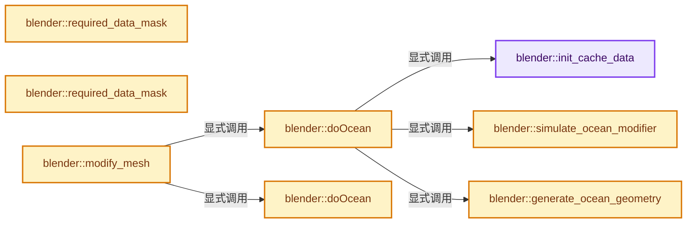
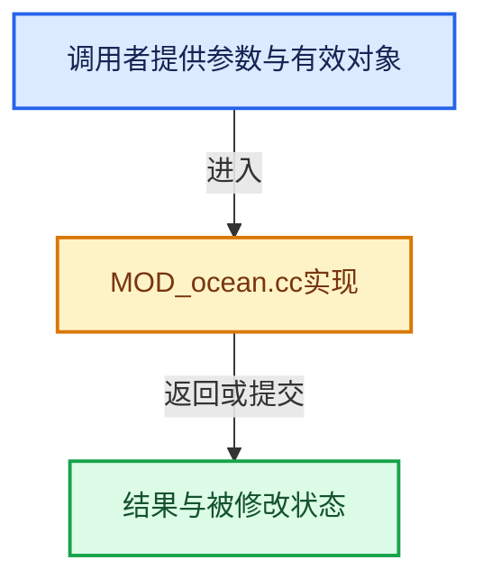

# 实现依赖专题：source/blender/modifiers/intern/MOD_ocean.cc

[实现依赖导航](../../../README.md) · [符号索引](../../../../00-课程指南/02-源码与提交索引/符号依赖与实现索引.md)

本专题从正文实际调用进入，集中保存共享实现。函数有稳定锚点，可从调用处直接跳到对应完整函数；递归与互相调用通过回链组织。

## 本文件的实现关系






## 完整成员与函数实现

<a id="f-9a57ec36e1d62d07"></a>

### `blender::init_cache_data`

实现位置：[source/blender/modifiers/intern/MOD_ocean.cc](../../../../../../../../source/blender/modifiers/intern/MOD_ocean.cc) · L45—L58。

接口参数：

- `Object *ob`
- `OceanModifierData *omd`
- `const int resolution`

**教学注释版**

<!-- annotated:98413ef07cfdf6 -->

```cpp
static void init_cache_data(Object *ob, OceanModifierData *omd, const int resolution)
{
  const char *relbase = BKE_modifier_path_relbase_from_global(ob);

  omd->oceancache = BKE_ocean_init_cache(omd->cachepath,
                                         relbase,
                                         omd->bakestart,
                                         omd->bakeend,
                                         omd->wave_scale,
                                         omd->chop_amount,
                                         omd->foam_coverage,
                                         omd->foam_fade,
                                         resolution);
}
```

<details>
<summary>核对原始源码：source/blender/modifiers/intern/MOD_ocean.cc · L45—L58</summary>

<!-- original:98413ef07cfdf6:source/blender/modifiers/intern/MOD_ocean.cc:45:58 -->

```cpp
static void init_cache_data(Object *ob, OceanModifierData *omd, const int resolution)
{
  const char *relbase = BKE_modifier_path_relbase_from_global(ob);

  omd->oceancache = BKE_ocean_init_cache(omd->cachepath,
                                         relbase,
                                         omd->bakestart,
                                         omd->bakeend,
                                         omd->wave_scale,
                                         omd->chop_amount,
                                         omd->foam_coverage,
                                         omd->foam_fade,
                                         resolution);
}
```

</details>

**沿实际写入检查状态**

- `omd->oceancache = BKE_ocean_init_cache(omd->cachepath,`

**继续追踪实现**

- `BKE_modifier_path_relbase_from_global` → [blender::BKE_modifier_path_relbase_from_global · L921](../../../02-BKE几何与数据/intern/modifier.cc.md#f-1b8a6ee008206a61)。
- `BKE_ocean_init_cache` → [blender::BKE_ocean_init_cache · L1313](../../../02-BKE几何与数据/intern/ocean.cc.md#f-08cd3051b3a050e5)；[blender::BKE_ocean_init_cache · L1647](../../../02-BKE几何与数据/intern/ocean.cc.md#f-c9193a51ddba1617)。同名重载需按实参类型选择。

<a id="f-10059de685751205"></a>

### `blender::simulate_ocean_modifier`

实现位置：[source/blender/modifiers/intern/MOD_ocean.cc](../../../../../../../../source/blender/modifiers/intern/MOD_ocean.cc) · L60—L63。

接口参数：

- `OceanModifierData *omd`

**教学注释版**

<!-- annotated:06929b4ec60566 -->

```cpp
static void simulate_ocean_modifier(OceanModifierData *omd)
{
  BKE_ocean_simulate(omd->ocean, omd->time, omd->wave_scale, omd->chop_amount);
}
```

<details>
<summary>核对原始源码：source/blender/modifiers/intern/MOD_ocean.cc · L60—L63</summary>

<!-- original:06929b4ec60566:source/blender/modifiers/intern/MOD_ocean.cc:60:63 -->

```cpp
static void simulate_ocean_modifier(OceanModifierData *omd)
{
  BKE_ocean_simulate(omd->ocean, omd->time, omd->wave_scale, omd->chop_amount);
}
```

</details>

**继续追踪实现**

- `BKE_ocean_simulate` → [blender::BKE_ocean_simulate · L645](../../../02-BKE几何与数据/intern/ocean.cc.md#f-7a552f56b3a14e21)；[blender::BKE_ocean_simulate · L1581](../../../02-BKE几何与数据/intern/ocean.cc.md#f-d4a0c8cab1f9d632)。同名重载需按实参类型选择。

<a id="f-ab89750e1f888f7b"></a>

### `blender::required_data_mask`

实现位置：[source/blender/modifiers/intern/MOD_ocean.cc](../../../../../../../../source/blender/modifiers/intern/MOD_ocean.cc) · L127—L134。

接口参数：

- `ModifierData *md`
- `CustomData_MeshMasks *r_cddata_masks`

**教学注释版**

<!-- annotated:621310b9d498aa -->

```cpp
static void required_data_mask(ModifierData *md, CustomData_MeshMasks *r_cddata_masks)
{
  OceanModifierData *omd = (OceanModifierData *)md;

  if (omd->flag & MOD_OCEAN_GENERATE_FOAM) {
    r_cddata_masks->fmask |= CD_MASK_MCOL; /* XXX Should be loop cddata I guess? */
  }
}
```

<details>
<summary>核对原始源码：source/blender/modifiers/intern/MOD_ocean.cc · L127—L134</summary>

<!-- original:621310b9d498aa:source/blender/modifiers/intern/MOD_ocean.cc:127:134 -->

```cpp
static void required_data_mask(ModifierData *md, CustomData_MeshMasks *r_cddata_masks)
{
  OceanModifierData *omd = (OceanModifierData *)md;

  if (omd->flag & MOD_OCEAN_GENERATE_FOAM) {
    r_cddata_masks->fmask |= CD_MASK_MCOL; /* XXX Should be loop cddata I guess? */
  }
}
```

</details>

**沿实际写入检查状态**

- `r_cddata_masks->fmask |= CD_MASK_MCOL; /* XXX Should be loop cddata I guess? */`

**继续追踪实现**

本实现没有需要继续展开的显式调用；检查返回表达式、对象转换和调用者前置条件。

<a id="f-e9c7f53ec4541341"></a>

### `blender::required_data_mask`

实现位置：[source/blender/modifiers/intern/MOD_ocean.cc](../../../../../../../../source/blender/modifiers/intern/MOD_ocean.cc) · L136—L136。

接口参数：

- `ModifierData *`
- `CustomData_MeshMasks *`

**教学注释版**

<!-- annotated:1658e1325c7e12 -->

```cpp
static void required_data_mask(ModifierData * /*md*/, CustomData_MeshMasks * /*r_cddata_masks*/) {}
```

<details>
<summary>核对原始源码：source/blender/modifiers/intern/MOD_ocean.cc · L136—L136</summary>

<!-- original:1658e1325c7e12:source/blender/modifiers/intern/MOD_ocean.cc:136:136 -->

```cpp
static void required_data_mask(ModifierData * /*md*/, CustomData_MeshMasks * /*r_cddata_masks*/) {}
```

</details>

**继续追踪实现**

本实现没有需要继续展开的显式调用；检查返回表达式、对象转换和调用者前置条件。

<a id="f-33efa1907e026ea6"></a>

### `blender::generate_ocean_geometry`

实现位置：[source/blender/modifiers/intern/MOD_ocean.cc](../../../../../../../../source/blender/modifiers/intern/MOD_ocean.cc) · L219—L285。

接口参数：

- `OceanModifierData *omd`
- `Mesh *mesh_orig`
- `const int resolution`

**教学注释版**

<!-- annotated:db631ade56655c -->

```cpp
static Mesh *generate_ocean_geometry(OceanModifierData *omd, Mesh *mesh_orig, const int resolution)
{
  Mesh *result;

  GenerateOceanGeometryData gogd;

  int verts_num;
  int faces_num;

  const bool use_threading = resolution > 4;

  gogd.rx = resolution * resolution;
  gogd.ry = resolution * resolution;
  gogd.res_x = gogd.rx * omd->repeat_x;
  gogd.res_y = gogd.ry * omd->repeat_y;

  verts_num = (gogd.res_x + 1) * (gogd.res_y + 1);
  faces_num = gogd.res_x * gogd.res_y;

  gogd.sx = omd->size * omd->spatial_size;
  gogd.sy = omd->size * omd->spatial_size;
  gogd.ox = -gogd.sx / 2.0f;
  gogd.oy = -gogd.sy / 2.0f;

  gogd.sx /= gogd.rx;
  gogd.sy /= gogd.ry;

  result = BKE_mesh_new_nomain(verts_num, 0, faces_num, faces_num * 4);
  BKE_mesh_copy_parameters_for_eval(result, mesh_orig);

  gogd.vert_positions = result->vert_positions_for_write();
  gogd.face_offsets = result->face_offsets_for_write();
  gogd.corner_verts = result->corner_verts_for_write();

  TaskParallelSettings settings;
  BLI_parallel_range_settings_defaults(&settings);
  settings.use_threading = use_threading;

  /* create vertices */
  BLI_task_parallel_range(0, gogd.res_y + 1, &gogd, generate_ocean_geometry_verts, &settings);

  /* create faces */
  BLI_task_parallel_range(0, gogd.res_y, &gogd, generate_ocean_geometry_faces, &settings);

  bke::mesh_calc_edges(*result, false, false);

  /* add uvs */
  if (result->uv_map_names().size() < MAX_MTFACE) {
    bke::MutableAttributeAccessor attributes = result->attributes_for_write();
    std::string name = BKE_attribute_calc_unique_name(AttributeOwner::from_id(&result->id),
                                                      "UVMap");
    bke::SpanAttributeWriter<float2> uv_map = attributes.lookup_or_add_for_write_span<float2>(
        name, bke::AttrDomain::Corner);

    if (uv_map) { /* unlikely to fail */
      gogd.uv_map = uv_map.span;
      gogd.ix = 1.0 / gogd.rx;
      gogd.iy = 1.0 / gogd.ry;

      BLI_task_parallel_range(0, gogd.res_y, &gogd, generate_ocean_geometry_uvs, &settings);
    }

    uv_map.finish();
  }

  return result;
}
```

<details>
<summary>核对原始源码：source/blender/modifiers/intern/MOD_ocean.cc · L219—L285</summary>

<!-- original:db631ade56655c:source/blender/modifiers/intern/MOD_ocean.cc:219:285 -->

```cpp
static Mesh *generate_ocean_geometry(OceanModifierData *omd, Mesh *mesh_orig, const int resolution)
{
  Mesh *result;

  GenerateOceanGeometryData gogd;

  int verts_num;
  int faces_num;

  const bool use_threading = resolution > 4;

  gogd.rx = resolution * resolution;
  gogd.ry = resolution * resolution;
  gogd.res_x = gogd.rx * omd->repeat_x;
  gogd.res_y = gogd.ry * omd->repeat_y;

  verts_num = (gogd.res_x + 1) * (gogd.res_y + 1);
  faces_num = gogd.res_x * gogd.res_y;

  gogd.sx = omd->size * omd->spatial_size;
  gogd.sy = omd->size * omd->spatial_size;
  gogd.ox = -gogd.sx / 2.0f;
  gogd.oy = -gogd.sy / 2.0f;

  gogd.sx /= gogd.rx;
  gogd.sy /= gogd.ry;

  result = BKE_mesh_new_nomain(verts_num, 0, faces_num, faces_num * 4);
  BKE_mesh_copy_parameters_for_eval(result, mesh_orig);

  gogd.vert_positions = result->vert_positions_for_write();
  gogd.face_offsets = result->face_offsets_for_write();
  gogd.corner_verts = result->corner_verts_for_write();

  TaskParallelSettings settings;
  BLI_parallel_range_settings_defaults(&settings);
  settings.use_threading = use_threading;

  /* create vertices */
  BLI_task_parallel_range(0, gogd.res_y + 1, &gogd, generate_ocean_geometry_verts, &settings);

  /* create faces */
  BLI_task_parallel_range(0, gogd.res_y, &gogd, generate_ocean_geometry_faces, &settings);

  bke::mesh_calc_edges(*result, false, false);

  /* add uvs */
  if (result->uv_map_names().size() < MAX_MTFACE) {
    bke::MutableAttributeAccessor attributes = result->attributes_for_write();
    std::string name = BKE_attribute_calc_unique_name(AttributeOwner::from_id(&result->id),
                                                      "UVMap");
    bke::SpanAttributeWriter<float2> uv_map = attributes.lookup_or_add_for_write_span<float2>(
        name, bke::AttrDomain::Corner);

    if (uv_map) { /* unlikely to fail */
      gogd.uv_map = uv_map.span;
      gogd.ix = 1.0 / gogd.rx;
      gogd.iy = 1.0 / gogd.ry;

      BLI_task_parallel_range(0, gogd.res_y, &gogd, generate_ocean_geometry_uvs, &settings);
    }

    uv_map.finish();
  }

  return result;
}
```

</details>

**沿实际写入检查状态**

- `gogd.rx = resolution * resolution;`
- `gogd.ry = resolution * resolution;`
- `gogd.res_x = gogd.rx * omd->repeat_x;`
- `gogd.res_y = gogd.ry * omd->repeat_y;`
- `verts_num = (gogd.res_x + 1) * (gogd.res_y + 1);`
- `faces_num = gogd.res_x * gogd.res_y;`
- `gogd.sx = omd->size * omd->spatial_size;`
- `gogd.sy = omd->size * omd->spatial_size;`
- `gogd.ox = -gogd.sx / 2.0f;`
- `gogd.oy = -gogd.sy / 2.0f;`
- `result = BKE_mesh_new_nomain(verts_num, 0, faces_num, faces_num * 4);`
- `gogd.vert_positions = result->vert_positions_for_write();`
- `gogd.face_offsets = result->face_offsets_for_write();`
- `gogd.corner_verts = result->corner_verts_for_write();`
- `settings.use_threading = use_threading;`
- `gogd.uv_map = uv_map.span;`
- `gogd.ix = 1.0 / gogd.rx;`
- `gogd.iy = 1.0 / gogd.ry;`

**结果出口**

- `return result;`

**继续追踪实现**

- `BKE_mesh_new_nomain` → [BKE_mesh_new_nomain · L1376](../../../../05-几何存储与拓扑映射/03-MPoly迁移与兼容.md#f-d63806a6e34190f2)。
- `BKE_mesh_copy_parameters_for_eval` → [BKE_mesh_copy_parameters_for_eval · L1484](../../../../05-几何存储与拓扑映射/03-MPoly迁移与兼容.md#f-71bebe4e73fe4c13)。
- `result->vert_positions_for_write` → [Mesh::vert_positions_for_write · L1199](../../../../05-几何存储与拓扑映射/03-MPoly迁移与兼容.md#f-ae8d77205112d843)。
- `result->face_offsets_for_write` → [Mesh::face_offsets_for_write · L1228](../../../../05-几何存储与拓扑映射/03-MPoly迁移与兼容.md#f-483f42747ab436a2)。
- `result->corner_verts_for_write` → [Mesh::corner_verts_for_write · L1246](../../../../05-几何存储与拓扑映射/03-MPoly迁移与兼容.md#f-6dfaf316a81ba215)。
- `BLI_parallel_range_settings_defaults` → [blender::BLI_parallel_range_settings_defaults · L218](../../../01-BLI基础库/BLI_task_c.hh.md#f-3858ad801a98e123)。
- `BLI_task_parallel_range` → [blender::BLI_task_parallel_range · L101](../../../../11-Depsgraph与并行任务系统/08-任务隔离死锁与实战.md#f-9d237d7e4e78d7e2)。
- `bke::mesh_calc_edges` → [blender::bke::mesh_calc_edges · L234](../../../02-BKE几何与数据/intern/mesh_calc_edges.cc.md#f-8dc1463382ec6743)；[blender::bke::mesh_calc_edges · L578](../../../02-BKE几何与数据/intern/mesh_calc_edges.cc.md#f-1312012cc732ca47)。同名重载需按实参类型选择。
- `result->uv_map_names().size` → [调用协议](../../../../00-课程指南/01-路线与规范/模板宏与动态分派协议.md)：接收对象类型依赖auto、返回值或模板实例；不按同名猜测目标。调用位置L266。
- `result->uv_map_names` → [Mesh::uv_map_names · L1308](../../../../05-几何存储与拓扑映射/03-MPoly迁移与兼容.md#f-6f71b15466566fad)。
- `result->attributes_for_write` → [Mesh::attributes_for_write · L1303](../../../../05-几何存储与拓扑映射/03-MPoly迁移与兼容.md#f-ca7af2f1a15f0bc4)。
- `BKE_attribute_calc_unique_name` → [blender::BKE_attribute_calc_unique_name · L351](../../../02-BKE几何与数据/intern/attribute.cc.md#f-c4ca40dc5668ffb2)。
- `AttributeOwner::from_id` → [blender::AttributeOwner::from_id · L46](../../../02-BKE几何与数据/intern/attribute.cc.md#f-866554bb7829a861)。
- `attributes.lookup_or_add_for_write_span<float2>` → [blender::bke::MutableAttributeAccessor::lookup_or_add_for_write_span · L533](../../../02-BKE几何与数据/intern/attribute_access.cc.md#f-c533eff1b9a4973e)；[blender::bke::MutableAttributeAccessor::lookup_or_add_for_write_span · L861](../../../../05-几何存储与拓扑映射/08-AttributeAccessor接口.md#f-aa4c0d5a61437381)。同名重载需按实参类型选择。
- `uv_map.finish` → [blender::bke::SpanAttributeWriter::finish · L279](../../../../05-几何存储与拓扑映射/08-AttributeAccessor接口.md#f-585970a3b1bd4da4)。

<a id="f-0ae1529ba38e379f"></a>

### `blender::doOcean`

实现位置：[source/blender/modifiers/intern/MOD_ocean.cc](../../../../../../../../source/blender/modifiers/intern/MOD_ocean.cc) · L287—L458。

接口参数：

- `ModifierData *md`
- `const ModifierEvalContext *ctx`
- `Mesh *mesh`

**教学注释版**

<!-- annotated:cb082df80a530f -->

```cpp
static Mesh *doOcean(ModifierData *md, const ModifierEvalContext *ctx, Mesh *mesh)
{
  OceanModifierData *omd = (OceanModifierData *)md;
  if (omd->ocean && !BKE_ocean_is_valid(omd->ocean)) {
    BKE_modifier_set_error(ctx->object, md, "Failed to allocate memory");
    return mesh;
  }
  int cfra_scene = int(DEG_get_ctime(ctx->depsgraph));
  Object *ob = ctx->object;
  bool allocated_ocean = false;

  Mesh *result = nullptr;
  OceanResult ocr;

  const int resolution = (ctx->flag & MOD_APPLY_RENDER) ? omd->resolution :
                                                          omd->viewport_resolution;

  int cfra_for_cache;
  int i, j;

  /* Use cached & inverted value for speed expanded this would read:
   * `(axis / (omd->size * omd->spatial_size)) + 0.5f`. */
#  define OCEAN_CO(_size_co_inv, _v) ((_v * _size_co_inv) + 0.5f)

  const float size_co_inv = 1.0f / (omd->size * omd->spatial_size);

  /* can happen in when size is small, avoid bad array lookups later and quit now */
  if (!isfinite(size_co_inv)) {
    return mesh;
  }

  /* do ocean simulation */
  if (omd->cached) {
    if (!omd->oceancache) {
      init_cache_data(ob, omd, resolution);
    }
    BKE_ocean_simulate_cache(omd->oceancache, cfra_scene);
  }
  else {
    /* omd->ocean is nullptr on an original object (in contrast to an evaluated one).
     * We can create a new one, but we have to free it as well once we're done.
     * This function is only called on an original object when applying the modifier
     * using the 'Apply Modifier' button, and thus it is not called frequently for
     * simulation. */
    allocated_ocean |= BKE_ocean_ensure(omd, resolution);
    simulate_ocean_modifier(omd);
  }

  if (omd->geometry_mode == MOD_OCEAN_GEOM_GENERATE) {
    result = generate_ocean_geometry(omd, mesh, resolution);
  }
  else if (omd->geometry_mode == MOD_OCEAN_GEOM_DISPLACE) {
    result = (Mesh *)BKE_id_copy_ex(nullptr, &mesh->id, nullptr, LIB_ID_COPY_LOCALIZE);
  }

  cfra_for_cache = cfra_scene;
  CLAMP(cfra_for_cache, omd->bakestart, omd->bakeend);
  cfra_for_cache -= omd->bakestart; /* shift to 0 based */

  MutableSpan<float3> positions = result->vert_positions_for_write();
  const OffsetIndices faces = result->faces();

  /* Add vertex-colors before displacement: allows lookup based on position. */

  if (omd->flag & MOD_OCEAN_GENERATE_FOAM) {
    AttributeOwner owner = AttributeOwner::from_id(&result->id);
    bke::MutableAttributeAccessor attributes = result->attributes_for_write();
    const Span<int> corner_verts = result->corner_verts();
    bke::SpanAttributeWriter mloopcols = attributes.lookup_or_add_for_write_span<ColorGeometry4b>(
        BKE_attribute_calc_unique_name(owner, omd->foamlayername), bke::AttrDomain::Corner);

    bke::SpanAttributeWriter<ColorGeometry4b> mloopcols_spray;
    if (omd->flag & MOD_OCEAN_GENERATE_SPRAY) {
      mloopcols_spray = attributes.lookup_or_add_for_write_span<ColorGeometry4b>(
          BKE_attribute_calc_unique_name(owner, omd->spraylayername), bke::AttrDomain::Corner);
    }

    if (mloopcols) { /* unlikely to fail */

      for (const int i : faces.index_range()) {
        const IndexRange face = faces[i];
        // [讲解] face.start：读取连续区间或分组的边界信息。
        const int *corner_vert = &corner_verts[face.start()];
        ColorGeometry4b *mlcol = &mloopcols.span[face.start()];

        ColorGeometry4b *mlcolspray = nullptr;
        if (omd->flag & MOD_OCEAN_GENERATE_SPRAY) {
          mlcolspray = &mloopcols_spray.span[face.start()];
        }

        // [讲解] face.size：读取连续区间或分组的边界信息。
        for (j = face.size(); j--; corner_vert++, mlcol++) {
          const float *vco = positions[*corner_vert];
          const float u = OCEAN_CO(size_co_inv, vco[0]);
          const float v = OCEAN_CO(size_co_inv, vco[1]);
          float foam;

          if (omd->oceancache && omd->cached) {
            BKE_ocean_cache_eval_uv(omd->oceancache, &ocr, cfra_for_cache, u, v);
            foam = ocr.foam;
            CLAMP(foam, 0.0f, 1.0f);
          }
          else {
            BKE_ocean_eval_uv(omd->ocean, &ocr, u, v);
            foam = BKE_ocean_jminus_to_foam(ocr.Jminus, omd->foam_coverage);
          }

          mlcol->r = mlcol->g = mlcol->b = char(foam * 255);
          /* This needs to be set (render engine uses) */
          mlcol->a = 255;

          if (omd->flag & MOD_OCEAN_GENERATE_SPRAY) {
            if (omd->flag & MOD_OCEAN_INVERT_SPRAY) {
              mlcolspray->r = ocr.Eminus[0] * 255;
            }
            else {
              mlcolspray->r = ocr.Eplus[0] * 255;
            }
            mlcolspray->g = 0;
            if (omd->flag & MOD_OCEAN_INVERT_SPRAY) {
              mlcolspray->b = ocr.Eminus[2] * 255;
            }
            else {
              mlcolspray->b = ocr.Eplus[2] * 255;
            }
            mlcolspray->a = 255;
          }
        }
      }
    }

    mloopcols.finish();
    mloopcols_spray.finish();
  }

  /* displace the geometry */

  /* NOTE: tried to parallelized that one and previous foam loop,
   * but gives 20% slower results... odd. */
  {
    const int verts_num = result->verts_num;

    for (i = 0; i < verts_num; i++) {
      float *vco = positions[i];
      const float u = OCEAN_CO(size_co_inv, vco[0]);
      const float v = OCEAN_CO(size_co_inv, vco[1]);

      if (omd->oceancache && omd->cached) {
        BKE_ocean_cache_eval_uv(omd->oceancache, &ocr, cfra_for_cache, u, v);
      }
      else {
        BKE_ocean_eval_uv(omd->ocean, &ocr, u, v);
      }

      vco[2] += ocr.disp[1];

      if (omd->chop_amount > 0.0f) {
        vco[0] += ocr.disp[0];
        vco[1] += ocr.disp[2];
      }
    }
  }

  result->tag_positions_changed();

  if (allocated_ocean) {
    BKE_ocean_free(omd->ocean);
    omd->ocean = nullptr;
  }

#  undef OCEAN_CO

  return result;
}
```

<details>
<summary>核对原始源码：source/blender/modifiers/intern/MOD_ocean.cc · L287—L458</summary>

<!-- original:cb082df80a530f:source/blender/modifiers/intern/MOD_ocean.cc:287:458 -->

```cpp
static Mesh *doOcean(ModifierData *md, const ModifierEvalContext *ctx, Mesh *mesh)
{
  OceanModifierData *omd = (OceanModifierData *)md;
  if (omd->ocean && !BKE_ocean_is_valid(omd->ocean)) {
    BKE_modifier_set_error(ctx->object, md, "Failed to allocate memory");
    return mesh;
  }
  int cfra_scene = int(DEG_get_ctime(ctx->depsgraph));
  Object *ob = ctx->object;
  bool allocated_ocean = false;

  Mesh *result = nullptr;
  OceanResult ocr;

  const int resolution = (ctx->flag & MOD_APPLY_RENDER) ? omd->resolution :
                                                          omd->viewport_resolution;

  int cfra_for_cache;
  int i, j;

  /* Use cached & inverted value for speed expanded this would read:
   * `(axis / (omd->size * omd->spatial_size)) + 0.5f`. */
#  define OCEAN_CO(_size_co_inv, _v) ((_v * _size_co_inv) + 0.5f)

  const float size_co_inv = 1.0f / (omd->size * omd->spatial_size);

  /* can happen in when size is small, avoid bad array lookups later and quit now */
  if (!isfinite(size_co_inv)) {
    return mesh;
  }

  /* do ocean simulation */
  if (omd->cached) {
    if (!omd->oceancache) {
      init_cache_data(ob, omd, resolution);
    }
    BKE_ocean_simulate_cache(omd->oceancache, cfra_scene);
  }
  else {
    /* omd->ocean is nullptr on an original object (in contrast to an evaluated one).
     * We can create a new one, but we have to free it as well once we're done.
     * This function is only called on an original object when applying the modifier
     * using the 'Apply Modifier' button, and thus it is not called frequently for
     * simulation. */
    allocated_ocean |= BKE_ocean_ensure(omd, resolution);
    simulate_ocean_modifier(omd);
  }

  if (omd->geometry_mode == MOD_OCEAN_GEOM_GENERATE) {
    result = generate_ocean_geometry(omd, mesh, resolution);
  }
  else if (omd->geometry_mode == MOD_OCEAN_GEOM_DISPLACE) {
    result = (Mesh *)BKE_id_copy_ex(nullptr, &mesh->id, nullptr, LIB_ID_COPY_LOCALIZE);
  }

  cfra_for_cache = cfra_scene;
  CLAMP(cfra_for_cache, omd->bakestart, omd->bakeend);
  cfra_for_cache -= omd->bakestart; /* shift to 0 based */

  MutableSpan<float3> positions = result->vert_positions_for_write();
  const OffsetIndices faces = result->faces();

  /* Add vertex-colors before displacement: allows lookup based on position. */

  if (omd->flag & MOD_OCEAN_GENERATE_FOAM) {
    AttributeOwner owner = AttributeOwner::from_id(&result->id);
    bke::MutableAttributeAccessor attributes = result->attributes_for_write();
    const Span<int> corner_verts = result->corner_verts();
    bke::SpanAttributeWriter mloopcols = attributes.lookup_or_add_for_write_span<ColorGeometry4b>(
        BKE_attribute_calc_unique_name(owner, omd->foamlayername), bke::AttrDomain::Corner);

    bke::SpanAttributeWriter<ColorGeometry4b> mloopcols_spray;
    if (omd->flag & MOD_OCEAN_GENERATE_SPRAY) {
      mloopcols_spray = attributes.lookup_or_add_for_write_span<ColorGeometry4b>(
          BKE_attribute_calc_unique_name(owner, omd->spraylayername), bke::AttrDomain::Corner);
    }

    if (mloopcols) { /* unlikely to fail */

      for (const int i : faces.index_range()) {
        const IndexRange face = faces[i];
        const int *corner_vert = &corner_verts[face.start()];
        ColorGeometry4b *mlcol = &mloopcols.span[face.start()];

        ColorGeometry4b *mlcolspray = nullptr;
        if (omd->flag & MOD_OCEAN_GENERATE_SPRAY) {
          mlcolspray = &mloopcols_spray.span[face.start()];
        }

        for (j = face.size(); j--; corner_vert++, mlcol++) {
          const float *vco = positions[*corner_vert];
          const float u = OCEAN_CO(size_co_inv, vco[0]);
          const float v = OCEAN_CO(size_co_inv, vco[1]);
          float foam;

          if (omd->oceancache && omd->cached) {
            BKE_ocean_cache_eval_uv(omd->oceancache, &ocr, cfra_for_cache, u, v);
            foam = ocr.foam;
            CLAMP(foam, 0.0f, 1.0f);
          }
          else {
            BKE_ocean_eval_uv(omd->ocean, &ocr, u, v);
            foam = BKE_ocean_jminus_to_foam(ocr.Jminus, omd->foam_coverage);
          }

          mlcol->r = mlcol->g = mlcol->b = char(foam * 255);
          /* This needs to be set (render engine uses) */
          mlcol->a = 255;

          if (omd->flag & MOD_OCEAN_GENERATE_SPRAY) {
            if (omd->flag & MOD_OCEAN_INVERT_SPRAY) {
              mlcolspray->r = ocr.Eminus[0] * 255;
            }
            else {
              mlcolspray->r = ocr.Eplus[0] * 255;
            }
            mlcolspray->g = 0;
            if (omd->flag & MOD_OCEAN_INVERT_SPRAY) {
              mlcolspray->b = ocr.Eminus[2] * 255;
            }
            else {
              mlcolspray->b = ocr.Eplus[2] * 255;
            }
            mlcolspray->a = 255;
          }
        }
      }
    }

    mloopcols.finish();
    mloopcols_spray.finish();
  }

  /* displace the geometry */

  /* NOTE: tried to parallelized that one and previous foam loop,
   * but gives 20% slower results... odd. */
  {
    const int verts_num = result->verts_num;

    for (i = 0; i < verts_num; i++) {
      float *vco = positions[i];
      const float u = OCEAN_CO(size_co_inv, vco[0]);
      const float v = OCEAN_CO(size_co_inv, vco[1]);

      if (omd->oceancache && omd->cached) {
        BKE_ocean_cache_eval_uv(omd->oceancache, &ocr, cfra_for_cache, u, v);
      }
      else {
        BKE_ocean_eval_uv(omd->ocean, &ocr, u, v);
      }

      vco[2] += ocr.disp[1];

      if (omd->chop_amount > 0.0f) {
        vco[0] += ocr.disp[0];
        vco[1] += ocr.disp[2];
      }
    }
  }

  result->tag_positions_changed();

  if (allocated_ocean) {
    BKE_ocean_free(omd->ocean);
    omd->ocean = nullptr;
  }

#  undef OCEAN_CO

  return result;
}
```

</details>

**沿实际写入检查状态**

- `allocated_ocean |= BKE_ocean_ensure(omd, resolution);`
- `result = generate_ocean_geometry(omd, mesh, resolution);`
- `result = (Mesh *)BKE_id_copy_ex(nullptr, &mesh->id, nullptr, LIB_ID_COPY_LOCALIZE);`
- `cfra_for_cache = cfra_scene;`
- `cfra_for_cache -= omd->bakestart; /* shift to 0 based */`
- `mloopcols_spray = attributes.lookup_or_add_for_write_span<ColorGeometry4b>(`
- `mlcolspray = &mloopcols_spray.span[face.start()];`
- `foam = ocr.foam;`
- `foam = BKE_ocean_jminus_to_foam(ocr.Jminus, omd->foam_coverage);`
- `mlcol->r = mlcol->g = mlcol->b = char(foam * 255);`
- `mlcol->a = 255;`
- `mlcolspray->r = ocr.Eminus[0] * 255;`
- `mlcolspray->r = ocr.Eplus[0] * 255;`
- `mlcolspray->g = 0;`
- `mlcolspray->b = ocr.Eminus[2] * 255;`
- `mlcolspray->b = ocr.Eplus[2] * 255;`
- `mlcolspray->a = 255;`
- `vco[2] += ocr.disp[1];`
- `vco[0] += ocr.disp[0];`
- `vco[1] += ocr.disp[2];`
- `omd->ocean = nullptr;`

**结果出口**

- `return mesh;`
- `return result;`

**继续追踪实现**

- `BKE_ocean_is_valid` → [blender::BKE_ocean_is_valid · L640](../../../02-BKE几何与数据/intern/ocean.cc.md#f-9c1572da8ed4248d)。
- `BKE_modifier_set_error` → [blender::BKE_modifier_set_error · L416](../../../02-BKE几何与数据/intern/modifier.cc.md#f-6241829f21c08456)。
- `DEG_get_ctime` → [blender::DEG_get_ctime · L105](../../../06-Depsgraph依赖图/intern/depsgraph_query.cc.md#f-156dee0918a22f2f)。
- `isfinite` → [isfinite · L125](../../../07-Intern运行时与平台/cycles/util/math_base.h.md#m-ec002db2e0ff)。宏定义由构建条件选择。
- `init_cache_data` → [blender::init_cache_data · L45](MOD_ocean.cc.md#f-9a57ec36e1d62d07)。
- `BKE_ocean_simulate_cache` → [blender::BKE_ocean_simulate_cache · L1351](../../../02-BKE几何与数据/intern/ocean.cc.md#f-47236fe1a9ae2706)；[blender::BKE_ocean_simulate_cache · L1662](../../../02-BKE几何与数据/intern/ocean.cc.md#f-86ec81778c2b4d0b)。同名重载需按实参类型选择。
- `BKE_ocean_ensure` → [blender::BKE_ocean_ensure · L746](../../../02-BKE几何与数据/intern/ocean.cc.md#f-c0aa481cf787bc99)。
- `simulate_ocean_modifier` → [blender::simulate_ocean_modifier · L60](MOD_ocean.cc.md#f-10059de685751205)。
- `generate_ocean_geometry` → [blender::generate_ocean_geometry · L219](MOD_ocean.cc.md#f-33efa1907e026ea6)。
- `BKE_id_copy_ex` → [blender::BKE_id_copy_ex · L851](../../../02-BKE几何与数据/intern/lib_id.cc.md#f-24272170c95f49fb)。
- `CLAMP` → [CLAMP · L200](../../../01-BLI基础库/BLI_utildefines.hh.md#m-69703e497120)。宏定义由构建条件选择。
- `result->vert_positions_for_write` → [Mesh::vert_positions_for_write · L1199](../../../../05-几何存储与拓扑映射/03-MPoly迁移与兼容.md#f-ae8d77205112d843)。
- `result->faces` → [Mesh::faces · L1217](../../../../05-几何存储与拓扑映射/03-MPoly迁移与兼容.md#f-ea444760154e17b2)。
- `AttributeOwner::from_id` → [blender::AttributeOwner::from_id · L46](../../../02-BKE几何与数据/intern/attribute.cc.md#f-866554bb7829a861)。
- `result->attributes_for_write` → [Mesh::attributes_for_write · L1303](../../../../05-几何存储与拓扑映射/03-MPoly迁移与兼容.md#f-ca7af2f1a15f0bc4)。
- `result->corner_verts` → [Mesh::corner_verts · L1238](../../../../05-几何存储与拓扑映射/03-MPoly迁移与兼容.md#f-a59c61f583b64bc4)。
- `attributes.lookup_or_add_for_write_span<ColorGeometry4b>` → [blender::bke::MutableAttributeAccessor::lookup_or_add_for_write_span · L533](../../../02-BKE几何与数据/intern/attribute_access.cc.md#f-c533eff1b9a4973e)；[blender::bke::MutableAttributeAccessor::lookup_or_add_for_write_span · L861](../../../../05-几何存储与拓扑映射/08-AttributeAccessor接口.md#f-aa4c0d5a61437381)。同名重载需按实参类型选择。
- `BKE_attribute_calc_unique_name` → [blender::BKE_attribute_calc_unique_name · L351](../../../02-BKE几何与数据/intern/attribute.cc.md#f-c4ca40dc5668ffb2)。
- `faces.index_range` → [blender::offset_indices::OffsetIndices::index_range · L77](../../../../05-几何存储与拓扑映射/02-OffsetIndices完整接口.md#f-19b5ca1456de007d)。
- `face.start` → [blender::IndexRange::start · L243](../../../../01-基础容器与现代CPP/04-IndexRange连续整数区间.md#f-99d2195bd9cfd1f0)。
- `face.size` → [blender::IndexRange::size · L156](../../../../01-基础容器与现代CPP/04-IndexRange连续整数区间.md#f-05f66c3ebb2fdfec)。
- `OCEAN_CO` → [调用协议](../../../../00-课程指南/01-路线与规范/模板宏与动态分派协议.md)：函数指针、局部可调用对象或未展开的宏；必须结合调用者环境。调用位置L378。
- `BKE_ocean_cache_eval_uv` → [blender::BKE_ocean_cache_eval_uv · L1233](../../../02-BKE几何与数据/intern/ocean.cc.md#f-fcfeb9df41c5bc61)；[blender::BKE_ocean_cache_eval_uv · L1637](../../../02-BKE几何与数据/intern/ocean.cc.md#f-726695bf2541e270)。同名重载需按实参类型选择。
- `BKE_ocean_eval_uv` → [blender::BKE_ocean_eval_uv · L192](../../../02-BKE几何与数据/intern/ocean.cc.md#f-5ae2f1a6e0336c6a)；[blender::BKE_ocean_eval_uv · L1570](../../../02-BKE几何与数据/intern/ocean.cc.md#f-83f03fe31a735f6b)。同名重载需按实参类型选择。
- `BKE_ocean_jminus_to_foam` → [blender::BKE_ocean_jminus_to_foam · L185](../../../02-BKE几何与数据/intern/ocean.cc.md#f-85bd7e632ca26fee)；[blender::BKE_ocean_jminus_to_foam · L1565](../../../02-BKE几何与数据/intern/ocean.cc.md#f-2a78d0a6e204a53f)。同名重载需按实参类型选择。
- `mloopcols.finish` → [blender::bke::SpanAttributeWriter::finish · L279](../../../../05-几何存储与拓扑映射/08-AttributeAccessor接口.md#f-585970a3b1bd4da4)。
- `mloopcols_spray.finish` → [blender::bke::SpanAttributeWriter::finish · L279](../../../../05-几何存储与拓扑映射/08-AttributeAccessor接口.md#f-585970a3b1bd4da4)。
- `result->tag_positions_changed` → [blender::Mesh::tag_positions_changed · L407](../../../../06-隐式共享与缓存系统/10-局部更新与失效修复.md#f-90e852663d44ad53)。
- `BKE_ocean_free` → [blender::BKE_ocean_free · L1102](../../../02-BKE几何与数据/intern/ocean.cc.md#f-1752ed059f8a24a5)；[blender::BKE_ocean_free · L1618](../../../02-BKE几何与数据/intern/ocean.cc.md#f-f6b9e0fadc362e55)。同名重载需按实参类型选择。

<a id="f-752c9b96e937ad1f"></a>

### `blender::doOcean`

实现位置：[source/blender/modifiers/intern/MOD_ocean.cc](../../../../../../../../source/blender/modifiers/intern/MOD_ocean.cc) · L460—L463。

接口参数：

- `ModifierData *`
- `const ModifierEvalContext *`
- `Mesh *mesh`

**教学注释版**

<!-- annotated:059d630a08b012 -->

```cpp
static Mesh *doOcean(ModifierData * /*md*/, const ModifierEvalContext * /*ctx*/, Mesh *mesh)
{
  return mesh;
}
```

<details>
<summary>核对原始源码：source/blender/modifiers/intern/MOD_ocean.cc · L460—L463</summary>

<!-- original:059d630a08b012:source/blender/modifiers/intern/MOD_ocean.cc:460:463 -->

```cpp
static Mesh *doOcean(ModifierData * /*md*/, const ModifierEvalContext * /*ctx*/, Mesh *mesh)
{
  return mesh;
}
```

</details>

**结果出口**

- `return mesh;`

**继续追踪实现**

本实现没有需要继续展开的显式调用；检查返回表达式、对象转换和调用者前置条件。

<a id="f-d98d16e9f5be35ca"></a>

### `blender::modify_mesh`

实现位置：[source/blender/modifiers/intern/MOD_ocean.cc](../../../../../../../../source/blender/modifiers/intern/MOD_ocean.cc) · L466—L469。

接口参数：

- `ModifierData *md`
- `const ModifierEvalContext *ctx`
- `Mesh *mesh`

**教学注释版**

<!-- annotated:d89e0cd0e179b1 -->

```cpp
static Mesh *modify_mesh(ModifierData *md, const ModifierEvalContext *ctx, Mesh *mesh)
{
  return doOcean(md, ctx, mesh);
}
```

<details>
<summary>核对原始源码：source/blender/modifiers/intern/MOD_ocean.cc · L466—L469</summary>

<!-- original:d89e0cd0e179b1:source/blender/modifiers/intern/MOD_ocean.cc:466:469 -->

```cpp
static Mesh *modify_mesh(ModifierData *md, const ModifierEvalContext *ctx, Mesh *mesh)
{
  return doOcean(md, ctx, mesh);
}
```

</details>

**结果出口**

- `return doOcean(md, ctx, mesh);`

**继续追踪实现**

- `doOcean` → [blender::doOcean · L287](MOD_ocean.cc.md#f-0ae1529ba38e379f)；[blender::doOcean · L460](MOD_ocean.cc.md#f-752c9b96e937ad1f)。同名重载需按实参类型选择。
