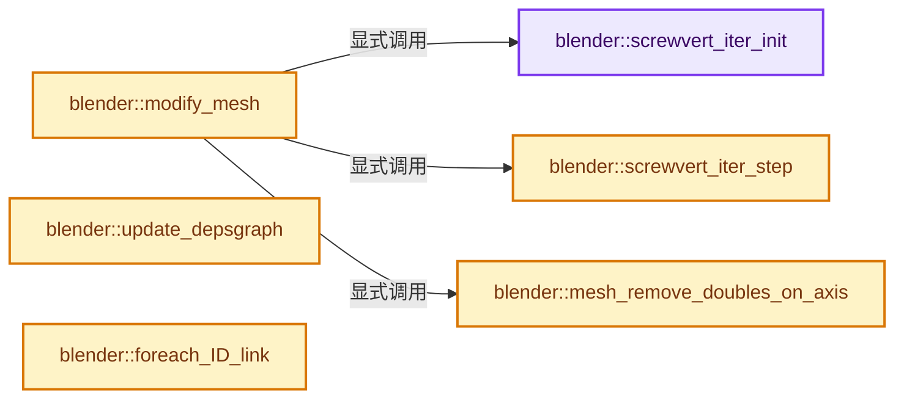
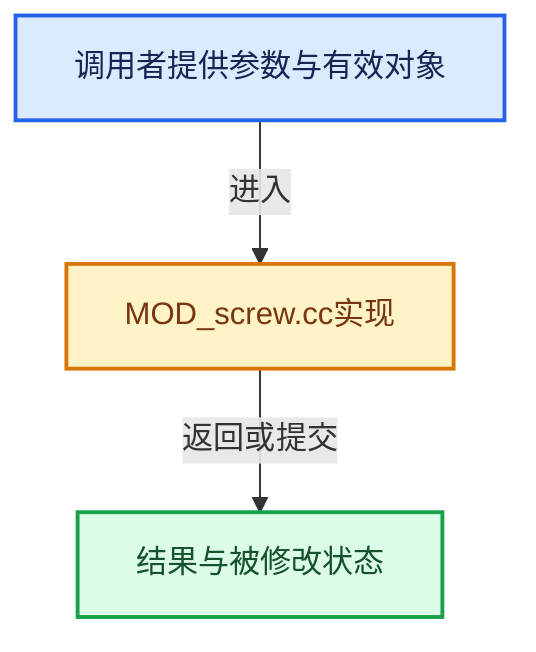

# 实现依赖专题：source/blender/modifiers/intern/MOD_screw.cc

[实现依赖导航](../../../README.md) · [符号索引](../../../../00-课程指南/02-源码与提交索引/符号依赖与实现索引.md)

本专题从正文实际调用进入，集中保存共享实现。函数有稳定锚点，可从调用处直接跳到对应完整函数；递归与互相调用通过回链组织。

## 本文件的实现关系






<a id="m-cbea06b4137e"></a>

## 宏 `SV_IS_VALID`

<!-- annotated:1cdde1332a7fb0 -->

```cpp
#define SV_IS_VALID(v) ((v) < SV_INVALID)

```

<details>
<summary>核对原始源码：source/blender/modifiers/intern/MOD_screw.cc · L83—L84</summary>

<!-- original:1cdde1332a7fb0:source/blender/modifiers/intern/MOD_screw.cc:83:84 -->

```cpp
#define SV_IS_VALID(v) ((v) < SV_INVALID)

```

</details>

宏在预处理阶段展开，参数替换、重复求值和条件编译应直接从该定义检查。与普通函数不同，宏不会自动提供参数类型检查；构建配置选择哪个定义需结合外围条件。

## 完整成员与函数实现

<a id="f-94c2e38f5396b243"></a>

### `blender::screwvert_iter_init`

实现位置：[source/blender/modifiers/intern/MOD_screw.cc](../../../../../../../../source/blender/modifiers/intern/MOD_screw.cc) · L85—L102。

接口参数：

- `ScrewVertIter *iter`
- `ScrewVertConnect *array`
- `uint v_init`
- `uint dir`

**教学注释版**

<!-- annotated:e04225e2bb7fa8 -->

```cpp
static void screwvert_iter_init(ScrewVertIter *iter,
                                ScrewVertConnect *array,
                                uint v_init,
                                uint dir)
{
  iter->v_array = array;
  iter->v = v_init;

  if (SV_IS_VALID(v_init)) {
    iter->v_poin = &array[v_init];
    iter->v_other = iter->v_poin->v[dir];
    iter->e = iter->v_poin->e[!dir];
  }
  else {
    iter->v_poin = nullptr;
    iter->e = nullptr;
  }
}
```

<details>
<summary>核对原始源码：source/blender/modifiers/intern/MOD_screw.cc · L85—L102</summary>

<!-- original:e04225e2bb7fa8:source/blender/modifiers/intern/MOD_screw.cc:85:102 -->

```cpp
static void screwvert_iter_init(ScrewVertIter *iter,
                                ScrewVertConnect *array,
                                uint v_init,
                                uint dir)
{
  iter->v_array = array;
  iter->v = v_init;

  if (SV_IS_VALID(v_init)) {
    iter->v_poin = &array[v_init];
    iter->v_other = iter->v_poin->v[dir];
    iter->e = iter->v_poin->e[!dir];
  }
  else {
    iter->v_poin = nullptr;
    iter->e = nullptr;
  }
}
```

</details>

**沿实际写入检查状态**

- `iter->v_array = array;`
- `iter->v = v_init;`
- `iter->v_poin = &array[v_init];`
- `iter->v_other = iter->v_poin->v[dir];`
- `iter->e = iter->v_poin->e[!dir];`
- `iter->v_poin = nullptr;`
- `iter->e = nullptr;`

**继续追踪实现**

- `SV_IS_VALID` → [SV_IS_VALID · L83](MOD_screw.cc.md#m-cbea06b4137e)。宏定义由构建条件选择。

<a id="f-23e988f84571e9d4"></a>

### `blender::screwvert_iter_step`

实现位置：[source/blender/modifiers/intern/MOD_screw.cc](../../../../../../../../source/blender/modifiers/intern/MOD_screw.cc) · L104—L122。

接口参数：

- `ScrewVertIter *iter`

**教学注释版**

<!-- annotated:f1cfe4385224da -->

```cpp
static void screwvert_iter_step(ScrewVertIter *iter)
{
  if (iter->v_poin->v[0] == iter->v_other) {
    iter->v_other = iter->v;
    iter->v = iter->v_poin->v[1];
  }
  else if (iter->v_poin->v[1] == iter->v_other) {
    iter->v_other = iter->v;
    iter->v = iter->v_poin->v[0];
  }
  if (SV_IS_VALID(iter->v)) {
    iter->v_poin = &iter->v_array[iter->v];
    iter->e = iter->v_poin->e[(iter->v_poin->e[0] == iter->e)];
  }
  else {
    iter->e = nullptr;
    iter->v_poin = nullptr;
  }
}
```

<details>
<summary>核对原始源码：source/blender/modifiers/intern/MOD_screw.cc · L104—L122</summary>

<!-- original:f1cfe4385224da:source/blender/modifiers/intern/MOD_screw.cc:104:122 -->

```cpp
static void screwvert_iter_step(ScrewVertIter *iter)
{
  if (iter->v_poin->v[0] == iter->v_other) {
    iter->v_other = iter->v;
    iter->v = iter->v_poin->v[1];
  }
  else if (iter->v_poin->v[1] == iter->v_other) {
    iter->v_other = iter->v;
    iter->v = iter->v_poin->v[0];
  }
  if (SV_IS_VALID(iter->v)) {
    iter->v_poin = &iter->v_array[iter->v];
    iter->e = iter->v_poin->e[(iter->v_poin->e[0] == iter->e)];
  }
  else {
    iter->e = nullptr;
    iter->v_poin = nullptr;
  }
}
```

</details>

**沿实际写入检查状态**

- `iter->v_other = iter->v;`
- `iter->v = iter->v_poin->v[1];`
- `iter->v = iter->v_poin->v[0];`
- `iter->v_poin = &iter->v_array[iter->v];`
- `iter->e = iter->v_poin->e[(iter->v_poin->e[0] == iter->e)];`
- `iter->e = nullptr;`
- `iter->v_poin = nullptr;`

**继续追踪实现**

- `SV_IS_VALID` → [SV_IS_VALID · L83](MOD_screw.cc.md#m-cbea06b4137e)。宏定义由构建条件选择。

<a id="f-54b511810763df1e"></a>

### `blender::mesh_remove_doubles_on_axis`

实现位置：[source/blender/modifiers/intern/MOD_screw.cc](../../../../../../../../source/blender/modifiers/intern/MOD_screw.cc) · L124—L193。

接口参数：

- `Mesh *result`
- `MutableSpan<float3> vert_positions_new`
- `const uint totvert`
- `const uint step_tot`
- `const float axis_vec[3]`
- `const float axis_offset[3]`
- `const float merge_threshold`

**教学注释版**

<!-- annotated:5974cd2bd504fa -->

```cpp
static Mesh *mesh_remove_doubles_on_axis(Mesh *result,
                                         MutableSpan<float3> vert_positions_new,
                                         const uint totvert,
                                         const uint step_tot,
                                         const float axis_vec[3],
                                         const float axis_offset[3],
                                         const float merge_threshold)
{
  BLI_bitmap *vert_tag = BLI_BITMAP_NEW(totvert, __func__);

  const float merge_threshold_sq = square_f(merge_threshold);
  const bool use_offset = axis_offset != nullptr;
  uint tot_doubles = 0;
  for (uint i = 0; i < totvert; i += 1) {
    float axis_co[3];
    if (use_offset) {
      float offset_co[3];
      sub_v3_v3v3(offset_co, vert_positions_new[i], axis_offset);
      project_v3_v3v3_normalized(axis_co, offset_co, axis_vec);
      add_v3_v3(axis_co, axis_offset);
    }
    else {
      project_v3_v3v3_normalized(axis_co, vert_positions_new[i], axis_vec);
    }
    const float dist_sq = len_squared_v3v3(axis_co, vert_positions_new[i]);
    if (dist_sq <= merge_threshold_sq) {
      BLI_BITMAP_ENABLE(vert_tag, i);
      tot_doubles += 1;
      copy_v3_v3(vert_positions_new[i], axis_co);
    }
  }

  if (tot_doubles != 0) {
    uint tot = totvert * step_tot;
    int *full_doubles_map = MEM_new_array_uninitialized<int>(tot, __func__);
    /* Vertices that aren't merged point at themselves, as #geometry::mesh_merge_verts expects. */
    array_utils::fill_index_range(MutableSpan<int>{full_doubles_map, int64_t(tot)});

    uint tot_doubles_left = tot_doubles;
    for (uint i = 0; i < totvert; i += 1) {
      if (BLI_BITMAP_TEST(vert_tag, i)) {
        int *doubles_map = &full_doubles_map[totvert + i];
        for (uint step = 1; step < step_tot; step += 1) {
          *doubles_map = int(i);
          doubles_map += totvert;
        }
        tot_doubles_left -= 1;
        if (tot_doubles_left == 0) {
          break;
        }
      }
    }

    Mesh *tmp = result;

    /* TODO(mano-wii): Polygons with all vertices merged are the ones that form duplicates.
     * Therefore the duplicate face test can be skipped. */
    result = geometry::mesh_merge_verts(*tmp,
                                        Span<int>{full_doubles_map, result->verts_num},
                                        int(tot_doubles * (step_tot - 1)),
                                        false);

    BKE_id_free(nullptr, tmp);
    MEM_delete(full_doubles_map);
  }

  MEM_delete(vert_tag);

  return result;
}
```

<details>
<summary>核对原始源码：source/blender/modifiers/intern/MOD_screw.cc · L124—L193</summary>

<!-- original:5974cd2bd504fa:source/blender/modifiers/intern/MOD_screw.cc:124:193 -->

```cpp
static Mesh *mesh_remove_doubles_on_axis(Mesh *result,
                                         MutableSpan<float3> vert_positions_new,
                                         const uint totvert,
                                         const uint step_tot,
                                         const float axis_vec[3],
                                         const float axis_offset[3],
                                         const float merge_threshold)
{
  BLI_bitmap *vert_tag = BLI_BITMAP_NEW(totvert, __func__);

  const float merge_threshold_sq = square_f(merge_threshold);
  const bool use_offset = axis_offset != nullptr;
  uint tot_doubles = 0;
  for (uint i = 0; i < totvert; i += 1) {
    float axis_co[3];
    if (use_offset) {
      float offset_co[3];
      sub_v3_v3v3(offset_co, vert_positions_new[i], axis_offset);
      project_v3_v3v3_normalized(axis_co, offset_co, axis_vec);
      add_v3_v3(axis_co, axis_offset);
    }
    else {
      project_v3_v3v3_normalized(axis_co, vert_positions_new[i], axis_vec);
    }
    const float dist_sq = len_squared_v3v3(axis_co, vert_positions_new[i]);
    if (dist_sq <= merge_threshold_sq) {
      BLI_BITMAP_ENABLE(vert_tag, i);
      tot_doubles += 1;
      copy_v3_v3(vert_positions_new[i], axis_co);
    }
  }

  if (tot_doubles != 0) {
    uint tot = totvert * step_tot;
    int *full_doubles_map = MEM_new_array_uninitialized<int>(tot, __func__);
    /* Vertices that aren't merged point at themselves, as #geometry::mesh_merge_verts expects. */
    array_utils::fill_index_range(MutableSpan<int>{full_doubles_map, int64_t(tot)});

    uint tot_doubles_left = tot_doubles;
    for (uint i = 0; i < totvert; i += 1) {
      if (BLI_BITMAP_TEST(vert_tag, i)) {
        int *doubles_map = &full_doubles_map[totvert + i];
        for (uint step = 1; step < step_tot; step += 1) {
          *doubles_map = int(i);
          doubles_map += totvert;
        }
        tot_doubles_left -= 1;
        if (tot_doubles_left == 0) {
          break;
        }
      }
    }

    Mesh *tmp = result;

    /* TODO(mano-wii): Polygons with all vertices merged are the ones that form duplicates.
     * Therefore the duplicate face test can be skipped. */
    result = geometry::mesh_merge_verts(*tmp,
                                        Span<int>{full_doubles_map, result->verts_num},
                                        int(tot_doubles * (step_tot - 1)),
                                        false);

    BKE_id_free(nullptr, tmp);
    MEM_delete(full_doubles_map);
  }

  MEM_delete(vert_tag);

  return result;
}
```

</details>

**沿实际写入检查状态**

- `tot_doubles += 1;`
- `doubles_map += totvert;`
- `tot_doubles_left -= 1;`
- `result = geometry::mesh_merge_verts(*tmp,`

**结果出口**

- `return result;`

**继续追踪实现**

- `BLI_BITMAP_NEW` → [BLI_BITMAP_NEW · L39](../../../01-BLI基础库/BLI_bitmap.hh.md#m-77dce9cd8859)。宏定义由构建条件选择。
- `square_f` → [blender::square_f · L302](../../../01-BLI基础库/intern/math_base_inline.cc.md#f-30f1dde493a37e0d)。
- `sub_v3_v3v3` → [blender::sub_v3_v3v3 · L360](../../../01-BLI基础库/intern/math_vector_inline.cc.md#f-23781c252db8b30c)。
- `project_v3_v3v3_normalized` → [blender::project_v3_v3v3_normalized · L514](../../../01-BLI基础库/intern/math_vector.cc.md#f-a5e567e5f07970ff)。
- `add_v3_v3` → [blender::add_v3_v3 · L286](../../../01-BLI基础库/intern/math_vector_inline.cc.md#f-e7930c6fdefe462c)。
- `len_squared_v3v3` → [blender::len_squared_v3v3 · L794](../../../01-BLI基础库/intern/math_vector_inline.cc.md#f-ae487ac3ef64aa87)。
- `BLI_BITMAP_ENABLE` → [BLI_BITMAP_ENABLE · L80](../../../01-BLI基础库/BLI_bitmap.hh.md#m-6b0abc936749)。宏定义由构建条件选择。
- `copy_v3_v3` → [blender::copy_v3_v3 · L47](../../../01-BLI基础库/intern/math_vector_inline.cc.md#f-037a0d5fa5060bd6)。
- `MEM_new_array_uninitialized<int>` → [MEM_new_array_uninitialized · L608](../../../07-Intern运行时与平台/guardedalloc/MEM_guardedalloc.h.md#f-b7103eae8eb57b05)；[MEM_new_array_uninitialized · L129](../../../07-Intern运行时与平台/guardedalloc/intern/mallocn.cc.md#f-bf6ef4ddcfb6e5df)。同名重载需按实参类型选择。
- `array_utils::fill_index_range` → [blender::array_utils::fill_index_range · L434](../../../../05-几何存储与拓扑映射/07-分组访问与反向索引.md#f-f8128b104d76df0f)；[blender::array_utils::fill_index_range · L439](../../../../05-几何存储与拓扑映射/07-分组访问与反向索引.md#f-95ca84458bfc7e7e)；[blender::array_utils::fill_index_range · L445](../../../../05-几何存储与拓扑映射/07-分组访问与反向索引.md#f-c11b114c213cd61a)。同名重载需按实参类型选择。
- `BLI_BITMAP_TEST` → [BLI_BITMAP_TEST · L63](../../../01-BLI基础库/BLI_bitmap.hh.md#m-631c4702a77d)。宏定义由构建条件选择。
- `geometry::mesh_merge_verts` → [blender::geometry::mesh_merge_verts · L1398](../../../05-Geometry几何算法/intern/mesh_merge_verts.cc.md#f-cd3db9879af9f268)；[blender::geometry::mesh_merge_verts · L1413](../../../05-Geometry几何算法/intern/mesh_merge_verts.cc.md#f-445656c1402c090c)。同名重载需按实参类型选择。
- `BKE_id_free` → [blender::BKE_id_free · L224](../../../02-BKE几何与数据/intern/lib_id_delete.cc.md#f-28ed02c41d0f2d5b)。
- `MEM_delete` → [MEM_delete · L400](../../../07-Intern运行时与平台/guardedalloc/MEM_guardedalloc.h.md#f-9049ffdd1682887c)。

<a id="f-028a98adac20a31c"></a>

### `blender::modify_mesh`

实现位置：[source/blender/modifiers/intern/MOD_screw.cc](../../../../../../../../source/blender/modifiers/intern/MOD_screw.cc) · L195—L1026。

接口参数：

- `ModifierData *md`
- `const ModifierEvalContext *ctx`
- `Mesh *meshData`

**教学注释版**

<!-- annotated:2a52f8e8a53da2 -->

```cpp
static Mesh *modify_mesh(ModifierData *md, const ModifierEvalContext *ctx, Mesh *meshData)
{
  const Mesh *mesh = meshData;
  Mesh *result;
  ScrewModifierData *ltmd = reinterpret_cast<ScrewModifierData *>(md);
  const bool use_render_params = (ctx->flag & MOD_APPLY_RENDER) != 0;

  int face_index = 0;
  uint step;
  uint j;
  uint i1, i2;
  uint step_tot = use_render_params ? ltmd->render_steps : ltmd->steps;
  const bool do_flip = (ltmd->flag & MOD_SCREW_NORMAL_FLIP) != 0;

  const int quad_ord[4] = {
      do_flip ? 3 : 0,
      do_flip ? 2 : 1,
      do_flip ? 1 : 2,
      do_flip ? 0 : 3,
  };
  const int quad_ord_ofs[4] = {
      do_flip ? 2 : 0,
      1,
      do_flip ? 0 : 2,
      3,
  };

  uint maxVerts = 0, maxEdges = 0, maxPolys = 0;
  const uint totvert = uint(mesh->verts_num);
  const uint totedge = uint(mesh->edges_num);
  const uint faces_num = uint(mesh->faces_num);

  uint *edge_face_map = nullptr; /* orig edge to orig face */
  uint *vert_loop_map = nullptr; /* orig vert to orig loop */

  /* UV Coords */
  const VectorSet<StringRefNull> uv_map_names = mesh->uv_map_names();
  // [讲解] uv_map_names.size：查询活项数量或键是否存在。
  Array<bke::SpanAttributeWriter<float2>> uv_map_layers(uv_map_names.size());
  float uv_u_scale;
  float uv_v_minmax[2] = {FLT_MAX, -FLT_MAX};
  float uv_v_range_inv;
  float uv_axis_plane[4];

  char axis_char = 'X';
  bool close;
  float angle = ltmd->angle;
  float screw_ofs = ltmd->screw_ofs;
  float axis_vec[3] = {0.0f, 0.0f, 0.0f};
  float tmp_vec1[3], tmp_vec2[3];
  float mat3[3][3];
  /* transform the coords by an object relative to this objects transformation */
  float mtx_tx[4][4];
  float mtx_tx_inv[4][4]; /* inverted */
  float mtx_tmp_a[4][4];

  uint vc_tot_linked = 0;
  short other_axis_1, other_axis_2;
  const float *tmpf1, *tmpf2;

  uint edge_offset;

  int2 *edge_new, *med_new_firstloop;
  Object *ob_axis = ltmd->ob_axis;

  ScrewVertConnect *vc, *vc_tmp, *vert_connect = nullptr;

  const bool use_flat_shading = (ltmd->flag & MOD_SCREW_SMOOTH_SHADING) == 0;

  /* don't do anything? */
  if (!totvert) {
    return BKE_mesh_new_nomain_from_template(mesh, 0, 0, 0, 0);
  }

  switch (ltmd->axis) {
    case 0:
      other_axis_1 = 1;
      other_axis_2 = 2;
      break;
    case 1:
      other_axis_1 = 0;
      other_axis_2 = 2;
      break;
    default: /* 2, use default to quiet warnings */
      other_axis_1 = 0;
      other_axis_2 = 1;
      break;
  }

  axis_vec[ltmd->axis] = 1.0f;

  if (ob_axis != nullptr) {
    /* Calculate the matrix relative to the axis object. */
    invert_m4_m4(mtx_tmp_a, ctx->object->object_to_world().ptr());
    copy_m4_m4(mtx_tx_inv, ob_axis->object_to_world().ptr());
    mul_m4_m4m4(mtx_tx, mtx_tmp_a, mtx_tx_inv);

    /* Calculate the axis vector. */
    mul_mat3_m4_v3(mtx_tx, axis_vec); /* only rotation component */
    normalize_v3(axis_vec);

    /* screw */
    if (ltmd->flag & MOD_SCREW_OBJECT_OFFSET) {
      /* Find the offset along this axis relative to this objects matrix. */
      float totlen = len_v3(mtx_tx[3]);

      if (totlen != 0.0f) {
        const float zero[3] = {0.0f, 0.0f, 0.0f};
        float cp[3];
        screw_ofs = closest_to_line_v3(cp, mtx_tx[3], zero, axis_vec);
      }
      else {
        screw_ofs = 0.0f;
      }
    }

    /* angle */

#if 0 /* can't include this, not predictable enough, though quite fun. */
    if (ltmd->flag & MOD_SCREW_OBJECT_ANGLE) {
      float mtx3_tx[3][3];
      copy_m3_m4(mtx3_tx, mtx_tx);

      float vec[3] = {0, 1, 0};
      float cross1[3];
      float cross2[3];
      cross_v3_v3v3(cross1, vec, axis_vec);

      mul_v3_m3v3(cross2, mtx3_tx, cross1);
      {
        float c1[3];
        float c2[3];
        float axis_tmp[3];

        cross_v3_v3v3(c1, cross2, axis_vec);
        cross_v3_v3v3(c2, axis_vec, c1);

        angle = angle_v3v3(cross1, c2);

        cross_v3_v3v3(axis_tmp, cross1, c2);
        normalize_v3(axis_tmp);

        if (len_v3v3(axis_tmp, axis_vec) > 1.0f) {
          angle = -angle;
        }
      }
    }
#endif
  }
  else {
    axis_char = char(axis_char + ltmd->axis); /* 'X' + axis */

    /* Useful to be able to use the axis vector in some cases still. */
    zero_v3(axis_vec);
    axis_vec[ltmd->axis] = 1.0f;
  }

  /* apply the multiplier */
  angle *= float(ltmd->iter);
  screw_ofs *= float(ltmd->iter);
  uv_u_scale = 1.0f / float(step_tot);

  /* multiplying the steps is a bit tricky, this works best */
  step_tot = ((step_tot + 1) * ltmd->iter) - (ltmd->iter - 1);

  /* Will the screw be closed?
   * NOTE: smaller than `FLT_EPSILON * 100`
   * gives problems with float precision so its never closed. */
  if (fabsf(screw_ofs) <= (FLT_EPSILON * 100.0f) &&
      fabsf(fabsf(angle) - (float(M_PI) * 2.0f)) <= (FLT_EPSILON * 100.0f) && step_tot > 3)
  {
    close = true;
    step_tot--;

    maxVerts = totvert * step_tot;    /* -1 because we're joining back up */
    maxEdges = (totvert * step_tot) + /* these are the edges between new verts */
               (totedge * step_tot);  /* -1 because vert edges join */
    maxPolys = totedge * step_tot;

    screw_ofs = 0.0f;
  }
  else {
    close = false;
    // [讲解] std::max<uint>：按比较关系选取较大值。本讲解中的增长公式同时满足最低请求和几何增长；若保存返回引用，还需注意实参寿命。
    step_tot = std::max<uint>(step_tot, 2);

    maxVerts = totvert * step_tot;          /* -1 because we're joining back up */
    maxEdges = (totvert * (step_tot - 1)) + /* these are the edges between new verts */
               (totedge * step_tot);        /* -1 because vert edges join */
    maxPolys = totedge * (step_tot - 1);
  }

  if ((ltmd->flag & MOD_SCREW_UV_STRETCH_U) == 0) {
    uv_u_scale = (uv_u_scale / float(ltmd->iter)) * (angle / (float(M_PI) * 2.0f));
  }

  /* The `screw_ofs` cannot change from now on. */
  const bool do_remove_doubles = (ltmd->flag & MOD_SCREW_MERGE) && (screw_ofs == 0.0f);

  result = BKE_mesh_new_nomain_from_template(
      mesh, int(maxVerts), int(maxEdges), int(maxPolys), int(maxPolys) * 4);
  /* The modifier doesn't support original index mapping on the edge or face domains. Remove
   * original index layers, since otherwise edges aren't displayed at all in wireframe view. */
  CustomData_free_layers(&result->edge_data, CD_ORIGINDEX);
  CustomData_free_layers(&result->face_data, CD_ORIGINDEX);

  const Span<float3> vert_positions_orig = mesh->vert_positions();
  const Span<int2> edges_orig = mesh->edges();
  const OffsetIndices faces_orig = mesh->faces();
  const Span<int> corner_verts_orig = mesh->corner_verts();
  const Span<int> corner_edges_orig = mesh->corner_edges();

  MutableSpan<float3> vert_positions_new = result->vert_positions_for_write();
  MutableSpan<int2> edges_new = result->edges_for_write();
  MutableSpan<int> face_offests_new = result->face_offsets_for_write();
  MutableSpan<int> corner_verts_new = result->corner_verts_for_write();
  MutableSpan<int> corner_edges_new = result->corner_edges_for_write();
  bke::MutableAttributeAccessor attributes = result->attributes_for_write();
  bke::SpanAttributeWriter<bool> sharp_faces = attributes.lookup_or_add_for_write_span<bool>(
      "sharp_face", bke::AttrDomain::Face);

  if (!CustomData_has_layer(&result->face_data, CD_ORIGINDEX)) {
    CustomData_add_layer(&result->face_data, CD_ORIGINDEX, CD_SET_DEFAULT, int(maxPolys));
  }

  int *origindex = static_cast<int *>(
      CustomData_get_layer_for_write(&result->face_data, CD_ORIGINDEX, result->faces_num));

  bke::LegacyMeshInterpolator vert_interp(*mesh, *result, bke::AttrDomain::Point);
  bke::LegacyMeshInterpolator edge_interp(*mesh, *result, bke::AttrDomain::Edge);
  bke::LegacyMeshInterpolator face_interp(*mesh, *result, bke::AttrDomain::Face);
  bke::LegacyMeshInterpolator corner_interp(*mesh, *result, bke::AttrDomain::Corner);

  vert_interp.copy(0, 0, int(totvert));

  // [讲解] uv_map_names.is_empty：查询活项数量或键是否存在。
  if (!uv_map_names.is_empty()) {
    const float zero_co[3] = {0};
    plane_from_point_normal_v3(uv_axis_plane, zero_co, axis_vec);
  }

  if (!uv_map_names.is_empty()) {
    for (const int64_t uv_lay : uv_map_names.index_range()) {
      uv_map_layers[uv_lay] = attributes.lookup_for_write_span<float2>(uv_map_names[uv_lay]);
    }

    if (ltmd->flag & MOD_SCREW_UV_STRETCH_V) {
      for (uint i = 0; i < totvert; i++) {
        const float v = dist_signed_squared_to_plane_v3(vert_positions_orig[i], uv_axis_plane);
        uv_v_minmax[0] = min_ff(v, uv_v_minmax[0]);
        uv_v_minmax[1] = max_ff(v, uv_v_minmax[1]);
      }
      uv_v_minmax[0] = sqrtf_signed(uv_v_minmax[0]);
      uv_v_minmax[1] = sqrtf_signed(uv_v_minmax[1]);
    }

    uv_v_range_inv = uv_v_minmax[1] - uv_v_minmax[0];
    uv_v_range_inv = uv_v_range_inv ? 1.0f / uv_v_range_inv : 0.0f;
  }

  /* Set the locations of the first set of verts */

  /* Copy the first set of edges */
  // [讲解] edges_orig.data：返回借用范围的地址。
  const int2 *edge_orig = edges_orig.data();
  edge_new = edges_new.data();
  for (uint i = 0; i < totedge; i++, edge_orig++, edge_new++) {
    *edge_new = *edge_orig;
  }

  /* build face -> edge map */
  if (faces_num) {

    edge_face_map = MEM_new_array_uninitialized<uint>(totedge, __func__);
    // [讲解] memset：填充字节，不调用T构造函数，也不保证任意类型的全零表示是合法或期望值。
    memset(edge_face_map, 0xff, sizeof(*edge_face_map) * totedge);

    vert_loop_map = MEM_new_array_uninitialized<uint>(totvert, __func__);
    memset(vert_loop_map, 0xff, sizeof(*vert_loop_map) * totvert);

    for (const int64_t i : faces_orig.index_range()) {
      for (const int64_t corner : faces_orig[i]) {
        const int vert_i = corner_verts_orig[corner];
        const int edge_i = corner_edges_orig[corner];
        edge_face_map[edge_i] = uint(i);
        vert_loop_map[vert_i] = uint(corner);

        /* also order edges based on faces */
        if (edges_new[edge_i][0] != vert_i) {
          std::swap(edges_new[edge_i][0], edges_new[edge_i][1]);
        }
      }
    }
  }

  if (ltmd->flag & MOD_SCREW_NORMAL_CALC) {

    /* Normal Calculation (for face flipping)
     * Sort edge verts for correct face flipping
     * NOT REALLY NEEDED but face flipping is nice. */

    vert_connect = MEM_new_array_uninitialized<ScrewVertConnect>(totvert, __func__);
    /* skip the first slice of verts. */
    // vert_connect = (ScrewVertConnect *) &medge_new[totvert];
    vc = vert_connect;

    /* Copy Vert Locations */
    if (totedge != 0) {
      // printf("\n\n\n\n\nStarting Modifier\n");
      /* set edge users */
      edge_new = edges_new.data();

      if (ob_axis != nullptr) {
        /* `mtx_tx` is initialized early on. */
        for (uint i = 0; i < totvert; i++, vc++) {
          vc->co[0] = vert_positions_new[i][0] = vert_positions_orig[i][0];
          vc->co[1] = vert_positions_new[i][1] = vert_positions_orig[i][1];
          vc->co[2] = vert_positions_new[i][2] = vert_positions_orig[i][2];

          vc->flag = 0;
          vc->e[0] = vc->e[1] = nullptr;
          vc->v[0] = vc->v[1] = SV_UNUSED;

          mul_m4_v3(mtx_tx, vc->co);
          /* Length in 2D, don't `sqrt` because this is only for comparison. */
          vc->dist_sq = vc->co[other_axis_1] * vc->co[other_axis_1] +
                        vc->co[other_axis_2] * vc->co[other_axis_2];

          // printf("location %f %f %f -- %f\n", vc->co[0], vc->co[1], vc->co[2], vc->dist_sq);
        }
      }
      else {
        for (uint i = 0; i < totvert; i++, vc++) {
          vc->co[0] = vert_positions_new[i][0] = vert_positions_orig[i][0];
          vc->co[1] = vert_positions_new[i][1] = vert_positions_orig[i][1];
          vc->co[2] = vert_positions_new[i][2] = vert_positions_orig[i][2];

          vc->flag = 0;
          vc->e[0] = vc->e[1] = nullptr;
          vc->v[0] = vc->v[1] = SV_UNUSED;

          /* Length in 2D, don't `sqrt` because this is only for comparison. */
          vc->dist_sq = vc->co[other_axis_1] * vc->co[other_axis_1] +
                        vc->co[other_axis_2] * vc->co[other_axis_2];

          // printf("location %f %f %f -- %f\n", vc->co[0], vc->co[1], vc->co[2], vc->dist_sq);
        }
      }

      /* this loop builds connectivity info for verts */
      for (uint i = 0; i < totedge; i++, edge_new++) {
        vc = &vert_connect[(*edge_new)[0]];

        if (vc->v[0] == SV_UNUSED) { /* unused */
          vc->v[0] = uint((*edge_new)[1]);
          vc->e[0] = edge_new;
        }
        else if (vc->v[1] == SV_UNUSED) {
          vc->v[1] = uint((*edge_new)[1]);
          vc->e[1] = edge_new;
        }
        else {
          vc->v[0] = vc->v[1] = SV_INVALID; /* error value  - don't use, 3 edges on vert */
        }

        vc = &vert_connect[(*edge_new)[1]];

        /* same as above but swap v1/2 */
        if (vc->v[0] == SV_UNUSED) { /* unused */
          vc->v[0] = uint((*edge_new)[0]);
          vc->e[0] = edge_new;
        }
        else if (vc->v[1] == SV_UNUSED) {
          vc->v[1] = uint((*edge_new)[0]);
          vc->e[1] = edge_new;
        }
        else {
          vc->v[0] = vc->v[1] = SV_INVALID; /* error value  - don't use, 3 edges on vert */
        }
      }

      /* find the first vert */
      vc = vert_connect;
      for (uint i = 0; i < totvert; i++, vc++) {
        /* Now do search for connected verts, order all edges and flip them
         * so resulting faces are flipped the right way */
        vc_tot_linked = 0; /* count the number of linked verts for this loop */
        if (vc->flag == 0) {
          uint v_best = SV_UNUSED, ed_loop_closed = 0; /* vert and vert new */
          ScrewVertIter lt_iter;
          float fl = -1.0f;

          /* compiler complains if not initialized, but it should be initialized below */
          bool ed_loop_flip = false;

          // printf("Loop on connected vert: %i\n", i);

          for (j = 0; j < 2; j++) {
            // printf("\tSide: %i\n", j);
            screwvert_iter_init(&lt_iter, vert_connect, i, j);
            if (j == 1) {
              screwvert_iter_step(&lt_iter);
            }
            while (lt_iter.v_poin) {
              // printf("\t\tVERT: %i\n", lt_iter.v);
              if (lt_iter.v_poin->flag) {
                // printf("\t\t\tBreaking Found end\n");
                // endpoints[0] = endpoints[1] = SV_UNUSED;
                ed_loop_closed = 1; /* circle */
                break;
              }
              lt_iter.v_poin->flag = 1;
              vc_tot_linked++;
              // printf("Testing 2 floats %f : %f\n", fl, lt_iter.v_poin->dist_sq);
              if (fl <= lt_iter.v_poin->dist_sq) {
                fl = lt_iter.v_poin->dist_sq;
                v_best = lt_iter.v;
                // printf("\t\t\tVERT BEST: %i\n", v_best);
              }
              screwvert_iter_step(&lt_iter);
              if (!lt_iter.v_poin) {
                // printf("\t\t\tFound End Also Num %i\n", j);
                // endpoints[j] = lt_iter.v_other; /* other is still valid */
                break;
              }
            }
          }

          /* Now we have a collection of used edges. flip their edges the right way. */
          /* if (v_best != SV_UNUSED) - */

          // printf("Done Looking - vc_tot_linked: %i\n", vc_tot_linked);

          if (vc_tot_linked > 1) {
            float vf_1, vf_2, vf_best;

            vc_tmp = &vert_connect[v_best];

            tmpf1 = vert_connect[vc_tmp->v[0]].co;
            tmpf2 = vert_connect[vc_tmp->v[1]].co;

            /* edge connects on each side! */
            if (SV_IS_VALID(vc_tmp->v[0]) && SV_IS_VALID(vc_tmp->v[1])) {
              // printf("Verts on each side (%i %i)\n", vc_tmp->v[0], vc_tmp->v[1]);
              /* Find out which is higher. */

              vf_1 = tmpf1[ltmd->axis];
              vf_2 = tmpf2[ltmd->axis];
              vf_best = vc_tmp->co[ltmd->axis];

              if (vf_1 < vf_best && vf_best < vf_2) {
                ed_loop_flip = false;
              }
              else if (vf_1 > vf_best && vf_best > vf_2) {
                ed_loop_flip = true;
              }
              else {
                /* not so simple to work out which edge is higher */
                sub_v3_v3v3(tmp_vec1, tmpf1, vc_tmp->co);
                sub_v3_v3v3(tmp_vec2, tmpf2, vc_tmp->co);
                normalize_v3(tmp_vec1);
                normalize_v3(tmp_vec2);

                if (tmp_vec1[ltmd->axis] < tmp_vec2[ltmd->axis]) {
                  ed_loop_flip = true;
                }
                else {
                  ed_loop_flip = false;
                }
              }
            }
            else if (SV_IS_VALID(vc_tmp->v[0])) { /* Vertex only connected on 1 side. */
              // printf("Verts on ONE side (%i %i)\n", vc_tmp->v[0], vc_tmp->v[1]);
              if (tmpf1[ltmd->axis] < vc_tmp->co[ltmd->axis]) { /* best is above */
                ed_loop_flip = true;
              }
              else { /* best is below or even... in even case we can't know what to do. */
                ed_loop_flip = false;
              }
            }
#if 0
            else {
              printf("No Connected ___\n");
            }
#endif

            // printf("flip direction %i\n", ed_loop_flip);

            /* Switch the flip option if set
             * NOTE: flip is now done at face level so copying group slices is easier. */
#if 0
            if (do_flip) {
              ed_loop_flip = !ed_loop_flip;
            }
#endif

            if (angle < 0.0f) {
              ed_loop_flip = !ed_loop_flip;
            }

            /* if its closed, we only need 1 loop */
            for (j = ed_loop_closed; j < 2; j++) {
              // printf("Ordering Side J %i\n", j);

              screwvert_iter_init(&lt_iter, vert_connect, v_best, j);
              // printf("\n\nStarting - Loop\n");
              lt_iter.v_poin->flag = 1; /* so a non loop will traverse the other side */

              /* If this is the vert off the best vert and
               * the best vert has 2 edges connected too it
               * then swap the flip direction */
              if (j == 1 && SV_IS_VALID(vc_tmp->v[0]) && SV_IS_VALID(vc_tmp->v[1])) {
                ed_loop_flip = !ed_loop_flip;
              }

              while (lt_iter.v_poin && lt_iter.v_poin->flag != 2) {
                // printf("\tOrdering Vert V %i\n", lt_iter.v);

                lt_iter.v_poin->flag = 2;
                if (lt_iter.e) {
                  if (lt_iter.v == uint((*lt_iter.e)[0])) {
                    if (ed_loop_flip == 0) {
                      // printf("\t\t\tFlipping 0\n");
                      std::swap((*lt_iter.e)[0], (*lt_iter.e)[1]);
                    }
#if 0
                    else {
                      printf("\t\t\tFlipping Not 0\n");
                    }
#endif
                  }
                  else if (lt_iter.v == uint((*lt_iter.e)[1])) {
                    if (ed_loop_flip == 1) {
                      // printf("\t\t\tFlipping 1\n");
                      std::swap((*lt_iter.e)[0], (*lt_iter.e)[1]);
                    }
#if 0
                    else {
                      printf("\t\t\tFlipping Not 1\n");
                    }
#endif
                  }
#if 0
                  else {
                    printf("\t\tIncorrect edge topology");
                  }
#endif
                }
#if 0
                else {
                  printf("\t\tNo Edge at this point\n");
                }
#endif
                screwvert_iter_step(&lt_iter);
              }
            }
          }
        }
      }
    }
  }
  else {
    for (uint i = 0; i < totvert; i++) {
      copy_v3_v3(vert_positions_new[i], vert_positions_orig[i]);
    }
  }
  /* done with edge connectivity based normal flipping */

  /* Add Faces */
  for (step = 1; step < step_tot; step++) {
    const uint varray_stride = totvert * step;
    float step_angle;
    float mat[4][4];
    /* Rotation Matrix */
    step_angle = (angle / float(step_tot - (!close))) * float(step);

    if (ob_axis != nullptr) {
      axis_angle_normalized_to_mat3(mat3, axis_vec, step_angle);
    }
    else {
      axis_angle_to_mat3_single(mat3, axis_char, step_angle);
    }
    copy_m4_m3(mat, mat3);

    if (screw_ofs) {
      madd_v3_v3fl(mat[3], axis_vec, screw_ofs * (float(step) / float(step_tot - 1)));
    }

    /* copy a slice */
    vert_interp.copy(0, int(varray_stride), int(totvert));

    /* set location */
    for (j = 0; j < totvert; j++) {
      const int vert_new = int(varray_stride) + int(j);

      copy_v3_v3(vert_positions_new[vert_new], vert_positions_new[j]);

      /* only need to set these if using non cleared memory */
      // mv_new->mat_nr = mv_new->flag = 0;

      if (ob_axis != nullptr) {
        sub_v3_v3(vert_positions_new[vert_new], mtx_tx[3]);

        mul_m4_v3(mat, vert_positions_new[vert_new]);

        add_v3_v3(vert_positions_new[vert_new], mtx_tx[3]);
      }
      else {
        mul_m4_v3(mat, vert_positions_new[vert_new]);
      }

      /* add the new edge */
      (*edge_new)[0] = int(varray_stride + j);
      (*edge_new)[1] = (*edge_new)[0] - int(totvert);
      edge_new++;
    }
  }

  /* we can avoid if using vert alloc trick */
  if (vert_connect) {
    MEM_delete(vert_connect);
    vert_connect = nullptr;
  }

  if (close) {
    /* last loop of edges, previous loop doesn't account for the last set of edges */
    const uint varray_stride = (step_tot - 1) * totvert;

    for (uint i = 0; i < totvert; i++) {
      (*edge_new)[0] = int(i);
      (*edge_new)[1] = int(varray_stride + i);
      edge_new++;
    }
  }

  int new_loop_index = 0;
  med_new_firstloop = edges_new.data();

  /* more of an offset in this case */
  edge_offset = totedge + (totvert * (step_tot - (close ? 0 : 1)));

  const bke::AttributeAccessor src_attributes = mesh->attributes();
  const VArraySpan src_material_index = *src_attributes.lookup<int>("material_index",
                                                                    bke::AttrDomain::Face);

  bke::MutableAttributeAccessor dst_attributes = result->attributes_for_write();
  bke::SpanAttributeWriter dst_material_index = dst_attributes.lookup_or_add_for_write_span<int>(
      "material_index", bke::AttrDomain::Face);

  for (uint i = 0; i < totedge; i++, med_new_firstloop++) {
    const uint step_last = step_tot - (close ? 1 : 2);
    const uint face_index_orig = faces_num ? edge_face_map[i] : UINT_MAX;
    const bool has_mpoly_orig = (face_index_orig != UINT_MAX);
    float uv_v_offset_a, uv_v_offset_b;

    const uint mloop_index_orig[2] = {
        vert_loop_map ? vert_loop_map[edges_new[i][0]] : UINT_MAX,
        vert_loop_map ? vert_loop_map[edges_new[i][1]] : UINT_MAX,
    };

    const bool has_mloop_orig = edge_face_map && (edge_face_map[i] != UINT_MAX) &&
                                (mloop_index_orig[0] != UINT_MAX);

    int mat_nr;

    /* for each edge, make a cylinder of quads */
    i1 = uint((*med_new_firstloop)[0]);
    i2 = uint((*med_new_firstloop)[1]);

    if (has_mpoly_orig) {
      mat_nr = src_material_index.is_empty() ? 0 : src_material_index[face_index_orig];
    }
    else {
      mat_nr = 0;
    }

    if (has_mloop_orig == false && !uv_map_names.is_empty()) {
      uv_v_offset_a = dist_signed_to_plane_v3(vert_positions_new[edges_new[i][0]], uv_axis_plane);
      uv_v_offset_b = dist_signed_to_plane_v3(vert_positions_new[edges_new[i][1]], uv_axis_plane);

      if (ltmd->flag & MOD_SCREW_UV_STRETCH_V) {
        uv_v_offset_a = (uv_v_offset_a - uv_v_minmax[0]) * uv_v_range_inv;
        uv_v_offset_b = (uv_v_offset_b - uv_v_minmax[0]) * uv_v_range_inv;
      }
    }

    for (step = 0; step <= step_last; step++) {

      /* Polygon */
      if (has_mpoly_orig) {
        face_interp.copy(int(face_index_orig), face_index, 1);
        origindex[face_index] = int(face_index_orig);
      }
      else {
        origindex[face_index] = ORIGINDEX_NONE;
        dst_material_index.span[face_index] = mat_nr;
        sharp_faces.span[face_index] = use_flat_shading;
      }
      face_offests_new[face_index] = face_index * 4;

      /* Loop-Custom-Data */
      if (has_mloop_orig) {

        corner_interp.copy(int(mloop_index_orig[0]), new_loop_index + 0, 1);
        corner_interp.copy(int(mloop_index_orig[1]), new_loop_index + 1, 1);
        corner_interp.copy(int(mloop_index_orig[1]), new_loop_index + 2, 1);
        corner_interp.copy(int(mloop_index_orig[0]), new_loop_index + 3, 1);

        if (!uv_map_names.is_empty()) {
          const float uv_u_offset_a = float(step) * uv_u_scale;
          const float uv_u_offset_b = float(step + 1) * uv_u_scale;
          // [讲解] uv_map_layers.index_range：查询固定有效长度及其索引范围。
          for (const int64_t uv_lay : uv_map_layers.index_range()) {
            float2 *mluv = &uv_map_layers[uv_lay].span[new_loop_index];

            mluv[quad_ord[0]][0] += uv_u_offset_a;
            mluv[quad_ord[1]][0] += uv_u_offset_a;
            mluv[quad_ord[2]][0] += uv_u_offset_b;
            mluv[quad_ord[3]][0] += uv_u_offset_b;
          }
        }
      }
      else {
        if (!uv_map_names.is_empty()) {
          const float uv_u_offset_a = float(step) * uv_u_scale;
          const float uv_u_offset_b = float(step + 1) * uv_u_scale;
          for (const int64_t uv_lay : uv_map_layers.index_range()) {
            float2 *mluv = &uv_map_layers[uv_lay].span[new_loop_index];

            copy_v2_fl2(mluv[quad_ord[0]], uv_u_offset_a, uv_v_offset_a);
            copy_v2_fl2(mluv[quad_ord[1]], uv_u_offset_a, uv_v_offset_b);
            copy_v2_fl2(mluv[quad_ord[2]], uv_u_offset_b, uv_v_offset_b);
            copy_v2_fl2(mluv[quad_ord[3]], uv_u_offset_b, uv_v_offset_a);
          }
        }
      }

      /* Loop-Data */
      if (!(close && step == step_last)) {
        /* regular segments */
        corner_verts_new[new_loop_index + quad_ord[0]] = int(i1);
        corner_verts_new[new_loop_index + quad_ord[1]] = int(i2);
        corner_verts_new[new_loop_index + quad_ord[2]] = int(i2 + totvert);
        corner_verts_new[new_loop_index + quad_ord[3]] = int(i1 + totvert);

        corner_edges_new[new_loop_index + quad_ord_ofs[0]] = int(
            step == 0 ? i : (edge_offset + step + (i * (step_tot - 1))) - 1);
        corner_edges_new[new_loop_index + quad_ord_ofs[1]] = int(totedge + i2);
        corner_edges_new[new_loop_index + quad_ord_ofs[2]] = int(edge_offset + step +
                                                                 (i * (step_tot - 1)));
        corner_edges_new[new_loop_index + quad_ord_ofs[3]] = int(totedge + i1);

        /* new vertical edge */
        if (step) { /* The first set is already done */
          (*edge_new)[0] = int(i1);
          (*edge_new)[1] = int(i2);
          edge_new++;
        }
        i1 += totvert;
        i2 += totvert;
      }
      else {
        /* last segment */
        corner_verts_new[new_loop_index + quad_ord[0]] = int(i1);
        corner_verts_new[new_loop_index + quad_ord[1]] = int(i2);
        corner_verts_new[new_loop_index + quad_ord[2]] = int((*med_new_firstloop)[1]);
        corner_verts_new[new_loop_index + quad_ord[3]] = int((*med_new_firstloop)[0]);

        corner_edges_new[new_loop_index + quad_ord_ofs[0]] = int(
            (edge_offset + step + (i * (step_tot - 1))) - 1);
        corner_edges_new[new_loop_index + quad_ord_ofs[1]] = int(totedge + i2);
        corner_edges_new[new_loop_index + quad_ord_ofs[2]] = int(i);
        corner_edges_new[new_loop_index + quad_ord_ofs[3]] = int(totedge + i1);
      }

      new_loop_index += 4;
      face_index++;
    }

    /* new vertical edge */
    (*edge_new)[0] = int(i1);
    (*edge_new)[1] = int(i2);
    edge_new++;
  }

/* validate loop edges */
#if 0
  {
    uint i = 0;
    printf("\n");
    for (; i < maxPolys * 4; i += 4) {
      uint ii;
      ml_new = mloop_new + i;
      ii = findEd(edges_new, maxEdges, ml_new[0].v, ml_new[1].v);
      printf("%d %d -- ", ii, ml_new[0].e);
      ml_new[0].e = ii;

      ii = findEd(edges_new, maxEdges, ml_new[1].v, ml_new[2].v);
      printf("%d %d -- ", ii, ml_new[1].e);
      ml_new[1].e = ii;

      ii = findEd(edges_new, maxEdges, ml_new[2].v, ml_new[3].v);
      printf("%d %d -- ", ii, ml_new[2].e);
      ml_new[2].e = ii;

      ii = findEd(edges_new, maxEdges, ml_new[3].v, ml_new[0].v);
      printf("%d %d\n", ii, ml_new[3].e);
      ml_new[3].e = ii;
    }
  }
#endif

  sharp_faces.finish();
  dst_material_index.finish();
  for (bke::SpanAttributeWriter<float2> &uv_map : uv_map_layers) {
    uv_map.finish();
  }

  if (edge_face_map) {
    MEM_delete(edge_face_map);
  }

  if (vert_loop_map) {
    MEM_delete(vert_loop_map);
  }

  if (do_remove_doubles) {
    result = mesh_remove_doubles_on_axis(result,
                                         vert_positions_new,
                                         totvert,
                                         step_tot,
                                         axis_vec,
                                         ob_axis != nullptr ? mtx_tx[3] : nullptr,
                                         ltmd->merge_dist);
  }

  return result;
}
```

<details>
<summary>核对原始源码：source/blender/modifiers/intern/MOD_screw.cc · L195—L1026</summary>

<!-- original:2a52f8e8a53da2:source/blender/modifiers/intern/MOD_screw.cc:195:1026 -->

```cpp
static Mesh *modify_mesh(ModifierData *md, const ModifierEvalContext *ctx, Mesh *meshData)
{
  const Mesh *mesh = meshData;
  Mesh *result;
  ScrewModifierData *ltmd = reinterpret_cast<ScrewModifierData *>(md);
  const bool use_render_params = (ctx->flag & MOD_APPLY_RENDER) != 0;

  int face_index = 0;
  uint step;
  uint j;
  uint i1, i2;
  uint step_tot = use_render_params ? ltmd->render_steps : ltmd->steps;
  const bool do_flip = (ltmd->flag & MOD_SCREW_NORMAL_FLIP) != 0;

  const int quad_ord[4] = {
      do_flip ? 3 : 0,
      do_flip ? 2 : 1,
      do_flip ? 1 : 2,
      do_flip ? 0 : 3,
  };
  const int quad_ord_ofs[4] = {
      do_flip ? 2 : 0,
      1,
      do_flip ? 0 : 2,
      3,
  };

  uint maxVerts = 0, maxEdges = 0, maxPolys = 0;
  const uint totvert = uint(mesh->verts_num);
  const uint totedge = uint(mesh->edges_num);
  const uint faces_num = uint(mesh->faces_num);

  uint *edge_face_map = nullptr; /* orig edge to orig face */
  uint *vert_loop_map = nullptr; /* orig vert to orig loop */

  /* UV Coords */
  const VectorSet<StringRefNull> uv_map_names = mesh->uv_map_names();
  Array<bke::SpanAttributeWriter<float2>> uv_map_layers(uv_map_names.size());
  float uv_u_scale;
  float uv_v_minmax[2] = {FLT_MAX, -FLT_MAX};
  float uv_v_range_inv;
  float uv_axis_plane[4];

  char axis_char = 'X';
  bool close;
  float angle = ltmd->angle;
  float screw_ofs = ltmd->screw_ofs;
  float axis_vec[3] = {0.0f, 0.0f, 0.0f};
  float tmp_vec1[3], tmp_vec2[3];
  float mat3[3][3];
  /* transform the coords by an object relative to this objects transformation */
  float mtx_tx[4][4];
  float mtx_tx_inv[4][4]; /* inverted */
  float mtx_tmp_a[4][4];

  uint vc_tot_linked = 0;
  short other_axis_1, other_axis_2;
  const float *tmpf1, *tmpf2;

  uint edge_offset;

  int2 *edge_new, *med_new_firstloop;
  Object *ob_axis = ltmd->ob_axis;

  ScrewVertConnect *vc, *vc_tmp, *vert_connect = nullptr;

  const bool use_flat_shading = (ltmd->flag & MOD_SCREW_SMOOTH_SHADING) == 0;

  /* don't do anything? */
  if (!totvert) {
    return BKE_mesh_new_nomain_from_template(mesh, 0, 0, 0, 0);
  }

  switch (ltmd->axis) {
    case 0:
      other_axis_1 = 1;
      other_axis_2 = 2;
      break;
    case 1:
      other_axis_1 = 0;
      other_axis_2 = 2;
      break;
    default: /* 2, use default to quiet warnings */
      other_axis_1 = 0;
      other_axis_2 = 1;
      break;
  }

  axis_vec[ltmd->axis] = 1.0f;

  if (ob_axis != nullptr) {
    /* Calculate the matrix relative to the axis object. */
    invert_m4_m4(mtx_tmp_a, ctx->object->object_to_world().ptr());
    copy_m4_m4(mtx_tx_inv, ob_axis->object_to_world().ptr());
    mul_m4_m4m4(mtx_tx, mtx_tmp_a, mtx_tx_inv);

    /* Calculate the axis vector. */
    mul_mat3_m4_v3(mtx_tx, axis_vec); /* only rotation component */
    normalize_v3(axis_vec);

    /* screw */
    if (ltmd->flag & MOD_SCREW_OBJECT_OFFSET) {
      /* Find the offset along this axis relative to this objects matrix. */
      float totlen = len_v3(mtx_tx[3]);

      if (totlen != 0.0f) {
        const float zero[3] = {0.0f, 0.0f, 0.0f};
        float cp[3];
        screw_ofs = closest_to_line_v3(cp, mtx_tx[3], zero, axis_vec);
      }
      else {
        screw_ofs = 0.0f;
      }
    }

    /* angle */

#if 0 /* can't include this, not predictable enough, though quite fun. */
    if (ltmd->flag & MOD_SCREW_OBJECT_ANGLE) {
      float mtx3_tx[3][3];
      copy_m3_m4(mtx3_tx, mtx_tx);

      float vec[3] = {0, 1, 0};
      float cross1[3];
      float cross2[3];
      cross_v3_v3v3(cross1, vec, axis_vec);

      mul_v3_m3v3(cross2, mtx3_tx, cross1);
      {
        float c1[3];
        float c2[3];
        float axis_tmp[3];

        cross_v3_v3v3(c1, cross2, axis_vec);
        cross_v3_v3v3(c2, axis_vec, c1);

        angle = angle_v3v3(cross1, c2);

        cross_v3_v3v3(axis_tmp, cross1, c2);
        normalize_v3(axis_tmp);

        if (len_v3v3(axis_tmp, axis_vec) > 1.0f) {
          angle = -angle;
        }
      }
    }
#endif
  }
  else {
    axis_char = char(axis_char + ltmd->axis); /* 'X' + axis */

    /* Useful to be able to use the axis vector in some cases still. */
    zero_v3(axis_vec);
    axis_vec[ltmd->axis] = 1.0f;
  }

  /* apply the multiplier */
  angle *= float(ltmd->iter);
  screw_ofs *= float(ltmd->iter);
  uv_u_scale = 1.0f / float(step_tot);

  /* multiplying the steps is a bit tricky, this works best */
  step_tot = ((step_tot + 1) * ltmd->iter) - (ltmd->iter - 1);

  /* Will the screw be closed?
   * NOTE: smaller than `FLT_EPSILON * 100`
   * gives problems with float precision so its never closed. */
  if (fabsf(screw_ofs) <= (FLT_EPSILON * 100.0f) &&
      fabsf(fabsf(angle) - (float(M_PI) * 2.0f)) <= (FLT_EPSILON * 100.0f) && step_tot > 3)
  {
    close = true;
    step_tot--;

    maxVerts = totvert * step_tot;    /* -1 because we're joining back up */
    maxEdges = (totvert * step_tot) + /* these are the edges between new verts */
               (totedge * step_tot);  /* -1 because vert edges join */
    maxPolys = totedge * step_tot;

    screw_ofs = 0.0f;
  }
  else {
    close = false;
    step_tot = std::max<uint>(step_tot, 2);

    maxVerts = totvert * step_tot;          /* -1 because we're joining back up */
    maxEdges = (totvert * (step_tot - 1)) + /* these are the edges between new verts */
               (totedge * step_tot);        /* -1 because vert edges join */
    maxPolys = totedge * (step_tot - 1);
  }

  if ((ltmd->flag & MOD_SCREW_UV_STRETCH_U) == 0) {
    uv_u_scale = (uv_u_scale / float(ltmd->iter)) * (angle / (float(M_PI) * 2.0f));
  }

  /* The `screw_ofs` cannot change from now on. */
  const bool do_remove_doubles = (ltmd->flag & MOD_SCREW_MERGE) && (screw_ofs == 0.0f);

  result = BKE_mesh_new_nomain_from_template(
      mesh, int(maxVerts), int(maxEdges), int(maxPolys), int(maxPolys) * 4);
  /* The modifier doesn't support original index mapping on the edge or face domains. Remove
   * original index layers, since otherwise edges aren't displayed at all in wireframe view. */
  CustomData_free_layers(&result->edge_data, CD_ORIGINDEX);
  CustomData_free_layers(&result->face_data, CD_ORIGINDEX);

  const Span<float3> vert_positions_orig = mesh->vert_positions();
  const Span<int2> edges_orig = mesh->edges();
  const OffsetIndices faces_orig = mesh->faces();
  const Span<int> corner_verts_orig = mesh->corner_verts();
  const Span<int> corner_edges_orig = mesh->corner_edges();

  MutableSpan<float3> vert_positions_new = result->vert_positions_for_write();
  MutableSpan<int2> edges_new = result->edges_for_write();
  MutableSpan<int> face_offests_new = result->face_offsets_for_write();
  MutableSpan<int> corner_verts_new = result->corner_verts_for_write();
  MutableSpan<int> corner_edges_new = result->corner_edges_for_write();
  bke::MutableAttributeAccessor attributes = result->attributes_for_write();
  bke::SpanAttributeWriter<bool> sharp_faces = attributes.lookup_or_add_for_write_span<bool>(
      "sharp_face", bke::AttrDomain::Face);

  if (!CustomData_has_layer(&result->face_data, CD_ORIGINDEX)) {
    CustomData_add_layer(&result->face_data, CD_ORIGINDEX, CD_SET_DEFAULT, int(maxPolys));
  }

  int *origindex = static_cast<int *>(
      CustomData_get_layer_for_write(&result->face_data, CD_ORIGINDEX, result->faces_num));

  bke::LegacyMeshInterpolator vert_interp(*mesh, *result, bke::AttrDomain::Point);
  bke::LegacyMeshInterpolator edge_interp(*mesh, *result, bke::AttrDomain::Edge);
  bke::LegacyMeshInterpolator face_interp(*mesh, *result, bke::AttrDomain::Face);
  bke::LegacyMeshInterpolator corner_interp(*mesh, *result, bke::AttrDomain::Corner);

  vert_interp.copy(0, 0, int(totvert));

  if (!uv_map_names.is_empty()) {
    const float zero_co[3] = {0};
    plane_from_point_normal_v3(uv_axis_plane, zero_co, axis_vec);
  }

  if (!uv_map_names.is_empty()) {
    for (const int64_t uv_lay : uv_map_names.index_range()) {
      uv_map_layers[uv_lay] = attributes.lookup_for_write_span<float2>(uv_map_names[uv_lay]);
    }

    if (ltmd->flag & MOD_SCREW_UV_STRETCH_V) {
      for (uint i = 0; i < totvert; i++) {
        const float v = dist_signed_squared_to_plane_v3(vert_positions_orig[i], uv_axis_plane);
        uv_v_minmax[0] = min_ff(v, uv_v_minmax[0]);
        uv_v_minmax[1] = max_ff(v, uv_v_minmax[1]);
      }
      uv_v_minmax[0] = sqrtf_signed(uv_v_minmax[0]);
      uv_v_minmax[1] = sqrtf_signed(uv_v_minmax[1]);
    }

    uv_v_range_inv = uv_v_minmax[1] - uv_v_minmax[0];
    uv_v_range_inv = uv_v_range_inv ? 1.0f / uv_v_range_inv : 0.0f;
  }

  /* Set the locations of the first set of verts */

  /* Copy the first set of edges */
  const int2 *edge_orig = edges_orig.data();
  edge_new = edges_new.data();
  for (uint i = 0; i < totedge; i++, edge_orig++, edge_new++) {
    *edge_new = *edge_orig;
  }

  /* build face -> edge map */
  if (faces_num) {

    edge_face_map = MEM_new_array_uninitialized<uint>(totedge, __func__);
    memset(edge_face_map, 0xff, sizeof(*edge_face_map) * totedge);

    vert_loop_map = MEM_new_array_uninitialized<uint>(totvert, __func__);
    memset(vert_loop_map, 0xff, sizeof(*vert_loop_map) * totvert);

    for (const int64_t i : faces_orig.index_range()) {
      for (const int64_t corner : faces_orig[i]) {
        const int vert_i = corner_verts_orig[corner];
        const int edge_i = corner_edges_orig[corner];
        edge_face_map[edge_i] = uint(i);
        vert_loop_map[vert_i] = uint(corner);

        /* also order edges based on faces */
        if (edges_new[edge_i][0] != vert_i) {
          std::swap(edges_new[edge_i][0], edges_new[edge_i][1]);
        }
      }
    }
  }

  if (ltmd->flag & MOD_SCREW_NORMAL_CALC) {

    /* Normal Calculation (for face flipping)
     * Sort edge verts for correct face flipping
     * NOT REALLY NEEDED but face flipping is nice. */

    vert_connect = MEM_new_array_uninitialized<ScrewVertConnect>(totvert, __func__);
    /* skip the first slice of verts. */
    // vert_connect = (ScrewVertConnect *) &medge_new[totvert];
    vc = vert_connect;

    /* Copy Vert Locations */
    if (totedge != 0) {
      // printf("\n\n\n\n\nStarting Modifier\n");
      /* set edge users */
      edge_new = edges_new.data();

      if (ob_axis != nullptr) {
        /* `mtx_tx` is initialized early on. */
        for (uint i = 0; i < totvert; i++, vc++) {
          vc->co[0] = vert_positions_new[i][0] = vert_positions_orig[i][0];
          vc->co[1] = vert_positions_new[i][1] = vert_positions_orig[i][1];
          vc->co[2] = vert_positions_new[i][2] = vert_positions_orig[i][2];

          vc->flag = 0;
          vc->e[0] = vc->e[1] = nullptr;
          vc->v[0] = vc->v[1] = SV_UNUSED;

          mul_m4_v3(mtx_tx, vc->co);
          /* Length in 2D, don't `sqrt` because this is only for comparison. */
          vc->dist_sq = vc->co[other_axis_1] * vc->co[other_axis_1] +
                        vc->co[other_axis_2] * vc->co[other_axis_2];

          // printf("location %f %f %f -- %f\n", vc->co[0], vc->co[1], vc->co[2], vc->dist_sq);
        }
      }
      else {
        for (uint i = 0; i < totvert; i++, vc++) {
          vc->co[0] = vert_positions_new[i][0] = vert_positions_orig[i][0];
          vc->co[1] = vert_positions_new[i][1] = vert_positions_orig[i][1];
          vc->co[2] = vert_positions_new[i][2] = vert_positions_orig[i][2];

          vc->flag = 0;
          vc->e[0] = vc->e[1] = nullptr;
          vc->v[0] = vc->v[1] = SV_UNUSED;

          /* Length in 2D, don't `sqrt` because this is only for comparison. */
          vc->dist_sq = vc->co[other_axis_1] * vc->co[other_axis_1] +
                        vc->co[other_axis_2] * vc->co[other_axis_2];

          // printf("location %f %f %f -- %f\n", vc->co[0], vc->co[1], vc->co[2], vc->dist_sq);
        }
      }

      /* this loop builds connectivity info for verts */
      for (uint i = 0; i < totedge; i++, edge_new++) {
        vc = &vert_connect[(*edge_new)[0]];

        if (vc->v[0] == SV_UNUSED) { /* unused */
          vc->v[0] = uint((*edge_new)[1]);
          vc->e[0] = edge_new;
        }
        else if (vc->v[1] == SV_UNUSED) {
          vc->v[1] = uint((*edge_new)[1]);
          vc->e[1] = edge_new;
        }
        else {
          vc->v[0] = vc->v[1] = SV_INVALID; /* error value  - don't use, 3 edges on vert */
        }

        vc = &vert_connect[(*edge_new)[1]];

        /* same as above but swap v1/2 */
        if (vc->v[0] == SV_UNUSED) { /* unused */
          vc->v[0] = uint((*edge_new)[0]);
          vc->e[0] = edge_new;
        }
        else if (vc->v[1] == SV_UNUSED) {
          vc->v[1] = uint((*edge_new)[0]);
          vc->e[1] = edge_new;
        }
        else {
          vc->v[0] = vc->v[1] = SV_INVALID; /* error value  - don't use, 3 edges on vert */
        }
      }

      /* find the first vert */
      vc = vert_connect;
      for (uint i = 0; i < totvert; i++, vc++) {
        /* Now do search for connected verts, order all edges and flip them
         * so resulting faces are flipped the right way */
        vc_tot_linked = 0; /* count the number of linked verts for this loop */
        if (vc->flag == 0) {
          uint v_best = SV_UNUSED, ed_loop_closed = 0; /* vert and vert new */
          ScrewVertIter lt_iter;
          float fl = -1.0f;

          /* compiler complains if not initialized, but it should be initialized below */
          bool ed_loop_flip = false;

          // printf("Loop on connected vert: %i\n", i);

          for (j = 0; j < 2; j++) {
            // printf("\tSide: %i\n", j);
            screwvert_iter_init(&lt_iter, vert_connect, i, j);
            if (j == 1) {
              screwvert_iter_step(&lt_iter);
            }
            while (lt_iter.v_poin) {
              // printf("\t\tVERT: %i\n", lt_iter.v);
              if (lt_iter.v_poin->flag) {
                // printf("\t\t\tBreaking Found end\n");
                // endpoints[0] = endpoints[1] = SV_UNUSED;
                ed_loop_closed = 1; /* circle */
                break;
              }
              lt_iter.v_poin->flag = 1;
              vc_tot_linked++;
              // printf("Testing 2 floats %f : %f\n", fl, lt_iter.v_poin->dist_sq);
              if (fl <= lt_iter.v_poin->dist_sq) {
                fl = lt_iter.v_poin->dist_sq;
                v_best = lt_iter.v;
                // printf("\t\t\tVERT BEST: %i\n", v_best);
              }
              screwvert_iter_step(&lt_iter);
              if (!lt_iter.v_poin) {
                // printf("\t\t\tFound End Also Num %i\n", j);
                // endpoints[j] = lt_iter.v_other; /* other is still valid */
                break;
              }
            }
          }

          /* Now we have a collection of used edges. flip their edges the right way. */
          /* if (v_best != SV_UNUSED) - */

          // printf("Done Looking - vc_tot_linked: %i\n", vc_tot_linked);

          if (vc_tot_linked > 1) {
            float vf_1, vf_2, vf_best;

            vc_tmp = &vert_connect[v_best];

            tmpf1 = vert_connect[vc_tmp->v[0]].co;
            tmpf2 = vert_connect[vc_tmp->v[1]].co;

            /* edge connects on each side! */
            if (SV_IS_VALID(vc_tmp->v[0]) && SV_IS_VALID(vc_tmp->v[1])) {
              // printf("Verts on each side (%i %i)\n", vc_tmp->v[0], vc_tmp->v[1]);
              /* Find out which is higher. */

              vf_1 = tmpf1[ltmd->axis];
              vf_2 = tmpf2[ltmd->axis];
              vf_best = vc_tmp->co[ltmd->axis];

              if (vf_1 < vf_best && vf_best < vf_2) {
                ed_loop_flip = false;
              }
              else if (vf_1 > vf_best && vf_best > vf_2) {
                ed_loop_flip = true;
              }
              else {
                /* not so simple to work out which edge is higher */
                sub_v3_v3v3(tmp_vec1, tmpf1, vc_tmp->co);
                sub_v3_v3v3(tmp_vec2, tmpf2, vc_tmp->co);
                normalize_v3(tmp_vec1);
                normalize_v3(tmp_vec2);

                if (tmp_vec1[ltmd->axis] < tmp_vec2[ltmd->axis]) {
                  ed_loop_flip = true;
                }
                else {
                  ed_loop_flip = false;
                }
              }
            }
            else if (SV_IS_VALID(vc_tmp->v[0])) { /* Vertex only connected on 1 side. */
              // printf("Verts on ONE side (%i %i)\n", vc_tmp->v[0], vc_tmp->v[1]);
              if (tmpf1[ltmd->axis] < vc_tmp->co[ltmd->axis]) { /* best is above */
                ed_loop_flip = true;
              }
              else { /* best is below or even... in even case we can't know what to do. */
                ed_loop_flip = false;
              }
            }
#if 0
            else {
              printf("No Connected ___\n");
            }
#endif

            // printf("flip direction %i\n", ed_loop_flip);

            /* Switch the flip option if set
             * NOTE: flip is now done at face level so copying group slices is easier. */
#if 0
            if (do_flip) {
              ed_loop_flip = !ed_loop_flip;
            }
#endif

            if (angle < 0.0f) {
              ed_loop_flip = !ed_loop_flip;
            }

            /* if its closed, we only need 1 loop */
            for (j = ed_loop_closed; j < 2; j++) {
              // printf("Ordering Side J %i\n", j);

              screwvert_iter_init(&lt_iter, vert_connect, v_best, j);
              // printf("\n\nStarting - Loop\n");
              lt_iter.v_poin->flag = 1; /* so a non loop will traverse the other side */

              /* If this is the vert off the best vert and
               * the best vert has 2 edges connected too it
               * then swap the flip direction */
              if (j == 1 && SV_IS_VALID(vc_tmp->v[0]) && SV_IS_VALID(vc_tmp->v[1])) {
                ed_loop_flip = !ed_loop_flip;
              }

              while (lt_iter.v_poin && lt_iter.v_poin->flag != 2) {
                // printf("\tOrdering Vert V %i\n", lt_iter.v);

                lt_iter.v_poin->flag = 2;
                if (lt_iter.e) {
                  if (lt_iter.v == uint((*lt_iter.e)[0])) {
                    if (ed_loop_flip == 0) {
                      // printf("\t\t\tFlipping 0\n");
                      std::swap((*lt_iter.e)[0], (*lt_iter.e)[1]);
                    }
#if 0
                    else {
                      printf("\t\t\tFlipping Not 0\n");
                    }
#endif
                  }
                  else if (lt_iter.v == uint((*lt_iter.e)[1])) {
                    if (ed_loop_flip == 1) {
                      // printf("\t\t\tFlipping 1\n");
                      std::swap((*lt_iter.e)[0], (*lt_iter.e)[1]);
                    }
#if 0
                    else {
                      printf("\t\t\tFlipping Not 1\n");
                    }
#endif
                  }
#if 0
                  else {
                    printf("\t\tIncorrect edge topology");
                  }
#endif
                }
#if 0
                else {
                  printf("\t\tNo Edge at this point\n");
                }
#endif
                screwvert_iter_step(&lt_iter);
              }
            }
          }
        }
      }
    }
  }
  else {
    for (uint i = 0; i < totvert; i++) {
      copy_v3_v3(vert_positions_new[i], vert_positions_orig[i]);
    }
  }
  /* done with edge connectivity based normal flipping */

  /* Add Faces */
  for (step = 1; step < step_tot; step++) {
    const uint varray_stride = totvert * step;
    float step_angle;
    float mat[4][4];
    /* Rotation Matrix */
    step_angle = (angle / float(step_tot - (!close))) * float(step);

    if (ob_axis != nullptr) {
      axis_angle_normalized_to_mat3(mat3, axis_vec, step_angle);
    }
    else {
      axis_angle_to_mat3_single(mat3, axis_char, step_angle);
    }
    copy_m4_m3(mat, mat3);

    if (screw_ofs) {
      madd_v3_v3fl(mat[3], axis_vec, screw_ofs * (float(step) / float(step_tot - 1)));
    }

    /* copy a slice */
    vert_interp.copy(0, int(varray_stride), int(totvert));

    /* set location */
    for (j = 0; j < totvert; j++) {
      const int vert_new = int(varray_stride) + int(j);

      copy_v3_v3(vert_positions_new[vert_new], vert_positions_new[j]);

      /* only need to set these if using non cleared memory */
      // mv_new->mat_nr = mv_new->flag = 0;

      if (ob_axis != nullptr) {
        sub_v3_v3(vert_positions_new[vert_new], mtx_tx[3]);

        mul_m4_v3(mat, vert_positions_new[vert_new]);

        add_v3_v3(vert_positions_new[vert_new], mtx_tx[3]);
      }
      else {
        mul_m4_v3(mat, vert_positions_new[vert_new]);
      }

      /* add the new edge */
      (*edge_new)[0] = int(varray_stride + j);
      (*edge_new)[1] = (*edge_new)[0] - int(totvert);
      edge_new++;
    }
  }

  /* we can avoid if using vert alloc trick */
  if (vert_connect) {
    MEM_delete(vert_connect);
    vert_connect = nullptr;
  }

  if (close) {
    /* last loop of edges, previous loop doesn't account for the last set of edges */
    const uint varray_stride = (step_tot - 1) * totvert;

    for (uint i = 0; i < totvert; i++) {
      (*edge_new)[0] = int(i);
      (*edge_new)[1] = int(varray_stride + i);
      edge_new++;
    }
  }

  int new_loop_index = 0;
  med_new_firstloop = edges_new.data();

  /* more of an offset in this case */
  edge_offset = totedge + (totvert * (step_tot - (close ? 0 : 1)));

  const bke::AttributeAccessor src_attributes = mesh->attributes();
  const VArraySpan src_material_index = *src_attributes.lookup<int>("material_index",
                                                                    bke::AttrDomain::Face);

  bke::MutableAttributeAccessor dst_attributes = result->attributes_for_write();
  bke::SpanAttributeWriter dst_material_index = dst_attributes.lookup_or_add_for_write_span<int>(
      "material_index", bke::AttrDomain::Face);

  for (uint i = 0; i < totedge; i++, med_new_firstloop++) {
    const uint step_last = step_tot - (close ? 1 : 2);
    const uint face_index_orig = faces_num ? edge_face_map[i] : UINT_MAX;
    const bool has_mpoly_orig = (face_index_orig != UINT_MAX);
    float uv_v_offset_a, uv_v_offset_b;

    const uint mloop_index_orig[2] = {
        vert_loop_map ? vert_loop_map[edges_new[i][0]] : UINT_MAX,
        vert_loop_map ? vert_loop_map[edges_new[i][1]] : UINT_MAX,
    };

    const bool has_mloop_orig = edge_face_map && (edge_face_map[i] != UINT_MAX) &&
                                (mloop_index_orig[0] != UINT_MAX);

    int mat_nr;

    /* for each edge, make a cylinder of quads */
    i1 = uint((*med_new_firstloop)[0]);
    i2 = uint((*med_new_firstloop)[1]);

    if (has_mpoly_orig) {
      mat_nr = src_material_index.is_empty() ? 0 : src_material_index[face_index_orig];
    }
    else {
      mat_nr = 0;
    }

    if (has_mloop_orig == false && !uv_map_names.is_empty()) {
      uv_v_offset_a = dist_signed_to_plane_v3(vert_positions_new[edges_new[i][0]], uv_axis_plane);
      uv_v_offset_b = dist_signed_to_plane_v3(vert_positions_new[edges_new[i][1]], uv_axis_plane);

      if (ltmd->flag & MOD_SCREW_UV_STRETCH_V) {
        uv_v_offset_a = (uv_v_offset_a - uv_v_minmax[0]) * uv_v_range_inv;
        uv_v_offset_b = (uv_v_offset_b - uv_v_minmax[0]) * uv_v_range_inv;
      }
    }

    for (step = 0; step <= step_last; step++) {

      /* Polygon */
      if (has_mpoly_orig) {
        face_interp.copy(int(face_index_orig), face_index, 1);
        origindex[face_index] = int(face_index_orig);
      }
      else {
        origindex[face_index] = ORIGINDEX_NONE;
        dst_material_index.span[face_index] = mat_nr;
        sharp_faces.span[face_index] = use_flat_shading;
      }
      face_offests_new[face_index] = face_index * 4;

      /* Loop-Custom-Data */
      if (has_mloop_orig) {

        corner_interp.copy(int(mloop_index_orig[0]), new_loop_index + 0, 1);
        corner_interp.copy(int(mloop_index_orig[1]), new_loop_index + 1, 1);
        corner_interp.copy(int(mloop_index_orig[1]), new_loop_index + 2, 1);
        corner_interp.copy(int(mloop_index_orig[0]), new_loop_index + 3, 1);

        if (!uv_map_names.is_empty()) {
          const float uv_u_offset_a = float(step) * uv_u_scale;
          const float uv_u_offset_b = float(step + 1) * uv_u_scale;
          for (const int64_t uv_lay : uv_map_layers.index_range()) {
            float2 *mluv = &uv_map_layers[uv_lay].span[new_loop_index];

            mluv[quad_ord[0]][0] += uv_u_offset_a;
            mluv[quad_ord[1]][0] += uv_u_offset_a;
            mluv[quad_ord[2]][0] += uv_u_offset_b;
            mluv[quad_ord[3]][0] += uv_u_offset_b;
          }
        }
      }
      else {
        if (!uv_map_names.is_empty()) {
          const float uv_u_offset_a = float(step) * uv_u_scale;
          const float uv_u_offset_b = float(step + 1) * uv_u_scale;
          for (const int64_t uv_lay : uv_map_layers.index_range()) {
            float2 *mluv = &uv_map_layers[uv_lay].span[new_loop_index];

            copy_v2_fl2(mluv[quad_ord[0]], uv_u_offset_a, uv_v_offset_a);
            copy_v2_fl2(mluv[quad_ord[1]], uv_u_offset_a, uv_v_offset_b);
            copy_v2_fl2(mluv[quad_ord[2]], uv_u_offset_b, uv_v_offset_b);
            copy_v2_fl2(mluv[quad_ord[3]], uv_u_offset_b, uv_v_offset_a);
          }
        }
      }

      /* Loop-Data */
      if (!(close && step == step_last)) {
        /* regular segments */
        corner_verts_new[new_loop_index + quad_ord[0]] = int(i1);
        corner_verts_new[new_loop_index + quad_ord[1]] = int(i2);
        corner_verts_new[new_loop_index + quad_ord[2]] = int(i2 + totvert);
        corner_verts_new[new_loop_index + quad_ord[3]] = int(i1 + totvert);

        corner_edges_new[new_loop_index + quad_ord_ofs[0]] = int(
            step == 0 ? i : (edge_offset + step + (i * (step_tot - 1))) - 1);
        corner_edges_new[new_loop_index + quad_ord_ofs[1]] = int(totedge + i2);
        corner_edges_new[new_loop_index + quad_ord_ofs[2]] = int(edge_offset + step +
                                                                 (i * (step_tot - 1)));
        corner_edges_new[new_loop_index + quad_ord_ofs[3]] = int(totedge + i1);

        /* new vertical edge */
        if (step) { /* The first set is already done */
          (*edge_new)[0] = int(i1);
          (*edge_new)[1] = int(i2);
          edge_new++;
        }
        i1 += totvert;
        i2 += totvert;
      }
      else {
        /* last segment */
        corner_verts_new[new_loop_index + quad_ord[0]] = int(i1);
        corner_verts_new[new_loop_index + quad_ord[1]] = int(i2);
        corner_verts_new[new_loop_index + quad_ord[2]] = int((*med_new_firstloop)[1]);
        corner_verts_new[new_loop_index + quad_ord[3]] = int((*med_new_firstloop)[0]);

        corner_edges_new[new_loop_index + quad_ord_ofs[0]] = int(
            (edge_offset + step + (i * (step_tot - 1))) - 1);
        corner_edges_new[new_loop_index + quad_ord_ofs[1]] = int(totedge + i2);
        corner_edges_new[new_loop_index + quad_ord_ofs[2]] = int(i);
        corner_edges_new[new_loop_index + quad_ord_ofs[3]] = int(totedge + i1);
      }

      new_loop_index += 4;
      face_index++;
    }

    /* new vertical edge */
    (*edge_new)[0] = int(i1);
    (*edge_new)[1] = int(i2);
    edge_new++;
  }

/* validate loop edges */
#if 0
  {
    uint i = 0;
    printf("\n");
    for (; i < maxPolys * 4; i += 4) {
      uint ii;
      ml_new = mloop_new + i;
      ii = findEd(edges_new, maxEdges, ml_new[0].v, ml_new[1].v);
      printf("%d %d -- ", ii, ml_new[0].e);
      ml_new[0].e = ii;

      ii = findEd(edges_new, maxEdges, ml_new[1].v, ml_new[2].v);
      printf("%d %d -- ", ii, ml_new[1].e);
      ml_new[1].e = ii;

      ii = findEd(edges_new, maxEdges, ml_new[2].v, ml_new[3].v);
      printf("%d %d -- ", ii, ml_new[2].e);
      ml_new[2].e = ii;

      ii = findEd(edges_new, maxEdges, ml_new[3].v, ml_new[0].v);
      printf("%d %d\n", ii, ml_new[3].e);
      ml_new[3].e = ii;
    }
  }
#endif

  sharp_faces.finish();
  dst_material_index.finish();
  for (bke::SpanAttributeWriter<float2> &uv_map : uv_map_layers) {
    uv_map.finish();
  }

  if (edge_face_map) {
    MEM_delete(edge_face_map);
  }

  if (vert_loop_map) {
    MEM_delete(vert_loop_map);
  }

  if (do_remove_doubles) {
    result = mesh_remove_doubles_on_axis(result,
                                         vert_positions_new,
                                         totvert,
                                         step_tot,
                                         axis_vec,
                                         ob_axis != nullptr ? mtx_tx[3] : nullptr,
                                         ltmd->merge_dist);
  }

  return result;
}
```

</details>

**沿实际写入检查状态**

- `other_axis_1 = 1;`
- `other_axis_2 = 2;`
- `other_axis_1 = 0;`
- `other_axis_2 = 1;`
- `axis_vec[ltmd->axis] = 1.0f;`
- `screw_ofs = closest_to_line_v3(cp, mtx_tx[3], zero, axis_vec);`
- `screw_ofs = 0.0f;`
- `angle = angle_v3v3(cross1, c2);`
- `angle = -angle;`
- `axis_char = char(axis_char + ltmd->axis); /* 'X' + axis */`
- `angle *= float(ltmd->iter);`
- `screw_ofs *= float(ltmd->iter);`
- `uv_u_scale = 1.0f / float(step_tot);`
- `step_tot = ((step_tot + 1) * ltmd->iter) - (ltmd->iter - 1);`
- `close = true;`
- `maxVerts = totvert * step_tot;    /* -1 because we're joining back up */`
- `maxEdges = (totvert * step_tot) + /* these are the edges between new verts */`
- `maxPolys = totedge * step_tot;`
- `close = false;`
- `step_tot = std::max<uint>(step_tot, 2);`
- `maxVerts = totvert * step_tot;          /* -1 because we're joining back up */`
- `maxEdges = (totvert * (step_tot - 1)) + /* these are the edges between new verts */`
- `maxPolys = totedge * (step_tot - 1);`
- `uv_u_scale = (uv_u_scale / float(ltmd->iter)) * (angle / (float(M_PI) * 2.0f));`
- `result = BKE_mesh_new_nomain_from_template(`
- `uv_map_layers[uv_lay] = attributes.lookup_for_write_span<float2>(uv_map_names[uv_lay]);`
- `uv_v_minmax[0] = min_ff(v, uv_v_minmax[0]);`
- `uv_v_minmax[1] = max_ff(v, uv_v_minmax[1]);`
- `uv_v_minmax[0] = sqrtf_signed(uv_v_minmax[0]);`
- `uv_v_minmax[1] = sqrtf_signed(uv_v_minmax[1]);`
- `uv_v_range_inv = uv_v_minmax[1] - uv_v_minmax[0];`
- `uv_v_range_inv = uv_v_range_inv ? 1.0f / uv_v_range_inv : 0.0f;`
- `edge_new = edges_new.data();`
- `edge_face_map = MEM_new_array_uninitialized<uint>(totedge, __func__);`
- `vert_loop_map = MEM_new_array_uninitialized<uint>(totvert, __func__);`
- `edge_face_map[edge_i] = uint(i);`
- `vert_loop_map[vert_i] = uint(corner);`
- `vert_connect = MEM_new_array_uninitialized<ScrewVertConnect>(totvert, __func__);`
- `vc = vert_connect;`
- `vc->co[0] = vert_positions_new[i][0] = vert_positions_orig[i][0];`
- `vc->co[1] = vert_positions_new[i][1] = vert_positions_orig[i][1];`
- `vc->co[2] = vert_positions_new[i][2] = vert_positions_orig[i][2];`
- `vc->flag = 0;`
- `vc->e[0] = vc->e[1] = nullptr;`
- `vc->v[0] = vc->v[1] = SV_UNUSED;`
- `vc->dist_sq = vc->co[other_axis_1] * vc->co[other_axis_1] +`
- `vc = &vert_connect[(*edge_new)[0]];`
- `vc->v[0] = uint((*edge_new)[1]);`
- `vc->e[0] = edge_new;`
- `vc->v[1] = uint((*edge_new)[1]);`
- `vc->e[1] = edge_new;`
- `vc->v[0] = vc->v[1] = SV_INVALID; /* error value  - don't use, 3 edges on vert */`
- `vc = &vert_connect[(*edge_new)[1]];`
- `vc->v[0] = uint((*edge_new)[0]);`
- `vc->v[1] = uint((*edge_new)[0]);`
- `vc_tot_linked = 0; /* count the number of linked verts for this loop */`
- `ed_loop_closed = 1; /* circle */`
- `lt_iter.v_poin->flag = 1;`
- `fl = lt_iter.v_poin->dist_sq;`
- `v_best = lt_iter.v;`
- `vc_tmp = &vert_connect[v_best];`
- `tmpf1 = vert_connect[vc_tmp->v[0]].co;`
- `tmpf2 = vert_connect[vc_tmp->v[1]].co;`
- `vf_1 = tmpf1[ltmd->axis];`
- `vf_2 = tmpf2[ltmd->axis];`
- `vf_best = vc_tmp->co[ltmd->axis];`
- `ed_loop_flip = false;`
- `ed_loop_flip = true;`
- `ed_loop_flip = !ed_loop_flip;`
- `lt_iter.v_poin->flag = 1; /* so a non loop will traverse the other side */`
- `lt_iter.v_poin->flag = 2;`
- `step_angle = (angle / float(step_tot - (!close))) * float(step);`
- `vert_connect = nullptr;`
- `med_new_firstloop = edges_new.data();`
- `edge_offset = totedge + (totvert * (step_tot - (close ? 0 : 1)));`
- `i1 = uint((*med_new_firstloop)[0]);`
- `i2 = uint((*med_new_firstloop)[1]);`
- `mat_nr = src_material_index.is_empty() ? 0 : src_material_index[face_index_orig];`
- `mat_nr = 0;`
- `uv_v_offset_a = dist_signed_to_plane_v3(vert_positions_new[edges_new[i][0]], uv_axis_plane);`
- `uv_v_offset_b = dist_signed_to_plane_v3(vert_positions_new[edges_new[i][1]], uv_axis_plane);`
- `uv_v_offset_a = (uv_v_offset_a - uv_v_minmax[0]) * uv_v_range_inv;`
- `uv_v_offset_b = (uv_v_offset_b - uv_v_minmax[0]) * uv_v_range_inv;`
- `origindex[face_index] = int(face_index_orig);`
- `origindex[face_index] = ORIGINDEX_NONE;`
- `dst_material_index.span[face_index] = mat_nr;`
- `sharp_faces.span[face_index] = use_flat_shading;`
- `face_offests_new[face_index] = face_index * 4;`
- `mluv[quad_ord[0]][0] += uv_u_offset_a;`
- `mluv[quad_ord[1]][0] += uv_u_offset_a;`
- `mluv[quad_ord[2]][0] += uv_u_offset_b;`
- `mluv[quad_ord[3]][0] += uv_u_offset_b;`
- `i1 += totvert;`
- `i2 += totvert;`
- `new_loop_index += 4;`
- `ml_new = mloop_new + i;`
- `ii = findEd(edges_new, maxEdges, ml_new[0].v, ml_new[1].v);`
- `ml_new[0].e = ii;`
- `ii = findEd(edges_new, maxEdges, ml_new[1].v, ml_new[2].v);`
- `ml_new[1].e = ii;`
- `ii = findEd(edges_new, maxEdges, ml_new[2].v, ml_new[3].v);`
- `ml_new[2].e = ii;`
- `ii = findEd(edges_new, maxEdges, ml_new[3].v, ml_new[0].v);`
- `ml_new[3].e = ii;`
- `result = mesh_remove_doubles_on_axis(result,`

**结果出口**

- `return BKE_mesh_new_nomain_from_template(mesh, 0, 0, 0, 0);`
- `return result;`

**继续追踪实现**

- `mesh->uv_map_names` → [Mesh::uv_map_names · L1308](../../../../05-几何存储与拓扑映射/03-MPoly迁移与兼容.md#f-6f71b15466566fad)。
- `uv_map_names.size` → [blender::VectorSet::size · L611](../../../../01-基础容器与现代CPP/14-VectorSet稳定索引与去重.md#f-f42667f4f31e3349)。
- `BKE_mesh_new_nomain_from_template` → [BKE_mesh_new_nomain_from_template · L1567](../../../../05-几何存储与拓扑映射/03-MPoly迁移与兼容.md#f-ec9d18994432323b)。
- `invert_m4_m4` → [blender::invert_m4_m4 · L1150](../../../01-BLI基础库/intern/math_matrix_c.cc.md#f-c75789f10cdd5b92)。
- `ctx->object->object_to_world().ptr` → [调用协议](../../../../00-课程指南/01-路线与规范/模板宏与动态分派协议.md)：接收对象类型依赖auto、返回值或模板实例；不按同名猜测目标。调用位置L287。
- `ctx->object->object_to_world` → [调用协议](../../../../00-课程指南/01-路线与规范/模板宏与动态分派协议.md)：接收对象类型依赖auto、返回值或模板实例；不按同名猜测目标。调用位置L287。
- `copy_m4_m4` → [blender::copy_m4_m4 · L84](../../../01-BLI基础库/intern/math_matrix_c.cc.md#f-b4390cf8c94710f5)。
- `ob_axis->object_to_world().ptr` → [调用协议](../../../../00-课程指南/01-路线与规范/模板宏与动态分派协议.md)：接收对象类型依赖auto、返回值或模板实例；不按同名猜测目标。调用位置L288。
- `ob_axis->object_to_world` → [blender::Object::object_to_world · L5761](../../../02-BKE几何与数据/intern/object.cc.md#f-12fc20026327d50c)。
- `mul_m4_m4m4` → [blender::mul_m4_m4m4 · L217](../../../01-BLI基础库/intern/math_matrix_c.cc.md#f-b5272136b543b73b)。
- `mul_mat3_m4_v3` → [blender::mul_mat3_m4_v3 · L738](../../../01-BLI基础库/intern/math_matrix_c.cc.md#f-85a92f87ede557ca)。
- `normalize_v3` → [blender::normalize_v3 · L933](../../../01-BLI基础库/intern/math_vector_inline.cc.md#f-5f3257e657ef732c)。
- `len_v3` → [blender::len_v3 · L781](../../../01-BLI基础库/intern/math_vector_inline.cc.md#f-4ad88eb0aa8d70ab)。
- `closest_to_line_v3` → [blender::closest_to_line_v3 · L3347](../../../01-BLI基础库/intern/math_geom.cc.md#f-976cfb9153971729)。
- `copy_m3_m4` → [blender::copy_m3_m4 · L94](../../../01-BLI基础库/intern/math_matrix_c.cc.md#f-1141cb3624c754b0)。
- `cross_v3_v3v3` → [blender::cross_v3_v3v3 · L690](../../../01-BLI基础库/intern/math_vector_inline.cc.md#f-ac8d04405fb5dad4)。
- `mul_v3_m3v3` → [blender::mul_v3_m3v3 · L824](../../../01-BLI基础库/intern/math_matrix_c.cc.md#f-4cc9cde9f14287de)。
- `angle_v3v3` → [blender::angle_v3v3 · L276](../../../01-BLI基础库/intern/math_vector.cc.md#f-19f04f581481dab6)。
- `len_v3v3` → [blender::len_v3v3 · L826](../../../01-BLI基础库/intern/math_vector_inline.cc.md#f-c873370566848169)。
- `zero_v3` → [blender::zero_v3 · L26](../../../01-BLI基础库/intern/math_vector_inline.cc.md#f-13235b08fdecb098)。
- `fabsf` → [fabsf · L21](../../../07-Intern运行时与平台/cycles/kernel/svm/radial_tiling_shared.h.md#m-02cc4c69cfb3)；[fabsf · L43](../../../07-Intern运行时与平台/cycles/kernel/svm/radial_tiling_shared.h.md#m-04effe61803b)；[fabsf · L74](../../../07-Intern运行时与平台/cycles/kernel/svm/radial_tiling_shared.h.md#m-927dd4eba7dc)；[fabsf · L25](../../../01-BLI基础库/intern/radial_tiling_shared.hh.md#m-8348d6b3d08f)；[fabsf · L47](../../../01-BLI基础库/intern/radial_tiling_shared.hh.md#m-13b7e0b6d84f)；[fabsf · L78](../../../01-BLI基础库/intern/radial_tiling_shared.hh.md#m-326c83464a0d)；[fabsf · L21](../../../07-Intern运行时与平台/cycles/kernel/osl/shaders/node_radial_tiling_shared.h.md#m-7c3ee12fc119)；[fabsf · L43](../../../07-Intern运行时与平台/cycles/kernel/osl/shaders/node_radial_tiling_shared.h.md#m-9112db0e2dd1)；[fabsf · L74](../../../07-Intern运行时与平台/cycles/kernel/osl/shaders/node_radial_tiling_shared.h.md#m-ee4e61908a6f)；[fabsf · L167](../../../07-Intern运行时与平台/cycles/kernel/device/oneapi/compat.h.md#m-b039ee6c1601)；[fabsf · L265](../../../07-Intern运行时与平台/cycles/kernel/device/metal/compat.h.md#m-6b21869e9f3f)。宏定义由构建条件选择。
- `std::max<uint>` → [外部契约](https://eel.is/c++draft/alg.min.max)：按比较关系选取较大值。本讲解中的增长公式同时满足最低请求和几何增长；若保存返回引用，还需注意实参寿命。
- `CustomData_free_layers` → [blender::CustomData_free_layers · L2988](../../../02-BKE几何与数据/intern/customdata.cc.md#f-13fed7d5cd3b8b69)。
- `mesh->vert_positions` → [Mesh::vert_positions · L1193](../../../../05-几何存储与拓扑映射/03-MPoly迁移与兼容.md#f-ae4177e5c5f2b371)。
- `mesh->edges` → [Mesh::edges · L1205](../../../../05-几何存储与拓扑映射/03-MPoly迁移与兼容.md#f-7232f6756b674d12)。
- `mesh->faces` → [Mesh::faces · L1217](../../../../05-几何存储与拓扑映射/03-MPoly迁移与兼容.md#f-ea444760154e17b2)。
- `mesh->corner_verts` → [Mesh::corner_verts · L1238](../../../../05-几何存储与拓扑映射/03-MPoly迁移与兼容.md#f-a59c61f583b64bc4)。
- `mesh->corner_edges` → [Mesh::corner_edges · L1252](../../../../05-几何存储与拓扑映射/03-MPoly迁移与兼容.md#f-687b790868e7f257)。
- `result->vert_positions_for_write` → [Mesh::vert_positions_for_write · L1199](../../../../05-几何存储与拓扑映射/03-MPoly迁移与兼容.md#f-ae8d77205112d843)。
- `result->edges_for_write` → [Mesh::edges_for_write · L1211](../../../../05-几何存储与拓扑映射/03-MPoly迁移与兼容.md#f-a4c919c44eeede7c)。
- `result->face_offsets_for_write` → [Mesh::face_offsets_for_write · L1228](../../../../05-几何存储与拓扑映射/03-MPoly迁移与兼容.md#f-483f42747ab436a2)。
- `result->corner_verts_for_write` → [Mesh::corner_verts_for_write · L1246](../../../../05-几何存储与拓扑映射/03-MPoly迁移与兼容.md#f-6dfaf316a81ba215)。
- `result->corner_edges_for_write` → [Mesh::corner_edges_for_write · L1260](../../../../05-几何存储与拓扑映射/03-MPoly迁移与兼容.md#f-51e939a4353adb83)。
- `result->attributes_for_write` → [Mesh::attributes_for_write · L1303](../../../../05-几何存储与拓扑映射/03-MPoly迁移与兼容.md#f-ca7af2f1a15f0bc4)。
- `attributes.lookup_or_add_for_write_span<bool>` → [blender::bke::MutableAttributeAccessor::lookup_or_add_for_write_span · L533](../../../02-BKE几何与数据/intern/attribute_access.cc.md#f-c533eff1b9a4973e)；[blender::bke::MutableAttributeAccessor::lookup_or_add_for_write_span · L861](../../../../05-几何存储与拓扑映射/08-AttributeAccessor接口.md#f-aa4c0d5a61437381)。同名重载需按实参类型选择。
- `CustomData_has_layer` → [blender::CustomData_has_layer · L3005](../../../02-BKE几何与数据/intern/customdata.cc.md#f-7333340531d48ea3)。
- `CustomData_add_layer` → [blender::CustomData_add_layer · L2851](../../../02-BKE几何与数据/intern/customdata.cc.md#f-4c7988e825541059)。
- `CustomData_get_layer_for_write` → [blender::CustomData_get_layer_for_write · L3318](../../../02-BKE几何与数据/intern/customdata.cc.md#f-6af158905e2c1274)。
- `vert_interp.copy` → [blender::bke::LegacyMeshInterpolator::copy · L348](../../../02-BKE几何与数据/intern/attribute_legacy_convert.cc.md#f-4e462b4a9febc9f7)。
- `uv_map_names.is_empty` → [blender::VectorSet::is_empty · L619](../../../../01-基础容器与现代CPP/14-VectorSet稳定索引与去重.md#f-0d62a24040f63dec)。
- `plane_from_point_normal_v3` → [blender::plane_from_point_normal_v3 · L225](../../../01-BLI基础库/intern/math_geom.cc.md#f-bf2050728f0916e7)。
- `uv_map_names.index_range` → [blender::VectorSet::index_range · L589](../../../../01-基础容器与现代CPP/14-VectorSet稳定索引与去重.md#f-da5115bdc28bb390)。
- `attributes.lookup_for_write_span<float2>` → [blender::bke::MutableAttributeAccessor::lookup_for_write_span · L505](../../../02-BKE几何与数据/intern/attribute_access.cc.md#f-eac5b5d8814ff900)；[blender::bke::MutableAttributeAccessor::lookup_for_write_span · L744](../../../../05-几何存储与拓扑映射/08-AttributeAccessor接口.md#f-4ace458d74222bb4)。同名重载需按实参类型选择。
- `dist_signed_squared_to_plane_v3` → [blender::dist_signed_squared_to_plane_v3 · L479](../../../01-BLI基础库/intern/math_geom.cc.md#f-3fdefe38d79b54e4)。
- `min_ff` → [blender::min_ff · L321](../../../01-BLI基础库/intern/math_base_inline.cc.md#f-5b8d83d6f191be1a)。
- `max_ff` → [blender::max_ff · L325](../../../01-BLI基础库/intern/math_base_inline.cc.md#f-05a351a3afd7dc2a)。
- `sqrtf_signed` → [blender::sqrtf_signed · L73](../../../01-BLI基础库/intern/math_base_inline.cc.md#f-5a25259b81b9306a)。
- `edges_orig.data` → [blender::Span::data · L219](../../../../01-基础容器与现代CPP/05-Span只读连续视图.md#f-10c5889198935800)。
- `edges_new.data` → [blender::MutableSpan::data · L545](../../../../01-基础容器与现代CPP/06-MutableSpan可写视图.md#f-eb45a6e4d8211efd)；[blender::gpu::shader::parser::MutableSpan::data · L82](../../gpu/shader_tool/utils.hh.md#f-ad0a09cec9741c65)。同名重载需按实参类型选择。
- `MEM_new_array_uninitialized<uint>` → [MEM_new_array_uninitialized · L608](../../../07-Intern运行时与平台/guardedalloc/MEM_guardedalloc.h.md#f-b7103eae8eb57b05)；[MEM_new_array_uninitialized · L129](../../../07-Intern运行时与平台/guardedalloc/intern/mallocn.cc.md#f-bf6ef4ddcfb6e5df)。同名重载需按实参类型选择。
- `memset` → [外部契约](https://eel.is/c++draft/cstring.syn)：填充字节，不调用T构造函数，也不保证任意类型的全零表示是合法或期望值。
- `faces_orig.index_range` → [blender::offset_indices::OffsetIndices::index_range · L77](../../../../05-几何存储与拓扑映射/02-OffsetIndices完整接口.md#f-19b5ca1456de007d)。
- `std::swap` → [外部契约](https://eel.is/c++draft/)：这个边界按实际表达式及所属类型核对参数、返回值、寿命与失败行为。这里提供接口入口，不声称已解释该第三方版本的内部实现。
- `MEM_new_array_uninitialized<ScrewVertConnect>` → [MEM_new_array_uninitialized · L608](../../../07-Intern运行时与平台/guardedalloc/MEM_guardedalloc.h.md#f-b7103eae8eb57b05)；[MEM_new_array_uninitialized · L129](../../../07-Intern运行时与平台/guardedalloc/intern/mallocn.cc.md#f-bf6ef4ddcfb6e5df)。同名重载需按实参类型选择。
- `mul_m4_v3` → [blender::mul_m4_v3 · L677](../../../01-BLI基础库/intern/math_matrix_c.cc.md#f-14a8c267710d47a3)。
- `screwvert_iter_init` → [blender::screwvert_iter_init · L85](MOD_screw.cc.md#f-94c2e38f5396b243)。
- `screwvert_iter_step` → [blender::screwvert_iter_step · L104](MOD_screw.cc.md#f-23e988f84571e9d4)。
- `SV_IS_VALID` → [SV_IS_VALID · L83](MOD_screw.cc.md#m-cbea06b4137e)。宏定义由构建条件选择。
- `sub_v3_v3v3` → [blender::sub_v3_v3v3 · L360](../../../01-BLI基础库/intern/math_vector_inline.cc.md#f-23781c252db8b30c)。
- `printf` → [外部契约](https://eel.is/c++draft/)：这个边界按实际表达式及所属类型核对参数、返回值、寿命与失败行为。这里提供接口入口，不声称已解释该第三方版本的内部实现。
- `copy_v3_v3` → [blender::copy_v3_v3 · L47](../../../01-BLI基础库/intern/math_vector_inline.cc.md#f-037a0d5fa5060bd6)。
- `axis_angle_normalized_to_mat3` → [blender::axis_angle_normalized_to_mat3 · L1173](../../../01-BLI基础库/intern/math_rotation_c.cc.md#f-36c222e5be313b4c)。
- `axis_angle_to_mat3_single` → [blender::axis_angle_to_mat3_single · L1246](../../../01-BLI基础库/intern/math_rotation_c.cc.md#f-865ce72e3206a077)。
- `copy_m4_m3` → [blender::copy_m4_m3 · L109](../../../01-BLI基础库/intern/math_matrix_c.cc.md#f-6915e4040afabeb8)。
- `madd_v3_v3fl` → [blender::madd_v3_v3fl · L501](../../../01-BLI基础库/intern/math_vector_inline.cc.md#f-4f81667c5d595c80)。
- `sub_v3_v3` → [blender::sub_v3_v3 · L353](../../../01-BLI基础库/intern/math_vector_inline.cc.md#f-da39d7342c417f4b)。
- `add_v3_v3` → [blender::add_v3_v3 · L286](../../../01-BLI基础库/intern/math_vector_inline.cc.md#f-e7930c6fdefe462c)。
- `MEM_delete` → [MEM_delete · L400](../../../07-Intern运行时与平台/guardedalloc/MEM_guardedalloc.h.md#f-9049ffdd1682887c)。
- `mesh->attributes` → [Mesh::attributes · L1298](../../../../05-几何存储与拓扑映射/03-MPoly迁移与兼容.md#f-607bbfe3e57cfc7f)。
- `src_attributes.lookup<int>` → [blender::bke::AttributeAccessor::lookup · L401](../../../02-BKE几何与数据/intern/attribute_access.cc.md#f-4673351b7bb3b651)；[blender::bke::AttributeAccessor::lookup · L585](../../../../05-几何存储与拓扑映射/08-AttributeAccessor接口.md#f-432b90c796a80893)；[blender::bke::AttributeAccessor::lookup · L602](../../../../05-几何存储与拓扑映射/08-AttributeAccessor接口.md#f-a60c1a45b85155d9)；[blender::bke::AttributeAccessor::lookup · L611](../../../../05-几何存储与拓扑映射/08-AttributeAccessor接口.md#f-16ca459803fc30a6)；[blender::bke::AttributeAccessor::lookup · L620](../../../../05-几何存储与拓扑映射/08-AttributeAccessor接口.md#f-403fd8a9d1a16c6d)。同名重载需按实参类型选择。
- `dst_attributes.lookup_or_add_for_write_span<int>` → [blender::bke::MutableAttributeAccessor::lookup_or_add_for_write_span · L533](../../../02-BKE几何与数据/intern/attribute_access.cc.md#f-c533eff1b9a4973e)；[blender::bke::MutableAttributeAccessor::lookup_or_add_for_write_span · L861](../../../../05-几何存储与拓扑映射/08-AttributeAccessor接口.md#f-aa4c0d5a61437381)。同名重载需按实参类型选择。
- `src_material_index.is_empty` → [blender::Bounds<T>::is_empty · L533](../../../../12-空间数据结构与几何算法/07-Bounds与BVH对比.md#f-55ac376b3d0a0944)；[blender::GVArrayCommon::is_empty · L767](../../../../04-虚拟数组与索引选择/05-GVArray运行时类型.md#f-c1da602ffc5555f9)；[blender::StringRefBase::is_empty · L201](../../../../01-基础容器与现代CPP/15-StringRef字符串视图.md#f-9f6c3d2da1cb1796)；[blender::KDTreeNew<T>::is_empty · L498](../../../../12-空间数据结构与几何算法/05-K近邻与范围查询.md#f-67f0ff91cf00b00b)。同名重载需按实参类型选择。
- `dist_signed_to_plane_v3` → [blender::dist_signed_to_plane_v3 · L511](../../../01-BLI基础库/intern/math_geom.cc.md#f-a3e6429979399131)。
- `face_interp.copy` → [blender::bke::LegacyMeshInterpolator::copy · L348](../../../02-BKE几何与数据/intern/attribute_legacy_convert.cc.md#f-4e462b4a9febc9f7)。
- `corner_interp.copy` → [blender::bke::LegacyMeshInterpolator::copy · L348](../../../02-BKE几何与数据/intern/attribute_legacy_convert.cc.md#f-4e462b4a9febc9f7)。
- `uv_map_layers.index_range` → [blender::Array::index_range · L371](../../../../01-基础容器与现代CPP/08-Array复制移动与销毁.md#f-50a09e14742887a0)。
- `copy_v2_fl2` → [blender::copy_v2_fl2 · L234](../../../01-BLI基础库/intern/math_vector_inline.cc.md#f-226daf6ca03c8844)。
- `findEd` → [调用协议](../../../../00-课程指南/01-路线与规范/模板宏与动态分派协议.md)：函数指针、局部可调用对象或未展开的宏；必须结合调用者环境。调用位置L982。
- `sharp_faces.finish` → [blender::bke::SpanAttributeWriter::finish · L279](../../../../05-几何存储与拓扑映射/08-AttributeAccessor接口.md#f-585970a3b1bd4da4)。
- `dst_material_index.finish` → [blender::bke::SpanAttributeWriter::finish · L279](../../../../05-几何存储与拓扑映射/08-AttributeAccessor接口.md#f-585970a3b1bd4da4)。
- `uv_map.finish` → [调用协议](../../../../00-课程指南/01-路线与规范/模板宏与动态分派协议.md)：接收对象类型依赖auto、返回值或模板实例；不按同名猜测目标。调用位置L1004。
- `mesh_remove_doubles_on_axis` → [blender::mesh_remove_doubles_on_axis · L124](MOD_screw.cc.md#f-54b511810763df1e)。

<a id="f-fd75d8159d4fb284"></a>

### `blender::update_depsgraph`

实现位置：[source/blender/modifiers/intern/MOD_screw.cc](../../../../../../../../source/blender/modifiers/intern/MOD_screw.cc) · L1028—L1035。

接口参数：

- `ModifierData *md`
- `const ModifierUpdateDepsgraphContext *ctx`

**教学注释版**

<!-- annotated:f442024e3a5206 -->

```cpp
static void update_depsgraph(ModifierData *md, const ModifierUpdateDepsgraphContext *ctx)
{
  ScrewModifierData *ltmd = reinterpret_cast<ScrewModifierData *>(md);
  if (ltmd->ob_axis != nullptr) {
    DEG_add_object_relation(ctx->node, ltmd->ob_axis, DEG_OB_COMP_TRANSFORM, "Screw Modifier");
    DEG_add_depends_on_transform_relation(ctx->node, "Screw Modifier");
  }
}
```

<details>
<summary>核对原始源码：source/blender/modifiers/intern/MOD_screw.cc · L1028—L1035</summary>

<!-- original:f442024e3a5206:source/blender/modifiers/intern/MOD_screw.cc:1028:1035 -->

```cpp
static void update_depsgraph(ModifierData *md, const ModifierUpdateDepsgraphContext *ctx)
{
  ScrewModifierData *ltmd = reinterpret_cast<ScrewModifierData *>(md);
  if (ltmd->ob_axis != nullptr) {
    DEG_add_object_relation(ctx->node, ltmd->ob_axis, DEG_OB_COMP_TRANSFORM, "Screw Modifier");
    DEG_add_depends_on_transform_relation(ctx->node, "Screw Modifier");
  }
}
```

</details>

**继续追踪实现**

- `DEG_add_object_relation` → [blender::DEG_add_object_relation · L123](../../../06-Depsgraph依赖图/intern/depsgraph_build.cc.md#f-f570cffae97e273c)。
- `DEG_add_depends_on_transform_relation` → [blender::DEG_add_depends_on_transform_relation · L240](../../../06-Depsgraph依赖图/intern/depsgraph_build.cc.md#f-47c32a354defa20d)。

<a id="f-19aa555f4f1c8700"></a>

### `blender::foreach_ID_link`

实现位置：[source/blender/modifiers/intern/MOD_screw.cc](../../../../../../../../source/blender/modifiers/intern/MOD_screw.cc) · L1037—L1042。

接口参数：

- `ModifierData *md`
- `Object *ob`
- `IDWalkFunc walk`
- `void *user_data`

**教学注释版**

<!-- annotated:3e9811d4dd6114 -->

```cpp
static void foreach_ID_link(ModifierData *md, Object *ob, IDWalkFunc walk, void *user_data)
{
  ScrewModifierData *ltmd = reinterpret_cast<ScrewModifierData *>(md);

  walk(user_data, ob, reinterpret_cast<ID **>(&ltmd->ob_axis), IDWALK_CB_NOP);
}
```

<details>
<summary>核对原始源码：source/blender/modifiers/intern/MOD_screw.cc · L1037—L1042</summary>

<!-- original:3e9811d4dd6114:source/blender/modifiers/intern/MOD_screw.cc:1037:1042 -->

```cpp
static void foreach_ID_link(ModifierData *md, Object *ob, IDWalkFunc walk, void *user_data)
{
  ScrewModifierData *ltmd = reinterpret_cast<ScrewModifierData *>(md);

  walk(user_data, ob, reinterpret_cast<ID **>(&ltmd->ob_axis), IDWALK_CB_NOP);
}
```

</details>

**继续追踪实现**

- `walk` → [调用协议](../../../../00-课程指南/01-路线与规范/模板宏与动态分派协议.md)：局部可调用对象，须结合其初始化与捕获环境。调用位置L1041。
